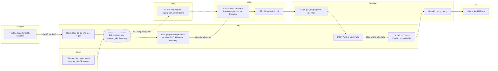
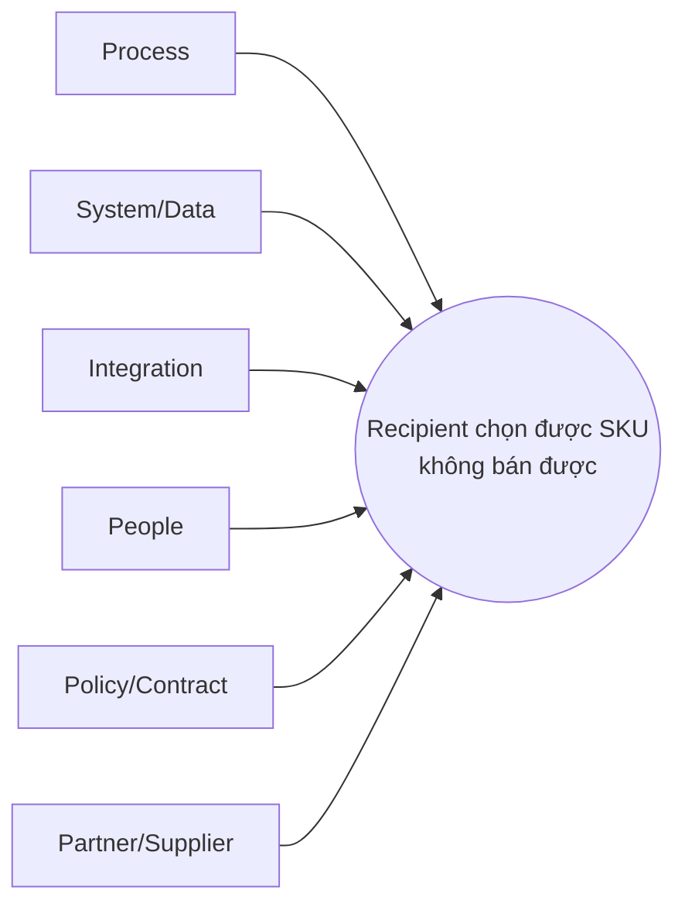
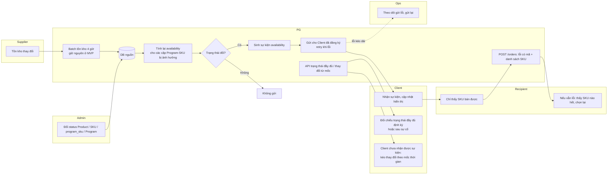
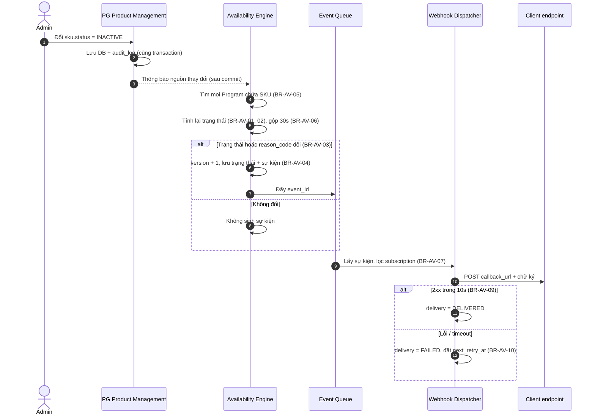
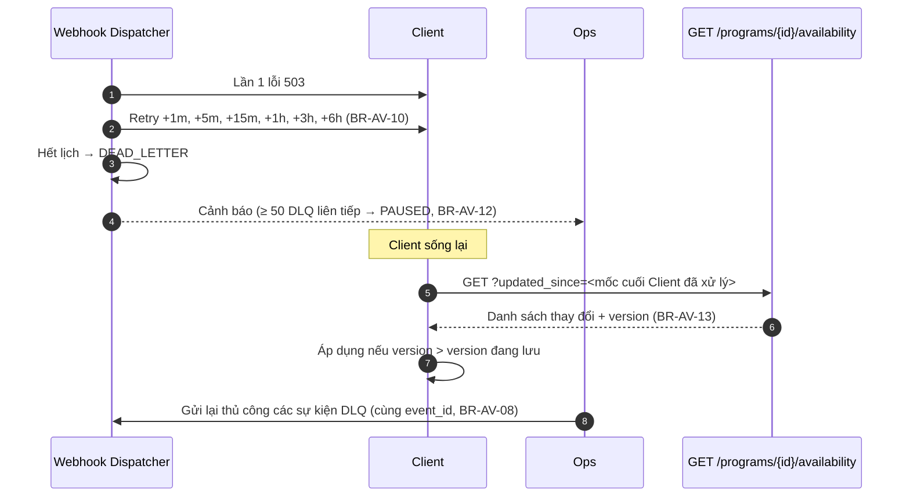
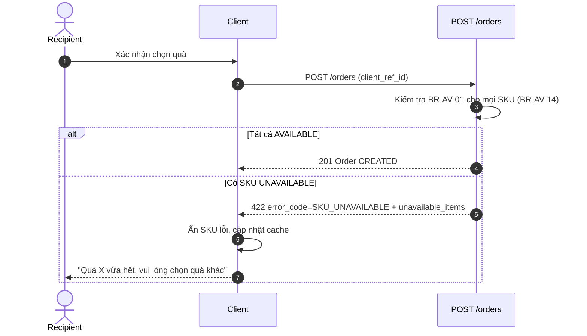
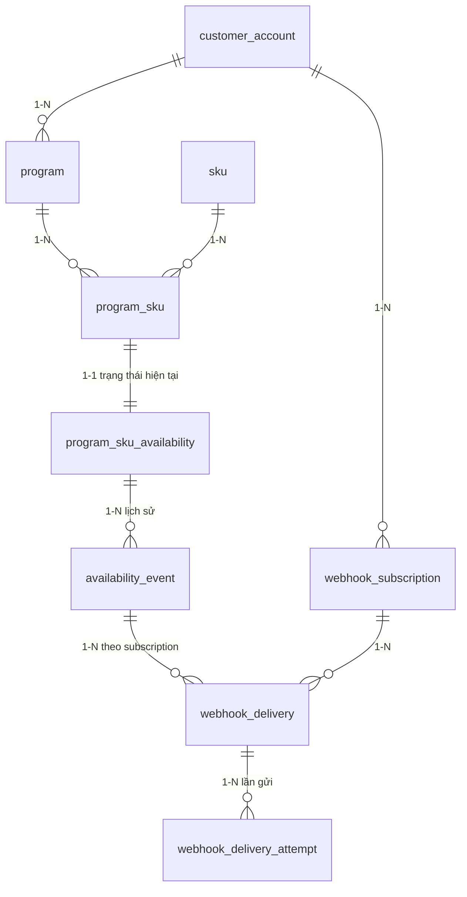
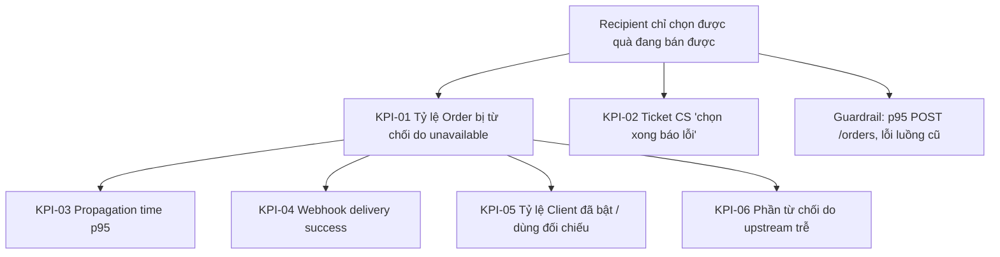

# Capstone — Day 50–56: Đồng bộ Product Availability

Capstone là bài tổng hợp cuối khóa. Bạn tự xử lý một feature từ lúc nhận yêu cầu đến lúc đo kết quả sau release, đúng như một Senior BA/PO làm trên dự án thật. Mọi entity, trạng thái, actor dùng đúng case **Physical Gift (PG)** trong `00-case-study/01-physical-gift.md`. Không tự đặt tên khác.

## Đề bài

> **Thiết kế tính năng tự động đồng bộ Product Availability từ hệ thống Product Management sang các Client bên ngoài để tránh Client hiển thị Product inactive hoặc out-of-stock.**

Đây là pain point số 1 của case PG: *"Client hiển thị Product đã INACTIVE hoặc hết hàng → Recipient chọn xong mới báo lỗi."*

Product Availability – Tình trạng có thể bán của sản phẩm: một SKU trong một Program, tại một thời điểm, Recipient có đặt được hay không.

## Cách làm Capstone

1. **Tự làm trước.** Mỗi mắt xích có *Câu hỏi gợi ý* và *Checklist*. Viết artifact của bạn ra giấy hoặc file riêng trước khi mở lời giải.
2. **Mở lời giải sau.** Lời giải của Senior nằm trong khối thu gọn `Lời giải mẫu Senior`. Chỉ mở khi bạn đã có bản nháp.
3. **So sánh, không chép.** Đánh dấu chỗ bạn khác lời giải. Khác không có nghĩa là sai. Hỏi: "Lý do của tôi có dữ liệu không? Có trade-off nào tôi chưa thấy?"
4. **Giữ một bộ hồ sơ.** Cuối Day 56 bạn có một bộ hồ sơ hoàn chỉnh: Discovery pack, Process pack, Solution & Requirement pack, System pack, Delivery pack, KPI & Review.
5. **Tự chấm.** Day 56 có rubric 0–4. Chấm thật, không chấm cho đẹp.

Thời lượng: mỗi ngày 90–120 phút. Ngày nào chưa xong thì làm tiếp hôm sau, không bỏ mắt xích.

> Quy ước: mọi số liệu, tham số, endpoint mới trong capstone là **giả định của bài tập**, ghi rõ `[Giả định bài tập]` khi xuất hiện lần đầu. Tham số trong ngoặc vuông `[ ]` là giá trị mặc định cấu hình được.

## Mục lục

| Day | Mắt xích | Deliverable |
|---|---|---|
| 50 | Đề bài & bối cảnh · Business Problem · Stakeholder · Discovery | Discovery pack: Problem Statement, Stakeholder Map + RACI, bộ câu hỏi Discovery |
| 51 | AS-IS · RCA · TO-BE | Process pack: AS-IS swimlane, Fishbone + 5 Whys, TO-BE + Gap |
| 52 | Solution Options · MVP · Scope · Business Rule | Solution decision sheet, In/Out Scope, BR Catalogue |
| 53 | Flow · API/Webhook · Error Handling | Sequence diagram, API/Webhook spec, Error Code Matrix |
| 54 | Data · User Story · Acceptance Criteria | ERD bổ sung, Data Dictionary, Story + AC G/W/T |
| 55 | Impact Analysis · UAT · Release | Impact matrix, UAT plan, Release & rollout plan |
| 56 | KPI · Final Review · Retrospective · Kế hoạch 30 ngày | Metric tree, self-assessment, plan 30 ngày |
| — | Liên hệ thực tế | So sánh với Promotion Code và Slide to Use |

Chuỗi phải đi đúng thứ tự:

```
Business Problem → Stakeholder → Discovery → AS-IS → RCA → TO-BE → Solution Options → MVP
→ Scope → Business Rule → Flow → API/Webhook → Error Handling → Data → User Story
→ Acceptance Criteria → Impact Analysis → UAT → Release → KPI
```

Mắt xích sau dùng kết quả của mắt xích trước. Nhảy cóc là lỗi phổ biến nhất của Junior: nhận đề xong viết ngay API webhook, chưa biết vấn đề nằm ở đâu.

---

## Day 50 - Đề bài, Bối cảnh, Business Problem, Stakeholder, Discovery

> Capstone · Senior · ~90–120 phút · Deliverable: Discovery pack (Problem Statement, Stakeholder Map + RACI, bộ câu hỏi Discovery có ưu tiên)

### Bối cảnh

Trong PG, Admin cấu hình Product, SKU, Supplier, Program. Đây là phần **Product Management** – quản lý danh mục sản phẩm. Client lấy danh sách quà qua `GET /programs/{id}/products`, hiển thị trên app hoặc portal của họ cho Recipient chọn, rồi gọi `POST /orders` để tạo Order.

Availability của một SKU trong một Program phụ thuộc vào năm nguồn dữ liệu do PG quản lý:

| Nguồn | Field | Ai/cái gì thay đổi nó |
|---|---|---|
| `product` | status (ACTIVE / INACTIVE) | Admin |
| `sku` | status (ACTIVE / INACTIVE / DISCONTINUED) | Admin |
| `program_sku` | is_visible | Admin |
| `program` | status (DRAFT / ACTIVE / PAUSED / ENDED) | Admin, hoặc tự động theo start_at / end_at |
| `supplier_sku` + `inventory` | is_active, available_qty, reserved_qty | Admin; Supplier đồng bộ tồn kho; Order giữ hàng (reserve) |

Hiện tại PG **không chủ động báo** cho Client khi bất kỳ nguồn nào ở trên thay đổi. Client tự quyết định lúc nào gọi lại API danh sách quà.

### Dữ liệu giả định của đề bài `[Giả định bài tập]`

| # | Dữ liệu | Giá trị |
|---|---|---|
| D1 | Số Client tích hợp qua API | 20 Client; 3 Client lớn chiếm 70% Order |
| D2 | Số Order qua API mỗi ngày | trung bình 1.200 Order/ngày |
| D3 | Tỷ lệ `POST /orders` bị từ chối do SKU không bán được | 4,8% (≈ 58 Order/ngày) trong 3 tháng gần nhất |
| D4 | Chu kỳ Client gọi lại `GET /programs/{id}/products` | 12/20 Client: 1 lần/ngày; 5 Client: mỗi 4 giờ; 3 Client: chỉ gọi khi mở Program |
| D5 | Tồn kho Supplier đồng bộ về PG | Định kỳ mỗi 4 giờ bằng batch |
| D6 | Số ticket CS liên quan "chọn quà xong báo lỗi" | 180 ticket/tháng; 40% đến từ Client, 60% từ Recipient qua Client |
| D7 | Số lần Admin đổi status Product/SKU/program_sku | ~150 lần/ngày, dồn vào 9h–11h |
| D8 | Số lần inventory về 0 hoặc có hàng lại | ~400 lần/ngày trên toàn hệ thống |
| D9 | Ops đang xử lý thủ công | Gửi email danh sách SKU ngừng bán cho Client vào thứ Hai hằng tuần |
| D10 | 2 trong 3 Client lớn đã yêu cầu "PG báo khi hết hàng" trong QBR quý trước | Có trong biên bản QBR |

Đề bài cố ý chưa nói rõ "đồng bộ" là đẩy (push) hay kéo (pull), chưa nói Client nào sẵn sàng nhận webhook. Bạn phải tự phát hiện qua Discovery.

---

### 50.1 Business Problem

#### Câu hỏi gợi ý

- Request (yêu cầu) ban đầu là gì? Vấn đề (problem) thật đằng sau là gì? Hai thứ có giống nhau không?
- Ai đang chịu thiệt? Thiệt bằng gì: Order mất, ticket CS, công Ops, uy tín với Client?
- Bằng chứng (evidence) nào chứng minh vấn đề có thật và đáng giải quyết?
- Nếu không làm gì trong 6 tháng tới, chuyện gì xảy ra?
- "Thành công" đo bằng chỉ số nào? Có baseline chưa?

#### Checklist

- [ ] Tách rõ Request – Problem – Need – Requirement.
- [ ] Problem Statement đủ 6 phần: Context, Problem, Evidence, Impact, Goal, Success Metric.
- [ ] Mỗi Impact có số hoặc nguồn số.
- [ ] Không có giải pháp (webhook, polling...) trong Problem Statement.
- [ ] Goal đo được, có mốc thời gian.

<details><summary>Lời giải mẫu Senior</summary>

**Bước 1 – Tách tầng yêu cầu**

| Tầng | Nội dung |
|---|---|
| Request | "Tự động đồng bộ Product Availability sang Client" (đề bài) và "PG báo khi hết hàng" (Client lớn, D10) |
| Problem | Client hiển thị SKU không còn bán được. Recipient chọn xong, `POST /orders` bị từ chối. |
| Need | Recipient chỉ nhìn thấy và chọn được SKU đang bán được. Client biết SKU đổi trạng thái trong thời gian đủ ngắn để không làm hỏng trải nghiệm. |
| Requirement | Được viết ở Day 52–54 (Business Rule, API, Story, AC). |

Request đã chứa sẵn giải pháp ("đồng bộ tự động"). Senior giữ request làm đầu vào, nhưng viết Problem Statement trung lập với giải pháp. Lý do: nếu khóa giải pháp ngay từ đầu, bạn sẽ không so sánh được polling, webhook hay real-time check ở Day 52.

**Bước 2 – Problem Statement**

| Phần | Nội dung |
|---|---|
| Context | 20 Client lấy danh sách quà qua `GET /programs/{id}/products` và tự lưu đệm (cache). PG không thông báo khi Product, SKU, program_sku, Program hoặc inventory thay đổi. Client làm mới danh sách theo chu kỳ riêng, phần lớn 1 lần/ngày (D4). |
| Problem | Trong khoảng thời gian giữa hai lần làm mới, Client vẫn hiển thị SKU đã INACTIVE, DISCONTINUED, bị ẩn khỏi Program hoặc hết hàng. Recipient chọn xong mới bị báo lỗi. |
| Evidence | 4,8% `POST /orders` bị từ chối do SKU không bán được (≈ 58 Order/ngày, D3). 180 ticket CS/tháng (D6). 2/3 Client lớn đã yêu cầu chính thức (D10). |
| Impact | Recipient: chọn lại hoặc bỏ cuộc. Client: mất uy tín với nhân viên/khách hàng của họ, tự gánh ticket. PG: mất Order, CS tốn công, Ops gửi email tay hằng tuần (D9). |
| Goal | Trong 3 tháng sau release, giảm tỷ lệ Order bị từ chối do SKU không bán được từ 4,8% xuống ≤ [1%] ở các Client đã bật tính năng. |
| Success Metric | (1) Tỷ lệ Order bị từ chối do unavailable. (2) Thời gian lan truyền thay đổi đến Client (propagation time). (3) Tỷ lệ gửi webhook thành công. Chi tiết ở Day 56. |

**Bước 3 – Ước tính impact để thuyết phục Management**

58 Order/ngày × 30 ngày ≈ 1.740 lần Recipient bị từ chối mỗi tháng. Không phải tất cả là mất Order: có Recipient chọn lại quà khác. Senior không tự đoán tỷ lệ chọn lại. Senior ghi thành câu hỏi Discovery (Q-D04) và đề nghị Data team đo từ log: bao nhiêu Recipient tạo được Order thành công trong [30] phút sau lần bị từ chối.

**Tại sao viết như vậy**

- Goal có số, có kỳ hạn, có phạm vi ("ở các Client đã bật tính năng"). Không có phạm vi thì KPI bị pha loãng bởi Client chưa tích hợp.
- Không ghi "0%" làm mục tiêu. Luôn có khoảng trễ giữa lúc hàng hết thật ở Supplier và lúc PG biết (D5). Target 0% là không trung thực.

**Junior hay sai ở đâu**

- Viết Problem = "Chưa có webhook đồng bộ availability". Đó là thiếu một giải pháp, không phải vấn đề.
- Bỏ phần Evidence, hoặc ghi "nhiều khiếu nại". "Nhiều" không đo được.
- Quên rằng availability có 5 nguồn. Chỉ nghĩ tới hết hàng, quên Program PAUSED hoặc `is_visible = false`.

</details>

---

### 50.2 Stakeholder

#### Câu hỏi gợi ý

- Ai ra quyết định cuối về phạm vi? Ai chịu ảnh hưởng nhưng không có quyền quyết định?
- Phía Client có những ai: người dùng business, đội kỹ thuật tích hợp, người ký hợp đồng?
- Ai thay đổi dữ liệu availability hằng ngày? Họ có biết thay đổi của họ đi tới Client không?
- Ai bị ảnh hưởng gián tiếp: CS, Finance, Supplier?
- Ai có thể chặn release: Tech Lead, Security, Client không kịp sửa code?

#### Checklist

- [ ] Liệt kê đủ actor trong case PG, đánh dấu ai liên quan, ai không.
- [ ] Power/Interest Grid có lý do cho mỗi vị trí.
- [ ] RACI cho các quyết định chính, mỗi dòng đúng một A.
- [ ] Tách Client business và Client kỹ thuật thành hai nhóm.
- [ ] Có chiến lược giao tiếp cho từng nhóm.

<details><summary>Lời giải mẫu Senior</summary>

**Bước 1 – Danh sách stakeholder và mức liên quan**

| Stakeholder | Liên quan thế nào | Mức |
|---|---|---|
| Management | Duyệt ưu tiên, nguồn lực; quan tâm Client lớn | Cao |
| Sales / AM | Nhận yêu cầu từ Client lớn (D10); truyền thông rollout | Cao |
| Client – Business owner | Chịu khiếu nại của Recipient; quyết định có bật tính năng không | Cao |
| Client – Đội kỹ thuật tích hợp | Phải viết code nhận webhook, verify chữ ký, xử lý thứ tự sự kiện | Rất cao (chặn release) |
| Recipient | Người chịu lỗi trực tiếp; không tiếp xúc PG | Gián tiếp qua Client |
| Admin | Thay đổi status Product/SKU/program_sku hằng ngày (D7) | Cao |
| Operator (Ops) | Đang gửi email tay (D9); sẽ theo dõi webhook lỗi | Cao |
| Supplier | Nguồn tồn kho (D5); độ trễ của họ giới hạn độ tươi dữ liệu | Trung bình (dependency) |
| CS (CSKH) | Nhận ticket (D6); cần biết tra cứu "Client đã nhận sự kiện chưa" | Trung bình |
| Tech Lead / Dev | Thiết kế event, hàng đợi, retry, hiệu năng | Cao |
| QC | Test bất đồng bộ, thứ tự, retry, regression API cũ | Cao |
| Finance / Kế toán | Không đổi giá, không đổi đối soát | Thấp – chỉ thông báo |
| Delivery Service | Không liên quan | Không |

Ghi "Finance: Thấp" vẫn phải ghi. Senior chứng minh đã cân nhắc, không bỏ sót.

**Bước 2 – Power/Interest Grid**

| Ô | Stakeholder | Chiến lược |
|---|---|---|
| Power cao – Interest cao | Management, Client lớn (business + kỹ thuật), Tech Lead | Quản lý chặt: workshop, review spec, sign-off |
| Power cao – Interest thấp | Security/Infra `[Giả định bài tập]` | Giữ hài lòng: review riêng phần chữ ký, secret, endpoint ra ngoài |
| Power thấp – Interest cao | Ops, CS, Admin, Client nhỏ | Thông tin thường xuyên: demo, hướng dẫn, FAQ |
| Power thấp – Interest thấp | Finance, Supplier | Theo dõi: email thông báo phạm vi |

Đội kỹ thuật của Client lớn nằm ô Power cao vì: không họ sửa code thì tính năng không có giá trị. Đây là điểm Junior thường bỏ, vì họ nghĩ "Client là khách, không phải người trong dự án".

**Bước 3 – RACI cho các quyết định chính**

| Quyết định / Việc | PO | BA | Tech Lead | QC | Ops | Sales/AM | Client kỹ thuật | Management |
|---|---|---|---|---|---|---|---|---|
| Chốt phạm vi MVP | A | R | C | C | C | C | C | I |
| Chọn giải pháp kỹ thuật | C | C | A/R | C | I | I | C | I |
| Đặc tả payload, chữ ký, retry | C | R | A | C | I | I | C | – |
| Kế hoạch rollout theo Client | A | R | C | C | C | R | C | I |
| UAT sign-off phía Client | C | R | I | C | I | C | A | – |
| Theo dõi webhook lỗi sau release | I | C | C | I | A/R | I | I | – |
| Báo cáo KPI sau 3 tháng | A | R | C | I | C | I | – | I |

Lưu ý: UAT sign-off phía Client do Client làm A. PG không thể tự ký thay cho phần hệ thống của Client.

**Junior hay sai ở đâu**

- Gộp "Client" thành một ô. Business owner của Client muốn tính năng; đội kỹ thuật của họ có thể không có sprint trống.
- Quên Admin. Admin là người tạo ra phần lớn sự kiện (D7) nhưng không biết hành động của mình làm gì với Client.
- RACI có hai A trong một dòng. Không ai chịu trách nhiệm cuối cùng.

</details>

---

### 50.3 Discovery

#### Câu hỏi gợi ý

- Bạn cần hỏi ai, hỏi gì, theo kỹ thuật nào (interview, workshop, observation, document analysis)?
- Câu nào **chặn thiết kế** nếu chưa có câu trả lời? Câu nào chỉ ảnh hưởng chi tiết?
- Dữ liệu D1–D10 có đáng tin không? Ai xác nhận?
- Có rule hoặc tính năng nào đang tồn tại dưới tên khác không?
- Client đang dùng API danh sách quà thế nào: cache bao lâu, có lọc gì không?

#### Checklist

- [ ] Ít nhất 20 câu hỏi, chia theo nhóm WHY / WHO / WHAT / WHEN / HOW / WHAT IF / DATA / SUCCESS.
- [ ] Mỗi câu có người trả lời dự kiến và mức ưu tiên (Chặn / Quan trọng / Chi tiết).
- [ ] Có ít nhất 3 hoạt động Document Analysis hoặc Observation, không chỉ phỏng vấn.
- [ ] Có kế hoạch workshop với Client kỹ thuật.
- [ ] Kết quả ghi thành Open Item có ID, có hạn trả lời.

<details><summary>Lời giải mẫu Senior</summary>

**Bước 1 – Bộ câu hỏi Discovery**

| ID | Nhóm | Câu hỏi | Hỏi ai | Ưu tiên |
|---|---|---|---|---|
| Q-D01 | WHY | Trong 4,8% Order bị từ chối, chia theo lý do: Product INACTIVE, SKU INACTIVE/DISCONTINUED, hết hàng, Program không ACTIVE, `is_visible = false` là bao nhiêu? | Data/Dev (log) | Chặn |
| Q-D02 | WHY | Tỷ lệ đó khác nhau thế nào giữa Client cache 1 ngày và Client cache 4 giờ? | Data | Chặn |
| Q-D03 | WHY | Có bao nhiêu lần bị từ chối là do hàng hết thật ở Supplier mà PG chưa biết (D5)? | Data + Ops | Chặn |
| Q-D04 | SUCCESS | Bao nhiêu Recipient tạo Order thành công trong [30] phút sau khi bị từ chối? | Data | Quan trọng |
| Q-D05 | WHO | Client nào có hạ tầng nhận webhook (endpoint public, HTTPS)? | Sales/AM → Client kỹ thuật | Chặn |
| Q-D06 | WHO | Client nào chỉ gọi API theo lịch, không thể nhận callback? | Client kỹ thuật | Chặn |
| Q-D07 | WHAT | Client cần biết gì: chỉ "bán được/không", hay cần số lượng còn lại, lý do? | Client business + kỹ thuật | Quan trọng |
| Q-D08 | WHAT | Có Client nào hiển thị "Sắp hết hàng" không? | Client business | Chi tiết |
| Q-D09 | WHAT | Hiện tại `GET /programs/{id}/products` có trả SKU INACTIVE không, hay đã lọc? | Dev + Document Analysis | Chặn |
| Q-D10 | WHAT | `POST /orders` hiện từ chối với mã lỗi gì? Có liệt kê SKU nào lỗi không? | Dev + API doc | Chặn |
| Q-D11 | WHEN | Program tự đổi sang ENDED đúng giờ `end_at` hay chạy job? Job chạy mấy giờ? | Dev | Quan trọng |
| Q-D12 | WHEN | Client chấp nhận độ trễ tối đa bao lâu từ lúc SKU ngừng bán đến lúc ẩn trên app? | Client business | Chặn |
| Q-D13 | HOW | Client đang cache danh sách quà ở đâu, bao lâu, làm mới thế nào? | Client kỹ thuật | Quan trọng |
| Q-D14 | HOW | Email thứ Hai của Ops (D9) gồm những gì? Client làm gì với email đó? | Ops (Observation) | Quan trọng |
| Q-D15 | HOW | Tồn kho Supplier về PG qua batch 4 giờ: Supplier nào có API tồn kho real-time? | Tech Lead + Supplier | Quan trọng |
| Q-D16 | WHAT IF | Admin bật/tắt cùng một SKU nhiều lần trong vài phút thì Client nhận bao nhiêu sự kiện? | PO + Tech Lead | Quan trọng |
| Q-D17 | WHAT IF | Endpoint của Client chết 1 ngày thì sao? Có cần bù lại khi họ sống lại? | Tech Lead + Client kỹ thuật | Chặn |
| Q-D18 | WHAT IF | Sự kiện đến sai thứ tự (cũ đến sau mới) thì Client xử lý thế nào? | Tech Lead | Chặn |
| Q-D19 | WHAT IF | Recipient đang ở bước xác nhận đơn đúng lúc SKU hết hàng thì sao? | PO | Quan trọng |
| Q-D20 | DATA | Ai là owner của dữ liệu availability? Có audit log khi Admin đổi status chưa? | Admin + Dev | Quan trọng |
| Q-D21 | DATA | Một SKU có nhiều Supplier: SKU hết hàng nghĩa là hết ở **tất cả** `supplier_sku` đang active? | PO + Dev | Chặn |
| Q-D22 | DATA | `reserved_qty` có tính vào tồn kho bán được không? | Dev | Chặn |
| Q-D23 | SUCCESS | Client lớn đo thành công bằng gì: ít ticket hơn, ít lỗi đặt hàng hơn? | Client business | Quan trọng |
| Q-D24 | WHO | Hợp đồng/API doc hiện có cam kết gì về độ tươi dữ liệu không? | Sales/AM + Document Analysis | Chi tiết |

**Bước 2 – Kỹ thuật elicitation**

| Hoạt động | Mục đích | Đầu ra |
|---|---|---|
| Document Analysis: API doc `GET /programs/{id}/products`, `POST /orders`, webhook `order.status_changed` | Biết hành vi hiện tại, chuẩn webhook PG đang dùng (chữ ký, retry) | Trả lời Q-D09, Q-D10; tái dùng chuẩn webhook có sẵn |
| Data analysis: log từ chối Order 3 tháng | Phân rã 4,8% theo lý do và theo Client | Trả lời Q-D01–Q-D04 |
| Observation: ngồi cạnh Ops một buổi sáng thứ Hai | Hiểu email tay được làm thế nào, mất bao lâu | Trả lời Q-D14, đo công Ops |
| Interview: 3 Client lớn (business + kỹ thuật cùng buổi) | Năng lực nhận webhook, độ trễ chấp nhận được | Trả lời Q-D05–Q-D07, Q-D12, Q-D13 |
| Workshop nội bộ: PO, Tech Lead, QC, Ops | Thống nhất định nghĩa "bán được" và các WHAT IF | Trả lời Q-D16–Q-D22 |

Senior đặt Document Analysis trước interview. Lý do: PG đã có webhook `order.status_changed`. Nếu chuẩn chữ ký, retry đã có, tái dùng sẽ giảm việc cho cả PG và Client. Client đã viết code nhận `order.status_changed` thì chỉ cần thêm một loại sự kiện.

**Bước 3 – Kết quả Discovery (giả lập để dùng cho các ngày sau)** `[Giả định bài tập]`

| ID | Kết luận |
|---|---|
| Q-D01 | Hết hàng 55%; SKU INACTIVE/DISCONTINUED 20%; Product INACTIVE 10%; `is_visible = false` 8%; Program không ACTIVE 7% |
| Q-D02 | Client cache 1 ngày: tỷ lệ từ chối 6,1%. Client cache 4 giờ: 2,9% |
| Q-D03 | Khoảng 1/3 ca hết hàng là do Supplier đã hết nhưng PG chưa nhận batch |
| Q-D05 | 3/3 Client lớn và 5 Client nhỏ nhận được webhook (đã nhận `order.status_changed`) |
| Q-D06 | 12 Client còn lại chỉ gọi API theo lịch |
| Q-D07 | Client cần trạng thái + lý do. Không Client nào yêu cầu số lượng chính xác |
| Q-D09 | API danh sách quà đã lọc SKU INACTIVE nhưng **không lọc hết hàng** |
| Q-D10 | `POST /orders` trả HTTP 422 với message chung "Product not available", không có mã lỗi riêng, không chỉ ra SKU nào |
| Q-D12 | Client lớn chấp nhận ≤ 5 phút |
| Q-D17 | Client lớn yêu cầu có cách lấy lại toàn bộ trạng thái sau sự cố |
| Q-D21 | Đúng: SKU bán được nếu còn ít nhất một `supplier_sku` active có hàng |
| Q-D22 | `reserved_qty` là hàng đã giữ cho Order chưa xác nhận; không được bán tiếp |

Các câu chưa trả lời (Q-D04, Q-D08, Q-D15, Q-D19, Q-D23, Q-D24) chuyển thành Open Item, có owner và hạn.

**Junior hay sai ở đâu**

- Chỉ hỏi Client "có muốn webhook không". Câu này luôn được trả lời "có", nhưng không cho bạn biết họ có làm được không.
- Không đọc API doc hiện có. Bỏ lỡ việc `POST /orders` trả lỗi chung chung (Q-D10). Đây là một nửa vấn đề: kể cả khi đã đồng bộ, lúc lỗi vẫn phải nói rõ SKU nào lỗi.
- Không hỏi Q-D21 và Q-D22. Định nghĩa "hết hàng" sai thì mọi thứ sau đều sai.

</details>

---

## Day 51 - AS-IS, RCA, TO-BE

> Capstone · Senior · ~90–120 phút · Deliverable: Process pack (AS-IS swimlane + Pain Point, Fishbone + 5 Whys, TO-BE + Gap table)

Hôm nay bạn chứng minh vấn đề nằm ở đâu trong quy trình, trước khi nghĩ giải pháp. AS-IS – quy trình hiện tại; RCA (Root Cause Analysis) – phân tích nguyên nhân gốc; TO-BE – quy trình mong muốn.

---

### 51.1 AS-IS

#### Câu hỏi gợi ý

- Từ lúc Admin đổi status (hoặc Supplier hết hàng) đến lúc Recipient thấy thay đổi, dữ liệu đi qua những bước nào?
- Bước nào là thủ công? Bước nào có độ trễ? Độ trễ bao lâu?
- Có bao nhiêu "điểm bắt đầu" khác nhau của một thay đổi availability?
- Khi `POST /orders` bị từ chối, ai biết, ai xử lý tiếp?
- Email thứ Hai của Ops nằm ở đâu trong quy trình?

#### Checklist

- [ ] Swimlane có đủ lane: Admin, Supplier, PG, Client, Recipient, Ops, CS.
- [ ] Ghi rõ độ trễ ở mỗi bước có chờ.
- [ ] Đánh dấu Pain Point bằng ID, mỗi Pain Point gắn với evidence.
- [ ] Có cả luồng "Recipient bị từ chối" chứ không chỉ luồng thành công.
- [ ] Không vẽ giải pháp vào AS-IS.

<details><summary>Lời giải mẫu Senior</summary>

**Bước 1 – Năm điểm bắt đầu (trigger) của một thay đổi availability**

| Trigger | Nguồn | Tần suất (D7, D8) |
|---|---|---|
| T1 | Admin đổi `product.status` | trong ~150 lần/ngày thao tác Admin |
| T2 | Admin đổi `sku.status` | như trên |
| T3 | Admin đổi `program_sku.is_visible` | như trên |
| T4 | `program.status` đổi (Admin hoặc tự động theo `end_at`) | ít, theo Program |
| T5 | `inventory` về 0 hoặc có hàng lại; `supplier_sku.is_active` đổi | ~400 lần/ngày |

Senior liệt kê trigger trước khi vẽ. Thiếu một trigger thì giải pháp sau này sẽ thiếu một nguồn sự kiện. T4 là trigger Junior hay quên nhất, vì nó có thể xảy ra tự động, không ai bấm nút.

**Bước 2 – AS-IS swimlane**



**Bước 3 – Pain Point**

| ID | Pain Point | Vị trí | Evidence |
|---|---|---|---|
| PP-01 | Client không biết khi availability thay đổi; chỉ biết khi tự làm mới | PG → Client | D4, Q-D02 |
| PP-02 | API danh sách quà không lọc SKU hết hàng | PG | Q-D09 |
| PP-03 | Lỗi từ chối Order chung chung, không chỉ SKU nào, không có mã lỗi riêng | PG → Client → Recipient | Q-D10 |
| PP-04 | Tồn kho từ Supplier trễ tới 4 giờ | Supplier → PG | D5, Q-D03 |
| PP-05 | Ops gửi email tay hằng tuần, Client cập nhật thủ công | Ops | D9, Q-D14 |
| PP-06 | CS không có công cụ biết SKU nào đổi trạng thái lúc nào | CS | D6 |
| PP-07 | Recipient mất công nhập địa chỉ rồi mới bị từ chối | Recipient | D3, D6 |

**Tính độ trễ end-to-end hiện tại (trường hợp xấu nhất)**

Hết hàng ở Supplier → PG biết: tối đa 4 giờ. PG biết → Client làm mới: tối đa 24 giờ (Client cache 1 ngày). Tổng: tới **28 giờ**. Với SKU do Admin tắt: tới 24 giờ. Con số này giải thích vì sao Client cache 1 ngày có tỷ lệ lỗi gấp đôi (Q-D02).

**Junior hay sai ở đâu**

- Vẽ AS-IS chỉ có luồng thành công. Pain point nằm ở nhánh bị từ chối.
- Bỏ lane Ops và CS, vì "họ không phải hệ thống". Email tay của Ops là bằng chứng nhu cầu đã có từ lâu.
- Không ghi thời gian chờ. AS-IS không có độ trễ thì không tính được target propagation time ở Day 56.

</details>

---

### 51.2 RCA

#### Câu hỏi gợi ý

- Vì sao Recipient chọn được SKU không bán được? Hỏi tiếp "vì sao" đến khi ra nguyên nhân bạn có thể tác động.
- Có bao nhiêu nguyên nhân độc lập? Nguyên nhân nào chiếm tỷ trọng lớn nhất (dùng Q-D01, Q-D03)?
- Nguyên nhân nào nằm ngoài quyền kiểm soát của PG?
- Nếu chỉ sửa một nguyên nhân, bao nhiêu phần trăm vấn đề còn lại?

#### Checklist

- [ ] Fishbone có ít nhất 5 nhánh (Process, System/Data, Integration, People, Policy, Partner).
- [ ] 5 Whys cho ít nhất 2 chuỗi khác nhau.
- [ ] Mỗi Root Cause gắn với dữ liệu tỷ trọng.
- [ ] Phân loại Root Cause: trong tầm kiểm soát / ngoài tầm kiểm soát / phụ thuộc.
- [ ] Không dừng ở triệu chứng ("Client cache lâu").

<details><summary>Lời giải mẫu Senior</summary>

**Bước 1 – Fishbone**



| Nhánh | Nguyên nhân |
|---|---|
| Process | Thông báo thay đổi cho Client làm thủ công, hằng tuần (PP-05) |
| System/Data | API danh sách quà không lọc hết hàng (PP-02); không có khái niệm "availability" tổng hợp từ 5 nguồn, mỗi nơi tự kiểm tra |
| Integration | PG không có cơ chế đẩy thay đổi; Client phải tự kéo (PP-01); lỗi Order không có mã lỗi riêng (PP-03) |
| People | Admin không biết tắt SKU giữa ngày sẽ làm Client hiển thị sai đến hôm sau |
| Policy/Contract | API doc không cam kết độ tươi dữ liệu, không hướng dẫn chu kỳ làm mới (Q-D24) |
| Partner/Supplier | Tồn kho Supplier về trễ 4 giờ (PP-04) |

**Bước 2 – 5 Whys, chuỗi A (SKU hết hàng – 55% ca lỗi)**

1. Vì sao Recipient chọn được SKU hết hàng? → Vì Client vẫn hiển thị SKU đó.
2. Vì sao Client vẫn hiển thị? → Vì danh sách Client cache chưa làm mới, và kể cả khi làm mới, API cũng không lọc hết hàng.
3. Vì sao API không lọc hết hàng? → Vì API chỉ đọc status, không đọc inventory. Thiết kế ban đầu coi tồn kho là việc của bước đặt hàng.
4. Vì sao Client không làm mới thường xuyên hơn? → Vì Client không biết khi nào có thay đổi; gọi liên tục thì tốn tài nguyên cả hai bên.
5. Vì sao Client không biết? → **Vì PG không phát ra sự kiện khi availability thay đổi.** (Root Cause RC-01)

Và một nhánh phụ: kể cả PG phát sự kiện ngay, 1/3 ca hết hàng là do PG chưa nhận batch từ Supplier (Q-D03). → **RC-03: tồn kho upstream trễ 4 giờ.**

**Bước 3 – 5 Whys, chuỗi B (Recipient bỏ cuộc sau khi bị từ chối)**

1. Vì sao Recipient bỏ cuộc? → Vì nhận lỗi chung chung, không biết phải làm gì.
2. Vì sao lỗi chung chung? → Vì Client chỉ nhận được "Product not available" với HTTP 422.
3. Vì sao Client không hiện lỗi cụ thể hơn? → Vì PG không trả mã lỗi riêng và không chỉ ra SKU nào.
4. Vì sao PG không trả? → Vì đặc tả `POST /orders` ban đầu chỉ có một nhánh lỗi cho mọi trường hợp không bán được.
5. → **RC-02: Error contract của `POST /orders` không đủ thông tin cho Client tự phục hồi.**

**Bước 4 – Bảng Root Cause**

| ID | Root Cause | Tỷ trọng ước tính | Kiểm soát |
|---|---|---|---|
| RC-01 | PG không phát sự kiện khi availability thay đổi; Client chỉ kéo theo chu kỳ dài | ≈ 2/3 ca lỗi (phần PG đã biết mà Client chưa biết) | Trong tầm kiểm soát PG, nhưng cần Client sửa code |
| RC-02 | Error contract của `POST /orders` không có mã lỗi riêng, không chỉ SKU | Không giảm số lỗi, nhưng quyết định Recipient có phục hồi được không | Trong tầm kiểm soát PG |
| RC-03 | Tồn kho Supplier về PG trễ tới 4 giờ | ≈ 1/3 ca hết hàng (≈ 18% tổng ca lỗi) | Phụ thuộc Supplier |
| RC-04 | API danh sách quà không lọc hết hàng | Làm RC-01 nặng thêm khi Client làm mới | Trong tầm kiểm soát PG |

**Kết luận dẫn sang TO-BE:** Chỉ sửa RC-01 và RC-04 vẫn còn khoảng 18% ca lỗi do RC-03. Vì vậy target ở Day 50 là ≤ 1%, không phải 0%, và MVP phải có thêm RC-02 để xử lý phần còn lại cho tử tế.

**Junior hay sai ở đâu**

- Dừng ở "Client cache 24 giờ" và đề xuất "yêu cầu Client giảm cache". Đó là chuyển vấn đề sang người khác, không giải quyết được gốc: Client không biết lúc nào nên làm mới.
- Bỏ RC-03 vì "không phải việc của mình". Không ghi nó thì không giải thích được vì sao KPI không về 0.
- Fishbone đủ nhánh nhưng không có tỷ trọng. Không biết sửa cái nào trước.

</details>

---

### 51.3 TO-BE

#### Câu hỏi gợi ý

- Mỗi Root Cause được xử lý ở bước nào trong TO-BE?
- Bước thủ công nào biến mất? Bước nào mới xuất hiện?
- Ai vận hành bước mới (VD: theo dõi webhook lỗi)?
- TO-BE có đòi hỏi Client thay đổi không? Client không đổi thì còn hưởng lợi gì?
- Gap giữa AS-IS và TO-BE là gì, theo từng chiều: process, system, data, people?

#### Checklist

- [ ] TO-BE xử lý từng RC, có bảng truy vết RC → bước TO-BE.
- [ ] TO-BE trung lập với công nghệ chi tiết (chưa chọn webhook hay polling ở bước này cũng được, nhưng nêu năng lực cần có).
- [ ] Có nhánh cho Client không thể đổi code.
- [ ] Gap table có owner.
- [ ] Ghi rõ RC nào không xử lý trong phạm vi và vì sao.

<details><summary>Lời giải mẫu Senior</summary>

**Bước 1 – Năng lực (capability) TO-BE cần có**

| Capability | Xử lý RC | Mô tả |
|---|---|---|
| CAP-1 Tính availability tập trung | RC-01, RC-04 | PG tính một trạng thái availability duy nhất cho mỗi cặp (Program, SKU) từ 5 nguồn |
| CAP-2 Phát hiện thay đổi | RC-01 | Mỗi khi một trong 5 nguồn đổi, PG tính lại; nếu trạng thái đổi thì sinh sự kiện |
| CAP-3 Thông báo cho Client | RC-01 | Client nhận được thay đổi trong ≤ [5] phút (Q-D12) |
| CAP-4 Lấy lại trạng thái đầy đủ | RC-01 | Client lấy được trạng thái hiện tại của cả Program bất kỳ lúc nào (Q-D17) |
| CAP-5 Error contract rõ | RC-02 | Lỗi đặt hàng có mã lỗi riêng và danh sách SKU lỗi |
| CAP-6 Danh sách quà phản ánh tồn kho | RC-04 | API danh sách quà trả availability của từng SKU |
| CAP-7 Quan sát được | PP-05, PP-06 | Ops và CS tra cứu được sự kiện nào đã gửi cho Client nào, kết quả ra sao |

**Bước 2 – TO-BE swimlane**



**Bước 3 – Gap table**

| Chiều | AS-IS | TO-BE | Gap | Owner |
|---|---|---|---|---|
| Process | Ops email tay thứ Hai | Không cần email; Ops theo dõi bảng gửi lỗi | Bỏ việc cũ, thêm việc mới cho Ops | PO + Ops |
| System | Không có trạng thái availability tổng hợp | Có bảng trạng thái hiện tại + version | Build mới | Tech Lead |
| System | Không phát sự kiện | Phát sự kiện, gửi có retry | Build mới, tái dùng hạ tầng `order.status_changed` | Tech Lead |
| Integration | Client chỉ kéo full danh sách | Client nhận đẩy + kéo đối chiếu | Client phải sửa code | Client kỹ thuật + Sales/AM |
| Integration | `POST /orders` lỗi chung | Lỗi có mã + SKU | Thay đổi contract, phải giữ tương thích ngược | Tech Lead + BA |
| Data | Không có lịch sử thay đổi availability | Lưu sự kiện, lịch sử gửi | Bảng mới, retention | BA + Dev |
| People | Admin không biết tác động | Màn Admin hiển thị "thay đổi này sẽ thông báo tới N Client" `[Giả định bài tập]` | Có thể để Phase 2 | PO |

**Bước 4 – RC không xử lý trong phạm vi**

RC-03 (tồn kho Supplier trễ 4 giờ) không xử lý trong capstone này. Lý do: phụ thuộc năng lực API của từng Supplier (Q-D15 chưa có câu trả lời). Ghi thành dependency và đề xuất Phase 2: rút chu kỳ batch hoặc nhận webhook tồn kho từ Supplier (dòng "Đồng bộ tồn kho Supplier → PG" trong bảng Integration của case). TO-BE được thiết kế để khi upstream nhanh hơn, downstream không phải sửa gì: mọi thay đổi inventory đều đi qua cùng CAP-2.

**Junior hay sai ở đâu**

- Vẽ TO-BE chỉ có "PG gửi webhook → Client cập nhật". Thiếu CAP-4: webhook có thể mất, Client phải có cách đối chiếu.
- Quên Client không nhận được webhook (12/20 Client, Q-D06). TO-BE không có nhánh cho họ thì 60% Client không được lợi gì.
- Không có bước "Trạng thái đổi?". Gửi sự kiện cho mọi lần thay đổi số lượng sẽ làm ngập Client (D8: ~400 lần/ngày chỉ tính lúc về 0 hoặc có lại; mọi lần đổi số lượng còn nhiều hơn rất nhiều).

</details>

---

## Day 52 - Solution Options, MVP, Scope, Business Rule

> Capstone · Senior · ~90–120 phút · Deliverable: Solution decision sheet, MVP, In/Out Scope, Business Rule Catalogue

---

### 52.1 Solution Options

#### Câu hỏi gợi ý

- Có những phương án nào? Kể cả phương án "gần như không build gì"?
- So sánh theo tiêu chí nào: latency (độ trễ), traffic (lưu lượng), complexity (độ phức tạp), backward compatibility (tương thích ngược), failure recovery (phục hồi khi lỗi)?
- Phương án nào phục vụ được cả 8 Client nhận webhook và 12 Client chỉ kéo?
- Phương án nào xử lý được RC-03 (dữ liệu upstream trễ)?

#### Checklist

- [ ] Ít nhất 5 phương án, có phương án tối thiểu.
- [ ] Bảng so sánh có thang điểm và lý do.
- [ ] Mỗi phương án nêu rõ Client phải làm gì.
- [ ] Ghi quyết định vào Decision Log: chọn gì, bỏ gì, vì sao, ai quyết.

<details><summary>Lời giải mẫu Senior</summary>

**Bước 1 – Năm phương án**

| ID | Phương án | Mô tả ngắn |
|---|---|---|
| OPT-1 | Manual refresh | Giữ nguyên, chỉ khuyến nghị Client làm mới mỗi [1] giờ và thêm lọc hết hàng vào API danh sách quà |
| OPT-2 | Polling theo mốc | PG thêm API trả các thay đổi availability kể từ một mốc (`updated_since`); Client gọi mỗi [1–5] phút |
| OPT-3 | Webhook / Event | PG đẩy sự kiện `product_availability.changed` tới callback URL Client đăng ký |
| OPT-4 | Real-time check khi đặt hàng | Client gọi API kiểm tra availability ngay trước khi Recipient xác nhận; `POST /orders` trả lỗi chi tiết |
| OPT-5 | Kết hợp | OPT-3 cho Client nhận được webhook + OPT-2 làm kênh đối chiếu và kênh chính cho Client chỉ kéo + phần lỗi chi tiết của OPT-4 làm lớp bảo vệ cuối |

**Bước 2 – Bảng so sánh** (1 = kém, 5 = tốt)

| Tiêu chí | OPT-1 | OPT-2 | OPT-3 | OPT-4 | OPT-5 |
|---|---|---|---|---|---|
| Latency tới Client | 1 (≤ 1 giờ nếu Client tuân thủ) | 3 (bằng chu kỳ poll) | 5 (giây đến phút) | 4 (đúng lúc đặt, nhưng danh sách vẫn sai) | 5 |
| Traffic | 3 (full list mỗi giờ) | 3 (nhiều lần gọi rỗng) | 5 (chỉ gửi khi đổi) | 3 (thêm 1 call mỗi Order) | 4 |
| Complexity phía PG | 5 | 4 | 2 (queue, retry, chữ ký, DLQ) | 4 | 2 |
| Complexity phía Client | 5 | 3 | 2 (endpoint public, verify chữ ký, thứ tự) | 3 | 2–3 (Client chọn kênh) |
| Backward compatibility | 5 | 5 (API mới, không đổi API cũ) | 5 (opt-in) | 3 (đổi error contract, phải giữ cũ) | 4 |
| Failure recovery | 2 | 4 (Client tự kéo lại từ mốc) | 2 nếu đứng một mình (mất sự kiện = lệch mãi) | 4 | 5 (webhook lỗi → đối chiếu bằng OPT-2) |
| Phục vụ 12 Client chỉ kéo | Có | Có | Không | Có | Có |
| Xử lý được RC-03 | Không | Không | Không | Không hoàn toàn (PG cũng chưa biết) | Không – cần Phase 2 upstream |

**Bước 3 – Quyết định**

Chọn **OPT-5**, triển khai theo lớp. Decision Log:

| ID | Ngày | Quyết định | Lý do | Phương án loại | Người quyết |
|---|---|---|---|---|---|
| DEC-01 | `[Giả định bài tập]` | Chọn OPT-5 | Webhook đáp ứng ≤ 5 phút cho Client lớn (Q-D12); polling cho 12 Client chỉ kéo; lỗi chi tiết là lưới an toàn cho phần RC-03 còn lại | OPT-1: không đạt latency. OPT-3 đơn lẻ: không có phục hồi. OPT-4 đơn lẻ: danh sách vẫn sai, Recipient vẫn chọn rồi mới biết | PO (A), Tech Lead (C) |
| DEC-02 | – | Không đẩy số lượng tồn kho, chỉ đẩy trạng thái + lý do | Q-D07: Client không cần; số lượng đổi liên tục làm tăng sự kiện gấp nhiều lần; lộ dữ liệu kinh doanh của Supplier | Đẩy `available_qty` | PO |

**Tại sao không chọn webhook đơn lẻ dù latency tốt nhất?** Webhook là giao hàng "tối thiểu một lần, có thể mất". Endpoint Client chết vài giờ, retry hết hạn, sự kiện vào DLQ – Client lệch trạng thái cho tới khi có thay đổi tiếp theo. Một hệ thống đồng bộ không có kênh đối chiếu là hệ thống lệch dần.

**Junior hay sai ở đâu**

- Chỉ so sánh webhook vs polling. Bỏ qua OPT-4, trong khi lỗi chi tiết là phần rẻ nhất và giúp ngay cả Client chưa tích hợp gì.
- Chấm điểm theo cảm tính, không ghi lý do.
- Quên cột "Client phải làm gì". Giải pháp tốt mà Client không làm được thì giá trị bằng 0.

</details>

---

### 52.2 MVP

#### Câu hỏi gợi ý

- Phần nhỏ nhất nào của OPT-5 vẫn chứng minh được giả thuyết "Client biết sớm → ít Order bị từ chối"?
- Giả thuyết (hypothesis) cần kiểm chứng là gì? Đo bằng gì?
- Pilot với Client nào? Vì sao?
- Phần nào để Phase 2 mà không làm hỏng MVP?

#### Checklist

- [ ] Có hypothesis viết dạng "Chúng tôi tin rằng... sẽ... đo bằng...".
- [ ] MVP liệt kê Must / Should / Could / Won't (MoSCoW).
- [ ] Mỗi Must truy ngược về RC hoặc CAP.
- [ ] Có tiêu chí "MVP thành công thì làm tiếp, thất bại thì dừng".

<details><summary>Lời giải mẫu Senior</summary>

**Hypothesis**

> Chúng tôi tin rằng nếu Client nhận thay đổi availability trong ≤ 5 phút và lỗi đặt hàng chỉ rõ SKU nào không bán được, thì tỷ lệ Order bị từ chối do unavailable ở Client pilot giảm từ mức baseline của Client đó xuống ≤ 1% trong 8 tuần, đo bằng log `POST /orders`.

**MoSCoW**

| Mức | Hạng mục | Truy vết |
|---|---|---|
| Must | Tính availability tập trung cho (Program, SKU) từ 5 nguồn, có version | CAP-1, CAP-2, RC-01 |
| Must | Webhook `product_availability.changed`: chữ ký, event_id, version, retry, DLQ | CAP-3, RC-01 |
| Must | API đối chiếu: snapshot đầy đủ theo Program và thay đổi kể từ mốc | CAP-4, RC-01 |
| Must | `POST /orders` trả mã lỗi `SKU_UNAVAILABLE` + danh sách SKU + lý do, giữ HTTP 422 | CAP-5, RC-02 |
| Must | Feature flag theo Client; đăng ký webhook do Admin cấu hình | Release an toàn |
| Must | Màn tra cứu lịch sử gửi + gửi lại thủ công cho Ops | CAP-7 |
| Should | API danh sách quà trả `availability_status` cho từng SKU | CAP-6, RC-04 |
| Could | Client tự đăng ký webhook qua API | Giảm việc Ops |
| Could | Admin thấy cảnh báo "thay đổi này ảnh hưởng N Program" | People gap |
| Won't (MVP) | Đẩy số lượng tồn kho; trạng thái "sắp hết hàng" | DEC-02, Q-D08 |
| Won't (MVP) | Rút ngắn đồng bộ tồn kho Supplier → PG | RC-03, Phase 2 |

**Pilot:** 1 Client lớn đã nhận `order.status_changed` + 1 Client nhỏ chỉ kéo `[Giả định bài tập]`. Lý do: kiểm chứng cả hai kênh; Client lớn có lượng Order đủ để thấy thay đổi KPI trong 8 tuần.

**Tiêu chí go/no-go sau pilot**

| Kết quả | Hành động |
|---|---|
| Tỷ lệ từ chối ≤ 1% và webhook delivery success ≥ 99,5% | Mở rộng theo kế hoạch Day 55 |
| Tỷ lệ từ chối giảm nhưng > 1% | Phân rã theo lý do; nếu phần còn lại chủ yếu do RC-03 thì ưu tiên Phase 2 upstream |
| Tỷ lệ từ chối không giảm | Dừng mở rộng, kiểm tra Client có xử lý sự kiện đúng không |

**Junior hay sai ở đâu**

- Đưa "Client tự đăng ký webhook qua API" vào Must. Với 8 Client, Admin cấu hình tay nhanh hơn build màn self-service.
- Bỏ màn tra cứu cho Ops ra khỏi MVP. Không có nó, ngày đầu tiên có Client kêu "không nhận được" là cả team phải đọc log.

</details>

---

### 52.3 Scope

#### Câu hỏi gợi ý

- Kênh, API, màn hình, dữ liệu nào thay đổi? Cái nào giữ nguyên?
- Assumption (giả định), Constraint (ràng buộc), Dependency (phụ thuộc) là gì?
- Những gì người khác **sẽ nghĩ** là có trong scope nhưng thực ra không?

#### Checklist

- [ ] Bảng scope theo từng thành phần: thay đổi / giữ nguyên / ngoài phạm vi.
- [ ] Out of Scope có lý do.
- [ ] Assumption có cách kiểm chứng; Dependency có owner.
- [ ] Constraint có nguồn.

<details><summary>Lời giải mẫu Senior</summary>

| Thành phần | Phase này |
|---|---|
| Logic tính availability (Program, SKU) | Build mới |
| Webhook `product_availability.changed` | Build mới |
| `GET /programs/{id}/availability` (snapshot + thay đổi từ mốc) | Build mới |
| `POST /orders` | Thay đổi một phần: thêm `error_code`, `unavailable_items`; giữ HTTP 422 và `message` cũ |
| `GET /programs/{id}/products` | Thay đổi một phần (Should): thêm field `availability_status`, không bỏ field cũ |
| Webhook `order.status_changed` | Giữ nguyên; dùng chung hạ tầng ký và retry |
| Màn Admin: cấu hình subscription, feature flag | Build mới |
| Màn Ops: lịch sử gửi, gửi lại | Build mới |
| Batch đồng bộ tồn kho Supplier → PG | Giữ nguyên |
| Đối soát, báo cáo Finance | Giữ nguyên |

**Out of Scope:** đẩy số lượng tồn kho (DEC-02); trạng thái "sắp hết hàng" (Q-D08 chưa có nhu cầu); rút ngắn đồng bộ upstream (RC-03, Phase 2); Client tự đăng ký webhook (Could); thay đổi UI phía Client (thuộc Client).

**Assumption**

| ID | Giả định | Kiểm chứng |
|---|---|---|
| AS-01 | Client pilot sửa được code trong 4 tuần | Xác nhận bằng email của Client kỹ thuật trước sprint 1 |
| AS-02 | Hạ tầng ký + retry của `order.status_changed` tái dùng được | Tech Lead spike 2 ngày |
| AS-03 | Lưu lượng sự kiện đỉnh ≤ [500] sự kiện/phút | Ước tính từ D7, D8 × số Program chứa SKU; Dev đo trên dữ liệu thật |

**Constraint:** không đổi HTTP status và field cũ của API đang chạy; secret webhook không gửi qua email thường `[Giả định bài tập]`.

**Dependency:** Client pilot (code nhận webhook) – owner Sales/AM; Security review chữ ký và endpoint ra ngoài – owner Tech Lead.

**Junior hay sai ở đâu:** không ghi "Batch Supplier giữ nguyên". Sau release, Client vẫn gặp hàng hết mà PG chưa biết, và mọi người hỏi "sao đã đồng bộ rồi vẫn lỗi?". Ghi rõ từ đầu là cách quản lý kỳ vọng rẻ nhất.

</details>

---

### 52.4 Business Rule

#### Câu hỏi gợi ý

- "Bán được" được định nghĩa chính xác thế nào? Công thức có dùng `reserved_qty` không?
- Khi nào sinh sự kiện, khi nào không?
- Thay đổi nhanh liên tiếp (flapping – bật tắt liên tục) xử lý thế nào?
- Một SKU thay đổi thì những Program nào bị ảnh hưởng?
- Nhiều lý do cùng lúc (Product INACTIVE và hết hàng) thì báo lý do nào?

#### Checklist

- [ ] Mỗi rule có ID, atomic, testable, có tham số `[ ]` khi cần.
- [ ] Có rule cho thứ tự ưu tiên lý do.
- [ ] Có rule cho đăng ký, gửi, retry, đối chiếu.
- [ ] Mỗi rule có nguồn (Discovery ID hoặc Decision ID).

<details><summary>Lời giải mẫu Senior</summary>

**Business Rule Catalogue – Product Availability**

| ID | Rule | Nguồn |
|---|---|---|
| BR-AV-01 | Một cặp (Program, SKU) là `AVAILABLE` khi và chỉ khi thỏa **đồng thời**: `program.status = ACTIVE`; `program_sku.is_visible = true`; `product.status = ACTIVE`; `sku.status = ACTIVE`; tồn tại ít nhất một `supplier_sku` có `is_active = true` và `inventory.available_qty − inventory.reserved_qty > [0]`. Ngược lại là `UNAVAILABLE`. | Q-D21, Q-D22 |
| BR-AV-02 | Khi `UNAVAILABLE`, `reason_code` lấy theo thứ tự ưu tiên: `PROGRAM_NOT_ACTIVE` > `PROGRAM_SKU_HIDDEN` > `PRODUCT_INACTIVE` > `SKU_DISCONTINUED` > `SKU_INACTIVE` > `OUT_OF_STOCK`. Chỉ trả một lý do. | Workshop |
| BR-AV-03 | Hệ thống chỉ sinh sự kiện khi `availability_status` hoặc `reason_code` của cặp (Program, SKU) khác giá trị đã lưu gần nhất. Đổi số lượng mà không đổi trạng thái thì không sinh sự kiện. | DEC-02 |
| BR-AV-04 | Mỗi lần sinh sự kiện, `version` của cặp (Program, SKU) tăng đúng 1. `version` không bao giờ giảm. | Q-D18 |
| BR-AV-05 | Một thay đổi ở `product` hoặc `sku` được tính lại cho **mọi** Program đang chứa SKU đó qua `program_sku`. Thay đổi `program.status` tính lại cho mọi SKU của Program đó. | Q-D21 |
| BR-AV-06 | Trong cửa sổ [30] giây, nhiều thay đổi của cùng một cặp (Program, SKU) được gộp lại; chỉ gửi trạng thái cuối cùng. Nếu trạng thái cuối bằng trạng thái đã gửi gần nhất thì không gửi. | Q-D16 |
| BR-AV-07 | Chỉ gửi sự kiện cho Client có feature flag bật **và** có subscription `ACTIVE` cho `event_type = product_availability.changed` **và** sở hữu Program qua `program.account_id`. | Bảo mật |
| BR-AV-08 | Mỗi sự kiện có một `event_id` duy nhất toàn hệ thống. Gửi lại (retry, gửi lại thủ công) giữ nguyên `event_id`. | Q-D18 |
| BR-AV-09 | Một lần gửi là thành công khi Client trả HTTP 2xx trong [10] giây. Còn lại là thất bại. | Tech Lead |
| BR-AV-10 | Thất bại thì gửi lại theo lịch [1 phút, 5 phút, 15 phút, 1 giờ, 3 giờ, 6 giờ]. Hết lịch mà vẫn thất bại thì chuyển `DEAD_LETTER`. | Q-D17 |
| BR-AV-11 | HTTP 4xx (trừ 408, 429) không retry; chuyển ngay `DEAD_LETTER` và cảnh báo Ops. | Error Matrix Day 53 |
| BR-AV-12 | Một subscription có ≥ [50] lần gửi `DEAD_LETTER` liên tiếp thì tự chuyển `PAUSED` và cảnh báo Ops + Sales/AM. | Bảo vệ hệ thống |
| BR-AV-13 | API đối chiếu luôn trả trạng thái **hiện tại** kèm `version` mới nhất của từng cặp; không phụ thuộc lịch sử gửi webhook. | CAP-4 |
| BR-AV-14 | `POST /orders` kiểm tra BR-AV-01 cho mọi SKU trong Order **tại thời điểm tạo**. Có ít nhất một SKU `UNAVAILABLE` thì từ chối toàn bộ Order với `error_code = SKU_UNAVAILABLE` và liệt kê đủ các SKU lỗi. | RC-02 |
| BR-AV-15 | Lịch sử sự kiện và lịch sử gửi lưu [90] ngày. | Ops, CS |

**Tại sao BR-AV-14 từ chối toàn bộ Order mà không tạo Order một phần?** Order đã có cơ chế tách Sub-order theo Supplier. Tạo Order thiếu một SKU mà Recipient không đồng ý là sai ý định người nhận. Từ chối toàn bộ và chỉ rõ SKU lỗi để Recipient chọn lại là an toàn hơn. Đây là quyết định PO cần ký, không phải BA tự chốt.

**Tại sao có BR-AV-06?** D7 cho thấy Admin thao tác dồn vào 9h–11h, thường bấm nhầm rồi sửa. Không gộp thì Client nhận "tắt – bật" trong 10 giây, app nhấp nháy. Cửa sổ 30 giây vẫn nằm trong cam kết 5 phút.

**Junior hay sai ở đâu**

- Viết rule "SKU hết hàng thì gửi webhook". Thiếu: hết ở Supplier nào, có tính `reserved_qty` không, Program nào bị ảnh hưởng, lý do nào ưu tiên.
- Quên BR-AV-05. Một SKU có thể nằm trong 30 Program của 10 Client. Một lần Admin tắt SKU sinh 30 sự kiện, không phải một.
- Không có BR-AV-02. Hai lý do cùng lúc, mỗi lần tính trả một lý do khác nhau → sinh sự kiện "giả" vì `reason_code` đổi.

</details>

---

## Day 53 - Flow, API/Webhook, Error Handling

> Capstone · Senior · ~90–120 phút · Deliverable: Sequence diagram, API/Webhook spec, Error Code Matrix

Mọi endpoint, header, payload hôm nay là `[Giả định bài tập]` dựng trên case PG. Nếu Document Analysis (Day 50) cho thấy chuẩn ký của `order.status_changed` khác, Senior theo chuẩn có sẵn để Client không phải viết hai bộ code.

---

### 53.1 Flow

#### Câu hỏi gợi ý

- Luồng chính từ lúc Admin đổi status đến lúc Client cập nhật gồm những bước nào, ai gọi ai?
- Luồng phụ: Client chết, sự kiện đến sai thứ tự, Client gọi đối chiếu.
- Luồng đặt hàng khi SKU vừa hết.
- Bước nào đồng bộ (chờ trả lời), bước nào bất đồng bộ?

#### Checklist

- [ ] Có sequence diagram cho luồng chính, luồng retry/DLQ, luồng đối chiếu, luồng đặt hàng.
- [ ] Ghi rõ commit dữ liệu trước rồi mới phát sự kiện.
- [ ] Mỗi bước tham chiếu Business Rule.

<details><summary>Lời giải mẫu Senior</summary>

**Luồng 1 – Thay đổi availability và gửi webhook**



**Luồng 2 – Retry, DLQ, đối chiếu**



**Luồng 3 – Đặt hàng đúng lúc SKU vừa hết**



**Tại sao "lưu rồi mới phát"?** Phát sự kiện trước khi commit mà transaction rollback thì Client nhận một thay đổi không có thật. Đây là lỗi kinh điển, Senior ghi thẳng vào NFR để Dev và QC cùng thấy.

**Junior hay sai:** chỉ vẽ luồng 1. Luồng 2 và 3 mới là nơi bug sản xuất xảy ra.

</details>

---

### 53.2 API/Webhook

#### Câu hỏi gợi ý

- Payload cần field gì để Client xử lý mà không phải gọi thêm API?
- Client xác thực sự kiện đến từ PG thế nào (signature – chữ ký)? Chống gửi lại sự kiện cũ (replay) thế nào?
- Client chống xử lý trùng thế nào (idempotency – tính lũy đẳng)?
- Client xử lý sự kiện đến sai thứ tự thế nào (ordering)?
- API đối chiếu phân trang thế nào?

#### Checklist

- [ ] Đặc tả webhook: method, header, payload JSON, response mong đợi.
- [ ] Quy tắc chữ ký có công thức và cửa sổ thời gian.
- [ ] Quy tắc idempotency theo `event_id`, ordering theo `version`.
- [ ] Retry + backoff, DLQ, gửi lại thủ công.
- [ ] Đặc tả API đối chiếu: snapshot đầy đủ và thay đổi từ mốc, có pagination.
- [ ] Thay đổi `POST /orders` tương thích ngược.

<details><summary>Lời giải mẫu Senior</summary>

**A. Webhook `product_availability.changed` (PG → Client)**

`POST {callback_url}` — Content-Type `application/json`

| Header | Ý nghĩa |
|---|---|
| `X-PG-Event-Id` | Trùng `event_id` trong body |
| `X-PG-Event-Type` | `product_availability.changed` |
| `X-PG-Timestamp` | Unix giây lúc gửi lần này |
| `X-PG-Signature` | `v1=` + hex(HMAC-SHA256(secret, `X-PG-Timestamp` + "." + raw_body)) |

```json
{
  "event_id": "evt_01JAV8Q4M2X9K7",
  "event_type": "product_availability.changed",
  "occurred_at": "2026-11-03T09:15:42Z",
  "program_id": "PRG-1024",
  "sku_id": "SKU-55012",
  "product_id": "PRD-8801",
  "availability_status": "UNAVAILABLE",
  "reason_code": "OUT_OF_STOCK",
  "version": 17,
  "previous_status": "AVAILABLE"
}
```

| Field | Bắt buộc | Ghi chú |
|---|---|---|
| `event_id` | Có | Duy nhất; giữ nguyên khi retry (BR-AV-08) |
| `occurred_at` | Có | Lúc trạng thái đổi trong PG, không phải lúc gửi |
| `availability_status` | Có | `AVAILABLE` / `UNAVAILABLE` |
| `reason_code` | Khi UNAVAILABLE | Theo BR-AV-02; `null` khi AVAILABLE |
| `version` | Có | Số nguyên tăng dần theo (Program, SKU) (BR-AV-04) |
| `previous_status` | Có | Giúp Client log và debug |

Không có số lượng tồn kho (DEC-02). Không có giá: giá thuộc `program_sku`, không thuộc sự kiện này.

**Quy tắc phía Client (ghi vào Integration Guide)**

| Chủ đề | Quy tắc |
|---|---|
| Signature | Tính lại chữ ký với secret của mình; so sánh constant-time. Sai → trả 401, không xử lý. |
| Replay | `X-PG-Timestamp` lệch quá [300] giây so với giờ Client → trả 401. |
| Idempotency | Đã xử lý `event_id` này → trả 200, không xử lý lại. Lưu `event_id` tối thiểu [7] ngày (dài hơn tổng lịch retry ~10,4 giờ). |
| Ordering | Chỉ áp dụng khi `version` > version đang lưu cho (Program, SKU). Nhỏ hơn hoặc bằng → bỏ qua, trả 200. Không dùng `occurred_at` để so thứ tự vì có thể trùng giây. |
| Response | Trả 2xx trong ≤ [10] giây. Xử lý nặng thì nhận trước, xử lý sau (bất đồng bộ). |

**Retry + backoff + DLQ**

| Lần | Thời điểm sau lần trước | Tích lũy |
|---|---|---|
| 1 | Ngay | 0 |
| 2 | 1 phút | 1 phút |
| 3 | 5 phút | 6 phút |
| 4 | 15 phút | 21 phút |
| 5 | 1 giờ | 1 giờ 21 phút |
| 6 | 3 giờ | 4 giờ 21 phút |
| 7 | 6 giờ | 10 giờ 21 phút |

Mỗi lần cộng ngẫu nhiên ±[10%] (jitter) để tránh dồn tải khi Client sống lại. Hết lần 7 → `DEAD_LETTER` (DLQ – Dead Letter Queue, hàng đợi thư chết). Ops gửi lại thủ công được trong [90] ngày.

**Tại sao retry lại gửi trạng thái cũ mà không gửi trạng thái mới nhất?** Vì Client dùng `version` để bỏ qua bản cũ. Retry giữ đúng sự kiện gốc thì dễ truy vết; Client vẫn đúng nhờ quy tắc ordering.

**B. API đối chiếu (reconciliation)**

`GET /programs/{program_id}/availability`

| Query param | Ý nghĩa |
|---|---|
| `updated_since` | ISO-8601. Có → chỉ trả cặp có thay đổi sau mốc này. Không có → snapshot đầy đủ (full-sync) |
| `cursor` | Phân trang theo cursor, không theo offset (dữ liệu đổi liên tục) |
| `limit` | Mặc định [200], tối đa [1000] |

```json
{
  "program_id": "PRG-1024",
  "as_of": "2026-11-03T09:20:00Z",
  "items": [
    {
      "sku_id": "SKU-55012",
      "product_id": "PRD-8801",
      "availability_status": "UNAVAILABLE",
      "reason_code": "OUT_OF_STOCK",
      "version": 17,
      "updated_at": "2026-11-03T09:15:42Z"
    }
  ],
  "next_cursor": "c_9f2a71"
}
```

Client gọi lại bằng `updated_since = as_of` của lần trước. Rate limit [60] lần/phút/Client. Client chỉ gọi được Program thuộc `account_id` của mình; sai → 404 (không trả 403 để không lộ Program tồn tại).

Khuyến nghị: Client nhận webhook chạy full-sync mỗi ngày một lần (đề xuất [03:00]) và sau mọi sự cố. Client chỉ kéo gọi `updated_since` mỗi [1–5] phút.

**C. Thay đổi `POST /orders` (tương thích ngược)**

```json
{
  "message": "Product not available",
  "error_code": "SKU_UNAVAILABLE",
  "unavailable_items": [
    { "sku_id": "SKU-55012", "reason_code": "OUT_OF_STOCK", "version": 17 }
  ]
}
```

HTTP vẫn 422. `message` giữ nguyên chuỗi cũ: Client cũ đang so chuỗi vẫn chạy. Field mới chỉ thêm, không đổi tên, không xóa.

**Junior hay sai ở đâu**

- Dùng `updated_at` để so thứ tự. Hai thay đổi cùng giây, hoặc lệch đồng hồ giữa các server, sẽ cho kết quả sai. `version` tăng đơn điệu theo từng cặp mới an toàn.
- Cho retry tạo `event_id` mới. Client sẽ xử lý trùng.
- Viết "Client tự xử lý trùng" mà không nói xử lý bằng gì. BA phải viết luôn Integration Guide cho Client, vì Client là người code phần còn lại.

</details>

---

### 53.3 Error Handling

#### Câu hỏi gợi ý

- Mỗi loại lỗi: ai phát hiện, hệ thống làm gì, ai được báo, người dùng thấy gì?
- Lỗi nào retry, lỗi nào không? Vì sao?
- Lỗi phía PG (Availability Engine chết, queue đầy) thì sao?
- Recipient thấy câu chữ gì?

#### Checklist

- [ ] Error Code Matrix có cột: mã, điều kiện, retry, hành động hệ thống, ai được báo, thông điệp.
- [ ] Phân biệt lỗi phía Client, lỗi mạng, lỗi phía PG.
- [ ] Có ngưỡng cảnh báo bằng số.

<details><summary>Lời giải mẫu Senior</summary>

**Error Code Matrix**

| Mã | Điều kiện | Retry | Hành động hệ thống | Báo ai | Thông điệp |
|---|---|---|---|---|---|
| AV-DLV-001 | Client trả 5xx | Có (BR-AV-10) | delivery FAILED, đặt lịch | – | Log: `HTTP 5xx from client` |
| AV-DLV-002 | Timeout > 10s | Có | Như trên | – | `Timeout after 10s` |
| AV-DLV-003 | Lỗi kết nối, DNS, TLS | Có | Như trên | Ops nếu > [20%] lần gửi trong 15 phút | `Connection error: <chi tiết>` |
| AV-DLV-004 | Client trả 408 hoặc 429 | Có; 429 tôn trọng `Retry-After` nếu có | Như trên | – | `Client throttled` |
| AV-DLV-005 | Client trả 401/403 | Không (BR-AV-11) | DEAD_LETTER ngay | Ops + Sales/AM: có thể sai secret | `Client rejected signature/auth` |
| AV-DLV-006 | Client trả 4xx khác (400, 404, 410...) | Không | DEAD_LETTER ngay | Ops | `Client returned 4xx: <code>` |
| AV-DLV-007 | Hết lịch retry | – | DEAD_LETTER | Ops (bảng DLQ) | `Retry exhausted` |
| AV-DLV-008 | ≥ 50 DEAD_LETTER liên tiếp | – | Subscription PAUSED (BR-AV-12) | Ops + Sales/AM + Client kỹ thuật (email) | `Subscription paused` |
| AV-SYS-001 | Queue tồn > [5.000] sự kiện hoặc sự kiện cũ nhất > [5] phút | – | Cảnh báo, không mất sự kiện | Dev on-call | `Propagation lag high` |
| AV-SYS-002 | Tính availability lỗi cho một cặp | Tự thử lại 3 lần | Không sinh sự kiện sai; ghi lỗi | Dev on-call | `Recompute failed` |
| AV-API-401 | Gọi API đối chiếu sai xác thực | – | Trả 401 | – | `Unauthorized` |
| AV-API-404 | Program không thuộc Client | – | Trả 404 | – | `Program not found` |
| AV-API-429 | Vượt rate limit | – | Trả 429 + `Retry-After` | – | `Too many requests` |
| SKU_UNAVAILABLE | `POST /orders` có SKU không bán được (BR-AV-14) | Client không retry cùng payload | Trả 422 + danh sách | – | Gợi ý cho Client hiển thị: "Quà [tên] vừa hết hoặc ngừng phát hành. Vui lòng chọn quà khác." |

**Tại sao 4xx không retry?** 4xx là Client nói "yêu cầu của bạn sai". Gửi lại y nguyên vẫn sai, chỉ tốn tài nguyên. Riêng 408 và 429 là lỗi tạm thời nên được retry.

**Tại sao AV-SYS-001 đo tuổi sự kiện cũ nhất?** Cam kết với Client là ≤ 5 phút. Số lượng sự kiện tồn không nói lên độ trễ; tuổi sự kiện cũ nhất thì có.

**Junior hay sai ở đâu**

- Retry mọi lỗi. 401 do sai secret retry 7 lần trong 10 giờ, không ai biết cho tới khi Client khiếu nại.
- Chỉ có lỗi phía Client. Lỗi phía PG (queue nghẽn) là nguyên nhân phổ biến làm trễ propagation.
- Để Dev tự viết câu thông báo cho Recipient. Câu chữ là requirement, BA phải đưa.

</details>

---

## Day 54 - Data, User Story, Acceptance Criteria

> Capstone · Senior · ~90–120 phút · Deliverable: ERD bổ sung, Data Dictionary, User Story + Acceptance Criteria G/W/T

---

### 54.1 Data

#### Câu hỏi gợi ý

- Cần bảng mới nào để lưu trạng thái hiện tại, lịch sử sự kiện, đăng ký nhận, lịch sử gửi?
- Khóa của trạng thái availability là gì?
- Bảng nào nối với entity sẵn có trong case PG?
- Dữ liệu nào nhạy cảm (secret)? Lưu bao lâu?

#### Checklist

- [ ] ERD chỉ thêm bảng mới, nối đúng entity case PG.
- [ ] Data Dictionary có: field, kiểu, bắt buộc, giá trị hợp lệ, ý nghĩa, nguồn.
- [ ] Có enum trạng thái cho subscription và delivery.
- [ ] Có ràng buộc unique phục vụ idempotency.

<details><summary>Lời giải mẫu Senior</summary>

**ERD bổ sung**



**Data Dictionary**

`program_sku_availability` – trạng thái hiện tại

| Field | Kiểu | Bắt buộc | Giá trị / Ràng buộc | Ý nghĩa |
|---|---|---|---|---|
| program_id | FK → program | Có | PK cùng sku_id | |
| sku_id | FK → sku | Có | PK cùng program_id | |
| availability_status | enum | Có | AVAILABLE / UNAVAILABLE | Kết quả BR-AV-01 |
| reason_code | enum | Khi UNAVAILABLE | 6 giá trị BR-AV-02 | |
| version | int | Có | ≥ 1, chỉ tăng | BR-AV-04 |
| updated_at | datetime | Có | | Lúc trạng thái đổi gần nhất |

`availability_event` – một lần trạng thái đổi

| Field | Kiểu | Bắt buộc | Giá trị / Ràng buộc | Ý nghĩa |
|---|---|---|---|---|
| event_id | string | Có | Unique | BR-AV-08 |
| program_id, sku_id, product_id | FK | Có | | product_id lưu sẵn cho payload |
| availability_status, previous_status | enum | Có | | |
| reason_code | enum | Không | | |
| version | int | Có | Unique cùng (program_id, sku_id) | Không có hai sự kiện cùng version |
| trigger_source | enum | Có | PRODUCT / SKU / PROGRAM / PROGRAM_SKU / INVENTORY / SUPPLIER_SKU | Phục vụ CS tra "vì sao đổi" |
| trigger_ref | string | Không | VD: log_id của `audit_log` | Truy vết về thao tác Admin |
| occurred_at | datetime | Có | | |
| created_at | datetime | Có | | Retention [90] ngày (BR-AV-15) |

`webhook_subscription` – Client đăng ký nhận

| Field | Kiểu | Bắt buộc | Giá trị / Ràng buộc | Ý nghĩa |
|---|---|---|---|---|
| subscription_id | PK | Có | | |
| account_id | FK → customer_account | Có | | Chủ sở hữu |
| event_type | enum | Có | `product_availability.changed` | Mở rộng sau |
| callback_url | string | Có | Bắt buộc `https://` | |
| secret_ref | string | Có | Tham chiếu kho bí mật, không lưu secret dạng rõ | |
| status | enum | Có | ACTIVE / PAUSED / DISABLED | PAUSED do BR-AV-12; DISABLED do Admin |
| paused_reason | string | Khi PAUSED | | |
| created_by, updated_by | user | Có | | Ghi `audit_log` khi đổi |

Unique (account_id, event_type, callback_url).

`webhook_delivery` – một sự kiện tới một subscription

| Field | Kiểu | Bắt buộc | Giá trị / Ràng buộc |
|---|---|---|---|
| delivery_id | PK | Có | Unique (event_id, subscription_id) – chống tạo trùng |
| event_id, subscription_id | FK | Có | |
| status | enum | Có | PENDING / DELIVERED / FAILED / DEAD_LETTER |
| attempt_count | int | Có | 0–7 |
| next_retry_at | datetime | Khi FAILED | |
| last_http_status, last_error_code | | Không | Mã AV-DLV-xxx |
| delivered_at | datetime | Khi DELIVERED | Dùng tính propagation time |

`webhook_delivery_attempt` lưu từng lần gửi (thời điểm, HTTP status, thời gian phản hồi). Không lưu body phản hồi của Client quá [1 KB].

**Feature flag:** thêm field `availability_sync_enabled` (bool, mặc định false) vào cấu hình theo `customer_account` `[Giả định bài tập]`.

**Junior hay sai ở đâu**

- Lưu secret dạng rõ trong bảng subscription.
- Thiếu unique (event_id, subscription_id). Dispatcher chạy song song sẽ tạo hai delivery cho cùng sự kiện.
- Không có `trigger_source`. CS nhận khiếu nại "sao quà này biến mất" sẽ không trả lời được.

</details>

---

### 54.2 User Story

#### Câu hỏi gợi ý

- Ai hưởng lợi trực tiếp từ từng phần: Client kỹ thuật, Recipient (qua Client), Admin, Ops, CS?
- Story nào quá lớn, cần tách? Tách theo kênh, theo luồng lỗi, hay theo vai trò?
- Story có độc lập, ước lượng được, test được (INVEST) không?

#### Checklist

- [ ] Story viết dạng "Là... tôi muốn... để...".
- [ ] Mỗi story truy về BR và CAP.
- [ ] Có story cho luồng lỗi, không chỉ luồng thành công.
- [ ] Mỗi story nằm vừa một sprint.

<details><summary>Lời giải mẫu Senior</summary>

| ID | Story | Truy vết | Ưu tiên |
|---|---|---|---|
| US-AV-01 | Là hệ thống PG, tôi muốn tính lại availability của mọi cặp (Program, SKU) bị ảnh hưởng khi một trong 5 nguồn đổi, để có một trạng thái duy nhất đáng tin. | BR-AV-01..06, CAP-1, CAP-2 | Must |
| US-AV-02 | Là Client kỹ thuật, tôi muốn nhận webhook có chữ ký khi availability đổi, để cập nhật danh sách quà trong ≤ 5 phút. | BR-AV-07..09, CAP-3 | Must |
| US-AV-03 | Là Client kỹ thuật, tôi muốn PG tự gửi lại khi endpoint của tôi lỗi tạm thời, để không mất thay đổi. | BR-AV-10, 11 | Must |
| US-AV-04 | Là Client kỹ thuật, tôi muốn lấy snapshot hoặc thay đổi từ mốc của một Program, để đối chiếu sau sự cố hoặc khi tôi không nhận được webhook. | BR-AV-13, CAP-4 | Must |
| US-AV-05 | Là Client, tôi muốn `POST /orders` trả mã lỗi và danh sách SKU không bán được, để Recipient biết chọn lại quà nào. | BR-AV-14, CAP-5 | Must |
| US-AV-06 | Là Admin, tôi muốn cấu hình subscription và bật/tắt tính năng cho từng Client, để rollout theo từng Client. | BR-AV-07 | Must |
| US-AV-07 | Là Ops, tôi muốn xem lịch sử gửi theo Client/Program/SKU và gửi lại sự kiện DEAD_LETTER, để xử lý khi Client báo không nhận được. | BR-AV-08, 12, CAP-7 | Must |
| US-AV-08 | Là Client, tôi muốn API danh sách quà trả `availability_status` từng SKU, để lần tải đầu đã đúng. | CAP-6 | Should |

**Cách tách:** US-AV-02 và US-AV-03 tách ra vì retry có độ phức tạp riêng và test riêng. US-AV-01 không gửi gì ra ngoài nhưng vẫn là story riêng: nó test được độc lập bằng bảng `availability_event`, và là nền cho mọi story khác.

**Junior hay sai:** viết một story "Là Client, tôi muốn được đồng bộ availability". Không ước lượng được, không test được, không biết khi nào Done.

</details>

---

### 54.3 Acceptance Criteria

#### Câu hỏi gợi ý

- Với mỗi story, kịch bản chính, kịch bản biên, kịch bản lỗi là gì?
- Expected result có con số cụ thể không?
- QC đọc AC có tự viết được test case không cần hỏi lại?

#### Checklist

- [ ] AC viết Given/When/Then, mỗi AC một hành vi.
- [ ] Có AC cho: nhiều lý do cùng lúc, flapping, sai thứ tự, trùng, retry, 4xx, đối chiếu, tương thích ngược.
- [ ] Mỗi AC tham chiếu BR.

<details><summary>Lời giải mẫu Senior</summary>

**US-AV-01 – Tính availability**

```gherkin
AC-01.1 (BR-AV-01, BR-AV-05)
Given SKU-55012 nằm trong PRG-1024 và PRG-2048, cả hai AVAILABLE
When Admin đổi sku.status của SKU-55012 sang INACTIVE
Then cả hai cặp (PRG-1024, SKU-55012) và (PRG-2048, SKU-55012) chuyển UNAVAILABLE
And reason_code = SKU_INACTIVE
And version mỗi cặp tăng đúng 1

AC-01.2 (BR-AV-01 – nhiều Supplier)
Given SKU-55012 có 2 supplier_sku active: S1 có available_qty=5, reserved_qty=5; S2 có available_qty=3, reserved_qty=0
When tính availability
Then trạng thái là AVAILABLE
When S2 về available_qty=0
Then trạng thái là UNAVAILABLE với reason_code = OUT_OF_STOCK

AC-01.3 (BR-AV-02 – nhiều lý do)
Given (PRG-1024, SKU-55012) đang UNAVAILABLE với reason_code = OUT_OF_STOCK
When Admin đổi product.status của sản phẩm chứa SKU sang INACTIVE
Then reason_code đổi sang PRODUCT_INACTIVE và sinh 1 sự kiện mới

AC-01.4 (BR-AV-03)
Given (PRG-1024, SKU-55012) AVAILABLE với tồn kho bán được = 10
When tồn kho đổi sang 4
Then không sinh sự kiện

AC-01.5 (BR-AV-06 – flapping)
Given (PRG-1024, SKU-55012) đã gửi trạng thái AVAILABLE
When Admin đổi sku.status INACTIVE rồi ACTIVE trong vòng 10 giây
Then sau cửa sổ 30 giây không có sự kiện nào được sinh ra
```

**US-AV-02, US-AV-03 – Gửi webhook và retry**

```gherkin
AC-02.1 (BR-AV-07)
Given Client A bật flag, có subscription ACTIVE, sở hữu PRG-1024; Client B không sở hữu PRG-1024
When (PRG-1024, SKU-55012) chuyển UNAVAILABLE
Then chỉ Client A nhận đúng 1 webhook; Client B không nhận

AC-02.2 (chữ ký)
Given secret của Client A
When Client A tính HMAC-SHA256(secret, X-PG-Timestamp + "." + raw_body)
Then kết quả khớp X-PG-Signature (phần sau "v1=")

AC-02.3 (BR-AV-09)
Given trạng thái đổi lúc T
When Client trả HTTP 200 trong 10 giây
Then delivery = DELIVERED và delivered_at − occurred_at ≤ 5 phút trong điều kiện tải bình thường

AC-03.1 (BR-AV-10)
Given Client trả 503 ở lần 1 và lần 2, trả 200 ở lần 3
Then lần 2 gửi sau lần 1 khoảng 1 phút ±10%, lần 3 sau lần 2 khoảng 5 phút ±10%
And cả 3 lần cùng event_id
And delivery = DELIVERED, attempt_count = 3

AC-03.2 (BR-AV-10)
Given Client trả 503 ở cả 7 lần
Then delivery = DEAD_LETTER và xuất hiện trong bảng DLQ của Ops

AC-03.3 (BR-AV-11)
Given Client trả 401
Then không retry; delivery = DEAD_LETTER ngay; Ops và Sales/AM nhận cảnh báo AV-DLV-005

AC-03.4 (ordering – kiểm thử theo Integration Guide)
Given Client đang lưu version 17 cho (PRG-1024, SKU-55012)
When Client nhận sự kiện version 16 (retry đến muộn)
Then Client giữ trạng thái của version 17 và trả 200
```

**US-AV-04 – Đối chiếu**

```gherkin
AC-04.1 (BR-AV-13)
Given endpoint Client A chết 12 giờ, 3 sự kiện vào DEAD_LETTER
When Client A gọi GET /programs/PRG-1024/availability?updated_since=<mốc trước sự cố>
Then response chứa đủ các cặp đã đổi, mỗi cặp với version mới nhất

AC-04.2 (bảo mật)
Given PRG-2048 thuộc Client B
When Client A gọi GET /programs/PRG-2048/availability
Then nhận HTTP 404
```

**US-AV-05 – Lỗi đặt hàng**

```gherkin
AC-05.1 (BR-AV-14)
Given Order có SKU-1 AVAILABLE và SKU-2 UNAVAILABLE (OUT_OF_STOCK)
When Client gọi POST /orders
Then HTTP 422, message = "Product not available", error_code = SKU_UNAVAILABLE
And unavailable_items chỉ chứa SKU-2 với reason_code = OUT_OF_STOCK
And không tạo Order, không tạo Sub-order, không giữ hàng SKU-1

AC-05.2 (tương thích ngược)
Given Client chưa bật flag
When POST /orders gặp SKU không bán được
Then HTTP status và field message giống hệt trước release; field mới được thêm vào
```

**US-AV-07 – Ops**

```gherkin
AC-07.1 (BR-AV-08)
Given một delivery DEAD_LETTER của event evt_01JAV8Q4M2X9K7
When Ops bấm Gửi lại
Then hệ thống gửi đúng payload cũ, cùng event_id, attempt_count tăng 1
And thao tác ghi audit_log (actor, thời điểm, delivery_id)
```

**Tại sao AC-05.1 có câu "không giữ hàng SKU-1"?** Nếu không ghi, Dev có thể reserve SKU-1 trước rồi mới kiểm SKU-2, rồi quên trả. `reserved_qty` tăng sai sẽ làm SKU-1 biến mất khỏi Client khác (theo BR-AV-01). AC phải chặn tác dụng phụ, không chỉ kiểm kết quả chính.

**Junior hay sai ở đâu:** AC viết "webhook được gửi nhanh chóng". Không có số, QC không pass/fail được. Thiếu AC-01.5 và AC-03.4, hai lỗi phổ biến nhất của hệ thống đồng bộ.

</details>

---

## Day 55 - Impact Analysis, UAT, Release

> Capstone · Senior · ~90–120 phút · Deliverable: Impact matrix, UAT plan, Release & rollout plan

---

### 55.1 Impact Analysis

#### Câu hỏi gợi ý

- Thay đổi chạm vào UI, API, DB, report, process, test, client integration ở đâu?
- Rule hoặc hành vi **đang chạy** nào bị ảnh hưởng (không chỉ rule mới)?
- Client chưa bật tính năng có bị ảnh hưởng gì không?
- Hiệu năng: một thao tác Admin sinh bao nhiêu phép tính và sự kiện?

#### Checklist

- [ ] Impact matrix đủ 7 chiều.
- [ ] Mỗi impact có mức (Cao/Trung bình/Thấp), owner, hành động.
- [ ] Có mục "hành vi đang chạy bị thay đổi".
- [ ] Có regression scope cụ thể.

<details><summary>Lời giải mẫu Senior</summary>

| Chiều | Impact | Mức | Hành động | Owner |
|---|---|---|---|---|
| UI | Màn Admin: thêm cấu hình subscription, feature flag. Màn Ops mới: lịch sử gửi, DLQ, gửi lại | Trung bình | Wireframe + permission (chỉ Admin cấu hình; Ops gửi lại) | BA + Design |
| API | `POST /orders` thêm field lỗi; `GET /programs/{id}/products` thêm field (Should); API đối chiếu mới; webhook mới | Cao | Giữ HTTP status, field cũ; versioning doc | Tech Lead |
| DB | 5 bảng mới; trigger từ 6 nguồn (product, sku, program, program_sku, supplier_sku, inventory) | Cao | Đo tải ghi khi inventory đổi; index theo (program_id, sku_id) | Dev |
| Report | Không đổi báo cáo Finance. Thêm dashboard vận hành (propagation, delivery success) | Thấp | Định nghĩa metric ở Day 56 | BA + Data |
| Process | Ops bỏ email thứ Hai **sau khi** mọi Client đã bật hoặc đã được thông báo; Ops thêm việc trực DLQ; CS thêm bước tra lịch sử gửi | Trung bình | SOP mới, đào tạo Ops/CS | PO + Ops |
| Test | Test bất đồng bộ, thứ tự, retry theo thời gian, tải; regression `POST /orders`, `GET /programs/{id}/products`, `order.status_changed` | Cao | Môi trường giả lập Client (trả 200/503/401/timeout theo cấu hình) | QC |
| Client integration | Client phải: endpoint HTTPS, verify chữ ký, idempotency, ordering, đối chiếu | Cao | Integration Guide, sandbox, checklist tự kiểm của Client | BA + Sales/AM |

**Hành vi đang chạy bị ảnh hưởng (Senior luôn rà mục này)**

| Hành vi hiện tại | Ảnh hưởng | Xử lý |
|---|---|---|
| `POST /orders` có thể reserve từng SKU trước khi kiểm hết | Nếu đúng như vậy thì AC-05.1 fail | Dev xác nhận thứ tự kiểm tra trong code hiện tại |
| Job chuyển Program sang ENDED theo `end_at` (Q-D11) | Job phải phát tín hiệu cho Availability Engine; nếu job update thẳng DB bằng câu lệnh hàng loạt, Engine không biết | Bổ sung điểm phát tín hiệu trong job |
| Batch tồn kho 4 giờ ghi hàng nghìn dòng một lúc | Đỉnh sự kiện mỗi 4 giờ | Gộp theo BR-AV-06; đo AS-03 |
| Email thứ Hai của Ops | Client chưa bật vẫn cần email | Giữ email cho Client chưa bật đến khi rollout xong |

**Tính khuếch đại (fan-out):** Admin tắt 1 SKU nằm trong 30 Program → 30 lần tính, tối đa 30 sự kiện, mỗi sự kiện tới 1 Client sở hữu. Inventory về 0 cho SKU phổ biến cũng vậy. Đây là lý do có AS-03 và AV-SYS-001.

**Junior hay sai:** chỉ phân tích phần mới build. Bài học thật trong case Promotion Code là rule hiện hành có thể chặn tính năng mới; ở đây là job ENDED và cách reserve của `POST /orders`.

</details>

---

### 55.2 UAT

#### Câu hỏi gợi ý

- Ai tham gia UAT: Ops, CS, Admin, Client pilot?
- UAT phía Client làm ở môi trường nào, dùng dữ liệu nào?
- Kịch bản UAT khác test case QC thế nào?
- Tiêu chí sign-off là gì?

#### Checklist

- [ ] UAT plan: người tham gia, môi trường, thời gian, dữ liệu, tiêu chí vào/ra.
- [ ] UAT Scenario viết theo nghiệp vụ, mỗi kịch bản truy về AC.
- [ ] Có kịch bản sự cố (Client chết, gửi lại).
- [ ] Sign-off tách: PG nội bộ và từng Client pilot.

<details><summary>Lời giải mẫu Senior</summary>

**UAT plan**

| Mục | Nội dung |
|---|---|
| Người tham gia | Admin (2), Ops (2), CS (1), Client pilot lớn (business + kỹ thuật), Client pilot nhỏ (kỹ thuật) |
| Môi trường | Staging PG + sandbox endpoint của Client pilot |
| Thời gian | 5 ngày làm việc |
| Dữ liệu | 2 Program giả lập cho mỗi Client pilot, 20 SKU, 2 Supplier/SKU, có SKU nằm ở cả 2 Program |
| Tiêu chí vào | QC pass toàn bộ AC Must; không còn bug Critical/High; Client pilot đã tự kiểm theo checklist tích hợp |
| Tiêu chí ra | 100% UAT Scenario Must pass; bug còn lại chỉ Low có workaround; sign-off của PO và Client kỹ thuật |

**UAT Scenario**

| ID | Kịch bản nghiệp vụ | Người thực hiện | Kết quả mong đợi | AC |
|---|---|---|---|---|
| UAT-01 | Admin tắt SKU trên màn Admin | Admin + Client | App Client ẩn SKU trong ≤ 5 phút ở cả 2 Program | AC-01.1, AC-02.3 |
| UAT-02 | Supplier hết hàng ở cả 2 Supplier (giả lập batch) | Dev hỗ trợ + Client | SKU ẩn; bật lại 1 Supplier thì SKU hiện lại | AC-01.2 |
| UAT-03 | Admin tắt nhầm rồi bật lại trong 10 giây | Admin + Client | App Client không nhấp nháy | AC-01.5 |
| UAT-04 | Client tắt endpoint 2 giờ, Admin đổi 5 SKU, Client bật lại và chạy đối chiếu | Client kỹ thuật | App đúng trạng thái sau đối chiếu | AC-03.1, AC-04.1 |
| UAT-05 | Client cấu hình sai secret | Client + Ops | Ops nhận cảnh báo AV-DLV-005; sửa secret, Ops gửi lại, Client nhận đủ | AC-03.3, AC-07.1 |
| UAT-06 | Recipient đặt SKU vừa hết | Client business | App hiện đúng câu thông báo, chỉ rõ quà hết, Recipient chọn lại được | AC-05.1 |
| UAT-07 | CS nhận khiếu nại "quà biến mất", tra lịch sử | CS | Tìm được sự kiện, `trigger_source`, thời điểm gửi | Data Dictionary |
| UAT-08 | Client chưa bật flag đặt SKU hết | Client không pilot (giả lập) | Phản hồi giống trước release cho field cũ | AC-05.2 |

**Tại sao UAT-07 có mặt dù không có AC riêng?** UAT kiểm giá trị nghiệp vụ, không chỉ kiểm chức năng. CS không trả lời được khách thì tính năng chưa xong, dù mọi AC đều pass.

**Junior hay sai:** dùng lại nguyên test case QC làm UAT. UAT phải do người dùng thật làm, với câu hỏi "tôi có làm được việc của mình không".

</details>

---

### 55.3 Release

#### Câu hỏi gợi ý

- Rollout theo thứ tự Client nào? Dựa trên tiêu chí gì?
- Feature flag bật ở cấp nào? Tắt thì chuyện gì xảy ra?
- Rollback gồm những gì? Dữ liệu sinh ra có phải xóa không?
- Theo dõi gì trong 24 giờ, 7 ngày đầu?
- Thông báo gì cho Client tích hợp, khi nào, qua ai?

#### Checklist

- [ ] Rollout có giai đoạn, tiêu chí chuyển giai đoạn bằng số.
- [ ] Feature flag theo Client, có kill switch toàn hệ thống.
- [ ] Rollback plan có điều kiện kích hoạt và các bước.
- [ ] Monitoring có ngưỡng cảnh báo.
- [ ] Communication plan cho Client, Ops, CS.

<details><summary>Lời giải mẫu Senior</summary>

**Rollout theo Client**

| Giai đoạn | Client | Thời lượng | Điều kiện sang giai đoạn sau |
|---|---|---|---|
| G0 | Bật Engine, sinh sự kiện, **không gửi** cho ai (dark launch) | 1 tuần | Không lỗi AV-SYS; tải đỉnh trong AS-03 |
| G1 | 2 Client pilot | 8 tuần (đo hypothesis) | Delivery success ≥ 99,5%; p95 propagation ≤ 5 phút; tỷ lệ từ chối giảm |
| G2 | 2 Client lớn còn lại + 5 Client nhỏ nhận webhook | 4 tuần | Như G1; không quá [2] ticket/tuần về sai trạng thái |
| G3 | 12 Client chỉ kéo: hướng dẫn dùng `updated_since` | Theo tiến độ từng Client | – |
| G4 | Dừng email thứ Hai | Khi mọi Client đã bật hoặc xác nhận bằng văn bản không dùng | – |

Phần lỗi chi tiết của `POST /orders` (US-AV-05) bật cho mọi Client từ G1, vì nó tương thích ngược và không cần Client làm gì.

**Feature flag**

| Cờ | Cấp | Tác dụng khi tắt |
|---|---|---|
| `availability_engine_enabled` | Toàn hệ thống (kill switch) | Dừng tính và sinh sự kiện. API đối chiếu trả trạng thái lưu gần nhất kèm header cảnh báo `[Giả định bài tập]` |
| `availability_sync_enabled` | Theo `customer_account` | Dừng gửi webhook cho Client đó; sự kiện vẫn sinh |
| `order_error_detail_enabled` | Toàn hệ thống | `POST /orders` trả lại đúng response cũ |

**Rollback**

| Điều kiện kích hoạt | Hành động |
|---|---|
| p95 thời gian phản hồi `POST /orders` tăng > [20%] so với trước release trong 30 phút | Tắt `order_error_detail_enabled` |
| Queue tồn > [5.000] hoặc sự kiện cũ nhất > [30] phút kéo dài 30 phút | Tắt `availability_sync_enabled` các Client G2 trước, giữ pilot; nếu không đỡ thì tắt kill switch |
| Client báo sai trạng thái hàng loạt | Tắt cờ của Client đó; Client chạy full-sync khi bật lại |

Không xóa dữ liệu khi rollback. Bảng mới không ảnh hưởng luồng cũ. Khi bật lại, Engine tính lại toàn bộ và Client chạy full-sync.

**Monitoring**

| Chỉ số | Ngưỡng cảnh báo | Ai nhận |
|---|---|---|
| Tuổi sự kiện cũ nhất chưa gửi | > 5 phút | Dev on-call |
| Delivery success theo Client (giờ) | < 99% | Ops |
| Số DEAD_LETTER mới (giờ) | > [10] theo một Client | Ops |
| Subscription chuyển PAUSED | Bất kỳ | Ops + Sales/AM |
| Tỷ lệ `SKU_UNAVAILABLE` theo Client (ngày) | Tăng so với tuần trước | PO |

**Communication plan**

| Thời điểm | Đối tượng | Nội dung | Kênh / Ai gửi |
|---|---|---|---|
| T−6 tuần | Client pilot (business + kỹ thuật) | Mục tiêu, lịch, Integration Guide, sandbox | Họp + email – Sales/AM, BA |
| T−2 tuần | Mọi Client | Thông báo `POST /orders` thêm field lỗi, không đổi field cũ | Email kỹ thuật – Tech Lead |
| T−1 tuần | Ops, CS | SOP DLQ, cách tra lịch sử, câu trả lời mẫu | Đào tạo – PO |
| T0 | Client pilot | Giờ bật, kênh hỗ trợ, người trực | Email – Sales/AM |
| T+1 tuần, T+8 tuần | Client pilot, Management | Kết quả KPI | Báo cáo – PO |
| Trước G2, G3 | Nhóm Client tương ứng | Như T−6 tuần | Sales/AM |

**Junior hay sai ở đâu**

- Bật cho tất cả Client cùng lúc vì "đã test kỹ". Lỗi tích hợp nằm ở code của Client, PG không test được thay.
- Rollback = "revert code". Webhook đã gửi không thu hồi được; rollback phải là tắt cờ + đối chiếu lại.
- Tắt email thứ Hai ngay ngày release. 12 Client chưa bật mất nguồn thông tin duy nhất.

</details>

---

## Day 56 - KPI, Final Review, Retrospective, Kế hoạch 30 ngày

> Capstone · Senior · ~90–120 phút · Deliverable: Metric tree + baseline/target, self-assessment theo rubric, retrospective, kế hoạch 30 ngày

---

### 56.1 KPI

#### Câu hỏi gợi ý

- Chỉ số kết quả (lagging – đo sau) nào chứng minh vấn đề đã giảm?
- Chỉ số dẫn dắt (leading – báo sớm) nào cho biết hệ thống đang chạy đúng?
- Baseline của từng chỉ số lấy từ đâu? Đo thế nào?
- Chỉ số bảo vệ (guardrail) nào không được xấu đi?

#### Checklist

- [ ] Metric tree từ mục tiêu kinh doanh xuống chỉ số vận hành.
- [ ] Mỗi chỉ số có công thức, nguồn dữ liệu, baseline, target, tần suất.
- [ ] Có guardrail.
- [ ] Đã hỏi "dữ liệu ở đâu ra?" cho từng chỉ số.

<details><summary>Lời giải mẫu Senior</summary>

**Metric tree**



| ID | Chỉ số | Công thức | Nguồn | Baseline | Target | Loại |
|---|---|---|---|---|---|---|
| KPI-01 | Tỷ lệ Order bị từ chối do unavailable | Số `POST /orders` trả `SKU_UNAVAILABLE` ÷ tổng `POST /orders`, theo Client đã bật | Log API | 4,8% (D3); theo Client pilot đo riêng trước G1 | ≤ 1% sau 8 tuần | Lagging |
| KPI-02 | Ticket CS "chọn xong báo lỗi" | Đếm ticket gắn nhãn theo tháng | Hệ thống ticket CS | 180/tháng (D6) | Giảm ≥ [60%] sau 3 tháng | Lagging |
| KPI-03 | Propagation time p95 | `delivered_at − occurred_at`, phân vị 95 | `availability_event`, `webhook_delivery` | Hiện tại tới 24 giờ (Day 51) | ≤ 5 phút | Leading |
| KPI-04 | Webhook delivery success | Delivery DELIVERED (kể cả sau retry) ÷ tổng delivery | `webhook_delivery` | Không có (mới) | ≥ 99,5% | Leading |
| KPI-05 | Mức độ áp dụng | Số Client bật webhook hoặc gọi `updated_since` ≥ 1 lần/giờ ÷ 20 | Cấu hình + log API | 0 | 8 sau G2; 20 sau G3 | Leading |
| KPI-06 | Phần từ chối do upstream | Order bị từ chối với `OUT_OF_STOCK` mà sự kiện tương ứng sinh **sau** lúc Client gọi `POST /orders` ÷ tổng `SKU_UNAVAILABLE` | Log API + `availability_event` | ≈ 1/3 ca hết hàng (Q-D03) | Không đặt target ở Phase 1; dùng làm bằng chứng cho Phase 2 | Chẩn đoán |
| GR-01 | p95 thời gian phản hồi `POST /orders` | | APM | Đo trước release | Tăng ≤ 10% | Guardrail |
| GR-02 | Tỷ lệ lỗi `order.status_changed` | | `webhook_delivery` hiện có | Đo trước release | Không tăng | Guardrail |

**Tại sao KPI-01 chỉ tính Client đã bật?** Tính cả 20 Client trong khi mới 2 Client bật sẽ pha loãng kết quả, kết luận sai rằng tính năng không hiệu quả.

**Tại sao có KPI-06?** Nó tách phần lỗi PG không thể sửa ở Phase 1. Không có nó, KPI-01 dừng ở 1,5% và mọi người tranh cãi "do webhook hay do Supplier". Có nó, PO mang số liệu đi xin ưu tiên Phase 2 upstream.

**Junior hay sai ở đâu**

- Chỉ đo KPI-04. Webhook gửi thành công 100% mà Client không cập nhật UI thì Recipient vẫn bị từ chối.
- Không đo baseline của Client pilot trước G1. Sau 8 tuần không chứng minh được gì (giống bài học OI-BRD-01 của Slide to Use: không có baseline thì không chứng minh được cải thiện).
- Đặt KPI mà dữ liệu không tồn tại. KPI-02 chỉ đo được nếu CS gắn nhãn ticket – phải yêu cầu CS gắn nhãn từ trước release.

</details>

---

### 56.2 Final Review theo rubric 0–4

Tự chấm bộ hồ sơ capstone của bạn. Thang điểm:

| Điểm | Ý nghĩa |
|---|---|
| 0 | Chưa làm được |
| 1 | Làm được khi có template/hướng dẫn |
| 2 | Tự làm được với case quen thuộc |
| 3 | Tự làm được với case mới và giải thích được trade-off |
| 4 | Review/coaching được người khác và cải tiến cách làm của team |

| Năng lực | Mắt xích kiểm tra | Bằng chứng để chấm 3 | Điểm tự chấm |
|---|---|---|---|
| Problem Analysis | Business Problem, RCA | Problem Statement đủ 6 phần có số; RC có tỷ trọng; biết vì sao target không phải 0% | |
| Stakeholder | Stakeholder, Discovery, Release communication | Tách Client business/kỹ thuật; RACI một A mỗi dòng; communication plan có mốc | |
| Process | AS-IS, TO-BE | AS-IS có độ trễ từng bước; TO-BE có nhánh Client chỉ kéo và nhánh đối chiếu | |
| Requirement | Scope, BR, Story, AC | BR atomic có tham số; AC có flapping, ordering, 4xx, tương thích ngược | |
| System Analysis | Flow, API, Error, Data | event_id + version + chữ ký + retry + DLQ + đối chiếu; unique key chống trùng | |
| Product Thinking | Solution Options, MVP, KPI | Decision Log có phương án bị loại và lý do; hypothesis + go/no-go; KPI-06 | |
| Delivery | Impact, UAT, Release | Rà hành vi đang chạy; UAT có kịch bản sự cố; rollback bằng cờ, không bằng revert | |

Mục tiêu: tối thiểu 2 điểm ở mọi năng lực, 3 điểm ở ít nhất Requirement, Process, Stakeholder, System Analysis hoặc Product Thinking.

**Cách tự review như Senior:** đưa bộ hồ sơ cho một Dev và một QC đọc 15 phút. Đếm số câu họ hỏi lại. Câu hỏi lại nào có câu trả lời trong hồ sơ là lỗi trình bày; câu nào không có là lỗi phân tích.

<details><summary>Lời giải mẫu Senior – các gap thường gặp khi chấm</summary>

| Dấu hiệu | Điểm thực tế | Cách nâng |
|---|---|---|
| Problem Statement có "webhook" | Problem Analysis ≤ 1 | Viết lại trung lập giải pháp |
| Không có Q-D21/Q-D22 hoặc tương đương | Requirement ≤ 2 | Định nghĩa "bán được" bằng công thức |
| Chỉ có webhook, không có đối chiếu | System Analysis ≤ 2 | Thêm CAP-4, US-AV-04 |
| So thứ tự bằng `updated_at` | System Analysis ≤ 2 | Đổi sang `version` đơn điệu |
| Không có Decision Log | Product Thinking ≤ 2 | Ghi DEC-01, DEC-02 với phương án loại |
| Rollout "bật cho tất cả" | Delivery ≤ 1 | Rollout theo Client, có dark launch |
| KPI không có baseline | Product Thinking ≤ 2 | Đo baseline Client pilot trước G1 |

</details>

---

### 56.3 Retrospective

#### Câu hỏi gợi ý

- Mắt xích nào bạn làm lâu nhất? Vì sao?
- Bạn đã nhảy cóc ở đâu (VD: nghĩ giải pháp khi đang làm AS-IS)?
- Kiến thức QC nào giúp bạn nhiều nhất? Kiến thức QC nào làm bạn lệch hướng?
- Lần sau bạn làm khác điều gì?

#### Checklist

- [ ] Viết theo 4 mục: Giữ lại / Bỏ / Thử mới / Câu hỏi còn mở.
- [ ] Mỗi mục có ví dụ cụ thể từ capstone.

<details><summary>Lời giải mẫu Senior</summary>

| Mục | Ví dụ |
|---|---|
| Giữ lại | Document Analysis trước interview: phát hiện `POST /orders` trả lỗi chung chung (Q-D10), từ đó có US-AV-05 – phần rẻ nhất, có giá trị cho mọi Client |
| Bỏ | Thói quen QC viết test case trước khi có Business Rule. Ở capstone, AC-01.2 chỉ viết được sau khi chốt BR-AV-01 với `reserved_qty` |
| Thử mới | Viết Integration Guide cho Client ngay từ Day 53, không đợi Dev |
| Câu hỏi còn mở | Q-D15 (Supplier nào có API tồn kho real-time) – chìa khóa của Phase 2 |

Một điểm người học gốc QC thường mạnh: AC đủ biên và lỗi. Một điểm thường yếu: Stakeholder và Product Thinking – quen nhận phạm vi có sẵn, chưa quen tự chọn bỏ cái gì.

</details>

---

### 56.4 Kế hoạch 30 ngày tiếp theo

Áp chuỗi capstone lên một feature thật. Chọn **Promotion Code** hoặc **Slide to Use**. Chỉ dùng facts trong file case; phần bạn tự đặt ra ghi `[Giả định bài tập]`.

#### Checklist

- [ ] Mỗi tuần có deliverable cụ thể.
- [ ] Mỗi tuần có một mắt xích bạn chấm thấp nhất ở 56.2.
- [ ] Có người review (PO, Tech Lead hoặc Senior BA) và mốc review.

<details><summary>Lời giải mẫu Senior – ví dụ với Promotion Code</summary>

| Tuần | Mắt xích | Việc cụ thể | Deliverable |
|---|---|---|---|
| 1 | Discovery, Impact | Đọc BRD Phase 1. Liệt kê rule đang chạy bị ảnh hưởng, bắt đầu từ bài học thật: "số lượng phân bổ không được lớn hơn Khả dụng" chặn over-issue; trần phát hành đã tồn tại dưới tên khác | Bảng "hành vi đang chạy bị ảnh hưởng" như Day 55 |
| 2 | Business Rule, Data | Viết lại BR mục 5 thành catalogue có ID và tham số `[ ]`; vẽ ERD tách Mã và Lượt phát; ràng buộc "một mã tối đa một lượt phát còn hiệu lực" | BR Catalogue + ERD |
| 3 | API, Error, AC | Đặc tả webhook `issuance.reclaimed` theo khung Day 53: event_id, ordering, retry, đối chiếu. Viết G/W/T cho 7 tiêu chí nghiệm thu MVP mục 12 | Webhook spec `[Giả định bài tập]` + AC |
| 4 | KPI, Release | KPI phải trả lời "dữ liệu ở đâu ra?" (bài học: Công ty chỉ biết mã đã rời kho). Đề xuất chỉ số đo được; kế hoạch pilot | Metric tree + Release plan |

**Phương án Slide to Use** (nếu chọn): tuần 1 Scope theo từng kênh (bảng mục 5); tuần 2 State + bảng tạm, NFR-1/NFR-2; tuần 3 AC cho 3 kết quả trượt (còn code / hết code brand Cả hai / brand Chỉ code 3rd tạm hết); tuần 4 KPI MT-1..MT-4 và baseline OI-BRD-01, migration voucher phát hành trước ngày bật (OI-S10/S54).

</details>

---

## Liên hệ thực tế

Bài toán capstone không phải bài toán riêng của Physical Gift. Hai dự án thật trong domain voucher có cùng cấu trúc: **có một nguồn sự thật về "còn dùng được hay không", và bên ngoài phải biết kịp**.

### So sánh với Promotion Code

| Khía cạnh | Capstone Product Availability | Promotion Code (theo BRD) |
|---|---|---|
| Thứ Client cần biết | SKU trong Program còn bán được không | SKU khách được bán, giá, **hạn mức còn lại** – qua `GET /promo/catalog` |
| Cách Client biết | Webhook + API đối chiếu + lỗi chi tiết lúc đặt hàng | Catalog là kênh kéo; lúc phát, hệ thống **không phát khi khách hết hạn mức hoặc vượt hạn mức công nợ** |
| Lưới an toàn lúc giao dịch | `POST /orders` kiểm lại (BR-AV-14) | API 2 bước giữ chỗ → xác nhận; không xác nhận sau [15] phút thì mã về kho |
| Sự kiện đẩy ra ngoài | `product_availability.changed` | `issuance.reclaimed`: job hằng ngày [00:30] đóng lượt chưa vuốt quá hạn, trả mã về kho, gửi webhook – để app của khách **ẩn voucher** đó |
| Chống trùng | `event_id` | Cùng ref ID gửi lại → trả đúng lượt phát cũ, không tạo mới, không tính phí lần hai |
| Bài học Impact | Job ENDED, cách reserve của `POST /orders` | Rule hiện hành "phân bổ không lớn hơn Khả dụng" chặn over-issue, chưa có trong estimate |
| Bài học KPI | KPI-06 tách phần upstream | KPI tỷ lệ redeem thật không đo được, vì Công ty chỉ biết mã đã rời kho |

Điểm giống nhau quan trọng nhất: `issuance.reclaimed` đóng vai trò như `product_availability.changed` – báo cho bên ngoài rằng một thứ họ đang hiển thị không còn hiệu lực. Nếu app của khách bỏ lỡ webhook đó, người dùng vẫn thấy voucher đã bị thu hồi. Câu hỏi Senior nên đặt khi làm Promotion Code `[Giả định bài tập]`: khách lấy lại trạng thái lượt phát sau sự cố bằng cách nào? Tài liệu có `GET /promo/issuances/{serial}` để tra từng lượt; chưa có trong file case một API đối chiếu hàng loạt như CAP-4 – đây là câu hỏi Discovery, không phải kết luận.

### So sánh với Slide to Use

| Khía cạnh | Capstone Product Availability | Slide to Use (theo BRD) |
|---|---|---|
| "Hết hàng" là gì | `available_qty − reserved_qty` về 0 ở mọi Supplier active | Tồn kho code 3rd hết **đúng lúc người nhận trượt** |
| Thời điểm phát hiện | Lúc trạng thái đổi (đẩy) hoặc lúc đặt hàng (kiểm lại) | Lúc trượt – vì code 3rd chỉ được lấy khi trượt, không lấy khi tách |
| Xử lý khi hết | Từ chối Order, chỉ rõ SKU để Recipient chọn lại | Brand Cả hai: chuyển sang mã nội bộ. Brand Chỉ code 3rd: báo tạm hết mã |
| Câu hỏi còn mở | Q-D15 upstream | OI-S15: brand Chỉ code 3rd hết kho kéo dài, voucher tới hạn – gia hạn, hoàn hay để hết hạn? |
| Đồng thời | Dispatcher song song → unique (event_id, subscription_id) | NFR-1: trượt nhiều lần hoặc hai thiết bị chỉ ra một kết quả, rút tối đa một code |
| Bài học | Đừng hứa 0% khi upstream trễ | Problem Statement số 2: bảng gợi ý mệnh giá không kiểm tồn kho → chọn xong mới báo không đủ mã – **cùng triệu chứng với pain point capstone** |

Slide to Use chọn hướng ngược với capstone ở một điểm: thay vì đồng bộ tồn kho sớm hơn, dự án **dời thời điểm lấy mã** đến lúc thật sự dùng, và thiết kế sẵn ba kết quả khi trượt. Đó là một Solution Option bạn chưa xét ở Day 52: thay đổi thời điểm cam kết thay vì làm dữ liệu tươi hơn. Với Physical Gift, phương án đó không áp dụng được vì hàng hiện vật phải giữ khi tạo Order – nhưng Senior luôn hỏi câu này trước khi chọn "đồng bộ nhanh hơn".

**Thông điệp cuối:** cùng một vấn đề "bên ngoài hiển thị thứ không còn dùng được", ba dự án chọn ba cách: đẩy sự kiện (capstone), thu hồi + webhook (Promotion Code), dời thời điểm cam kết (Slide to Use). BA/PO giỏi không thuộc lòng một giải pháp. BA/PO giỏi biết hỏi đủ câu để chọn đúng giải pháp cho từng bối cảnh.
