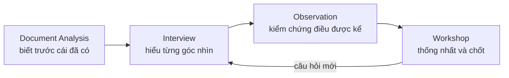

# Tuần 1 — Foundation & Discovery Mindset

Tuần đầu tiên không dạy bạn viết tài liệu. Tuần này dạy bạn **đứng đúng chỗ** và **hỏi đúng câu**. Bạn sẽ biết BA/PO khác các vai trò khác ở đâu, đứng ở đâu trong vòng đời sản phẩm, làm việc thế nào trong Scrum. Sau đó bạn học kỹ năng quan trọng nhất của cả nghề: tách một yêu cầu kiểu "Tôi muốn..." thành vấn đề thật, rồi tổ chức discovery để làm rõ nó.

| Day | Topic | Deliverable |
|---|---|---|
| 1 | BA là gì, PO là gì; BA vs PO vs PM vs SA vs DEV vs QA | RACI 1 trang cho feature "Tự tạo Re-delivery khi giao thất bại" |
| 2 | SDLC & Product Lifecycle — BA/PO ở đâu trong vòng đời | Lifecycle map: 12 hoạt động BA/PO gắn vào giai đoạn |
| 3 | Agile & Scrum cho BA/PO (role, event, artifact) | Bảng "BA/PO làm gì trong từng event" + xử lý 4 tình huống sprint |
| 4 | Business Thinking & Product Thinking: Request vs Problem vs Need vs Requirement | Bảng phân rã 5 request thành Problem / Need / Requirement / Solution |
| 5 | Business Request → Business Problem → Problem Statement | 3 Problem Statement đạt chuẩn |
| 6 | Kỹ thuật Elicitation: Interview, Workshop, Observation, Document Analysis | Elicitation Plan cho bài toán đối soát Supplier lệch số |
| 7 | Thiết kế Discovery Question: 5W1H, WHY-WHO-WHAT-WHEN-WHERE-HOW-WHAT IF (+ review tuần 1) | Bộ 25 câu hỏi discovery + Discovery Pack v1 |

---

## Day 1 - BA là gì, PO là gì; BA vs PO vs PM vs SA vs DEV vs QA

> Phase 1 Foundation · Level Foundation · Thời lượng ~60–90 phút · Deliverable: RACI 1 trang cho feature "Tự tạo Re-delivery khi giao thất bại"

### Mục tiêu

Sau bài này bạn:

- Nói được trong một câu BA chịu trách nhiệm gì, PO chịu trách nhiệm gì.
- Phân biệt được ranh giới BA, PO, PM, SA, DEV, QA trên cùng một feature.
- Biết ai **quyết định**, ai **làm**, ai **được hỏi**, ai **được báo** — và lập được RACI.
- Tự định vị mình đang ở level nào trên lộ trình Foundation → Junior → Middle → Senior.

### Kiến thức cần học

**1. Mỗi vai trò trả lời một câu hỏi khác nhau**

| Vai trò | Câu hỏi cốt lõi | Đầu ra chính |
|---|---|---|
| BA – Business Analyst (Chuyên viên phân tích nghiệp vụ) | Vấn đề là gì, cần hệ thống làm gì để giải quyết? | Problem Statement, process AS-IS/TO-BE, Business Rule, Requirement, AC |
| PO – Product Owner (Người sở hữu sản phẩm) | Làm cái gì trước, vì sao đáng làm, thành công đo bằng gì? | Product Goal, Product Backlog đã sắp ưu tiên, quyết định accept/reject |
| PM – Project Manager (Quản lý dự án) | Làm xong khi nào, với nguồn lực nào, rủi ro gì? | Plan, timeline, risk log, báo cáo tiến độ |
| SA – Solution Architect / System Analyst | Hệ thống được thiết kế thế nào để đáp ứng requirement? | Kiến trúc, ADR, API design, data model kỹ thuật |
| DEV – Developer | Làm sao build đúng và chạy ổn định? | Code, unit test, tài liệu kỹ thuật |
| QA/QC – Quality Assurance / Quality Control | Sản phẩm có đúng requirement và không phá cái cũ? | Test scenario, test case, bug report, sign-off |

Lưu ý: "SA" ở nhiều công ty là **Solution Architect**, ở một số nơi là **System Analyst**. Hỏi rõ khi vào dự án. Trong khoá này, SA = người chịu trách nhiệm thiết kế giải pháp kỹ thuật.

**2. BA và PO chồng lấn — nhưng khác quyền**

- BA **phân tích và đề xuất**. PO **quyết định và chịu trách nhiệm về giá trị**.
- BA làm requirement đúng. PO chọn requirement đúng để làm.
- Ở team nhỏ, một người kiêm cả hai. Khi kiêm, bạn vẫn phải tách hai "chiếc mũ": lúc phân tích thì trung lập, lúc quyết định thì nói rõ "đây là quyết định PO, lý do là...".

**3. Ranh giới hay bị lẫn**

| Nhầm lẫn | Thực tế |
|---|---|
| BA thiết kế database | BA mô tả **dữ liệu nghiệp vụ cần lưu** (entity, field, rule). SA/DEV quyết định cấu trúc bảng, index |
| BA chọn công nghệ | BA nêu yêu cầu (VD: "Supplier callback trong [30] giây"). SA chọn cơ chế (queue, retry) |
| PO quản lý timeline | PO quản lý **thứ tự giá trị**. Timeline, nguồn lực là việc PM (nếu có) |
| QC tự định nghĩa expected result | Expected result phải trace về requirement/AC. Không có trong spec → hỏi BA, không tự đoán |

**4. RACI – Ma trận trách nhiệm**

- **R – Responsible:** người trực tiếp làm.
- **A – Accountable:** người chịu trách nhiệm cuối, ký duyệt. **Mỗi hoạt động chỉ có đúng một A.**
- **C – Consulted:** được hỏi ý kiến trước khi làm (giao tiếp 2 chiều).
- **I – Informed:** được thông báo kết quả (1 chiều).

**5. Lộ trình năng lực — bạn đang ở đâu?**

| Level | Tư duy chính | Làm được gì | Dấu hiệu cần lên level |
|---|---|---|---|
| Foundation | "Họ muốn gì thì ghi lại" | Hiểu thuật ngữ, đọc được BRD/User Story, ghi biên bản | Ghi đủ nhưng không phát hiện được chỗ thiếu |
| Junior | "Làm rõ cái họ muốn" | Viết User Story, AC cho feature nhỏ khi đã có hướng giải pháp; hỏi được câu chi tiết (field, format) | Viết đúng format nhưng bị Dev/QC hỏi lại nhiều; ít hỏi "tại sao" |
| Middle | "Hiểu vấn đề rồi mới làm rõ giải pháp" | Tự chạy discovery, AS-IS/TO-BE, Business Rule, edge case, data/API impact cho 1 feature end-to-end | Giải quyết tốt feature nhưng chưa nhìn ra ảnh hưởng sang hệ thống/team khác, chưa đàm phán được scope |
| Senior | "Có nên làm không, làm bao nhiêu là đủ, ai bị ảnh hưởng" | Định hình bài toán mơ hồ, đề xuất phương án và trade-off, impact analysis toàn hệ thống, điều phối stakeholder mâu thuẫn, đo kết quả sau release | — |

Với người đi từ QC sang: bạn có lợi thế lớn ở **edge case, testability, regression**. Điểm cần bù là **problem framing** (đặt bài toán) và **stakeholder** (làm việc với người ra quyết định). Tuần 1 tập trung vào hai điểm này.

### BA/PO sử dụng kiến thức này khi nào?

- Ngày đầu vào dự án: xác định ai là người ra quyết định cuối cho từng loại câu hỏi (scope, rule nghiệp vụ, kỹ thuật, tiền).
- Khi một câu hỏi "treo" nhiều ngày: thường do không ai là A. Lập RACI để chỉ ra người phải chốt.
- Khi Dev hỏi BA "dùng queue hay cron?": biết đây là câu hỏi của SA/Tech Lead, BA chỉ cung cấp yêu cầu nghiệp vụ (độ trễ chấp nhận được, khối lượng).
- Khi Business đòi "làm ngay tuần này": biết chuyển câu hỏi ưu tiên sang PO, timeline sang PM.

### Quy trình thực hiện

**Step 1 — Liệt kê hoạt động của feature.** Chia feature thành 8–12 hoạt động theo vòng đời: discovery, chốt scope, viết rule, thiết kế, build, test, UAT, release, theo dõi.

**Step 2 — Liệt kê vai trò thật.** Không chỉ 6 vai trò kỹ thuật. Thêm các bên nghiệp vụ: Ops, Finance, CS, Supplier, Client, Management.

**Step 3 — Gán A trước.** Với mỗi hoạt động hỏi: "Nếu kết quả sai, ai bị hỏi trách nhiệm?" Người đó là A. Chỉ một người.

**Step 4 — Gán R, C, I.** R là người làm. C là người có thông tin bắt buộc phải hỏi. I là người bị ảnh hưởng nhưng không cần góp ý.

**Step 5 — Kiểm tra lỗi.** Mỗi dòng có đúng một A. Không dòng nào toàn C. Không ai là A của quá nhiều dòng mà không làm R ở dòng nào (dấu hiệu "nút cổ chai duyệt").

**Step 6 — Xác nhận với các bên.** RACI chỉ có giá trị khi người được gán A đồng ý mình là A.

### Ví dụ thực tế

Case Physical Gift, pain point số 2: *Supplier không confirm Sub-order trong SLA → Order treo.* Feature đề xuất: Sub-order ở trạng thái `SENT_TO_SUPPLIER` quá `confirm_sla_minutes` thì hệ thống xử lý tự động.

Cùng một feature, mỗi vai trò làm việc khác nhau:

| Vai trò | Việc cụ thể trên feature này |
|---|---|
| BA | Hỏi Ops hiện xử lý Order treo thế nào, bao nhiêu đơn/tuần. Viết rule: quá SLA thì chuyển `CANCELLED` hay chuyển Supplier khác? Order.status tổng hợp ra sao khi 1 trong 3 Sub-order bị huỷ? |
| PO | Quyết định làm phương án "huỷ" (rẻ) hay "tự chuyển Supplier khác" (đắt hơn, giá trị cao hơn). Chốt KPI: giảm số Order treo quá X giờ |
| PM | Lên kế hoạch, phối hợp lịch với Supplier test callback, quản lý rủi ro trễ |
| SA | Thiết kế cơ chế quét Sub-order quá hạn, xử lý callback đến muộn sau khi đã huỷ |
| DEV | Build job, update trạng thái, gửi webhook `order.status_changed` |
| QC | Test boundary đúng phút thứ SLA, callback đến sau khi huỷ, Order có nhiều Sub-order |

RACI rút gọn:

| Hoạt động | BA | PO | PM | SA | DEV | QC | Ops | Finance |
|---|---|---|---|---|---|---|---|---|
| Discovery với Ops | R | A | I | C | – | C | C | – |
| Chốt scope (huỷ hay chuyển Supplier) | C | A | C | C | – | I | C | C |
| Viết Business Rule, AC | R | A | – | C | C | C | C | – |
| Thiết kế giải pháp kỹ thuật | C | I | I | A/R | C | I | – | – |
| Build | I | I | I | C | A/R | I | – | – |
| Test | C | I | I | – | C | A/R | – | – |
| UAT | R | A | I | – | – | C | R | C |
| Theo dõi sau release | R | A | I | – | C | – | C | I |

Đọc bảng: "Thiết kế giải pháp" ghi A/R nghĩa là SA vừa làm vừa chịu trách nhiệm. Finance là C ở bước chốt scope vì huỷ Sub-order ảnh hưởng đối soát cuối tháng (pain point 5).

#### Ví dụ từ dự án thật: Slide to Use

Theo tài liệu dự án, stakeholder thật gồm: PO Voucher (chốt phạm vi), Tech Lead (giải pháp bảng tạm, POS), App ví quà (thời điểm phát hành), Kế toán (ghi và huỷ doanh thu), Design (UI thanh trượt, câu chữ), MC/CS (hướng dẫn khách, merchant), BA/QC, và các team Team kênh A, Team kênh B (đánh giá kênh của họ).

Bài học: một feature "trên màn hình App" kéo theo **Kế toán** và **team của kênh khác**. Câu hỏi mở OI-S43 (huỷ dòng doanh thu bằng đánh dấu hay bút toán đảo) chỉ Kế toán trả lời được — BA không tự chốt, PO cũng không. Nếu RACI không có Kế toán ở vai trò C cho hoạt động "chốt rule doanh thu", câu hỏi đó sẽ bị phát hiện muộn.

### Junior vs Middle vs Senior

Tình huống: Ops nhắn "Supplier không confirm thì hệ thống tự huỷ giúp em nhé."

| | Junior | Middle | Senior |
|---|---|---|---|
| Nghĩ | "Ghi lại, tạo ticket tự huỷ" | "Huỷ sau bao lâu? Huỷ cả Order hay chỉ Sub-order?" | "Huỷ có phải cách tốt nhất? Ai chịu thiệt khi huỷ: Recipient, Client, Finance?" |
| Hỏi | Ops | Ops, Dev | Ops, PO, Finance, CS; xem dữ liệu số đơn treo |
| Làm | Viết story "Hệ thống tự huỷ Sub-order" | Viết rule có tham số SLA, edge case callback muộn | Đưa 2–3 phương án (huỷ / chuyển Supplier / cảnh báo Ops) kèm trade-off cho PO quyết, lập RACI để chốt người duyệt |

### Sai lầm thường gặp

1. **Một dòng RACI có hai A.** "BA và PO cùng duyệt AC" → khi hai người không đồng ý, không ai chốt.
2. **BA đi quyết định thay PO.** BA chốt "làm phương án huỷ" trong cuộc họp với Ops mà PO chưa biết.
3. **BA viết giải pháp kỹ thuật vào requirement.** "Dùng cron 5 phút một lần" là quyết định của SA.
4. **Quên bên nghiệp vụ.** RACI chỉ có BA/PO/DEV/QC, thiếu Finance, CS, Ops — nhóm sẽ phát hiện vấn đề lúc UAT.
5. **QC chuyển sang BA vẫn giữ phản xạ "tìm lỗi giải pháp"** trước khi hiểu vấn đề. Tìm edge case là thế mạnh, nhưng làm sau bước problem framing.

### Góc nhìn Senior BA/PO

- Câu hỏi treo lâu gần như luôn là câu hỏi **thiếu chủ**. Việc đầu tiên khi thấy Open Item treo quá 3 ngày: xác định ai là A, gửi đích danh.
- RACI không phải tài liệu để nộp. Nó là **công cụ tránh xung đột**. Lập sớm, ngắn, xác nhận bằng lời với từng người được gán A.
- Senior không cố làm nhiều vai. Senior biết **câu nào không phải của mình** và chuyển đúng người, kèm đủ context để người đó quyết nhanh.

### Bài tập thực hành

**Đầu vào:** Case Physical Gift. Management yêu cầu: "Khi Delivery Service báo `DELIVERY_FAILED`, hệ thống tự tạo lần giao lại (Re-delivery) thay vì Ops làm thủ công qua Excel." (pain point 3)

Các bên liên quan: BA, PO, PM, SA, DEV, QC, Ops, CS, Finance, Delivery Service, Client.

**Yêu cầu đầu ra:**

1. RACI cho 8 hoạt động: Discovery; Chốt rule re-delivery (tối đa mấy lần, phí ai chịu); Thiết kế tích hợp với Delivery Service; Build; Test; UAT; Thông báo Client; Theo dõi sau release.
2. Ghi 3 câu hỏi bạn sẽ gửi cho người là A của dòng "Chốt rule re-delivery".
3. Chỉ ra 1 hoạt động mà nếu bỏ sót một bên C thì sẽ gây lỗi lúc go-live.

### Lời giải tham khảo

| Hoạt động | BA | PO | PM | SA | DEV | QC | Ops | CS | Finance | Delivery Service | Client |
|---|---|---|---|---|---|---|---|---|---|---|---|
| Discovery | R | A | I | C | – | C | C | C | C | – | – |
| Chốt rule re-delivery | R | A | – | C | – | C | C | C | C | C | – |
| Thiết kế tích hợp | C | I | C | A/R | C | I | – | – | – | C | – |
| Build | I | I | I | C | A/R | – | – | – | – | – | – |
| Test | C | I | I | – | C | A/R | – | – | – | C | – |
| UAT | R | A | I | – | – | C | R | C | C | – | – |
| Thông báo Client | C | A | I | – | – | – | – | C | – | – | I |
| Theo dõi sau release | R | A | I | – | C | – | C | C | I | – | – |

Câu hỏi cho PO (A của dòng chốt rule):
1. Tối đa bao nhiêu lần re-delivery cho một Sub-order trước khi chuyển `RETURNED`?
2. Phí giao lại do ai chịu: công ty, Client, hay tuỳ `failed_reason`?
3. Lý do thất bại nào **không** được tự giao lại (VD: sai địa chỉ — giao lại sẽ lại thất bại)?

Vì sao: Junior thường để BA là A của "Chốt rule". Sai — rule re-delivery quyết định chi phí, đó là quyết định giá trị/kinh doanh, thuộc PO. BA là R: chuẩn bị phương án, dữ liệu, câu hỏi.

Hoạt động dễ gây lỗi go-live: **Chốt rule re-delivery thiếu Finance là C**. Phí giao lại phát sinh, cuối tháng đối soát với Delivery Service/Client sẽ lệch, giống pain point 5. Junior hay bỏ sót **CS**: Recipient gọi hỏi "sao tôi nhận tin nhắn giao lại", CS không được báo trước sẽ trả lời sai.

### Checklist hoàn thành

- [ ] Tôi hiểu khái niệm.
- [ ] Tôi tự làm được bài tập.
- [ ] Tôi giải thích được cho Developer/QC.
- [ ] Tôi có thể viết thành Requirement/artifact.
- [ ] RACI của tôi mỗi dòng có đúng một A.
- [ ] Tôi phân biệt được câu hỏi của BA, của PO và của SA trong cùng một feature.
- [ ] Tôi tự xếp mình vào một level và ghi 2 điểm cần bù.

---

## Day 2 - SDLC & Product Lifecycle — BA/PO ở đâu trong vòng đời

> Phase 1 Foundation · Level Foundation · Thời lượng ~60–90 phút · Deliverable: Lifecycle map — 12 hoạt động BA/PO gắn vào giai đoạn, có đầu vào/đầu ra

### Mục tiêu

Sau bài này bạn:

- Phân biệt SDLC – Software Development Life Cycle (vòng đời phát triển phần mềm) với Product Lifecycle (vòng đời sản phẩm).
- Biết BA/PO làm gì ở **từng** giai đoạn, không chỉ ở giai đoạn "viết requirement".
- Biết mỗi giai đoạn cần đầu vào gì và bàn giao đầu ra gì cho giai đoạn sau.
- Nhận ra chi phí của việc phát hiện vấn đề muộn.

### Kiến thức cần học

**1. SDLC — vòng đời của một lần thay đổi phần mềm**

| Giai đoạn | Câu hỏi | Đầu ra điển hình |
|---|---|---|
| 1. Initiation / Discovery (Khởi tạo, khám phá) | Vấn đề có thật không, có đáng giải quyết không? | Problem Statement, mục tiêu, stakeholder |
| 2. Analysis (Phân tích) | Hiện trạng thế nào, cần thay đổi gì? | AS-IS, TO-BE, Business Rule, Scope |
| 3. Requirement / Specification | Hệ thống phải làm chính xác cái gì? | BRD, FS, User Story, AC |
| 4. Design (Thiết kế) | Build thế nào? | Kiến trúc, API design, UI mockup |
| 5. Development (Phát triển) | Code | Code, unit test |
| 6. Testing (Kiểm thử) | Đúng spec chưa, có phá cái cũ không? | Test result, bug report |
| 7. UAT – User Acceptance Testing (Nghiệm thu người dùng) | Đúng nhu cầu nghiệp vụ chưa? | UAT sign-off |
| 8. Release / Deployment | Đưa lên production an toàn thế nào? | Release checklist, rollback plan |
| 9. Operation & Measure (Vận hành, đo lường) | Có đạt mục tiêu không? | KPI report, post-release review |

Waterfall chạy các giai đoạn một lần theo thứ tự. Agile chạy chúng **lặp lại trong từng vòng ngắn**, nhưng các giai đoạn vẫn tồn tại. Agile không bỏ Analysis — Agile làm Analysis thành nhiều lát mỏng, đúng lúc.

**2. Product Lifecycle — vòng đời của cả sản phẩm**

```
Ý tưởng → Discovery → MVP – Minimum Viable Product (sản phẩm khả dụng tối thiểu)
→ Growth (mở rộng) → Maturity (ổn định, tối ưu) → Sunset (ngừng)
```

Một sản phẩm đi qua nhiều SDLC. Mỗi feature là một vòng SDLC nằm trong một giai đoạn của Product Lifecycle. Ở giai đoạn MVP, PO ưu tiên **học nhanh** (chứng minh giả định). Ở Maturity, PO ưu tiên **ổn định và chi phí vận hành**.

**3. BA/PO có mặt ở mọi giai đoạn — nhưng vai trò thay đổi**

| Giai đoạn | BA | PO |
|---|---|---|
| Discovery | Elicitation, làm rõ vấn đề | Quyết định có theo đuổi không |
| Analysis | AS-IS/TO-BE, rule, gap | Chọn phương án |
| Requirement | Viết spec, AC | Duyệt, sắp ưu tiên |
| Design | Review mockup/API với nghiệp vụ | Trade-off scope vs effort |
| Development | Trả lời câu hỏi, quản lý change | Quyết định khi có change |
| Testing | Hỗ trợ QC hiểu rule, triage bug | Quyết định bug nào chặn release |
| UAT | Chuẩn bị scenario, điều phối | Sign-off |
| Release | Release note, hướng dẫn Ops/CS | Go/No-go |
| Measure | Thu thập số liệu | Đánh giá đạt mục tiêu, quyết định bước tiếp |

**4. Chi phí phát hiện muộn**

Một câu hỏi bỏ sót ở Discovery có thể chỉ tốn 10 phút để hỏi. Cùng câu hỏi đó phát hiện ở UAT phải sửa spec, sửa code, test lại, dời lịch. Phát hiện ở production còn kèm khiếu nại, dữ liệu sai cần sửa. Không cần nhớ hệ số cụ thể; cần nhớ chiều hướng: **càng muộn càng đắt, và đắt theo cấp số**.

### BA/PO sử dụng kiến thức này khi nào?

- Khi nhận một yêu cầu: xác định nó đang ở giai đoạn nào. "Làm nút Export" nghe như Requirement, thực chất mới ở Discovery.
- Khi lên kế hoạch cá nhân: biết giai đoạn sau cần gì để chuẩn bị trước (VD: đang viết spec thì đồng thời nghĩ UAT scenario).
- Khi bị ép "viết spec ngay": chỉ ra những câu Discovery chưa trả lời và rủi ro nếu bỏ qua.
- Sau release: nhớ rằng việc của BA/PO chưa xong — còn đo kết quả.

### Quy trình thực hiện

**Step 1 — Xác định giai đoạn hiện tại của yêu cầu.** Có Problem Statement chưa? Có scope chưa? Có AC chưa? Thiếu cái nào thì đang ở giai đoạn trước nó.

**Step 2 — Liệt kê hoạt động BA/PO cho các giai đoạn còn lại.** Mỗi hoạt động ghi động từ cụ thể: "phỏng vấn Ops", không ghi "tìm hiểu".

**Step 3 — Ghi đầu vào và đầu ra.** Mỗi hoạt động cần gì để bắt đầu, bàn giao gì cho ai.

**Step 4 — Đánh dấu "điểm kiểm soát" (gate).** Ví dụ: không sang Design khi chưa chốt scope; không sang UAT khi QC chưa pass.

**Step 5 — Đánh dấu hoạt động hay bị bỏ.** Thường là: đo baseline ở Discovery, regression scope ở Testing, đo KPI sau release.

### Ví dụ thực tế

Case Physical Gift, pain point 3: *Giao thất bại, Ops re-delivery thủ công qua Excel.*

| Giai đoạn | Hoạt động BA/PO | Đầu vào | Đầu ra |
|---|---|---|---|
| Discovery | Ngồi cạnh Ops xem một ca xử lý re-delivery; đếm số ca/tuần | Excel Ops đang dùng | Problem Statement có số liệu |
| Analysis | Vẽ AS-IS; liệt kê `failed_reason` nào giao lại được | Dữ liệu `shipment` | AS-IS, danh sách rule |
| Requirement | Viết rule: `DELIVERY_FAILED` → tạo Shipment mới `attempt_no + 1`, `shipping_status` về `PICKED_UP` khi Delivery Service lấy hàng lại | Rule đã chốt | User Story + AC |
| Design | Review với SA: webhook `shipment.status_changed` có đủ `failed_reason` không | API Delivery Service | Danh sách gap tích hợp |
| Development | Trả lời câu hỏi Dev | — | Decision Log |
| Testing | Cùng QC xác định regression: luồng giao lần đầu không đổi | AC | Test scope |
| UAT | Ops chạy 5 ca thật trên staging | UAT scenario | Sign-off |
| Release | Hướng dẫn Ops ngừng dùng Excel từ ngày X | Release note | Ops/CS được báo |
| Measure | So số ca re-delivery thủ công trước/sau | Baseline | Báo cáo 2 tuần sau release |

Chú ý dòng Discovery: **đếm số ca/tuần trước khi build**. Không có baseline thì sau release không chứng minh được cải thiện.

#### Ví dụ từ dự án thật: Promotion Code

BRD Promotion Code Warehouse ghi rõ đây là **Phase 1 MVP**. Mục tiêu Phase 1 theo tài liệu có ba ý: đưa mã từ file Excel của merchant vào kho, phát qua API và Loyalty Hub, đối soát được cuối tháng; **chứng minh** mô hình phát lại mã chưa vuốt hoạt động an toàn trong pilot; **không ảnh hưởng** luồng e-voucher đang chạy.

Đọc theo lăng kính lifecycle:
- "Chứng minh mô hình ... trong pilot" là mục tiêu kiểu MVP: học, chưa tối ưu.
- "Không ảnh hưởng luồng e-voucher" biến thành tiêu chí nghiệm thu "chạy lại regression" — một yêu cầu cho giai đoạn Testing được đặt ra ngay từ Discovery.
- Rule "Đã vuốt mà hết hạn dùng → Chờ merchant xác nhận. Phase 1 không tự phát lại" cho thấy PO chủ động để một phần cho phase sau.

#### Ví dụ từ dự án thật: Slide to Use

Theo tài liệu, quyết định thiết kế đổi ba lần trong hai ngày (14–15/10/2026), rồi mở rộng phạm vi sau họp review mockup 20/10/2026. Nghĩa là dự án đang ở Design nhưng phải quay lại Requirement và cả Scope. Đây là bình thường trong Agile — miễn là mỗi lần quay lại đều **cập nhật tài liệu và ghi quyết định**. Chi tiết xử lý change sẽ học ở Day 45.

### Junior vs Middle vs Senior

Tình huống: PO nói "Sprint sau Dev rảnh, viết spec re-delivery tự động đi."

| | Junior | Middle | Senior |
|---|---|---|---|
| Nghĩ | "Viết spec ngay" | "Chưa có AS-IS và rule, viết spec sẽ thiếu" | "Chưa có baseline, chưa biết đây có phải vấn đề lớn nhất của Ops không" |
| Hỏi | Field nào trên màn hình | Ops xử lý thế nào, `failed_reason` gồm gì | Mỗi tuần bao nhiêu ca, tốn bao nhiêu giờ Ops, đo thành công bằng gì |
| Làm | Viết story ngay | Làm AS-IS + rule rồi viết story | Đề xuất 2 ngày discovery có output rõ, đồng thời viết sẵn phần chắc chắn để Dev không ngồi chờ |

### Sai lầm thường gặp

1. **Coi BA chỉ làm ở giai đoạn Requirement.** BA biến mất sau khi giao spec → Dev và QC tự diễn giải.
2. **Bỏ qua Measure.** Release xong là xong, không ai biết feature có giải quyết vấn đề không.
3. **Nghĩ Agile = không cần Analysis.** Kết quả là sprint nào cũng sửa lại sprint trước.
4. **Không đặt regression scope từ đầu.** Feature mới đúng, feature cũ hỏng.
5. **Không có gate.** Chuyển Design khi scope còn mở → design phải làm lại.

### Góc nhìn Senior BA/PO

- Senior luôn hỏi "đầu ra của giai đoạn này dùng cho ai ở giai đoạn sau?". Spec viết cho Dev và QC đọc, không viết cho người duyệt đọc.
- Senior chuẩn bị **trước một giai đoạn**: đang viết AC thì đã ghi chú UAT scenario; đang Discovery thì đã đo baseline.
- Quay lại giai đoạn trước không phải thất bại. Thất bại là quay lại mà không ghi vì sao, rồi hai tuần sau không ai nhớ quyết định cuối là gì.

### Bài tập thực hành

**Đầu vào:** Case Physical Gift, pain point 6: *Client gọi API tạo Order hai lần khi timeout → hai Order.* Tích hợp hiện có: `POST /orders` có field `client_ref_id`. `[Giả định bài tập]` Hiện hệ thống chưa kiểm tra trùng `client_ref_id`.

**Yêu cầu đầu ra:** Lifecycle map dạng bảng với **12 hoạt động BA/PO**, mỗi hoạt động có: giai đoạn, động từ cụ thể, đầu vào, đầu ra, người nhận đầu ra. Đánh dấu (*) 3 hoạt động Junior hay bỏ sót.

### Lời giải tham khảo

| # | Giai đoạn | Hoạt động | Đầu vào | Đầu ra | Người nhận |
|---|---|---|---|---|---|
| 1 | Discovery | Đếm số cặp Order trùng trong 3 tháng (*) | Bảng `order` | Số liệu baseline | PO |
| 2 | Discovery | Hỏi CS/Finance hậu quả: giao 2 lần? trừ ngân sách 2 lần? | — | Danh sách impact | PO |
| 3 | Analysis | Xác định Client nào gửi `client_ref_id`, Client nào không | Log API | Danh sách Client | SA, Sales/AM |
| 4 | Analysis | Viết rule: cùng `account_id` + `client_ref_id` gửi lại → trả Order cũ, không tạo mới | Impact | Business Rule | Dev, QC |
| 5 | Requirement | Viết AC cho trường hợp gửi lại khi Order cũ đã `CANCELLED` | Rule | AC | QC |
| 6 | Requirement | Xác định response trả về khi trùng (mã lỗi hay trả Order cũ) | Rule | API requirement | SA, Client |
| 7 | Design | Review với SA cách xử lý hai request đến cùng lúc | API requirement | Decision Log | Dev |
| 8 | Testing | Thống nhất regression: tạo Order bình thường không đổi (*) | AC | Regression scope | QC |
| 9 | UAT | Chuẩn bị scenario gửi lại request có/không có `client_ref_id` | AC | UAT scenario | Ops, PO |
| 10 | Release | Thông báo Client thay đổi hành vi API | API requirement | Release note | Client, Sales/AM |
| 11 | Release | Hướng dẫn CS cách tra Order khi Client khiếu nại trùng | Rule | Hướng dẫn CS | CS |
| 12 | Measure | So số Order trùng 1 tháng sau release với baseline (*) | Baseline | Báo cáo | PO, Management |

Vì sao:
- Hoạt động 1 và 12 đi cặp. Không có 1 thì 12 vô nghĩa.
- Hoạt động 5 là edge case Middle mới nghĩ tới: gửi lại khi Order cũ đã huỷ — trả Order cũ hay tạo mới? Phải có rule.
- Hoạt động 7 (hai request cùng lúc) là thế mạnh của người từ QC. Bạn không thiết kế giải pháp, nhưng bạn đặt câu hỏi để SA phải trả lời.
- Hoạt động 10: thay đổi hành vi API là thay đổi **hợp đồng** với Client. Junior hay quên thông báo.

### Checklist hoàn thành

- [ ] Tôi hiểu khái niệm.
- [ ] Tôi tự làm được bài tập.
- [ ] Tôi giải thích được cho Developer/QC.
- [ ] Tôi có thể viết thành Requirement/artifact.
- [ ] Tôi nói được BA/PO làm gì ở giai đoạn Testing và Measure.
- [ ] Lifecycle map của tôi có hoạt động đo baseline và đo sau release.
- [ ] Tôi xác định được một yêu cầu đang thực sự ở giai đoạn nào.

---

## Day 3 - Agile & Scrum cho BA/PO (role, event, artifact)

> Phase 1 Foundation · Level Foundation → Junior · Thời lượng ~60–90 phút · Deliverable: Bảng "BA/PO làm gì trong từng event" + cách xử lý 4 tình huống sprint

### Mục tiêu

Sau bài này bạn:

- Nắm khung Scrum: 3 accountability (trách nhiệm), 5 event (sự kiện), 3 artifact (sản phẩm) và commitment (cam kết) của mỗi artifact.
- Biết BA đứng ở đâu khi Scrum không có "vai BA".
- Biết BA/PO cần chuẩn bị gì trước mỗi event và mang gì ra khỏi event.
- Xử lý được các tình huống hay gặp trong sprint: change giữa sprint, story chưa ready, bug phát hiện muộn.

### Kiến thức cần học

**1. Agile là tư duy, Scrum là một khung làm việc**

Agile ưu tiên: phần mềm chạy được, phản hồi sớm, thích ứng với thay đổi. Scrum là một cách cụ thể để làm Agile: làm việc theo **Sprint** – vòng lặp cố định tối đa 1 tháng (thường 1–2 tuần), cuối mỗi Sprint có một **Increment** – phần sản phẩm hoàn chỉnh, dùng được.

**2. Ba accountability trong Scrum**

| Accountability | Chịu trách nhiệm |
|---|---|
| Product Owner | Tối đa hoá giá trị sản phẩm. Quản lý Product Backlog: nội dung, thứ tự, độ rõ ràng |
| Scrum Master | Hiệu quả của Scrum team: gỡ vướng, huấn luyện cách làm |
| Developers | Tạo Increment mỗi Sprint. "Developers" gồm mọi người làm ra sản phẩm: dev, QC, designer, BA |

Scrum **không có vai BA riêng**. Thực tế có ba mô hình:
- BA nằm trong Developers, phụ trách làm rõ requirement.
- BA hỗ trợ PO, PO uỷ quyền phần viết và làm rõ backlog item nhưng vẫn giữ quyền quyết định.
- Một người kiêm BA và PO.

**3. Năm event**

| Event | Mục đích | Thời lượng tối đa (Sprint 1 tháng) |
|---|---|---|
| Sprint | Vỏ chứa mọi event khác | ≤ 1 tháng |
| Sprint Planning | Chọn việc, đặt Sprint Goal | 8 giờ |
| Daily Scrum | Developers đồng bộ tiến độ hướng tới Sprint Goal | 15 phút |
| Sprint Review | Trình bày Increment, lấy phản hồi stakeholder, điều chỉnh backlog | 4 giờ |
| Sprint Retrospective | Cải tiến cách làm việc | 3 giờ |

Sprint ngắn hơn thì các event ngắn tương ứng.

**Backlog Refinement** (làm mịn backlog) **không phải event**. Đây là hoạt động liên tục: chia nhỏ, làm rõ, ước lượng item. Với BA/PO, đây là nơi tốn nhiều thời gian nhất.

**4. Ba artifact và commitment**

| Artifact | Commitment | Ý nghĩa |
|---|---|---|
| Product Backlog | Product Goal | Danh sách việc có thứ tự, hướng tới mục tiêu dài hạn |
| Sprint Backlog | Sprint Goal | Việc chọn cho Sprint + kế hoạch làm |
| Increment | Definition of Done (DoD) | Phần sản phẩm đạt chuẩn "xong" |

DoR – Definition of Ready (tiêu chí sẵn sàng) không có trong Scrum Guide, nhưng nhiều team dùng để chặn story chưa rõ đi vào Sprint. Học kỹ ở Day 21.

### BA/PO sử dụng kiến thức này khi nào?

| Thời điểm | BA/PO làm gì |
|---|---|
| Trước Sprint Planning | Đảm bảo top backlog đã refine: có AC, đã trả lời câu hỏi mở, đã ước lượng |
| Trong Sprint Planning | PO trình bày mục tiêu, đề xuất Sprint Goal. BA trả lời câu hỏi về rule, AC |
| Trong Sprint | BA trả lời câu hỏi Dev/QC trong ngày; ghi lại quyết định; không lặng lẽ đổi AC |
| Daily Scrum | Nghe vướng mắc liên quan requirement, xử lý sau Daily |
| Sprint Review | PO mời đúng stakeholder; BA ghi nhận phản hồi thành backlog item mới |
| Retrospective | Nêu vấn đề requirement (VD: story vào sprint mà thiếu rule) |
| Liên tục | Refinement 2 sprint phía trước |

### Quy trình thực hiện

**Step 1 — Nắm lịch sprint của team.** Độ dài sprint, ngày Planning, Review, giờ Daily, lịch refinement.

**Step 2 — Duy trì "2 sprint ready".** Top backlog luôn có đủ item ready cho khoảng 2 sprint tới.

**Step 3 — Chuẩn bị cho Planning.** Mỗi item đưa vào: có mục tiêu, AC, câu hỏi mở đã đóng hoặc được ghi rõ là không chặn.

**Step 4 — Trong Sprint, xử lý câu hỏi trong ngày.** Câu nào thay đổi AC thì ghi Decision Log và báo QC.

**Step 5 — Chuẩn bị Sprint Review.** Kịch bản demo theo góc nhìn người dùng, không theo màn hình.

**Step 6 — Sau Review, cập nhật backlog.** Phản hồi thành item mới, không nhét vào story đang làm.

### Ví dụ thực tế

Case Physical Gift. Product Goal `[Giả định bài tập]`: "Giảm Order treo do Supplier không phản hồi."

Product Backlog (top 5, đã sắp ưu tiên):

| # | Item | Trạng thái |
|---|---|---|
| 1 | Ops xem danh sách Sub-order `SENT_TO_SUPPLIER` quá `confirm_sla_minutes` | Ready |
| 2 | Gửi cảnh báo cho Ops khi Sub-order quá SLA | Ready |
| 3 | Ops chuyển Sub-order bị `SUPPLIER_REJECTED` sang Supplier khác có cùng SKU | Đang refine — chờ rule chọn Supplier theo `supplier_sku.priority` |
| 4 | Tự huỷ Sub-order quá SLA | Chưa refine — chờ PO quyết có làm không |
| 5 | Báo cáo tỷ lệ confirm đúng SLA theo Supplier | Chưa refine |

Sprint Goal: "Ops nhìn thấy và được cảnh báo về mọi Sub-order quá SLA." Sprint Backlog: item 1 và 2.

Lưu ý: item 3 chưa ready vì thiếu rule. BA không đẩy nó vào sprint với hy vọng "Dev làm tới đâu hỏi tới đó".

Giữa sprint, Ops yêu cầu thêm "nút gửi lại Sub-order cho Supplier". BA không thêm vào item 1. BA ghi thành item mới, hỏi PO có đổi ưu tiên không. Sprint Goal không đổi.

#### Ví dụ từ dự án thật: Slide to Use

Theo tài liệu, Slide to Use có bảng Open Items với các câu "Đã đóng" ghi **ngày đóng + kết luận + rule liên quan** (VD: "Đã đóng 22/10/2026: được, voucher chưa gắn brand (BR-V16)"). Đây là thói quen nên mang vào Scrum: mỗi câu hỏi Dev/QC hỏi trong sprint, khi trả lời thì đóng ở một chỗ chung, có ngày và rule. Không trả lời trong chat riêng rồi để mất.

### Junior vs Middle vs Senior

Tình huống: Ngày 3 của sprint 2 tuần, Dev phát hiện story "cảnh báo Ops khi quá SLA" chưa nói gửi qua kênh nào và gửi lặp lại không.

| | Junior | Middle | Senior |
|---|---|---|---|
| Nghĩ | "Hỏi Ops rồi trả lời Dev" | "Đây là thiếu sót refinement, cần trả lời trong ngày và ghi Decision Log" | "Vì sao lọt qua refinement? Cần thêm mục 'kênh thông báo, tần suất' vào checklist DoR" |
| Làm | Hỏi Ops, nhắn Dev | Chốt với PO trong ngày, cập nhật AC, báo QC | Như Middle + nêu ở Retro, đề xuất cải tiến DoR |
| Rủi ro | Trả lời bằng chat, QC không biết | Ổn | Ổn, và lần sau không lặp |

### Sai lầm thường gặp

1. **Đưa story chưa ready vào sprint** vì "Dev đang rảnh". Kết quả: Dev ngồi chờ, hoặc tự đoán.
2. **Đổi AC giữa sprint không báo QC.** QC test theo AC cũ, báo bug sai.
3. **Biến Sprint Review thành buổi demo nội bộ.** Không mời stakeholder thật → không có phản hồi thật.
4. **Nhét phản hồi mới vào story đang làm** thay vì tạo item mới. Story phình, sprint trễ.
5. **Nghĩ PO là "người viết ticket".** PO chịu trách nhiệm giá trị và thứ tự. Viết ticket có thể do BA làm.

### Góc nhìn Senior BA/PO

- Scrum không làm requirement tốt hơn. Nó chỉ làm requirement tệ **lộ ra nhanh hơn**. Refinement tốt là việc của BA/PO.
- Sprint Goal là công cụ để nói "không". Yêu cầu mới giữa sprint không phục vụ Sprint Goal → backlog.
- Senior đo sức khoẻ backlog: bao nhiêu sprint ready, bao nhiêu câu hỏi mở chặn top 10 item, bao nhiêu story bị trả về giữa sprint vì thiếu rule.

### Bài tập thực hành

**Đầu vào:** Case Physical Gift, team sprint 2 tuần. Sprint Goal: "Recipient nhận thông báo khi giao hàng thất bại." `[Giả định bài tập]` Sprint Backlog có 3 story: (A) nhận webhook `shipment.status_changed` trạng thái `DELIVERY_FAILED`; (B) gửi SMS cho Recipient; (C) hiển thị `failed_reason` trên trang tra cứu đơn.

Bốn tình huống xảy ra trong sprint:
1. Ngày 2: Dev hỏi `failed_reason` từ Delivery Service là mã hay chữ tự do — spec không ghi.
2. Ngày 5: Sales/AM muốn thêm "gửi email cho Client mỗi khi giao thất bại", cần gấp.
3. Ngày 8: QC phát hiện SMS gửi 2 lần khi Delivery Service gửi lại cùng một webhook.
4. Ngày 10: Story C không kịp xong.

**Yêu cầu đầu ra:**
- Bảng "BA/PO làm gì trong từng event" cho sprint này (Planning, Daily, Review, Retro, Refinement).
- Với mỗi tình huống: ai quyết định, quyết định gì, ghi lại ở đâu, ai cần được báo.

### Lời giải tham khảo

**Tình huống 1 — `failed_reason` là mã hay chữ:** BA hỏi SA/tài liệu API của Delivery Service trong ngày. Nếu là chữ tự do, câu hỏi tiếp theo là cho PO: hiển thị nguyên văn cho Recipient hay map sang câu thân thiện? Ghi Decision Log, cập nhật AC story C, báo QC. Junior hay trả lời Dev bằng phỏng đoán "chắc là mã".

**Tình huống 2 — email cho Client:** PO quyết. Không phục vụ Sprint Goal (Goal nói về Recipient) → tạo item mới, PO cân nhắc ưu tiên cho sprint sau. Nếu thật sự khẩn cấp, PO có thể thương lượng với Developers đổi Sprint Backlog, nhưng không đổi Sprint Goal và phải bỏ bớt việc khác. Báo Sales/AM kết quả và lý do.

**Tình huống 3 — SMS gửi 2 lần:** Đây là thiếu rule idempotency (chống xử lý trùng). BA viết rule: cùng `shipment_id` + cùng `status` + cùng `attempt_no` chỉ gửi SMS một lần. PO quyết bug này có chặn release không — có, vì Recipient nhận tin trùng gây khiếu nại. Ghi vào Retro: lần sau khi nhận webhook, checklist refinement phải có câu "gửi lại thì sao?". Đây là điểm Junior bỏ sót lúc viết story A.

**Tình huống 4 — story C không kịp:** Developers báo trong Daily. PO quyết: Sprint Goal vẫn đạt nếu A và B xong (Recipient đã nhận thông báo). C trả về Product Backlog, không "xong một nửa". Sprint Review nói rõ C chưa xong.

**Bảng event:**

| Event | BA/PO chuẩn bị | BA/PO mang ra |
|---|---|---|
| Planning | Story A, B, C có AC; danh sách `failed_reason` (nếu đã biết) | Sprint Goal, câu hỏi còn mở có hạn trả lời |
| Daily | Nghe vướng mắc requirement | Hẹn xử lý ngay sau Daily |
| Refinement | Item sprint sau (email Client) | Item ready |
| Review | Kịch bản: một Shipment thất bại → Recipient nhận SMS | Phản hồi stakeholder thành item mới |
| Retro | Dữ kiện: 2 câu hỏi spec bỏ sót | Cải tiến checklist refinement |

### Checklist hoàn thành

- [ ] Tôi hiểu khái niệm.
- [ ] Tôi tự làm được bài tập.
- [ ] Tôi giải thích được cho Developer/QC.
- [ ] Tôi có thể viết thành Requirement/artifact.
- [ ] Tôi nêu được 3 accountability, 5 event, 3 artifact và commitment tương ứng.
- [ ] Tôi biết Backlog Refinement không phải event và BA làm gì trong đó.
- [ ] Tôi xử lý được yêu cầu mới giữa sprint mà không phá Sprint Goal.

---

## Day 4 - Business Thinking & Product Thinking: Request vs Problem vs Need vs Requirement

> Phase 1 Foundation · Level Junior → Middle · Thời lượng ~60–90 phút · Deliverable: Bảng phân rã 5 request thành Request / Problem / Need / Requirement / Solution

### Mục tiêu

Sau bài này bạn:

- Phân biệt rõ 5 khái niệm: Request, Problem, Need, Requirement, Solution.
- Nhận ra khi nào người yêu cầu đang nói giải pháp chứ không nói vấn đề.
- Đi ngược từ một Solution được đề xuất về Problem gốc, rồi đi xuôi lại thành Requirement.
- Phân biệt Business Thinking (công ty được/mất gì) và Product Thinking (người dùng cần gì, sản phẩm nên làm gì).

### Kiến thức cần học

**1. Năm khái niệm**

| Khái niệm | Định nghĩa ngắn | Câu hỏi nhận diện | Ví dụ (Physical Gift) |
|---|---|---|---|
| Request – Yêu cầu ban đầu | Điều người dùng/business **nói ra** | "Họ đã nói gì?" | "Cho em nút Export Excel danh sách Sub-order" |
| Problem – Vấn đề | Điều đang **sai/thiếu**, gây thiệt hại đo được | "Điều gì đang tệ, tệ bao nhiêu?" | Đối soát Supplier cuối tháng lệch số, mất 2 ngày dò |
| Need – Nhu cầu | Năng lực người dùng **cần có** để hết vấn đề | "Họ cần làm được gì?" | Finance cần biết Sub-order nào đủ điều kiện thanh toán cho Supplier trong kỳ |
| Requirement – Yêu cầu hệ thống | Điều hệ thống **phải làm**, đo/test được | "Hệ thống phải làm gì, kiểm thế nào?" | Hệ thống phải liệt kê Sub-order theo Supplier và kỳ, gồm cả Sub-order huỷ sau ngày chốt kỳ, kèm ngày huỷ |
| Solution – Giải pháp | **Cách** đáp ứng requirement | "Build cái gì?" | Màn hình đối soát / file export / báo cáo tự động gửi mail |

Thứ tự logic: **Request → Problem → Need → Requirement → Solution**. Người dùng thường bắt đầu từ cuối chuỗi (Solution) và gọi nó là Request.

**2. Request thường là Solution trá hình**

"Thêm nút", "Export Excel", "Gửi mail", "Thêm cột" — đều là giải pháp. Không sai khi người dùng đề xuất giải pháp. Sai khi BA chép nguyên giải pháp đó thành requirement mà không biết nó giải quyết vấn đề gì.

**3. Business Thinking vs Product Thinking**

| | Business Thinking | Product Thinking |
|---|---|---|
| Hỏi | Công ty được/mất gì? Doanh thu, chi phí, rủi ro, tuân thủ? | Ai dùng, họ đang cố hoàn thành việc gì, trải nghiệm hiện tại vướng ở đâu? |
| Đo bằng | Tiền, giờ công, số sự cố, rủi ro tài chính | Tỷ lệ hoàn thành tác vụ, lỗi người dùng, khiếu nại |
| Hay bỏ sót | Người dùng cuối | Chi phí vận hành, đối soát, kế toán |

BA/PO tốt dùng cả hai: một yêu cầu đáng làm khi **giải quyết vấn đề của người dùng** và **có lý do kinh doanh**.

**4. Ví dụ kinh điển: "Business muốn Export Excel"**

| Level | Phản ứng | Kết quả |
|---|---|---|
| Junior | Ghi lại: "Thêm nút Export Excel ở màn danh sách Sub-order." | Build xong, người dùng vẫn mở Excel ra lọc tay, vẫn lệch số |
| Middle | Hỏi: "Export những field nào? Lọc theo gì? Bao nhiêu dòng? Định dạng ngày thế nào?" | File đúng field, nhưng vẫn có thể giải sai vấn đề |
| Senior | Hỏi: "Export để làm gì? Ai dùng file này? Dùng cho **reconciliation (đối soát)** hay **reporting (báo cáo)**? Mỗi tháng làm mấy lần, mất bao lâu? Sau khi có file, họ làm gì tiếp? Có giải pháp khác không?" | Có thể phát hiện việc cần là **màn hình đối soát có trạng thái lệch**, không phải file Excel |

Vì sao câu "reconciliation hay reporting" quan trọng:

| | Reconciliation (đối soát) | Reporting (báo cáo) |
|---|---|---|
| Mục đích | So hai nguồn, tìm dòng lệch, xử lý từng dòng | Tổng hợp xu hướng, ra quyết định |
| Cần | Từng dòng chi tiết, khoá kỳ, trạng thái khớp/lệch, lịch sử thay đổi | Số tổng, nhóm theo chiều, biểu đồ |
| Rủi ro nếu nhầm | Số "đúng tại thời điểm export" nhưng sai sau khi Sub-order đổi trạng thái muộn | Báo cáo quá chi tiết, không ai đọc |

Với Finance của Physical Gift, pain point 5 là "đối soát Supplier lệch số do Sub-order huỷ muộn". Nếu chỉ build export, file xuất ngày 1 không chứa Sub-order bị huỷ ngày 3 cho kỳ trước. Vấn đề vẫn còn nguyên.

Câu "có giải pháp khác không?" không phải để từ chối người dùng. Đó là để PO có **lựa chọn**: export (rẻ, giải quyết một phần) vs màn đối soát (đắt, giải quyết gốc) vs khoá kỳ không cho huỷ sau ngày chốt (rule, gần như không tốn code nhưng ảnh hưởng Ops).

### BA/PO sử dụng kiến thức này khi nào?

- Mỗi lần nhận yêu cầu có dạng "thêm/làm/cho em...": trước khi viết ticket.
- Khi hai bên đề xuất hai giải pháp khác nhau: đưa cả hai về cùng một Problem để so.
- Khi ước lượng lớn bất thường: kiểm tra có giải pháp nhỏ hơn cho cùng Need không.
- Khi viết tiêu đề User Story: tiêu đề nói về Need, không nói về nút bấm.

### Quy trình thực hiện

**Step 1 — Ghi nguyên văn Request.** Không sửa câu chữ. Ghi ai nói, ngày nào, bối cảnh.

**Step 2 — Gắn nhãn.** Request này là Problem, Need hay Solution? Có động từ "thêm/làm/xuất/gửi" + vật thể UI → gần như chắc là Solution.

**Step 3 — Đi ngược lên Problem.** Hỏi "để làm gì?" và "nếu không có thì sao?". Dừng khi gặp một thiệt hại đo được (giờ công, tiền, lỗi, khiếu nại).

**Step 4 — Phát biểu Need.** "[Ai] cần [làm được gì] để [kết quả]". Không chứa tên UI.

**Step 5 — Viết Requirement.** Hệ thống phải làm gì, có điều kiện, testable.

**Step 6 — Liệt kê 2–3 Solution.** Kèm ưu/nhược. PO chọn.

### Ví dụ thực tế

Case Physical Gift. Request từ Ops: "Cho em cột 'Số lần giao' trên màn danh sách Order."

| Tầng | Nội dung |
|---|---|
| Request | Thêm cột "Số lần giao" ở danh sách Order |
| Problem | Ops không biết Order nào đã giao thất bại nhiều lần, nên giao lại lần 3–4 cho địa chỉ sai, tốn phí giao. `[Giả định bài tập]` |
| Need | Ops cần nhận ra Sub-order đã thất bại nhiều lần trước khi quyết định giao lại |
| Requirement | REQ-01: Màn danh sách Sub-order phải hiển thị số lần giao (`max(shipment.attempt_no)`) và `failed_reason` của lần gần nhất. REQ-02: Ops phải lọc được Sub-order có `shipping_status = DELIVERY_FAILED` và số lần giao ≥ [2] |
| Solution | (a) Thêm cột như đề xuất; (b) Cảnh báo khi Ops bấm giao lại lần thứ [3]; (c) Rule chặn tự giao lại khi `failed_reason` = sai địa chỉ, chuyển CS liên hệ Recipient |

Lưu ý: cột "Số lần giao" ở **Order** sai cấp. Shipment thuộc Sub-order, một Order có nhiều Sub-order. Đây là lỗi Junior hay mắc khi chép nguyên request.

#### Ví dụ từ dự án thật: Promotion Code

Theo BRD, bài toán là: Công ty xây module bán mã ưu đãi của merchant cho ngân hàng, bảo hiểm (qua API) và khách hàng Loyalty Hub; điểm khác e-voucher hiện tại là **một mã của merchant có thể được phát và tính phí nhiều lần**; người dùng không vuốt mở mã trong [7] ngày thì mã quay về kho.

Nếu ai đó nói "Làm chức năng thu hồi mã sau 7 ngày", đó là Solution. Đọc BRD, mục tiêu Phase 1 cho thấy tầng trên: "chứng minh mô hình phát lại mã chưa vuốt hoạt động an toàn trong pilot". Chữ **"an toàn"** sinh ra Requirement mà request "thu hồi sau 7 ngày" không nói: một mã không bao giờ có hai lượt phát còn hiệu lực cùng lúc; mã chỉ trả về qua endpoint vuốt; mỗi mã phát tối đa [3] lần. Không hiểu Problem/Need thì sẽ thiếu các rule này.

#### Ví dụ từ dự án thật: Slide to Use

Request có thể nghe là "làm thanh trượt Slide to Use". Tài liệu nêu Problem: **mã đối tác được cấp trước khi người nhận cần** — hệ thống lấy code 3rd ngay khi tách; người nhận không dùng thì mã không thu hồi được; với nguồn cấp theo lượt, Công ty trả tiền cho mã không tạo giao dịch. Thanh trượt chỉ là Solution cho Need "chỉ lấy mã đối tác khi người nhận thật sự dùng" (MT-1). Hiểu vậy thì mới hiểu vì sao brand thường (nhận mã nội bộ) gần như không đổi hành vi, còn brand code 3rd thay đổi lớn.

### Junior vs Middle vs Senior

Tình huống: Finance nói "Cho chị Export Excel danh sách Sub-order theo Supplier."

| | Junior | Middle | Senior |
|---|---|---|---|
| Nghĩ | "Thêm nút Export" | "Export cần field nào, lọc gì" | "Export để làm gì — đối soát hay báo cáo? Vấn đề thật là lệch số?" |
| Hỏi | "Chị muốn đặt nút ở đâu?" | "Cần cột nào? Lọc theo kỳ nào? Định dạng tiền, ngày?" | "Ai dùng file? Sau khi tải chị làm gì tiếp? Mỗi tháng mất bao lâu? Lần gần nhất lệch vì sao? Nếu hệ thống tự đánh dấu dòng lệch thì chị còn cần file không?" |
| Làm | Ticket "Export Excel" | Ticket export có danh sách field rõ | Problem Statement + 3 phương án (export, màn đối soát, khoá kỳ) cho PO chọn |

### Sai lầm thường gặp

1. **Chép Solution thành Requirement.** "Hệ thống phải có nút Export" — testable nhưng không giải quyết gì.
2. **Hỏi "tại sao" kiểu chất vấn.** Người dùng thấy bị nghi ngờ. Hỏi "sau khi có file, chị làm gì tiếp?" thay vì "sao chị cần file?".
3. **Dừng ở Need mơ hồ.** "Finance cần dữ liệu tốt hơn" — không đo được.
4. **Từ chối giải pháp người dùng.** Mục tiêu là tìm giải pháp đúng, có thể chính là giải pháp họ đề xuất.
5. **Quên Business Thinking.** Giải pháp hay cho người dùng nhưng chi phí gấp 10 lần thiệt hại hiện tại.

### Góc nhìn Senior BA/PO

- Câu hỏi mạnh nhất không phải "tại sao" mà là **"sau đó thì sao?"**. Theo dõi hành trình sau giải pháp, bạn sẽ thấy vấn đề thật.
- Senior không cần thắng tranh luận về giải pháp. Senior đặt Problem lên bàn, để mọi người cùng thấy phương án nào khớp nhất.
- Đôi khi Senior kết luận "không cần build" — đổi một rule vận hành là đủ. Đó vẫn là kết quả tốt.

### Bài tập thực hành

**Đầu vào:** Case Physical Gift. Năm request trong tuần:

1. Sales/AM: "Cho Client xem được tồn kho của từng SKU."
2. Ops: "Thêm nút huỷ hàng loạt Sub-order."
3. CS: "Cho em sửa địa chỉ Order trên màn admin."
4. Management: "Làm dashboard số Order theo ngày."
5. Admin: "Khi Supplier ngưng một SKU thì tự ẩn SKU đó khỏi Program."

**Yêu cầu đầu ra:** Bảng 5 dòng × 5 cột (Request / Problem / Need / Requirement / Solution khác). Problem nào bạn chưa biết thì ghi **giả thuyết** và **câu hỏi để xác minh**. Ít nhất một requirement atomic, testable cho mỗi dòng.

### Lời giải tham khảo

| # | Problem (giả thuyết) | Câu hỏi xác minh | Need | Requirement mẫu | Solution khác |
|---|---|---|---|---|---|
| 1 | Recipient chọn quà hết hàng, đặt xong mới báo lỗi (pain point 1) | Client hỏi tồn kho để làm gì — hiển thị hay chặn? | Client cần biết SKU nào còn đặt được tại thời điểm Recipient chọn | `GET /programs/{id}/products` chỉ trả SKU có `status = ACTIVE` và tổng `available_qty` > 0 trên các Supplier `is_active` | Trả cờ còn/hết thay vì số tồn (không lộ số tồn của Supplier) |
| 2 | Supplier ngừng hợp tác/lỗi hàng loạt, Ops huỷ tay từng Sub-order | Bao lâu xảy ra một lần? Bao nhiêu Sub-order? | Ops cần huỷ nhiều Sub-order cùng nguyên nhân trong một thao tác, có lý do | Huỷ hàng loạt chỉ áp dụng Sub-order `PENDING` hoặc `SENT_TO_SUPPLIER`; mỗi Sub-order ghi `audit_log` có `reason` | Chuyển Sub-order sang Supplier khác thay vì huỷ |
| 3 | Recipient nhập sai địa chỉ, giao thất bại (pain point 4) | Sửa trước hay sau khi Supplier đã nhận hàng? | CS cần sửa thông tin giao khi hàng chưa rời kho Supplier | Chỉ sửa được địa chỉ khi `shipping_status = NOT_SHIPPED`; ghi `audit_log` before/after | Recipient tự sửa qua link trước khi Supplier confirm |
| 4 | Chưa rõ — Management muốn ra quyết định gì? | Dashboard trả lời câu hỏi nào? Xem bao lâu một lần? | Chưa phát biểu được → **cần discovery** | Chưa viết được — không bịa | Báo cáo email tuần |
| 5 | Program vẫn hiển thị SKU đã ngưng, Recipient chọn xong bị reject | Ngưng ở một Supplier hay mọi Supplier? | Recipient chỉ thấy SKU còn ít nhất một Supplier cung cấp | Khi mọi `supplier_sku` của SKU có `is_active = false`, SKU không xuất hiện trong danh sách quà của mọi Program | Cảnh báo Admin, Admin tự ẩn |

Vì sao:
- **Dòng 4 là bài kiểm tra trung thực.** Không đủ thông tin thì ghi "cần discovery", không bịa requirement. Junior hay tự nghĩ ra "dashboard 5 biểu đồ".
- **Dòng 1:** Junior hay viết "hiển thị số tồn kho" — lộ dữ liệu Supplier và vẫn không chặn được hết hàng giữa lúc chọn và lúc đặt.
- **Dòng 5:** Junior quên SKU N–N Supplier. Một Supplier ngưng chưa chắc SKU hết nguồn.
- **Dòng 3:** Middle hay quên điều kiện trạng thái. Sửa địa chỉ khi hàng đang `IN_TRANSIT` không có tác dụng.

### Checklist hoàn thành

- [ ] Tôi hiểu khái niệm.
- [ ] Tôi tự làm được bài tập.
- [ ] Tôi giải thích được cho Developer/QC.
- [ ] Tôi có thể viết thành Requirement/artifact.
- [ ] Tôi nhận ra được một Request là Solution trá hình.
- [ ] Tôi phân biệt export cho reconciliation và export cho reporting.
- [ ] Khi thiếu thông tin, tôi ghi giả thuyết + câu hỏi, không bịa requirement.

---

## Day 5 - Business Request → Business Problem → Problem Statement

> Phase 2 Discovery · Level Junior → Middle · Thời lượng ~60–90 phút · Deliverable: 3 Problem Statement đạt chuẩn (có evidence, impact, metric)

### Mục tiêu

Sau bài này bạn:

- Viết được Problem Statement – Phát biểu vấn đề theo cấu trúc chuẩn.
- Tách được triệu chứng, vấn đề, nguyên nhân và giải pháp ra khỏi nhau.
- Gắn vấn đề với evidence (bằng chứng), impact (tác động) và success metric (chỉ số thành công).
- Biết khi nào một Problem Statement chưa đủ để đi tiếp.

### Kiến thức cần học

**1. Problem Statement là gì và dùng để làm gì**

Problem Statement là đoạn ngắn (3–6 câu) mô tả: ai bị ảnh hưởng, vấn đề gì, trong bối cảnh nào, thiệt hại bao nhiêu, ta biết nhờ đâu, và thế nào là giải quyết xong. Nó là **điểm neo** cho mọi quyết định sau: scope, ưu tiên, giải pháp, KPI. Khi tranh luận "có nên thêm cái này không", câu trả lời là: nó có giúp giải quyết Problem Statement không?

**2. Cấu trúc khuyến nghị**

```
[Ai] gặp [vấn đề] khi [bối cảnh/thời điểm].
Hậu quả là [tác động đo được: tiền, giờ, lỗi, khiếu nại, rủi ro].
Ta biết điều này nhờ [bằng chứng: số liệu, log, ticket, quan sát].
Vấn đề được coi là giải quyết khi [chỉ số] đạt [ngưỡng] trong [thời gian].
(Tuỳ chọn) Ngoài phạm vi: [điều không giải quyết lần này].
```

**3. Bốn thứ hay bị trộn vào nhau**

| Loại | Ví dụ (Physical Gift) | Thuộc Problem Statement? |
|---|---|---|
| Symptom – Triệu chứng | "Order treo nhiều" | Có, nhưng chưa đủ — cần mô tả cụ thể và đo |
| Problem – Vấn đề | "Sub-order nằm ở `SENT_TO_SUPPLIER` quá SLA, Recipient không nhận quà đúng hẹn" | Có — đây là lõi |
| Root cause – Nguyên nhân gốc | "Supplier X không có người trực ca tối" | Không — tìm ở Day 11, đừng khẳng định khi chưa phân tích |
| Solution – Giải pháp | "Tự huỷ sau 2 giờ" | Không — đưa vào phần phương án |

**4. Kiểm tra chất lượng — 6 câu**

1. Có nêu ai bị ảnh hưởng (actor cụ thể, không phải "người dùng")?
2. Có số đo tác động không?
3. Có bằng chứng, hay chỉ là cảm nhận?
4. Có chứa giải pháp không? (Nếu có → bỏ ra.)
5. Có metric thành công và baseline không?
6. Người ngoài dự án đọc xong có hiểu vì sao cần làm không?

**5. Khi chưa có số liệu**

Không bịa số. Ghi "Chưa có số liệu — Open Item: [ai] cung cấp [số gì] trước [ngày]". Một Problem Statement thiếu baseline vẫn dùng được cho discovery, nhưng **chưa đủ** để PO cam kết KPI.

### BA/PO sử dụng kiến thức này khi nào?

- Ngay sau buổi tiếp nhận request đầu tiên — bản nháp v0, rồi chỉnh sau discovery.
- Mở đầu BRD, đầu Epic, đầu mỗi tài liệu trình duyệt.
- Khi PO cần so ưu tiên giữa nhiều yêu cầu: so Problem Statement, không so giải pháp.
- Khi scope phình: đối chiếu từng item mới với Problem Statement.

### Quy trình thực hiện

**Step 1 — Thu Request nguyên văn.** Ghi người nói, vai trò, ngày.

**Step 2 — Hỏi để tìm Problem.** "Việc này đang gây khó khăn gì?", "Gần nhất xảy ra khi nào?", "Nếu không làm thì sao?".

**Step 3 — Tìm evidence.** Query dữ liệu, xem ticket CS, xem file Excel Ops, đếm sự cố. Không có thì ghi Open Item.

**Step 4 — Lượng hoá impact.** Giờ công × số lần, số Order bị ảnh hưởng, số khiếu nại, tiền phải trả.

**Step 5 — Viết bản nháp theo cấu trúc.** Xoá mọi động từ giải pháp ("thêm", "build", "tự động").

**Step 6 — Đặt metric và baseline.** Metric phải lấy được từ dữ liệu có sẵn hoặc có kế hoạch thu thập.

**Step 7 — Xác nhận.** Gửi người yêu cầu và PO: "Tôi hiểu vấn đề như sau, đúng không?"

### Ví dụ thực tế

Case Physical Gift. Request từ Ops: "Làm giúp em tính năng tự huỷ Sub-order khi Supplier không confirm."

**Bản Junior (chưa đạt):**
> Hệ thống cần tự động huỷ Sub-order khi Supplier không confirm để giảm tải cho Ops và tăng trải nghiệm khách hàng.

Lỗi: chứa giải pháp ("tự động huỷ"); "giảm tải", "tăng trải nghiệm" không đo được; không có bằng chứng; không nói ai bị ảnh hưởng.

**Bản đạt chuẩn** (số liệu là `[Giả định bài tập]`):
> Recipient của các Program quà tặng không nhận quà đúng hạn khi Supplier không phản hồi Sub-order trong `confirm_sla_minutes`. Trong 3 tháng gần nhất, 6% Sub-order nằm ở `SENT_TO_SUPPLIER` quá SLA; 40% trong số đó treo quá 24 giờ trước khi Ops phát hiện bằng cách lọc tay. Hậu quả: Order của Client ở trạng thái `CONFIRMED` nhưng không tiến triển, CS nhận trung bình 25 khiếu nại/tháng, Ops mất khoảng 10 giờ/tuần rà soát. Bằng chứng: dữ liệu bảng `sub_order` (sent_at, confirmed_at), ticket CS gắn nhãn "chậm giao". Vấn đề được coi là giải quyết khi thời gian từ lúc Sub-order quá SLA đến lúc được xử lý (huỷ, chuyển Supplier, hoặc Supplier confirm) có trung vị dưới 1 giờ, đo trong 1 tháng sau release. Ngoài phạm vi: đánh giá, phạt Supplier.

Để ý câu cuối "được xử lý (huỷ, chuyển Supplier, hoặc Supplier confirm)" — metric không ép giải pháp. Huỷ, chuyển Supplier, hay cảnh báo Ops đều có thể đạt metric.

#### Ví dụ từ dự án thật: Slide to Use

Tài liệu dự án có Problem Statement đáng học. Phần vấn đề 1:

> Mã đối tác được cấp trước khi người nhận cần. Hệ thống lấy code 3rd ngay khi tách, kể cả khi người nhận chưa định ra cửa hàng. Người nhận không dùng thì mã không thu hồi được. Kho cạn nhanh hơn nhu cầu thật; với nguồn cấp theo lượt, Công ty trả tiền cho mã không tạo giao dịch.

Phân tích theo cấu trúc:

| Thành phần | Trong tài liệu |
|---|---|
| Ai/bối cảnh | Người nhận voucher, lúc tách voucher ở brand nhận code 3rd |
| Vấn đề | Code 3rd được lấy ngay khi tách, trước khi cần |
| Hậu quả | Kho cạn nhanh hơn nhu cầu thật; trả tiền cho mã không tạo giao dịch (nguồn cấp theo lượt) |
| Không chứa giải pháp | Đúng — thanh trượt xuất hiện ở phần TO-BE, không ở phần vấn đề |
| Metric | MT-1: tỷ lệ voucher đã tách nhưng chưa lấy mã sau 30/60/90 ngày; số mã không phải xuất kho |
| Baseline | Mở thành Open Item riêng **OI-BRD-01** |

Bài học: dự án không bịa baseline. Họ ghi rõ là Open Item. Đây đúng là cách xử lý "khi chưa có số liệu".

Vấn đề 2 cũng tốt: "Bảng gợi ý mệnh giá dựng từ danh sách cố định, không kiểm tồn kho → chọn xong mới báo không đủ mã, phải làm lại." Có nguyên nhân trực tiếp (danh sách cố định, không kiểm tồn) và hậu quả cho người dùng (làm lại).

#### Ví dụ từ dự án thật: Promotion Code

Theo vòng rà soát dự án, KPI được đặt là tỷ lệ redeem thật tại merchant, nhưng với mã merchant cấp, Công ty chỉ biết mã đã rời kho. Bài học cho Problem Statement: **metric thành công phải đo được bằng dữ liệu có thật**. Khi viết câu "giải quyết khi...", luôn hỏi kèm "số này lấy từ đâu?".

### Junior vs Middle vs Senior

Tình huống: Client lớn phàn nàn với Sales/AM "Hệ thống của các bạn hay tạo trùng đơn." (pain point 6)

| | Junior | Middle | Senior |
|---|---|---|---|
| Nghĩ | "Lỗi hệ thống, báo Dev fix" | "Trùng do Client gọi lại khi timeout — cần chống trùng theo `client_ref_id`" | "Bao nhiêu Order trùng, đã giao trùng chưa, ai chịu chi phí, có Client nào khác bị không?" |
| Viết | "Fix lỗi tạo trùng Order" | Problem Statement có nguyên nhân kỹ thuật | Problem Statement có số Order trùng, chi phí hàng giao trùng, Client bị ảnh hưởng, metric "0 Order trùng cùng `client_ref_id`" |
| Hỏi thêm | — | Client có luôn gửi `client_ref_id` không? | Order trùng đã được xử lý tài chính thế nào? Đối soát Client có bị lệch? |

### Sai lầm thường gặp

1. **Problem Statement chứa giải pháp.** "Vấn đề là chưa có tính năng X" — không có tính năng không phải là vấn đề.
2. **Tính từ thay cho số.** "Nhiều", "chậm", "thường xuyên".
3. **Nhảy sang root cause khi chưa phân tích.** Khẳng định nguyên nhân trong Problem Statement làm mọi người bỏ qua nguyên nhân khác.
4. **Metric không đo được.** Đặt KPI mà hệ thống không có dữ liệu.
5. **Viết cho mình đọc.** Dùng tên viết tắt nội bộ, người ngoài không hiểu.

### Góc nhìn Senior BA/PO

- Problem Statement tốt làm cho **cuộc họp sau ngắn hơn**. Khi ai đó đề xuất thêm việc, chỉ cần hỏi "việc này giúp metric nào?".
- Senior chủ động hỏi "có phải vấn đề lớn nhất không?". Một vấn đề có thật nhưng nhỏ thì có thể không đáng làm lúc này.
- Senior viết Problem Statement **cho người quyết ngân sách**: ngắn, có tiền/giờ, có rủi ro nếu không làm.

### Bài tập thực hành

**Đầu vào:** Case Physical Gift. Ba request cùng tuần, kèm dữ liệu thô (`[Giả định bài tập]` toàn bộ số liệu):

1. Finance: "Cuối tháng em phải đối soát tay với Supplier, mệt lắm, làm tự động giúp em." Dữ liệu: tháng trước 4/12 Supplier lệch số; mất 3 ngày công để tìm dòng lệch; 70% dòng lệch là Sub-order `CANCELLED` sau ngày chốt kỳ.
2. CS: "Thêm nút gửi lại SMS mã vận đơn cho Recipient." Dữ liệu: 120 cuộc gọi/tháng hỏi "hàng tôi đâu"; 80% trong số đó Shipment đang `IN_TRANSIT`.
3. Sales/AM: "Client X muốn mở Program có 500 SKU, hệ thống chậm quá." Dữ liệu: không có.

**Yêu cầu đầu ra:** Ba Problem Statement theo cấu trúc chuẩn. Cái nào thiếu dữ liệu thì viết bản v0 + Open Item. Mỗi cái kèm một dòng "Ngoài phạm vi".

### Lời giải tham khảo

**1. Đối soát Supplier**
> Finance mất khoảng 3 ngày công mỗi kỳ để tìm dòng lệch khi đối soát với Supplier. Kỳ gần nhất 4/12 Supplier lệch số; 70% dòng lệch là Sub-order bị chuyển `CANCELLED` sau ngày chốt kỳ, khiến số liệu Finance xuất lúc chốt kỳ khác với số Supplier ghi nhận. Hậu quả: chậm thanh toán Supplier, rủi ro trả sai tiền. Bằng chứng: biên bản đối soát kỳ trước, dữ liệu `sub_order` và `reconciliation`. Giải quyết khi thời gian đối soát dưới [0,5] ngày công/kỳ và mọi dòng lệch được hệ thống chỉ ra kèm lý do. Ngoài phạm vi: đối soát với Client.

Vì sao tốt: nêu cơ chế gây lệch (huỷ sau chốt kỳ) — đây là **dữ kiện quan sát được**, chưa phải root cause đầy đủ. Junior hay viết "cần tự động đối soát" — giải pháp.

**2. SMS mã vận đơn**
> Recipient không biết hàng đang ở đâu sau khi đặt quà, nên gọi CS: khoảng 120 cuộc/tháng, 80% trong đó Shipment đang `IN_TRANSIT` bình thường. Hậu quả: CS tốn thời gian trả lời câu hỏi không phải sự cố. Bằng chứng: log tổng đài, dữ liệu `shipment`. Giải quyết khi số cuộc gọi hỏi tình trạng giao với Shipment đang `IN_TRANSIT` giảm [50]% sau 2 tháng. Ngoài phạm vi: khiếu nại giao thất bại.

Vì sao: Request là "nút gửi lại SMS" — đó là việc CS làm **sau khi** khách đã gọi. Problem là khách không có thông tin **trước khi** gọi. Giải pháp có thể là gửi chủ động khi `PICKED_UP`, không phải nút cho CS. Junior bỏ sót điểm này.

**3. Program 500 SKU**
> v0: Sales/AM báo Client X gặp vấn đề hiệu năng khi làm việc với Program 500 SKU. Chưa rõ "chậm" ở thao tác nào (Admin cấu hình `program_sku`, Recipient xem danh sách quà, hay `GET /programs/{id}/products`), chậm bao nhiêu, ảnh hưởng ai. Open Item: Sales/AM cung cấp thao tác cụ thể và thời gian thực tế; SA kiểm tra log thời gian phản hồi. Ngoài phạm vi: chưa xác định.

Vì sao: không đủ dữ liệu thì **không viết như đã biết**. "Chậm" là tính từ. Bản v0 trung thực tốt hơn bản "đẹp" bịa số.

### Checklist hoàn thành

- [ ] Tôi hiểu khái niệm.
- [ ] Tôi tự làm được bài tập.
- [ ] Tôi giải thích được cho Developer/QC.
- [ ] Tôi có thể viết thành Requirement/artifact.
- [ ] Problem Statement của tôi không chứa giải pháp.
- [ ] Mỗi Problem Statement có evidence hoặc Open Item để lấy evidence.
- [ ] Metric thành công của tôi đo được bằng dữ liệu có thật.

---

## Day 6 - Kỹ thuật Elicitation: Interview, Workshop, Observation, Document Analysis

> Phase 2 Discovery · Level Junior → Middle · Thời lượng ~60–90 phút · Deliverable: Elicitation Plan cho bài toán "đối soát Supplier lệch số"

### Mục tiêu

Sau bài này bạn:

- Hiểu Elicitation – Khai thác yêu cầu là gì và vì sao không chỉ là "hỏi".
- Biết dùng 4 kỹ thuật chính: Interview, Workshop, Observation, Document Analysis.
- Chọn kỹ thuật phù hợp cho từng loại thông tin cần lấy.
- Lập được Elicitation Plan: hỏi ai, bằng cách nào, lấy được gì, khi nào.

### Kiến thức cần học

**1. Elicitation không phải "thu thập"**

Thông tin không nằm sẵn để nhặt. Người dùng thường không nói được hết điều họ biết, và điều họ nói không luôn khớp điều họ làm. Elicitation là **khai thác** — chủ động dùng nhiều cách để lấy ra cả điều người ta nói, điều người ta làm, và điều hệ thống/tài liệu ghi.

**2. Bốn kỹ thuật chính**

| Kỹ thuật | Là gì | Mạnh khi | Yếu khi | Đầu ra |
|---|---|---|---|---|
| Interview – Phỏng vấn | Hỏi 1–1 hoặc 1–2 người, có chuẩn bị | Cần hiểu sâu bối cảnh, động cơ, chính trị nội bộ | Người được hỏi nhớ sai, nói điều "nên làm" thay vì điều "đang làm" | Ghi chú phỏng vấn, danh sách vấn đề |
| Workshop – Hội thảo làm việc | Nhiều bên cùng ngồi, có điều phối | Cần thống nhất giữa nhiều bên, chốt rule, giải mâu thuẫn | Tốn thời gian chuẩn bị; người có quyền lực át ý người khác | Quyết định, MoM, danh sách rule đã chốt |
| Observation – Quan sát | Xem người dùng làm việc thật, hoặc xem hệ thống/dữ liệu thật đang chạy | Quy trình thủ công, workaround, khác biệt giữa "nói" và "làm" | Người bị quan sát làm khác bình thường; tốn thời gian | AS-IS thực tế, danh sách workaround |
| Document Analysis – Phân tích tài liệu | Đọc tài liệu, User Guide, spec cũ, hợp đồng, log, dữ liệu | Tìm rule đang chạy, ràng buộc, cái đã có sẵn | Tài liệu lỗi thời; không nói lý do | Danh sách rule hiện hành, gap, câu hỏi |

Các kỹ thuật khác sẽ gặp: Survey (khảo sát số đông), Prototyping (dựng mẫu để lấy phản hồi), Focus group. Tuần này tập trung 4 kỹ thuật trên.

**3. Thứ tự khuyến nghị**



Đọc tài liệu trước để không hỏi người dùng những câu tài liệu đã trả lời. Workshop đặt cuối vì workshop dùng để **chốt**, không dùng để bắt đầu tìm hiểu.

**4. Kỹ năng phỏng vấn cốt lõi**

- Câu mở trước, câu đóng sau. "Chị kể lần gần nhất đối soát lệch?" trước "Có phải do huỷ muộn không?".
- Hỏi về **lần cụ thể gần nhất**, không hỏi "thường thì".
- Không gợi ý câu trả lời. Tránh "Chắc là do Supplier đúng không?".
- Nhắc lại để xác nhận: "Tôi hiểu là... đúng không?".
- Kết thúc bằng: "Còn điều gì tôi nên hỏi mà chưa hỏi?" và "Tôi nên nói chuyện thêm với ai?".

**5. Observation có hai loại**

- Quan sát **người**: ngồi cạnh Ops/Finance khi họ làm.
- Quan sát **hệ thống**: chạy query, xem log, xem cấu hình thật trên production. Với người từ QC, đây là thế mạnh — bạn đã quen kiểm chứng thay vì tin lời.

### BA/PO sử dụng kiến thức này khi nào?

- Bắt đầu một feature: lập Elicitation Plan trước khi gửi lời mời họp.
- Khi các bên kể khác nhau: dùng Observation/dữ liệu để kiểm chứng.
- Khi đề xuất build mới: Document Analysis để chắc chưa có cái tương tự.
- Khi cần chốt rule có nhiều bên liên quan: Workshop.

### Quy trình thực hiện

**Step 1 — Liệt kê thông tin cần có.** Từ Problem Statement v0: cần biết quy trình, rule, số liệu, ràng buộc, ai quyết.

**Step 2 — Map thông tin → nguồn → kỹ thuật.** Rule đang chạy → tài liệu/cấu hình. Workaround → Observation. Động cơ, ưu tiên → Interview. Thống nhất → Workshop.

**Step 3 — Chuẩn bị.** Danh sách câu hỏi (Day 7), tài liệu cần đọc, quyền truy cập dữ liệu.

**Step 4 — Thực hiện, ghi chú ngay.** Ghi trong 30 phút sau mỗi buổi. Tách: sự kiện / ý kiến / câu hỏi mới.

**Step 5 — Đối chiếu.** So điều người nói với điều tài liệu ghi và điều dữ liệu cho thấy. Chỗ lệch là chỗ đáng đào.

**Step 6 — Xác nhận và cập nhật.** Gửi tóm tắt cho người được hỏi; cập nhật Problem Statement, danh sách Open Item.

### Ví dụ thực tế

Case Physical Gift, pain point 3: Ops re-delivery thủ công qua Excel.

| Thông tin cần | Kỹ thuật | Nguồn | Phát hiện có thể có `[Giả định bài tập]` |
|---|---|---|---|
| Ops xử lý giao thất bại thế nào | Observation | Ngồi cạnh Ops 1 buổi | Ops gọi Recipient trước khi giao lại — bước này không ai kể trong phỏng vấn |
| `failed_reason` gồm những giá trị nào | Document Analysis | Tài liệu API Delivery Service, dữ liệu `shipment` | 30% bản ghi `failed_reason` rỗng |
| Bao nhiêu lần giao lại thì dừng | Interview | Trưởng nhóm Ops | "Thường 2 lần" — nhưng dữ liệu có Sub-order `attempt_no` = 5 |
| Phí giao lại ai chịu | Interview → Workshop | Finance, PO | Chưa thống nhất → cần Workshop |

Dòng 3 cho thấy giá trị của đối chiếu: người nói "thường 2 lần", dữ liệu nói khác. Đó không phải để bắt lỗi ai, mà để hỏi tiếp "trường hợp 5 lần là gì?".

#### Ví dụ từ dự án thật: Promotion Code

Vòng rà soát dự án ngày 18/09/2026 có ba phát hiện là bài học Elicitation điển hình:

**Document Analysis tìm ra rule cũ chặn tính năng mới.** User Guide ghi "số lượng phân bổ không được lớn hơn Khả dụng", trong khi over-issue (phát nhiều lượt hơn số mã) cần vượt đúng điều đó. Không nới rule cũ thì đợt sau không chạy được — và việc này chưa có trong estimate. → Đọc tài liệu vận hành hiện tại, không chỉ đọc tài liệu của feature mới.

**Document Analysis tránh build trùng.** Trần phát hành đã tồn tại một phần dưới **tên khác**. → Tìm theo chức năng, không chỉ tìm theo tên. Hỏi "hệ thống hiện có giới hạn nào tương tự không?".

**Observation phá vỡ giả định nền.** Thiết kế giả định "một chương trình một nguồn mã", nhưng thực tế sản xuất đã có brand chạy nhiều nguồn mã + fallback. → Nhìn dữ liệu/cấu hình thật, không tin giả định của tài liệu thiết kế.

Cả ba điểm này **không** thể lấy được bằng phỏng vấn đơn thuần — người được phỏng vấn không biết để kể.

### Junior vs Middle vs Senior

Tình huống: PO giao "tìm hiểu vì sao đối soát Supplier lệch" (pain point 5).

| | Junior | Middle | Senior |
|---|---|---|---|
| Kỹ thuật | Hẹn một buổi họp với Finance | Phỏng vấn Finance + đọc biên bản đối soát + query `sub_order` | Như Middle + quan sát Finance làm đối soát một kỳ + phỏng vấn Ops (người huỷ) + hỏi 1–2 Supplier cách họ ghi nhận |
| Hỏi | "Chị muốn hệ thống làm gì?" | "Lần lệch gần nhất là dòng nào, vì sao?" | "Ai huỷ Sub-order sau chốt kỳ, vì sao lại huỷ muộn, Supplier biết lúc nào?" |
| Đầu ra | Danh sách mong muốn | AS-IS + nguyên nhân dữ liệu | AS-IS cả hai phía + nhận ra vấn đề nằm ở **quy trình huỷ** chứ không chỉ ở báo cáo |

### Sai lầm thường gặp

1. **Chỉ dùng một kỹ thuật** (thường là họp). Thiếu kiểm chứng.
2. **Mở Workshop khi chưa hiểu gì.** Buổi họp thành buổi kể chuyện, không chốt được.
3. **Tin tài liệu tuyệt đối.** Tài liệu cũ, hệ thống đã đổi.
4. **Tin lời kể tuyệt đối.** Người dùng kể quy trình "chuẩn", không kể workaround.
5. **Không ghi chú ngay.** Sau 1 ngày, bạn chỉ nhớ ý mình đồng ý.
6. **Chỉ hỏi người yêu cầu.** Bỏ sót người làm bước trước/bước sau trong quy trình.

### Góc nhìn Senior BA/PO

- Câu "đã có cái gì rồi?" tiết kiệm nhiều tiền hơn mọi kỹ thuật khác. Document Analysis + Observation hệ thống trước khi đề xuất build.
- Senior tìm **chỗ lệch** giữa ba nguồn: điều người nói, điều tài liệu ghi, điều dữ liệu cho thấy. Chỗ lệch là nơi requirement thật nằm.
- Senior chọn kỹ thuật theo **chi phí sai**. Rule ảnh hưởng tiền → kiểm chứng bằng dữ liệu, chốt bằng Workshop có Finance, không chốt qua chat.

### Bài tập thực hành

**Đầu vào:** Case Physical Gift, pain point 5. Problem Statement v0 (từ Day 5): Finance mất khoảng 3 ngày công/kỳ tìm dòng lệch; phần lớn dòng lệch là Sub-order `CANCELLED` sau ngày chốt kỳ (số liệu `[Giả định bài tập]`). Thời gian discovery: 5 ngày làm việc. Stakeholder có thể tiếp cận: Finance (2 người), Ops (trưởng nhóm + 3 nhân viên), PO, SA, 2 Supplier tích hợp `API`, 1 Supplier `MANUAL`.

**Yêu cầu đầu ra:** Elicitation Plan dạng bảng gồm: thông tin cần lấy; kỹ thuật; với ai/nguồn nào; câu hỏi hoặc việc chính; đầu ra; ngày. Tối thiểu 7 dòng, dùng đủ 4 kỹ thuật. Thêm 1 đoạn: "Kết quả nào sẽ khiến tôi đổi Problem Statement?"

### Lời giải tham khảo

| # | Thông tin cần | Kỹ thuật | Với ai/nguồn | Việc chính | Đầu ra | Ngày |
|---|---|---|---|---|---|---|
| 1 | Rule chốt kỳ hiện tại | Document Analysis | Quy trình đối soát, hợp đồng Supplier (điều khoản thanh toán) | Tìm định nghĩa "Sub-order thuộc kỳ nào" | Rule hiện hành + điểm mơ hồ | D1 |
| 2 | Quy mô lệch | Document Analysis (dữ liệu) | Bảng `sub_order`, `reconciliation` | Đếm Sub-order `CANCELLED` sau ngày cuối kỳ, theo Supplier | Số liệu evidence | D1 |
| 3 | Cách Finance đối soát | Observation | Finance | Ngồi cùng khi đối soát lại một Supplier kỳ trước | AS-IS từng bước, file dùng | D2 |
| 4 | Vì sao huỷ muộn | Interview | Trưởng nhóm Ops | "Kể lần huỷ Sub-order gần nhất sau khi đã gửi Supplier" | Lý do huỷ, ai được phép huỷ | D2 |
| 5 | Supplier ghi nhận huỷ thế nào | Interview | 1 Supplier `API`, 1 Supplier `MANUAL` | "Khi bị huỷ, bên anh biết lúc nào, ghi vào kỳ nào?" | Góc nhìn phía Supplier | D3 |
| 6 | Hệ thống có báo huỷ cho Supplier không | Document Analysis + hỏi SA | Tài liệu tích hợp Supplier | Có API/callback huỷ không, Supplier `MANUAL` nhận qua kênh gì | Gap tích hợp | D3 |
| 7 | Đã có báo cáo nào tương tự chưa | Document Analysis + Observation hệ thống | Màn admin, báo cáo hiện có | Tìm theo chức năng "danh sách thay đổi sau chốt kỳ" | Có/không, tránh build trùng | D3 |
| 8 | Thống nhất rule "Sub-order thuộc kỳ nào" | Workshop | Finance, Ops, PO, SA | Trình bày dữ liệu D1–D3, chốt 1 rule | Rule đã chốt, MoM | D5 |

**Đổi Problem Statement khi:**
- Dữ liệu (dòng 2) cho thấy huỷ muộn chỉ chiếm phần nhỏ dòng lệch → Problem Statement sai trọng tâm.
- Phỏng vấn Supplier (dòng 5) cho thấy Supplier `MANUAL` không bao giờ được báo huỷ → vấn đề là **thông báo huỷ**, không phải báo cáo.
- Dòng 7 tìm thấy báo cáo đã có nhưng Finance không biết → vấn đề là **đào tạo/truyền thông**, có thể không cần build.

Vì sao: Junior hay bỏ dòng 5 (hỏi Supplier) vì Supplier là bên ngoài. Nhưng đối soát là việc **hai bên**. Junior cũng hay đặt Workshop ở ngày 1 — chưa có dữ liệu để chốt. Dòng 7 là bài học trực tiếp từ dự án thật: tìm theo chức năng trước khi đề xuất build.

### Checklist hoàn thành

- [ ] Tôi hiểu khái niệm.
- [ ] Tôi tự làm được bài tập.
- [ ] Tôi giải thích được cho Developer/QC.
- [ ] Tôi có thể viết thành Requirement/artifact.
- [ ] Elicitation Plan của tôi dùng đủ 4 kỹ thuật và có người làm bước trước/sau trong quy trình.
- [ ] Tôi có bước Document Analysis để tìm rule đang chạy và chức năng đã tồn tại.
- [ ] Tôi biết kết quả nào sẽ khiến tôi đổi Problem Statement.

---

## Day 7 - Thiết kế Discovery Question: 5W1H, WHY-WHO-WHAT-WHEN-WHERE-HOW-WHAT IF

> Phase 2 Discovery · Level Junior → Middle · Thời lượng ~60–90 phút · Deliverable: Bộ 25 câu hỏi discovery có nhóm, mục đích, người trả lời + Discovery Pack v1 (Review tuần 1)

### Mục tiêu

Sau bài này bạn:

- Dùng khung 5W1H mở rộng (WHY – WHO – WHAT – WHEN – WHERE – HOW – WHAT IF) để thiết kế bộ câu hỏi đủ góc.
- Viết câu hỏi mở, cụ thể, không gợi ý đáp án.
- Gắn mỗi câu hỏi với mục đích và người trả lời đúng.
- Biến câu chưa trả lời được thành Open Item có chủ, có hạn.

### Kiến thức cần học

**1. Khung câu hỏi**

| Nhóm | Mục đích | Câu hỏi gốc | Hay bị bỏ sót |
|---|---|---|---|
| WHY | Vấn đề, giá trị | Vì sao cần? Không làm thì sao? Đo thành công bằng gì? | Baseline, metric |
| WHO | Actor, stakeholder | Ai làm, ai dùng, ai bị ảnh hưởng, ai quyết? | Người ở bước sau (Finance, CS) |
| WHAT | Phạm vi, dữ liệu, rule | Cái gì thay đổi? Dữ liệu nào? Rule nào? | Rule hiện hành bị ảnh hưởng |
| WHEN | Thời điểm, tần suất, trigger | Khi nào xảy ra? Bao lâu một lần? Hạn chót? | Thời điểm chốt kỳ, múi giờ |
| WHERE | Kênh, hệ thống | Ở màn nào, kênh nào, hệ thống nào? | Kênh/hệ thống khác cùng logic |
| HOW | Quy trình, cách làm hiện tại và mong muốn | Hiện làm thế nào? Sau thay đổi làm thế nào? | Workaround đang dùng |
| WHAT IF | Ngoại lệ, lỗi, biên | Nếu sai, trùng, đồng thời, hết, trễ thì sao? | Đồng thời (concurrency), gửi lại, dữ liệu cũ |

Với người từ QC: WHAT IF là thế mạnh. Nhưng đặt WHAT IF **sau** WHY và WHO. Hỏi edge case khi chưa biết vấn đề sẽ làm buổi discovery thành buổi review spec.

**2. Đặc điểm câu hỏi tốt**

| Tiêu chí | Câu kém | Câu tốt |
|---|---|---|
| Mở | "Có cần huỷ tự động không?" | "Khi Supplier từ chối, hiện tại Ops xử lý thế nào?" |
| Cụ thể | "Có vấn đề gì không?" | "Lần gần nhất Sub-order bị từ chối, mất bao lâu để giao được cho Recipient?" |
| Không gợi ý | "Chắc chọn Supplier rẻ nhất nhỉ?" | "Khi có nhiều Supplier cùng SKU, chọn bên nào theo tiêu chí gì?" |
| Một ý | "Ai duyệt và duyệt trong bao lâu và qua kênh nào?" | Tách 3 câu |
| Đúng người | Hỏi Dev "phí giao ai chịu?" | Hỏi PO/Finance |

**3. Từ câu hỏi đến Open Item**

Câu không trả lời được ngay → Open Item có: mã, câu hỏi, vì sao quan trọng (chặn gì), người trả lời, hạn, trạng thái. Khi đóng: ngày đóng + kết luận + rule liên quan.

### BA/PO sử dụng kiến thức này khi nào?

- Trước mỗi buổi Interview/Workshop: chuẩn bị bộ câu hỏi theo nhóm.
- Khi đọc một request/BRD người khác viết: dùng khung để tìm phần thiếu.
- Khi review spec trước refinement: mỗi nhóm có ít nhất một câu đã trả lời chưa?
- Khi bàn giao cho người khác: danh sách Open Item cho biết chỗ nào chưa chắc.

### Quy trình thực hiện

**Step 1 — Viết lại Problem Statement v0** ở đầu trang. Mọi câu hỏi phải phục vụ nó.

**Step 2 — Brainstorm theo 7 nhóm.** Mỗi nhóm 3–5 câu. Chưa lọc.

**Step 3 — Lọc và sửa.** Bỏ câu tài liệu đã trả lời (Day 6). Sửa câu đóng thành câu mở. Tách câu ghép.

**Step 4 — Gắn người trả lời và mục đích.** Câu nào không có người trả lời rõ → chính câu đó cần hỏi "ai quyết?".

**Step 5 — Xếp thứ tự.** WHY, WHO, HOW (AS-IS) trước; WHAT, WHEN, WHERE giữa; WHAT IF cuối.

**Step 6 — Đánh dấu câu chặn.** Câu nào chưa trả lời thì không viết được rule/AC → ưu tiên.

**Step 7 — Sau buổi hỏi, chuyển câu chưa trả lời thành Open Item.**

### Ví dụ thực tế

Case Physical Gift. Request từ Ops: "Khi Supplier từ chối Sub-order (`SUPPLIER_REJECTED`), hệ thống tự chuyển sang Supplier khác có cùng SKU."

Trích bộ câu hỏi:

| # | Nhóm | Câu hỏi | Mục đích | Hỏi ai |
|---|---|---|---|---|
| 1 | WHY | Tháng gần nhất có bao nhiêu Sub-order bị từ chối? Mất trung bình bao lâu để giao được cho Recipient? | Baseline | Ops, dữ liệu |
| 2 | WHY | Nếu chuyển tay như hiện tại thì thiệt hại lớn nhất là gì: trễ giao, khiếu nại, hay giờ công? | Ưu tiên giá trị | Ops, CS |
| 3 | WHO | Ai đang quyết định chuyển Supplier? Có cần ai duyệt không? | Quyền quyết định | Ops, PO |
| 4 | WHO | Client có cần biết Sub-order đã đổi Supplier không? | Stakeholder bị ảnh hưởng | Sales/AM |
| 5 | HOW | Lần gần nhất chuyển Supplier, anh/chị làm những bước nào? | AS-IS | Ops |
| 6 | WHAT | Khi có nhiều Supplier cùng SKU, chọn theo tiêu chí gì: `priority`, giá vốn, tồn kho? | Business Rule | PO, Ops |
| 7 | WHAT | Giá vốn Supplier mới cao hơn thì ai chịu chênh lệch? | Rule tài chính | Finance, PO |
| 8 | WHEN | Chuyển ngay khi bị từ chối, hay sau một khoảng chờ? | Trigger | Ops |
| 9 | WHERE | Supplier `MANUAL` có tham gia luồng tự chuyển không? | Phạm vi kênh | Ops, SA |
| 10 | WHAT IF | Không còn Supplier nào có tồn kho thì sao? | Exception | PO |
| 11 | WHAT IF | Supplier cũ gửi callback confirm muộn sau khi đã chuyển? | Concurrency | SA, PO |
| 12 | WHAT IF | Sub-order có 3 dòng hàng, Supplier mới chỉ có 2 SKU? | Edge case dữ liệu | PO |

Câu 7 và 12 là câu chặn: chưa có rule thì không viết được AC.

#### Ví dụ từ dự án thật: Slide to Use

Bảng Open Items của dự án là ví dụ discovery question tốt. Mỗi câu đi kèm "vì sao quan trọng". Map vào khung:

| Nhóm | Open Item trong tài liệu | Vì sao quan trọng (theo tài liệu) |
|---|---|---|
| WHO (Kế toán) | OI-S43: Kế toán có chấp nhận huỷ dòng doanh thu lúc tách và ghi lại khi khách dùng mã nội bộ? Huỷ bằng đánh dấu hay bút toán đảo? | Chặn một nhánh chức năng |
| WHAT | OI-S16: Quy tắc tự chia mệnh giá: ít mã nhất, ưu tiên mệnh giá lớn, hay theo tồn kho? | Chưa có rule thì QC không viết được expected result |
| WHEN | OI-S42: Thời gian redeem cho đối soát client là ngày tách hay ngày lấy mã? | Kỳ đối soát lệch khi tách và trượt khác tháng |
| WHERE | OI-S34: Custom API của một số đối tác và POS khác có đi qua cùng logic kiểm tra không? | Sót kênh = rủi ro |
| WHAT IF | OI-S15: Brand Chỉ code 3rd hết kho kéo dài, voucher tới hạn: gia hạn, hoàn hay để hết hạn? | Khách bị tính redeem mà không nhận được mã |
| WHAT IF | OI-S10 / S54: Voucher phát hành trước ngày bật tính năng áp luồng mới hay cũ? | Rủi ro dữ liệu chuyển tiếp |
| HOW (trợ năng) | OI-S06: Đường thay thế cho thanh trượt? | Trợ năng |

Bài học: câu hỏi tốt **có lý do đi kèm**. Lý do giúp người trả lời biết mức độ gấp, và giúp PO sắp ưu tiên câu hỏi.

### Junior vs Middle vs Senior

Tình huống: chuẩn bị buổi phỏng vấn 45 phút với trưởng nhóm Ops về yêu cầu tự chuyển Supplier.

| | Junior | Middle | Senior |
|---|---|---|---|
| Bộ câu hỏi | 10 câu về màn hình: nút ở đâu, hiện gì | 20 câu đủ 7 nhóm | 20 câu, đã lọc câu tài liệu trả lời được, đánh dấu 5 câu chặn hỏi trước |
| Trong buổi | Hỏi theo thứ tự danh sách | Hỏi theo danh sách, ghi Open Item | Bám câu chặn; khi nghe điều bất ngờ thì đào tiếp, bỏ câu kém quan trọng |
| Sau buổi | Gửi ghi chú | Gửi ghi chú + Open Item | Gửi tóm tắt 5 dòng + Open Item có chủ/hạn + cập nhật Problem Statement |

### Sai lầm thường gặp

1. **Toàn câu hỏi WHAT về UI.** Bỏ trống WHY, WHO.
2. **Câu đóng, gợi ý.** Người trả lời chỉ "vâng" và bạn chỉ nghe lại giả định của mình.
3. **Hỏi sai người.** Hỏi Dev rule tài chính, hỏi Ops quyết định ưu tiên.
4. **Không có lý do kèm câu hỏi.** Người trả lời không biết câu nào gấp.
5. **Open Item không chủ, không hạn.** Treo đến sprint planning.
6. **Hỏi WHAT IF quá sớm**, khiến stakeholder thấy bị "bắt lỗi".

### Góc nhìn Senior BA/PO

- Bộ câu hỏi là **bản đồ những gì mình chưa biết**. Senior đọc bộ câu hỏi của Junior là biết Junior hiểu bài toán tới đâu.
- Số câu không quan trọng. Senior ưu tiên câu **chặn quyết định** và câu **đắt nếu sai** (tiền, dữ liệu, pháp lý).
- WHERE là nhóm Senior soi kỹ nhất: "còn kênh nào, hệ thống nào đi qua logic này?" — bỏ sót kênh là lỗi đắt nhất khi go-live.

### Bài tập thực hành

**Đầu vào:** Case Physical Gift. Request từ CS: "Cho Recipient tự đổi quà (đổi SKU) sau khi đã đặt." Problem Statement v0 `[Giả định bài tập]`: khoảng 60 yêu cầu đổi quà/tháng qua tổng đài; CS hiện phải huỷ Order và nhờ Recipient đặt lại.

**Yêu cầu đầu ra:** Bộ 25 câu hỏi discovery, đủ 7 nhóm (mỗi nhóm ≥ 3 câu), cột: Nhóm / Câu hỏi / Mục đích / Hỏi ai / Câu chặn (Y/N). Đánh dấu 5 câu hỏi đầu tiên bạn sẽ hỏi.

### Lời giải tham khảo

Trích các câu then chốt (bản đầy đủ của bạn cần 25 câu):

| Nhóm | Câu hỏi | Hỏi ai | Chặn |
|---|---|---|---|
| WHY | 60 yêu cầu/tháng là trên tổng bao nhiêu Order? Lý do đổi phổ biến nhất là gì? | CS, dữ liệu | Y |
| WHY | Nếu không cho đổi, Recipient làm gì: chấp nhận, khiếu nại, bỏ quà? | CS | N |
| WHO | Client có cho phép Recipient đổi quà không, hay tuỳ Program? | Sales/AM, PO | Y |
| WHO | Supplier có chấp nhận huỷ/sửa Sub-order đã nhận không? | Ops | Y |
| HOW | Lần gần nhất CS xử lý đổi quà, gồm những bước nào? | CS | N |
| WHAT | Đổi sang SKU khác giá/điểm thì chênh lệch xử lý thế nào? | PO, Finance | Y |
| WHAT | Chỉ đổi trong cùng Program (`program_sku`) hay bất kỳ SKU? | PO | Y |
| WHEN | Được đổi đến trạng thái nào: trước `SENT_TO_SUPPLIER`, trước `SUPPLIER_CONFIRMED`, hay trước `PICKED_UP`? | PO, Ops | Y |
| WHEN | Program đã `ENDED` thì còn đổi được không? | PO | N |
| WHERE | Recipient đổi ở đâu: trang tra cứu đơn, hay qua Client (API)? | PO, SA | Y |
| WHAT IF | SKU mới thuộc Supplier khác → Sub-order cũ huỷ, tạo Sub-order mới? Order.status tổng hợp thế nào? | SA, PO | Y |
| WHAT IF | Recipient đổi nhiều lần liên tiếp? Giới hạn mấy lần? | PO | N |
| WHAT IF | SKU mới hết hàng ngay lúc xác nhận đổi? | SA | N |
| WHAT IF | Đổi xảy ra sau ngày chốt kỳ đối soát? | Finance | N |

5 câu hỏi đầu: **Client có cho phép không** (nếu không thì dừng), **lý do đổi phổ biến** (có thể giải bằng cách khác, VD mô tả SKU rõ hơn), **Supplier có chấp nhận sửa không**, **đổi được đến trạng thái nào**, **chênh lệch giá ai chịu**.

Vì sao: Junior bắt đầu bằng "nút Đổi quà đặt ở đâu". Hai câu WHO đầu có thể **kết thúc** cả yêu cầu — hỏi trước tiết kiệm nhất. Câu Supplier khác (WHAT IF) là chỗ Junior bỏ sót: SKU N–N Supplier và Order 1–N Sub-order nghĩa là "đổi quà" có thể thành "huỷ một Sub-order, tạo một Sub-order mới", kéo theo đối soát (pain point 5).

### Checklist hoàn thành

- [ ] Tôi hiểu khái niệm.
- [ ] Tôi tự làm được bài tập.
- [ ] Tôi giải thích được cho Developer/QC.
- [ ] Tôi có thể viết thành Requirement/artifact.
- [ ] Bộ câu hỏi của tôi có đủ 7 nhóm, mỗi câu có người trả lời.
- [ ] Tôi đánh dấu được câu chặn và hỏi chúng trước.
- [ ] Câu chưa trả lời được chuyển thành Open Item có chủ và hạn.

### Review tuần 1

**Câu tự kiểm** (trả lời bằng ví dụ từ case Physical Gift, không trả lời bằng định nghĩa):

1. Trong feature "tự huỷ Sub-order quá SLA", ai là A của quyết định "huỷ hay chuyển Supplier"? Vì sao không phải BA?
2. Nêu 2 hoạt động BA/PO ở giai đoạn Measure. Nếu bỏ hoạt động đo baseline ở Discovery thì hoạt động Measure hỏng thế nào?
3. Giữa sprint, Sales/AM yêu cầu thêm tính năng gấp. PO và BA làm gì để không phá Sprint Goal?
4. "Export Excel danh sách Sub-order" — viết 3 câu hỏi Senior để biết đó là reconciliation hay reporting.
5. Câu sau sai ở đâu: "Vấn đề là hệ thống chưa có chức năng re-delivery tự động, gây chậm trễ"? Viết lại.
6. Vì sao Document Analysis nên làm trước Interview? Dẫn một bài học từ dự án Promotion Code.
7. Viết 1 câu hỏi WHERE và 1 câu hỏi WHAT IF cho yêu cầu "Recipient tự sửa địa chỉ giao hàng".
8. Một Open Item đã đóng cần ghi những gì để người khác đọc sau 2 tháng vẫn hiểu?

**Mini-case tổng hợp: "Refresh Product"**

Sales/AM chuyển lời Client: "Client muốn có nút **Refresh Product** trên hệ thống của họ để cập nhật danh sách quà bất cứ lúc nào." Bối cảnh từ case: Client lấy danh sách quà qua `GET /programs/{id}/products`; pain point 1 — Client hiển thị Product đã `INACTIVE` hoặc hết hàng, Recipient chọn xong mới báo lỗi.

**Yêu cầu (Discovery Pack v1, tối đa 2 trang):**
1. Phân rã Request / Problem / Need / Requirement (giả thuyết) / 2 Solution khác.
2. Problem Statement v0 — số liệu chưa có thì ghi Open Item.
3. Danh sách stakeholder và RACI cho hoạt động "chốt cơ chế cập nhật danh sách quà".
4. Elicitation Plan 5 dòng.
5. 15 câu hỏi discovery theo 7 nhóm, đánh dấu câu chặn.

**Gợi ý tự chấm:**
- "Nút Refresh" là Solution. Problem gần nhất là: danh sách quà phía Client **cũ hơn** trạng thái thật (`sku.status`, `inventory.available_qty`), nên Recipient chọn phải quà không đặt được.
- Một nút bấm tay không giải quyết được nếu trạng thái đổi **giữa lúc Recipient xem và lúc đặt**. Solution khác: PG chủ động báo thay đổi cho Client (webhook), và/hoặc kiểm tra lại khi tạo Order và trả lỗi rõ. Đây là hướng của Capstone.
- Stakeholder hay bị sót: Supplier (nguồn của tồn kho), CS (người nhận khiếu nại), Client tech team (người phải tích hợp).
- Câu WHAT IF quan trọng: SKU hết ở Supplier ưu tiên nhưng còn ở Supplier khác thì hiển thị còn hay hết? Tồn kho đồng bộ trễ bao lâu thì chấp nhận được?
- Nếu bạn viết requirement có chữ "cập nhật nhanh" mà không có số giây/phút → chưa đạt.

---
