# Tuần 2 — Stakeholder, Communication & Process Analysis

Tuần 1 bạn học cách nghe đúng vấn đề. Tuần 2 bạn học cách xác định **ai** liên quan, **nói với họ thế nào**, và **vẽ** được quy trình hiện tại lẫn quy trình mục tiêu để cả team cùng nhìn một bức tranh. Đây là tuần chuyển từ "thu thập thông tin" sang "phân tích quy trình": AS-IS, nguyên nhân gốc, TO-BE, rồi thể hiện bằng Flowchart, Swimlane và BPMN. Case xuyên suốt vẫn là Physical Gift (PG); case thật Slide to Use dùng cho Day 8–12, case Promotion Code dùng cho Day 14.

| Day | Topic | Deliverable |
|---|---|---|
| 8 | Stakeholder Mapping (Power/Interest) & RACI | Stakeholder Register + Power/Interest Grid + RACI |
| 9 | Communication Strategy, workshop, MoM, follow-up | Communication Plan + Workshop Agenda + MoM + Follow-up |
| 10 | AS-IS & Pain Point | AS-IS Flow + Pain Point Register |
| 11 | Root Cause Analysis: 5 Whys, Fishbone | RCA Sheet (5 Whys + Fishbone + kết luận) |
| 12 | Gap Analysis, TO-BE & Process Optimization | Gap Table + TO-BE Flow + Rationale |
| 13 | Flowchart & Swimlane | Swimlane 5 lane + Step Table |
| 14 | BPMN cơ bản (+ review tuần 2) | BPMN v1 + Review tuần 2 |

---

## Day 8 - Stakeholder Mapping (Power/Interest) & RACI

> P2 Discovery · Junior · Thời lượng ~60–90 phút · Deliverable: Stakeholder Register + Power/Interest Grid + RACI cho feature "Auto-cancel Sub-order khi Supplier không confirm"

### Mục tiêu

- Liệt kê đủ stakeholder của một feature, không chỉ người gửi yêu cầu.
- Phân loại stakeholder theo Power/Interest để biết cách làm việc với từng nhóm.
- Viết được RACI cho các quyết định và hoạt động chính, mỗi dòng đúng một người Accountable.
- Nhận ra stakeholder "ẩn": người không đòi hỏi gì nhưng nắm một quyết định chặn.

### Kiến thức cần học

**Stakeholder – Bên liên quan.** Là cá nhân hoặc nhóm ra quyết định, sử dụng, bị ảnh hưởng, hoặc phải làm việc gì đó để feature chạy được. Có bốn câu hỏi để tìm stakeholder:

| Câu hỏi | Loại stakeholder |
|---|---|
| Ai quyết định có làm, làm đến đâu? | Decision maker (PO, Management) |
| Ai dùng trực tiếp? | User (Ops, Admin, Recipient) |
| Ai bị ảnh hưởng dù không dùng? | Impacted party (Finance, CS, Client) |
| Ai phải làm gì đó thì feature mới chạy? | Contributor / Dependency (Dev, Supplier, team khác) |

**Stakeholder Register – Sổ đăng ký bên liên quan.** Bảng ghi tên vai trò, mối quan tâm, quyết định họ nắm, mức Power, mức Interest, cách làm việc. Đây là artifact sống, cập nhật khi scope đổi.

**Power/Interest Grid – Ma trận Quyền lực/Quan tâm.** Chia stakeholder vào 4 ô:

| | Interest thấp | Interest cao |
|---|---|---|
| **Power cao** | **Keep Satisfied** – Giữ hài lòng: báo cáo ngắn, xin quyết định đúng lúc | **Manage Closely** – Quản lý sát: mời workshop, duyệt tài liệu |
| **Power thấp** | **Monitor** – Theo dõi: thông báo khi có thay đổi | **Keep Informed** – Giữ thông tin: demo, cập nhật định kỳ, lấy feedback |

Power ở đây không phải chức danh. Power là **khả năng chặn hoặc thay đổi kết quả**. Một kế toán viên có thể có Power cao nếu không có xác nhận của họ thì không go-live được.

**RACI – Ma trận trách nhiệm.**

| Chữ | Nghĩa | Quy tắc |
|---|---|---|
| R – Responsible | Người làm | Có thể nhiều người |
| A – Accountable | Người chịu trách nhiệm cuối, chốt | **Đúng một người** mỗi dòng |
| C – Consulted | Được hỏi ý kiến trước khi chốt | Giao tiếp hai chiều |
| I – Informed | Được báo sau khi chốt | Giao tiếp một chiều |

RACI viết theo **hoạt động hoặc quyết định**, không theo người. Dòng "Chốt thời gian SLA confirm" khác dòng "Cấu hình SLA cho từng Supplier".

### BA/PO sử dụng kiến thức này khi nào?

- Ngay sau khi có Problem Statement, trước khi lên lịch interview đầu tiên.
- Khi chuẩn bị workshop: ai phải có mặt, ai chỉ cần nhận MoM.
- Khi scope đổi: kênh mới, team mới, thêm người bị ảnh hưởng.
- Khi một quyết định bị treo: tra RACI xem ai là A để escalate.
- Khi UAT: ai sign-off phần nào.

### Quy trình thực hiện

**Step 1 – Brainstorm danh sách thô.** Đi theo dòng chảy dữ liệu và tiền của feature. Ai tạo dữ liệu, ai xử lý, ai nhận kết quả, ai trả tiền, ai nhận tiền, ai nghe khiếu nại.

**Step 2 – Ghi mối quan tâm và quyết định họ nắm.** Mỗi stakeholder một câu "Họ quan tâm..." và một câu "Họ quyết định...". Không ghi được câu thứ hai thì thường họ không phải decision maker.

**Step 3 – Chấm Power và Interest.** Dùng thang Cao/Thấp, kèm lý do một câu. Không có lý do thì chưa chấm.

**Step 4 – Đặt vào grid, chọn cách tiếp cận.** Manage Closely thì mời workshop. Keep Satisfied thì chuẩn bị câu hỏi đóng, xin quyết định.

**Step 5 – Viết RACI cho 6–10 hoạt động/quyết định chính.** Kiểm mỗi dòng đúng một A, có ít nhất một R.

**Step 6 – Rà stakeholder ẩn.** Hỏi: "Nếu người này nói Không vào phút cuối, mình có phải làm lại không?" Có thì nâng Power.

### Ví dụ thực tế

**Bối cảnh PG.** Pain point 2: Supplier không confirm Sub-order trong SLA → Order treo. Yêu cầu: "Tự động huỷ Sub-order khi Supplier không confirm trong `confirm_sla_minutes`."

**Stakeholder Register (rút gọn)**

| Stakeholder | Quan tâm | Quyết định nắm | Power | Interest | Lý do chấm |
|---|---|---|---|---|---|
| Management | Tỷ lệ Order hoàn tất, chi phí vận hành | Ưu tiên, ngân sách | Cao | Thấp | Duyệt ưu tiên nhưng không theo chi tiết |
| PO PG | Giảm Order treo | Scope, rule nghiệp vụ | Cao | Cao | Chủ sản phẩm |
| Ops | Bớt việc theo dõi thủ công | Quy trình xử lý ngoại lệ sau huỷ | Trung bình | Cao | Người dùng chính, ảnh hưởng hằng ngày |
| Supplier | Không bị huỷ oan khi đang chuẩn bị hàng | Có chấp nhận SLA hay không (theo hợp đồng) | Cao | Cao | Phải đồng ý SLA, có thể từ chối hợp tác |
| Client | Order không bị treo, nhận webhook đúng | Có chấp nhận Order bị huỷ một phần | Cao | Trung bình | Trả tiền, có thể khiếu nại |
| Finance | Sub-order huỷ ảnh hưởng đối soát | Cách ghi nhận Sub-order huỷ trong kỳ | Cao | Thấp | Pain point 5 cho thấy huỷ muộn làm lệch đối soát |
| CS | Trả lời Recipient khi quà bị huỷ | Kịch bản trả lời | Thấp | Cao | Nhận khiếu nại trực tiếp |
| Sales/AM | Giữ quan hệ Client | Cách thông báo Client | Thấp | Trung bình | Bị hỏi khi Client phàn nàn |
| Tech Lead | Job định kỳ, race với callback Supplier | Giải pháp kỹ thuật | Trung bình | Cao | Quyết định khả thi |

Junior thường chỉ ghi PO, Ops, Dev. Finance và Supplier hay bị bỏ sót, dù cả hai đều có thể chặn go-live.

**Power/Interest Grid**

| | Interest thấp | Interest cao |
|---|---|---|
| **Power cao** | Management, Finance | PO, Supplier, Client |
| **Power thấp/TB** | — | Ops, CS, Sales/AM, Tech Lead |

**RACI**

| Hoạt động / Quyết định | PO | BA | Ops | Tech Lead | Finance | Supplier Mgmt | CS |
|---|---|---|---|---|---|---|---|
| Chốt giá trị SLA mặc định | **A** | R | C | C | I | C | I |
| Viết rule huỷ tự động | **A** | R | C | C | C | I | I |
| Chọn cơ chế job/timer | C | C | I | **A/R** | I | I | I |
| Quy trình Ops sau khi huỷ | C | R | **A** | I | I | I | C |
| Cách ghi nhận Sub-order huỷ trong đối soát | C | R | I | I | **A** | I | I |
| Thông báo Supplier về SLA mới | C | C | I | I | I | **A/R** | I |
| Kịch bản trả lời Recipient | I | C | C | I | I | I | **A/R** |

`[Giả định bài tập]`: "Supplier Mgmt" là vai trò nội bộ quản lý quan hệ Supplier, không có trong danh sách actor gốc của case.

Lưu ý dòng "Cách ghi nhận trong đối soát": A là Finance, không phải PO. PO quyết định sản phẩm, nhưng quy tắc kế toán thuộc Finance.

#### Ví dụ từ dự án thật: Slide to Use

Dự án Slide to Use có các stakeholder được ghi nhận trong tài liệu: PO Voucher (chốt phạm vi), Tech Lead (giải pháp bảng tạm, POS), App ví quà (thời điểm phát hành), Kế toán (ghi và huỷ doanh thu), Design (UI thanh trượt, câu chữ), MC/CS (hướng dẫn khách, merchant), BA/QC, các team Team kênh A và Team kênh B (đánh giá kênh của họ).

Bài học đáng giá nhất: **Kế toán**. Nhìn bề ngoài, Kế toán không dùng màn hình tách voucher, không quan tâm thanh trượt. Nếu chấm theo "ai dùng feature" thì Kế toán rơi vào ô Monitor. Nhưng Open Item OI-S43 hỏi Kế toán có chấp nhận huỷ dòng doanh thu lúc tách và ghi lại khi khách dùng mã nội bộ hay không, và tài liệu ghi rõ câu này **chặn một nhánh chức năng**. Vậy Power của Kế toán với feature này là Cao.

Tương tự, các team Team kênh A và Team kênh B: kênh kênh Gift và Loyalty/Loyalty Hub đang ở trạng thái "Chờ team liên quan đánh giá". Họ là **dependency**, không phải người dùng. Chưa có câu trả lời của họ thì scope chưa đóng.

| Stakeholder (Slide to Use) | Ô gợi ý | Lý do |
|---|---|---|
| PO Voucher | Manage Closely | Chốt phạm vi |
| Tech Lead | Manage Closely | Giải pháp bảng tạm, POS nguyên tử |
| Kế toán | Keep Satisfied → Manage Closely khi OI-S43 mở | Nắm quyết định chặn |
| App ví quà | Keep Satisfied | Quyết định thời điểm phát hành |
| Design | Keep Informed | Làm UI theo rule đã chốt |
| MC/CS | Keep Informed | Hướng dẫn khách, merchant sau phát hành |
| Team User/Team kênh B | Keep Satisfied | Đánh giá kênh của họ, có thể mở rộng scope |

`[Giả định bài tập]`: cột "Ô gợi ý" là phân tích học tập, tài liệu dự án không có grid này.

### Junior vs Middle vs Senior

| Tình huống: nhận yêu cầu Auto-cancel Sub-order | Junior | Middle | Senior |
|---|---|---|---|
| Nghĩ | "Ops yêu cầu, Dev làm, QC test." | "Huỷ Sub-order ảnh hưởng Supplier, Client, Finance." | "Ai có thể nói Không ở phút cuối? Quyết định nào chưa có chủ?" |
| Hỏi | "Ai cần tính năng này?" | "Ai bị ảnh hưởng khi Sub-order bị huỷ?" | "Ai là A cho rule đối soát? Hợp đồng Supplier có cho phép huỷ đơn phương không?" |
| Làm | Danh sách 3–4 người | Register + grid + RACI | Register + grid + RACI + danh sách quyết định chặn kèm owner và hạn chót |

### Sai lầm thường gặp

1. **Chấm Power theo chức danh.** Kế toán viên có thể chặn go-live; một trưởng phòng không liên quan thì không.
2. **Hai chữ A trên một dòng.** Hai người cùng chốt nghĩa là không ai chốt.
3. **RACI theo người thay vì theo quyết định.** "PO: A" không cho biết PO chốt cái gì.
4. **Quên đối tác ngoài công ty.** Supplier, Delivery Service, Client đều là stakeholder.
5. **Không cập nhật khi scope đổi.** Slide to Use mở rộng sang Link V ngày 20/10/2026 thì danh sách người cần hỏi cũng đổi.
6. **Đặt toàn bộ stakeholder vào Manage Closely.** Mời tất cả vào mọi cuộc họp làm workshop mất kiểm soát.

### Góc nhìn Senior BA/PO

Stakeholder map không phải hình để trang trí BRD. Nó là **bản đồ rủi ro**. Senior đọc grid để trả lời ba câu:

- Quyết định nào chưa có người A? Đó là việc tuần này.
- Ai có Power cao nhưng chưa được hỏi? Đó là rủi ro bị lật scope.
- Ai Interest cao nhưng Power thấp, dễ bị bỏ quên? Đó là nguồn khiếu nại sau go-live (thường là CS).

Senior cũng ghi rõ **Power theo từng chủ đề**. Kế toán có Power cao với chủ đề doanh thu, thấp với chủ đề UI. Một grid chung cho mọi chủ đề sẽ sai.

### Bài tập thực hành

**Đầu vào.** Feature PG: "Ops được bấm Re-delivery trên hệ thống thay cho file Excel" (pain point 3). Khi bấm, hệ thống tạo `shipment` mới với `attempt_no` tăng 1, gửi lại cho Delivery Service. `[Giả định bài tập]`: phí giao lại hiện do công ty chịu, chưa có quy định tính cho Client.

**Yêu cầu đầu ra.**
1. Stakeholder Register tối thiểu 8 dòng, có cột "Quyết định nắm" và "Lý do chấm".
2. Power/Interest Grid.
3. RACI cho 6 hoạt động/quyết định, mỗi dòng đúng một A.
4. Liệt kê 2 stakeholder ẩn và quyết định chặn của họ.

### Lời giải tham khảo

**Stakeholder chính:** Ops (user chính), PO (scope), Delivery Service (phải nhận được shipment mới qua tích hợp hiện có), Finance (phí giao lại), Client (có bị tính phí, có nhận webhook mới không), CS (trả lời Recipient về lần giao mới), Recipient (địa chỉ có thể cần xác nhận lại), Tech Lead, Sales/AM.

**RACI mẫu:**

| Hoạt động | PO | BA | Ops | Finance | Tech Lead | Sales/AM |
|---|---|---|---|---|---|---|
| Giới hạn số lần re-delivery | **A** | R | C | C | I | C |
| Ai chịu phí giao lại | C | R | I | **A** | I | C |
| Lý do bắt buộc khi bấm re-delivery | **A** | R | C | I | I | I |
| Tích hợp gửi shipment mới | I | C | I | I | **A/R** | I |
| Thông báo Client | C | R | I | I | C | **A** |
| SOP Ops cho re-delivery | C | C | **A/R** | I | I | I |

**Stakeholder ẩn:**
- **Finance**: chưa có quy định ai chịu phí giao lại. Nếu Finance quyết định tính phí Client, feature cần thêm dữ liệu phí trên `shipment` và đưa vào đối soát Client. Scope đổi.
- **Delivery Service**: nếu họ không nhận shipment mới cho cùng một đơn đã `DELIVERY_FAILED`, luồng không chạy được.

**Tại sao.** Feature nhìn như "thêm một nút cho Ops", nhưng bấm nút tạo chi phí và tạo giao dịch với đối tác. Junior hay bỏ sót Finance vì Finance không dùng nút. Junior cũng hay để PO làm A cho dòng "ai chịu phí", trong khi đó là quyết định tài chính.

### Checklist hoàn thành

- [ ] Tôi hiểu khái niệm.
- [ ] Tôi tự làm được bài tập.
- [ ] Tôi giải thích được cho Developer/QC.
- [ ] Tôi có thể viết thành Requirement/artifact.
- [ ] Mỗi dòng RACI của tôi có đúng một A.
- [ ] Mỗi điểm Power tôi chấm đều có lý do một câu.
- [ ] Tôi tìm được ít nhất một stakeholder không dùng feature nhưng có quyết định chặn.

---

## Day 9 - Communication Strategy, chuẩn bị & điều phối workshop, MoM, follow-up

> P2 Discovery · Junior → Middle · Thời lượng ~60–90 phút · Deliverable: Communication Plan + Workshop Agenda 60 phút + MoM + Follow-up message

### Mục tiêu

- Lập Communication Plan theo từng nhóm stakeholder từ grid Day 8.
- Chuẩn bị workshop có mục tiêu đầu ra cụ thể, không phải "họp trao đổi".
- Điều phối workshop để ra quyết định, không để trôi thành buổi than phiền.
- Viết MoM tách rõ Decision, Action Item, Open Item; gửi follow-up trong ngày.

### Kiến thức cần học

**Communication Strategy – Chiến lược giao tiếp.** Trả lời 5 câu cho từng nhóm stakeholder: nói **gì**, qua **kênh nào**, **bao lâu một lần**, **định dạng** gì, **ai** gửi.

| Ô grid | Nội dung | Kênh | Tần suất |
|---|---|---|---|
| Manage Closely | Rule, flow, open item, decision | Workshop, review tài liệu | Hằng tuần hoặc theo mốc |
| Keep Satisfied | 1 trang tóm tắt, câu hỏi đóng cần quyết định | Email/tin nhắn ngắn, họp 15 phút | Theo mốc quyết định |
| Keep Informed | Thay đổi ảnh hưởng tới họ, demo | Kênh chat dự án, demo | Theo sprint |
| Monitor | Thông báo phát hành | Release note | Khi phát hành |

**Workshop – Buổi làm việc chung.** Khác cuộc họp thường ở chỗ có **đầu ra**: một quyết định, một danh sách rule đã chốt, một flow được xác nhận.

**Agenda – Chương trình.** Mỗi mục có thời lượng, người dẫn, đầu ra mong đợi.

**Pre-read – Tài liệu đọc trước.** Gửi trước tối thiểu 1 ngày làm việc. Ghi rõ "Câu cần quyết định trong buổi".

**Facilitation – Điều phối.** Các kỹ thuật cơ bản:
- **Parking lot – Bãi đỗ:** chủ đề ngoài agenda ghi lại, xử lý sau.
- **Timebox – Giới hạn thời gian:** hết giờ mà chưa chốt thì chuyển thành Open Item có owner.
- **Paraphrase – Diễn đạt lại:** "Tôi hiểu là... đúng không?" trước khi ghi Decision.
- **Option framing – Đưa phương án:** hỏi "A hay B" thay vì "anh chị nghĩ sao".

**MoM – Minutes of Meeting – Biên bản họp.** Không ghi lại toàn bộ cuộc nói chuyện. Chỉ ghi 4 thứ:

| Phần | Nội dung | Định dạng |
|---|---|---|
| Decision | Đã chốt gì | D-xx: nội dung + người chốt |
| Action Item | Ai làm gì, hạn nào | A-xx: việc + owner + hạn |
| Open Item | Câu hỏi chưa chốt | OI-xx: câu hỏi + owner trả lời + hạn |
| Parking lot | Chủ đề ngoài phạm vi buổi | Ghi để không mất |

**Follow-up.** Gửi MoM trong ngày. Hết hạn Action/Open Item thì nhắc. Khi Open Item đóng, cập nhật **ngày đóng + kết luận + rule liên quan**.

### BA/PO sử dụng kiến thức này khi nào?

- Mở đầu dự án: lập Communication Plan cùng lúc với Stakeholder Register.
- Trước mỗi workshop discovery, review flow, review mockup.
- Khi có Requirement Change: ai cần biết, theo thứ tự nào.
- Khi một Open Item treo quá hạn: follow-up, rồi escalate theo RACI.

### Quy trình thực hiện

**Step 1 – Lập Communication Plan.** Lấy grid Day 8, mỗi nhóm một dòng: nội dung, kênh, tần suất, owner.

**Step 2 – Xác định đầu ra workshop.** Viết một câu: "Hết buổi này, chúng ta có ...". Không viết được thì chưa cần họp.

**Step 3 – Chọn người tham dự theo RACI.** Mời A và C của các quyết định trong agenda. I nhận MoM.

**Step 4 – Soạn agenda + pre-read.** Mỗi quyết định đưa sẵn 2–3 phương án và hệ quả.

**Step 5 – Điều phối.** Mở đầu nhắc mục tiêu. Mỗi mục: trình bày → thảo luận trong timebox → paraphrase → ghi Decision hoặc Open Item.

**Step 6 – Chốt cuối buổi (5 phút).** Đọc lại Decision và Action Item ngay trong buổi. Người liên quan xác nhận tại chỗ.

**Step 7 – Gửi MoM và theo dõi.** Gửi trong ngày. Cập nhật bảng Open Item, Decision Log.

### Ví dụ thực tế

**Bối cảnh PG.** Workshop chốt rule Auto-cancel Sub-order. Người dự: PO (A), Ops, Tech Lead, Finance, đại diện Supplier Mgmt. `[Giả định bài tập]` cho toàn bộ nội dung buổi họp dưới đây.

**Agenda 60 phút**

| Thời gian | Mục | Người dẫn | Đầu ra |
|---|---|---|---|
| 0–5' | Mục tiêu, nhắc pain point Order treo | BA | Thống nhất mục tiêu |
| 5–20' | SLA: dùng `confirm_sla_minutes` từng Supplier hay một giá trị chung | BA | D: chọn phương án |
| 20–35' | Sau khi huỷ: Order chuyển trạng thái gì, Client nhận webhook gì | BA + Tech Lead | D: rule trạng thái |
| 35–50' | Supplier confirm đúng lúc hệ thống đang huỷ (race) | Tech Lead | D hoặc OI |
| 50–55' | Đối soát Sub-order bị huỷ tự động | Finance | OI nếu chưa chốt |
| 55–60' | Đọc lại Decision, Action, Open Item | BA | Xác nhận tại chỗ |

**MoM mẫu**

```
Workshop: Auto-cancel Sub-order — [ngày]
Tham dự: PO, Ops, Tech Lead, Finance, Supplier Mgmt. Vắng: CS (nhận MoM)

DECISION
D-01  Dùng confirm_sla_minutes của từng Supplier. Không dùng giá trị chung. (PO chốt)
D-02  Hết SLA mà Sub-order vẫn SENT_TO_SUPPLIER → hệ thống chuyển CANCELLED,
      ghi audit_log actor=SYSTEM, reason=SLA_TIMEOUT. (PO chốt)
D-03  Order.status tính lại từ các Sub-order còn lại; gửi webhook order.status_changed. (PO chốt)

ACTION ITEM
A-01  Tech Lead đề xuất cách xử lý callback confirm đến sau khi đã huỷ — hạn [ngày+3]
A-02  Supplier Mgmt rà hợp đồng: có điều khoản cho phép huỷ khi quá SLA không — hạn [ngày+5]

OPEN ITEM
OI-07 Sub-order huỷ tự động có đưa vào kỳ đối soát Supplier không? Owner: Finance — hạn [ngày+5]

PARKING LOT
- Ops muốn tự gán Supplier thay thế sau khi huỷ → ticket riêng.
```

Chú ý D-02 viết rõ trạng thái nguồn, trạng thái đích, actor, reason. QC đọc được và viết test ngay.

**Communication Plan rút gọn**

| Stakeholder | Nội dung | Kênh | Tần suất | Owner |
|---|---|---|---|---|
| PO | Decision cần chốt, OI quá hạn | Workshop + chat | Hằng tuần | BA |
| Finance | Câu hỏi đóng về đối soát | Email 1 trang | Theo OI | BA |
| Supplier | Thông báo SLA, quy tắc huỷ | Văn bản chính thức | Trước go-live | Supplier Mgmt |
| Ops, CS | SOP mới, kịch bản trả lời | Demo + tài liệu | Trước UAT | BA + Ops Lead |
| Management | Tiến độ, rủi ro | Báo cáo 1 trang | 2 tuần/lần | PO |

#### Ví dụ từ dự án thật: Slide to Use

Dự án có buổi **họp review mockup ngày 20/10/2026**. Buổi này mở rộng phạm vi sang Link V (mono chưa auto convert, multi), API kiểm tra trạng thái và Report. Đây là bài học communication quan trọng: một buổi "review mockup" — vốn để xem giao diện — lại sinh ra **quyết định scope**. Nếu MoM chỉ ghi "góp ý UI" thì team kênh Link V, QC regression và Kế toán sẽ không biết phạm vi đã đổi.

Cách ghi đúng trong MoM của buổi như vậy:

```
DECISION
D-xx  Mở rộng phạm vi phase này sang: Link V mono chưa auto convert, Link V multi,
      API kiểm tra trạng thái, Report.
      Ảnh hưởng: cập nhật scope theo kênh, FS liên quan, mockup, danh sách regression.
ACTION ITEM
A-xx  Cập nhật bảng Scope theo kênh và gửi lại cho các team liên quan.
```
`[Giả định bài tập]`: số hiệu D-xx/A-xx và câu chữ "Ảnh hưởng" là minh hoạ cách ghi, không trích từ biên bản thật.

Bài học thứ hai: **cách đóng Open Item**. Bảng OI thật của dự án ghi câu đã đóng theo mẫu "Đã đóng 22/10/2026: được, voucher chưa gắn brand (BR-V16)". Ba thành phần: ngày đóng, kết luận, rule liên quan. Sáu tháng sau, Dev hay QC đọc lại vẫn hiểu vì sao rule BR-V16 tồn tại.

Bài học thứ ba: chuỗi thay đổi 14/10 → 15/10 (hai lần) → 20/10. Mỗi lần đổi kéo theo cập nhật ADR, 4–5 FS, mockup, open items, và một câu hỏi mới cho Kế toán (OI-S43). Communication Plan phải có dòng "Khi có thay đổi quyết định: báo ai, theo thứ tự nào".

### Junior vs Middle vs Senior

| Tình huống: cần chốt rule huỷ tự động | Junior | Middle | Senior |
|---|---|---|---|
| Nghĩ | "Họp một buổi để mọi người góp ý." | "Họp để chốt 3 quyết định, mời đúng người." | "Quyết định nào chốt được qua tin nhắn, cái nào cần họp? Ai vắng thì quyết định có giá trị không?" |
| Hỏi | "Anh chị thấy sao?" | "Chọn A hay B? Hệ quả của mỗi phương án là..." | "Nếu Finance không chấp nhận, phương án dự phòng là gì? Ai là A khi PO và Ops bất đồng?" |
| Làm | Ghi chép dài, gửi sau 2 ngày | Agenda có đầu ra, MoM có D/A/OI gửi trong ngày | Thêm Decision Log, nhắc OI đúng hạn, escalate theo RACI khi quá hạn |

### Sai lầm thường gặp

1. **Họp không có đầu ra.** Hết giờ, mọi người "sẽ suy nghĩ thêm".
2. **MoM dạng biên bản tường thuật.** "Anh A nói..., chị B nói...". Không ai tìm được quyết định.
3. **Action Item không owner hoặc không hạn.** "Team sẽ kiểm tra" nghĩa là không ai kiểm tra.
4. **Không đọc lại Decision trong buổi.** Gửi MoM xong mới có người phản đối.
5. **Để buổi review UI quyết định scope mà không ghi nhận.** Đúng như bài học 20/10.
6. **Đóng Open Item không ghi lý do.** Chỉ ghi "Đã đóng".

### Góc nhìn Senior BA/PO

Senior coi mỗi cuộc họp là **chi phí**: 6 người × 60 phút = 6 giờ công. Câu hỏi đầu tiên luôn là "có cần họp không?". Quyết định đóng, ít người liên quan thì chốt qua tin nhắn có ghi nhận. Quyết định có xung đột lợi ích thì mới họp.

Senior cũng biết **người im lặng không phải người đồng ý**. Cuối buổi, Senior hỏi trực tiếp người có Power cao nhưng nói ít: "Phía Kế toán có điểm nào chưa ổn không?". Một câu hỏi lúc đó rẻ hơn một lần làm lại.

Cuối cùng, Senior giữ **một nguồn sự thật**: Decision Log và bảng Open Item. MoM chỉ là đầu vào cho hai bảng đó.

### Bài tập thực hành

**Đầu vào.** Feature PG: "Ops bấm Re-delivery trên hệ thống" (bài tập Day 8). Có 3 câu chưa chốt:
- Q1: Giới hạn số lần re-delivery cho một Sub-order.
- Q2: Ai chịu phí giao lại.
- Q3: Ops có được đổi địa chỉ khi re-delivery không.

Người liên quan: PO, Ops Lead, Finance, Tech Lead, Sales/AM, CS. `[Giả định bài tập]`: Finance chỉ có 20 phút.

**Yêu cầu đầu ra.**
1. Quyết định câu nào cần họp, câu nào chốt qua tin nhắn. Giải thích.
2. Agenda 45 phút, mỗi mục có đầu ra.
3. MoM giả định sau buổi, đủ D/A/OI/Parking lot.
4. Tin nhắn follow-up gửi Finance (tối đa 6 dòng).

### Lời giải tham khảo

**1. Phân loại.**
- Q1 họp: PO, Ops, Sales có lợi ích khác nhau (Ops muốn nhiều lần, Sales lo chi phí Client).
- Q2 chốt qua email với Finance, vì A là Finance và các bên khác chỉ C. Đưa 2 phương án: công ty chịu / tính Client theo hợp đồng.
- Q3 họp: đổi địa chỉ đụng tới Recipient, CS, rủi ro gian lận. Đây là thay đổi dữ liệu Order (gần với pain point 4), cần thảo luận.

**2. Agenda 45 phút:** 0–5' mục tiêu; 5–15' Q2 (Finance có mặt đầu buổi, chốt trong 10 phút rồi Finance rời); 15–30' Q1; 30–40' Q3; 40–45' đọc lại. Xếp Q2 lên đầu vì Finance chỉ có 20 phút. Junior thường xếp theo thứ tự câu hỏi, không theo lịch người có Power cao.

**3. MoM mẫu:**
```
D-01  Một Sub-order re-delivery tối đa [2] lần; lần thứ 3 thất bại → RETURNED. (PO chốt)
D-02  Re-delivery không cho đổi địa chỉ trong phase này. (PO chốt)
A-01  Ops Lead viết SOP re-delivery — hạn [ngày+5]
OI-03 Phí giao lại: công ty chịu hay tính Client? Owner: Finance — hạn [ngày+3]
Parking lot: Đổi địa chỉ khi re-delivery → gộp vào feature "Admin sửa Order".
```

**4. Follow-up Finance:**
```
Chị ơi, sau buổi họp còn 1 câu cần Finance chốt (OI-03):
Phí giao lại khi re-delivery: (A) công ty chịu, (B) tính Client theo hợp đồng.
Nếu chọn B, hệ thống cần lưu phí trên từng shipment và đưa vào đối soát Client.
Hạn cần câu trả lời: [ngày+3] để kịp refinement.
```

**Tại sao.** Tin nhắn có phương án + hệ quả + hạn. Người bận chỉ cần chọn. Junior hay gửi "Chị xem giúp em vụ phí nhé" — không có phương án, không có hạn, nên không ai trả lời.

### Checklist hoàn thành

- [ ] Tôi hiểu khái niệm.
- [ ] Tôi tự làm được bài tập.
- [ ] Tôi giải thích được cho Developer/QC.
- [ ] Tôi có thể viết thành Requirement/artifact.
- [ ] Agenda của tôi có đầu ra cụ thể cho từng mục.
- [ ] MoM của tôi tách Decision / Action / Open Item, mỗi Action có owner và hạn.
- [ ] Tôi đóng Open Item theo mẫu: ngày đóng + kết luận + rule liên quan.

---

## Day 10 - AS-IS & Pain Point

> P3 Process · Junior · Thời lượng ~60–90 phút · Deliverable: AS-IS Flow (mermaid) + Step Table + Pain Point Register

### Mục tiêu

- Mô tả quy trình hiện tại đủ 4 thành phần: actor, bước, dữ liệu, điểm ra quyết định.
- Tách quan sát ("đang xảy ra gì") khỏi đánh giá ("cái gì dở") và giải pháp ("nên làm gì").
- Lập Pain Point Register có evidence, tần suất, ảnh hưởng.
- Biết lấy AS-IS từ hệ thống thật, không chỉ từ lời kể.

### Kiến thức cần học

**AS-IS Process – Quy trình hiện tại.** Mô tả cách công việc đang thực sự diễn ra hôm nay, kể cả phần làm thủ công ngoài hệ thống (Excel, chat, gọi điện). AS-IS không phải quy trình "trên giấy" trong SOP.

**Bốn thành phần bắt buộc của mỗi bước:**

| Thành phần | Câu hỏi | Ví dụ PG |
|---|---|---|
| Actor | Ai làm? | Ops |
| Action | Làm gì, bằng công cụ gì? | Mở file Excel, ghi Sub-order giao thất bại |
| Data | Đọc/ghi dữ liệu gì? | `sub_order_id`, `failed_reason`, địa chỉ |
| Decision | Có rẽ nhánh không, theo điều kiện gì? | Lý do thất bại là sai địa chỉ hay vắng nhà |

**Pain Point – Điểm đau.** Một vấn đề cụ thể, quan sát được, gây tốn thời gian, tiền, rủi ro hoặc trải nghiệm xấu. Pain point tốt có 5 trường:

| Trường | Ý nghĩa |
|---|---|
| Mô tả | Chuyện gì xảy ra, ở bước nào |
| Ai chịu | Actor hoặc stakeholder bị ảnh hưởng |
| Evidence – Bằng chứng | Số liệu, ticket, log, quan sát trực tiếp |
| Tần suất | Bao nhiêu lần/ngày/tuần/tháng |
| Impact – Ảnh hưởng | Giờ công, tiền, khiếu nại, rủi ro dữ liệu |

**Ba nguồn để dựng AS-IS:**
1. **Observation – Quan sát:** ngồi cạnh Ops một buổi.
2. **Document Analysis – Phân tích tài liệu:** SOP, User Guide, ticket cũ.
3. **System/Data check – Kiểm tra hệ thống:** trạng thái thật trong DB, log, cấu hình.

Ba nguồn hay lệch nhau. Chỗ lệch thường là chỗ có pain point.

**Phân biệt ba loại câu:**

| Loại | Ví dụ | Thuộc artifact |
|---|---|---|
| Quan sát | "Ops nhập lại địa chỉ từ Excel sang form của Delivery Service" | AS-IS |
| Đánh giá | "Nhập lại thủ công dễ sai và mất ~5 phút/đơn" | Pain point |
| Giải pháp | "Thêm nút Re-delivery" | TO-BE (Day 12) |

### BA/PO sử dụng kiến thức này khi nào?

- Sau Discovery, trước khi đề xuất bất kỳ giải pháp nào.
- Khi nhận yêu cầu dạng giải pháp ("thêm nút X"): vẽ AS-IS để kiểm tra vấn đề thật.
- Khi cần baseline cho KPI: AS-IS cho biết hiện tại mất bao lâu, bao nhiêu lỗi.
- Khi bàn giao cho QC: AS-IS là đầu vào cho regression (cái gì đang chạy phải giữ nguyên).

### Quy trình thực hiện

**Step 1 – Xác định ranh giới.** Quy trình bắt đầu ở sự kiện nào, kết thúc ở sự kiện nào. VD: bắt đầu "Delivery Service gửi webhook DELIVERY_FAILED", kết thúc "Sub-order DELIVERED hoặc RETURNED".

**Step 2 – Liệt kê bước theo thứ tự thời gian.** Mỗi bước: Actor + động từ + đối tượng. Ghi cả bước ngoài hệ thống.

**Step 3 – Ghi dữ liệu và công cụ.** Bước nào đọc/ghi field nào, trên hệ thống nào, file nào.

**Step 4 – Đánh dấu điểm rẽ nhánh.** Điều kiện nào dẫn tới nhánh nào.

**Step 5 – Vẽ flow.** Dùng flowchart đơn giản. Swimlane để Day 13.

**Step 6 – Gắn pain point vào bước.** Mỗi pain point trỏ tới một hoặc nhiều bước cụ thể. Pain point không gắn được vào bước nào thì có thể là ý kiến, chưa phải pain point.

**Step 7 – Xác nhận với người làm thật.** Đưa flow cho Ops đọc: "Có bước nào anh chị làm mà không có ở đây không?"

### Ví dụ thực tế

**Bối cảnh PG.** Pain point 3: giao thất bại, Ops re-delivery thủ công qua Excel. `[Giả định bài tập]` cho chi tiết các bước thủ công dưới đây.

**AS-IS Flow**

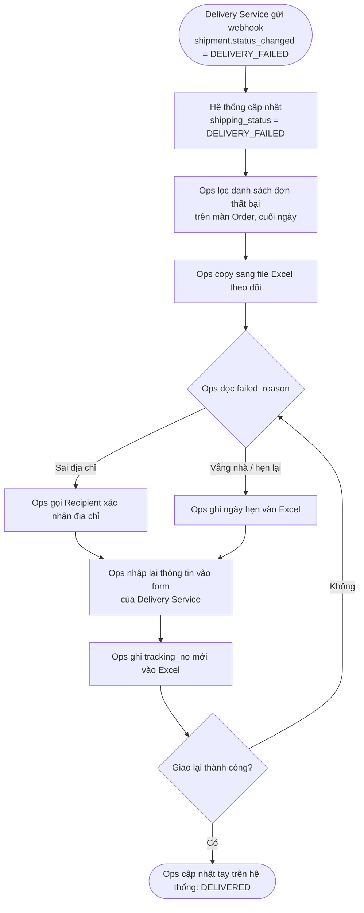

**Step Table**

| # | Actor | Hành động | Dữ liệu | Công cụ |
|---|---|---|---|---|
| 1 | Delivery Service | Gửi webhook thất bại | `failed_reason`, `tracking_no` | Webhook |
| 2 | Ops | Lọc đơn thất bại | `shipping_status` | Màn Order |
| 3 | Ops | Ghi sang Excel | sub_order_id, recipient, phone, address | Excel |
| 4 | Ops | Gọi Recipient (nếu sai địa chỉ) | phone | Điện thoại |
| 5 | Ops | Tạo lại vận đơn | address, items | Form Delivery Service |
| 6 | Ops | Ghi tracking mới | tracking_no | Excel |
| 7 | Ops | Cập nhật trạng thái cuối | shipping_status | Màn Order |

**Pain Point Register**

| # | Pain point | Bước | Ai chịu | Evidence cần lấy | Impact |
|---|---|---|---|---|---|
| PP-01 | Lần giao lại không có bản ghi `shipment` trên hệ thống, `attempt_no` không tăng | 5–6 | Ops, Finance, CS | Đếm Sub-order có tracking_no trong Excel nhưng không có trên hệ thống | Đối soát Delivery thiếu lần giao, CS không tra được |
| PP-02 | Ops chỉ xử lý cuối ngày → đơn thất bại chờ đến hôm sau | 2 | Recipient | Khoảng cách giữa thời điểm webhook và thời điểm tạo vận đơn mới | Giao chậm, khiếu nại |
| PP-03 | Nhập lại địa chỉ thủ công | 5 | Ops | Số phút/đơn khi quan sát | Sai địa chỉ lần hai |
| PP-04 | Webhook kết quả lần giao lại không gắn được vào Sub-order | 7 | Ops, Client | Số Sub-order Ops phải cập nhật tay | Client không nhận `order.status_changed` đúng lúc |
| PP-05 | Không giới hạn số lần giao lại | 9 | Finance | Phân bố số lần giao/đơn | Chi phí vận chuyển không kiểm soát |

Chú ý cột "Evidence cần lấy": khi chưa có số, BA ghi **cách lấy số**, không tự điền số.

#### Ví dụ từ dự án thật: Slide to Use

Tài liệu dự án mô tả hai vấn đề của luồng tách voucher trên Voucher Link E và App ví quà. Viết lại dưới dạng AS-IS:

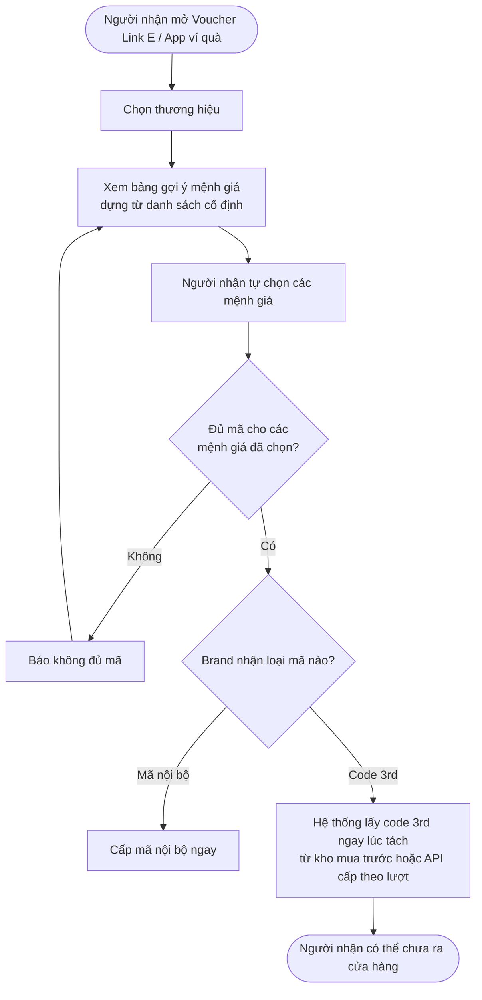

**Pain point (theo tài liệu):**

| # | Pain point | Bước | Ai chịu | Impact (theo tài liệu) |
|---|---|---|---|---|
| PP-1 | Code 3rd được lấy ngay khi tách, kể cả khi người nhận chưa định ra cửa hàng; không dùng thì không thu hồi được | H | Công ty | Kho cạn nhanh hơn nhu cầu thật; với nguồn cấp theo lượt, Công ty trả tiền cho mã không tạo giao dịch |
| PP-2 | Bảng gợi ý mệnh giá không kiểm tồn kho | B–E | Người nhận | Chọn xong mới báo không đủ mã, phải làm lại |
| PP-3 | Người nhận phải tự chia mệnh giá | C | Người nhận | Thao tác tách phức tạp (MT-2 đo tỷ lệ lượt tách hoàn tất) |

Điểm hay của AS-IS này: PP-1 không phải lỗi phần mềm. Hệ thống chạy đúng thiết kế. Vấn đề nằm ở **thời điểm** lấy mã. Nếu chỉ hỏi người dùng "có lỗi gì không", bạn sẽ không thấy PP-1. Phải nhìn theo dòng tiền: chi phí phát sinh khi nào (bảng nguồn code ở mục 1 của case) so với giá trị tạo ra khi nào.

Tài liệu cũng ghi baseline cho MT-1, MT-2 là Open Item riêng (OI-BRD-01). Nghĩa là pain point đã rõ về bản chất nhưng **chưa có số đo hiện trạng**. Đây là tình huống bình thường. BA ghi nhận, mở OI, không tự điền số.

### Junior vs Middle vs Senior

| Tình huống: vẽ AS-IS re-delivery | Junior | Middle | Senior |
|---|---|---|---|
| Nghĩ | "Vẽ theo SOP là xong." | "Phải ngồi với Ops xem làm thật thế nào." | "Dữ liệu nào đang nằm ngoài hệ thống? Ai đang dựa vào dữ liệu đó?" |
| Hỏi | "Quy trình có mấy bước?" | "Bước nào làm ngoài hệ thống? Mất bao lâu?" | "Finance đối soát lần giao lại bằng nguồn nào nếu hệ thống không có?" |
| Làm | Flow 5 bước, không dữ liệu | Flow + step table + pain point có tần suất | Thêm cột Evidence + cách lấy số, đánh dấu chỗ SOP lệch thực tế |

### Sai lầm thường gặp

1. **Vẽ TO-BE và gọi là AS-IS.** Vô thức bỏ bước "dở" đi.
2. **Chỉ vẽ phần trong hệ thống.** Excel, điện thoại, chat mới là chỗ có pain.
3. **Pain point không có evidence.** "Ops thấy mệt" chưa phải pain point.
4. **Tự điền số.** "Mất 10 phút/đơn" khi chưa đo. Nếu chưa có, ghi cách đo.
5. **Trộn giải pháp vào pain point.** "Chưa có nút re-delivery" là giải pháp đội lốt vấn đề.
6. **Không xác nhận với người làm thật.** AS-IS sai thì TO-BE cũng sai.

### Góc nhìn Senior BA/PO

Senior dùng AS-IS để tìm **dữ liệu bị đứt**: chỗ thông tin rời hệ thống rồi quay lại bằng tay. Mỗi chỗ đứt là ba rủi ro: sai dữ liệu, không audit được, không đo được.

Senior cũng dùng AS-IS để **bảo vệ hành vi đang chạy**. Mọi bước trong AS-IS mà TO-BE không đụng tới phải được giữ nguyên. Đó chính là regression scope. Slide to Use có NFR-4 "các kênh giữ nguyên không đổi hành vi, QC chạy regression từng kênh" — muốn viết được NFR này, phải biết AS-IS của từng kênh.

Câu Senior hay hỏi nhất ở bước này: "Chi phí phát sinh ở bước nào, giá trị tạo ra ở bước nào?". Khi hai điểm này lệch nhau, thường có pain point lớn.

### Bài tập thực hành

**Đầu vào.** Pain point 2 của PG: Supplier không confirm Sub-order trong SLA → Order treo. `[Giả định bài tập]` lời kể của Ops:

> "Sáng nào em cũng lọc Sub-order đang SENT_TO_SUPPLIER quá 1 ngày. Supplier nào có API thì em gọi hotline hỏi, Supplier MANUAL thì em nhắn Zalo. Nếu họ báo hết hàng thì em huỷ Sub-order, báo Sales để Sales báo Client. Có hôm em quên lọc, Client gọi CS hỏi thì mới biết. Cuối tháng kế toán hỏi đơn này huỷ ngày nào em phải lục lại tin nhắn."

**Yêu cầu đầu ra.**
1. AS-IS flow (mermaid) từ lúc Sub-order chuyển `SENT_TO_SUPPLIER` đến lúc Sub-order `SUPPLIER_CONFIRMED` hoặc `CANCELLED`.
2. Step table có cột Dữ liệu và Công cụ.
3. Pain Point Register tối thiểu 4 dòng, có cột Evidence cần lấy.

### Lời giải tham khảo

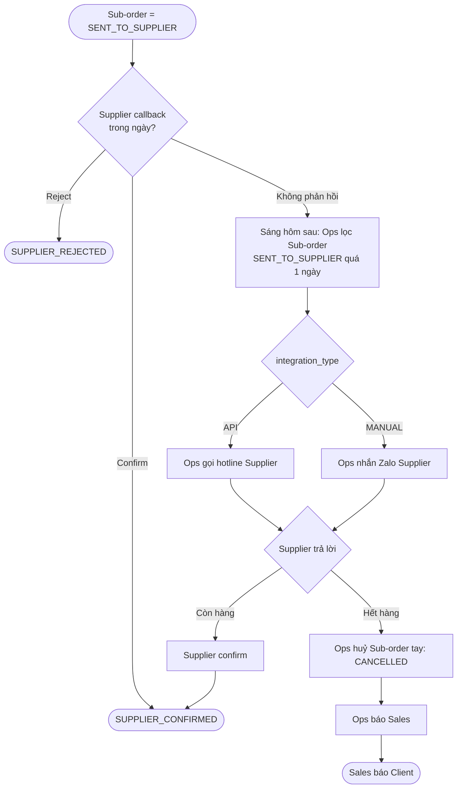

**Pain Point Register mẫu:**

| # | Pain point | Ai chịu | Evidence cần lấy |
|---|---|---|---|
| PP-01 | Phát hiện treo phụ thuộc Ops lọc tay mỗi sáng; ngày quên lọc thì không ai biết | Client, CS | Số lần CS nhận hỏi về Order treo / tháng |
| PP-02 | Ngưỡng "quá 1 ngày" không khớp `confirm_sla_minutes` cấu hình cho từng Supplier | Ops, Supplier | So sánh giá trị cấu hình với thời điểm Ops thực sự xử lý |
| PP-03 | Lý do và thời điểm huỷ chỉ nằm trong tin nhắn | Finance | Số Sub-order CANCELLED không có `audit_log.reason` |
| PP-04 | Client nhận thông tin qua Sales, không qua webhook `order.status_changed` | Client, Sales | Kiểm tra log webhook cho Sub-order huỷ tay |
| PP-05 | Không ghi nhận Supplier nào hay trễ | Management | Không có dữ liệu → đây chính là evidence |

**Tại sao.** Lời kể chứa ba hệ thống ngầm: hotline, Zalo, Sales. Junior thường vẽ một khối "Ops liên hệ Supplier" và bỏ mất PP-03, PP-04. PP-02 là phát hiện quan trọng nhất: hệ thống **đã có** field `confirm_sla_minutes` nhưng quy trình thật không dùng nó. Đây là kiểu phát hiện chỉ có khi đối chiếu lời kể với dữ liệu hệ thống. PP-03 nối với pain point 5 (đối soát lệch do Sub-order huỷ muộn) — Junior hay xử lý từng pain point riêng lẻ, không thấy chúng cùng một gốc.

### Checklist hoàn thành

- [ ] Tôi hiểu khái niệm.
- [ ] Tôi tự làm được bài tập.
- [ ] Tôi giải thích được cho Developer/QC.
- [ ] Tôi có thể viết thành Requirement/artifact.
- [ ] Mỗi bước AS-IS của tôi có Actor, Hành động, Dữ liệu.
- [ ] Mỗi pain point của tôi gắn vào bước cụ thể và có cách lấy evidence.
- [ ] AS-IS của tôi có các bước làm ngoài hệ thống.

---

## Day 11 - Root Cause Analysis: 5 Whys, Fishbone

> P3 Process · Middle · Thời lượng ~60–90 phút · Deliverable: RCA Sheet (Problem + 5 Whys + Fishbone + Root cause đã kiểm chứng + hướng xử lý)

### Mục tiêu

- Phân biệt Symptom – Triệu chứng, Cause – Nguyên nhân, Root Cause – Nguyên nhân gốc.
- Dùng 5 Whys để đào theo chiều sâu một chuỗi nhân quả.
- Dùng Fishbone để quét theo chiều rộng, không bỏ sót nhóm nguyên nhân.
- Kiểm chứng root cause bằng dữ liệu trước khi đề xuất TO-BE.

### Kiến thức cần học

**Symptom vs Cause vs Root Cause**

| Loại | Định nghĩa | Ví dụ PG |
|---|---|---|
| Symptom | Cái người dùng thấy | Order treo nhiều ngày |
| Cause | Lý do trực tiếp | Sub-order không được confirm |
| Root Cause | Nguyên nhân mà nếu xử lý, vấn đề không lặp lại | Không có cơ chế nào hành động khi hết `confirm_sla_minutes` |

Kiểm tra một nguyên nhân có phải gốc không bằng câu: **"Nếu sửa cái này, vấn đề có quay lại không?"** Còn quay lại thì chưa phải gốc.

**5 Whys – Năm lần Tại sao.** Hỏi "Tại sao?" liên tiếp, mỗi câu trả lời là đầu vào cho câu hỏi tiếp. Số 5 là ước lượng; dừng khi tới điểm có thể hành động và nằm trong tầm kiểm soát của tổ chức. Quy tắc:
- Mỗi câu trả lời phải là **sự kiện kiểm chứng được**, không phải đoán.
- Không dừng ở "do con người" ("Ops quên"). Hỏi tiếp: "Tại sao quy trình phụ thuộc vào việc Ops nhớ?"
- Một câu "Tại sao" có thể có nhiều câu trả lời → tách nhánh.

**Fishbone – Biểu đồ xương cá (Ishikawa).** Đầu cá là vấn đề, các xương là nhóm nguyên nhân. Với phần mềm và vận hành, dùng 6 nhóm:

| Nhóm | Câu hỏi gợi ý |
|---|---|
| People – Con người | Kỹ năng, phân công, quá tải |
| Process – Quy trình | Bước thiếu, thứ tự sai, không có SLA |
| System – Hệ thống | Thiếu chức năng, job, cảnh báo |
| Data – Dữ liệu | Dữ liệu sai, thiếu, cũ, không đồng bộ |
| Partner – Đối tác | Supplier, Delivery Service, Client |
| Policy – Chính sách | Hợp đồng, quy định, rule tài chính |

**Kết hợp hai công cụ.** Fishbone để quét rộng, chọn 1–2 nhánh có evidence mạnh, rồi dùng 5 Whys đào sâu.

**Kiểm chứng root cause.** Một root cause chỉ được chấp nhận khi có evidence: số liệu, log, cấu hình, tài liệu. Chưa có evidence → ghi là **giả thuyết** kèm cách kiểm chứng.

### BA/PO sử dụng kiến thức này khi nào?

- Sau AS-IS, khi đã có pain point nhưng chưa biết nên sửa ở đâu.
- Khi nhận yêu cầu giải pháp và nghi ngờ nó chỉ chữa triệu chứng.
- Khi bug production lặp lại (Day 44 Bug Triage).
- Khi post-release KPI không cải thiện (Day 47).

### Quy trình thực hiện

**Step 1 – Viết Problem Statement một câu.** Có đối tượng, hiện tượng, phạm vi. VD: "Sub-order ở trạng thái SENT_TO_SUPPLIER vượt `confirm_sla_minutes` không được xử lý cho tới khi Ops phát hiện thủ công."

**Step 2 – Vẽ Fishbone.** Mỗi nhóm ghi 1–4 nguyên nhân khả dĩ. Chưa đánh giá.

**Step 3 – Đánh dấu evidence.** Mỗi nguyên nhân: Đã kiểm chứng / Giả thuyết / Loại bỏ.

**Step 4 – 5 Whys trên nhánh mạnh nhất.** Viết thành bảng, mỗi dòng có cột Evidence.

**Step 5 – Kiểm tra bằng câu "sửa cái này, có quay lại không?".**

**Step 6 – Chốt root cause + hướng xử lý sơ bộ.** Hướng xử lý chỉ ở mức định hướng; TO-BE chi tiết làm ở Day 12.

### Ví dụ thực tế

**Bối cảnh PG.** Từ AS-IS Day 10 (bài tập): Order treo do Supplier không confirm.

**Fishbone**

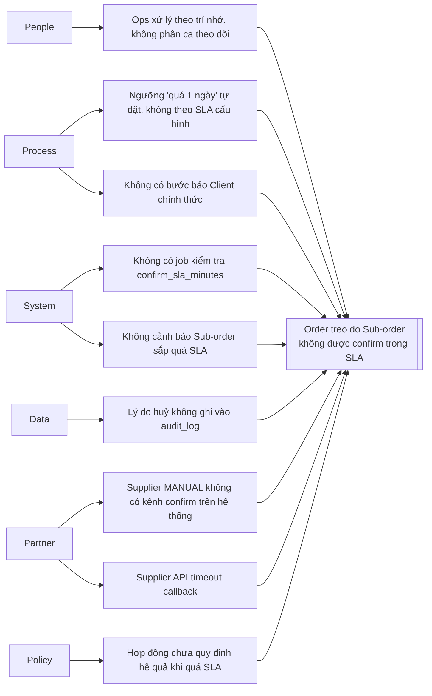

Mermaid không có dạng xương cá; dùng flowchart trái → phải, mỗi nhóm một nút gốc, tất cả dồn về "đầu cá".

**Đánh giá evidence** `[Giả định bài tập]`:

| Nguyên nhân | Trạng thái | Evidence / cách kiểm chứng |
|---|---|---|
| S1 Không có job kiểm SLA | Đã kiểm chứng | Field `confirm_sla_minutes` có, nhưng không có tiến trình nào đọc nó |
| PR1 Ngưỡng tự đặt | Đã kiểm chứng | Lời kể Ops + so với cấu hình |
| PA1 Supplier MANUAL không có kênh confirm | Giả thuyết | Cần kiểm tra Supplier MANUAL confirm bằng cách nào |
| PA2 Callback timeout | Giả thuyết | Cần log callback |
| PO1 Hợp đồng | Giả thuyết | Cần Supplier Mgmt rà (A-02 Day 9) |

**5 Whys trên nhánh System/Process**

| # | Tại sao? | Trả lời | Evidence |
|---|---|---|---|
| 1 | Tại sao Order treo? | Có Sub-order ở SENT_TO_SUPPLIER rất lâu | Truy vấn Sub-order theo `sent_at` |
| 2 | Tại sao Sub-order ở đó lâu? | Supplier không callback và không ai xử lý | Không có `confirmed_at`, không có audit_log |
| 3 | Tại sao không ai xử lý? | Chỉ Ops phát hiện bằng cách lọc tay mỗi sáng | Lời kể Ops, không có job |
| 4 | Tại sao phụ thuộc lọc tay? | Hệ thống lưu `confirm_sla_minutes` nhưng không có hành động nào khi hết SLA | Cấu hình + code/không có job |
| 5 | Tại sao không có hành động? | Khi thiết kế tích hợp Supplier, chưa định nghĩa rule "hết SLA thì làm gì" | Tài liệu tích hợp không có rule này |

**Root cause:** Chưa có Business Rule cho sự kiện "hết `confirm_sla_minutes`" → hệ thống có dữ liệu SLA nhưng không hành động.

**Kiểm tra:** Nếu chỉ thêm cảnh báo cho Ops (sửa tầng 3), Ops vẫn có thể bỏ lỡ; vấn đề quay lại. Nếu định nghĩa rule và tự động hoá (sửa tầng 5), vấn đề không lặp lại. Vậy tầng 5 là gốc.

Chú ý: "Auto-cancel" chỉ là **một** phương án của rule. Rule cũng có thể là "chuyển Supplier khác" hoặc "báo Ops xử lý trong X phút". RCA chỉ ra **chỗ** cần sửa, chưa chọn **cách** sửa.

#### Ví dụ từ dự án thật: Slide to Use

Áp 5 Whys vào PP-1 của Day 10. Ba tầng đầu bám tài liệu, các tầng còn lại là phân tích học tập.

| # | Tại sao? | Trả lời | Nguồn |
|---|---|---|---|
| 1 | Tại sao Công ty trả tiền cho mã không tạo giao dịch (nguồn cấp theo lượt)? | Mã được lấy từ đối tác nhưng người nhận không dùng | Tài liệu, mục Vấn đề |
| 2 | Tại sao mã được lấy khi người nhận chưa dùng? | Hệ thống lấy code 3rd ngay khi tách, kể cả khi người nhận chưa định ra cửa hàng | Tài liệu, mục Vấn đề |
| 3 | Tại sao lấy ngay khi tách? | Luồng gộp hai việc vào cùng một thời điểm: ghi nhận quyền dùng (redeem, doanh thu cho brand) và lấy mã | Tài liệu, mục TO-BE: "Tách hai việc đang xảy ra cùng lúc thành hai thời điểm" |
| 4 | Tại sao hai việc này bị gộp? | `[Giả định bài tập]` Luồng được thiết kế khi đa số brand nhận mã nội bộ, nơi cấp mã gần như không tốn chi phí biên | Giả thuyết, cần kiểm chứng |

Root cause (theo tài liệu): **thời điểm lấy mã gắn cứng với thời điểm tách**. Hướng giải quyết của dự án đúng là tách hai việc này: lúc tách chỉ ghi nhận redeem và doanh thu, lúc trượt Slide to Use mới lấy mã.

Fishbone cho thấy thêm một nguyên nhân độc lập — nhóm Data/System: **bảng gợi ý mệnh giá dựng từ danh sách cố định, không kiểm tồn kho** (PP-2). Đây là root cause khác, không giải được bằng việc dời thời điểm lấy mã. Dự án xử lý bằng một hướng khác: người nhận chỉ nhập số tiền, hệ thống tự chia mệnh giá. Quy tắc chia vẫn là Open Item OI-S16 (ít mã nhất, ưu tiên mệnh giá lớn, hay theo tồn kho).

Bài học: **một vấn đề có thể có hai root cause độc lập**, và mỗi root cause cần một hướng xử lý riêng. Gộp chung sẽ bỏ sót.

### Junior vs Middle vs Senior

| Tình huống: Order treo do Supplier | Junior | Middle | Senior |
|---|---|---|---|
| Nghĩ | "Supplier chậm, nhắc Supplier." | "Thiếu cơ chế xử lý khi quá SLA." | "Thiếu rule, và hợp đồng có thể chưa cho phép rule đó. Hai gốc, hai owner." |
| Hỏi | "Supplier nào hay chậm?" | "Tại sao hệ thống không hành động khi hết SLA?" | "Evidence nào chứng minh? Sửa xong, đo bằng gì để biết không lặp lại?" |
| Làm | Đề xuất gửi email nhắc Supplier | 5 Whys + root cause + hướng xử lý | Fishbone + đánh giá evidence + 5 Whys + metric kiểm chứng + owner cho từng giả thuyết |

### Sai lầm thường gặp

1. **Dừng ở con người.** "Ops quên" không phải root cause; quy trình phụ thuộc trí nhớ mới là vấn đề.
2. **5 Whys bằng suy đoán.** Mỗi tầng không có evidence → chuỗi nhân quả đẹp nhưng sai.
3. **Nhảy thẳng sang giải pháp.** Root cause "Thiếu nút auto-cancel" là giải pháp trá hình.
4. **Chỉ đi một nhánh.** Bỏ qua root cause thứ hai (như PP-2 Slide to Use).
5. **Đổ lỗi cho đối tác mà không xem phần mình kiểm soát.** Supplier chậm là bên ngoài; thiếu rule là bên trong.
6. **Không ghi giả thuyết.** Nguyên nhân chưa kiểm chứng biến mất khỏi tài liệu, rồi quay lại thành bug.

### Góc nhìn Senior BA/PO

Senior dùng RCA để **từ chối đúng cách**. Khi Ops yêu cầu "thêm màn hình nhắc Supplier", Senior không nói "không". Senior đưa RCA: "Màn nhắc xử lý tầng 3. Gốc ở tầng 5. Nếu làm màn nhắc, sau 2 tháng vấn đề quay lại." Có dữ liệu, cuộc nói chuyện chuyển từ ý kiến sang bằng chứng.

Senior cũng tách root cause theo **owner**. Root cause thuộc hệ thống → backlog. Thuộc hợp đồng → Supplier Mgmt. Thuộc rule tài chính → Finance. Một RCA tốt luôn kết thúc bằng danh sách việc có người chịu trách nhiệm.

Cuối cùng, Senior gắn root cause với **metric kiểm chứng**: "Sau khi sửa, số Sub-order SENT_TO_SUPPLIER quá `confirm_sla_minutes` mà chưa có hành động phải bằng 0." Không đo được thì không biết đã sửa đúng gốc chưa.

### Bài tập thực hành

**Đầu vào.** Pain point 5 của PG: cuối tháng đối soát Supplier lệch số do Sub-order huỷ muộn. `[Giả định bài tập]`:
- Đối soát Supplier chạy ngày 1 hằng tháng, lấy Sub-order có `confirmed_at` trong tháng trước.
- Một số Sub-order được huỷ sau ngày 1 (Supplier đã confirm nhưng sau đó hết hàng).
- Finance phải sửa tay biên bản đối soát đã gửi Supplier.
- `audit_log` có ghi huỷ, nhưng `reconciliation` không đọc `audit_log`.

**Yêu cầu đầu ra.**
1. Problem Statement một câu.
2. Fishbone 6 nhóm, mỗi nhóm ít nhất 1 nguyên nhân, đánh dấu Đã kiểm chứng/Giả thuyết.
3. 5 Whys trên nhánh mạnh nhất, có cột Evidence.
4. Root cause + câu kiểm tra "sửa có quay lại không" + owner.

### Lời giải tham khảo

**Problem Statement:** "Sub-order bị huỷ sau khi kỳ đối soát Supplier đã chốt vẫn nằm trong biên bản kỳ đó, khiến Finance phải sửa tay biên bản đã gửi Supplier."

**Fishbone (rút gọn):** Process – không có bước xử lý điều chỉnh sau khi chốt kỳ (Đã kiểm chứng); System – `reconciliation` không đọc thay đổi trạng thái sau thời điểm chốt (Đã kiểm chứng); Data – kỳ đối soát xác định theo `confirmed_at`, không theo trạng thái cuối (Đã kiểm chứng); Partner – Supplier cho phép huỷ sau confirm (Giả thuyết); Policy – chưa có quy định đối soát xử lý huỷ sau kỳ như thế nào (Giả thuyết); People – Finance không được báo khi Sub-order đã đối soát bị huỷ (Đã kiểm chứng).

**5 Whys:**

| # | Tại sao? | Trả lời |
|---|---|---|
| 1 | Biên bản lệch? | Có Sub-order CANCELLED vẫn tính tiền |
| 2 | Tại sao vẫn tính? | Lúc chạy đối soát, Sub-order còn SUPPLIER_CONFIRMED |
| 3 | Tại sao không cập nhật sau đó? | Kỳ đã chốt là ảnh chụp cố định, không có cơ chế điều chỉnh |
| 4 | Tại sao không có cơ chế điều chỉnh? | Chưa có rule: huỷ sau khi kỳ đã chốt thì ghi nhận vào kỳ nào |
| 5 | Tại sao chưa có rule? | Thiết kế đối soát giả định Sub-order đã confirm thì không huỷ |

**Root cause:** Thiếu rule ghi nhận điều chỉnh cho Sub-order đổi trạng thái sau khi kỳ đối soát đã chốt. Owner: Finance (A cho rule), BA (viết rule), Tech Lead (thiết kế).

**Kiểm tra:** Nếu chỉ "chạy đối soát muộn hơn vào ngày 5", huỷ sau ngày 5 vẫn lệch → không phải gốc. Nếu có rule điều chỉnh kỳ sau (ví dụ dòng âm ở kỳ kế tiếp), mọi thời điểm huỷ đều được xử lý → gốc.

**Tại sao.** Junior thường chọn giải pháp "chạy đối soát muộn hơn" vì nó dễ, nhưng đó là dời triệu chứng. Junior cũng hay bỏ nhóm Policy: ở đây Finance mới quyết định cách điều chỉnh (đánh dấu hay dòng âm), không phải Dev. Câu hỏi này giống hệt OI-S43 của Slide to Use (huỷ dòng doanh thu bằng đánh dấu hay bút toán đảo) — một mẫu câu hỏi tài chính sẽ lặp lại ở nhiều dự án.

### Checklist hoàn thành

- [ ] Tôi hiểu khái niệm.
- [ ] Tôi tự làm được bài tập.
- [ ] Tôi giải thích được cho Developer/QC.
- [ ] Tôi có thể viết thành Requirement/artifact.
- [ ] Mỗi tầng 5 Whys của tôi có evidence hoặc được ghi là giả thuyết.
- [ ] Root cause của tôi qua được câu kiểm tra "sửa có quay lại không".
- [ ] Tôi không dừng ở nguyên nhân "do con người".

---

## Day 12 - Gap Analysis, TO-BE & Process Optimization

> P3 Process · Middle · Thời lượng ~60–90 phút · Deliverable: Gap Table + TO-BE Flow + Rationale (lý do, trade-off, impact)

### Mục tiêu

- Viết Gap Analysis nối AS-IS, root cause và TO-BE.
- Thiết kế TO-BE xử lý đúng root cause, không chỉ triệu chứng.
- Áp dụng 4 hướng tối ưu quy trình: Eliminate, Simplify, Integrate, Automate.
- Liệt kê impact của TO-BE lên dữ liệu, đối soát, kênh khác và stakeholder.

### Kiến thức cần học

**TO-BE Process – Quy trình mục tiêu.** Cách công việc sẽ diễn ra sau khi thay đổi. TO-BE tốt trả lời: bước nào bỏ, bước nào đổi, bước nào thêm, ai làm, dữ liệu gì, và **pain point nào được xử lý**.

**Gap Analysis – Phân tích khoảng cách.** Bảng so sánh AS-IS và TO-BE theo từng khía cạnh, chỉ ra cái cần thay đổi.

| Cột | Ý nghĩa |
|---|---|
| Khía cạnh | Bước, dữ liệu, rule, vai trò, công cụ |
| AS-IS | Hiện tại |
| TO-BE | Mục tiêu |
| Gap | Cần thay đổi gì |
| Xử lý pain point / root cause | Trỏ về PP-xx, RC-xx |
| Loại thay đổi | Process / System / Data / Policy / People |

**ESIA – Bốn hướng tối ưu quy trình**

| Hướng | Câu hỏi | Ví dụ PG |
|---|---|---|
| Eliminate – Loại bỏ | Bước này có cần tồn tại không? | Bỏ bước copy sang Excel |
| Simplify – Đơn giản hoá | Có làm ít thao tác hơn được không? | Ops chọn lý do từ danh sách thay vì gõ tự do |
| Integrate – Tích hợp | Gộp hoặc nối hai hệ thống/bước được không? | Tạo shipment mới gửi thẳng Delivery Service qua tích hợp |
| Automate – Tự động hoá | Máy làm thay người được không? | Job kiểm tra `confirm_sla_minutes` |

Thứ tự ESIA có ý nghĩa: **loại bỏ trước, tự động hoá sau**. Tự động hoá một bước thừa chỉ làm việc thừa chạy nhanh hơn.

**Ba ràng buộc khi thiết kế TO-BE**
- **Constraint – Ràng buộc:** hợp đồng, hệ thống đối tác, quy định kế toán.
- **Out of scope – Ngoài phạm vi:** đã quyết định không làm.
- **Backward compatibility – Tương thích ngược:** dữ liệu và kênh hiện có phải tiếp tục chạy.

**Rationale – Lý do thiết kế.** Mỗi quyết định TO-BE quan trọng có một dòng: chọn gì, vì sao, phương án bị loại, trade-off.

### BA/PO sử dụng kiến thức này khi nào?

- Sau RCA, trước khi viết scope và requirement (Tuần 3).
- Khi trình phương án cho PO/Management: Gap Table là bản tóm tắt "sẽ thay đổi những gì".
- Khi estimate: mỗi dòng Gap là một hạng mục công việc.
- Khi lập kế hoạch regression: dòng nào AS-IS = TO-BE là phần phải giữ nguyên.

### Quy trình thực hiện

**Step 1 – Lấy đầu vào.** AS-IS (Day 10), pain point, root cause (Day 11), constraint, out of scope.

**Step 2 – Chạy ESIA trên từng bước AS-IS.** Ghi bước nào bỏ, đơn giản hoá, tích hợp, tự động.

**Step 3 – Vẽ TO-BE.** Đánh dấu bước mới, bước đổi.

**Step 4 – Lập Gap Table.** Mỗi gap trỏ về pain point hoặc root cause. Gap không trỏ về đâu → hỏi lại có cần không (scope creep).

**Step 5 – Kiểm tra ngược.** Mỗi pain point có ít nhất một gap xử lý, hoặc được ghi rõ "không xử lý phase này" kèm lý do.

**Step 6 – Impact scan.** Với mỗi gap: ảnh hưởng dữ liệu, trạng thái, đối soát, báo cáo, kênh khác, stakeholder nào cần quyết định.

**Step 7 – Viết Rationale và Open Item.** Quyết định chưa có chủ → Open Item.

### Ví dụ thực tế

**Bối cảnh PG.** TO-BE cho root cause Day 11: chưa có rule cho sự kiện hết `confirm_sla_minutes`. `[Giả định bài tập]`: PO đã chọn hướng "hết SLA thì huỷ Sub-order" sau workshop Day 9.

**TO-BE Flow**

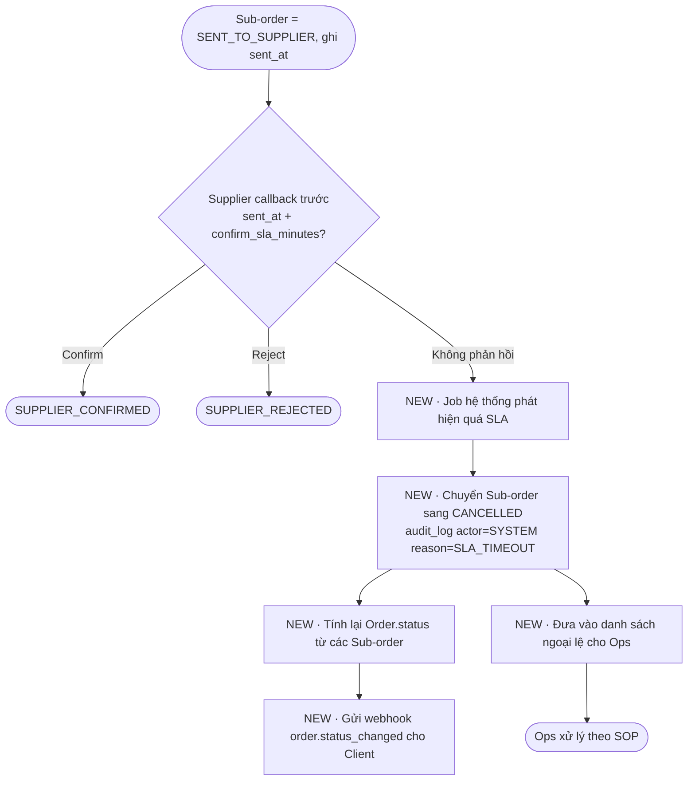

**Gap Table**

| Khía cạnh | AS-IS | TO-BE | Gap | Xử lý | Loại |
|---|---|---|---|---|---|
| Phát hiện quá SLA | Ops lọc tay mỗi sáng | Job hệ thống | Thêm job đọc `confirm_sla_minutes` | PP-01, PP-02, RC | System |
| Huỷ Sub-order | Ops huỷ tay sau khi gọi/nhắn | Hệ thống huỷ khi hết SLA | Thêm rule huỷ tự động | RC | System + Policy |
| Lý do huỷ | Nằm trong tin nhắn | `audit_log.reason = SLA_TIMEOUT` | Ghi audit cho actor SYSTEM | PP-03 | Data |
| Báo Client | Qua Sales | Webhook `order.status_changed` | Gửi webhook khi Order.status đổi do huỷ tự động | PP-04 | System |
| Theo dõi Supplier trễ | Không có | Đếm Sub-order huỷ do SLA_TIMEOUT theo Supplier | Báo cáo | PP-05 | Data |
| Liên hệ Supplier | Hotline/Zalo | Giữ nguyên cho trường hợp ngoại lệ | Không đổi | — | — |

**Rationale**

| Quyết định | Lý do | Phương án bị loại | Trade-off |
|---|---|---|---|
| Dùng `confirm_sla_minutes` từng Supplier | Field đã có, mỗi Supplier năng lực khác nhau | Một SLA chung | Cấu hình sai một Supplier thì huỷ oan hàng loạt → cần kiểm tra cấu hình trước go-live |
| Huỷ tự động thay vì chỉ cảnh báo | Cảnh báo vẫn phụ thuộc người (Day 11) | Chỉ cảnh báo Ops | Có thể huỷ đơn Supplier đang chuẩn bị → cần OI với Supplier Mgmt |

**Impact scan + Open Item**
- Callback confirm đến sau khi hệ thống đã huỷ: xử lý thế nào? (race — Day 32)
- Finance: Sub-order huỷ tự động có vào kỳ đối soát không? (OI-07)
- Client: Order bị huỷ một phần có chấp nhận được với mọi Client không?

#### Ví dụ từ dự án thật: Slide to Use

Đây là ví dụ TO-BE rất rõ của nguyên tắc **tách hai việc đang gộp**. AS-IS (Day 10) lấy mã lúc tách. TO-BE tách thành hai thời điểm.

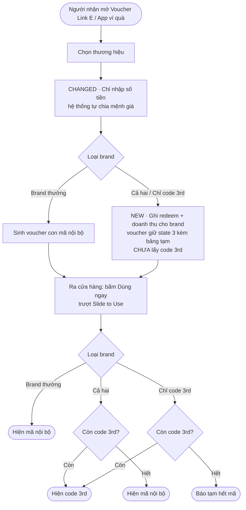

**Gap Table (theo tài liệu dự án)**

| Khía cạnh | AS-IS | TO-BE | Xử lý pain point |
|---|---|---|---|
| Thời điểm lấy code 3rd | Lúc tách | Lúc trượt Slide to Use | PP-1 |
| Chia mệnh giá | Người nhận tự chọn từ bảng cố định | Nhập số tiền, hệ thống tự chia | PP-2, PP-3 |
| Trạng thái voucher sau tách (brand code 3rd) | Đã có mã | State 3 + bảng tạm | PP-1 |
| Brand Cả hai hết code | — | Trả mã nội bộ | MT-3 |
| Brand Chỉ code 3rd hết code | — | Báo tạm hết mã | MT-1 |

**Ràng buộc và quyết định đã ghi trong tài liệu:**
- Out of scope: tự chuyển nguồn code theo ngưỡng tồn kho (**đã bỏ**). Đây là một ý tưởng tối ưu đã bị loại; ghi lại để không ai đề xuất lại mà không biết lịch sử.
- Brand Cả hai hết code → xoá bảng tạm và huỷ dòng doanh thu lúc tách; doanh thu ghi khi khách dùng mã nội bộ (quyết định 15/10/2026 lần 2). Quyết định này sinh ra OI-S43 cho Kế toán.

**Impact scan của TO-BE này** (các mục đều có trong tài liệu):

| Impact | Hệ quả | Nguồn |
|---|---|---|
| Hai thời điểm tách và trượt có thể khác tháng | Đối soát client dùng ngày nào? | OI-S42 |
| Chỉ code 3rd hết kho kéo dài, voucher tới hạn | Gia hạn, hoàn hay để hết hạn? | OI-S15 |
| Trượt nhiều lần / hai thiết bị | Chỉ một kết quả, tối đa một code | NFR-1 |
| POS kiểm bảng tạm và trừ voucher | Phải nguyên tử | NFR-2 |
| Voucher phát hành trước ngày bật tính năng | Luồng mới hay cũ? | OI-S10 / S54 |
| Custom API, POS khác | Có đi qua cùng logic không? | OI-S34 |

Bài học: TO-BE chỉ đổi **một thời điểm**, nhưng impact lan sang đối soát, kế toán, concurrency, migration, kênh khác. Junior vẽ xong TO-BE là dừng; Senior coi TO-BE là điểm bắt đầu của impact scan.

### Junior vs Middle vs Senior

| Tình huống: thiết kế TO-BE cho Order treo | Junior | Middle | Senior |
|---|---|---|---|
| Nghĩ | "Thêm auto-cancel là xong." | "Auto-cancel xử lý root cause; cần ghi audit và webhook." | "Auto-cancel tạo trạng thái mới cho đối soát, race với callback, rủi ro hợp đồng. Phải chốt trước khi dev." |
| Hỏi | "Mấy phút thì huỷ?" | "Huỷ xong Order chuyển gì? Client biết bằng cách nào?" | "Cái gì đang chạy phải giữ nguyên? Ai quyết định khi Supplier phản đối?" |
| Làm | Vẽ flow mới | Flow + Gap Table trỏ pain point | Flow + Gap + Rationale + Impact scan + Open Item có owner |

### Sai lầm thường gặp

1. **TO-BE không trỏ về pain point.** Thêm tính năng "tiện thể" → scope creep.
2. **Tự động hoá trước khi loại bỏ.** Tự động hoá việc copy Excel thay vì bỏ hẳn Excel.
3. **Không có Rationale.** Ba tháng sau không ai nhớ vì sao chọn phương án này.
4. **Quên phần giữ nguyên.** Không ghi "Liên hệ Supplier: không đổi" → Dev không biết có được đụng hay không.
5. **Bỏ qua impact tài chính.** TO-BE đổi thời điểm ghi nhận → đối soát đổi.
6. **Đề xuất lại phương án đã bị loại** vì không đọc Out of scope và lịch sử quyết định.

### Góc nhìn Senior BA/PO

Senior hỏi ba câu trước khi chấp nhận một TO-BE:

1. **Root cause nào được xử lý?** Không trỏ được → không làm.
2. **Ai mất gì?** Mọi TO-BE đều chuyển chi phí hoặc rủi ro từ bên này sang bên khác. Auto-cancel chuyển rủi ro từ Ops sang Supplier (bị huỷ đơn). Slide to Use chuyển thời điểm phát sinh chi phí code 3rd từ lúc tách sang lúc trượt, đổi lại phải xử lý brand hết code lúc trượt.
3. **Dữ liệu ở giữa hai thời điểm sống ở đâu?** Khi tách một việc thành hai thời điểm, luôn có trạng thái trung gian. Slide to Use có state 3 + bảng tạm. Trạng thái trung gian là nơi sinh bug: concurrency, migration, đối soát.

Senior cũng viết TO-BE ở mức **đủ để quyết định**, chưa đến mức đặc tả. Chi tiết field, API, UI để các tuần sau.

### Bài tập thực hành

**Đầu vào.** AS-IS và Pain Point Register re-delivery ở Day 10 (PP-01 đến PP-05). `[Giả định bài tập]` thêm:
- Delivery Service có API tạo vận đơn mới.
- PO đã chốt: tối đa 2 lần giao lại, lần thứ 3 thất bại thì `RETURNED`.
- Out of scope: đổi địa chỉ khi re-delivery (để cho feature "Admin sửa Order").

**Yêu cầu đầu ra.**
1. Bảng ESIA cho 7 bước AS-IS.
2. TO-BE flow (mermaid), đánh dấu NEW/CHANGED.
3. Gap Table, mỗi dòng trỏ về PP-xx.
4. Ba dòng Rationale.
5. Tối thiểu 3 impact/Open Item.

### Lời giải tham khảo

**ESIA:**

| Bước AS-IS | Hướng | TO-BE |
|---|---|---|
| Lọc đơn thất bại cuối ngày | Automate | Hàng đợi ngoại lệ cập nhật theo webhook |
| Copy sang Excel | Eliminate | Bỏ |
| Gọi Recipient | Giữ (ngoại lệ) | Vẫn cần với lý do sai địa chỉ |
| Nhập lại vào form Delivery | Integrate | Nút Re-delivery tạo `shipment` mới, gọi API Delivery |
| Ghi tracking vào Excel | Eliminate | `tracking_no` lưu trên `shipment` |
| Cập nhật trạng thái tay | Automate | Webhook cập nhật theo `shipment` mới |

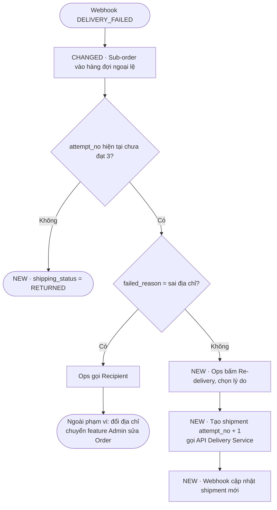

**Gap Table (rút gọn):** hàng đợi ngoại lệ (PP-02); tạo `shipment` mới trên hệ thống (PP-01); tích hợp API tạo vận đơn (PP-03); webhook gắn đúng `shipment` (PP-04); giới hạn `attempt_no` (PP-05).

**Rationale:** (1) Bỏ Excel thay vì import Excel — Excel là chỗ dữ liệu đứt. (2) Giới hạn theo `attempt_no` vì field đã có, không cần đếm riêng. (3) Không cho đổi địa chỉ phase này để tránh chồng với feature sửa Order; trade-off: đơn sai địa chỉ vẫn xử lý ngoài hệ thống.

**Impact / Open Item:** phí giao lại ai chịu (OI-03 Finance); đối soát Delivery Service phải tính theo từng `shipment`; Client có nhận webhook mỗi lần giao lại không; Order.status khi một Sub-order `RETURNED` (Order là trạng thái tổng hợp).

**Tại sao.** Nhánh "sai địa chỉ" là bẫy: Junior thường thêm ô sửa địa chỉ vào màn Re-delivery vì "tiện", vi phạm Out of scope. Junior cũng hay quên Order.status tổng hợp: một Sub-order `RETURNED` thì Order không còn đi tới `COMPLETED` theo đường bình thường. Cần rule riêng.

### Checklist hoàn thành

- [ ] Tôi hiểu khái niệm.
- [ ] Tôi tự làm được bài tập.
- [ ] Tôi giải thích được cho Developer/QC.
- [ ] Tôi có thể viết thành Requirement/artifact.
- [ ] Mỗi dòng Gap của tôi trỏ về một pain point hoặc root cause.
- [ ] Tôi ghi rõ phần giữ nguyên và phần ngoài phạm vi.
- [ ] TO-BE của tôi có Impact scan và Open Item có owner.

---

## Day 13 - Flowchart & Swimlane

> P3 Process · Junior → Middle · Thời lượng ~60–90 phút · Deliverable: Swimlane 5 lane (mermaid) + Step Table + danh sách Handoff

### Mục tiêu

- Vẽ flowchart đúng ký hiệu cơ bản, đọc được bởi Dev, QC, Ops.
- Chuyển flowchart sang swimlane để thể hiện ai chịu trách nhiệm bước nào.
- Nhận diện handoff – điểm bàn giao giữa các bên, nơi hay phát sinh lỗi.
- Vẽ swimlane bằng mermaid (subgraph làm lane) và giữ được tính dễ đọc.

### Kiến thức cần học

**Flowchart – Lưu đồ.** Mô tả thứ tự bước và rẽ nhánh. Ký hiệu cơ bản và cách viết trong mermaid:

| Ký hiệu | Ý nghĩa | Mermaid |
|---|---|---|
| Hình tròn/bo tròn | Bắt đầu / kết thúc | `A([Bắt đầu])` |
| Chữ nhật | Bước xử lý | `B[Ops bấm Re-delivery]` |
| Hình thoi | Quyết định (câu hỏi Có/Không hoặc nhiều nhánh) | `C{Còn hàng?}` |
| Hình trụ | Kho dữ liệu | `D[(inventory)]` |
| Mũi tên | Thứ tự | `A --> B` |
| Mũi tên có nhãn | Nhánh theo điều kiện | `C -- Có --> E` |

**Quy tắc viết nhãn**
- Bước: **Động từ + đối tượng**. "Gửi Sub-order", không phải "Sub-order".
- Quyết định: **câu hỏi** có câu trả lời đóng. "`available_qty` ≥ qty?" thay vì "Kiểm tra tồn kho".
- Mỗi nhánh ra khỏi hình thoi có nhãn. Các nhánh phải **phủ hết** khả năng (Có/Không, hoặc liệt kê đủ giá trị).

**Swimlane – Sơ đồ làn bơi.** Flowchart chia theo làn, mỗi làn là một actor (người, vai trò, hệ thống). Đọc ngang một làn biết actor đó làm gì. Đọc mũi tên cắt làn biết chỗ bàn giao.

**Handoff – Điểm bàn giao.** Mỗi lần mũi tên đi từ làn này sang làn khác. Handoff là nơi:
- Dữ liệu có thể mất hoặc sai định dạng.
- Thời gian chờ phát sinh.
- Không rõ ai chịu trách nhiệm nếu bên kia không phản hồi.

Với mỗi handoff, BA hỏi: **truyền dữ liệu gì, qua kênh nào, nếu bên nhận không phản hồi thì sao?**

**Chọn làn.** Làn có thể là vai trò (Ops, Admin), tổ chức (Supplier), hoặc hệ thống (PG System, Delivery Service). Quy tắc: 4–6 làn. Nhiều hơn → tách sơ đồ.

**Swimlane trong mermaid.** Mermaid không có swimlane chuẩn. Cách làm: mỗi lane là một `subgraph`, đặt node của actor vào subgraph tương ứng, mũi tên nối giữa subgraph là handoff.

### BA/PO sử dụng kiến thức này khi nào?

- Khi quy trình có từ 3 actor trở lên.
- Khi cần làm rõ trách nhiệm trước khi viết RACI chi tiết hoặc SOP.
- Khi phân tích tích hợp: mỗi handoff giữa hệ thống là một API hoặc webhook (Tuần 6).
- Khi viết test scenario end-to-end: QC đi theo từng handoff.

### Quy trình thực hiện

**Step 1 – Viết danh sách bước dạng bảng trước.** Cột: #, Actor, Bước, Dữ liệu vào/ra. Đừng vẽ ngay.

**Step 2 – Chọn làn.** Gom actor vào 4–6 làn.

**Step 3 – Vẽ đường chính (happy path) trước.** Từ sự kiện bắt đầu tới kết thúc thành công.

**Step 4 – Thêm nhánh ngoại lệ.** Reject, timeout, thất bại.

**Step 5 – Đánh số handoff.** Mỗi mũi tên cắt làn gắn H1, H2... Lập bảng handoff.

**Step 6 – Rà ba lỗi.** Hình thoi thiếu nhánh; bước không có actor; nhánh cụt (không dẫn về đâu).

**Step 7 – Đọc cho người khác nghe.** Đọc từ trái sang phải cho Dev hoặc Ops. Chỗ họ dừng hỏi là chỗ sơ đồ chưa rõ.

### Ví dụ thực tế

**Bối cảnh PG.** Luồng Order → Supplier → Delivery, 5 làn: Client, PG System, Supplier, Delivery Service, Ops.

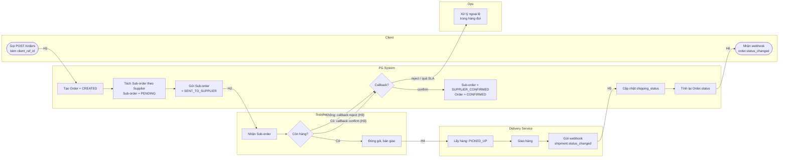

**Bảng Handoff**

| # | Từ → Đến | Dữ liệu | Kênh | Nếu bên nhận không phản hồi? |
|---|---|---|---|---|
| H1 | Client → PG | Program, SKU, recipient, `client_ref_id` | `POST /orders` | Client retry → chống trùng bằng `client_ref_id` (pain point 6) |
| H2 | PG → Supplier | Sub-order, items | API Supplier | Retry? Bao nhiêu lần? → Open Item |
| H3 | Supplier → PG | confirm / reject | Callback | Hết `confirm_sla_minutes` → rule Day 12 |
| H4 | Supplier → Delivery | Kiện hàng | Bàn giao vật lý | Ngoài hệ thống — ai ghi nhận thời điểm? |
| H5 | Delivery → PG | `shipment.status_changed` | Webhook | Webhook mất → trạng thái kẹt IN_TRANSIT |
| H6 | PG → Client | `order.status_changed` | Webhook | Client không nhận → retry webhook? |

Bảng handoff biến một sơ đồ thành **danh sách câu hỏi tích hợp**. H2, H5, H6 sẽ là bài học Tuần 6 (timeout, retry, webhook). H4 là handoff vật lý, không có dữ liệu trên hệ thống — một điểm mù.

`[Giả định bài tập]`: hàng đợi ngoại lệ của Ops (O1) là thành phần TO-BE từ Day 12, chưa có trong case gốc.

**Mẹo đọc mermaid swimlane.** Mermaid tự sắp layout, các lane có thể không thẳng hàng như Visio. Giữ mỗi lane ít node, nhãn ngắn, và luôn kèm bảng handoff. Sơ đồ để nhìn tổng thể, bảng để đọc chi tiết.

#### Ví dụ từ dự án thật: Slide to Use

Swimlane cho luồng trượt Slide to Use ở brand Cả hai. Làn theo tài liệu: Người nhận, Kênh (Voucher Link E / App ví quà), Hệ thống voucher, Nguồn code 3rd.

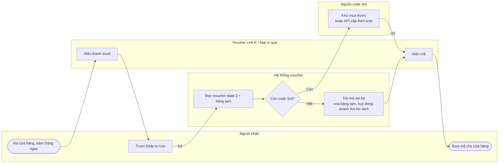

**Handoff đáng chú ý (theo tài liệu):**

| # | Handoff | Câu hỏi | Nguồn |
|---|---|---|---|
| H1 | Người nhận trượt → Hệ thống | Trượt nhiều lần hoặc trên hai thiết bị cùng lúc chỉ ra một kết quả, rút tối đa một code | NFR-1 |
| H2 | Nguồn code 3rd → Kênh | Lấy mã lúc trượt; nguồn cấp theo lượt phát sinh chi phí mỗi lần yêu cầu | Mục 1 case |
| V3 | Hết code ở brand Cả hai | Huỷ dòng doanh thu bằng đánh dấu hay bút toán đảo? | OI-S43 |

`[Giả định bài tập]`: cách chia làn "Hệ thống voucher" và "Nguồn code 3rd" là cách trình bày học tập; tài liệu dự án không có swimlane này. Ngoài ra, OI-S06 hỏi đường thay thế cho thanh trượt (giữ nút 1 giây / nút phụ sau 5 giây) vì trợ năng — nếu được chốt, làn Người nhận sẽ có thêm một nhánh.

Bài học: H1 nhìn chỉ là "người dùng trượt", nhưng đó là handoff có rủi ro cao nhất, vì một thao tác UI kích hoạt việc rút mã có chi phí. Swimlane giúp thấy ngay chỗ cần NFR.

### Junior vs Middle vs Senior

| Tình huống: vẽ luồng Order → Delivery | Junior | Middle | Senior |
|---|---|---|---|
| Nghĩ | "Vẽ đủ bước là được." | "Phải thấy ai làm bước nào, chỗ bàn giao ở đâu." | "Mỗi handoff là một hợp đồng dữ liệu và một điểm có thể kẹt." |
| Hỏi | "Bước tiếp theo là gì?" | "Bên nào làm bước này? Bên kia nhận gì?" | "Nếu bên nhận không phản hồi thì ai biết, sau bao lâu, làm gì?" |
| Làm | Flowchart 1 cột, chỉ happy path | Swimlane 5 làn + nhánh ngoại lệ | Swimlane + bảng handoff + câu hỏi tích hợp chuyển thành Open Item |

### Sai lầm thường gặp

1. **Hình thoi thiếu nhánh.** "Còn hàng?" chỉ có nhánh Có.
2. **Nhãn bước là danh từ.** "Sub-order" thay vì "Gửi Sub-order".
3. **Quá nhiều làn.** 9 làn không ai đọc được; tách thành 2 sơ đồ.
4. **Chỉ vẽ happy path.** Ngoại lệ mới là phần Dev và QC cần.
5. **Bỏ handoff vật lý.** Bàn giao hàng giữa Supplier và Delivery không có dữ liệu → điểm mù.
6. **Một node làm hai việc.** "Kiểm tra và gửi" → tách hai node.

### Góc nhìn Senior BA/PO

Senior không đánh giá swimlane bằng độ đẹp. Senior đếm **handoff**. Quy trình nhiều handoff thì chậm và dễ lỗi; TO-BE tốt thường giảm số handoff hoặc tự động hoá handoff.

Senior cũng dùng swimlane làm **khung test end-to-end**: mỗi handoff ít nhất một scenario thành công, một scenario bên nhận không phản hồi, một scenario dữ liệu sai. Đây là cách QC Manager chuyển sang BA tận dụng thế mạnh của mình.

Cuối cùng, Senior biết khi nào **không** dùng swimlane. Quy trình một actor, không bàn giao → flowchart là đủ. Cần timer, message, sự kiện ngoại lệ chuẩn hoá → BPMN (Day 14).

### Bài tập thực hành

**Đầu vào.** TO-BE re-delivery (lời giải Day 12). Làn: Delivery Service, PG System, Ops, Recipient, Client.

**Yêu cầu đầu ra.**
1. Step table (Actor, Bước, Dữ liệu).
2. Swimlane mermaid 5 làn, có nhánh `attempt_no` đã đủ và nhánh sai địa chỉ.
3. Bảng handoff, mỗi dòng có cột "Nếu bên nhận không phản hồi?".
4. Chỉ ra 2 handoff rủi ro nhất và lý do.

### Lời giải tham khảo

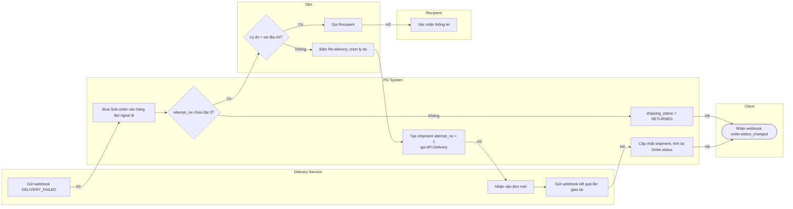

**Handoff rủi ro nhất:**
- **H3 (PG → Delivery, tạo vận đơn mới):** API lỗi hoặc timeout có thể tạo hai vận đơn, `attempt_no` tăng mà không có vận đơn thật. Đây là bài toán idempotency (Day 31).
- **H4 (webhook kết quả lần giao lại):** webhook phải gắn đúng `shipment` của lần giao mới. Nếu gắn theo `sub_order_id`, kết quả lần 2 có thể ghi đè lần 1 — chính là PP-04 ở Day 10.

**Tại sao.** H2 (gọi Recipient) nhìn có vẻ rủi ro vì thủ công, nhưng nằm trong Out of scope và không đổi dữ liệu hệ thống. Junior hay chọn H2 vì "thủ công = rủi ro", bỏ qua H3, H4 nơi tiền và dữ liệu bị ảnh hưởng. Junior cũng hay quên làn Client: Order là trạng thái tổng hợp, Sub-order `RETURNED` thì Client phải nhận webhook.

### Checklist hoàn thành

- [ ] Tôi hiểu khái niệm.
- [ ] Tôi tự làm được bài tập.
- [ ] Tôi giải thích được cho Developer/QC.
- [ ] Tôi có thể viết thành Requirement/artifact.
- [ ] Mọi hình thoi trong sơ đồ của tôi có đủ nhánh và nhãn.
- [ ] Tôi có bảng handoff với câu hỏi "bên nhận không phản hồi thì sao".
- [ ] Tôi vẽ được swimlane bằng mermaid subgraph.

---

## Day 14 - BPMN cơ bản

> P3 Process · Middle · Thời lượng ~60–90 phút · Deliverable: BPMN v1 luồng "Huỷ Sub-order khi Supplier không confirm trong SLA" + bảng ký hiệu + Review tuần 2

### Mục tiêu

- Hiểu 4 nhóm ký hiệu BPMN: Event, Activity, Gateway, Flow (kèm Pool/Lane).
- Biết khi nào cần BPMN thay vì flowchart/swimlane.
- Mô tả được timer, message, ngoại lệ và nhánh song song bằng ký hiệu chuẩn.
- Thể hiện BPMN bằng mermaid flowchart theo quy ước thống nhất (vì mermaid không có BPMN).

### Kiến thức cần học

**BPMN – Business Process Model and Notation – Ký hiệu mô hình quy trình nghiệp vụ.** Chuẩn quốc tế để vẽ quy trình. Khác flowchart ở chỗ có ký hiệu riêng cho **sự kiện** (thời gian, thông điệp, lỗi) và **luồng thông điệp giữa các tổ chức**. Dev, BA, vận hành đọc cùng một nghĩa.

**Bảng ký hiệu BPMN cơ bản và quy ước mermaid trong khoá học**

| Nhóm | Ký hiệu BPMN | Ý nghĩa | Quy ước mermaid |
|---|---|---|---|
| Event | Start Event (tròn viền mảnh) | Điểm bắt đầu | `S((Start: ...))` |
| Event | End Event (tròn viền đậm) | Điểm kết thúc | `E(((End: ...)))` |
| Event | Timer Event (tròn có đồng hồ) | Kích hoạt theo thời gian | `T((⏱ Timer: ...))` hoặc tiền tố `TIMER:` |
| Event | Message Event (tròn có phong bì) | Nhận/gửi thông điệp từ bên ngoài | `M((✉ Msg: ...))` hoặc tiền tố `MSG:` |
| Event | Error Event (tròn có tia sét) | Lỗi kết thúc nhánh | tiền tố `ERROR:` |
| Event | Boundary Event (gắn trên viền task) | Sự kiện ngắt task đang chờ (VD: hết giờ) | Nhánh ra từ task với nhãn `boundary: ...` |
| Activity | Task (chữ nhật bo góc) | Một việc | `A[User: ...]` / `A[Service: ...]` |
| Activity | Sub-process (có dấu +) | Gói nhiều task | `A[[Sub-process: ...]]` |
| Gateway | Exclusive Gateway – XOR (thoi có X) | Chọn **một** nhánh | `G{XOR: ...?}` |
| Gateway | Parallel Gateway – AND (thoi có +) | Chạy **tất cả** nhánh cùng lúc / chờ đủ | `G{AND}` |
| Gateway | Inclusive Gateway – OR (thoi có O) | Chạy **một hoặc nhiều** nhánh thoả điều kiện | `G{OR: ...}` |
| Gateway | Event-based Gateway | Chờ sự kiện nào đến trước | `G{EVENT: chờ sự kiện đầu tiên}` |
| Flow | Sequence Flow (nét liền) | Thứ tự trong cùng một Pool | `-->` |
| Flow | Message Flow (nét đứt) | Thông điệp giữa hai Pool | `-.->` |
| Container | Pool | Một tổ chức/hệ thống độc lập | `subgraph` cấp 1 |
| Container | Lane | Vai trò trong Pool | `subgraph` lồng trong Pool |

Hai quy tắc BPMN Junior hay vi phạm:
1. **Sequence Flow không đi xuyên Pool.** Giữa hai tổ chức chỉ có Message Flow. PG và Supplier là hai Pool; PG không "điều khiển" bước của Supplier.
2. **Gateway tách thì phải có gateway gộp tương ứng** khi các nhánh nhập lại (đặc biệt AND: chờ đủ các nhánh).

**Event-based Gateway và Timer Boundary.** Đây là lý do chính để dùng BPMN cho bài toán SLA: "chờ callback của Supplier HOẶC hết `confirm_sla_minutes`, cái nào đến trước". Flowchart không diễn đạt rõ "cái nào đến trước"; BPMN có ký hiệu riêng.

**Khi nào dùng BPMN?**

| Dùng flowchart/swimlane | Dùng BPMN |
|---|---|
| Giải thích nhanh cho business | Có timer, SLA, chờ sự kiện |
| Một tổ chức, ít ngoại lệ | Nhiều tổ chức trao đổi thông điệp |
| Workshop discovery | Đặc tả cho Dev/workflow engine, đối chiếu với audit |

### BA/PO sử dụng kiến thức này khi nào?

- Khi quy trình có thời gian chờ, hết hạn, nhắc nhở, job định kỳ.
- Khi tích hợp nhiều bên (Client, PG, Supplier, Delivery) bằng API/webhook.
- Khi cần đối chiếu quy trình với state machine (Day 24) và sequence diagram (Day 33).
- Khi tài liệu sẽ dùng cho kiểm toán, đối soát, hoặc team khác tiếp nhận.

### Quy trình thực hiện

**Step 1 – Xác định Pool.** Mỗi tổ chức/hệ thống độc lập một Pool. Bên trong Pool, chia Lane nếu cần.

**Step 2 – Đặt Start Event đúng loại.** Bắt đầu bằng thông điệp (Message), bằng thời gian (Timer), hay do người khởi tạo (None).

**Step 3 – Vẽ task và gateway trong từng Pool.** Ghi loại task: User (người làm) hay Service (hệ thống làm).

**Step 4 – Nối Pool bằng Message Flow.** Không dùng sequence flow giữa Pool.

**Step 5 – Thêm sự kiện chờ.** Event-based gateway hoặc timer boundary cho SLA, hết hạn.

**Step 6 – Đặt End Event cho mọi nhánh.** Mỗi End Event ghi kết quả nghiệp vụ (VD: "Sub-order CANCELLED").

**Step 7 – Đối chiếu trạng thái.** Mỗi End Event và mỗi task đổi trạng thái phải khớp danh sách trạng thái chuẩn của case.

### Ví dụ thực tế

**Bối cảnh PG.** BPMN v1 cho TO-BE Day 12: Sub-order không được confirm trong `confirm_sla_minutes` thì huỷ.

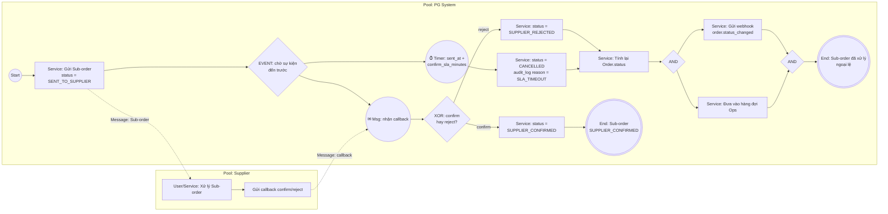

**Đọc sơ đồ:**
- `G1` là Event-based Gateway: callback và timer "đua" nhau, cái nào đến trước thắng.
- Nét đứt `-.->` là Message Flow giữa hai Pool. Trong Pool Supplier, PG không quy định Supplier xử lý thế nào.
- `G3`/`G4` là cặp AND: gửi webhook và đưa vào hàng đợi Ops chạy song song, kết thúc khi cả hai xong.

**Câu hỏi BPMN làm lộ ra.** Callback đến **sau** khi timer đã thắng thì sao? Trong BPMN, khi Event-based Gateway đã chọn nhánh timer, message đến sau không còn được chờ. Nghĩa là PG cần rule riêng cho "callback đến muộn" — chính là A-01 của Day 9. Flowchart thường che mất câu hỏi này.

`[Giả định bài tập]`: Order.status tính lại khi Sub-order `SUPPLIER_REJECTED` được vẽ chung nhánh với huỷ do SLA để đơn giản hoá; chi tiết rule tổng hợp làm ở Day 24.

#### Ví dụ từ dự án thật: Promotion Code

BRD Promotion Code Warehouse có hai luồng thời gian rất hợp để học BPMN. Các rule dưới đây có trong tài liệu (tham số trong `[ ]` là giá trị mặc định cấu hình được).

**1. API 2 bước giữ chỗ → xác nhận.** Rule: "Không xác nhận sau [15] phút thì mã về kho, không tính phí." Đây là **Timer Boundary Event** gắn trên bước "Chờ xác nhận".

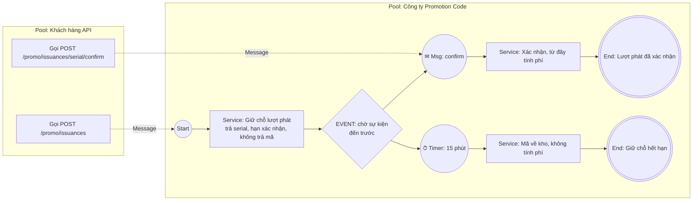

**2. Job thu hồi hằng ngày.** Rule: "Job hằng ngày [00:30]: lượt chưa vuốt quá hạn → đóng, trả mã về kho, gửi webhook. Không hoàn phí." Đây là **Timer Start Event** (quy trình bắt đầu theo lịch, không do người khởi tạo).

| Thành phần BPMN | Áp vào rule |
|---|---|
| Timer Start Event | Hằng ngày [00:30] |
| Service Task | Tìm lượt phát chưa vuốt quá hạn |
| Service Task | Đóng lượt phát, trả mã về kho |
| Message (gửi) | Webhook `issuance.reclaimed` |
| End Event | Lượt đã thu hồi, không hoàn phí |

**3. Loyalty Hub trừ điểm và tạo lượt phát.** Rule: "trừ điểm và tạo lượt phát trong cùng một giao dịch; một bước lỗi thì cả hai huỷ." Trong BPMN, đây là một **Transaction Sub-process**: hai task gói chung, lỗi bất kỳ thì cả gói rollback. Vẽ bằng `[[Transaction: Trừ điểm + Tạo lượt phát]]` với nhánh `ERROR:` dẫn về End "Không trừ điểm, không tạo lượt phát" — khớp tiêu chí nghiệm thu MVP của BRD.

Bài học: một BRD có nhiều rule dạng "sau X phút", "hằng ngày lúc Y", "cùng một giao dịch". Mỗi cụm từ đó là tín hiệu nên dùng BPMN thay vì flowchart.

### Junior vs Middle vs Senior

| Tình huống: mô hình hoá huỷ Sub-order theo SLA | Junior | Middle | Senior |
|---|---|---|---|
| Nghĩ | "Vẽ hình thoi 'quá SLA?' là đủ." | "Cần timer và message, chọn cái đến trước." | "Message đến sau timer thì sao? Pool nào sở hữu quyết định?" |
| Hỏi | "Quá SLA thì huỷ đúng không?" | "Timer tính từ `sent_at` hay `created_at`?" | "Callback muộn: chấp nhận, từ chối hay báo Ops? Có cần bù trạng thái không?" |
| Làm | Flowchart với hình thoi kiểm tra | BPMN có event-based gateway, message flow | BPMN + đối chiếu state + danh sách sự kiện muộn/lặp → Open Item |

### Sai lầm thường gặp

1. **Sequence Flow xuyên Pool.** Vẽ như thể PG điều khiển bước của Supplier.
2. **Dùng hình thoi "Quá SLA?" thay cho timer.** Hình thoi kiểm tra một lần; timer là chờ.
3. **Mở AND mà không gộp AND.** Không rõ quy trình kết thúc khi nào.
4. **End Event không ghi kết quả.** "End" không cho biết Sub-order ở trạng thái gì.
5. **Vẽ BPMN cho mọi thứ.** Workshop discovery với business thì swimlane dễ đọc hơn.
6. **Lẫn trạng thái.** Task ghi "Huỷ đơn" mà không nói Sub-order hay Order, trạng thái nào.

### Góc nhìn Senior BA/PO

BPMN có giá trị nhất ở chỗ nó **buộc bạn trả lời câu hỏi về thời gian và thứ tự sự kiện**: cái gì chờ cái gì, cái gì đến trước thắng, cái gì đến sau bị xử lý thế nào. Phần lớn bug production trong tích hợp nằm ở đây: callback muộn, retry trùng, timer chạy khi người dùng đang thao tác.

Senior không bắt business đọc BPMN đầy đủ ký hiệu. Senior vẽ swimlane cho business, BPMN cho Dev/QC, và giữ hai bản **nhất quán**. Khi một rule đổi, cả hai cập nhật.

Senior cũng dùng BPMN để kiểm tra state machine: mỗi End Event phải là một trạng thái hợp lệ, mỗi task đổi trạng thái phải là một transition được phép. Lệch nhau nghĩa là thiếu rule.

### Bài tập thực hành

**Đầu vào.** Luồng "Supplier huỷ Sub-order sau khi đã confirm" (nối pain point 5). `[Giả định bài tập]`:
- Supplier gửi callback `cancel` cho Sub-order đang `SUPPLIER_CONFIRMED`, `shipping_status = NOT_SHIPPED`.
- Nếu `shipping_status` đã khác `NOT_SHIPPED`, PG từ chối, báo Ops.
- Huỷ hợp lệ: Sub-order `CANCELLED`, tính lại Order.status, gửi webhook cho Client, đồng thời ghi nhận điều chỉnh đối soát (rule từ RCA Day 11).
- Ops có [60] phút xem xét ngoại lệ; quá hạn thì tự động escalate cho PO.

**Yêu cầu đầu ra.**
1. BPMN v1 bằng mermaid theo quy ước bảng ký hiệu, có ít nhất 2 Pool, 1 XOR, 1 cặp AND, 1 Timer.
2. Danh sách End Event, mỗi cái kèm trạng thái Sub-order và shipping_status.
3. Ba câu hỏi về sự kiện muộn/lặp mà BPMN làm lộ ra.

### Lời giải tham khảo

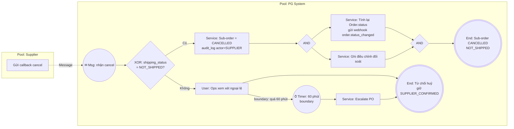

**End Event:** E1 – Sub-order `CANCELLED`, `NOT_SHIPPED`. E2 – Sub-order vẫn `SUPPLIER_CONFIRMED`, `shipping_status` giữ nguyên giá trị hiện tại (đã `PICKED_UP` hoặc sau đó).

**Câu hỏi BPMN làm lộ ra:**
1. Callback `cancel` đến lần hai cho cùng Sub-order: bỏ qua hay báo lỗi? (idempotency – Day 31)
2. Webhook `PICKED_UP` của Delivery Service đến gần như cùng lúc với `cancel`: bên nào thắng? Cần kiểm và đổi trạng thái nguyên tử (Day 32) — giống NFR-2 của Slide to Use.
3. Huỷ xảy ra sau khi kỳ đối soát đã chốt: điều chỉnh vào kỳ nào? (OI cho Finance)

**Tại sao.** Junior hay vẽ sequence flow từ Supplier sang PG như thể cùng một quy trình, và quên rằng "cancel" của Supplier chỉ là **yêu cầu**, PG mới quyết định. Junior cũng hay đặt timer 60 phút thành hình thoi "Quá 60 phút?" — sai vì không ai "kiểm tra" vào phút thứ 60; đó là sự kiện ngắt task đang chờ. Cặp AND quan trọng vì đối soát và webhook độc lập: thiếu một trong hai là lỗi, dù luồng chính vẫn chạy.

### Checklist hoàn thành

- [ ] Tôi hiểu khái niệm.
- [ ] Tôi tự làm được bài tập.
- [ ] Tôi giải thích được cho Developer/QC.
- [ ] Tôi có thể viết thành Requirement/artifact.
- [ ] Tôi phân biệt được Sequence Flow và Message Flow, không vẽ sequence flow xuyên Pool.
- [ ] Tôi dùng Timer/Event-based Gateway cho SLA thay vì hình thoi kiểm tra.
- [ ] Mỗi End Event của tôi ghi rõ trạng thái nghiệp vụ.

### Review tuần 2

**Câu tự kiểm (trả lời không nhìn tài liệu):**

1. Một kế toán viên không dùng feature có thể nằm ở ô Manage Closely không? Lấy ví dụ từ Slide to Use để giải thích.
2. Trên một dòng RACI có hai chữ A. Bạn xử lý thế nào và hỏi ai?
3. MoM của bạn có 4 phần nào? Viết lại một Open Item đã đóng theo đúng mẫu "ngày đóng + kết luận + rule liên quan".
4. Phân loại 3 câu sau thành Quan sát / Đánh giá / Giải pháp: "Ops copy dữ liệu sang Excel", "Copy tay gây sai địa chỉ", "Thêm nút Re-delivery".
5. "Ops quên lọc đơn" có phải root cause không? Hỏi tiếp câu gì?
6. Vì sao ESIA đặt Automate ở cuối?
7. Một mũi tên cắt làn trong swimlane nói lên điều gì? Bạn hỏi 3 câu gì cho nó?
8. Khi nào phải dùng Timer/Event-based Gateway thay cho hình thoi trong flowchart?

**Mini-case tổng hợp: "Re-delivery bị treo khi Delivery Service không phản hồi"**

`[Giả định bài tập]` Sau khi TO-BE re-delivery (Day 12) chạy, Ops phản ánh: một số Sub-order đã bấm Re-delivery, `attempt_no` đã tăng, nhưng không có kết quả giao. Finance phát hiện đối soát Delivery Service có lần giao không khớp `shipment` trên hệ thống. Client phàn nàn không nhận được webhook.

Yêu cầu (tối đa 90 phút):
1. **Stakeholder + RACI:** 6 stakeholder, RACI cho 4 quyết định (ai A cho "xử lý shipment không có phản hồi", ai A cho "điều chỉnh đối soát").
2. **AS-IS:** flow hiện tại từ lúc Ops bấm Re-delivery tới lúc phát hiện treo; 3 pain point có cách lấy evidence.
3. **RCA:** Fishbone 6 nhóm + 5 Whys trên nhánh System. Gợi ý: handoff H3 (PG → Delivery) có timeout/retry không? Webhook H4 gắn theo khoá nào?
4. **TO-BE + Gap:** đề xuất xử lý khi Delivery Service không phản hồi trong [X] phút; Gap Table trỏ về pain point.
5. **BPMN v1:** 2 Pool (PG, Delivery Service), Event-based Gateway giữa "webhook kết quả" và "Timer [X] phút".
6. **Communication:** tin nhắn 6 dòng gửi Finance xin quyết định điều chỉnh đối soát.

Tự chấm: mỗi mục 0–3 điểm theo thang của khoá (0: chưa làm được; 1: làm được khi có template; 2: tự làm được với case quen thuộc; 3: tự làm được với case mới và giải thích được trade-off). Mục nào dưới 2 điểm, quay lại ngày tương ứng.

**Gợi ý tự kiểm cho mini-case:** root cause thường nằm ở chỗ tạo `shipment` trên hệ thống trước khi chắc chắn Delivery Service đã nhận vận đơn, và không có rule cho "không phản hồi". Nếu đề xuất của bạn chỉ là "thêm nút Retry cho Ops", bạn đang chữa triệu chứng — xem lại Day 11.
