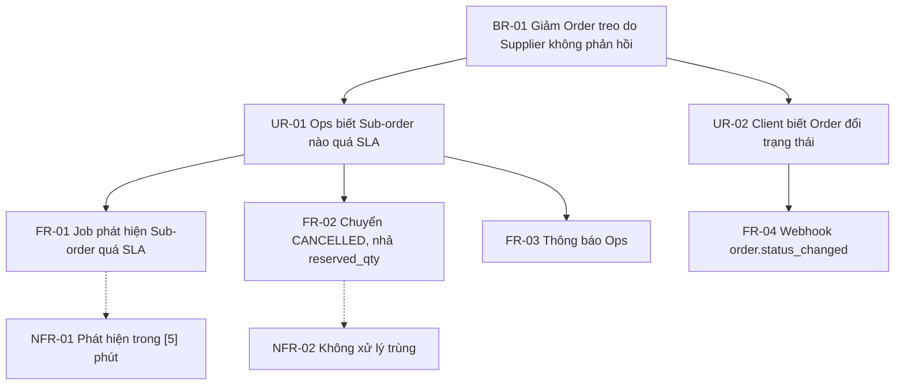
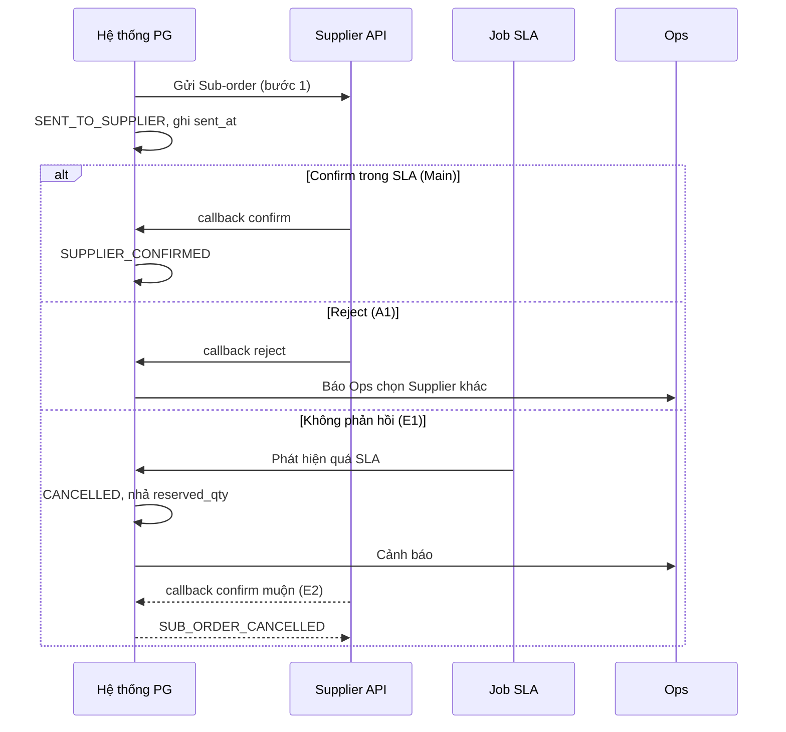

# Tuần 3 — Requirement Engineering: từ Scope đến Requirement Traceability

Tuần 1 và 2 bạn đã đi từ yêu cầu thô đến vấn đề thật và quy trình TO-BE. Tuần 3 biến TO-BE thành bộ requirement mà Developer build được một nghĩa và QC test được một nghĩa. Bạn sẽ chốt phạm vi, phân tầng requirement, viết Business Rule có tham số, Use Case, User Story, Acceptance Criteria dạng Given/When/Then, rồi khoá chất lượng bằng DoR, DoD và RTM. Cả tuần đi theo một feature xuyên suốt của case Physical Gift: **tự huỷ Sub-order khi Supplier không xác nhận trong SLA**, đối chiếu với hai dự án thật Promotion Code và Slide to Use.

| Day | Topic | Deliverable |
|---|---|---|
| 15 | Scope, In/Out Scope, Assumption, Constraint, Dependency | Scope Statement cho feature Auto-cancel Sub-order |
| 16 | Business / User / Functional / Non-functional Requirement — phân tầng | Requirement Hierarchy (BR → UR → FR/NFR) |
| 17 | Business Rule & Business Rule Catalogue | Business Rule Catalogue 10–12 rule có ID, tham số, nguồn, owner |
| 18 | Use Case: Main / Alternative / Exception Flow | Use Case Specification UC-SUB-01 |
| 19 | User Story: INVEST, story splitting | Backlog v1: 6–8 User Story đã tách |
| 20 | Acceptance Criteria & Given/When/Then | AC Pack cho 3 story + bộ G/W/T Promotion Code |
| 21 | Definition of Ready, Definition of Done, RTM (+ review tuần 3) | DoR/DoD checklist + RTM 10 dòng |

> Feature xuyên suốt tuần `[Giả định bài tập]` trên case Physical Gift: Pain point số 2 — "Supplier không confirm Sub-order trong SLA → Order treo". Field `supplier.confirm_sla_minutes` đã có trong case. Mọi con số SLA, số lần retry, kênh thông báo trong tuần này là giả định bài tập, viết dạng tham số `[ ]`.

---

## Day 15 - Scope, In/Out Scope, Assumption, Constraint, Dependency

> P4 Requirement · Level: Junior → Middle · Thời lượng ~75 phút · Deliverable: Scope Statement cho feature Auto-cancel Sub-order

### Mục tiêu

- Viết được Scope Statement – Tuyên bố phạm vi gồm In-scope, Out-of-scope, Assumption, Constraint, Dependency.
- Phân biệt năm khái niệm này bằng câu hỏi kiểm tra, không học thuộc định nghĩa.
- Biết cắt scope theo **kênh**, theo **trạng thái**, theo **actor**, theo **phase**.
- Biết biến một Assumption rủi ro thành Open Item có owner và hạn chốt.

### Kiến thức cần học

**1. Scope – Phạm vi.** Ranh giới của những gì feature sẽ thay đổi trong lần phát hành này. Scope không phải danh sách tính năng mong muốn. Scope là cam kết.

**2. In-scope và Out-of-scope.** In-scope là thứ team cam kết build và test. Out-of-scope là thứ người khác có thể *nghĩ* là có, nhưng không có. Out-of-scope quan trọng ngang In-scope, vì nó chặn tranh cãi lúc UAT.

Quy tắc viết Out-of-scope: chỉ ghi thứ **có người sẽ hỏi**. Đừng ghi "không làm app di động" nếu không ai nghĩ tới app.

**3. Assumption – Giả định.** Điều team coi là đúng để lập kế hoạch, nhưng **chưa được xác minh**. Mỗi Assumption là một rủi ro tiềm ẩn. Nếu sai, scope hoặc estimate phải đổi.

**4. Constraint – Ràng buộc.** Điều **đã biết là đúng** và giới hạn cách làm: deadline, ngân sách, công nghệ bắt buộc, quy định pháp lý, hợp đồng.

**5. Dependency – Phụ thuộc.** Việc của bên khác mà feature cần để chạy hoặc để phát hành: API của đối tác, team khác release, dữ liệu migration, quyết định của Kế toán.

Bảng phân biệt bằng câu hỏi kiểm tra:

| Khái niệm | Câu hỏi kiểm tra | Nếu sai thì sao |
|---|---|---|
| Assumption | "Đã có ai xác nhận điều này chưa?" → Chưa | Scope/estimate đổi |
| Constraint | "Có thể thương lượng được không?" → Không | Không đổi được, phải thiết kế quanh nó |
| Dependency | "Việc này do ai khác làm?" → Bên khác | Feature bị chặn, trễ release |

**6. Các trục cắt scope.**

| Trục | Ví dụ câu hỏi |
|---|---|
| Kênh | API, Admin portal, Supplier portal, Webhook — kênh nào đổi? |
| Trạng thái | Áp cho Sub-order ở trạng thái nào? |
| Actor | Ai bị ảnh hưởng: Supplier, Ops, Client, Recipient, Finance? |
| Đối tượng | Mọi Supplier hay chỉ `integration_type = API`? |
| Dữ liệu cũ | Sub-order đã tồn tại trước ngày release có áp dụng không? |
| Phase | Phase 1 làm gì, Phase 2 làm gì? |

Trục "dữ liệu cũ" là trục Junior hay bỏ nhất.

### BA/PO sử dụng kiến thức này khi nào?

- Sau khi chốt TO-BE (Day 12–14), trước khi viết Business Rule và User Story.
- Khi viết mục 4–5 của BRD/FS (Scope; Assumptions/Dependencies/Constraints).
- Khi Sprint Planning: PO dùng Out-of-scope để từ chối việc phát sinh.
- Khi có Change Request: đối chiếu yêu cầu mới với Scope đã ký để biết đây là bug, là thiếu sót hay là scope mới.
- Khi UAT: business nói "sao không có X" → mở Scope Statement ra.

### Quy trình thực hiện

**Step 1 — Viết một câu mục tiêu.** Feature này giải quyết vấn đề gì, đo bằng gì. Mọi dòng In-scope phải phục vụ câu này.

**Step 2 — Liệt kê mọi thứ có thể bị đụng.** Dùng các trục ở trên. Ghi ra hết, chưa phân loại.

**Step 3 — Phân loại In / Out / Chờ đánh giá.** Mỗi dòng Out ghi lý do ngắn và nơi xử lý (phase sau, ticket khác, team khác).

**Step 4 — Tách Assumption, Constraint, Dependency.** Với mỗi Assumption, hỏi: "Nếu sai thì ảnh hưởng gì?" Assumption ảnh hưởng lớn → chuyển thành Open Item có owner và ngày chốt.

**Step 5 — Review với Tech Lead và một stakeholder business.** Tech Lead bắt Dependency kỹ thuật bạn không thấy. Business bắt Out-of-scope họ không đồng ý.

**Step 6 — Đóng băng và đánh version.** Scope v1.0 có ngày. Mọi thay đổi sau đó đi qua Change Request (Day 45).

### Ví dụ thực tế

Feature: **Auto-cancel Sub-order khi Supplier không xác nhận trong SLA** `[Giả định bài tập]`.

**Mục tiêu:** Không còn Sub-order nằm ở `SENT_TO_SUPPLIER` quá `confirm_sla_minutes` mà không ai xử lý. Ops được báo để chuyển Supplier khác hoặc huỷ.

**Scope Statement v1.0**

| # | In-scope |
|---|---|
| IN-01 | Job quét Sub-order có `status = SENT_TO_SUPPLIER` và `sent_at + confirm_sla_minutes` đã qua |
| IN-02 | Chuyển Sub-order sang `CANCELLED`, ghi lý do `SUPPLIER_SLA_TIMEOUT` |
| IN-03 | Nhả `reserved_qty` của Inventory theo cặp (Supplier, SKU) |
| IN-04 | Tính lại `Order.status` tổng hợp từ các Sub-order |
| IN-05 | Gửi thông báo cho Ops trên Admin portal |
| IN-06 | Gửi webhook `order.status_changed` cho Client khi Order đổi trạng thái |
| IN-07 | Từ chối callback confirm của Supplier đến sau khi Sub-order đã `CANCELLED` |
| IN-08 | Ghi `audit_log` cho mọi lần auto-cancel |

| # | Out-of-scope | Lý do / nơi xử lý |
|---|---|---|
| OUT-01 | Tự động chuyển sang Supplier dự phòng | Phase 2; cần rule chọn Supplier theo `priority` |
| OUT-02 | Supplier `integration_type = MANUAL` | Không có callback, Ops xác nhận tay |
| OUT-03 | Huỷ Sub-order đã `SUPPLIER_CONFIRMED` nhưng chưa giao | Thuộc luồng Delivery, Pain point 3 |
| OUT-04 | Phạt Supplier vi phạm SLA trong đối soát | Ticket Finance riêng |

| Loại | # | Nội dung | Owner xác minh |
|---|---|---|---|
| Assumption | AS-01 | Mọi Supplier API đã có `confirm_sla_minutes` khác rỗng | Admin cấu hình Supplier |
| Assumption | AS-02 | Supplier không gửi confirm sau khi đã quá SLA quá [24] giờ | Tech Lead, đối chiếu log |
| Constraint | CO-01 | Không đổi contract API `POST /orders` với Client | Hợp đồng tích hợp |
| Constraint | CO-02 | Order.status vẫn là trạng thái tổng hợp, không cho đổi tay | Mô hình dữ liệu hiện hành |
| Dependency | DE-01 | Supplier cần xử lý mã lỗi mới khi confirm muộn | Từng Supplier |
| Dependency | DE-02 | Finance xác nhận Sub-order `CANCELLED` không vào đối soát kỳ | Finance |

Câu hỏi về dữ liệu cũ: Sub-order đang `SENT_TO_SUPPLIER` từ trước ngày release, đã quá SLA vài ngày. Job chạy lần đầu sẽ huỷ hàng loạt. Đây phải là một dòng scope rõ ràng, không để Dev tự quyết.

```text
IN-09: Sub-order SENT_TO_SUPPLIER tạo trước ngày release
       KHÔNG bị job tự huỷ; Ops nhận danh sách để xử lý tay một lần.
```

#### Ví dụ từ dự án thật: Promotion Code

BRD Promotion Code ghi rõ đây là **Phase 1 MVP**, có ba mục tiêu: đưa mã từ Excel vào kho, phát qua API và Loyalty Hub, đối soát cuối tháng; chứng minh mô hình phát lại mã chưa vuốt an toàn trong pilot; không ảnh hưởng luồng e-voucher đang chạy.

Ba điểm đáng học về scope:

1. **Phase là công cụ cắt scope.** Rule "Đã vuốt mà hết hạn dùng → Chờ merchant xác nhận. Phase 1 không tự phát lại" là một câu Out-of-scope viết ngay trong rule. Người đọc biết việc này có chủ đích, không phải quên.
2. **"Không ảnh hưởng luồng cũ" là scope, không phải mong muốn.** Nó trở thành tiêu chí nghiệm thu: "Luồng e-voucher hiện tại không bị ảnh hưởng (chạy lại regression)".
3. **Assumption bị sản xuất phá vỡ.** Vòng rà soát phát hiện giả định "một chương trình một nguồn mã" sai, vì đã có brand chạy nhiều nguồn mã kèm fallback. Một Assumption chưa xác minh đã nằm trong nền tảng thiết kế.

#### Ví dụ từ dự án thật: Slide to Use

BRD Slide to Use cắt scope **theo từng kênh**: Voucher Link E và App ví quà thay đổi; Link V mono chưa auto convert thay đổi; Link V mono auto convert giữ nguyên; kênh Gift, Loyalty/Loyalty Hub "Chờ team liên quan đánh giá"; nhắn tin đổi code giữ nguyên. Out-of-scope ghi rõ: tự chuyển nguồn code theo ngưỡng tồn kho (đã bỏ), quy tắc brand được dùng voucher đã tách (thuộc ticket khác), mini app Zalo.

Bài học: có ba nhãn chứ không phải hai — **Thay đổi / Giữ nguyên / Chờ đánh giá**. Nhãn thứ ba là Dependency với team khác, phải có người theo dõi. Nhãn "Giữ nguyên" sinh ra NFR-4: QC chạy regression từng kênh giữ nguyên.

### Junior vs Middle vs Senior

| Tình huống: Business nói "làm auto-cancel Sub-order nếu Supplier không confirm" | Junior | Middle | Senior |
|---|---|---|---|
| Nghĩ gì | Viết job huỷ là xong | Huỷ thì Inventory, Order.status, Client bị ảnh hưởng | Huỷ sai thì mất đơn thật; dữ liệu cũ sẽ bị huỷ hàng loạt ngày release |
| Hỏi gì | "SLA bao nhiêu phút?" | "Supplier MANUAL có áp dụng không? Callback muộn xử lý sao?" | "Ai chịu trách nhiệm khi huỷ nhầm? Có cần Phase 1 chỉ cảnh báo, chưa huỷ?" |
| Làm gì | Ghi In-scope một dòng | Viết đủ In/Out/AS/CO/DE | Thêm trục dữ liệu cũ, phase, gắn owner cho từng Assumption, chốt với Finance |

### Sai lầm thường gặp

1. **Out-of-scope để trống.** Kết quả: UAT thành nơi đàm phán scope.
2. **Ghi Assumption như sự thật.** "Supplier luôn gửi callback" là Assumption, không phải Constraint.
3. **Assumption không có owner.** Không ai xác minh, đến lúc vỡ thì không ai chịu.
4. **Quên dữ liệu cũ và luồng cũ.** Release ngày đầu huỷ hàng trăm Sub-order tồn đọng.
5. **Viết scope bằng giải pháp kỹ thuật.** "Dùng cron 5 phút" là thiết kế. Scope nói "Sub-order quá SLA được xử lý trong vòng [5] phút".
6. **Scope không có version.** Không biết thay đổi nào là Change Request.

### Góc nhìn Senior BA/PO

Scope là công cụ đàm phán, không phải tài liệu kỹ thuật. Senior dùng Out-of-scope để bảo vệ team và dùng Phase để nói "chưa" thay vì "không". Khi một stakeholder ép thêm việc, câu trả lời của Senior là: "Việc này nằm OUT-01. Nếu đưa vào Phase 1, ta lùi release [N] ngày hoặc bỏ IN-05. Anh/chị chọn phương án nào?"

Senior cũng đọc Assumption như đọc danh sách rủi ro. Case Promotion Code cho thấy một Assumption sai ở tầng nền có thể kéo theo đổi thiết kế. Cách phòng: mỗi Assumption phải trả lời được "ai xác minh, bằng cách nào, trước ngày nào".

### Bài tập thực hành

**Đầu vào** `[Giả định bài tập]`: Business muốn thêm tính năng **Re-delivery tự động**. Khi Delivery Service gửi webhook `shipment.status_changed` với `DELIVERY_FAILED`, hệ thống tự tạo Shipment mới (`attempt_no` + 1) và yêu cầu giao lại, tối đa [2] lần. Hiện Ops làm việc này thủ công qua Excel (Pain point 3). Một số Delivery Service gửi `failed_reason`, một số không. Finance muốn biết phí giao lại tính cho ai.

**Yêu cầu đầu ra:**
1. Scope Statement gồm câu mục tiêu, ≥ 6 In-scope, ≥ 4 Out-of-scope có lý do.
2. ≥ 2 Assumption, 2 Constraint, 2 Dependency, mỗi dòng có owner xác minh.
3. Một dòng xử lý dữ liệu cũ.
4. Ba câu hỏi Open Item cần chốt trước khi viết Business Rule.

### Lời giải tham khảo

**Mục tiêu:** Shipment `DELIVERY_FAILED` có lý do giao lại được sẽ được yêu cầu giao lại trong [30] phút mà không cần Ops thao tác, tối đa [2] lần.

**In-scope:** nhận webhook `DELIVERY_FAILED`; phân loại `failed_reason` thành "giao lại được" / "không giao lại được"; tạo `shipment` mới với `attempt_no` tăng 1; giữ `shipping_status` theo luồng `DELIVERY_FAILED → PICKED_UP`; dừng khi đạt số lần tối đa và chuyển Ops; ghi audit log; thông báo Client khi Order đổi trạng thái.

**Out-of-scope:** đổi địa chỉ khi giao lại (thuộc Pain point 4 — sửa Order); chọn Delivery Service khác (phase sau); tính phí giao lại cho Client (chờ Finance); `RETURNED` về Supplier (luồng riêng).

**Assumption:** AS-01 Delivery Service hỗ trợ tạo yêu cầu giao lại qua API (owner: Tech Lead, xác minh từng hãng). AS-02 `failed_reason` có danh mục chuẩn (owner: Ops, đối chiếu dữ liệu 3 tháng).

**Constraint:** không đổi luồng trạng thái `shipping_status` chuẩn; không đổi webhook format cho Client.

**Dependency:** Delivery Service mở API giao lại; Finance chốt ai chịu phí.

**Dữ liệu cũ:** Shipment `DELIVERY_FAILED` trước ngày release không tự giao lại; Ops xử lý theo cách hiện tại.

**Open Item:** (1) Không có `failed_reason` thì coi là giao lại được hay không? (2) Recipient từ chối nhận có tính là một lần thất bại không? (3) Phí giao lại tính cho Client, Supplier hay công ty chịu?

**Tại sao như vậy:** Câu hỏi (1) quyết định hành vi của nhánh lớn nhất — thiếu dữ liệu. Junior hay bỏ sót: trường hợp Recipient từ chối nhận (giao lại vô ích), dữ liệu cũ, và việc đổi địa chỉ khi giao lại — business chắc chắn sẽ hỏi, nên phải ghi Out-of-scope.

### Checklist hoàn thành

- [ ] Tôi hiểu khái niệm.
- [ ] Tôi tự làm được bài tập.
- [ ] Tôi giải thích được cho Developer/QC.
- [ ] Tôi có thể viết thành Requirement/artifact.
- [ ] Mỗi dòng Out-of-scope của tôi có lý do và nơi xử lý.
- [ ] Mỗi Assumption có owner xác minh.
- [ ] Tôi đã cắt scope theo ít nhất 4 trục, trong đó có dữ liệu cũ.

---

## Day 16 - Business / User / Functional / Non-functional Requirement — phân tầng

> P4 Requirement · Level: Junior → Middle · Thời lượng ~75 phút · Deliverable: Requirement Hierarchy (BR → UR → FR/NFR) cho feature Auto-cancel Sub-order

### Mục tiêu

- Phân biệt bốn tầng requirement và biết mỗi tầng do ai sở hữu, ai đọc.
- Viết được chuỗi truy vết từ một Business Requirement xuống Functional và Non-functional Requirement.
- Nhận ra requirement viết sai tầng (giải pháp lẫn vào mục tiêu, NFR mơ hồ).
- Viết NFR có số đo, test được.

### Kiến thức cần học

**1. Business Requirement (BR) – Yêu cầu nghiệp vụ.** Mục tiêu tổ chức muốn đạt. Trả lời câu "Tại sao làm?". Owner: Sponsor, Management, PO.

**2. User Requirement (UR) – Yêu cầu người dùng.** Việc một nhóm người dùng cần làm được. Trả lời câu "Ai cần làm được gì?". Owner: PO, BA cùng đại diện người dùng.

**3. Functional Requirement (FR) – Yêu cầu chức năng.** Hệ thống phải làm gì. Trả lời câu "Hệ thống phản ứng thế nào với đầu vào này?". Owner: BA. Người đọc: Dev, QC.

**4. Non-functional Requirement (NFR) – Yêu cầu phi chức năng.** Hệ thống phải làm **tốt đến mức nào**: hiệu năng, bảo mật, khả dụng, đồng thời, audit, tương thích. NFR không có số thì không test được.

> Lưu ý ký hiệu: trong tài liệu này "BR" ở tầng requirement là Business Requirement. Business Rule (Day 17) dùng tiền tố có module, ví dụ `BR-SUB-001`. Trong dự án thật nên quy ước rõ trong mục "Thuật ngữ" của BRD để không nhầm.

**Quan hệ giữa các tầng:**



**5. Các nhóm NFR thường gặp trong domain voucher/gift.**

| Nhóm | Câu hỏi | Ví dụ có số |
|---|---|---|
| Performance | Bao lâu? Bao nhiêu? | Job xử lý xong [1.000] Sub-order trong ≤ [60] giây |
| Concurrency | Hai việc cùng lúc thì sao? | Callback confirm và job huỷ cùng lúc → chỉ một kết quả thắng |
| Idempotency | Gọi lại thì sao? | Job chạy lại không tạo thêm audit log hay webhook |
| Availability | Chết thì sao? | Job lỗi một lần, lần chạy sau xử lý bù |
| Security | Ai được thấy/làm? | Chỉ role Ops thấy danh sách Sub-order bị huỷ |
| Auditability | Truy vết thế nào? | Mọi thay đổi trạng thái ghi `audit_log` có before/after |
| Compatibility | Ảnh hưởng ai đang chạy? | Client không phải đổi code tích hợp |

**6. Dấu hiệu viết sai tầng.**

| Câu | Vấn đề | Sửa |
|---|---|---|
| "Dùng Redis lock để chống trùng" | Giải pháp lọt vào requirement | NFR: "Một Sub-order chỉ bị huỷ một lần dù job chạy song song" |
| "Hệ thống xử lý nhanh" | NFR không số | "Trong ≤ [5] phút sau khi quá SLA" |
| "Ops hài lòng hơn" | BR không đo được | "Số Sub-order treo quá [24] giờ giảm về 0" |
| "Huỷ Sub-order" | FR thiếu điều kiện | "Khi Sub-order `SENT_TO_SUPPLIER` quá `confirm_sla_minutes`, chuyển `CANCELLED`" |

### BA/PO sử dụng kiến thức này khi nào?

- Khi viết BRD (tầng BR, UR) và FS (tầng FR, NFR).
- Khi Sponsor hỏi "feature này đem lại gì" — trả lời bằng BR, không bằng FR.
- Khi Dev hỏi "làm đến đâu là đủ" — trả lời bằng NFR có số.
- Khi QC lập test plan: FR → functional test; NFR → performance, concurrency, security, regression test.
- Khi cắt scope: bỏ một FR phải biết UR và BR nào bị yếu đi.

### Quy trình thực hiện

**Step 1 — Viết BR từ Problem Statement.** Mỗi BR có một chỉ số đo được và một baseline (hoặc ghi rõ baseline là Open Item).

**Step 2 — Từ mỗi BR, liệt kê actor bị ảnh hưởng.** Mỗi actor sinh một hoặc vài UR dạng "[Actor] cần [làm được gì] để [kết quả]".

**Step 3 — Từ mỗi UR, viết FR.** FR mô tả hành vi hệ thống: trigger, điều kiện, kết quả. Một FR một hành vi.

**Step 4 — Rà NFR theo checklist 7 nhóm.** Với mỗi FR, hỏi: chạy song song thì sao, gọi lại thì sao, lỗi giữa chừng thì sao, ai được xem.

**Step 5 — Gắn ID và liên kết cha–con.** Mỗi FR/NFR phải có cha là một UR hoặc BR. FR không có cha là gold-plating – làm thừa.

**Step 6 — Kiểm tra testable.** Đọc từng dòng, hỏi: "QC viết được expected result cho câu này không?"

### Ví dụ thực tế

Feature Auto-cancel Sub-order `[Giả định bài tập]`.

| ID | Tầng | Nội dung | Cha |
|---|---|---|---|
| BR-01 | Business | Số Sub-order nằm `SENT_TO_SUPPLIER` quá [24] giờ giảm về 0 trong [1] tháng sau release | — |
| BR-02 | Business | Client nhận trạng thái Order chính xác, không phải hỏi CS | — |
| UR-01 | User | Ops cần biết Sub-order nào bị huỷ do quá SLA để chuyển Supplier khác | BR-01 |
| UR-02 | User | Client cần nhận thông báo khi Order đổi trạng thái do Sub-order bị huỷ | BR-02 |
| UR-03 | User | Supplier cần biết confirm muộn đã bị từ chối | BR-01 |
| FR-01 | Functional | Hệ thống phát hiện Sub-order `SENT_TO_SUPPLIER` có `now > sent_at + confirm_sla_minutes` | UR-01 |
| FR-02 | Functional | Hệ thống chuyển Sub-order sang `CANCELLED`, lý do `SUPPLIER_SLA_TIMEOUT` | UR-01 |
| FR-03 | Functional | Hệ thống giảm `reserved_qty` của Inventory (Supplier, SKU) theo `order_item.qty` | UR-01 |
| FR-04 | Functional | Hệ thống tính lại `Order.status` từ các Sub-order | UR-02 |
| FR-05 | Functional | Hệ thống gửi webhook `order.status_changed` khi `Order.status` đổi | UR-02 |
| FR-06 | Functional | Hệ thống từ chối callback confirm cho Sub-order `CANCELLED`, trả mã lỗi `[SUB_ORDER_CANCELLED]` | UR-03 |
| FR-07 | Functional | Hệ thống hiển thị danh sách Sub-order bị auto-cancel trên Admin portal cho Ops | UR-01 |
| NFR-01 | Performance | Sub-order được huỷ trong ≤ [5] phút sau khi quá SLA | FR-01 |
| NFR-02 | Concurrency | Callback confirm và job huỷ đến cùng lúc → chỉ một trạng thái cuối, không có Sub-order vừa `SUPPLIER_CONFIRMED` vừa bị nhả `reserved_qty` | FR-02, FR-06 |
| NFR-03 | Idempotency | Job chạy lại trên cùng Sub-order không tạo thêm audit log, webhook | FR-02, FR-05 |
| NFR-04 | Audit | Mỗi lần auto-cancel ghi `audit_log` gồm before, after, actor = `SYSTEM`, reason | FR-02 |
| NFR-05 | Compatibility | Client không phải thay đổi code nhận webhook | FR-05 |

Nhìn bảng, QC biết ngay NFR-02 cần test race condition, NFR-03 cần test chạy job hai lần. Junior viết thiếu cả hai.

#### Ví dụ từ dự án thật: Slide to Use

BRD Slide to Use tách NFR riêng, mỗi NFR là một hành vi có thể kiểm:

| # | Yêu cầu | Nhóm NFR |
|---|---|---|
| NFR-1 | Trượt nhiều lần, hoặc trên hai thiết bị cùng lúc, chỉ ra một kết quả và rút tối đa một code | Concurrency + Idempotency |
| NFR-2 | Kiểm bảng tạm và trừ voucher tại POS là một thao tác nguyên tử | Atomicity |
| NFR-3 | Ghi log lịch sử mọi thay đổi của bảng tạm và dòng doanh thu | Audit |
| NFR-4 | Các kênh giữ nguyên không đổi hành vi, QC chạy regression từng kênh | Compatibility / Regression |

Điểm đáng học:
- **NFR-1 viết bằng kết quả quan sát được** ("chỉ ra một kết quả", "rút tối đa một code"), không viết "dùng khoá phân tán". QC test được bằng cách trượt trên hai máy.
- **NFR-4 nối thẳng với scope.** Kênh "Giữ nguyên" trong bảng scope (Day 15) sinh ra NFR regression. Scope và NFR không tách rời.
- **BR của dự án có chỉ số.** MT-4 "Mỗi voucher chỉ dùng một lần — không voucher nào bị ghi nhận dùng hai lần hoặc có hai dòng doanh thu" là tầng Business; NFR-1 và NFR-2 là cách hệ thống bảo đảm nó. Đây là chuỗi truy vết BR → NFR thật.

### Junior vs Middle vs Senior

| Tình huống: viết requirement cho auto-cancel | Junior | Middle | Senior |
|---|---|---|---|
| Nghĩ gì | Liệt kê việc hệ thống làm | Mỗi việc thuộc tầng nào, có cha chưa | Requirement nào gánh rủi ro tiền/dữ liệu nhất |
| Hỏi gì | "Huỷ xong làm gì tiếp?" | "Job chạy hai lần thì sao? Callback đến cùng lúc thì sao?" | "BR-01 đo bằng dữ liệu nào? Baseline hiện tại bao nhiêu?" |
| Làm gì | Viết 5 FR, không NFR | Viết FR + NFR có số, có ID cha | Gắn BR với KPI, chỉ ra NFR nào là điều kiện release, đưa baseline thành Open Item |

### Sai lầm thường gặp

1. **Bỏ qua tầng BR.** Không có BR thì không biết cắt FR nào khi trễ.
2. **NFR mơ hồ.** "Hệ thống ổn định, bảo mật" — không test được.
3. **Gộp nhiều hành vi vào một FR.** "Hệ thống huỷ Sub-order, nhả kho, báo Ops và Client" — một dòng fail thì cả FR fail, không biết hỏng chỗ nào.
4. **Viết giải pháp thay cho requirement.** Chặn Dev chọn cách tốt hơn.
5. **FR mồ côi.** Có FR nhưng không UR/BR nào cần — làm thừa, tốn test.
6. **Quên NFR concurrency, idempotency.** Trong domain voucher/gift, đây là nguồn mất tiền phổ biến nhất.

### Góc nhìn Senior BA/PO

Phân tầng không để làm đẹp tài liệu. Nó cho bạn **quyền cắt có lý do**. Khi trễ deadline, Senior không hỏi "bỏ cái nào dễ", mà hỏi "bỏ FR nào thì BR vẫn đạt". Ví dụ: bỏ FR-07 (màn danh sách) và thay bằng thông báo, BR-01 vẫn đạt. Bỏ NFR-02 thì có thể mất hàng — không được bỏ.

Senior cũng biết NFR thường là thứ **đắt nhất và ít ai hỏi**. Business hiếm khi nói "callback đến cùng lúc thì sao". BA phải tự đặt câu hỏi, viết thành NFR có số, và để Tech Lead ước lượng.

### Bài tập thực hành

**Đầu vào** `[Giả định bài tập]`: Problem Statement cho Pain point 6 — "Client gọi `POST /orders` hai lần khi timeout, hệ thống tạo hai Order; Ops phải huỷ tay, Supplier đôi khi đã nhận cả hai Sub-order." Request có `client_ref_id`.

**Yêu cầu đầu ra:**
1. 2 BR có chỉ số đo được.
2. 3 UR cho ba actor khác nhau.
3. ≥ 5 FR, mỗi FR một hành vi, có cha.
4. ≥ 4 NFR thuộc ít nhất 3 nhóm, có số hoặc kết quả quan sát được.
5. Chỉ ra 1 câu trong đầu vào là giải pháp chứ không phải requirement (nếu có), hoặc tự viết 1 câu sai tầng rồi sửa.

### Lời giải tham khảo

**BR:**
- BR-01: Số Order trùng do Client gọi lại giảm về 0 sau release.
- BR-02: Ops không còn thao tác huỷ tay Order trùng (baseline số ca/tháng: Open Item).

**UR:**
- UR-01 (Client): cần gọi lại an toàn khi timeout mà không tạo Order mới.
- UR-02 (Ops): cần tra được Order theo `client_ref_id`.
- UR-03 (Supplier): chỉ nhận một Sub-order cho một yêu cầu thật.

**FR:**
- FR-01: Khi nhận `POST /orders` có `client_ref_id` chưa tồn tại với `account_id` đó → tạo Order mới.
- FR-02: Khi `client_ref_id` đã tồn tại với cùng `account_id` và cùng nội dung → trả lại Order cũ, không tạo mới.
- FR-03: Khi `client_ref_id` đã tồn tại nhưng nội dung khác → từ chối với mã lỗi `[DUPLICATE_REF_DIFFERENT_PAYLOAD]`.
- FR-04: Khi request thiếu `client_ref_id` → từ chối với mã lỗi `[MISSING_CLIENT_REF_ID]`.
- FR-05: Ops tìm được Order theo `client_ref_id` trên Admin portal.

**NFR:**
- NFR-01 (Concurrency): Hai request cùng `client_ref_id` đến cách nhau ≤ [100] ms → chỉ một Order được tạo.
- NFR-02 (Idempotency): Gọi lại trong [24] giờ trả cùng `order_id`.
- NFR-03 (Compatibility): Client đang gửi `client_ref_id` không phải đổi code.
- NFR-04 (Audit): Request trùng được ghi log kèm `client_ref_id`, thời điểm, kết quả.

**Câu sai tầng:** "Dùng unique index trên `client_ref_id`" là giải pháp. Requirement đúng là NFR-01. Thêm nữa, unique chỉ theo `client_ref_id` là sai nghiệp vụ: hai Client khác nhau có thể dùng cùng giá trị → phải là cặp (`account_id`, `client_ref_id`).

**Tại sao:** Junior hay bỏ FR-03 (cùng ref, khác nội dung) và FR-04 (thiếu ref). Đây là hai nhánh làm Dev phải tự quyết nếu BA không viết. Junior cũng hay quên phạm vi uniqueness theo Client — đúng loại lỗi chỉ lộ ra khi có Client thứ hai.

### Checklist hoàn thành

- [ ] Tôi hiểu khái niệm.
- [ ] Tôi tự làm được bài tập.
- [ ] Tôi giải thích được cho Developer/QC.
- [ ] Tôi có thể viết thành Requirement/artifact.
- [ ] Mọi FR/NFR của tôi có ID cha.
- [ ] Mọi NFR của tôi có số hoặc kết quả quan sát được.
- [ ] Tôi đã rà NFR concurrency và idempotency cho mọi FR thay đổi trạng thái hoặc tiền.

---

## Day 17 - Business Rule & Business Rule Catalogue

> P4 Requirement · Level: Middle · Thời lượng ~90 phút · Deliverable: Business Rule Catalogue 10–12 rule cho feature Auto-cancel Sub-order

### Mục tiêu

- Viết Business Rule – Quy tắc nghiệp vụ atomic, testable theo khuôn IF / AND / THEN / ELSE.
- Tách giá trị có thể thay đổi thành tham số cấu hình `[ ]`.
- Xây Business Rule Catalogue – Danh mục quy tắc nghiệp vụ có ID, nguồn, owner, trạng thái.
- Phát hiện rule mâu thuẫn, rule trùng, rule cũ chặn rule mới.

### Kiến thức cần học

**1. Business Rule khác Functional Requirement thế nào.**
- Business Rule là **chính sách của doanh nghiệp**, tồn tại kể cả khi không có phần mềm. "Supplier phải xác nhận đơn trong [30] phút" đúng cả khi Ops làm tay.
- Functional Requirement là **cách hệ thống thực thi** chính sách đó. "Job quét mỗi [5] phút" là FR.
- Một Business Rule có thể được nhiều FR thực thi. Một FR có thể thực thi nhiều rule.

**2. Các loại Business Rule.**

| Loại | Mô tả | Ví dụ |
|---|---|---|
| Constraint rule | Chặn một hành động | Không phát mã khi khách hết hạn mức |
| Action trigger | Điều kiện kích hoạt hành động | Quá SLA thì huỷ Sub-order |
| Computation | Công thức tính | `available = available_qty - reserved_qty` |
| Inference | Suy ra trạng thái | Mọi Sub-order `CANCELLED` → Order `CANCELLED` |
| Authorization | Ai được làm gì | Chỉ Merchant Lead duyệt lô lớn |

**3. Khuôn viết rule.**

```text
BR-<MODULE>-<NNN>  <Tên ngắn>
IF    <điều kiện 1>
AND   <điều kiện 2>
THEN  <hành động / kết quả của hệ thống hoặc nghiệp vụ>
ELSE  <hành động thay thế, nếu cần>
Tham số: [tên_tham_số] = giá trị mặc định, ai được đổi
Nguồn: <tài liệu, cuộc họp, quy định>
Owner: <vai trò chịu trách nhiệm quyết định rule>
```

**4. Tham số cấu hình `[ ]`.** Mọi con số kinh doanh có thể đổi (thời gian, ngưỡng, số lần) để trong ngoặc vuông. Lợi ích:
- Dev biết phải đưa vào cấu hình, không hardcode.
- QC biết phải test ở biên của tham số.
- Business đổi số mà không cần Change Request cho code.

Mỗi tham số cần trả lời: giá trị mặc định, phạm vi (toàn hệ thống / theo Supplier / theo Program), ai được đổi, đổi có hiệu lực từ lúc nào.

**5. Tiêu chí rule tốt.**
- **Atomic:** một rule một quyết định.
- **Testable:** viết được ít nhất một test đúng và một test sai.
- **Không mơ hồ:** không "kịp thời", "phù hợp", "nếu cần".
- **Có ELSE khi nhánh còn lại không hiển nhiên.**
- **Có nguồn và owner:** biết hỏi ai khi rule cần đổi.

**6. Business Rule Catalogue.** Bảng tập trung mọi rule của module, cột tối thiểu:

| Cột | Ý nghĩa |
|---|---|
| ID | `BR-SUB-001`, không tái sử dụng ID đã xoá |
| Tên | Ngắn, động từ + đối tượng |
| Rule | IF / AND / THEN / ELSE |
| Tham số | `[ ]` + mặc định |
| Loại | Constraint / Trigger / Computation / Inference / Authorization |
| Nguồn | BRD mục X, MoM ngày Y, quy định Z |
| Owner | Vai trò quyết định |
| Trạng thái | Draft / Confirmed / Deprecated |
| Liên kết | FR, Story, Test case |

### BA/PO sử dụng kiến thức này khi nào?

- Sau Scope và Requirement Hierarchy, trước khi viết Use Case và Story.
- Khi Dev hỏi "trường hợp X thì sao?" — câu trả lời phải nằm trong một rule có ID.
- Khi QC thiết kế test: mỗi rule sinh ít nhất 2 test (đúng điều kiện, sai điều kiện) và test biên tham số.
- Khi Impact Analysis (Day 45): tìm rule hiện hành bị feature mới phá.
- Khi CS trả lời khách: "vì sao Order bị huỷ?" → trích rule.

### Quy trình thực hiện

**Step 1 — Thu rule từ mọi nguồn.** BRD, MoM, User Guide hiện hành, hợp đồng, câu trả lời Open Item. Rule cũ đang chạy cũng phải vào catalogue.

**Step 2 — Viết lại theo khuôn IF/AND/THEN/ELSE.** Một câu nghiệp vụ dài thường tách thành 2–4 rule.

**Step 3 — Kéo số ra thành tham số `[ ]`.** Ghi mặc định và phạm vi.

**Step 4 — Gắn nguồn, owner, trạng thái.** Rule không có nguồn để trạng thái Draft và tạo Open Item.

**Step 5 — Rà mâu thuẫn và chồng lấn.** Đặt các rule cùng đối tượng cạnh nhau. Hỏi: có trường hợp nào hai rule cùng đúng nhưng ra hai kết quả khác nhau không?

**Step 6 — Rà rule cũ bị ảnh hưởng.** Tìm trong tài liệu hệ thống hiện tại mọi rule nói về cùng entity.

**Step 7 — Review với owner từng rule.** Chuyển Draft → Confirmed, ghi ngày.

### Ví dụ thực tế

Business Rule Catalogue — Auto-cancel Sub-order `[Giả định bài tập]` (nguồn "Workshop SLA" là giả định).

```text
BR-SUB-001  Xác định Sub-order quá SLA
IF    sub_order.status = SENT_TO_SUPPLIER
AND   supplier.integration_type = API
AND   now > sub_order.sent_at + supplier.confirm_sla_minutes
THEN  Sub-order được coi là quá SLA
Tham số: confirm_sla_minutes, mặc định [30], cấu hình theo Supplier, Admin đổi
Nguồn: Workshop SLA với Ops | Owner: Ops Lead | Loại: Inference
```

```text
BR-SUB-002  Huỷ Sub-order quá SLA
IF    Sub-order quá SLA theo BR-SUB-001
AND   Sub-order chưa nhận callback confirm hoặc reject
THEN  chuyển sub_order.status = CANCELLED, lý do SUPPLIER_SLA_TIMEOUT
ELSE  (đã nhận callback) giữ nguyên trạng thái theo callback
Nguồn: Workshop SLA | Owner: Ops Lead | Loại: Action trigger
```

```text
BR-SUB-003  Nhả hàng giữ chỗ khi huỷ
IF    sub_order.status chuyển sang CANCELLED
THEN  với mỗi order_item: inventory.reserved_qty -= order_item.qty
      tại cặp (sub_order.supplier_id, order_item.sku_id)
Nguồn: Mô hình Inventory hiện hành | Owner: Tech Lead | Loại: Computation
```

```text
BR-SUB-004  Từ chối confirm muộn
IF    Supplier gửi callback confirm
AND   sub_order.status = CANCELLED
THEN  từ chối, trả mã lỗi [SUB_ORDER_CANCELLED], không đổi trạng thái
Nguồn: Workshop SLA | Owner: Ops Lead | Loại: Constraint
```

Bảng catalogue đầy đủ:

| ID | Tên | Tóm tắt rule | Tham số | Loại | Nguồn | Owner | Trạng thái |
|---|---|---|---|---|---|---|---|
| BR-SUB-001 | Xác định quá SLA | Như trên | `confirm_sla_minutes` [30] | Inference | Workshop SLA | Ops Lead | Confirmed |
| BR-SUB-002 | Huỷ khi quá SLA | Như trên | — | Trigger | Workshop SLA | Ops Lead | Confirmed |
| BR-SUB-003 | Nhả reserved_qty | Như trên | — | Computation | Mô hình Inventory | Tech Lead | Confirmed |
| BR-SUB-004 | Từ chối confirm muộn | Như trên | — | Constraint | Workshop SLA | Ops Lead | Confirmed |
| BR-SUB-005 | Tổng hợp Order huỷ | IF mọi Sub-order của Order = `CANCELLED` THEN Order = `CANCELLED` | — | Inference | Mô hình trạng thái | PO | Confirmed |
| BR-SUB-006 | Tổng hợp Order còn sống | IF ≥ 1 Sub-order `CANCELLED` AND ≥ 1 Sub-order chưa huỷ THEN Order giữ trạng thái tính từ Sub-order chưa huỷ | — | Inference | Mô hình trạng thái | PO | Draft — chờ PO chốt |
| BR-SUB-007 | Báo Client | IF `Order.status` đổi THEN gửi webhook `order.status_changed` | — | Trigger | Integration hiện hành | PO | Confirmed |
| BR-SUB-008 | Báo Ops | IF Sub-order bị huỷ theo BR-SUB-002 THEN tạo cảnh báo trên Admin portal trong ≤ [5] phút | `ops_alert_delay` [5] phút | Trigger | Workshop SLA | Ops Lead | Confirmed |
| BR-SUB-009 | Không áp dữ liệu cũ | IF `sub_order.sent_at` < [ngày release] THEN không áp BR-SUB-002 | `go_live_at` | Constraint | Scope IN-09 | PO | Confirmed |
| BR-SUB-010 | Loại Supplier thủ công | IF `integration_type = MANUAL` THEN không áp BR-SUB-001 | — | Constraint | Scope OUT-02 | PO | Confirmed |
| BR-SUB-011 | Ghi audit | IF auto-cancel THEN ghi `audit_log` actor = `SYSTEM`, reason = `SUPPLIER_SLA_TIMEOUT`, before, after | — | Constraint | Chính sách audit | Tech Lead | Confirmed |

Chú ý BR-SUB-006 ở trạng thái Draft. Đây là chỗ dễ có bug nhất: Order có 3 Sub-order, 1 bị huỷ, 2 đã `SUPPLIER_CONFIRMED`. Order là gì? Rule chưa chốt thì Story liên quan chưa Ready (Day 21).

#### Ví dụ từ dự án thật: Promotion Code

BRD Promotion Code mục 5 đã viết rule với tham số `[ ]`. Viết lại theo khuôn catalogue (nội dung rule giữ nguyên tài liệu; ID theo dạng `BR-PC-xxx` và cột Owner là cách trình bày của bài học, không phải mã trong BRD):

```text
BR-PC-001  Duyệt lô lớn
IF    lô nhập có số mã > [5.000]
THEN  lô cần Merchant Lead duyệt trước khi mã vào kho
Nguồn: BRD mục 5 (Nhập kho) | Owner: Merchant Lead
```

```text
BR-PC-002  HSD tối thiểu khi phát
IF    mã còn < [14] ngày HSD gốc
THEN  không phát mã đó
ELSE  mã đủ điều kiện phát; ưu tiên mã gần hết hạn trước (FEFO)
Nguồn: BRD mục 5 (Phát mã)
```

```text
BR-PC-003  Hết hạn giữ chỗ
IF    lượt phát đã giữ chỗ qua API
AND   không có xác nhận sau [15] phút
THEN  mã về kho, không tính phí
Nguồn: BRD mục 5 (Phát mã)
```

```text
BR-PC-004  Chặn trùng ref ID
IF    khách gửi yêu cầu phát với ref ID đã tồn tại
THEN  trả đúng lượt phát cũ, không tạo lượt mới, không tính phí lần hai
Nguồn: BRD mục 5 (Chặn trùng)
```

```text
BR-PC-005  Thu hồi lượt chưa vuốt
IF    job hằng ngày chạy lúc [00:30]
AND   lượt phát chưa vuốt đã quá hạn
THEN  đóng lượt, trả mã về kho, gửi webhook; không hoàn phí
Nguồn: BRD mục 5 (Thu hồi)
```

```text
BR-PC-006  Giới hạn số lần phát
IF    mã đã được phát [3] lần
THEN  không phát mã đó thêm
Nguồn: BRD mục 5 (Giới hạn)
```

Ba bài học thật từ vòng rà soát:

1. **Rule cũ chặn rule mới.** User Guide hiện hành có rule "số lượng phân bổ không được lớn hơn Khả dụng". Over-issue cần phát nhiều lượt hơn số mã. Nếu catalogue chỉ chứa rule mới, xung đột này không lộ ra — và việc nới rule cũ chưa có trong estimate. Đó là lý do Step 6 bắt buộc rà rule cũ.
2. **FIFO hay FEFO chưa chốt** giữa brief BOD và tài liệu kho. BR-PC-002 ghi FEFO theo BRD, nhưng trong catalogue thật rule này phải mang trạng thái "chờ chốt" cho đến khi có quyết định, kèm nguồn mâu thuẫn.
3. **Rule có hai mặt của cùng tham số.** HSD [14] ngày xuất hiện ở cả nhập kho (cảnh báo, Lead quyết định) và phát mã (chặn). Một tham số dùng chung hay hai tham số riêng? Catalogue phải nói rõ, nếu không admin đổi một chỗ, chỗ kia lệch.

### Junior vs Middle vs Senior

| Tình huống: viết rule "huỷ Sub-order quá SLA" | Junior | Middle | Senior |
|---|---|---|---|
| Nghĩ gì | Một câu "quá 30 phút thì huỷ" | Tách thành rule xác định, rule hành động, rule hệ quả | Rule nào xung đột với rule hiện hành, tham số ai đổi |
| Hỏi gì | "30 phút tính từ lúc nào?" | "Supplier MANUAL? Callback muộn? Order nhiều Sub-order?" | "Đổi SLA của Supplier có áp cho Sub-order đang chờ không? Ai duyệt đổi?" |
| Làm gì | Hardcode 30 trong text | Tham số `[30]` theo Supplier, có ELSE | Catalogue có nguồn, owner, trạng thái; rule Draft gắn Open Item; rà User Guide cũ |

### Sai lầm thường gặp

1. **Một rule nhiều quyết định.** Không test riêng được.
2. **Hardcode số.** "30 phút" trong câu → Dev hardcode → đổi số phải release.
3. **Thiếu ELSE ở chỗ không hiển nhiên.** Dev tự đoán nhánh còn lại.
4. **Không ghi mốc thời gian của điều kiện.** "Quá 30 phút" — từ lúc tạo Order, lúc gửi Supplier, hay lúc Supplier nhận?
5. **Không có owner.** Rule cần đổi không biết hỏi ai; QC hỏi BA, BA hỏi khắp nơi.
6. **Catalogue chỉ chứa rule mới.** Bỏ sót xung đột với rule đang chạy.
7. **Rule viết bằng ngôn ngữ UI.** "Nút Huỷ chuyển xám" là UI behavior, không phải Business Rule.

### Góc nhìn Senior BA/PO

Catalogue là **tài sản dài hạn** của sản phẩm, sống lâu hơn mọi BRD. BRD đóng khi dự án xong; catalogue tiếp tục được CS, QC, team mới dùng. Senior đầu tư vào ID ổn định, nguồn rõ, trạng thái Deprecated thay vì xoá.

Senior cũng dùng tham số `[ ]` như công cụ đàm phán. Khi business chưa chốt 30 hay 60 phút, Senior không chờ: "Ta build theo tham số, mặc định 30, đổi được không cần release. Quyết định số cuối trước UAT." Quyết định khó được tách khỏi đường găng.

### Bài tập thực hành

**Đầu vào** `[Giả định bài tập]` — biên bản workshop Re-delivery:
> "Giao thất bại thì giao lại, tối đa 2 lần. Nếu khách từ chối nhận thì khỏi giao lại, trả hàng về Supplier. Sai địa chỉ thì Ops gọi khách trước, xác nhận xong mới giao lại. Giao lại phải trong 2 ngày, quá thì trả hàng. Program đã ENDED thì vẫn giao lại bình thường. Mỗi lần giao lại Ops phải được biết."

**Yêu cầu đầu ra:**
1. Catalogue ≥ 8 rule, ID `BR-DLV-xxx`, khuôn IF/AND/THEN/ELSE.
2. Mọi số thành tham số `[ ]` có mặc định và phạm vi.
3. Cột nguồn, owner, trạng thái.
4. Chỉ ra ≥ 2 chỗ mơ hồ hoặc mâu thuẫn trong biên bản, chuyển thành Open Item.

### Lời giải tham khảo

| ID | Rule | Tham số | Owner | Trạng thái |
|---|---|---|---|---|
| BR-DLV-001 | IF `shipment.status` = `DELIVERY_FAILED` AND `failed_reason` thuộc nhóm giao lại được AND `attempt_no` ≤ [max_redelivery] THEN tạo Shipment mới, `attempt_no` + 1 | `max_redelivery` [2] toàn hệ thống | Ops Lead | Confirmed |
| BR-DLV-002 | IF `attempt_no` > [max_redelivery] THEN `shipping_status` = `RETURNED` | như trên | Ops Lead | Confirmed |
| BR-DLV-003 | IF `failed_reason` = khách từ chối nhận THEN không giao lại; `shipping_status` = `RETURNED` | — | Ops Lead | Confirmed |
| BR-DLV-004 | IF `failed_reason` = sai địa chỉ THEN chờ Ops xác nhận địa chỉ; chỉ tạo Shipment mới sau xác nhận | — | Ops Lead | Confirmed |
| BR-DLV-005 | IF chờ xác nhận địa chỉ quá [redelivery_window] THEN `RETURNED` | `redelivery_window` [2] ngày | Ops Lead | Draft |
| BR-DLV-006 | IF `program.status` = `ENDED` THEN vẫn áp BR-DLV-001 | — | PO | Draft |
| BR-DLV-007 | IF tạo Shipment giao lại THEN thông báo Ops trong ≤ [5] phút | `ops_alert_delay` [5] | Ops Lead | Confirmed |
| BR-DLV-008 | IF bất kỳ rule DLV đổi trạng thái THEN ghi `audit_log` | — | Tech Lead | Confirmed |

**Open Item:**
- OI-1: "Giao lại trong 2 ngày" tính từ lúc nào — lúc `DELIVERY_FAILED`, hay lúc Ops xác nhận địa chỉ? Hai mốc cho hai kết quả khác nhau → BR-DLV-005 để Draft.
- OI-2: "Tối đa 2 lần" là 2 lần giao lại (tổng 3 lần giao) hay tổng 2 lần giao? Ảnh hưởng `max_redelivery`.
- OI-3: Program `ENDED` vẫn giao lại — chi phí giao lại trừ vào `budget` của Program đã đóng? Cần Finance.
- OI-4: Không có `failed_reason` thì vào nhóm nào?

**Tại sao:** "Tối đa 2 lần" là bẫy kinh điển — off-by-one ngay trong câu nghiệp vụ. Junior hay bỏ sót mốc thời gian của "2 ngày", trường hợp thiếu `failed_reason`, và không nhận ra Program `ENDED` kéo theo câu hỏi ngân sách. Junior cũng thường viết BR-DLV-003 và BR-DLV-004 chung một rule "giao thất bại thì xử lý theo lý do" — không test được.

### Checklist hoàn thành

- [ ] Tôi hiểu khái niệm.
- [ ] Tôi tự làm được bài tập.
- [ ] Tôi giải thích được cho Developer/QC.
- [ ] Tôi có thể viết thành Requirement/artifact.
- [ ] Mọi con số kinh doanh trong rule của tôi là tham số `[ ]` có mặc định và phạm vi.
- [ ] Mọi rule có nguồn, owner, trạng thái.
- [ ] Tôi đã rà rule hiện hành có thể xung đột với rule mới.

---

## Day 18 - Use Case: Main / Alternative / Exception Flow

> P4 Requirement · Level: Middle · Thời lượng ~80 phút · Deliverable: Use Case Specification UC-SUB-01 "Xử lý Sub-order với Supplier"

### Mục tiêu

- Viết Use Case Specification – Đặc tả ca sử dụng đủ các phần: actor, trigger, pre-condition, post-condition, main flow, alternative flow, exception flow.
- Phân biệt Alternative Flow (đường khác nhưng vẫn đạt mục tiêu) với Exception Flow (không đạt mục tiêu).
- Nối mỗi bước của flow với Business Rule có ID.
- Biết khi nào dùng Use Case, khi nào dùng User Story.

### Kiến thức cần học

**1. Use Case – Ca sử dụng.** Mô tả chuỗi tương tác giữa actor và hệ thống để đạt **một mục tiêu có giá trị** cho actor. Use Case nhìn toàn cảnh một luồng, kể cả các nhánh lỗi. User Story (Day 19) thường là một lát cắt nhỏ trong Use Case.

**2. Thành phần.**

| Phần | Nội dung | Câu hỏi kiểm tra |
|---|---|---|
| ID, Tên | `UC-SUB-01`, động từ + đối tượng | Tên có nói mục tiêu actor không? |
| Primary Actor – Actor chính | Người/hệ thống muốn đạt mục tiêu | Ai được lợi khi UC thành công? |
| Secondary Actor | Bên tham gia | Hệ thống ngoài nào được gọi? |
| Trigger | Sự kiện bắt đầu | Cái gì xảy ra để UC chạy? |
| Pre-condition – Điều kiện trước | Phải đúng trước khi bắt đầu | Hệ thống có kiểm điều này không, hay giả định? |
| Post-condition – Điều kiện sau | Trạng thái sau khi kết thúc | Thành công và thất bại khác nhau thế nào? |
| Main Flow – Luồng chính | Đường thành công phổ biến nhất | Có đánh số bước, actor/hệ thống xen kẽ? |
| Alternative Flow – Luồng thay thế | Rẽ nhánh nhưng vẫn kết thúc hợp lệ | Rẽ từ bước nào, quay về bước nào? |
| Exception Flow – Luồng ngoại lệ | Lỗi, mục tiêu không đạt | Hệ thống để lại trạng thái gì? Ai được báo? |
| Business Rules | ID rule áp dụng | Mỗi điều kiện rẽ nhánh có rule chưa? |

**3. Quy ước đánh số.** Main Flow: 1, 2, 3. Alternative: `A1` rẽ từ bước 4 → `A1.1, A1.2`, quay về bước 6. Exception: `E1` rẽ từ bước 3 → `E1.1, E1.2`, kết thúc. Quy ước này giúp QC viết test case trỏ đúng bước.

**4. Alternative hay Exception?** Hỏi: "Actor chính có đạt mục tiêu không?"
- Supplier reject, Ops chuyển Supplier khác thành công → mục tiêu (Order được xử lý) vẫn đạt → Alternative.
- Supplier không phản hồi, Sub-order bị huỷ → mục tiêu không đạt → Exception.

Người viết khác có thể phân loại khác. Điều quan trọng là **mọi nhánh đều được viết**, và post-condition của mỗi nhánh rõ ràng.

**5. Use Case cho system actor.** Actor không nhất thiết là người. Supplier API, Delivery Service, job định kỳ (Timer) đều có thể là actor. Với domain tích hợp như Physical Gift, đa số Use Case quan trọng có actor là hệ thống.

### BA/PO sử dụng kiến thức này khi nào?

- Khi luồng có nhiều nhánh, nhiều actor, nhiều bên tích hợp — Story rời rạc dễ sót nhánh.
- Khi viết FS cho module có trạng thái phức tạp, cần nhìn toàn cảnh trước khi cắt Story.
- Khi QC cần nguồn để thiết kế test end-to-end.
- Khi onboarding Dev mới vào domain.
- Không cần dùng khi thay đổi nhỏ, một actor, một bước (ví dụ đổi nhãn nút).

### Quy trình thực hiện

**Step 1 — Xác định mục tiêu và actor chính.** Một UC một mục tiêu.

**Step 2 — Viết Main Flow 5–10 bước.** Xen kẽ "Actor làm X" và "Hệ thống làm Y". Không viết UI chi tiết.

**Step 3 — Ở mỗi bước, hỏi "điều gì có thể khác đi?".** Dữ liệu khác, actor chọn khác, hệ thống ngoài trả khác, thời gian trôi, gọi trùng.

**Step 4 — Phân loại thành Alternative / Exception.** Ghi bước rẽ và bước quay về hoặc kết thúc.

**Step 5 — Gắn Business Rule.** Mỗi điểm rẽ nhánh phải trỏ tới một rule. Điểm rẽ không có rule → thêm rule hoặc Open Item.

**Step 6 — Viết post-condition cho từng kết thúc.** Trạng thái entity, dữ liệu kho, thông báo đã gửi.

**Step 7 — Vẽ sơ đồ nếu ≥ 3 nhánh.** Dùng sequence hoặc flowchart để reviewer kiểm nhanh.

### Ví dụ thực tế

**UC-SUB-01 — Xử lý Sub-order với Supplier** `[Giả định bài tập]`

| Mục | Nội dung |
|---|---|
| Primary Actor | Hệ thống PG (thay mặt Recipient) |
| Secondary Actor | Supplier (API), Ops, Client |
| Trigger | Order được tạo và tách thành Sub-order `PENDING` |
| Pre-condition | Supplier `integration_type = API`, `status` hoạt động; Inventory đã tăng `reserved_qty` cho từng `order_item` |
| Post-condition thành công | Sub-order `SUPPLIER_CONFIRMED`, `confirmed_at` có giá trị |
| Post-condition thất bại | Sub-order `CANCELLED` hoặc `SUPPLIER_REJECTED`; `reserved_qty` đã nhả; Ops và Client được báo |
| Rules | BR-SUB-001 đến BR-SUB-011 |

**Main Flow**

1. Hệ thống gửi Sub-order sang API Supplier.
2. Hệ thống chuyển Sub-order sang `SENT_TO_SUPPLIER`, ghi `sent_at`.
3. Supplier gửi callback confirm trong `confirm_sla_minutes` (BR-SUB-001).
4. Hệ thống kiểm Sub-order đang ở `SENT_TO_SUPPLIER`.
5. Hệ thống chuyển Sub-order sang `SUPPLIER_CONFIRMED`, ghi `confirmed_at`.
6. Hệ thống tính lại `Order.status` (BR-SUB-005, BR-SUB-006).
7. Nếu `Order.status` đổi, hệ thống gửi webhook `order.status_changed` (BR-SUB-007). Kết thúc thành công.

**Alternative Flows**

- **A1 — Supplier reject, Ops chuyển Supplier khác** (rẽ từ bước 3)
  - A1.1 Supplier gửi callback reject kèm lý do.
  - A1.2 Hệ thống chuyển Sub-order sang `SUPPLIER_REJECTED`, nhả `reserved_qty` (BR-SUB-003), báo Ops.
  - A1.3 Ops chọn Supplier khác có cùng SKU trong `supplier_sku` đang `is_active`.
  - A1.4 Hệ thống tạo Sub-order mới `PENDING` cho Supplier mới, giữ chỗ Inventory. Quay về bước 1 với Sub-order mới.
- **A2 — Gửi API lần đầu lỗi kết nối, gửi lại thành công** (rẽ từ bước 1)
  - A2.1 API Supplier trả lỗi kết nối hoặc timeout.
  - A2.2 Hệ thống gửi lại tối đa [3] lần, cách nhau [1] phút, cùng `sub_order_id`.
  - A2.3 Một lần gửi thành công. Quay về bước 2.

**Exception Flows**

- **E1 — Supplier không phản hồi trong SLA** (rẽ từ bước 3)
  - E1.1 Job phát hiện Sub-order quá SLA (BR-SUB-001).
  - E1.2 Hệ thống chuyển `CANCELLED`, lý do `SUPPLIER_SLA_TIMEOUT` (BR-SUB-002), nhả `reserved_qty` (BR-SUB-003), ghi audit (BR-SUB-011).
  - E1.3 Hệ thống báo Ops (BR-SUB-008), tính lại `Order.status`, gửi webhook nếu đổi. Kết thúc thất bại.
- **E2 — Callback confirm đến sau khi đã huỷ** (rẽ từ bước 4)
  - E2.1 Hệ thống thấy Sub-order đang `CANCELLED`.
  - E2.2 Hệ thống từ chối, trả `[SUB_ORDER_CANCELLED]` (BR-SUB-004). Trạng thái không đổi. Kết thúc.
- **E3 — Gửi API thất bại hết số lần thử** (rẽ từ A2.2)
  - E3.1 Sau [3] lần vẫn lỗi, Sub-order giữ `PENDING`, hệ thống báo Ops. Kết thúc thất bại, chờ Ops.
- **E4 — Callback confirm và job huỷ đến cùng lúc** (rẽ từ bước 3/E1.1)
  - E4.1 Hệ thống chỉ chấp nhận một thay đổi trạng thái từ `SENT_TO_SUPPLIER` (NFR-02 Day 16).
  - E4.2 Bên đến sau thấy trạng thái đã đổi, xử lý như E2 hoặc bỏ qua. Không có Sub-order bị nhả kho hai lần.



Câu hỏi còn mở mà Use Case làm lộ ra: A2.2 gửi lại cùng `sub_order_id` — Supplier có chống trùng không? Nếu không, Supplier có thể nhận hai đơn. Đây là Dependency mới, phải ghi lại vào Scope.

#### Ví dụ từ dự án thật: Slide to Use

Thời điểm người nhận trượt thanh Slide to Use là một Use Case có **ba kết thúc** khác nhau theo loại brand, đúng như bảng TO-BE trong BRD:

| Nhánh | Điều kiện | Kết quả |
|---|---|---|
| Main | Brand Chỉ code 3rd hoặc Cả hai, còn code 3rd | Hiện code 3rd |
| Alternative | Brand Cả hai, hết code 3rd | Hiện mã nội bộ (người nhận vẫn có mã để dùng) |
| Exception | Brand Chỉ code 3rd, hết code | Báo tạm hết mã (mục tiêu không đạt) |

Cùng một sự kiện "hết code" nhưng là Alternative ở brand Cả hai và Exception ở brand Chỉ code 3rd. Đó là lý do phải phân loại theo **mục tiêu của actor**, không theo tên sự kiện.

Use Case cũng làm lộ câu hỏi thật. Nhánh Exception kéo theo OI-S15: brand Chỉ code 3rd hết kho kéo dài, voucher tới hạn thì gia hạn, hoàn hay để hết hạn — vì khách đã bị tính redeem mà không nhận được mã. Và NFR-1 (trượt hai thiết bị cùng lúc chỉ rút tối đa một code) chính là một Exception Flow kiểu E4 ở trên.

### Junior vs Middle vs Senior

| Tình huống: viết UC xử lý Sub-order | Junior | Middle | Senior |
|---|---|---|---|
| Nghĩ gì | Happy path gửi → confirm | Mọi phản hồi của Supplier: confirm, reject, im lặng | Thời gian và đồng thời: callback muộn, callback đúng lúc huỷ, gửi lại gây trùng |
| Hỏi gì | "Supplier confirm xong thì sao?" | "Reject thì ai xử lý tiếp?" | "Retry có làm Supplier nhận hai đơn không? Supplier có chống trùng không?" |
| Làm gì | Viết Main Flow 5 bước | Thêm A/E flow, gắn rule | Thêm E4 race condition, ghi Dependency mới vào Scope, post-condition rõ từng nhánh |

### Sai lầm thường gặp

1. **Use Case thành mô tả màn hình.** "Bấm nút xanh góc phải" — đó là UI spec.
2. **Không có post-condition cho nhánh thất bại.** Dev không biết dọn dữ liệu gì.
3. **Không ghi bước rẽ và bước quay về.** QC không dựng lại được luồng.
4. **Gộp nhiều mục tiêu vào một UC.** "Quản lý Sub-order" — quá rộng, không có kết thúc rõ.
5. **Bỏ qua actor hệ thống và thời gian.** Job định kỳ, timeout không xuất hiện trong UC.
6. **Điểm rẽ không có rule.** Dev tự quyết điều kiện.

### Góc nhìn Senior BA/PO

Senior dùng Use Case như **máy dò câu hỏi**. Viết UC xong, giá trị lớn nhất thường không phải tài liệu, mà là danh sách câu hỏi mới lộ ra ở các nhánh: retry có gây trùng không, Order nhiều Sub-order thì trạng thái gì. Mỗi câu hỏi được đẩy ngược lên Scope (Dependency) hoặc Rule Catalogue (Draft).

Senior cũng không viết UC cho mọi thứ. Luồng có ≥ 2 actor, ≥ 3 nhánh, hoặc có tích hợp ngoài thì viết UC. Thay đổi nhỏ thì Story + AC là đủ.

### Bài tập thực hành

**Đầu vào** `[Giả định bài tập]`: Client gọi `POST /orders` với `client_ref_id`, `program_id`, danh sách SKU, địa chỉ Recipient. Hệ thống cần kiểm Program `ACTIVE`, SKU thuộc `program_sku` và `is_visible`, Inventory đủ, `budget` đủ. Một số Order cần tách nhiều Supplier. Client có thể gọi lại khi timeout.

**Yêu cầu đầu ra:**
1. UC-ORD-01 "Client tạo Order qua API" đủ các phần.
2. Main Flow 6–9 bước.
3. ≥ 2 Alternative Flow và ≥ 4 Exception Flow, có bước rẽ/quay về.
4. Post-condition riêng cho thành công và thất bại.
5. Liệt kê ≥ 3 câu hỏi mới mà UC làm lộ ra.

### Lời giải tham khảo

**Main Flow:** (1) Client gửi `POST /orders`. (2) Hệ thống kiểm `client_ref_id` chưa tồn tại với `account_id`. (3) Kiểm Program `ACTIVE`, trong `start_at`–`end_at`. (4) Kiểm từng SKU thuộc `program_sku`, `is_visible = true`. (5) Kiểm Inventory đủ và chọn Supplier cho từng SKU. (6) Kiểm `budget` còn đủ. (7) Tạo Order `CREATED`, tách Sub-order `PENDING` theo Supplier, tăng `reserved_qty`. (8) Trả `order_id` cho Client.

**Alternative:** A1 (từ bước 2) — `client_ref_id` đã tồn tại, cùng nội dung → trả Order cũ, kết thúc thành công. A2 (từ bước 5) — một SKU có nhiều Supplier → chọn theo `supplier_sku.priority`, quay về bước 6.

**Exception:** E1 (bước 2) cùng ref, khác nội dung → lỗi `[DUPLICATE_REF_DIFFERENT_PAYLOAD]`. E2 (bước 3) Program không `ACTIVE` → lỗi `[PROGRAM_NOT_ACTIVE]`. E3 (bước 4) SKU không thuộc Program → lỗi `[SKU_NOT_IN_PROGRAM]`. E4 (bước 5) không Supplier nào đủ hàng → lỗi `[OUT_OF_STOCK]`. E5 (bước 6) vượt `budget` → lỗi `[BUDGET_EXCEEDED]`. E6 (bước 7) lỗi giữa chừng khi đang tách Sub-order → không tạo gì, không giữ chỗ.

**Post-condition:** Thành công: Order `CREATED`, ≥ 1 Sub-order `PENDING`, `reserved_qty` tăng đúng, `budget` khả dụng giảm. Thất bại: không có Order, không thay đổi Inventory và `budget`.

**Câu hỏi lộ ra:** (1) Một Order có SKU hết hàng một phần — tạo Order thiếu hay từ chối cả Order? (2) `budget` trừ lúc tạo Order hay lúc Sub-order confirm? Nếu Sub-order bị huỷ (UC-SUB-01 E1) có hoàn `budget` không? (3) Hai Client gọi cùng lúc lấy dòng hàng cuối — ai thắng?

**Tại sao:** E6 là exception Junior hay bỏ nhất — lỗi giữa chừng để lại Order "nửa vời" và kho bị giữ chỗ ảo. Câu hỏi (2) nối hai Use Case với nhau: huỷ Sub-order ở UC-SUB-01 ảnh hưởng `budget` ở UC-ORD-01. Senior luôn tìm điểm nối như vậy.

### Checklist hoàn thành

- [ ] Tôi hiểu khái niệm.
- [ ] Tôi tự làm được bài tập.
- [ ] Tôi giải thích được cho Developer/QC.
- [ ] Tôi có thể viết thành Requirement/artifact.
- [ ] Mỗi Alternative/Exception của tôi có bước rẽ và bước quay về hoặc kết thúc.
- [ ] Mỗi nhánh thất bại có post-condition về dữ liệu.
- [ ] Mỗi điểm rẽ nhánh trỏ tới một Business Rule hoặc Open Item.

---

## Day 19 - User Story: INVEST, story splitting

> P4 Requirement · Level: Junior → Middle · Thời lượng ~80 phút · Deliverable: Backlog v1 gồm 6–8 User Story đã tách cho feature Auto-cancel Sub-order

### Mục tiêu

- Viết User Story – Câu chuyện người dùng tập trung vào giá trị, không nhét giải pháp kỹ thuật.
- Kiểm chất lượng Story bằng INVEST.
- Tách Story lớn (Epic) thành Story nhỏ theo các pattern splitting có lý do.
- Nối Story với Use Case, Business Rule đã có.

### Kiến thức cần học

**1. Khuôn User Story.**

```text
As a   <vai trò cụ thể>
I want <khả năng cần có>
So that <giá trị nghiệp vụ>
```

"As a user" là dấu hiệu chưa phân tích. Vai trò phải cụ thể: Ops, Client (B2B), Supplier, Finance.

"So that" là phần quan trọng nhất. Nó cho PO quyền cắt và cho Dev quyền đề xuất cách khác rẻ hơn mà vẫn đạt giá trị.

**2. Ba chữ C.** Card (thẻ ngắn), Conversation (trao đổi để làm rõ), Confirmation (Acceptance Criteria — Day 20). Story không phải đặc tả đầy đủ. Story là lời hứa sẽ nói chuyện, được chốt bằng AC và rule.

**3. INVEST.**

| Chữ | Nghĩa | Câu hỏi kiểm tra | Dấu hiệu vi phạm |
|---|---|---|---|
| I – Independent | Độc lập | Làm Story này trước/sau Story kia được không? | "Phải xong S3 mới test được S2" |
| N – Negotiable | Thương lượng được | Cách làm còn mở để Dev đề xuất không? | Story ghi tên bảng, tên thư viện |
| V – Valuable | Có giá trị | Actor nào thấy khác đi khi Story xong? | "Tạo bảng audit" — không ai thấy |
| E – Estimable | Ước lượng được | Dev ước lượng được không? | Rule chưa chốt, tích hợp chưa rõ |
| S – Small | Nhỏ | Xong trong một Sprint, tốt nhất ≤ [3] ngày? | Story 13 điểm |
| T – Testable | Kiểm thử được | QC viết được AC pass/fail không? | "Ops dễ theo dõi hơn" |

**4. Pattern tách Story.**

| Pattern | Tách theo | Ví dụ |
|---|---|---|
| Workflow steps | Các bước trong luồng | Phát hiện → Huỷ → Báo |
| Business rule variations | Biến thể rule | Supplier API vs MANUAL |
| Happy / Unhappy path | Thành công vs ngoại lệ | Confirm đúng hạn vs confirm muộn |
| Data variations | Loại dữ liệu | Order 1 Sub-order vs nhiều Sub-order |
| Interface / Channel | Kênh | Admin portal vs webhook Client |
| Operations (CRUD) | Thao tác | Xem / cấu hình SLA |
| Defer performance | Làm đúng trước, tối ưu sau | Chạy đúng → đạt NFR thời gian |
| Spike | Nghiên cứu trước | Kiểm Supplier có chống trùng không |

Nguyên tắc: tách **dọc** (mỗi Story xuyên qua các lớp và có giá trị), không tách **ngang** (Story "làm backend", Story "làm frontend").

**5. Story kỹ thuật (Technical Story / Enabler).** Có lúc cần — ví dụ migration, nâng cấp hạ tầng. Vẫn phải nói giá trị: "để Story X đạt NFR Y". Không lạm dụng.

### BA/PO sử dụng kiến thức này khi nào?

- Sau Use Case và Rule Catalogue, khi đưa việc vào Product Backlog.
- Trong Backlog Refinement: tách Story quá lớn, gộp Story quá vụn.
- Khi Sprint Planning: chọn Story vừa capacity mà vẫn ra giá trị trọn vẹn.
- Khi trễ: cắt Story theo "So that" — Story nào bỏ được mà BR vẫn đạt.

### Quy trình thực hiện

**Step 1 — Bắt đầu từ Epic và Use Case.** Epic = mục tiêu lớn. Use Case cho bạn các nhánh.

**Step 2 — Liệt kê actor được lợi.** Mỗi actor gợi ý ít nhất một Story.

**Step 3 — Tách theo nhánh Use Case.** Main Flow thường là Story đầu. Mỗi Exception có giá trị riêng có thể là một Story.

**Step 4 — Áp pattern splitting cho Story còn lớn.** Ưu tiên rule variations và happy/unhappy path.

**Step 5 — Kiểm INVEST từng Story.** Ghi chữ nào vi phạm và cách sửa.

**Step 6 — Gắn liên kết.** Mỗi Story trỏ tới UC bước nào, BR nào. Đây là nền cho RTM (Day 21).

**Step 7 — Sắp thứ tự sơ bộ.** Story nào tạo giá trị nhỏ nhất dùng được (thin slice) làm trước.

### Ví dụ thực tế

**Epic:** Xử lý Sub-order không được Supplier xác nhận trong SLA `[Giả định bài tập]`.

**Story viết sai (trước khi tách):**

```text
As a user
I want hệ thống có cron job 5 phút quét bảng sub_order, update status CANCELLED,
       trừ reserved_qty, gửi email Ops, webhook Client, chặn callback muộn, có màn hình báo cáo
So that hệ thống tốt hơn
```

Vi phạm: "user" mơ hồ; nhét giải pháp (cron, email); quá lớn (S); "tốt hơn" không có giá trị đo được (V, T); khó ước lượng vì gộp màn báo cáo (E).

**Backlog v1 sau khi tách:**

| ID | Story | Pattern | Liên kết |
|---|---|---|---|
| ST-01 | As **Ops**, I want Sub-order quá SLA của Supplier API được tự huỷ và nhả hàng giữ chỗ, so that hàng không bị khoá bởi đơn Supplier không xử lý | Workflow (lõi) | UC-SUB-01 E1; BR-SUB-001/002/003/011 |
| ST-02 | As **Ops**, I want nhận cảnh báo khi một Sub-order bị auto-cancel, so that tôi chuyển Supplier khác trong ngày | Workflow (báo) | E1.3; BR-SUB-008 |
| ST-03 | As **Client**, I want nhận webhook khi Order đổi trạng thái do Sub-order bị huỷ, so that hệ thống của tôi hiển thị đúng cho Recipient | Channel | E1.3; BR-SUB-005/007 |
| ST-04 | As **Ops**, I want callback confirm đến sau khi Sub-order đã huỷ bị từ chối, so that không có đơn vừa huỷ vừa được Supplier đóng gói | Unhappy path | E2; BR-SUB-004 |
| ST-05 | As **Ops**, I want Order có nhiều Sub-order hiển thị trạng thái đúng khi chỉ một Sub-order bị huỷ, so that tôi biết Order còn hàng đang đi | Data variation | BR-SUB-006 (Draft) |
| ST-06 | As **Admin**, I want cấu hình `confirm_sla_minutes` cho từng Supplier, so that Supplier chậm có SLA phù hợp hợp đồng | CRUD | BR-SUB-001 |
| ST-07 | As **Ops**, I want Sub-order quá SLA tạo trước ngày release không bị tự huỷ mà vào danh sách xử lý tay, so that ngày release không huỷ hàng loạt | Rule variation | BR-SUB-009 |
| SP-01 | Spike: xác minh Supplier API có chống trùng khi PG gửi lại cùng `sub_order_id` | Spike | UC-SUB-01 A2 |

**Kiểm INVEST nhanh:**

| ID | Vi phạm | Xử lý |
|---|---|---|
| ST-01 | Không | Story lõi, làm đầu tiên |
| ST-03 | I — phụ thuộc ST-01 | Chấp nhận; ghi rõ thứ tự. Phụ thuộc theo luồng là bình thường, miễn test được độc lập bằng dữ liệu dựng sẵn |
| ST-05 | E — BR-SUB-006 còn Draft | Chưa Ready; chờ PO chốt (Day 21) |
| ST-06 | V — nếu tất cả Supplier dùng chung SLA thì chưa cần | Hỏi Ops; có thể để sau, mặc định [30] |

Thin slice đầu tiên: ST-01 + ST-07. Hai Story này đủ giải quyết BR-01 "hết Sub-order treo" mà không gây sự cố ngày release.

#### Ví dụ từ dự án thật: Promotion Code

BRD Promotion Code đề xuất API phát mã cho khách gồm các bước: giữ chỗ (`POST /promo/issuances`), xác nhận (`.../confirm`), vuốt mở mã (`.../reveal`), bấm đã dùng (`.../mark-used`), tra cứu. Đây là chuỗi workflow tự nhiên để tách Story.

`[Giả định bài tập]` — cách tách dưới đây là bài học, không phải backlog thật của dự án:

| Story | Actor | Giá trị | Rule BRD liên quan |
|---|---|---|---|
| Giữ chỗ lượt phát | Khách hàng (ngân hàng, bảo hiểm qua API) | Đảm bảo có mã trước khi cam kết với người dùng | Không trả mã lúc phát |
| Xác nhận lượt phát | Khách hàng | Chỉ trả phí cho lượt đã chốt | Không xác nhận sau [15] phút thì mã về kho, không tính phí |
| Gửi lại cùng ref ID | Khách hàng | Gọi lại khi timeout mà không bị tính phí hai lần | Cùng ref ID → trả lượt cũ |
| Vuốt mở mã | Người dùng cuối | Nhận mã khi thật sự cần | Mã chỉ trả qua reveal |
| Thu hồi lượt chưa vuốt | Công ty | Mã quay về kho để phát lại | Job [00:30], không hoàn phí |

Ba điểm học:
- Story "Gửi lại cùng ref ID" là **unhappy path tách riêng** vì nó có giá trị riêng (không mất tiền) và tiêu chí nghiệm thu riêng trong BRD.
- Story "Thu hồi" có actor là Công ty/hệ thống, giá trị là tài sản (mã) quay về kho. Story không bắt buộc actor là người dùng cuối.
- Loyalty Hub có rule riêng (trừ điểm và tạo lượt phát trong cùng giao dịch) → tách theo **kênh**, thành Story riêng.

#### Ví dụ từ dự án thật: Slide to Use

Bảng scope theo kênh của Slide to Use (Day 15) gợi ý ngay pattern tách theo Channel: Voucher Link E/App, Link V mono chưa auto convert, Link V multi, API trạng thái, POS, Report là các nhóm Story khác nhau. Bảng TO-BE theo loại brand (thường / Cả hai / Chỉ code 3rd) gợi ý pattern rule variations. `[Giả định bài tập]`: nếu một team mới nhận dự án, thin slice hợp lý là một kênh × một loại brand, ví dụ App × brand Cả hai, rồi mở rộng.

### Junior vs Middle vs Senior

| Tình huống: Epic auto-cancel quá lớn cho một Sprint | Junior | Middle | Senior |
|---|---|---|---|
| Nghĩ gì | Tách theo backend/frontend | Tách dọc theo luồng và nhánh | Thin slice nào giải quyết BR-01 sớm nhất, rủi ro nào cần Spike |
| Hỏi gì | "Dev làm phần nào trước?" | "Story này có tự test được không?" | "Nếu chỉ release ST-01, có gây hại gì không? Dữ liệu cũ thế nào?" |
| Làm gì | 2 Story kỹ thuật | 6–8 Story INVEST | Sắp thứ tự theo giá trị/rủi ro, đưa ST-07 vào slice đầu, tạo Spike cho Dependency |

### Sai lầm thường gặp

1. **"As a user".** Không biết ai, không biết giá trị.
2. **So that lặp lại I want.** "I want huỷ Sub-order so that Sub-order được huỷ."
3. **Tách ngang theo tầng kỹ thuật.** Không Story nào có giá trị độc lập.
4. **Story chứa giải pháp.** Mất N (Negotiable).
5. **Story không trỏ rule.** AC viết sau sẽ thiếu nhánh.
6. **Vụn quá mức.** Story "đổi nhãn lỗi" tách riêng — tăng chi phí quản lý mà không thêm giá trị.
7. **Bỏ Story cho dữ liệu cũ và vận hành.** Sự cố ngày release thường nằm ở đây.

### Góc nhìn Senior BA/PO

Story là **đơn vị đàm phán giá trị**, không phải đơn vị công việc. Senior viết "So that" sao cho có thể dùng nó để nói không: "Story ST-06 có giá trị khi Supplier có SLA khác nhau. Hiện mọi hợp đồng đều [30] phút, nên để sau."

Senior cũng nhìn thứ tự Story như một chuỗi giảm rủi ro. Spike đặt sớm vì nếu Supplier không chống trùng, thiết kế retry phải đổi. Story dữ liệu cũ đặt ngay slice đầu vì nó bảo vệ ngày release.

### Bài tập thực hành

**Đầu vào** `[Giả định bài tập]` — Epic từ Pain point 4: "Cho phép Admin sửa Order sau khi tạo: đổi địa chỉ, đổi SKU, đổi số lượng." Biết: Sub-order có thể đang `PENDING`, `SENT_TO_SUPPLIER`, `SUPPLIER_CONFIRMED`; `shipping_status` có thể đã `PICKED_UP`. Mọi thay đổi phải ghi `audit_log`.

**Yêu cầu đầu ra:**
1. 6–8 Story đúng khuôn, actor cụ thể, "So that" có giá trị thật.
2. Ghi pattern splitting đã dùng cho từng Story.
3. Kiểm INVEST, chỉ ra ≥ 2 Story có vi phạm và cách xử lý.
4. Chọn thin slice đầu tiên và giải thích.

### Lời giải tham khảo

| ID | Story | Pattern |
|---|---|---|
| ST-11 | As Ops, I want đổi địa chỉ Recipient khi mọi Sub-order còn `PENDING`, so that hàng đi đúng địa chỉ mà không phải huỷ tạo lại | Rule variation (theo trạng thái) |
| ST-12 | As Ops, I want đổi địa chỉ khi Sub-order đã `SENT_TO_SUPPLIER`, so that Supplier nhận địa chỉ mới trước khi đóng gói | Rule variation |
| ST-13 | As Ops, I want bị chặn sửa địa chỉ khi `shipping_status` đã `PICKED_UP`, kèm hướng dẫn liên hệ Delivery Service, so that không có địa chỉ trên hệ thống khác với địa chỉ thực giao | Unhappy path |
| ST-14 | As Ops, I want đổi số lượng SKU khi Sub-order `PENDING`, so that Recipient nhận đúng số lượng | Operation |
| ST-15 | As Ops, I want đổi sang SKU khác cùng Product khi Sub-order `PENDING`, so that Recipient đổi màu/dung tích mà không huỷ Order | Data variation |
| ST-16 | As Finance, I want mọi lần sửa Order có before/after, người sửa, lý do, so that đối soát giải trình được chênh lệch | Workflow (audit) |
| ST-17 | As Client, I want nhận webhook khi Order bị sửa, so that hệ thống của tôi khớp dữ liệu | Channel |
| SP-02 | Spike: Supplier nào hỗ trợ API cập nhật Sub-order đã gửi | Spike |

**INVEST:** ST-12 vi phạm E — phụ thuộc Supplier hỗ trợ cập nhật, chờ SP-02. ST-15 vi phạm S/E — đổi SKU kéo theo đổi giá, `budget`, Supplier, Inventory; có thể phải tách tiếp (SKU cùng Supplier vs khác Supplier). ST-16 có thể bị cho là kỹ thuật, nhưng actor Finance có giá trị rõ, nên giữ.

**Thin slice:** ST-11 + ST-16. Đổi địa chỉ khi còn `PENDING` là ca phổ biến, rủi ro thấp (chưa có bên ngoài nào giữ dữ liệu), và audit đi kèm từ đầu để không phải bổ sung sau.

**Tại sao:** Junior thường viết một Story "sửa Order" và để trạng thái thành "AC". Tách theo trạng thái là chìa khoá, vì rủi ro tăng dần theo trạng thái. Junior cũng bỏ sót ST-13 (chặn có hướng dẫn) và quên Finance là actor.

### Checklist hoàn thành

- [ ] Tôi hiểu khái niệm.
- [ ] Tôi tự làm được bài tập.
- [ ] Tôi giải thích được cho Developer/QC.
- [ ] Tôi có thể viết thành Requirement/artifact.
- [ ] Mỗi Story của tôi có actor cụ thể và "So that" không lặp lại "I want".
- [ ] Tôi tách dọc, không tách theo tầng kỹ thuật.
- [ ] Mỗi Story trỏ tới UC/BR, Story có rule Draft được đánh dấu chưa Ready.

---

## Day 20 - Acceptance Criteria & Given/When/Then

> P4 Requirement · Level: Middle · Thời lượng ~90 phút · Deliverable: AC Pack cho 3 Story auto-cancel + bộ G/W/T chuyển từ tiêu chí nghiệm thu Promotion Code

### Mục tiêu

- Viết Acceptance Criteria – Tiêu chí chấp nhận dạng Given/When/Then rõ, quan sát được, pass/fail một nghĩa.
- Phủ đủ happy path, unhappy path, boundary (biên) và concurrency cho một Story.
- Nhận ra AC xấu và sửa thành AC tốt.
- Chuyển tiêu chí nghiệm thu dạng câu văn trong BRD thành G/W/T.

### Kiến thức cần học

**1. Acceptance Criteria.** Điều kiện để PO chấp nhận Story là xong. AC là phần "Confirmation" trong 3C. AC khác Test Case: AC nói **cái gì phải đúng**; Test Case nói **bước kiểm cụ thể** với dữ liệu cụ thể. Một AC thường sinh 1–5 Test Case.

**2. Khuôn Given/When/Then (Gherkin).**

```gherkin
Scenario: <tên ngắn nói kết quả>
  Given <trạng thái ban đầu, dữ liệu, cấu hình>
  And   <điều kiện bổ sung>
  When  <một hành động hoặc sự kiện duy nhất>
  Then  <kết quả quan sát được>
  And   <kết quả quan sát được khác>
```

Quy tắc:
- **Given** là trạng thái, không phải hành động. "Given Sub-order đang `SENT_TO_SUPPLIER`", không phải "Given Ops mở màn hình".
- **When** chỉ có một sự kiện. Hai sự kiện → hai Scenario, trừ khi đang test đồng thời.
- **Then** phải quan sát được: trạng thái, field, số, thông báo, mã lỗi, webhook. Không viết "hệ thống xử lý đúng".
- Dùng **giá trị cụ thể** hoặc tham chiếu tham số: "`confirm_sla_minutes` = [30]".

**3. Scenario Outline cho biên.** Khi cùng logic, nhiều giá trị:

```gherkin
Scenario Outline: Biên SLA
  Given confirm_sla_minutes = 30
  And   Sub-order SENT_TO_SUPPLIER với sent_at cách đây <phút> phút
  When  job SLA chạy
  Then  Sub-order có status <kết quả>
  Examples:
    | phút | kết quả           |
    | 29   | SENT_TO_SUPPLIER  |
    | 30   | SENT_TO_SUPPLIER  |
    | 31   | CANCELLED         |
```

Dòng 30 phút buộc rule phải nói rõ ">" hay "≥". BR-SUB-001 viết `now > sent_at + confirm_sla_minutes` → đúng 30 phút chưa huỷ. Nếu rule không rõ, AC làm lộ ra ngay.

**4. Tiêu chí AC tốt.**

| Tiêu chí | Câu hỏi |
|---|---|
| Quan sát được | QC nhìn vào đâu để biết pass? |
| Một nghĩa | Hai QC đọc có ra cùng kết quả không? |
| Độc lập với UI chi tiết | Đổi màu nút có làm AC sai không? |
| Phủ unhappy path | Có ít nhất một Scenario lỗi không? |
| Phủ biên | Tham số `[ ]` có được test ở biên không? |
| Truy vết | Scenario trỏ tới BR nào? |

**5. Bao nhiêu AC là đủ.** Thường 3–7 Scenario mỗi Story. Hơn 10 → Story có thể quá lớn, cân nhắc tách (Day 19).

### BA/PO sử dụng kiến thức này khi nào?

- Trong Backlog Refinement, trước khi Story được coi là Ready.
- Khi Three Amigos – họp ba bên BA/PO, Dev, QC: AC là ngôn ngữ chung.
- Khi PO nghiệm thu Story trong Sprint Review: pass hết AC → accept.
- Khi chuyển BRD sang backlog: tiêu chí nghiệm thu dạng câu văn cần chuyển thành G/W/T.
- Khi viết UAT Scenario (Day 46): AC là nguồn gốc.

### Quy trình thực hiện

**Step 1 — Đọc Story, UC bước liên quan và các BR.** AC không được thêm rule mới; nếu cần rule mới → bổ sung Catalogue trước.

**Step 2 — Viết Scenario happy path.**

**Step 3 — Với mỗi điều kiện trong rule, viết Scenario khi điều kiện sai.** Mỗi `AND` trong rule thường sinh một Scenario âm.

**Step 4 — Với mỗi tham số `[ ]`, viết Scenario Outline biên.**

**Step 5 — Với Story thay đổi trạng thái hoặc tiền, viết Scenario lặp lại và đồng thời.**

**Step 6 — Đọc lại từng Then, hỏi "nhìn vào đâu?".** Sửa mọi Then không quan sát được.

**Step 7 — Review với QC.** QC sẽ chỉ ra Then nào không test được và nhánh nào thiếu.

### Ví dụ thực tế

**ST-01** — As Ops, I want Sub-order quá SLA của Supplier API được tự huỷ và nhả hàng giữ chỗ, so that hàng không bị khoá. `[Giả định bài tập]`

```gherkin
# BR-SUB-001, BR-SUB-002, BR-SUB-003, BR-SUB-011
Scenario: Huỷ Sub-order quá SLA và nhả hàng giữ chỗ
  Given Supplier S1 có integration_type = API, confirm_sla_minutes = 30
  And   Sub-order SO1 của S1 ở SENT_TO_SUPPLIER, sent_at cách đây 31 phút
  And   SO1 có order_item SKU A qty 2
  And   inventory (S1, SKU A) có reserved_qty = 5
  When  job SLA chạy
  Then  SO1.status = CANCELLED với lý do SUPPLIER_SLA_TIMEOUT
  And   inventory (S1, SKU A).reserved_qty = 3
  And   audit_log có 1 bản ghi cho SO1: before SENT_TO_SUPPLIER, after CANCELLED, actor SYSTEM

Scenario: Không huỷ Sub-order đã nhận callback
  Given Sub-order SO2 đã SUPPLIER_CONFIRMED, sent_at cách đây 45 phút
  When  job SLA chạy
  Then  SO2.status vẫn là SUPPLIER_CONFIRMED
  And   reserved_qty không đổi

Scenario: Không áp cho Supplier MANUAL   # BR-SUB-010
  Given Supplier S2 có integration_type = MANUAL
  And   Sub-order SO3 của S2 ở SENT_TO_SUPPLIER quá 2 giờ
  When  job SLA chạy
  Then  SO3.status vẫn là SENT_TO_SUPPLIER

Scenario: Không tự huỷ Sub-order tạo trước ngày release   # BR-SUB-009
  Given go_live_at = 2026-11-01 00:00
  And   Sub-order SO4 SENT_TO_SUPPLIER với sent_at = 2026-10-30 10:00
  When  job SLA chạy sau go_live_at
  Then  SO4.status vẫn là SENT_TO_SUPPLIER
  And   SO4 nằm trong danh sách xử lý tay của Ops

Scenario: Job chạy lại không xử lý trùng   # NFR-03
  Given SO1 đã bị auto-cancel ở lần chạy trước
  When  job SLA chạy lần nữa
  Then  reserved_qty không giảm thêm
  And   audit_log của SO1 vẫn chỉ có 1 bản ghi auto-cancel
```

**ST-04** — Từ chối callback confirm muộn.

```gherkin
# BR-SUB-004
Scenario: Callback confirm sau khi đã huỷ bị từ chối
  Given SO1 đang CANCELLED với lý do SUPPLIER_SLA_TIMEOUT
  When  Supplier S1 gửi callback confirm cho SO1
  Then  PG trả mã lỗi SUB_ORDER_CANCELLED
  And   SO1.status vẫn là CANCELLED
  And   confirmed_at của SO1 vẫn rỗng

# NFR-02
Scenario: Callback confirm và job huỷ đến cùng lúc
  Given SO5 ở SENT_TO_SUPPLIER, vừa quá SLA
  When  callback confirm của Supplier và job SLA xử lý SO5 đồng thời
  Then  SO5 có đúng một trạng thái cuối: SUPPLIER_CONFIRMED hoặc CANCELLED
  And   nếu là SUPPLIER_CONFIRMED thì reserved_qty không bị nhả
  And   nếu là CANCELLED thì Supplier nhận mã lỗi SUB_ORDER_CANCELLED
```

**AC xấu và cách sửa**

| AC xấu | Vì sao xấu | AC tốt |
|---|---|---|
| "Hệ thống huỷ Sub-order đúng hạn" | "Đúng hạn" không có số, không có mốc | Scenario Outline biên 29/30/31 phút |
| "Ops được thông báo kịp thời" | "Kịp thời" mơ hồ, không nói kênh | "Then cảnh báo cho SO1 xuất hiện trên Admin portal trong ≤ 5 phút sau khi SO1 = CANCELLED" |
| "Given Ops mở màn hình, click Sub-order, When chờ 30 phút..." | Given là hành động UI; When là chờ đợi | Given trạng thái dữ liệu; When job chạy |
| "Then hệ thống xử lý chính xác" | Không quan sát được | Then field cụ thể = giá trị cụ thể |
| "Then nút Huỷ chuyển màu xám" | AC phụ thuộc UI chi tiết, không phải giá trị Story | Đưa vào UI spec; AC giữ hành vi |
| Một Scenario có When "job chạy và Supplier callback và Ops sửa" | Ba sự kiện, fail không biết vì đâu | Tách 3 Scenario; nếu test đồng thời thì ghi rõ "đồng thời" |

#### Ví dụ từ dự án thật: Promotion Code

BRD mục 12 có 7 tiêu chí nghiệm thu MVP viết dạng câu văn. Câu văn đúng ý nhưng chưa đủ để QC viết expected result một nghĩa. Dưới đây chuyển 5 tiêu chí sang G/W/T. Chỗ nào bổ sung chi tiết mà BRD không nói thì đánh dấu `[Giả định bài tập]` hoặc ghi thành câu hỏi.

**Tiêu chí: "Gọi phát mã 2 lần cùng ref ID: chỉ 1 lượt phát và 1 lần tính phí."**

```gherkin
Scenario: Gửi lại yêu cầu phát với cùng ref ID
  Given khách K đã gọi POST /promo/issuances với ref ID R1 và nhận serial S1
  When  khách K gọi lại POST /promo/issuances với ref ID R1
  Then  phản hồi trả về serial S1
  And   số lượt phát gắn ref ID R1 vẫn là 1
  And   số lần tính phí cho R1 là 1
```

Câu hỏi AC làm lộ ra: gọi lại cùng ref ID nhưng **khác SKU** thì sao? BRD rule "Cùng ref ID gửi lại → trả đúng lượt phát cũ" không phân biệt. Đây là Open Item cần chốt trước khi Story Ready `[Giả định bài tập]`.

**Tiêu chí: "Giữ chỗ không xác nhận sau 15 phút: mã về kho, không tính phí."**

```gherkin
Scenario Outline: Hết hạn giữ chỗ
  Given lượt phát S2 đã giữ chỗ lúc T
  And   S2 chưa được xác nhận
  When  thời điểm hiện tại là T + <phút> phút
  Then  <kết quả>
  Examples:
    | phút | kết quả                                              |
    | 14   | S2 còn giữ chỗ, xác nhận được                        |
    | 16   | mã của S2 đã về kho, S2 không xác nhận được, phí = 0 |
```

Đúng phút thứ 15 thuộc bên nào? BRD viết "không xác nhận sau [15] phút". AC buộc phải chốt biên — đây chính là giá trị của Scenario Outline.

**Tiêu chí: "Phản hồi phát mã không chứa giá trị mã; mã chỉ xuất hiện sau reveal."**

```gherkin
Scenario: Phát mã không lộ giá trị mã
  Given SKU P1 còn mã trong kho
  When  khách gọi POST /promo/issuances cho SKU P1
  Then  phản hồi có serial, link, hạn xác nhận
  And   phản hồi không chứa giá trị mã

Scenario: Mã chỉ trả khi vuốt
  Given lượt phát S3 đã xác nhận, chưa vuốt
  When  người dùng gọi POST /promo/issuances/S3/reveal
  Then  phản hồi chứa mã, PIN, barcode/QR, hạn dùng
```

**Tiêu chí: "Lượt chưa vuốt sau 7 ngày: mã về kho, webhook issuance.reclaimed gửi đi, mã được phát lại với serial mới."**

```gherkin
Scenario: Thu hồi lượt chưa vuốt và phát lại
  Given lượt phát S4 của mã M1 đã xác nhận và chưa vuốt quá 7 ngày
  When  job thu hồi hằng ngày chạy
  Then  S4 được đóng
  And   M1 về kho
  And   webhook issuance.reclaimed được gửi cho khách sở hữu S4
  And   phí của S4 không được hoàn
  When  một khách khác được phát M1
  Then  lượt phát mới có serial khác S4
```

Scenario này có hai When — được chấp nhận vì nó mô tả một chuỗi nghiệp vụ trong tiêu chí gốc. Khi viết test, QC nên tách thành hai Scenario. "Không hoàn phí" lấy từ rule Thu hồi trong BRD mục 5, không phải từ tiêu chí mục 12 — AC tốt kéo rule liên quan vào.

**Tiêu chí: "Loyalty Hub: đổi điểm lỗi giữa chừng thì không trừ điểm và không tạo lượt phát."**

```gherkin
Scenario: Lỗi giữa chừng khi đổi điểm
  Given người dùng Loyalty Hub có đủ điểm đổi SKU P1
  When  giao dịch đổi điểm gặp lỗi sau khi bắt đầu trừ điểm
  Then  số điểm của người dùng không đổi
  And   không có lượt phát nào được tạo cho giao dịch này
```

"Lỗi sau khi bắt đầu trừ điểm" là điểm lỗi cụ thể hoá cho QC dựng được `[Giả định bài tập]`. BRD chỉ nói "lỗi giữa chừng"; khi làm thật, BA phải cùng Dev liệt kê các điểm lỗi có thể giả lập.

Hai tiêu chí còn lại (file 10.000 mã có lỗi; regression e-voucher) để làm bài tập ở phần dưới.

### Junior vs Middle vs Senior

| Tình huống: viết AC cho ST-01 | Junior | Middle | Senior |
|---|---|---|---|
| Nghĩ gì | Một Scenario happy path | Mỗi điều kiện rule một Scenario âm, biên tham số | Đồng thời, chạy lặp, dữ liệu cũ — chỗ mất tiền/mất hàng |
| Hỏi gì | "Huỷ xong hiện gì?" | "Đúng 30 phút thì sao?" | "Hai sự kiện cùng lúc thì trạng thái cuối là gì, có nhả kho hai lần không?" |
| Làm gì | "Then hệ thống huỷ thành công" | 4–5 Scenario có giá trị cụ thể | Thêm Scenario NFR, gắn BR từng Scenario, AC lộ ra rule mơ hồ thì đẩy về Catalogue |

### Sai lầm thường gặp

1. **Then không quan sát được.** "Xử lý đúng", "thành công".
2. **Chỉ có happy path.** Bug thật nằm ở nhánh âm và biên.
3. **Given là thao tác UI.** AC vỡ khi UI đổi.
4. **AC thêm rule mới không có trong Catalogue.** Rule bị phân tán, lần sau không ai tìm thấy.
5. **Không có giá trị cụ thể.** "Given Sub-order quá SLA" — quá bao nhiêu? Biên không được test.
6. **Viết AC như Test Case từng click.** AC dài, khó review, lẫn mục tiêu.
7. **Không test lặp và đồng thời** cho Story đổi trạng thái hoặc tiền.

### Góc nhìn Senior BA/PO

Senior coi viết AC là **bài kiểm tra cuối cho requirement**. Không viết được Then một nghĩa → rule chưa rõ. Không dựng được Given → dữ liệu hoặc trạng thái chưa được định nghĩa. Hai ví dụ trên (biên 15 phút, cùng ref ID khác SKU) cho thấy AC lộ ra chỗ BRD chưa chốt, dù BRD đã viết khá kỹ.

Senior cũng giữ ranh giới: AC nói **hành vi nghiệp vụ**, Test Case nói **cách kiểm**. Khi QC là người mạnh về test, Senior BA để QC mở rộng Test Case và tập trung giữ AC chính xác, có truy vết về rule.

### Bài tập thực hành

**Đầu vào:** Hai tiêu chí nghiệm thu còn lại trong BRD Promotion Code mục 12:
1. "File 10.000 mã có lẫn trùng và sai mẫu: báo đúng số dòng lỗi, chỉ nhập mã hợp lệ sau khi duyệt."
2. "Luồng e-voucher hiện tại không bị ảnh hưởng (chạy lại regression)."

Kèm rule BRD: "Lô trên [5.000] mã cần Merchant Lead duyệt. Mã dưới [14] ngày HSD lúc nhập: cảnh báo, Lead quyết định."

**Yêu cầu đầu ra:**
1. Viết ≥ 4 Scenario G/W/T cho tiêu chí 1, có số cụ thể `[Giả định bài tập]` cho số dòng trùng/sai mẫu.
2. Viết ≥ 1 Scenario Outline biên cho ngưỡng [5.000].
3. Viết AC cho tiêu chí 2 sao cho QC biết khi nào pass.
4. Liệt kê ≥ 3 câu hỏi mà khi viết AC bạn phát hiện BRD chưa trả lời.

### Lời giải tham khảo

```gherkin
Scenario: Báo đúng số dòng lỗi
  Given file F có 10.000 dòng: 9.950 hợp lệ, 30 trùng, 20 sai mẫu   # [Giả định bài tập]
  When  Merchant Executive nhập file F
  Then  hệ thống báo 50 dòng lỗi, phân loại 30 trùng và 20 sai mẫu, kèm số dòng
  And   lô ở trạng thái chờ duyệt, chưa có mã nào vào kho

Scenario: Chỉ nhập mã hợp lệ sau khi duyệt
  Given lô từ file F đang chờ duyệt
  When  Merchant Lead duyệt lô
  Then  9.950 mã hợp lệ vào kho
  And   50 dòng lỗi không vào kho

Scenario: Mã HSD ngắn được cảnh báo
  Given file G có 100 mã, trong đó 5 mã còn 10 ngày HSD   # [Giả định bài tập]
  When  Merchant Executive nhập file G
  Then  hệ thống cảnh báo 5 mã dưới 14 ngày HSD
  And   quyết định nhận hay loại 5 mã thuộc về Merchant Lead

Scenario Outline: Ngưỡng duyệt lô
  Given file có <số mã hợp lệ> mã hợp lệ
  When  Merchant Executive nhập file
  Then  lô <cần duyệt>
  Examples:
    | số mã hợp lệ | cần duyệt                      |
    | 5.000        | không cần Merchant Lead duyệt  |
    | 5.001        | cần Merchant Lead duyệt         |
```

Lưu ý: Scenario 1–2 dùng file 10.000 mã nên rơi vào nhánh cần duyệt — khớp với câu "sau khi duyệt" trong tiêu chí.

**Tiêu chí 2 (regression):**

```gherkin
Scenario: Luồng e-voucher không đổi
  Given bộ regression e-voucher đã được PO và QC thống nhất phạm vi trước release
  When  QC chạy bộ regression trên bản build có Promotion Code
  Then  100% case trong bộ đạt kết quả giống bản build trước đó
```

**Câu hỏi lộ ra:**
1. Ngưỡng [5.000] đếm trên tổng dòng file hay số mã hợp lệ? Scenario Outline buộc phải chốt.
2. Mã trùng **trong file** và mã trùng **với kho đã có** có cùng xử lý không?
3. Merchant Lead có duyệt từng phần (nhận mã HSD ngắn nhưng từ chối phần khác) được không?
4. Bộ regression e-voucher gồm những luồng nào, ai sở hữu? Không có danh sách thì "không bị ảnh hưởng" không có điểm dừng.

**Tại sao:** Junior viết "Then hệ thống báo lỗi" mà không nói số dòng và phân loại — đúng thứ tiêu chí gốc yêu cầu ("báo đúng số dòng lỗi"). Junior cũng hay viết AC regression thành "không có bug", không test được. AC regression đúng phải trỏ tới một bộ case đã thống nhất.

### Checklist hoàn thành

- [ ] Tôi hiểu khái niệm.
- [ ] Tôi tự làm được bài tập.
- [ ] Tôi giải thích được cho Developer/QC.
- [ ] Tôi có thể viết thành Requirement/artifact.
- [ ] Mọi Then của tôi chỉ ra được QC nhìn vào đâu.
- [ ] Mỗi tham số `[ ]` có Scenario biên.
- [ ] Story đổi trạng thái/tiền có Scenario lặp lại và đồng thời.

---

## Day 21 - Definition of Ready, Definition of Done, Requirement Traceability Matrix

> P4 Requirement · Level: Middle → Senior · Thời lượng ~90 phút · Deliverable: DoR/DoD checklist cho team + RTM 10 dòng cho feature Auto-cancel Sub-order

### Mục tiêu

- Viết Definition of Ready (DoR) – Tiêu chuẩn sẵn sàng để Story vào Sprint.
- Viết Definition of Done (DoD) – Tiêu chuẩn hoàn thành để Story được coi là xong.
- Lập Requirement Traceability Matrix (RTM) – Ma trận truy vết requirement từ BR xuống Story, AC, Test Case, kết quả.
- Dùng RTM để phát hiện requirement chưa được test và test không có requirement.

### Kiến thức cần học

**1. Definition of Ready.** Danh sách điều kiện một Story phải đạt **trước khi** team cam kết làm trong Sprint. DoR bảo vệ Dev khỏi Story mơ hồ, bảo vệ PO khỏi Sprint trễ. DoR do team thống nhất, không phải PO tự đặt.

**2. Definition of Done.** Danh sách điều kiện **mọi** Story phải đạt để được coi là xong. DoD khác AC:
- AC riêng cho từng Story ("SO1.status = CANCELLED").
- DoD chung cho mọi Story ("code review xong, AC pass, regression pass, tài liệu cập nhật").

Story pass AC nhưng chưa đạt DoD → chưa Done.

**3. Mẫu DoR cho team domain voucher/gift.**

| # | Tiêu chí | Vì sao |
|---|---|---|
| R1 | Story đúng khuôn, actor cụ thể, "So that" có giá trị | Có cơ sở cắt/ưu tiên |
| R2 | AC dạng G/W/T, có ≥ 1 unhappy path và biên của mọi tham số | QC viết test được |
| R3 | Mọi Business Rule liên quan ở trạng thái Confirmed | Không Dev tự quyết |
| R4 | Không còn Open Item chặn Story | Không đứng giữa Sprint |
| R5 | Dependency bên ngoài đã có cam kết thời gian hoặc có mock | Không bị chặn |
| R6 | Data/API/UI impact đã xác định (field, endpoint, màn hình) | Estimate đúng |
| R7 | Story đã được estimate và vừa một Sprint | Small |
| R8 | NFR liên quan (concurrency, idempotency, audit) đã ghi | Không bị phát hiện muộn |

**4. Mẫu DoD.**

| # | Tiêu chí |
|---|---|
| D1 | Code đã review, merge vào nhánh chính |
| D2 | Mọi AC pass trên môi trường test, có bằng chứng |
| D3 | Unit test cho logic rule, coverage theo chuẩn team |
| D4 | Không còn bug mức Critical/High mở |
| D5 | Regression các luồng bị ảnh hưởng pass |
| D6 | NFR liên quan đã kiểm (ví dụ test đồng thời) |
| D7 | Tài liệu cập nhật: Rule Catalogue, API doc, hướng dẫn Ops/CS nếu có |
| D8 | PO đã nghiệm thu |

**5. Requirement Traceability Matrix.** Bảng nối các tầng:

```text
BR → UR → FR/NFR → Business Rule → Story → AC → Test Case → Kết quả test → Release
```

Truy vết hai chiều:
- **Forward (xuôi):** từ requirement, có test chưa? → phát hiện requirement bị bỏ sót.
- **Backward (ngược):** từ test/Story, phục vụ requirement nào? → phát hiện làm thừa (gold-plating).

**6. Cột RTM tối thiểu.**

| Cột | Ví dụ |
|---|---|
| Req ID | FR-02 |
| Mô tả ngắn | Huỷ Sub-order quá SLA |
| Cha | UR-01 / BR-01 |
| Business Rule | BR-SUB-002 |
| Story | ST-01 |
| AC | ST-01-AC1 |
| Test Case | TC-SUB-001 |
| Trạng thái test | Pass / Fail / Not run |
| Ghi chú | Rủi ro, Open Item |

RTM không cần công cụ đắt. Bảng tính hoặc trường liên kết trong công cụ quản lý ticket là đủ, miễn ID ổn định.

### BA/PO sử dụng kiến thức này khi nào?

- **DoR:** trong Backlog Refinement, trước Sprint Planning. Story không đạt DoR không vào Sprint.
- **DoD:** trong Sprint Review, khi PO accept/reject.
- **RTM:** khi lập test plan cùng QC; khi có Change Request (tìm mọi thứ bị ảnh hưởng); trước release (còn requirement nào chưa test?); khi audit hỏi "requirement này được kiểm ở đâu?".

### Quy trình thực hiện

**Step 1 — Lấy DoR/DoD mẫu, điều chỉnh với team.** Bỏ tiêu chí team không làm được thật; một DoR không ai tuân thủ còn tệ hơn không có.

**Step 2 — Chạy DoR cho từng Story ứng viên.** Đánh dấu tiêu chí chưa đạt, ghi hành động và owner.

**Step 3 — Dựng RTM từ Requirement Hierarchy (Day 16).** Mỗi FR/NFR một dòng.

**Step 4 — Nối Rule, Story, AC.** Dùng liên kết đã ghi ở Day 17–20.

**Step 5 — Cùng QC nối Test Case.**

**Step 6 — Đọc RTM theo hai chiều.** Dòng nào thiếu Test Case? Test Case nào không có dòng?

**Step 7 — Cập nhật RTM khi có thay đổi.** RTM chết sau Sprint đầu là RTM vô dụng.

### Ví dụ thực tế

**Chạy DoR cho Backlog v1** `[Giả định bài tập]`

| Story | R2 AC | R3 Rule | R4 OI | R5 Dependency | Kết luận |
|---|---|---|---|---|---|
| ST-01 | Đạt | Đạt | Đạt | Đạt | **Ready** |
| ST-04 | Đạt | Đạt | Đạt | Chưa: Supplier xử lý mã lỗi mới (DE-01) | Ready nếu có mock Supplier; thông báo Supplier song song |
| ST-05 | Chưa | Chưa: BR-SUB-006 Draft | Chưa | Đạt | **Not Ready** — PO chốt BR-SUB-006 trước Refinement tới |
| ST-07 | Đạt | Đạt | Đạt | Đạt | **Ready** |

**RTM — Auto-cancel Sub-order** `[Giả định bài tập]`

| Req | Mô tả | Cha | Rule | Story | AC | Test Case | Trạng thái |
|---|---|---|---|---|---|---|---|
| FR-01 | Phát hiện quá SLA | UR-01 | BR-SUB-001 | ST-01 | AC biên 29/30/31 | TC-001..003 | Pass |
| FR-02 | Chuyển CANCELLED | UR-01 | BR-SUB-002 | ST-01 | AC1 | TC-004 | Pass |
| FR-03 | Nhả reserved_qty | UR-01 | BR-SUB-003 | ST-01 | AC1 | TC-005 | Pass |
| FR-04 | Tính lại Order.status | UR-02 | BR-SUB-005, 006 | ST-03, ST-05 | — | — | **Chưa có AC** (BR-SUB-006 Draft) |
| FR-05 | Webhook Client | UR-02 | BR-SUB-007 | ST-03 | ST-03-AC1 | TC-010 | Not run |
| FR-06 | Từ chối confirm muộn | UR-03 | BR-SUB-004 | ST-04 | ST-04-AC1 | TC-012 | Pass |
| FR-07 | Danh sách cho Ops | UR-01 | BR-SUB-008 | ST-02 | ST-02-AC1 | TC-014 | Fail — bug mở |
| NFR-02 | Đồng thời confirm/huỷ | FR-02, 06 | BR-SUB-004 | ST-04 | ST-04-AC2 | — | **Thiếu Test Case** |
| NFR-03 | Không xử lý trùng | FR-02 | BR-SUB-002 | ST-01 | ST-01-AC5 | TC-007 | Pass |
| — | — | — | — | — | — | TC-020 "Export Excel Sub-order huỷ" | **Test không có requirement** |

Đọc RTM:
- **Forward:** NFR-02 không có Test Case. Đây là rủi ro lớn nhất (có thể nhả kho sai) mà lại chưa test. Không release cho tới khi có.
- **Forward:** FR-04 chưa có AC vì rule Draft. RTM làm lộ ra một Open Item chặn release, không chỉ chặn Story.
- **Backward:** TC-020 kiểm tính năng Export không có trong scope. Hoặc Dev làm thêm (gold-plating), hoặc requirement thiếu. Phải hỏi.
- FR-07 Fail → Story ST-02 chưa Done theo DoD D4.

#### Ví dụ từ dự án thật: Slide to Use

Ba chi tiết thật của Slide to Use minh hoạ đúng DoR, DoD, RTM:

- **DoR:** OI-S16 hỏi quy tắc tự chia mệnh giá — ít mã nhất, ưu tiên mệnh giá lớn, hay theo tồn kho. Tài liệu ghi lý do: "Chưa có rule thì QC không viết được expected result". Đây chính là tiêu chí R3/R4. Story tự chia mệnh giá không thể Ready khi OI-S16 còn mở.
- **DoD:** NFR-4 "Các kênh giữ nguyên không đổi hành vi, QC chạy regression từng kênh" là tiêu chí DoD D5 viết cụ thể cho dự án: Done nghĩa là regression **từng kênh** giữ nguyên đã pass, không chỉ kênh thay đổi.
- **RTM và thay đổi:** Ngày 20/10/2026 phạm vi mở rộng sang Link V, API trạng thái, Report. Mỗi kênh mới là một nhóm dòng mới trong RTM. Mỗi lần đổi quyết định 14–15/10 kéo theo cập nhật ADR, FS, mockup, Open Items. Không có RTM, team không trả lời được câu "thay đổi này đụng tới test nào?".

Cách viết Open Item đã đóng của dự án cũng là mẫu cho cột "Ghi chú" RTM: "Đã đóng 22/10/2026: được, voucher chưa gắn brand (BR-V16)" — có ngày, kết luận, rule liên quan.

#### Ví dụ từ dự án thật: Promotion Code

Bảy tiêu chí nghiệm thu MVP (BRD mục 12) là điểm cuối tự nhiên của RTM. `[Giả định bài tập]` — nếu dựng RTM, mỗi tiêu chí là một dòng, truy ngược về rule mục 5 và mục tiêu Phase 1:

| Tiêu chí nghiệm thu | Rule BRD mục 5 | Mục tiêu Phase 1 |
|---|---|---|
| Gọi 2 lần cùng ref ID → 1 lượt, 1 lần phí | Chặn trùng: cùng ref ID | Phát qua API an toàn |
| Giữ chỗ quá 15 phút → về kho, không phí | Phát mã: API 2 bước | Phát qua API |
| Lượt chưa vuốt sau 7 ngày → về kho, webhook, phát lại serial mới | Thu hồi: job hằng ngày | Chứng minh phát lại an toàn |
| E-voucher không bị ảnh hưởng | — | Không ảnh hưởng e-voucher |

Đọc ngược: rule "Mỗi mã phát tối đa [3] lần" không xuất hiện trong 7 tiêu chí nghiệm thu. Theo backward/forward trace, đây là rule chưa có tiêu chí nghiệm thu tương ứng — câu hỏi BA nên đưa ra khi review, không phải kết luận rằng dự án thiếu.

### Junior vs Middle vs Senior

| Tình huống: Sprint Planning ngày mai, ST-05 chưa chốt rule | Junior | Middle | Senior |
|---|---|---|---|
| Nghĩ gì | Cứ đưa vào, làm tới đâu hỏi tới đó | DoR chưa đạt R3, không đưa vào | Rule chưa chốt chặn cả FR-04 trên RTM, tức chặn release |
| Hỏi gì | "Dev làm trước phần khác được không?" | "Ai chốt BR-SUB-006, khi nào?" | "Nếu PO không chốt trong tuần, ta release ST-01 mà không ST-05 có an toàn không?" |
| Làm gì | Đưa ST-05 vào Sprint | Để ST-05 lại, nhắc PO | Đưa quyết định lên PO kèm hai phương án và hệ quả; cập nhật RTM ghi rủi ro release |

### Sai lầm thường gặp

1. **DoR thành thủ tục giấy tờ.** 20 tiêu chí, không Story nào đạt, team bỏ qua luôn.
2. **Nhầm DoD với AC.** Story pass AC nhưng chưa regression, chưa cập nhật tài liệu vẫn được đánh Done.
3. **RTM lập một lần rồi bỏ.** Sau Change Request đầu tiên, RTM sai.
4. **RTM chỉ có chiều xuôi.** Không phát hiện test thừa hoặc tính năng thừa.
5. **RTM không có NFR.** NFR bị bỏ sót test nhiều nhất.
6. **ID không ổn định.** Đổi số hiệu rule/Story giữa chừng → liên kết gãy.

### Góc nhìn Senior BA/PO

Senior dùng DoR để **nói không có căn cứ**: "Story này chưa đạt R3 vì BR-SUB-006 còn Draft" thay vì "tôi thấy chưa ổn". Căn cứ chung giảm tranh cãi cá nhân.

Senior dùng RTM như **bảng điều khiển rủi ro release**. Trước go-live, Senior không hỏi "đã test xong chưa", mà hỏi "dòng nào trên RTM chưa Pass, rủi ro của từng dòng là gì, ai chấp nhận rủi ro đó". Quyết định release trở thành quyết định có ghi nhận, không phải cảm giác.

Với QC Manager đang chuyển sang BA/PO, RTM là cầu nối mạnh nhất: bạn đã quen chiều Test Case → kết quả; giờ bạn sở hữu thêm chiều BR → Rule → Story.

### Bài tập thực hành

**Đầu vào** `[Giả định bài tập]`: Feature Re-delivery tự động (bài tập Day 15, Day 17). Bạn có:
- Rule BR-DLV-001 đến 008 (Day 17), trong đó BR-DLV-005 và 006 Draft.
- 4 Story: ST-21 tạo Shipment giao lại (BR-DLV-001, 002), ST-22 không giao lại khi khách từ chối (BR-DLV-003), ST-23 chờ Ops xác nhận địa chỉ (BR-DLV-004, 005), ST-24 thông báo Ops (BR-DLV-007).
- QC đã có test: TC-31 giao lại lần 1, TC-32 giao lại lần 2, TC-33 khách từ chối, TC-34 Ops nhận cảnh báo, TC-35 "giao lại sang Delivery Service khác".
- Delivery Service chưa xác nhận có API giao lại (AS-01).

**Yêu cầu đầu ra:**
1. Chạy DoR cho 4 Story, kết luận Ready/Not Ready, hành động và owner.
2. RTM 8–10 dòng, gồm ít nhất 1 dòng NFR.
3. Đọc RTM hai chiều, chỉ ra ≥ 3 vấn đề.
4. Đề xuất 2 tiêu chí DoD riêng cho feature này ngoài DoD chung.

### Lời giải tham khảo

**DoR:**
- ST-21: Not Ready — R5: API giao lại chưa xác nhận (AS-01). Hành động: Tech Lead xác minh với Delivery Service; nếu chưa có thì làm Spike trước.
- ST-22: Ready, nếu danh mục `failed_reason` "khách từ chối" đã chốt.
- ST-23: Not Ready — R3: BR-DLV-005 Draft (mốc tính "2 ngày"). Owner: Ops Lead.
- ST-24: Ready.

**RTM (rút gọn):**

| Req | Rule | Story | Test | Vấn đề |
|---|---|---|---|---|
| Giao lại khi thất bại | BR-DLV-001 | ST-21 | TC-31, TC-32 | Thiếu biên: lần thứ [max+1] |
| Dừng khi vượt số lần | BR-DLV-002 | ST-21 | — | **Thiếu test** |
| Khách từ chối không giao lại | BR-DLV-003 | ST-22 | TC-33 | — |
| Chờ xác nhận địa chỉ | BR-DLV-004 | ST-23 | — | Thiếu test |
| Quá hạn chờ → RETURNED | BR-DLV-005 | ST-23 | — | Rule Draft |
| Program ENDED vẫn giao lại | BR-DLV-006 | — | — | **Không có Story** |
| Báo Ops | BR-DLV-007 | ST-24 | TC-34 | — |
| Audit | BR-DLV-008 | — | — | Không Story, không test |
| NFR: webhook `DELIVERY_FAILED` gửi trùng không tạo 2 Shipment | — | ST-21 | — | **Thiếu NFR test** |
| — | — | — | TC-35 | **Test không có requirement** (đổi Delivery Service là Out-of-scope) |

**Vấn đề:** (1) BR-DLV-002 không có test — đúng nhánh chặn chi phí vô hạn. (2) BR-DLV-006 không có Story — rule tồn tại nhưng không ai build. (3) NFR webhook trùng chưa có test — Delivery Service gửi lại webhook là chuyện bình thường. (4) TC-35 kiểm thứ nằm ngoài scope — hỏi QC lấy từ đâu; nếu Dev đã làm thì là gold-plating.

**DoD riêng:** (a) Test webhook `DELIVERY_FAILED` gửi 2 lần chỉ tạo 1 Shipment mới. (b) Hướng dẫn cho Ops và CS về các trường hợp không giao lại đã cập nhật.

**Tại sao:** Junior đọc RTM theo chiều xuôi và dừng ở "có test chưa". Junior hay bỏ sót chiều ngược (TC-35) và dòng NFR. Bài học lớn: RTM không chỉ để chứng minh đã test, mà để tìm **thứ không ai sở hữu** — như BR-DLV-006 không có Story.

### Checklist hoàn thành

- [ ] Tôi hiểu khái niệm.
- [ ] Tôi tự làm được bài tập.
- [ ] Tôi giải thích được cho Developer/QC.
- [ ] Tôi có thể viết thành Requirement/artifact.
- [ ] Tôi phân biệt được DoD (chung) và AC (riêng từng Story).
- [ ] RTM của tôi có dòng NFR và được đọc cả hai chiều.
- [ ] Tôi dùng DoR để từ chối Story chưa sẵn sàng bằng căn cứ, không bằng cảm giác.

### Review tuần 3

**Câu tự kiểm** (trả lời bằng ví dụ từ feature của bạn, không trả lời bằng định nghĩa):

1. Lấy một Assumption trong Scope của bạn. Ai xác minh, bằng cách nào, trước ngày nào? Nếu sai, dòng In-scope nào phải đổi?
2. Chọn một NFR. Viết lại nó sao cho QC có thể pass/fail mà không cần hỏi bạn.
3. Lấy một Business Rule có tham số `[ ]`. Giá trị mặc định, phạm vi (toàn hệ thống / theo đối tượng), ai được đổi, đổi có áp cho dữ liệu đang chạy không?
4. Trong Use Case của bạn, cùng một sự kiện có thể là Alternative ở trường hợp này và Exception ở trường hợp khác không? Cho ví dụ.
5. Story nào trong backlog của bạn vi phạm INVEST? Chữ nào, bạn xử lý thế nào?
6. Tìm một AC có Then không quan sát được và sửa lại. Tham số nào chưa có Scenario biên?
7. Story nào chưa Ready? Căn cứ là tiêu chí DoR nào?
8. Đọc RTM của bạn theo chiều ngược: có Test Case hay Story nào không phục vụ requirement nào không?

**Mini-case tổng hợp** `[Giả định bài tập]`

Business gửi yêu cầu một dòng: "Program hết `budget` thì tự dừng, không nhận Order mới."

Trong 60 phút, tạo bộ requirement mini:
1. **Scope:** 4 In-scope, 3 Out-of-scope (gợi ý: Order đang `CREATED` có bị huỷ không? Program `PAUSED` thủ công khác gì?). 1 Assumption, 1 Dependency.
2. **Requirement Hierarchy:** 1 BR, 2 UR (Client, Sales/AM), 4 FR, 2 NFR (gợi ý: hai Order cùng lúc lấy phần `budget` cuối).
3. **Rule Catalogue:** 5 rule `BR-PRG-xxx` dạng IF/AND/THEN/ELSE, có tham số (gợi ý: ngưỡng cảnh báo `[90]%` `budget` trước khi dừng), nguồn, owner.
4. **Use Case** "Client tạo Order khi Program sắp hết `budget`": Main + 1 Alternative + 2 Exception.
5. **3 User Story** INVEST, chỉ ra pattern tách.
6. **AC:** 1 Story có ≥ 4 Scenario, gồm 1 Scenario Outline biên `budget` và 1 Scenario đồng thời.
7. **DoR** cho 3 Story và **RTM** 6 dòng, đọc hai chiều.

Tự đối chiếu: Program chuyển `PAUSED` hay `ENDED` khi hết `budget` — bạn đã chốt bằng rule có owner chưa? Order bị Supplier huỷ (UC-SUB-01 E1) có hoàn `budget` để Program chạy lại không? Nếu chưa trả lời được, đó là Open Item đầu tiên của bạn — và đó là đúng việc của BA.
