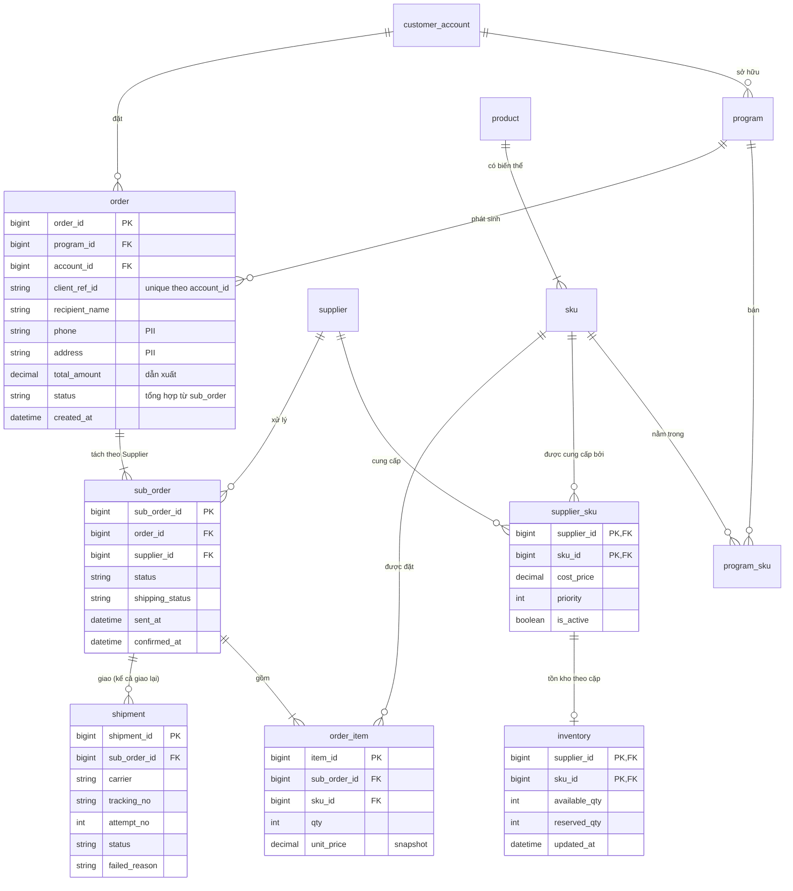
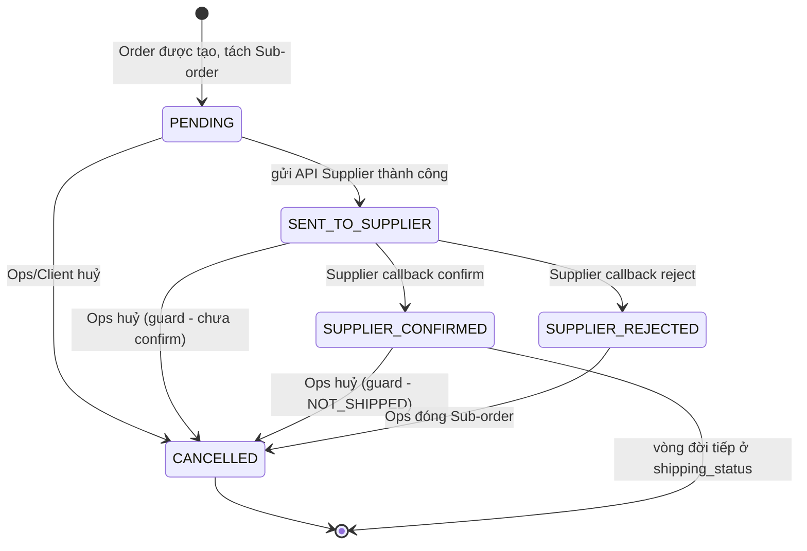
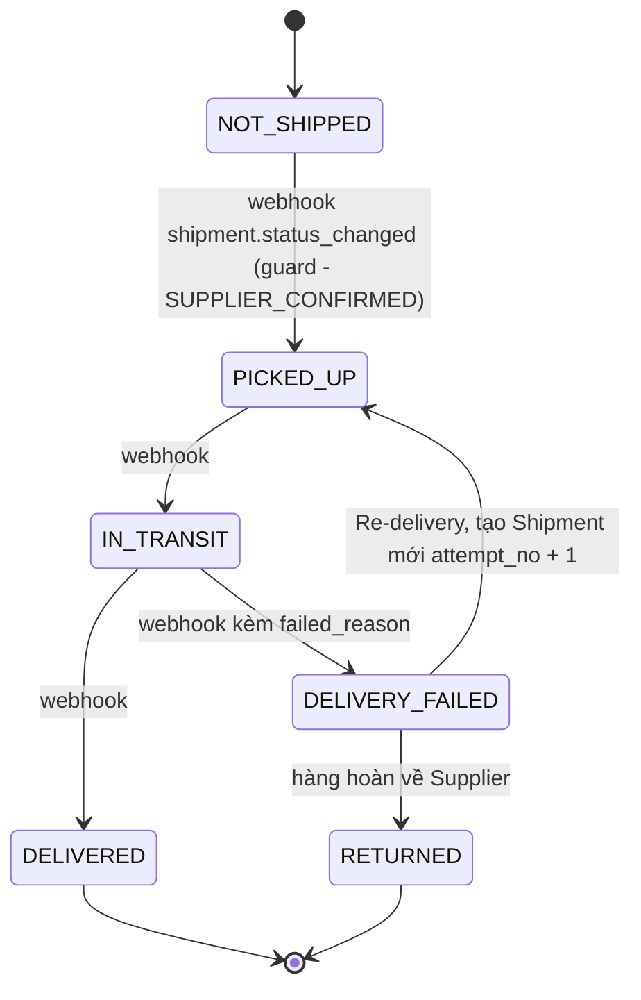
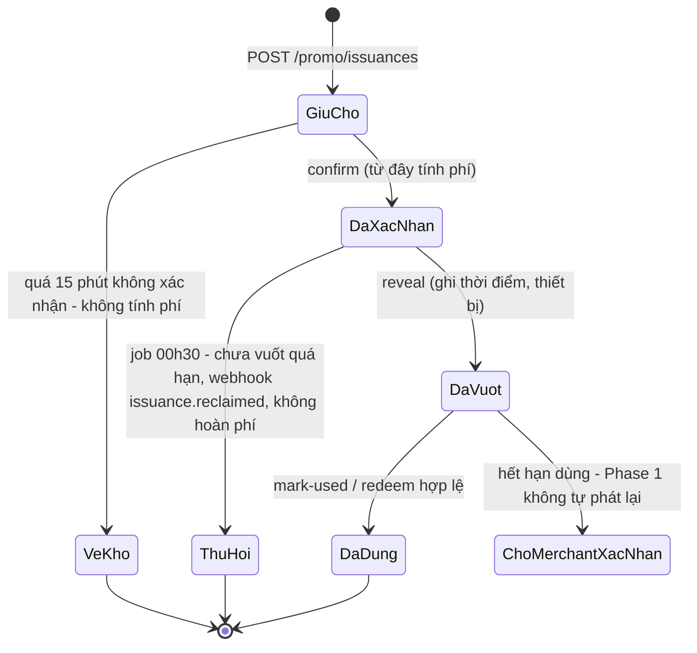
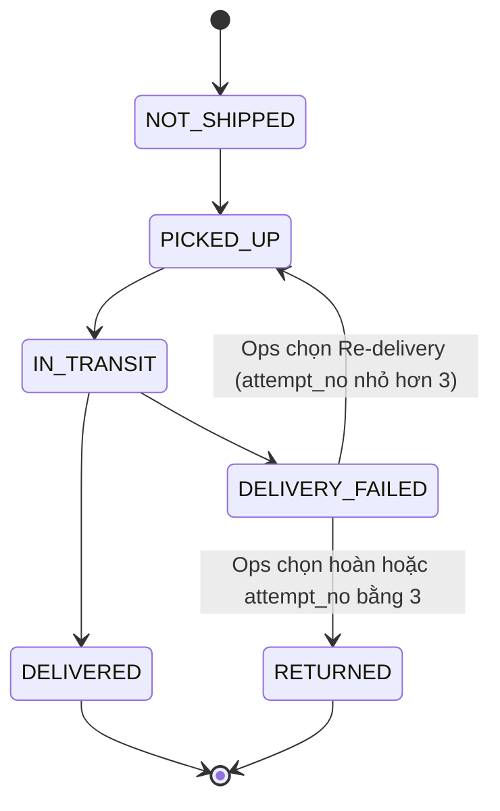
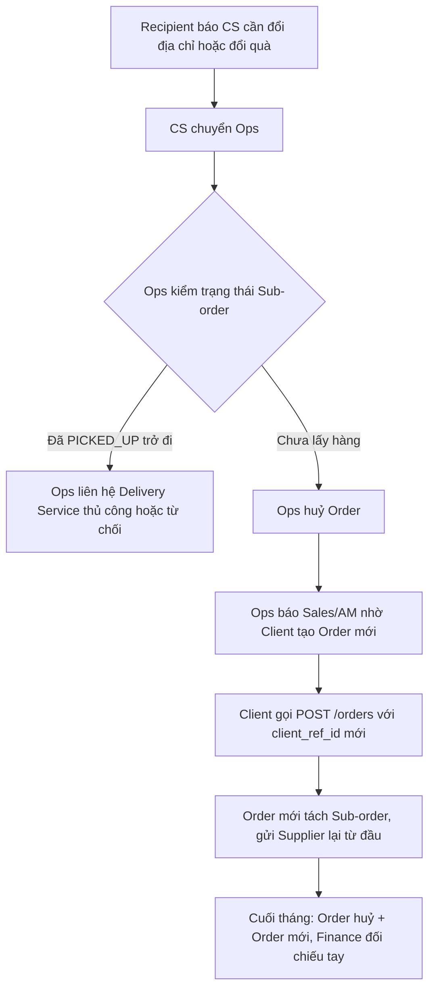
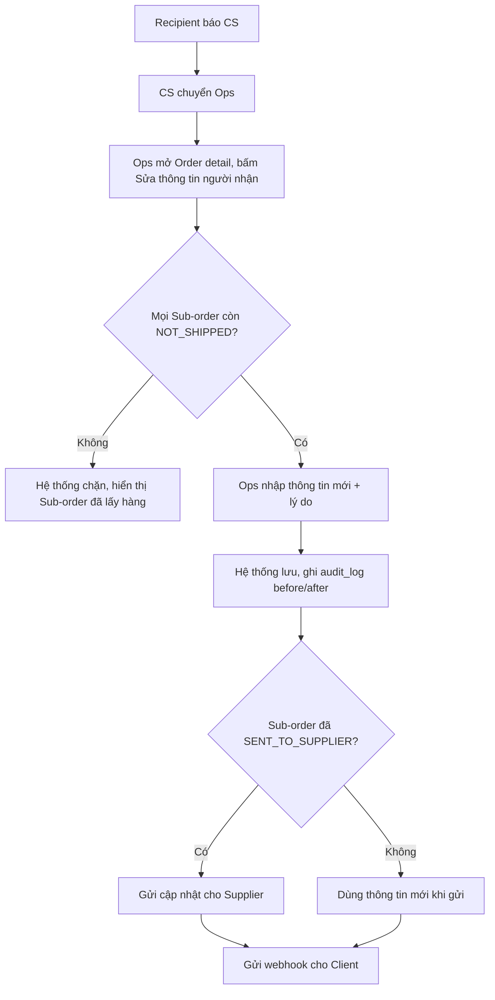

# Tuần 4 — System Analysis: từ dữ liệu, trạng thái, quyền đến API

Ba tuần đầu bạn học cách hiểu vấn đề và viết requirement. Tuần này bạn học cách nhìn feature từ phía hệ thống: dữ liệu nằm ở đâu, đổi trạng thái theo luật nào, ai được làm gì, và để lại dấu vết gì. Đây là phần tách BA "viết lại lời Business" khỏi BA mà Developer và QC tin tưởng. Cuối tuần có một bài tổng hợp lớn (Day 27) bắt bạn dùng toàn bộ kiến thức từ Day 1 đến Day 26 cho một yêu cầu rất hay gặp: "Cho Admin sửa Order".

| Day | Topic | Deliverable |
|---|---|---|
| 22 | Entity, Attribute, PK, FK, quan hệ 1-1 / 1-N / N-N | Entity list + bảng quan hệ có cardinality cho Physical Gift |
| 23 | ERD & Data Dictionary | ERD v1 (mermaid) + Data Dictionary cho Create Order |
| 24 | State Transition | State diagram + Transition Table cho Sub-order và shipping_status |
| 25 | Permission & Audit Log | Permission Matrix + Audit Log Requirement |
| 26 | SQL cơ bản cho BA — điều tra dữ liệu & đối soát | Bộ 10 query điều tra + 1 query đối soát redeem |
| 27 | Bài tổng hợp: "Cho phép Admin sửa Order sau khi đã tạo" | Bộ phân tích end-to-end (Problem → Test Scenario) |
| 28 | REST API cơ bản: resource, method, status code (+ review tuần 4) | API Checklist cho `POST /orders` + bài review tuần |

---

## Day 22 - Entity, Attribute, PK, FK và quan hệ 1-1 / 1-N / N-N

> P5 System · Level: Junior → Middle · Thời lượng ~75 phút · Deliverable: Entity list + bảng quan hệ có cardinality cho Physical Gift

### Mục tiêu

- Nhận ra Entity (thực thể) trong một mô tả nghiệp vụ, không nhầm với Attribute hay với trạng thái.
- Xác định PK, FK và cardinality (số lượng quan hệ) cho từng cặp entity.
- Biết khi nào phải tách một khái niệm thành hai entity, dựa vào câu hỏi nghiệp vụ chứ không dựa vào cảm giác.

### Kiến thức cần học

**Entity – Thực thể.** Một "thứ" mà Business cần theo dõi riêng, có vòng đời riêng, có nhiều bản ghi. Ví dụ: Order, Supplier, SKU. Dấu hiệu nhận biết: Business nói "mỗi cái ... có ...", "danh sách các ...", "tra cứu theo ...".

**Attribute – Thuộc tính.** Thông tin mô tả một entity. Ví dụ: `order.recipient_name`, `sku.weight`. Một attribute không có vòng đời riêng.

**Primary Key (PK) – Khoá chính.** Giá trị định danh duy nhất một bản ghi, không đổi suốt vòng đời. Ví dụ: `order_id`.

**Foreign Key (FK) – Khoá ngoại.** Field trỏ tới PK của entity khác, thể hiện quan hệ. Ví dụ: `sub_order.order_id` trỏ tới `order.order_id`.

**Natural key vs Surrogate key.** `client_ref_id` là mã do Client gửi (natural key – khoá nghiệp vụ). `order_id` do hệ thống sinh (surrogate key – khoá thay thế). BA cần cả hai: PK để hệ thống nối dữ liệu, khoá nghiệp vụ để chống trùng và tra cứu với bên ngoài.

**Cardinality – Bản số quan hệ.**

| Loại | Ý nghĩa | Ví dụ Physical Gift | Cách lưu |
|---|---|---|---|
| 1-1 | Mỗi A có tối đa một B và ngược lại | Cặp (Supplier, SKU) – Inventory | FK + unique, hoặc gộp bảng |
| 1-N | Một A có nhiều B, mỗi B thuộc đúng một A | Order – Sub-order | FK đặt ở phía N (`sub_order.order_id`) |
| N-N | Một A có nhiều B, một B có nhiều A | SKU – Supplier | Bảng nối (`supplier_sku`) |

**Optionality – Tính bắt buộc.** Ngoài "một hay nhiều", còn hỏi "có thể không có không?". Sub-order có thể chưa có Shipment nào (0..N). Order phải có ít nhất một Sub-order (1..N). Khác biệt này sinh ra validation và test case.

**Bảng nối có thuộc tính riêng.** Khi quan hệ N-N có thông tin của riêng nó (giá vốn, ưu tiên), bảng nối trở thành entity thật. `supplier_sku` có `cost_price`, `priority`, `is_active`. `program_sku` có `price_or_point`, `is_visible`.

### BA/PO sử dụng kiến thức này khi nào?

- Khi Business nói một câu như "một sản phẩm có nhiều nhà cung cấp" — đó là quyết định N-N, ảnh hưởng giá vốn, chọn Supplier, đối soát.
- Khi viết Functional Requirement có chữ "mỗi", "tất cả", "duy nhất" — đó là cardinality và unique constraint.
- Khi phân tích impact: thêm một field vào entity khác hẳn với thêm một entity mới.
- Khi QC hỏi "trường hợp không có ... thì sao?" — đó là optionality.
- Khi đọc bug "tồn kho sai": phải biết tồn kho tính theo cặp (Supplier, SKU), không theo SKU.

### Quy trình thực hiện

**Step 1 — Gạch danh từ trong mô tả nghiệp vụ.** Lấy mô tả luồng, gạch tất cả danh từ. Đừng lọc vội.

**Step 2 — Phân loại danh từ.** Mỗi danh từ là Entity, Attribute, Value (giá trị của trạng thái/enum) hay Actor. "Delivered" là value của `shipping_status`, không phải entity.

**Step 3 — Test "có vòng đời riêng không?".** Nếu một danh từ có trạng thái riêng, có thể có nhiều bản ghi, cần tra cứu riêng → entity. Shipment có `attempt_no`, `failed_reason` → entity, không phải vài cột trên Sub-order.

**Step 4 — Với mỗi cặp entity, hỏi 2 câu theo 2 chiều.** "Một A có bao nhiêu B?" và "Một B thuộc bao nhiêu A?". Ghi cả min và max.

**Step 5 — Đặt PK, FK.** FK đặt ở phía N. N-N cần bảng nối. Ghi rõ khoá nghiệp vụ nào phải unique (VD: `client_ref_id` unique theo `account_id`).

**Step 6 — Kiểm chứng bằng câu hỏi nghiệp vụ.** Viết 3–5 câu hỏi Business sẽ hỏi (báo cáo, đối soát, tra cứu). Mô hình phải trả lời được bằng cách nối bảng, không cần "đoán".

### Ví dụ thực tế

Mô tả từ case: "Recipient chọn quà trong Program. Hệ thống tạo Order, tách thành nhiều Sub-order theo Supplier. Supplier đóng gói, bàn giao cho Delivery Service."

| Cặp | Chiều 1 | Chiều 2 | Kết luận |
|---|---|---|---|
| Order – Sub-order | 1 Order có 1..N Sub-order | 1 Sub-order thuộc đúng 1 Order | 1-N, FK `sub_order.order_id` |
| Sub-order – Supplier | 1 Sub-order thuộc đúng 1 Supplier | 1 Supplier có 0..N Sub-order | N-1, FK `sub_order.supplier_id` |
| Sub-order – Order Item | 1 Sub-order có 1..N item | 1 item thuộc 1 Sub-order | 1-N |
| Sub-order – Shipment | 1 Sub-order có 0..N Shipment | 1 Shipment thuộc 1 Sub-order | 1-N, `attempt_no` phân biệt lần giao |
| SKU – Supplier | 1 SKU có 1..N Supplier | 1 Supplier cung cấp 0..N SKU | N-N qua `supplier_sku` |
| Program – SKU | 1 Program có 0..N SKU | 1 SKU nằm trong 0..N Program | N-N qua `program_sku` |
| (Supplier, SKU) – Inventory | 1 cặp có tối đa 1 dòng tồn kho | 1 dòng tồn kho thuộc 1 cặp | 1-1 |

Điểm Junior hay sai: đặt `supplier_id` lên `order_item` hoặc lên `order`. Case đã chốt Order tách theo Supplier, nên Supplier thuộc về Sub-order. Đặt sai chỗ thì một Order nhiều Supplier không biểu diễn được.

Câu hỏi kiểm chứng:

1. "Tháng 9 Supplier X có bao nhiêu Sub-order bị huỷ?" → `sub_order` lọc `supplier_id`, `status`.
2. "Order này giao lại mấy lần?" → `shipment` theo `sub_order_id`, đếm `attempt_no`.
3. "Giá vốn SKU Y từ Supplier X?" → `supplier_sku`. Không có bảng nối thì không trả lời được.

#### Ví dụ từ dự án thật: Promotion Code

BRD Promotion Code Warehouse có quyết định mô hình dữ liệu đáng học: **tách Mã (merchant giao) khỏi Lượt phát (mỗi lần mã được gán cho một người dùng)**.

Lý do nằm trong bài toán: một mã của merchant có thể được phát và tính phí nhiều lần. Người dùng không vuốt mở mã trong [7] ngày thì mã về kho và được phát cho người khác. Nếu chỉ có một entity "Mã" với cột "người nhận", lần phát thứ hai sẽ ghi đè lần thứ nhất — mất lịch sử, mất căn cứ tính phí, mất căn cứ đối soát.

| Đối tượng | Quan hệ | Ghi chú từ tài liệu |
|---|---|---|
| Mã – Lượt phát | 1-N theo thời gian | Mỗi mã phát tối đa [3] lần |
| Mã – Lượt phát còn hiệu lực | Tối đa 1 tại một thời điểm | "Một mã không bao giờ có hai lượt phát còn hiệu lực cùng lúc" |
| Lô – Mã | 1-N | Lô = một lần nhập file |
| Lượt phát | Có serial (Công ty tạo), ref ID (khách gửi), mã người dùng đã băm | Serial là khoá hệ thống, ref ID là khoá nghiệp vụ chống trùng |

So sánh với Physical Gift: Sub-order và Shipment có cùng kiểu tư duy. Sub-order là "cái cần giao", Shipment là "mỗi lần thử giao". Giao thất bại rồi Re-delivery thì tạo Shipment mới với `attempt_no` tăng, không ghi đè Shipment cũ. Cả hai case đều trả lời cùng một câu: **khi một việc có thể lặp lại nhiều lần cho cùng một đối tượng, mỗi lần lặp là một entity riêng.**

Chi tiết thêm từ tài liệu: kho của khách chỉ là **hạn mức**, không giữ mã vật lý. Nghĩa là "Hạn mức" là entity riêng, không phải danh sách mã gán sẵn cho khách. Đây là chỗ BA mới hay mô hình sai: tưởng "khách mua 1.000 mã" thì phải gán 1.000 mã cụ thể cho khách.

### Junior vs Middle vs Senior

| Tình huống: Business nói "Một SKU có thể lấy từ nhiều Supplier" | Junior | Middle | Senior |
|---|---|---|---|
| Nghĩ gì | Thêm cột `supplier_id` vào SKU, có thể là danh sách | Đây là N-N, cần bảng nối `supplier_sku` | N-N có thuộc tính riêng: giá vốn, ưu tiên, active. Quy tắc chọn Supplier khi tạo Sub-order là một Business Rule mới |
| Hỏi gì | "Tối đa mấy Supplier?" | "Mỗi Supplier giá vốn khác nhau không?" | "Khi hai Supplier cùng còn hàng, chọn ai? Một Supplier tắt `is_active` thì Sub-order đang chạy xử lý thế nào? Đối soát tính giá vốn tại thời điểm nào?" |
| Làm gì | Ghi vào requirement "SKU có nhiều Supplier" | Vẽ bảng nối, liệt kê field | Vẽ bảng nối, chốt rule chọn Supplier, yêu cầu lưu `unit_price`/giá vốn tại thời điểm đặt (snapshot) để đối soát không lệch khi giá đổi |

### Sai lầm thường gặp

1. **Nhầm trạng thái thành entity.** "Đơn giao thất bại" không phải entity; đó là `shipping_status = DELIVERY_FAILED`.
2. **Bỏ quên chiều thứ hai.** Chỉ hỏi "một Order có mấy Sub-order" mà không hỏi "một Sub-order có thể thuộc hai Order không".
3. **Không ghi optionality.** Viết "Sub-order có Shipment" trong khi Sub-order mới tạo chưa có Shipment nào. QC sẽ không biết test trường hợp 0.
4. **Ghi đè lịch sử.** Lưu lần giao mới đè lên lần giao cũ. Mất khả năng trả lời "giao mấy lần, vì sao thất bại".
5. **Coi khoá nghiệp vụ là PK.** Dùng `client_ref_id` làm PK của Order. Hai Client khác nhau có thể gửi trùng `client_ref_id`; khoá đúng là unique theo (`account_id`, `client_ref_id`).

### Góc nhìn Senior BA/PO

Senior không vẽ data model để thay Developer. Senior dùng data model để **kiểm tra requirement có nhất quán không**. Mỗi câu "một", "nhiều", "duy nhất" trong BRD là một cam kết về dữ liệu. Nếu BRD nói "mỗi Order giao cho một địa chỉ" nhưng Business lại muốn "Recipient chọn hai quà gửi hai nơi", mâu thuẫn lộ ra ngay ở cardinality — trước khi Developer phát hiện lúc code.

Câu hỏi Senior luôn hỏi thêm: "Cái này có lặp lại không? Có cần lịch sử không? Có bên ngoài nào tham chiếu không?". Ba câu này quyết định tách entity, giữ lịch sử, và cần khoá nghiệp vụ.

### Bài tập thực hành

**Đầu vào.** Ops gửi yêu cầu: "Khi Supplier từ chối Sub-order, chúng tôi muốn chuyển Sub-order đó sang Supplier khác còn hàng, thay vì huỷ cả Order. Cần biết đã thử những Supplier nào, ai thao tác, lý do từ chối."

**Yêu cầu đầu ra.**

1. Liệt kê entity bị ảnh hưởng và entity mới (nếu có).
2. Bảng quan hệ có cardinality hai chiều, min/max.
3. Chỉ ra field nào cần thêm, field nào không nên sửa đè.
4. Ba câu hỏi nghiệp vụ mô hình mới phải trả lời được.

### Lời giải tham khảo

**1. Entity.** Ảnh hưởng: `sub_order`, `supplier`, `supplier_sku`, `inventory`, `audit_log`. Cần một entity mới, ví dụ `sub_order_assignment` (lần gán Supplier) `[Giả định bài tập]`.

Tại sao cần entity mới: yêu cầu "đã thử những Supplier nào" nghĩa là một Sub-order có **nhiều lần gán Supplier theo thời gian**. Đây đúng là bài học Mã vs Lượt phát. Nếu chỉ sửa `sub_order.supplier_id` thì mất Supplier cũ.

**2. Quan hệ.**

| Cặp | Cardinality |
|---|---|
| Sub-order – Assignment | 1 Sub-order có 1..N Assignment; tại một thời điểm tối đa 1 Assignment đang hiệu lực |
| Assignment – Supplier | N-1 |
| Assignment – Audit log | 1-N (gán, gửi, từ chối, chuyển) |

**3. Field.** Assignment: `assignment_id`, `sub_order_id`, `supplier_id`, `assigned_at`, `status`, `rejected_reason`, `assigned_by`. Trên `sub_order`, `supplier_id` có thể giữ là "Supplier hiện tại" để truy vấn nhanh, nhưng nguồn sự thật cho lịch sử là bảng Assignment. Không sửa đè `order_item.unit_price` khi đổi Supplier: giá bán cho Client không đổi, giá vốn thay đổi theo `supplier_sku` của Supplier mới — phải ghi giá vốn theo Assignment để đối soát Supplier đúng.

**4. Câu hỏi kiểm chứng.** (a) Sub-order X đã qua những Supplier nào, theo thứ tự? (b) Tháng này Supplier Y từ chối bao nhiêu lần, lý do gì? (c) Đối soát Supplier Y: chỉ tính Sub-order mà Assignment cuối cùng thuộc Y và đã giao thành công.

**Junior hay bỏ sót:** (1) ràng buộc "tối đa một Assignment hiệu lực" — thiếu nó, hai Supplier cùng giao một Sub-order; (2) tồn kho: Supplier cũ đã `reserved_qty` thì phải trả lại; (3) đối soát: Sub-order bị chuyển là nguồn lệch số cuối tháng (pain point 5 của case).

### Checklist hoàn thành

- [ ] Tôi hiểu khái niệm.
- [ ] Tôi tự làm được bài tập.
- [ ] Tôi giải thích được cho Developer/QC.
- [ ] Tôi có thể viết thành Requirement/artifact.
- [ ] Tôi hỏi cardinality theo cả hai chiều, có min/max.
- [ ] Tôi nhận ra khi nào một hành động lặp lại cần thành entity riêng (Mã vs Lượt phát, Sub-order vs Shipment).
- [ ] Tôi phân biệt được PK hệ thống và khoá nghiệp vụ cần unique.

---

## Day 23 - ERD & Data Dictionary

> P5 System · Level: Middle · Thời lượng ~90 phút · Deliverable: ERD v1 (mermaid) cho Physical Gift + Data Dictionary cho Create Order

### Mục tiêu

- Vẽ ERD (Entity Relationship Diagram – Sơ đồ quan hệ thực thể) đọc được cho cả Developer lẫn Business.
- Viết Data Dictionary (Từ điển dữ liệu) đủ để Developer code validation và QC viết test case mà không cần hỏi lại.
- Biết field nào phải snapshot (chụp lại giá trị lúc phát sinh) và field nào được tham chiếu sống.

### Kiến thức cần học

**ERD** cho thấy entity, attribute chính, và quan hệ có cardinality. BA vẽ ERD mức logic: đúng entity, đúng quan hệ, đủ field quan trọng. Không cần index, kiểu dữ liệu vật lý chi tiết.

**Ký hiệu crow's foot trong mermaid:**

| Ký hiệu | Nghĩa |
|---|---|
| `\|\|` | đúng một |
| `o\|` | không hoặc một |
| `\|{` | một hoặc nhiều |
| `o{` | không hoặc nhiều |

**Data Dictionary** là bảng mô tả từng field. Cột tối thiểu:

| Cột | Trả lời câu hỏi |
|---|---|
| Field | Tên kỹ thuật |
| Tên nghiệp vụ | Business gọi là gì |
| Type | Kiểu, độ dài |
| Required | Bắt buộc khi nào (có thể có điều kiện) |
| Validation | Quy tắc hợp lệ, có số cụ thể |
| Source | Ai/hệ thống nào điền: Client gửi, hệ thống sinh, copy từ entity khác |
| Editable | Sửa được không, ở trạng thái nào, bởi ai |
| Example | Một giá trị mẫu |
| Note / PII | Có phải dữ liệu cá nhân không, cần che không |

**Snapshot vs Reference.** `order_item.unit_price` là snapshot: giá tại lúc đặt, không đổi khi `program_sku.price_or_point` thay đổi sau đó. Nếu chỉ tham chiếu giá sống, đối soát tháng trước sẽ ra số khác mỗi lần chạy.

**Derived field – Field dẫn xuất.** `order.status` là trạng thái tổng hợp từ các Sub-order. `order.total_amount` là tổng các `order_item`. Data Dictionary phải ghi rõ "tính từ đâu", để không ai cho phép sửa tay.

### BA/PO sử dụng kiến thức này khi nào?

- Viết API spec: request body chính là một phần Data Dictionary.
- Thiết kế màn hình: mỗi field trên form cần Required, Validation, Editable.
- Đối soát và báo cáo: cần biết số lấy từ field nào, snapshot hay sống.
- Onboard thành viên mới: ERD là bản đồ nhanh nhất của hệ thống.
- Impact Analysis: thêm hoặc đổi một field kéo theo API, UI, report, export nào.

### Quy trình thực hiện

**Step 1 — Lấy entity list và quan hệ từ Day 22.**

**Step 2 — Vẽ ERD khung.** Chỉ entity + quan hệ. Kiểm tra từng đường nối: đọc to thành câu tiếng Việt ("một Order có một hoặc nhiều Sub-order").

**Step 3 — Thêm field chính.** PK, FK, khoá nghiệp vụ, status, field tiền, field thời gian.

**Step 4 — Chọn một luồng (VD: Create Order) và viết Data Dictionary cho các field luồng đó chạm tới.**

**Step 5 — Đánh dấu Source và Editable cho từng field.** Đây là hai cột Junior hay bỏ trống và gây tranh cãi nhiều nhất về sau.

**Step 6 — Review với Developer và QC.** Developer kiểm tra khả thi. QC kiểm tra "mỗi dòng Validation có thể test được không".

### Ví dụ thực tế

**ERD v1 — Physical Gift**



Đọc lại thành câu để kiểm tra: "Một Order có một hoặc nhiều Sub-order. Mỗi Sub-order thuộc đúng một Supplier. Một Sub-order có thể chưa có Shipment nào hoặc có nhiều Shipment."

`reconciliation` và `audit_log` không nối FK cứng vào ERD trên: `reconciliation` dùng `party_type` + `party_id` (trỏ tới Supplier hoặc Client tuỳ loại), `audit_log` dùng `entity` + `entity_id` (trỏ tới bất kỳ entity nào). Đây là kiểu quan hệ đa hình (polymorphic). BA cần ghi chú điều này để QC biết khi test phải kiểm cặp giá trị, không chỉ một cột.

**Data Dictionary — Create Order (trích)**

| Field | Tên nghiệp vụ | Type | Required | Validation | Source | Editable | PII |
|---|---|---|---|---|---|---|---|
| `client_ref_id` | Mã tham chiếu của Client | string(64) `[Giả định bài tập]` | Có | Unique theo `account_id`; trùng thì trả Order cũ, không tạo mới | Client gửi | Không bao giờ | Không |
| `program_id` | Chương trình | bigint | Có | Program thuộc `account_id` của API key; `status = ACTIVE`; thời điểm gọi nằm trong `start_at`–`end_at` | Client gửi | Không | Không |
| `recipient_name` | Tên người nhận | string(100) `[Giả định bài tập]` | Có | Không rỗng sau khi bỏ khoảng trắng | Client gửi | Theo rule Day 27 | Có |
| `phone` | SĐT người nhận | string | Có | Định dạng số di động VN 10 số `[Giả định bài tập]` | Client gửi | Theo rule Day 27 | Có, che khi hiển thị |
| `address` | Địa chỉ giao | string(255) `[Giả định bài tập]` | Có | Không rỗng; có tỉnh/thành hợp lệ | Client gửi | Theo rule Day 27 | Có |
| `items[].sku_id` | SKU đặt | bigint | Có, ≥ 1 item | SKU có trong `program_sku` với `is_visible = true`; `sku.status = ACTIVE`; còn tồn ở ít nhất một Supplier active | Client gửi | Theo rule Day 27 | Không |
| `items[].qty` | Số lượng | int | Có | 1 ≤ qty ≤ [5] `[Giả định bài tập]` | Client gửi | Theo rule Day 27 | Không |
| `unit_price` | Đơn giá | decimal | — | — | Hệ thống copy từ `program_sku.price_or_point` lúc tạo (snapshot) | Không | Không |
| `total_amount` | Tổng tiền | decimal | — | = Σ qty × unit_price | Hệ thống tính | Không sửa tay | Không |
| `status` | Trạng thái Order | enum | — | `CREATED` khi tạo | Hệ thống | Chỉ qua state transition | Không |

Chú ý cột Editable của địa chỉ và SKU ghi "Theo rule Day 27". Đây không phải lười: đó là quyết định chưa chốt, phải mở Open Item. Một Data Dictionary trung thực có chỗ ghi "chưa chốt" tốt hơn một bản điền đủ nhưng đoán.

#### Ví dụ từ dự án thật: Promotion Code

So sánh cách Promotion Code tách Mã vs Lượt phát với cách Physical Gift tách Order vs Sub-order vs Shipment:

| Khía cạnh | Promotion Code (từ BRD) | Physical Gift |
|---|---|---|
| Thứ "gốc" | Mã (merchant giao, mã hoá khi lưu, HSD gốc, số lần đã phát) | Sub-order (cần giao cho một người) |
| Thứ "lặp lại" | Lượt phát (serial, ref ID, mã người dùng đã băm, mốc thời gian, trạng thái, phí) | Shipment (attempt_no, carrier, failed_reason) |
| Ràng buộc đồng thời | Tối đa 1 lượt phát còn hiệu lực trên một mã | Tối đa 1 Shipment đang chạy trên một Sub-order `[Giả định bài tập]` |
| Giới hạn số lần | Mỗi mã phát tối đa [3] lần | Số lần giao lại tối đa — chưa có trong case, là Open Item |
| Khoá nghiệp vụ chống trùng | ref ID do khách gửi | `client_ref_id` do Client gửi |
| Dữ liệu nhạy cảm | Mã mã hoá khi lưu; chỉ lưu băm SĐT/CIF | `phone`, `address` là PII |

Ghi chú Data Dictionary rút ra từ tài liệu thật: field "mã người dùng" trong Lượt phát là **giá trị đã băm**, không phải SĐT gốc. Nếu BA viết Data Dictionary cho Lượt phát mà ghi "Field: phone, Type: string" thì sai yêu cầu bảo mật ngay ở tầng định nghĩa. Cột PII và cột "lưu dạng gì" (gốc / băm / mã hoá) phải có.

### Junior vs Middle vs Senior

| Tình huống: viết Data Dictionary cho `unit_price` | Junior | Middle | Senior |
|---|---|---|---|
| Nghĩ gì | Giá lấy từ Program | Giá phải copy vào lúc tạo Order | Giá snapshot là căn cứ đối soát Client; giá vốn snapshot là căn cứ đối soát Supplier — cần cả hai |
| Hỏi gì | "Kiểu số mấy chữ số thập phân?" | "Đổi giá Program sau khi đặt thì Order cũ ra sao?" | "Đối soát Supplier tính theo giá vốn lúc tạo Sub-order hay lúc giao thành công? Ai có thẩm quyền chốt?" |
| Làm gì | Ghi Source = program_sku | Ghi Source = snapshot, Editable = Không | Thêm field giá vốn snapshot, ghi rule đối soát, đưa câu hỏi thời điểm vào Open Item cho Finance |

### Sai lầm thường gặp

1. **ERD quá chi tiết.** Vẽ 40 field mỗi bảng. Không ai đọc. ERD của BA chỉ cần field có ý nghĩa nghiệp vụ.
2. **Validation mơ hồ.** "Số điện thoại hợp lệ". Hợp lệ theo gì? Ghi số chữ số, đầu số, có nhận +84 không.
3. **Bỏ trống Source.** Không biết field do Client gửi hay hệ thống sinh → Developer tự chọn, API spec và UI lệch nhau.
4. **Không có cột Editable.** Mọi tranh cãi "có cho sửa không" về sau đều do thiếu cột này.
5. **Quên PII.** Không đánh dấu dữ liệu cá nhân → export, log, màn hình CS lộ SĐT và địa chỉ.

### Góc nhìn Senior BA/PO

Data Dictionary là hợp đồng giữa ba bên: Business (ý nghĩa), Developer (cách lưu), QC (cách kiểm). Senior viết Data Dictionary trước API spec và trước wireframe, vì cả hai đều kế thừa từ nó.

Senior cũng dùng ERD để nhìn **rủi ro đối soát**. Mọi field tiền phải trả lời: giá trị này cố định từ lúc nào, ai được thay đổi, thay đổi có để lại dấu vết không. Tài liệu Promotion Code có cả entity "Bảng giá" (điều khoản tính phí theo hợp đồng) và "Dòng redeem" (kết quả đối chiếu) — tiền được mô hình hoá thành entity, không phải một cột rải rác.

### Bài tập thực hành

**Đầu vào.** Client yêu cầu thêm "ghi chú giao hàng" (VD: "giao giờ hành chính") và "ngày mong muốn nhận" khi tạo Order qua API. Supplier cần thấy hai thông tin này khi nhận Sub-order. CS cần thấy khi khách khiếu nại.

**Yêu cầu đầu ra.**

1. Hai field này đặt ở entity nào? Vì sao?
2. Viết hai dòng Data Dictionary đủ 9 cột.
3. Cập nhật ERD: có cần entity mới không?
4. Liệt kê 4 câu hỏi cần chốt với Business/Supplier trước khi coi là Ready.

### Lời giải tham khảo

**1.** Đặt ở `order`, vì ghi chú và ngày mong muốn gắn với người nhận và địa chỉ, giống nhau cho mọi Sub-order. Khi gửi Sub-order sang Supplier, hệ thống copy hai giá trị vào payload. Câu hỏi phản biện tốt: nếu Business muốn mỗi Supplier một ghi chú khác nhau thì phải đặt ở `sub_order` — đây là câu hỏi cần chốt, không tự quyết.

**2.**

| Field | Tên nghiệp vụ | Type | Required | Validation | Source | Editable | Example | PII |
|---|---|---|---|---|---|---|---|---|
| `delivery_note` | Ghi chú giao hàng | string(255) | Không | Tối đa 255 ký tự; loại bỏ ký tự điều khiển | Client gửi | Theo rule sửa Order (Day 27) | "Giao giờ hành chính" | Có thể chứa PII — che trong log |
| `expected_delivery_date` | Ngày mong muốn nhận | date | Không | ≥ ngày tạo + [2] ngày; ≤ `program.end_at` + [30] ngày `[Giả định bài tập]` | Client gửi | Theo rule sửa Order | 2026-11-15 | Không |

**3.** Không cần entity mới. Chỉ thêm attribute. Nhưng phải đánh dấu impact: API `POST /orders` (request), payload gửi Supplier, màn hình Order detail, màn hình CS, export.

**4.** (a) Supplier đang tích hợp API có nhận thêm field không, hay phải đổi hợp đồng API? Supplier `integration_type = MANUAL` nhận qua kênh nào? (b) "Ngày mong muốn" là cam kết hay chỉ tham khảo? Nếu là cam kết thì phát sinh SLA và phạt — scope lớn hơn nhiều. (c) Ghi chú có giới hạn nội dung (không cho nhập link, số điện thoại khác) không? (d) Report và đối soát có cần hai field này không?

**Junior hay bỏ sót:** câu (b). Một field "ngày mong muốn" nhìn vô hại nhưng nếu Client hiểu là cam kết thì cả luồng SLA, webhook trễ hạn, và khiếu nại đều đổi.

### Checklist hoàn thành

- [ ] Tôi hiểu khái niệm.
- [ ] Tôi tự làm được bài tập.
- [ ] Tôi giải thích được cho Developer/QC.
- [ ] Tôi có thể viết thành Requirement/artifact.
- [ ] ERD của tôi đọc thành câu tiếng Việt đúng nghĩa nghiệp vụ.
- [ ] Data Dictionary của tôi có đủ cột Source, Editable, PII.
- [ ] Tôi phân biệt được field snapshot, field dẫn xuất và field tham chiếu sống.

---

## Day 24 - State Transition

> P5 System · Level: Middle → Senior · Thời lượng ~90 phút · Deliverable: State diagram + Transition Table cho Sub-order.status và Sub-order.shipping_status

### Mục tiêu

- Vẽ State Diagram (Sơ đồ trạng thái) cho một entity, đủ trạng thái đầu, trạng thái kết thúc và nhánh lỗi.
- Viết Transition Table (Bảng chuyển trạng thái) gồm from, event, to, guard, action, ai được làm.
- Phát hiện chuyển trạng thái bị cấm, trạng thái "kẹt", và mâu thuẫn giữa hai trục trạng thái chạy song song.

### Kiến thức cần học

**State – Trạng thái.** Một tình huống ổn định của entity, trong đó entity cho phép một tập hành động nhất định. Ví dụ: Sub-order `SENT_TO_SUPPLIER` cho phép Supplier confirm hoặc reject, chưa cho phép giao hàng.

**Event – Sự kiện.** Điều làm trạng thái đổi: hành động người dùng, callback từ hệ thống ngoài, job định kỳ, hết thời gian.

**Guard – Điều kiện chặn.** Điều kiện phải đúng thì transition mới xảy ra. Ví dụ: "chỉ cancel Sub-order khi `shipping_status = NOT_SHIPPED`".

**Action – Hành động kèm theo.** Việc hệ thống làm khi transition xảy ra: trừ/trả tồn kho, gửi webhook, ghi audit log, tính lại Order.status.

**Terminal state – Trạng thái kết thúc.** Không còn transition đi ra. Ví dụ: `CANCELLED`, `DELIVERED` `[cần xác nhận: có cho phép trả hàng sau DELIVERED không]`.

**Trạng thái song song (orthogonal).** Case Physical Gift tách Sub-order thành hai trục: `status` (xử lý với Supplier) và `shipping_status` (vận chuyển). Hai trục độc lập nhưng có ràng buộc chéo: không thể `PICKED_UP` khi chưa `SUPPLIER_CONFIRMED`.

**Trạng thái tổng hợp (derived).** `Order.status` không tự đổi; nó được tính từ các Sub-order. Junior hay cho Order có transition riêng, sinh ra Order `COMPLETED` trong khi một Sub-order vẫn `IN_TRANSIT`.

### BA/PO sử dụng kiến thức này khi nào?

- Bất kỳ feature nào có chữ "khi đơn đã ...", "chỉ được ... nếu đang ...".
- Viết rule huỷ, sửa, hoàn, giao lại.
- Thiết kế webhook: mỗi transition là ứng viên cho một event gửi ra ngoài.
- Viết test case: mỗi dòng Transition Table là ít nhất một test case dương; mỗi cặp (state, event) không có trong bảng là một test case âm.
- Điều tra dữ liệu "treo": đơn kẹt ở một state quá lâu thường do thiếu event thoát (timeout, job).

### Quy trình thực hiện

**Step 1 — Liệt kê state từ nguồn chuẩn.** Dùng đúng tên trong case/BRD. Không đặt tên mới.

**Step 2 — Liệt kê event.** Ai hoặc cái gì gây ra: người (Ops, Admin, Client), hệ thống ngoài (Supplier callback, Delivery webhook), thời gian (SLA, job).

**Step 3 — Vẽ diagram.** Bắt đầu `[*]`, kết thúc ở terminal state. Mỗi mũi tên ghi event.

**Step 4 — Lập Transition Table.** Mỗi mũi tên thành một dòng, thêm guard, action, actor.

**Step 5 — Lập ma trận (state × event) để tìm lỗ hổng.** Ô trống nghĩa là "event này đến khi đang ở state này thì sao?". Phải có câu trả lời: bỏ qua, báo lỗi, hay ghi nhận để xử lý tay.

**Step 6 — Kiểm ràng buộc chéo và trạng thái tổng hợp.** Hai trục song song có tổ hợp nào vô lý không? Order.status tính thế nào từ các Sub-order?

**Step 7 — Kiểm "lối thoát".** Mỗi state không terminal phải có ít nhất một event thoát không phụ thuộc bên ngoài (timeout hoặc thao tác tay), nếu không sẽ có đơn treo vĩnh viễn.

### Ví dụ thực tế

**Sub-order.status (xử lý với Supplier)**



**Sub-order.shipping_status (vận chuyển)**



**Transition Table — Sub-order.status (trích)**

| # | From | Event | To | Guard | Action | Ai được làm |
|---|---|---|---|---|---|---|
| T1 | PENDING | Gửi API Supplier thành công | SENT_TO_SUPPLIER | Supplier `status` active; `integration_type = API` | Ghi `sent_at`; bắt đầu đếm `confirm_sla_minutes` | Hệ thống |
| T2 | SENT_TO_SUPPLIER | Supplier confirm | SUPPLIER_CONFIRMED | Callback hợp lệ, đúng `sub_order_id` | Ghi `confirmed_at`; tính lại Order.status; webhook `order.status_changed` | Supplier (qua API) |
| T3 | SENT_TO_SUPPLIER | Supplier reject | SUPPLIER_REJECTED | Callback hợp lệ | Trả `reserved_qty`; báo Ops; ghi lý do | Supplier |
| T4 | SENT_TO_SUPPLIER | Quá `confirm_sla_minutes` | (giữ nguyên) | Chưa có callback | Cảnh báo Ops (pain point 2) — chưa có transition tự động, là Open Item | Hệ thống (job) |
| T5 | PENDING / SENT_TO_SUPPLIER / SUPPLIER_CONFIRMED | Huỷ | CANCELLED | `shipping_status = NOT_SHIPPED` | Trả tồn kho; báo Supplier nếu đã gửi; ghi audit log có `reason`; tính lại Order.status | Ops |
| T6 | SUPPLIER_CONFIRMED | Callback confirm lần hai | (giữ nguyên) | — | Bỏ qua, trả thành công (idempotent), ghi log | Supplier |

Dòng T4 và T6 là dòng Junior thường không có. T4 là lối thoát cho đơn treo. T6 là event lặp lại — Supplier retry callback là chuyện bình thường.

**Ràng buộc chéo giữa hai trục**

| status | shipping_status hợp lệ |
|---|---|
| PENDING, SENT_TO_SUPPLIER | chỉ NOT_SHIPPED |
| SUPPLIER_CONFIRMED | mọi giá trị |
| SUPPLIER_REJECTED | chỉ NOT_SHIPPED |
| CANCELLED | NOT_SHIPPED (theo guard T5) |

Webhook `PICKED_UP` đến khi Sub-order đang `CANCELLED` là tình huống thật (Ops huỷ trễ, Delivery đã lấy hàng). Không được bỏ qua im lặng: ghi nhận, cảnh báo Ops, và đây là nguồn lệch đối soát (pain point 5).

**Order.status (tổng hợp)** `[Giả định bài tập — quy tắc tính cụ thể]`:

- Mọi Sub-order `CANCELLED` → Order `CANCELLED`.
- Tất cả Sub-order không huỷ đã `SUPPLIER_CONFIRMED` → Order `CONFIRMED`.
- Ít nhất một Sub-order `DELIVERED` và còn Sub-order chưa kết thúc → `PARTIALLY_SHIPPED`.
- Mọi Sub-order không huỷ đều `DELIVERED` → `COMPLETED`.

Viết quy tắc này thành bảng là việc của BA. Không viết thì mỗi Developer tự hiểu một kiểu.

#### Ví dụ từ dự án thật: Promotion Code

BRD Promotion Code mô tả vòng đời của Lượt phát và Mã qua hành vi, không phải qua một danh sách tên state. Tên state dưới đây là đặt cho bài học `[Giả định bài tập]`; hành vi lấy từ tài liệu.



Các guard có trong tài liệu, viết thành bảng:

| Transition | Guard / Rule từ BRD |
|---|---|
| Tạo giữ chỗ | Mã còn ≥ [14] ngày HSD gốc; ưu tiên FEFO; khách còn hạn mức và chưa vượt hạn mức công nợ; mã chưa có lượt phát còn hiệu lực; mã chưa phát quá [3] lần |
| Gửi lại cùng ref ID | Không tạo lượt mới, trả lượt cũ, không tính phí lần hai |
| Reveal | Mã chỉ trả ở bước này; sau vuốt có [7] ngày dùng, không vượt HSD gốc |
| Tặng người khác | Chỉ trước khi vuốt |
| Redeem khi chưa vuốt | Đối soát xếp "Tranh chấp: chưa vuốt" → khoá mã, báo Lead |

Điểm đáng học: **Lượt phát có terminal state, nhưng Mã thì quay vòng.** Lượt phát bị thu hồi là kết thúc; Mã quay về kho và có thể bắt đầu lượt phát mới với serial mới. Đây là hai state machine lồng nhau, đúng như việc tách hai entity ở Day 22. Nếu bạn chỉ vẽ một state machine cho "Mã", bạn sẽ có mũi tên từ "Đã phát" quay về "Trong kho" — và mất luôn lịch sử ai đã nhận mã đó.

#### Ví dụ từ dự án thật: Slide to Use

BRD Slide to Use dùng **state 3 kèm bảng tạm** cho brand Chỉ code 3rd và brand Cả hai. Facts từ tài liệu:

- Lúc tách: ghi redeem và doanh thu cho brand đã chọn, **chưa lấy code 3rd**; voucher giữ state 3 kèm bảng tạm.
- Lúc trượt: còn code → trả code 3rd. Hết code: brand Cả hai → mã nội bộ; brand Chỉ code 3rd → báo tạm hết mã.
- Quyết định 15/10/2026 (lần 2): brand Cả hai hết code → xoá bảng tạm **và huỷ dòng doanh thu lúc tách**; doanh thu ghi khi khách dùng mã nội bộ.
- NFR-1: trượt nhiều lần hoặc trên hai thiết bị cùng lúc chỉ ra một kết quả, rút tối đa một code.
- NFR-2: kiểm bảng tạm và trừ voucher tại POS là một thao tác nguyên tử.
- NFR-3: ghi log lịch sử mọi thay đổi của bảng tạm và dòng doanh thu.

Ba bài học state transition rút ra:

1. **Một transition kéo theo nhiều action ở nhiều entity.** Trượt ở brand Cả hai khi hết code không chỉ đổi state voucher: xoá bảng tạm, huỷ dòng doanh thu, phát sinh mã nội bộ. Transition Table phải liệt kê đủ action, và mỗi action là một câu hỏi cho bên liên quan (huỷ doanh thu bằng đánh dấu hay bút toán đảo là OI-S43 của Kế toán).
2. **Concurrency là guard.** NFR-1 và NFR-2 thực chất là guard "chỉ một event được thắng". BA không thiết kế lock, nhưng BA phải viết rõ kết quả mong muốn khi hai event cùng đến.
3. **State có thể kẹt.** OI-S15 hỏi: brand Chỉ code 3rd hết kho kéo dài, voucher tới hạn thì gia hạn, hoàn hay để hết hạn? Đó chính là Step 7 — một state không có lối thoát được chốt.

### Junior vs Middle vs Senior

| Tình huống: Ops muốn "huỷ Sub-order bất kỳ lúc nào" | Junior | Middle | Senior |
|---|---|---|---|
| Nghĩ gì | Thêm nút Huỷ, chuyển sang CANCELLED | Huỷ chỉ hợp lệ ở một số state | Huỷ là transition có guard, action ở 4 nơi (tồn kho, Supplier, Order.status, đối soát), và có xung đột với event từ Delivery |
| Hỏi gì | "Nút đặt ở đâu?" | "Đang IN_TRANSIT có huỷ được không?" | "Huỷ sau confirm thì Supplier có tính phí không? Webhook PICKED_UP đến sau khi huỷ thì xử lý ra sao? Client được báo qua webhook nào?" |
| Làm gì | Viết 1 AC | Viết Transition Table với guard | Viết Transition Table + ma trận state×event + rule tính lại Order.status + Open Item về phí huỷ cho Finance |

### Sai lầm thường gặp

1. **Đặt tên state mới** khác tài liệu chuẩn ("SHIPPING", "DONE"). Hai bên nói hai ngôn ngữ, report đếm sai.
2. **Chỉ vẽ happy path.** Không có REJECTED, FAILED, timeout.
3. **Không có guard.** Diagram cho thấy "có thể" chuyển, không nói "khi nào được".
4. **Bỏ qua event lặp và event đến muộn.** Webhook và callback có thể đến hai lần hoặc sai thứ tự.
5. **Cho trạng thái tổng hợp tự đổi.** Order.status được sửa tay, lệch với Sub-order.
6. **Thiếu lối thoát.** Không có timeout hoặc thao tác tay → đơn treo vĩnh viễn.

### Góc nhìn Senior BA/PO

State machine là nơi Business Rule, permission, integration và đối soát gặp nhau. Một dòng Transition Table tốt trả lời cùng lúc: được không (guard), ai được (permission), xảy ra gì (action), ai biết (webhook/notification), và để lại gì (audit log).

Senior đọc Transition Table để tìm **tiền**: transition nào phát sinh phí, hoàn phí, ghi hoặc huỷ doanh thu. Promotion Code: tính phí từ confirm, không hoàn phí khi thu hồi. Slide to Use: huỷ dòng doanh thu khi brand Cả hai hết code. Mỗi transition chạm tiền phải có Finance/Kế toán xác nhận.

### Bài tập thực hành

**Đầu vào.** Ops đề xuất: "Khi giao thất bại, cho Ops chọn Re-delivery tối đa 2 lần. Sau 2 lần thất bại, hàng hoàn về Supplier. Ops cũng muốn đổi địa chỉ trước khi giao lại." Hiện Ops làm việc này qua Excel (pain point 3).

**Yêu cầu đầu ra.**

1. Cập nhật stateDiagram-v2 cho `shipping_status` có giới hạn số lần.
2. Transition Table đủ 6 cột cho các transition từ `DELIVERY_FAILED`.
3. Liệt kê 3 tổ hợp event bất thường và cách xử lý.
4. Ghi các Open Item cần chốt.

### Lời giải tham khảo

**1.**



"Tối đa 2 lần Re-delivery" nghĩa là tối đa 3 lần giao (1 lần đầu + 2 lần lại). Guard viết bằng `attempt_no` để QC test được biên: `attempt_no = 2` được giao lại, `attempt_no = 3` không.

**2.**

| From | Event | To | Guard | Action | Ai |
|---|---|---|---|---|---|
| DELIVERY_FAILED | Ops chọn Re-delivery | PICKED_UP (khi Delivery lấy lại hàng) | `attempt_no` < 3; Sub-order không CANCELLED | Tạo Shipment mới `attempt_no + 1`; gửi yêu cầu Delivery Service; audit log | Ops |
| DELIVERY_FAILED | Ops chọn Re-delivery + đổi địa chỉ | như trên | như trên + địa chỉ mới qua validation | Lưu địa chỉ mới (có before/after); Shipment mới dùng địa chỉ mới | Ops |
| DELIVERY_FAILED | Ops chọn hoàn | RETURNED | — | Báo Supplier; webhook `order.status_changed` nếu Order.status đổi; ghi lý do | Ops |
| DELIVERY_FAILED | Đến lần thứ 3 thất bại | RETURNED | `attempt_no = 3` | Như trên, tự động `[Giả định bài tập]` | Hệ thống |

Lưu ý dòng 1: thực tế transition là DELIVERY_FAILED → (chờ lấy lại) → PICKED_UP. Nếu Ops cần thấy trạng thái "đã yêu cầu giao lại, chờ lấy", đó là state mới chưa có trong chuẩn. Không tự thêm; ghi Open Item.

**3.** (a) Webhook `DELIVERED` của Shipment cũ đến sau khi Shipment mới đã tạo → gắn theo `shipment_id`/`tracking_no`, không theo Sub-order chung chung. (b) Ops bấm Re-delivery hai lần liên tiếp → chỉ tạo một Shipment (idempotent theo Sub-order + attempt). (c) Đổi địa chỉ sang tỉnh khác làm thay đổi phí vận chuyển → ai chịu phí?

**4.** Open Item: phí giao lại do ai chịu (Client, Supplier, công ty); đổi địa chỉ có cần Client/Recipient xác nhận không; có cần state "chờ lấy lại" không; RETURNED có đưa hàng về tồn kho Supplier không; đối soát Supplier tính Sub-order RETURNED thế nào.

**Junior hay bỏ sót:** đổi địa chỉ là sửa dữ liệu PII trên Order sau khi đã tạo — chính là bài toán Day 27. Một yêu cầu "giao lại" nhỏ đã chạm vào permission, audit và đối soát.

### Checklist hoàn thành

- [ ] Tôi hiểu khái niệm.
- [ ] Tôi tự làm được bài tập.
- [ ] Tôi giải thích được cho Developer/QC.
- [ ] Tôi có thể viết thành Requirement/artifact.
- [ ] Transition Table của tôi có đủ guard, action, actor.
- [ ] Tôi đã xử lý event lặp, event đến muộn và lối thoát cho state treo.
- [ ] Tôi viết được quy tắc tính trạng thái tổng hợp Order.status.

---

## Day 25 - Permission & Audit Log

> P5 System · Level: Middle → Senior · Thời lượng ~75 phút · Deliverable: Permission Matrix + Audit Log Requirement cho module Order của Physical Gift

### Mục tiêu

- Viết Permission Matrix (Ma trận phân quyền) theo role × action × điều kiện dữ liệu.
- Phân biệt quyền theo chức năng và quyền theo phạm vi dữ liệu.
- Viết Audit Log Requirement (Yêu cầu nhật ký kiểm toán) đủ để trả lời "ai, làm gì, lúc nào, trước – sau, vì sao".
- Biết khi nào phải che, băm, mã hoá dữ liệu.

### Kiến thức cần học

**Authentication – Xác thực** trả lời "bạn là ai". **Authorization – Phân quyền** trả lời "bạn được làm gì". BA chủ yếu viết phần Authorization.

**RBAC (Role-Based Access Control – phân quyền theo vai trò).** Quyền gán cho role, người dùng nhận role. Đủ cho phần lớn hệ thống nội bộ.

**Ba lớp quyền BA phải viết:**

| Lớp | Câu hỏi | Ví dụ |
|---|---|---|
| Chức năng | Role này có thấy màn/nút/API này không | Ops được Huỷ Sub-order |
| Phạm vi dữ liệu | Thấy dữ liệu của ai | Sales/AM chỉ thấy Client mình phụ trách |
| Điều kiện trạng thái | Được làm khi dữ liệu đang ở state nào | Huỷ chỉ khi `NOT_SHIPPED` |

**Segregation of Duties – Tách nhiệm vụ.** Người tạo và người duyệt là hai người khác nhau cho thao tác rủi ro cao. Ví dụ Promotion Code: Merchant Executive nhập lô, lô trên [5.000] mã cần Merchant Lead duyệt.

**Field-level permission – Quyền theo field.** Cùng màn hình, role khác thấy field khác. CS thấy SĐT đã che; Ops thấy đầy đủ để gọi giao hàng `[Giả định bài tập]`.

**Audit Log – Nhật ký kiểm toán.** Bảng `audit_log` của case có: `entity`, `entity_id`, `action`, `before`, `after`, `actor`, `reason`, `created_at`. Audit log khác application log: audit log dành cho người nghiệp vụ (CS, Finance, kiểm toán) đọc, phải bất biến (không sửa, không xoá) và có ý nghĩa nghiệp vụ.

**Masking / Hashing / Encryption.**

| Kỹ thuật | Ý nghĩa | Khi dùng |
|---|---|---|
| Masking – Che | Hiển thị một phần (`090****123`) | Màn hình, export cho role không cần dữ liệu đầy đủ |
| Hashing – Băm | Biến đổi một chiều, không lấy lại gốc | Cần so khớp nhưng không cần biết gốc |
| Encryption – Mã hoá | Biến đổi hai chiều, có khoá mới đọc được | Cần dùng lại giá trị gốc nhưng phải bảo vệ khi lưu |

### BA/PO sử dụng kiến thức này khi nào?

- Mọi màn hình admin/backoffice mới.
- Mọi thao tác sửa, huỷ, hoàn, duyệt, export.
- Khi feature chạm PII hoặc tiền.
- Khi CS hỏi "tại sao đơn này đổi địa chỉ?" mà không ai trả lời được — đó là thiếu audit log.
- Khi kiểm toán hoặc Finance cần chứng cứ cho một số liệu đối soát.

### Quy trình thực hiện

**Step 1 — Liệt kê action**, lấy từ Transition Table (Day 24) và danh sách màn hình/API. Mỗi transition là một action.

**Step 2 — Liệt kê role** từ Actor list. Không tạo role mới khi chưa có lý do.

**Step 3 — Điền ma trận role × action.** Giá trị: Được / Không / Có điều kiện (ghi điều kiện).

**Step 4 — Thêm phạm vi dữ liệu** cho từng role.

**Step 5 — Xác định thao tác cần duyệt hai bước** (maker–checker – người làm, người duyệt): theo ngưỡng tiền, số lượng, hoặc mức rủi ro.

**Step 6 — Viết Audit Log Requirement**: thao tác nào phải log, log field nào, ai xem được log, giữ bao lâu.

**Step 7 — Rà PII**: field nào che, băm, mã hoá; ở màn hình nào, export nào, log nào.

### Ví dụ thực tế

**Permission Matrix — module Order (Physical Gift)** `[Giả định bài tập — phân quyền cụ thể, case chỉ nêu vai trò]`

| Action | Client (API) | Ops | Admin | CS | Finance | Sales/AM |
|---|---|---|---|---|---|---|
| Tạo Order | Được (Program của mình) | Không | Không | Không | Không | Không |
| Xem Order | Order của mình | Tất cả | Tất cả | Tất cả, PII che | Tất cả, PII che | Client mình phụ trách |
| Huỷ Sub-order | Không `[Open Item]` | Có điều kiện: `NOT_SHIPPED` | Không | Không | Không | Không |
| Re-delivery | Không | Có điều kiện: `DELIVERY_FAILED`, `attempt_no` < 3 | Không | Không | Không | Không |
| Cấu hình Supplier, SKU, Program | Không | Không | Được | Không | Không | Không |
| Export danh sách Order | Không | Được, PII che | Được | Không | Được, không PII | Client mình |
| Xem audit log Order | Không | Được | Được | Được (chỉ đọc) | Được | Không |

Chú ý cột Admin. Theo Actor list, Admin cấu hình Product, SKU, Supplier, Program và phân quyền; còn **xử lý ngoại lệ Order là việc của Ops**. Một yêu cầu "cho Admin sửa Order" vì vậy đã có câu hỏi đầu tiên: thật sự là Admin hay Ops? Day 27 sẽ khai thác điểm này.

**Audit Log Requirement (trích)**

| ID | Requirement |
|---|---|
| AL-01 | Hệ thống ghi một dòng `audit_log` cho mỗi transition của Sub-order.status và shipping_status, gồm `entity`, `entity_id`, `action`, `before`, `after`, `actor`, `created_at`. |
| AL-02 | Với thao tác do người thực hiện (huỷ, re-delivery, đổi địa chỉ), `reason` là bắt buộc, tối thiểu [10] ký tự `[Giả định bài tập]`. |
| AL-03 | `actor` ghi user ID của người thao tác; thao tác của hệ thống ghi `system:<tên job>`; của đối tác ghi `supplier:<supplier_id>` hoặc `client:<account_id>`. |
| AL-04 | `before` và `after` chỉ chứa field bị thay đổi. Field PII lưu dạng đã che trong `before`/`after` `[Giả định bài tập — cần chốt với bảo mật]`. |
| AL-05 | Không role nào sửa hoặc xoá được dòng `audit_log` qua giao diện hoặc API. |
| AL-06 | Màn Order detail hiển thị lịch sử thay đổi theo thời gian giảm dần, lọc được theo `action`. |

Chú ý AL-04: có mâu thuẫn thật. CS cần biết địa chỉ cũ để trả lời khiếu nại "tôi đã đổi địa chỉ mà vẫn giao chỗ cũ". Bảo mật muốn che. BA không tự chọn — đưa ra lựa chọn (lưu đầy đủ nhưng chỉ role X xem được / lưu che) và để người có thẩm quyền quyết.

#### Ví dụ từ dự án thật: Promotion Code

BRD mục 10 của Promotion Code là một Permission Matrix tốt để học:

| Vai trò | Quyền |
|---|---|
| Merchant Executive | Nhập lô, đề xuất hạn mức, nhập file redeem, chuẩn bị danh sách chờ merchant xác nhận |
| Merchant Lead | Duyệt lô lớn, duyệt trả mã về kho thủ công, xử lý tranh chấp |
| Kế toán | Chỉ xem; xuất báo cáo nghiệm thu, phải trả merchant, doanh thu |
| Sales / AM | Chỉ xem hạn mức, lượt phát của khách mình phụ trách |
| CSKH | Tra cứu theo serial hoặc ref ID, không thấy toàn bộ mã |

Và các yêu cầu bảo mật: mã mã hoá khi lưu; admin luôn che một phần mã; mỗi lần reveal ghi thời điểm và thiết bị; không lưu số điện thoại/CIF gốc, chỉ lưu băm; mọi thao tác admin ghi log ai, lúc nào, trước và sau.

Bốn điểm đáng học:

1. **Maker–checker có ngưỡng.** Executive nhập; Lead duyệt lô lớn (> [5.000] mã) và duyệt trả mã về kho thủ công. Ngưỡng là tham số, không cứng.
2. **Phạm vi dữ liệu rõ.** Sales/AM chỉ khách mình phụ trách. CSKH tra cứu theo serial hoặc ref ID — tức là CS phải có khoá cụ thể mới tra được, không duyệt được toàn bộ kho.
3. **Ba kỹ thuật bảo vệ đúng chỗ.** Mã: mã hoá khi lưu (vì phải trả lại mã gốc lúc reveal) + che khi admin xem. SĐT/CIF: băm (chỉ cần so khớp người dùng, không cần gọi lại). Chọn sai kỹ thuật là sai requirement: nếu băm mã thì không bao giờ reveal được.
4. **Reveal là sự kiện cần audit riêng.** Ghi thời điểm và thiết bị lúc vuốt chính là chứng cứ khi đối soát "Tranh chấp: chưa vuốt". Audit log ở đây không chỉ để kiểm tra nội bộ; nó là dữ liệu đầu vào của đối soát tiền.

#### Ví dụ từ dự án thật: Slide to Use

NFR-3 của Slide to Use: "Ghi log lịch sử mọi thay đổi của bảng tạm và dòng doanh thu", với bài học trong tài liệu là "Audit log cho CS và đối soát". Khi quyết định 15/10/2026 cho phép huỷ dòng doanh thu lúc tách (brand Cả hai hết code), câu hỏi OI-S43 "huỷ bằng đánh dấu hay bút toán đảo" thực chất cũng là câu hỏi audit: Kế toán cần thấy dấu vết thế nào để sổ sách hợp lệ.

### Junior vs Middle vs Senior

| Tình huống: CS xin quyền xem đầy đủ SĐT người nhận | Junior | Middle | Senior |
|---|---|---|---|
| Nghĩ gì | CS cần thì cấp | CS cần SĐT để làm gì? | Đây là PII; nhu cầu thật có thể giải bằng cách khác ít rủi ro hơn |
| Hỏi gì | "Cấp cho tất cả CS hay một số người?" | "Có thể tìm theo SĐT thay vì xem SĐT không?" | "CS cần xem, cần tìm, hay cần gọi? Mỗi lần xem đầy đủ có cần ghi log và lý do không? Chính sách bảo mật dữ liệu cá nhân của công ty nói gì?" |
| Làm gì | Bỏ che SĐT cho CS | Cho tìm kiếm theo SĐT, kết quả vẫn che | Đề xuất: tìm theo SĐT, hiển thị che; nút "Xem đầy đủ" yêu cầu lý do và ghi audit log; đưa lên người có thẩm quyền về bảo mật duyệt |

### Sai lầm thường gặp

1. **Chỉ viết quyền chức năng**, quên phạm vi dữ liệu. Sales thấy Order của Client người khác phụ trách.
2. **Quên điều kiện trạng thái.** Ops có quyền Huỷ, nhưng không nói huỷ được ở state nào.
3. **Audit log thiếu `before` hoặc `reason`.** Biết có thay đổi nhưng không biết đổi từ gì, vì sao.
4. **Log PII đầy đủ vào audit log hoặc application log.** Che ở màn hình nhưng lộ ở log.
5. **Không nghĩ tới export.** Màn hình che PII nhưng file Excel export thì không.
6. **Tạo role mới cho từng yêu cầu.** Ma trận phình to, không ai quản lý được.

### Góc nhìn Senior BA/PO

Permission là Business Rule, không phải chi tiết kỹ thuật. "Ai được hoàn tiền" là quyết định kinh doanh có trách nhiệm pháp lý. Senior luôn hỏi: thao tác này sai thì ai chịu thiệt, mất bao nhiêu, phát hiện bằng cách nào? Câu trả lời quyết định có cần maker–checker, có cần lý do, có cần ngưỡng.

Audit log là thứ không ai đòi lúc làm requirement, nhưng ai cũng đòi lúc có sự cố. Senior viết nó ngay từ đầu, cho mọi thao tác chạm tiền, trạng thái và PII.

### Bài tập thực hành

**Đầu vào.** Finance yêu cầu: "Cho Finance điều chỉnh `total_amount` của một dòng `reconciliation` Supplier khi phát hiện lệch, kèm file chứng từ. Điều chỉnh trên [10.000.000] VND cần Trưởng Finance duyệt." `[Giả định bài tập]`

**Yêu cầu đầu ra.**

1. Permission Matrix cho thao tác điều chỉnh, duyệt, xem.
2. Ràng buộc trạng thái của `reconciliation` (điều chỉnh khi nào, khoá khi nào).
3. Audit Log Requirement (ít nhất 4 dòng).
4. Ba câu hỏi phải chốt.

### Lời giải tham khảo

**1.**

| Action | Finance Staff | Trưởng Finance | Ops | Admin |
|---|---|---|---|---|
| Tạo điều chỉnh ≤ 10.000.000 | Được, tự hiệu lực | Được | Không | Không |
| Tạo điều chỉnh > 10.000.000 | Được, trạng thái chờ duyệt | Được, vẫn cần người khác duyệt | Không | Không |
| Duyệt / từ chối điều chỉnh | Không | Được, trừ điều chỉnh do chính mình tạo | Không | Không |
| Xem điều chỉnh, lịch sử | Được | Được | Xem | Không |

Vì sao Trưởng Finance tự tạo vẫn cần người khác duyệt: Segregation of Duties. Không có ngoại lệ cho người có quyền cao nhất; nếu không có người duyệt thứ hai thì đó là Open Item, không phải lý do bỏ rule.

**2.** Chỉ điều chỉnh khi `reconciliation.status` chưa ở trạng thái đã chốt/đã thanh toán. Tên trạng thái cụ thể của `reconciliation` chưa có trong case → Open Item, không tự đặt.

**3.** AL-F1: mỗi điều chỉnh ghi `before.total_amount`, `after.total_amount`, chênh lệch, `actor`, `reason` bắt buộc, file chứng từ đính kèm. AL-F2: duyệt/từ chối ghi người duyệt, thời điểm, lý do từ chối. AL-F3: không xoá điều chỉnh; huỷ một điều chỉnh là tạo điều chỉnh ngược. AL-F4: báo cáo đối soát hiển thị số gốc, tổng điều chỉnh, số cuối.

**4.** (a) Ngưỡng tính trên giá trị tuyệt đối của chênh lệch hay của số cuối? (b) Sau khi Supplier đã xác nhận biên bản thì còn điều chỉnh được không? (c) File chứng từ giữ bao lâu, ai được tải?

**Junior hay bỏ sót:** (a) ngưỡng theo giá trị tuyệt đối — điều chỉnh giảm 50 triệu cũng rủi ro như tăng 50 triệu; (b) AL-F3 — "huỷ = tạo điều chỉnh ngược", giống câu hỏi "đánh dấu hay bút toán đảo" của OI-S43 trong Slide to Use.

### Checklist hoàn thành

- [ ] Tôi hiểu khái niệm.
- [ ] Tôi tự làm được bài tập.
- [ ] Tôi giải thích được cho Developer/QC.
- [ ] Tôi có thể viết thành Requirement/artifact.
- [ ] Permission Matrix của tôi có đủ ba lớp: chức năng, phạm vi dữ liệu, điều kiện trạng thái.
- [ ] Tôi chọn đúng che / băm / mã hoá cho từng loại dữ liệu và giải thích được vì sao.
- [ ] Audit Log Requirement của tôi có before/after/actor/reason và quy tắc bất biến.

---

## Day 26 - SQL cơ bản cho BA: điều tra dữ liệu & đối soát

> P5 System · Level: Junior → Middle · Thời lượng ~90 phút · Deliverable: Bộ 10 query điều tra trên schema Physical Gift + 1 query phân loại đối soát redeem

### Mục tiêu

- Viết được SELECT, WHERE, JOIN, GROUP BY, HAVING, CASE để tự trả lời câu hỏi nghiệp vụ, không phải chờ Developer.
- Biến một câu hỏi của Ops/Finance thành query, rồi biến kết quả query thành finding có số.
- Viết query đối soát phân loại kết quả theo Business Rule.

### Kiến thức cần học

BA không cần viết SQL tối ưu. BA cần viết SQL **đúng nghĩa nghiệp vụ** và đọc được kết quả. Sáu khối lệnh đủ cho 90% việc điều tra:

| Lệnh | Dùng để | Câu hỏi nghiệp vụ |
|---|---|---|
| `SELECT ... FROM` | Lấy cột từ bảng | "Cho tôi xem danh sách ..." |
| `WHERE` | Lọc dòng | "... đang ở trạng thái X, trong tháng Y" |
| `JOIN` | Nối bảng theo FK | "... kèm tên Supplier" |
| `LEFT JOIN ... IS NULL` | Tìm cái **không có** | "Sub-order nào chưa có Shipment?" |
| `GROUP BY` + `COUNT/SUM` | Gom nhóm, đếm, cộng | "Mỗi Supplier bao nhiêu đơn bị huỷ?" |
| `HAVING` | Lọc sau khi gom | "Supplier nào có hơn 10 đơn bị từ chối?" |
| `CASE WHEN` | Phân loại theo rule | "Xếp mỗi dòng redeem vào 5 nhóm kết quả" |

**Ba bẫy BA hay mắc:**

1. **JOIN nhân dòng.** Order JOIN Sub-order JOIN Order Item rồi `SUM(total_amount)` → tổng bị nhân lên theo số item. Luôn tự hỏi: "sau JOIN, một dòng là một cái gì?"
2. **NULL không bằng gì cả.** `WHERE confirmed_at = NULL` không bao giờ đúng. Dùng `IS NULL`.
3. **Mốc thời gian.** "Tháng 9" là theo `created_at`, `confirmed_at` hay ngày giao? Mỗi lựa chọn ra số khác nhau. Đây là câu hỏi nghiệp vụ, không phải kỹ thuật (giống OI-S42 của Slide to Use: thời gian redeem cho đối soát là ngày tách hay ngày lấy mã).

**Từ khoá trùng tên bảng.** `order` là từ khoá SQL. Trong MySQL phải viết `` `order` ``. Các query dưới dùng cú pháp MySQL `[Giả định bài tập — dialect]`.

**Nguyên tắc an toàn:** BA chỉ chạy `SELECT` trên môi trường được cấp (thường là bản sao chỉ đọc). Không bao giờ chạy `UPDATE`/`DELETE` trên production. Luôn thêm `LIMIT` khi thăm dò bảng lớn.

### BA/PO sử dụng kiến thức này khi nào?

- Xác minh pain point có thật và lớn cỡ nào trước khi đề xuất feature (evidence cho Problem Statement).
- Lấy baseline cho KPI (như OI-BRD-01 của Slide to Use: không có baseline thì không chứng minh được cải thiện).
- Bug triage: lỗi do dữ liệu hay do logic?
- Đối soát cuối tháng: giải thích vì sao số lệch.
- Viết AC có số cụ thể và chuẩn bị dữ liệu UAT.

### Quy trình thực hiện

**Step 1 — Viết câu hỏi nghiệp vụ thành một câu đầy đủ**, có đối tượng, điều kiện, mốc thời gian. "Sub-order nào đã gửi Supplier quá SLA confirm mà chưa có phản hồi, tính đến hiện tại?"

**Step 2 — Xác định "một dòng kết quả là gì".** Một Sub-order? Một Supplier? Một ngày?

**Step 3 — Xác định bảng và đường JOIN** dựa trên ERD Day 23.

**Step 4 — Viết WHERE từ điều kiện nghiệp vụ**, dùng đúng tên trạng thái chuẩn.

**Step 5 — Chạy với `LIMIT 20`, kiểm tra bằng mắt** 3–5 dòng xem có đúng nghĩa không.

**Step 6 — Gom nhóm và đếm.**

**Step 7 — Viết finding**: số liệu + diễn giải + giới hạn của query (dữ liệu nào không bao gồm).

### Ví dụ thực tế

Schema dùng đúng bảng và field trong case Physical Gift. Ngưỡng thời gian trong query là `[Giả định bài tập]`.

**Q1 — Order treo: tạo quá 2 giờ mà chưa Sub-order nào được gửi Supplier**

```sql
SELECT o.order_id, o.client_ref_id, o.created_at
FROM `order` o
WHERE o.status = 'CREATED'
  AND o.created_at < NOW() - INTERVAL 2 HOUR
  AND NOT EXISTS (
      SELECT 1 FROM sub_order so
      WHERE so.order_id = o.order_id
        AND so.status <> 'PENDING'
  )
ORDER BY o.created_at;
```

`NOT EXISTS` đọc thành câu: "không tồn tại Sub-order nào đã rời PENDING". Một dòng kết quả = một Order.

**Q2 — Sub-order quá SLA confirm (pain point 2)**

```sql
SELECT so.sub_order_id, so.order_id, s.name AS supplier_name,
       so.sent_at, s.confirm_sla_minutes,
       TIMESTAMPDIFF(MINUTE, so.sent_at, NOW()) AS minutes_waiting
FROM sub_order so
JOIN supplier s ON s.supplier_id = so.supplier_id
WHERE so.status = 'SENT_TO_SUPPLIER'
  AND so.confirmed_at IS NULL
  AND so.sent_at < NOW() - INTERVAL s.confirm_sla_minutes MINUTE
ORDER BY minutes_waiting DESC;
```

SLA lấy từ `supplier.confirm_sla_minutes`, không hardcode. Mỗi Supplier một SLA.

**Q3 — Tỷ lệ từ chối theo Supplier trong tháng 9/2026**

```sql
SELECT s.name AS supplier_name,
       COUNT(*) AS total_sent,
       SUM(CASE WHEN so.status = 'SUPPLIER_REJECTED' THEN 1 ELSE 0 END) AS rejected,
       ROUND(100.0 * SUM(CASE WHEN so.status = 'SUPPLIER_REJECTED' THEN 1 ELSE 0 END)
             / COUNT(*), 1) AS reject_rate_pct
FROM sub_order so
JOIN supplier s ON s.supplier_id = so.supplier_id
WHERE so.sent_at >= '2026-09-01' AND so.sent_at < '2026-10-01'
GROUP BY s.name
HAVING COUNT(*) >= 20
ORDER BY reject_rate_pct DESC;
```

`HAVING COUNT(*) >= 20` loại Supplier quá ít đơn, tránh kết luận "Supplier X từ chối 100%" chỉ vì có 1 đơn. Mốc là `sent_at` — nếu dùng `created_at` của Order sẽ ra số khác.

**Q4 — Trùng `client_ref_id` (pain point 6)**

```sql
SELECT o.account_id, o.client_ref_id,
       COUNT(*) AS order_count,
       MIN(o.created_at) AS first_created,
       MAX(o.created_at) AS last_created
FROM `order` o
GROUP BY o.account_id, o.client_ref_id
HAVING COUNT(*) > 1
ORDER BY order_count DESC;
```

Nhóm theo cặp (`account_id`, `client_ref_id`) vì khoá nghiệp vụ unique theo Client (Day 22). Nếu kết quả khác rỗng, rule chống trùng đang không được thực thi ở tầng dữ liệu.

**Q5 — Order.status lệch với Sub-order: Order COMPLETED nhưng còn Sub-order chưa giao**

```sql
SELECT o.order_id, o.status AS order_status,
       so.sub_order_id, so.status, so.shipping_status
FROM `order` o
JOIN sub_order so ON so.order_id = o.order_id
WHERE o.status = 'COMPLETED'
  AND so.status <> 'CANCELLED'
  AND so.shipping_status <> 'DELIVERED';
```

Đây là query kiểm tra rule tổng hợp Day 24. Có kết quả = Order.status đang bị đổi độc lập.

**Q6 — Sub-order bị huỷ nhưng hàng đã rời kho (nguồn lệch đối soát, pain point 5)**

```sql
SELECT so.sub_order_id, so.supplier_id, so.shipping_status,
       al.actor, al.reason, al.created_at AS cancelled_at
FROM sub_order so
LEFT JOIN audit_log al
       ON al.entity = 'sub_order'
      AND al.entity_id = so.sub_order_id
      AND al.action = 'CANCEL'
WHERE so.status = 'CANCELLED'
  AND so.shipping_status <> 'NOT_SHIPPED';
```

Giá trị `action = 'CANCEL'` là `[Giả định bài tập]` — phải hỏi Developer giá trị thật. Dùng `LEFT JOIN` vì nếu thiếu audit log thì vẫn muốn thấy Sub-order (và thiếu log là một finding).

**Q7 — Sub-order không có Shipment dù đã confirm quá 3 ngày**

```sql
SELECT so.sub_order_id, so.supplier_id, so.confirmed_at
FROM sub_order so
LEFT JOIN shipment sh ON sh.sub_order_id = so.sub_order_id
WHERE so.status = 'SUPPLIER_CONFIRMED'
  AND so.confirmed_at < NOW() - INTERVAL 3 DAY
  AND sh.shipment_id IS NULL;
```

Mẫu `LEFT JOIN ... IS NULL` là công cụ quan trọng nhất của BA khi tìm "cái thiếu".

**Q8 — Giao lại nhiều lần: lý do thất bại phổ biến (pain point 3)**

```sql
SELECT sh.failed_reason, COUNT(*) AS failed_count,
       COUNT(DISTINCT sh.sub_order_id) AS sub_orders
FROM shipment sh
WHERE sh.status = 'DELIVERY_FAILED'
  AND sh.attempt_no >= 1
GROUP BY sh.failed_reason
ORDER BY failed_count DESC;
```

`COUNT(*)` đếm lần thất bại; `COUNT(DISTINCT sub_order_id)` đếm đơn. Một đơn thất bại 3 lần cho 3 lần nhưng 1 đơn. Báo cáo phải ghi rõ đang đếm cái nào. Giá trị `shipment.status` dùng chung tên với `shipping_status` là `[Giả định bài tập]`.

**Q9 — SKU không còn bán được nhưng vẫn hiển thị trong Program đang chạy (pain point 1)**

```sql
SELECT p.program_id, p.name AS program_name, k.sku_id, k.status AS sku_status,
       COALESCE(SUM(CASE WHEN ss.is_active = 1 THEN i.available_qty END), 0) AS active_stock
FROM program p
JOIN program_sku ps ON ps.program_id = p.program_id AND ps.is_visible = 1
JOIN sku k ON k.sku_id = ps.sku_id
LEFT JOIN supplier_sku ss ON ss.sku_id = k.sku_id
LEFT JOIN inventory i ON i.supplier_id = ss.supplier_id AND i.sku_id = ss.sku_id
WHERE p.status = 'ACTIVE'
GROUP BY p.program_id, p.name, k.sku_id, k.status
HAVING k.status <> 'ACTIVE' OR active_stock = 0;
```

Đây là evidence cho Capstone. Có con số này, Problem Statement "Recipient chọn quà đã hết hàng" có quy mô thật.

**Q10 — Lệch `total_amount` với tổng dòng hàng**

```sql
SELECT o.order_id, o.total_amount, t.items_amount,
       o.total_amount - t.items_amount AS diff
FROM `order` o
JOIN (
    SELECT so.order_id, SUM(oi.qty * oi.unit_price) AS items_amount
    FROM sub_order so
    JOIN order_item oi ON oi.sub_order_id = so.sub_order_id
    WHERE so.status <> 'CANCELLED'
    GROUP BY so.order_id
) t ON t.order_id = o.order_id
WHERE o.total_amount <> t.items_amount;
```

Gom ở subquery trước rồi mới JOIN với Order — tránh bẫy JOIN nhân dòng. Lưu ý: query loại Sub-order CANCELLED. Nếu rule là "`total_amount` giữ nguyên khi huỷ một phần" thì mọi Order huỷ một phần đều hiện ra như lệch. Query phản ánh rule; rule chưa rõ thì query chưa đúng.

#### Ví dụ từ dự án thật: Promotion Code

BRD mục 7 định nghĩa 5 kết quả đối soát redeem với merchant:

| Kết quả | Điều kiện | Xử lý |
|---|---|---|
| Hợp lệ | Mã do Công ty phát, đã vuốt, redeem trong hạn dùng, chưa từng thanh toán | Đưa vào phải trả merchant, đóng mã |
| Tranh chấp: chưa vuốt | Redeem khi lượt phát chưa vuốt | Nghi lộ mã, khoá mã, báo Lead |
| Tranh chấp: ngoài hạn | Redeem sau hạn dùng | Chưa trả, chờ giải trình |
| Tranh chấp: trùng | Mã đã được thanh toán | Không trả lần hai |
| Không tồn tại | Mã không có trong kho | Loại bỏ |

Bài tập SQL dưới đây dùng **schema giả định** `[Giả định bài tập]` — BRD không công bố tên bảng, tên cột. Chỉ 5 nhóm kết quả và điều kiện là từ tài liệu.

```text
promo_code    (code_id, code_lookup, sku_id, status)          -- code_lookup: giá trị dùng để so khớp, vì mã gốc được mã hoá khi lưu
issuance      (issuance_id, code_id, serial, issued_at, revealed_at, use_expire_at, status)
redeem_line   (line_id, batch_id, merchant_code, redeemed_at)  -- mỗi dòng trong file merchant gửi
payable_line  (payable_id, code_id, redeem_line_id, paid_at)   -- đã đưa vào phải trả merchant
```

Bài sẽ được giải trong phần Bài tập.

### Junior vs Middle vs Senior

| Tình huống: Finance hỏi "Tháng 9 Supplier A bao nhiêu đơn?" | Junior | Middle | Senior |
|---|---|---|---|
| Nghĩ gì | `COUNT(*)` sub_order của A | "Đơn" là Order hay Sub-order? Tháng 9 theo mốc nào? | Con số này dùng để làm gì — đối soát trả tiền? Thì phải theo đúng định nghĩa trong hợp đồng/quy trình đối soát |
| Hỏi gì | Không hỏi | "Có tính đơn huỷ không?" | "Đối soát tính đơn đã giao hay đã confirm? Đơn giao tháng 10 nhưng confirm tháng 9 thuộc kỳ nào? Đơn huỷ sau khi Supplier đã đóng gói có tính không?" |
| Làm gì | Gửi một con số | Gửi số kèm định nghĩa | Gửi số theo định nghĩa đã chốt, kèm bảng chi tiết loại trừ (huỷ, hoàn, chuyển kỳ) để Finance đối chiếu từng dòng |

### Sai lầm thường gặp

1. **Không kiểm "một dòng là gì"** → SUM bị nhân.
2. **Dùng `=` với NULL.**
3. **Dùng sai mốc thời gian** cho câu hỏi đối soát.
4. **INNER JOIN làm mất dữ liệu** khi bảng bên phải không có dòng tương ứng. Khi tìm "cái thiếu" phải LEFT JOIN.
5. **Gửi kết quả query mà không ghi điều kiện lọc.** Người đọc không biết số đã loại gì.
6. **Hardcode giá trị** đáng lẽ lấy từ cấu hình (SLA, ngưỡng).
7. **Thứ tự CASE sai.** CASE dừng ở điều kiện đúng đầu tiên. Đặt "Hợp lệ" trước "Trùng" thì mã đã thanh toán rồi vẫn được xếp hợp lệ.

### Góc nhìn Senior BA/PO

SQL của BA là công cụ tìm **evidence**, không phải công cụ báo cáo. Senior dùng một query 10 dòng để biến câu "Supplier hay confirm trễ" thành "Tháng 9 có 312/4.100 Sub-order (7,6%) quá SLA, 70% thuộc 2 Supplier" `[số giả định minh hoạ]`. Câu thứ hai mới đưa vào Problem Statement và ưu tiên được.

Senior cũng biết **query là bản cụ thể hoá của Business Rule**. Khi viết CASE đối soát mà không biết đặt nhánh nào trước, đó là dấu hiệu rule chưa chốt thứ tự ưu tiên. Viết query sớm là cách nhanh nhất để lộ rule mơ hồ.

### Bài tập thực hành

**Bài A — Điều tra Physical Gift.** Ops báo: "Tuần qua nhiều Client phàn nàn webhook `order.status_changed` báo COMPLETED trong khi người nhận chưa nhận đủ quà." Viết 2 query: (1) đếm số Order bị ảnh hưởng theo Client; (2) liệt kê chi tiết để Ops kiểm tra. Nêu bạn sẽ báo finding thế nào.

**Bài B — Đối soát redeem Promotion Code.** Trên schema giả định ở trên, viết một query xếp mỗi dòng `redeem_line` của batch `B202609` vào đúng một trong 5 kết quả, kèm `code_id` và `issuance_id` dùng để đối chiếu. Sau đó viết query tổng hợp số dòng theo kết quả. Nêu các điểm rule chưa rõ bạn phát hiện khi viết query. `[Giả định bài tập]`

### Lời giải tham khảo

**Bài A.**

```sql
-- (1) Số Order bị ảnh hưởng theo Client, 7 ngày gần nhất
SELECT ca.name AS client_name, COUNT(DISTINCT o.order_id) AS affected_orders
FROM `order` o
JOIN customer_account ca ON ca.account_id = o.account_id
JOIN sub_order so ON so.order_id = o.order_id
WHERE o.status = 'COMPLETED'
  AND so.status <> 'CANCELLED'
  AND so.shipping_status <> 'DELIVERED'
  AND o.created_at >= NOW() - INTERVAL 7 DAY
GROUP BY ca.name
ORDER BY affected_orders DESC;

-- (2) Chi tiết
SELECT o.order_id, o.client_ref_id, so.sub_order_id, s.name AS supplier_name,
       so.status, so.shipping_status
FROM `order` o
JOIN sub_order so ON so.order_id = o.order_id
JOIN supplier s ON s.supplier_id = so.supplier_id
WHERE o.status = 'COMPLETED'
  AND so.status <> 'CANCELLED'
  AND so.shipping_status <> 'DELIVERED'
  AND o.created_at >= NOW() - INTERVAL 7 DAY
ORDER BY o.order_id, so.sub_order_id;
```

`COUNT(DISTINCT o.order_id)` vì một Order có thể có nhiều Sub-order chưa giao — đếm `*` sẽ thổi phồng.

Finding nên viết: "7 ngày qua có N Order (của M Client) ở COMPLETED trong khi có Sub-order chưa DELIVERED. Mẫu chung: [điền sau khi xem dữ liệu, ví dụ toàn bộ là Order nhiều Sub-order]. Giả thuyết: rule tính Order.status lấy theo Sub-order đầu tiên thay vì tất cả. Cần Developer xác nhận. Query lọc theo `created_at`; Order tạo trước 7 ngày nhưng bị đổi trạng thái trong tuần chưa bao gồm."

Junior hay bỏ sót câu cuối — giới hạn của query. Thiếu nó, người đọc tưởng đã thấy toàn bộ.

**Bài B.**

```sql
WITH matched AS (
    SELECT r.line_id, r.merchant_code, r.redeemed_at,
           c.code_id,
           -- lượt phát gần nhất trước thời điểm redeem
           (SELECT i.issuance_id FROM issuance i
             WHERE i.code_id = c.code_id AND i.issued_at <= r.redeemed_at
             ORDER BY i.issued_at DESC LIMIT 1) AS issuance_id
    FROM redeem_line r
    LEFT JOIN promo_code c ON c.code_lookup = r.merchant_code
    WHERE r.batch_id = 'B202609'
),
classified AS (
    SELECT m.line_id, m.code_id, m.issuance_id, m.redeemed_at,
           CASE
             WHEN m.code_id IS NULL
                  THEN 'KHONG_TON_TAI'
             WHEN EXISTS (SELECT 1 FROM payable_line p
                           WHERE p.code_id = m.code_id
                             AND p.paid_at IS NOT NULL)
                  THEN 'TRANH_CHAP_TRUNG'
             WHEN m.issuance_id IS NULL
                  THEN 'CAN_XAC_MINH_CHUA_PHAT'
             WHEN i.revealed_at IS NULL OR i.revealed_at > m.redeemed_at
                  THEN 'TRANH_CHAP_CHUA_VUOT'
             WHEN m.redeemed_at > i.use_expire_at
                  THEN 'TRANH_CHAP_NGOAI_HAN'
             ELSE 'HOP_LE'
           END AS result
    FROM matched m
    LEFT JOIN issuance i ON i.issuance_id = m.issuance_id
)
SELECT * FROM classified ORDER BY result, line_id;

-- Tổng hợp: thay câu SELECT cuối bằng
-- SELECT result, COUNT(*) AS line_count FROM classified GROUP BY result ORDER BY line_count DESC;
```

**Vì sao thứ tự CASE như vậy:**

1. **Không tồn tại** trước tiên — không có mã thì không xét gì khác.
2. **Trùng** trước các nhánh còn lại — rule "không trả lần hai" là chốt chặn tiền. Một mã đã thanh toán, dù lần redeem này có hợp lệ đến đâu, cũng không được trả.
3. **Chưa vuốt** trước **ngoài hạn** — chưa vuốt thì chưa có hạn dùng (hạn dùng tính từ lúc vuốt: "sau vuốt có [7] ngày để dùng"). Nhánh này cũng xử lý nặng hơn (khoá mã, báo Lead) nên không để bị nuốt bởi nhánh nhẹ hơn.
4. **Hợp lệ** cuối cùng — chỉ khi qua hết các chốt chặn.

**Vì sao chọn "lượt phát gần nhất trước thời điểm redeem":** một mã có nhiều lượt phát theo thời gian (Day 22). Đối chiếu với lượt phát sai thì kết quả sai: mã được phát lần 2 hôm qua, người nhận lần 1 (chưa từng vuốt, đã bị thu hồi) mang ra dùng — đúng là tình huống "nghi lộ mã" mà rule muốn bắt.

**Điểm rule chưa rõ lộ ra khi viết query (đưa vào Open Item):**

- Mã có trong kho nhưng **chưa từng được phát** mà merchant báo đã redeem: không thuộc rõ nhóm nào trong 5 nhóm. Query tạm xếp `CAN_XAC_MINH_CHUA_PHAT` — đây là nhóm thứ 6 do BA phát hiện, cần người có thẩm quyền chốt xếp vào đâu. Không tự gộp vào "Không tồn tại".
- "Đã được thanh toán": tính theo đã đưa vào danh sách phải trả hay đã chi tiền thật (`paid_at`)? Query đang dùng `paid_at`. Nếu cùng một batch có hai dòng trùng mã, cả hai đều chưa `paid_at` → cả hai có thể ra "Hợp lệ". Cần rule xử lý trùng **trong cùng batch**.
- Mốc thời gian của merchant (`redeemed_at`) theo múi giờ nào, có tin được không?
- Redeem đúng ngày hết hạn: so sánh `>` hay `>=`? Một ký tự quyết định tiền.

**Junior hay bỏ sót:** trùng trong cùng batch, và mã có trong kho nhưng chưa phát. Cả hai đều không hiện ra khi đọc bảng rule, chỉ hiện ra khi viết query thật.

### Checklist hoàn thành

- [ ] Tôi hiểu khái niệm.
- [ ] Tôi tự làm được bài tập.
- [ ] Tôi giải thích được cho Developer/QC.
- [ ] Tôi có thể viết thành Requirement/artifact.
- [ ] Trước mỗi query tôi trả lời được "một dòng kết quả là gì".
- [ ] Tôi dùng được `LEFT JOIN ... IS NULL` và `NOT EXISTS` để tìm dữ liệu thiếu.
- [ ] Tôi sắp thứ tự CASE theo mức ưu tiên của Business Rule và giải thích được.
- [ ] Mỗi finding tôi gửi đều kèm điều kiện lọc và giới hạn của query.

---

## Day 27 - Bài tổng hợp: "Cho phép Admin sửa Order sau khi đã tạo"

> P5 tổng hợp · Level: Middle → Senior · Thời lượng ~120 phút (bài dài hơn ngày thường) · Deliverable: Bộ phân tích end-to-end từ Business Problem đến Test Scenario

### Mục tiêu

- Đi trọn một yêu cầu từ một câu nói của Business đến artifact Developer và QC dùng được.
- Dùng lại toàn bộ công cụ đã học: Problem Statement (D5), Discovery Question (D7), Stakeholder (D8), AS-IS/TO-BE (D10–D12), Scope (D15), Business Rule (D17), User Story và AC (D19–D20), Entity và Data Dictionary (D22–D23), State Transition (D24), Permission và Audit (D25), SQL (D26).
- Luyện phản xạ Senior: thấy một yêu cầu "sửa dữ liệu" là thấy ngay trạng thái, tích hợp, tiền và dấu vết.

### Kiến thức cần học

Không có kiến thức mới. Bài này dạy **thứ tự dùng kiến thức**. Một yêu cầu "cho sửa X" luôn đi qua 7 câu hỏi:

| # | Câu hỏi | Công cụ |
|---|---|---|
| 1 | Vì sao cần sửa? Vấn đề gốc là gì? | Problem Statement, 5 Whys |
| 2 | Ai bị ảnh hưởng khi dữ liệu đổi? | Stakeholder map |
| 3 | Sửa được ở trạng thái nào? | State Transition |
| 4 | Bên ngoài đã nhận bản cũ chưa? | Integration, API, webhook |
| 5 | Có chạm tiền, tồn kho, đối soát không? | Data model, snapshot, SQL |
| 6 | Ai được sửa, ai duyệt, để lại dấu vết gì? | Permission, Audit Log |
| 7 | Kiểm thế nào? | AC, Test Scenario |

Quy tắc ngầm: **"sửa" không phải một hành động, mà là nhiều hành động khác nhau trùng tên.** Sửa tên người nhận, sửa địa chỉ, đổi SKU, đổi số lượng có rủi ro hoàn toàn khác nhau. Bước đầu tiên luôn là tách ra.

### BA/PO sử dụng kiến thức này khi nào?

- Mọi yêu cầu dạng "cho phép sửa/huỷ/hoàn/đổi ... sau khi đã ...".
- Khi Business đưa giải pháp thay vì vấn đề.
- Khi cần ước lượng nhanh một yêu cầu "nghe nhỏ" có thật sự nhỏ không.
- Khi chuẩn bị refinement cho một feature chạm nhiều hệ thống.

### Quy trình thực hiện

**Step 1 — Viết lại yêu cầu thành vấn đề.** Ai gặp gì, bao nhiêu lần, thiệt hại gì.

**Step 2 — Lấy evidence bằng dữ liệu** (SQL D26): bao nhiêu Order bị huỷ/tạo lại vì sai thông tin.

**Step 3 — Lập stakeholder map và Discovery Question**, nhóm theo chủ đề.

**Step 4 — Vẽ AS-IS**, tìm pain point thật.

**Step 5 — Tách "sửa" thành các loại thay đổi**, đánh giá từng loại theo trạng thái × tích hợp × tiền.

**Step 6 — Đề xuất TO-BE và scope theo phase.**

**Step 7 — Viết Business Rule, Permission, Audit.**

**Step 8 — Phân tích impact: API, Data, UI.**

**Step 9 — Viết User Story, AC, Test Scenario.**

**Step 10 — Lập danh sách Open Item và Risk**, đưa người có thẩm quyền chốt.

### Ví dụ thực tế

Pain point 4 của case Physical Gift: "Admin muốn sửa Order sau khi tạo (đổi địa chỉ, đổi SKU)". Ngay trong một câu đã có ba tín hiệu cần khai thác:

1. **"Admin"** — theo Actor list, Admin cấu hình Product, SKU, Supplier, Program, phân quyền. Xử lý ngoại lệ Order là việc của **Ops**. Người nói "Admin" có thể đang chỉ "người dùng backoffice" nói chung.
2. **"sau khi tạo"** — Order có nhiều trạng thái sau khi tạo. Sửa lúc `CREATED` khác hẳn sửa lúc Sub-order đã `IN_TRANSIT`.
3. **"đổi địa chỉ, đổi SKU"** — hai thay đổi khác bản chất. Địa chỉ là thông tin giao hàng. SKU là hàng hoá, kéo theo Supplier, tồn kho, giá, đối soát.

#### Ví dụ từ dự án thật: Promotion Code

Vòng rà soát Promotion Code (18/09/2026) phát hiện: User Guide đang ghi "số lượng phân bổ không được lớn hơn Khả dụng", trong khi tính năng over-issue cần phát nhiều lượt hơn số mã. Không nới rule cũ thì đợt sau không chạy được, và việc này **chưa có trong estimate**. Bài học trong tài liệu: Impact Analysis phải rà cả rule đang chạy, không chỉ rule mới.

Áp vào bài hôm nay: trước khi thiết kế "sửa Order", phải rà các rule đang chạy giả định Order bất biến — hợp đồng API với Supplier, quy tắc đối soát, báo cáo theo `created_at`, `client_ref_id` chống trùng. Mỗi rule giả định "Order không đổi sau khi tạo" là một chỗ có thể vỡ.

#### Ví dụ từ dự án thật: Slide to Use

Slide to Use đổi quyết định ba lần trong hai ngày (14–15/10/2026) rồi mở rộng scope ngày 20/10/2026. Mỗi lần đổi kéo theo cập nhật ADR, 4–5 FS, mockup, open items, và một câu hỏi mới cho Kế toán (OI-S43). Bài học: một quyết định chạm **doanh thu** luôn sinh câu hỏi cho Kế toán. "Đổi SKU" trong bài hôm nay chạm giá vốn và đối soát Supplier — Finance phải có mặt từ Discovery, không phải lúc UAT.

### Junior vs Middle vs Senior

| Tình huống: Business nói "Cho Admin sửa Order" | Junior | Middle | Senior |
|---|---|---|---|
| Nghĩ gì | Thêm nút Sửa trên màn Order detail, mở form toàn bộ field | Sửa được field nào, ở trạng thái nào | Đây là nhiều loại thay đổi khác nhau, mỗi loại chạm Supplier, Delivery, tồn kho, tiền khác nhau. Có thể giải bằng luồng "huỷ và tạo lại có kiểm soát" thay vì "sửa" |
| Hỏi gì | "Field nào cho sửa?" | "Sửa sau khi gửi Supplier thì Supplier có biết không?" | "Mỗi tháng bao nhiêu đơn cần sửa, vì lý do gì? Hiện xử lý thế nào, mất bao lâu? Supplier API có nhận cập nhật không? Ai chịu chi phí khi hàng đã đóng gói? Client có cần được báo không?" |
| Làm gì | Viết 1 User Story "Admin sửa Order" | Viết rule theo trạng thái | Tách theo loại thay đổi, đề xuất phase 1 chỉ thông tin người nhận trước khi lấy hàng; đổi SKU đi luồng huỷ Sub-order + tạo Sub-order mới; mở Open Item cho Supplier, Finance, Client |

### Sai lầm thường gặp

1. **Làm đúng câu chữ của yêu cầu.** Build "Admin sửa mọi field" vì Business nói vậy.
2. **Không hỏi trạng thái.** Cho sửa địa chỉ khi hàng đã `IN_TRANSIT`; dữ liệu đổi nhưng shipper vẫn giao chỗ cũ.
3. **Quên bên ngoài đã nhận bản cũ.** Supplier đã in phiếu giao theo địa chỉ cũ. Client đang lưu dữ liệu cũ.
4. **Sửa SKU như sửa text.** Không trả tồn kho cũ, không giữ tồn kho mới, không đổi Supplier, giá vốn sai.
5. **Sửa đè không để dấu vết.** CS không trả lời được "ai đổi địa chỉ".
6. **Sửa `total_amount` tay.** Field dẫn xuất bị sửa trực tiếp, đối soát Client lệch.
7. **Không đo vấn đề.** Không biết mỗi tháng bao nhiêu đơn cần sửa → không biết đáng đầu tư bao nhiêu.

### Góc nhìn Senior BA/PO

Câu hỏi Senior đặt ra đầu tiên không phải "sửa thế nào" mà là "**có nên sửa không, hay nên huỷ và tạo lại có kiểm soát?**". Sửa giữ nguyên định danh (Order ID, `client_ref_id`) nhưng phải đồng bộ mọi bên đã nhận bản cũ. Huỷ và tạo lại sạch về dữ liệu nhưng Client thấy hai Order, `client_ref_id` không dùng lại được, Recipient có thể bị hỏi lại.

Không có đáp án đúng tuyệt đối. Senior trình bày hai phương án với trade-off rõ, đề xuất một, và để người có thẩm quyền (PO/Management) quyết. Điều Senior không làm: tự chọn ngầm trong lúc viết spec.

### Bài tập thực hành

**Đầu vào.** Trong buổi họp tuần, đại diện vận hành nói: "Cho phép Admin sửa Order sau khi Order đã tạo. Hiện tại khách gọi lên đổi địa chỉ hoặc đổi quà là bọn em phải huỷ đơn rồi nhờ Client tạo lại, mất cả ngày." Bạn có case Physical Gift (entity, state, actor, integration, pain point) và kiến thức tuần 1–4.

**Yêu cầu đầu ra** — viết đủ 13 phần:

1. Business Problem
2. Stakeholder
3. Discovery Questions
4. AS-IS
5. TO-BE
6. Business Rules
7. Risk
8. API Impact
9. Data Impact
10. UI Impact
11. User Story
12. Acceptance Criteria
13. Test Scenario

Tự làm trước ít nhất 60 phút rồi mới đọc lời giải.

### Lời giải tham khảo

Các con số, tên endpoint mới, tham số trong lời giải này là `[Giả định bài tập]` trừ khi lấy từ case Physical Gift.

#### 1. Business Problem

**Viết lại yêu cầu.** Câu gốc là giải pháp ("cho Admin sửa"). Vấn đề nằm ở vế sau: "huỷ đơn rồi nhờ Client tạo lại, mất cả ngày".

**Problem Statement.**

> Khi Recipient cần đổi thông tin giao hàng hoặc đổi quà sau khi Order đã tạo, Ops phải huỷ Order và nhờ Client tạo Order mới. Mỗi trường hợp mất khoảng [1 ngày làm việc], cần phối hợp 3 bên (Recipient → CS/Ops → Client), làm phát sinh Order huỷ, `client_ref_id` mới, và chênh lệch khi đối soát. Ảnh hưởng: trải nghiệm Recipient, chi phí vận hành Ops/CS, và độ chính xác đối soát cuối tháng.

**Evidence cần lấy trước khi đi tiếp** (không có thì chưa đủ căn cứ ưu tiên):

```sql
-- Số Order huỷ toàn bộ trong tháng, lý do huỷ từ audit_log
SELECT al.reason, COUNT(DISTINCT o.order_id) AS cancelled_orders
FROM `order` o
JOIN audit_log al ON al.entity = 'order' AND al.entity_id = o.order_id
WHERE o.status = 'CANCELLED'
  AND o.created_at >= '2026-09-01' AND o.created_at < '2026-10-01'
GROUP BY al.reason
ORDER BY cancelled_orders DESC;
```

Nếu `reason` không có cấu trúc (text tự do), đó là finding: hiện không đo được bao nhiêu đơn huỷ vì "đổi địa chỉ/đổi quà". Cần đếm tay một mẫu [100] đơn hoặc thêm lý do huỷ dạng danh mục. Giống bài học Promotion Code: chọn KPI phải hỏi "dữ liệu ở đâu ra".

**Vì sao Junior bỏ qua phần này:** yêu cầu nghe rõ ràng nên nhảy thẳng vào thiết kế. Không có Problem Statement thì không có tiêu chí chọn giữa "sửa" và "huỷ–tạo lại nhanh hơn".

#### 2. Stakeholder

| Stakeholder | Quan tâm | Ảnh hưởng | Vai trò trong quyết định |
|---|---|---|---|
| Ops | Giảm thao tác, xử lý trong ngày | Người dùng chính | Consulted, người dùng UAT |
| Admin | Có thể là người yêu cầu thật hoặc không | Cấu hình quyền | Consulted |
| Recipient | Nhận đúng quà, đúng chỗ | Người khởi phát yêu cầu đổi | Informed (qua CS) |
| Client (B2B) | Dữ liệu Order của họ khớp với hệ thống của họ; được báo khi đổi | Đang lưu `client_ref_id`, nhận webhook | Consulted — quyết định có cần đồng ý trước khi đổi |
| Supplier | Đã nhận Sub-order, có thể đã đóng gói | Phải nhận cập nhật hoặc huỷ | Consulted — khả năng tích hợp |
| Delivery Service | Đã có thể lấy hàng | Địa chỉ trên vận đơn | Consulted — có cho đổi địa chỉ sau khi lấy hàng không |
| Finance | Giá vốn, giá bán, đối soát | Đổi SKU chạm tiền | Consulted, sign-off rule đối soát |
| CS | Trả lời khách "đã đổi chưa, ai đổi" | Cần lịch sử | Informed, người dùng màn lịch sử |
| Sales/AM | Quan hệ Client | Báo Client về thay đổi quy trình | Informed |
| Management / PO | Ưu tiên, phương án | Quyết định trade-off | Accountable |
| Developer, QC | Khả thi, kiểm thử | Estimate, regression | Responsible |

Power/Interest: Client và Finance là **high power** dễ bị quên vì không có mặt trong cuộc họp nêu yêu cầu. Supplier là dependency bên ngoài — nếu Supplier API không nhận cập nhật, phương án "sửa" sau khi gửi Supplier không khả thi.

#### 3. Discovery Questions

**Nhóm Why — vấn đề và giá trị**
1. Mỗi tháng có bao nhiêu yêu cầu đổi sau khi tạo Order? Tỷ lệ đổi địa chỉ / đổi SĐT / đổi quà / đổi số lượng?
2. Hiện mỗi trường hợp mất bao lâu, ai làm những bước nào?
3. Có trường hợp nào đổi không kịp, hàng giao sai, phải hoàn? Chi phí ai chịu?

**Nhóm Who — ai yêu cầu, ai thao tác, ai duyệt**
4. Ai nhận yêu cầu đổi: CS, Ops, hay Client gọi tới? Recipient có được tự đổi không?
5. "Admin" trong yêu cầu là role Admin hay Ops? Có cần người duyệt không?
6. Client có cần đồng ý trước khi Order của họ bị đổi không? Hợp đồng với Client nói gì?

**Nhóm What — sửa gì**
7. Field nào thật sự cần đổi: tên, SĐT, địa chỉ, SKU (biến thể khác cùng Product?), SKU khác Product, số lượng?
8. Đổi quà có giới hạn trong cùng giá/điểm không? Chênh giá thì sao?

**Nhóm When — trạng thái**
9. Sửa được đến lúc nào: trước khi gửi Supplier, trước khi Supplier confirm, trước khi lấy hàng?
10. Sau khi hàng đã `PICKED_UP`, có muốn hỗ trợ đổi địa chỉ qua Delivery Service không?

**Nhóm Where/How — tích hợp**
11. Supplier tích hợp API có endpoint nhận cập nhật Sub-order không, hay chỉ có tạo/huỷ? Supplier `MANUAL` nhận thay đổi qua kênh nào?
12. Client có cần webhook khi Order đổi thông tin không? Hiện chỉ có `order.status_changed`.

**Nhóm What if — ngoại lệ**
13. Supplier đã đóng gói rồi mới nhận yêu cầu đổi: ai chịu chi phí?
14. Đổi SKU mà SKU mới hết hàng ở Supplier cũ nhưng còn ở Supplier khác?
15. Hai người cùng sửa một Order cùng lúc?
16. Đổi quà sang Supplier khác ở tháng sau: đối soát kỳ nào?

#### 4. AS-IS



Pain point AS-IS:

| # | Pain point | Hệ quả |
|---|---|---|
| P1 | 3–4 bên chuyển tay (Recipient → CS → Ops → Sales → Client) | Mất [1 ngày], dễ rơi |
| P2 | Order mới bắt đầu lại toàn bộ luồng Supplier | Trễ giao thêm |
| P3 | Huỷ sau khi Supplier đã nhận | Supplier có thể đã đóng gói; lệch đối soát (pain point 5) |
| P4 | Không có liên kết giữa Order cũ và Order mới | CS, Finance không truy vết được |
| P5 | Lý do huỷ không có cấu trúc | Không đo được quy mô vấn đề |

#### 5. TO-BE

**Bước 1 — Tách loại thay đổi và đánh giá.**

| Loại thay đổi | Chạm Supplier | Chạm Delivery | Chạm tiền/tồn kho | Mức rủi ro |
|---|---|---|---|---|
| A. Tên, SĐT người nhận | Có (thông tin trên phiếu) | Có nếu đã lấy hàng | Không | Thấp |
| B. Địa chỉ | Có | Có | Có thể (phí ship nếu khác vùng) | Trung bình |
| C. SKU cùng Product, cùng Supplier, cùng giá | Có | Không nếu chưa lấy hàng | Tồn kho | Trung bình |
| D. SKU khác Supplier hoặc khác giá | Đổi Supplier | Không nếu chưa lấy hàng | Tồn kho, giá vốn, giá bán, đối soát | Cao |
| E. Số lượng | Có | Không | Tồn kho, tiền | Cao |

**Bước 2 — Hai phương án.**

| | Phương án 1: Sửa trực tiếp | Phương án 2: Thay Sub-order có kiểm soát |
|---|---|---|
| Cách làm | Sửa field trên Order/Sub-order, đồng bộ Supplier | Thông tin người nhận: sửa trực tiếp. Hàng hoá: huỷ Sub-order cũ, tạo Sub-order mới **trong cùng Order**, liên kết với nhau |
| Ưu | Đơn giản với loại A, B | Giữ Order ID và `client_ref_id`; lịch sử rõ; tồn kho, giá vốn, đối soát đi theo luồng đã có |
| Nhược | Loại C, D, E phải tự xử lý tồn kho, giá, Supplier — dễ sai | Cần Supplier xử lý huỷ + tạo mới; Order có thêm Sub-order huỷ |
| Phụ thuộc | Supplier API nhận cập nhật | Supplier API hủy (đã có theo state CANCELLED) và tạo (đã có) |

**Đề xuất:** loại A, B dùng sửa trực tiếp; loại C, D dùng Phương án 2; loại E để ngoài scope phase 1.

**Bước 3 — Scope theo phase.**

| Phase | Trong scope | Ngoài scope |
|---|---|---|
| Phase 1 | Loại A, B khi mọi Sub-order còn `shipping_status = NOT_SHIPPED`; lịch sử thay đổi; webhook cho Client | Đổi địa chỉ sau khi lấy hàng; đổi SKU; đổi số lượng; Recipient tự đổi |
| Phase 2 | Loại C, D bằng thay Sub-order | Loại E |

Lý do: loại A, B chiếm phần lớn yêu cầu (cần xác nhận bằng Discovery Q1), rủi ro thấp, không chạm tiền. Đổi SKU chạm Finance và cần Supplier xác nhận khả năng — để Phase 2 sau khi chốt Open Item.

**TO-BE Phase 1:**



#### 6. Business Rules

| ID | Rule | Tham số |
|---|---|---|
| BR-01 | Chỉ sửa được `recipient_name`, `phone`, `address` trong Phase 1. | — |
| BR-02 | Chỉ sửa khi Order.status khác `CANCELLED`, `COMPLETED` và **mọi** Sub-order không huỷ có `shipping_status = NOT_SHIPPED`. | — |
| BR-03 | Không bao giờ sửa: `order_id`, `client_ref_id`, `account_id`, `program_id`, `unit_price`, `total_amount`, `created_at`. | — |
| BR-04 | Mỗi lần sửa bắt buộc chọn lý do từ danh mục và có thể ghi chú thêm. | Danh mục: [Recipient yêu cầu, Client yêu cầu, Sai dữ liệu nhập, Khác] |
| BR-05 | Dữ liệu mới phải qua cùng validation như khi tạo Order (Data Dictionary D23). | — |
| BR-06 | Nếu có Sub-order đang `SENT_TO_SUPPLIER` hoặc `SUPPLIER_CONFIRMED`, hệ thống gửi cập nhật cho Supplier; Supplier không xác nhận trong [30] phút thì cảnh báo Ops. | [30] phút |
| BR-07 | Supplier `integration_type = MANUAL`: hệ thống tạo nhắc việc cho Ops liên hệ Supplier; sửa vẫn lưu. | — |
| BR-08 | Mỗi Order sửa tối đa [3] lần; lần thứ 4 cần role duyệt. | [3] lần |
| BR-09 | Sau khi lưu, gửi webhook thông báo thay đổi cho Client trong [5] phút. | [5] phút |
| BR-10 | Hai người cùng sửa một Order: lần lưu sau bị từ chối nếu dữ liệu đã đổi kể từ lúc mở form. | — |
| BR-11 | Chỉ role Ops được sửa (D25). Admin không có quyền này trừ khi Discovery Q5 chốt khác. | — |
| BR-12 | Mọi lần sửa ghi `audit_log` gồm before, after, actor, reason, created_at. Không ai xoá/sửa được. | — |

Chú ý BR-02 dùng "**mọi** Sub-order". Order nhiều Supplier có thể một Sub-order đã lấy hàng, một Sub-order chưa. Cho sửa trong trường hợp đó nghĩa là một gói giao địa chỉ cũ, một gói giao địa chỉ mới — Recipient nhận được một nửa. Đây là quyết định cần PO xác nhận, nên ghi vào Open Item kèm khuyến nghị.

#### 7. Risk

| # | Risk | Khả năng | Ảnh hưởng | Giảm thiểu |
|---|---|---|---|---|
| R1 | Supplier đã in phiếu theo địa chỉ cũ, không nhận cập nhật kịp | Trung bình | Giao sai địa chỉ | BR-06 cảnh báo; Supplier xác nhận nhận cập nhật; Discovery Q11 |
| R2 | Supplier API không có endpoint cập nhật | Cao cho đến khi xác minh | Phase 1 không khả thi với Supplier đã nhận đơn | Xác minh trước khi commit; fallback BR-07 |
| R3 | Webhook `PICKED_UP` đến đúng lúc Ops đang sửa | Thấp | Sửa sau khi hàng đã đi | Kiểm lại BR-02 tại thời điểm lưu, không chỉ lúc mở form |
| R4 | Client không xử lý được webhook mới | Trung bình | Dữ liệu hai bên lệch | Phát hành webhook có phiên bản, Client đăng ký mới nhận; Sales/AM thông báo trước |
| R5 | Lạm dụng quyền sửa (đổi địa chỉ để chiếm quà) | Thấp | Mất hàng, uy tín | Lý do bắt buộc, BR-08 giới hạn, audit log, báo cáo số lần sửa theo user |
| R6 | Lộ PII qua audit log, export | Trung bình | Vi phạm bảo mật dữ liệu | Che PII theo D25, chốt với bảo mật |
| R7 | Rule hiện hành giả định Order bất biến bị vỡ (báo cáo, đối soát, tích hợp) | Trung bình | Lỗi ngầm sau go-live | Rà soát toàn bộ consumer của dữ liệu Order (bài học Promotion Code) |
| R8 | Scope creep sang đổi SKU trong Phase 1 | Cao | Trễ, rủi ro tiền | Scope có chữ ký PO; đổi SKU là Phase 2 |

#### 8. API Impact

| API / Event | Thay đổi | Ghi chú |
|---|---|---|
| Backoffice API mới: `PATCH /admin/orders/{order_id}/recipient` `[Giả định bài tập]` | Body: `recipient_name`, `phone`, `address`, `reason_code`, `note`, `version` | `version` để chặn sửa đồng thời (BR-10). Trả 409 khi version cũ, 422 khi vi phạm BR-02 |
| PG → Supplier | Cần gửi cập nhật Sub-order | Phụ thuộc Supplier có endpoint không (R2). Nếu không có, luồng thủ công BR-07 |
| PG → Client: webhook | Thêm event, ví dụ `order.recipient_updated` `[Giả định bài tập]` | Hiện chỉ có `order.status_changed`. Không nên nhồi vào `status_changed` vì status không đổi |
| `POST /orders` | Không đổi | Rà soát: `client_ref_id` vẫn trả Order cũ (giờ có thể đã sửa) — Client gọi lại sẽ nhận dữ liệu mới. Cần ghi rõ trong tài liệu API |
| `GET` Order (nếu Client có) | Trả dữ liệu mới nhất | Có thể thêm `updated_at` |

Payload ví dụ:

```json
{
  "recipient_name": "Nguyen Van A",
  "phone": "0901234567",
  "address": "12 Ly Thuong Kiet, Hoan Kiem, Ha Noi",
  "reason_code": "RECIPIENT_REQUEST",
  "note": "Khách đổi sang địa chỉ công ty",
  "version": 3
}
```

#### 9. Data Impact

| Bảng | Thay đổi |
|---|---|
| `order` | Thêm `updated_at`, `version` (số lần sửa / khoá lạc quan), `edit_count` |
| `sub_order` | Thêm trạng thái đồng bộ cập nhật với Supplier, ví dụ `supplier_update_status` (PENDING / ACKED / FAILED) `[Giả định bài tập]` — **không** thêm value mới vào `sub_order.status` chuẩn |
| `audit_log` | Dùng bảng có sẵn; `action` mới cho sửa người nhận; `before/after` chỉ field đổi, PII che theo quyết định D25 |
| Danh mục lý do | Bảng/enum `reason_code` mới |
| Báo cáo | Báo cáo theo địa chỉ/tỉnh phải dùng dữ liệu nào — lúc tạo hay sau sửa? Open Item |
| Đối soát | Phase 1 không đổi tiền. Phase 2 (đổi SKU) phải dùng Sub-order huỷ + Sub-order mới, giá vốn snapshot theo Sub-order mới |

Vì sao không thêm state mới vào `sub_order.status`: trạng thái chuẩn mô tả xử lý với Supplier (D24). Việc "đang đồng bộ cập nhật" là một trục khác. Nhồi vào sẽ phá rule tổng hợp Order.status và mọi query đang lọc theo status.

#### 10. UI Impact

| Màn hình | Thay đổi |
|---|---|
| Order detail | Nút "Sửa thông tin người nhận": hiện với Ops; disable kèm tooltip lý do khi vi phạm BR-02 ("Sub-order #… đã được lấy hàng") |
| Form sửa | Prefill dữ liệu hiện tại; validation inline; bắt buộc chọn lý do; nút Lưu chỉ bật khi có thay đổi |
| Xác nhận | Popup tóm tắt "Trước → Sau", nêu Supplier nào sẽ nhận cập nhật |
| Kết quả | Thành công: thông báo + trạng thái đồng bộ Supplier. Lỗi 409: "Order vừa được người khác cập nhật, vui lòng tải lại" |
| Tab Lịch sử | Danh sách thay đổi: thời gian, người, lý do, trước/sau (PII theo quyền) |
| Order list | Cột/biểu tượng "đã sửa", lọc Order có cập nhật Supplier FAILED |
| Màn CS | Xem lịch sử, không có nút Sửa |

#### 11. User Story

- **US-01.** Là Ops, tôi muốn sửa tên, SĐT, địa chỉ người nhận khi hàng chưa được lấy, để xử lý yêu cầu đổi của Recipient trong ngày mà không phải huỷ Order.
- **US-02.** Là Ops, tôi muốn hệ thống tự gửi cập nhật cho Supplier đã nhận Sub-order và báo tôi khi Supplier chưa xác nhận, để hàng không giao theo thông tin cũ.
- **US-03.** Là CS, tôi muốn xem lịch sử thay đổi thông tin người nhận của Order, để trả lời Recipient ai đã đổi, lúc nào, vì sao.
- **US-04.** Là Client, tôi muốn nhận webhook khi thông tin người nhận trong Order của tôi thay đổi, để dữ liệu hệ thống của tôi khớp với PG.

Mỗi story nhỏ, độc lập, test được (INVEST). Không viết một story "Admin sửa Order" — quá lớn, không ước lượng được.

#### 12. Acceptance Criteria (US-01, trích)

```gherkin
Scenario: Sửa địa chỉ khi mọi Sub-order chưa lấy hàng
  Given Order có 2 Sub-order, cả hai có shipping_status = NOT_SHIPPED
  And tôi đăng nhập với role Ops
  When tôi đổi address và chọn lý do "Recipient yêu cầu" rồi xác nhận
  Then order.address được cập nhật giá trị mới
  And audit_log có 1 dòng với before.address, after.address, actor là tôi, reason "Recipient yêu cầu"
  And order.client_ref_id, order.total_amount không đổi

Scenario: Chặn sửa khi có Sub-order đã lấy hàng
  Given Order có 1 Sub-order shipping_status = PICKED_UP và 1 Sub-order NOT_SHIPPED
  When tôi mở Order detail
  Then nút "Sửa thông tin người nhận" bị vô hiệu
  And tooltip hiển thị mã Sub-order đã lấy hàng

Scenario: Trạng thái đổi giữa lúc mở form và lúc lưu
  Given tôi đã mở form sửa khi mọi Sub-order NOT_SHIPPED
  And sau đó hệ thống nhận webhook PICKED_UP cho một Sub-order
  When tôi bấm Lưu
  Then hệ thống từ chối và hiển thị lý do
  And order không thay đổi, không có dòng audit_log sửa mới

Scenario: Hai người sửa cùng lúc
  Given Ops A và Ops B cùng mở form sửa Order version 3
  And Ops A lưu thành công, Order lên version 4
  When Ops B bấm Lưu với version 3
  Then Ops B nhận thông báo "Order vừa được người khác cập nhật"
  And dữ liệu của Ops A được giữ nguyên

Scenario: Không cho lưu khi thiếu lý do
  Given tôi đã đổi phone hợp lệ
  When tôi bấm Lưu mà không chọn lý do
  Then hệ thống báo lỗi tại trường lý do và không lưu

Scenario: Role không có quyền
  Given tôi đăng nhập với role CS
  When tôi mở Order detail
  Then không thấy nút "Sửa thông tin người nhận"
  And gọi trực tiếp PATCH /admin/orders/{order_id}/recipient trả 403
```

AC cuối cùng kiểm cả UI lẫn API. Junior hay chỉ ẩn nút mà quên chặn API — quyền phải chặn ở server.

#### 13. Test Scenario

| # | Scenario | Loại | Liên kết |
|---|---|---|---|
| TS-01 | Sửa từng field (tên, SĐT, địa chỉ) riêng lẻ và cùng lúc khi NOT_SHIPPED | Positive | BR-01, BR-02 |
| TS-02 | Sửa ở từng trạng thái Sub-order: PENDING, SENT_TO_SUPPLIER, SUPPLIER_CONFIRMED | Positive | BR-06 |
| TS-03 | Chặn ở PICKED_UP, IN_TRANSIT, DELIVERED, DELIVERY_FAILED, RETURNED | Negative | BR-02 |
| TS-04 | Chặn khi Order CANCELLED, COMPLETED | Negative | BR-02 |
| TS-05 | Order nhiều Sub-order, một Sub-order đã lấy hàng | Negative/Edge | BR-02 |
| TS-06 | Cố sửa field cấm qua API (`client_ref_id`, `total_amount`) | Negative/Security | BR-03 |
| TS-07 | Validation SĐT, địa chỉ: rỗng, sai định dạng, độ dài biên | Negative/Boundary | BR-05 |
| TS-08 | Sửa lần 3 được, lần 4 bị chặn chờ duyệt | Boundary | BR-08 |
| TS-09 | Sửa đồng thời hai phiên | Concurrency | BR-10 |
| TS-10 | Webhook PICKED_UP đến giữa lúc sửa | Race condition | BR-02, R3 |
| TS-11 | Supplier API nhận cập nhật thành công / timeout / từ chối | Integration | BR-06 |
| TS-12 | Supplier MANUAL tạo nhắc việc cho Ops | Integration | BR-07 |
| TS-13 | Client nhận webhook đúng nội dung; Client endpoint lỗi thì retry | Integration | BR-09 |
| TS-14 | Audit log đủ before/after/actor/reason; PII che theo role | Audit/Security | BR-12 |
| TS-15 | Role CS, Finance, Admin không sửa được qua UI và API | Permission | BR-11 |
| TS-16 | Gọi lại `POST /orders` cùng `client_ref_id` sau khi sửa → trả Order đã sửa, không tạo mới | Regression | API impact |
| TS-17 | Báo cáo, đối soát tháng không đổi số sau khi sửa thông tin người nhận | Regression | R7 |

**Open Item cần chốt trước khi coi Phase 1 là Ready:**

| # | Câu hỏi | Người chốt |
|---|---|---|
| OI-1 | Người sửa là Ops hay Admin? Có cần người duyệt? | PO, Ops lead |
| OI-2 | Supplier nào có API cập nhật? Danh sách và thời gian xác nhận | Tech Lead tích hợp, Supplier |
| OI-3 | Client có cần đồng ý trước khi đổi không? Webhook mới phát hành thế nào? | Sales/AM, PO |
| OI-4 | Order nhiều Sub-order, một phần đã lấy hàng: chặn hay cho sửa phần chưa lấy? | PO |
| OI-5 | Audit log lưu PII đầy đủ hay che? Ai xem đầy đủ? | Bảo mật, PO |
| OI-6 | Báo cáo theo địa chỉ dùng dữ liệu lúc tạo hay sau sửa? | Management/Report owner |

**Tóm tắt điều Junior hay bỏ sót trong bài này:** đo vấn đề trước khi build; tách "sửa" thành nhiều loại; "mọi Sub-order" chứ không phải "Order"; kiểm lại điều kiện lúc lưu; bên ngoài (Supplier, Client) đã nhận bản cũ; chặn quyền ở API chứ không chỉ ở nút; rà rule cũ giả định Order bất biến.

### Checklist hoàn thành

- [ ] Tôi hiểu khái niệm.
- [ ] Tôi tự làm được bài tập.
- [ ] Tôi giải thích được cho Developer/QC.
- [ ] Tôi có thể viết thành Requirement/artifact.
- [ ] Tôi viết lại được yêu cầu dạng giải pháp thành Problem Statement có evidence.
- [ ] Tôi tách được "sửa" thành các loại thay đổi theo rủi ro và chọn scope theo phase.
- [ ] Tôi trình bày được hai phương án (sửa trực tiếp vs thay Sub-order) với trade-off rõ.
- [ ] Mỗi AC và Test Scenario của tôi truy được về một Business Rule hoặc Risk.

---

## Day 28 - REST API cơ bản: resource, method, status code

> P6 API · Level: Junior → Middle · Thời lượng ~75 phút · Deliverable: API Checklist cho `POST /orders` + bảng resource/method cho Physical Gift + Review tuần 4

### Mục tiêu

- Hiểu REST API (Giao diện lập trình theo kiểu REST) đủ để đọc tài liệu API, hỏi đúng câu, và viết requirement cho API.
- Phân biệt resource, method, status code; biết method nào an toàn để gọi lại.
- Map được một luồng nghiệp vụ thành danh sách API.

### Kiến thức cần học

**API – Application Programming Interface.** Cách một hệ thống gọi hệ thống khác. Trong case: Client gọi PG để tạo Order; PG gọi Supplier gửi Sub-order; Delivery Service gọi PG qua webhook.

**Resource – Tài nguyên.** Một danh từ nghiệp vụ được truy cập qua URL. Resource thường trùng entity: `/orders`, `/programs/{id}/products`. URL đặt theo danh từ, không theo động từ (`/orders`, không phải `/createOrder`).

**Method – Phương thức.**

| Method | Ý nghĩa | Ví dụ | Gọi lại nhiều lần có an toàn? |
|---|---|---|---|
| GET | Đọc | `GET /programs/{id}/products` | An toàn, không đổi dữ liệu |
| POST | Tạo mới / thực hiện hành động | `POST /orders` | **Không** tự an toàn — gọi 2 lần có thể tạo 2 Order |
| PUT | Thay toàn bộ resource | `PUT /orders/{id}` `[Giả định bài tập]` | Idempotent (gọi nhiều lần ra cùng kết quả) |
| PATCH | Sửa một phần | `PATCH /admin/orders/{id}/recipient` (Day 27) | Tuỳ thiết kế |
| DELETE | Xoá | Hiếm dùng cho dữ liệu nghiệp vụ | Idempotent |

**Idempotent – Lũy đẳng.** Gọi một lần hay nhiều lần cho cùng kết quả. Đây là lý do case Physical Gift có `client_ref_id`: `POST /orders` vốn không idempotent, nên phải có khoá nghiệp vụ để chống tạo trùng khi Client gọi lại do timeout (pain point 6). Day 31 học sâu.

**Status code – Mã trạng thái phản hồi.**

| Nhóm | Ý nghĩa | Mã hay gặp |
|---|---|---|
| 2xx | Thành công | 200 OK, 201 Created, 202 Accepted (đã nhận, xử lý sau) |
| 4xx | Lỗi phía người gọi | 400 Bad Request, 401 Unauthorized (chưa xác thực), 403 Forbidden (không có quyền), 404 Not Found, 409 Conflict, 422 Unprocessable (đúng định dạng nhưng sai nghiệp vụ), 429 Too Many Requests |
| 5xx | Lỗi phía hệ thống | 500 Internal Server Error, 502/503 (hệ thống phía sau không sẵn sàng), 504 Gateway Timeout |

Quy tắc BA cần nhớ: **4xx thì người gọi phải sửa request, gọi lại y nguyên vẫn lỗi. 5xx và timeout thì có thể gọi lại** — và đó chính là lúc cần chống trùng.

**Ngoài status code, cần error code nghiệp vụ.** 422 chỉ nói "sai nghiệp vụ". Client cần biết sai gì: `PROGRAM_ENDED`, `SKU_OUT_OF_STOCK` `[Giả định bài tập]`. Day 34 học Error Code Matrix.

**Webhook.** API theo chiều ngược lại: hệ thống của bạn chủ động gọi sang bên kia khi có sự kiện. Case: `shipment.status_changed` (Delivery → PG), `order.status_changed` (PG → Client).

### BA/PO sử dụng kiến thức này khi nào?

- Viết requirement cho tích hợp Client, Supplier, Delivery.
- Đọc tài liệu API của đối tác để đánh giá khả thi (như Discovery Q11 Day 27: Supplier có endpoint cập nhật không?).
- Triage bug tích hợp: lỗi 4xx hay 5xx quyết định lỗi của bên nào.
- Viết AC cho API: mỗi tình huống một status code + error code + body.
- Trao đổi với Developer bằng cùng ngôn ngữ.

### Quy trình thực hiện

**Step 1 — Từ luồng nghiệp vụ, liệt kê hành động** theo actor (Client tạo Order, Client xem quà...).

**Step 2 — Map hành động thành resource + method.**

**Step 3 — Với mỗi API, điền API Checklist:** ai gọi, xác thực thế nào, input, output, validation, status code cho từng tình huống, chống trùng, timeout, webhook liên quan.

**Step 4 — Liệt kê tình huống lỗi** và gán status code + error code.

**Step 5 — Xác định API nào cần idempotency** (mọi POST tạo dữ liệu hoặc phát sinh tiền).

**Step 6 — Review với Developer**: đặt tên, mã lỗi, khả thi.

### Ví dụ thực tế

**Resource map — Physical Gift**

| Hành động | Actor | Method + Path | Nguồn |
|---|---|---|---|
| Lấy danh sách quà của Program | Client | `GET /programs/{id}/products` | Case |
| Tạo Order | Client | `POST /orders` | Case |
| Gửi Sub-order cho Supplier | PG | `POST` sang API Supplier | Case |
| Supplier confirm/reject | Supplier | Callback | Case |
| Cập nhật vận chuyển | Delivery Service | Webhook `shipment.status_changed` | Case |
| Báo Client thay đổi trạng thái | PG | Webhook `order.status_changed` | Case |
| Xem một Order | Client | `GET /orders/{order_id}` | `[Giả định bài tập]` |
| Sửa người nhận | Ops (backoffice) | `PATCH /admin/orders/{order_id}/recipient` | Day 27 `[Giả định bài tập]` |

**API Checklist — `POST /orders`**

| Mục | Nội dung |
|---|---|
| Mục đích | Client tạo Order quà cho một Recipient trong một Program |
| Người gọi | Client (B2B), xác thực bằng API key gắn `customer_account.api_key_id` |
| Input | `client_ref_id`, `program_id`, `recipient_name`, `phone`, `address`, `items[]` (`sku_id`, `qty`) — theo Data Dictionary Day 23 |
| Output thành công | `order_id`, `client_ref_id`, `status = CREATED`, `total_amount`, danh sách Sub-order `[Giả định bài tập — nội dung response]` |
| Chống trùng | Cùng (`account_id`, `client_ref_id`) → trả Order cũ, không tạo mới |
| Validation nghiệp vụ | Program thuộc Client, ACTIVE, trong thời gian chạy; SKU hiển thị trong Program, ACTIVE, còn tồn; qty trong giới hạn; budget Program còn đủ `[cần xác nhận]`; `credit_limit` của Client `[cần xác nhận]` |
| Side effect | Tạo Order + Sub-order theo Supplier; giữ tồn kho (`reserved_qty`); gửi Sub-order sang Supplier |
| Webhook liên quan | `order.status_changed` khi Order đổi trạng thái |

**Status code cho `POST /orders`** `[Giả định bài tập — error code cụ thể]`

| Tình huống | HTTP | Error code | Client nên làm |
|---|---|---|---|
| Tạo thành công | 201 | — | Lưu `order_id` |
| Gửi lại cùng `client_ref_id`, Order đã có | 200 | — | Dùng Order trả về, không coi là lỗi |
| Thiếu field bắt buộc, sai định dạng SĐT | 400 | `INVALID_REQUEST` (kèm field) | Sửa dữ liệu |
| Sai/thiếu API key | 401 | `UNAUTHORIZED` | Kiểm tra cấu hình |
| Program không thuộc Client | 403 | `PROGRAM_NOT_ALLOWED` | Không gọi lại |
| Program không tồn tại | 404 | `PROGRAM_NOT_FOUND` | Kiểm tra `program_id` |
| Program đã ENDED hoặc PAUSED | 422 | `PROGRAM_NOT_ACTIVE` | Báo Recipient |
| SKU INACTIVE hoặc hết hàng | 422 | `SKU_UNAVAILABLE` | Gọi lại `GET /programs/{id}/products`, cho Recipient chọn lại |
| Gọi quá nhiều | 429 | `RATE_LIMITED` | Chờ rồi gọi lại |
| Lỗi hệ thống / timeout | 500 / 504 | — | Gọi lại **cùng `client_ref_id`** |

Dòng cuối là cầu nối với pain point 6: nếu tài liệu API không nói "gọi lại cùng `client_ref_id`", Client sẽ sinh `client_ref_id` mới mỗi lần retry, và cơ chế chống trùng vô dụng.

Câu hỏi thiết kế đáng tranh luận: trùng `client_ref_id` trả 200 hay 409? 200 + Order cũ giúp Client retry đơn giản. 409 buộc Client xử lý thêm một nhánh. Không có đáp án tuyệt đối, nhưng phải chốt một và ghi rõ — và phải kiểm: nếu cùng `client_ref_id` mà **nội dung khác** (khác SKU) thì sao? Đó là Open Item cho Day 31.

#### Ví dụ từ dự án thật: Promotion Code

BRD Promotion Code đề xuất bộ API cho khách hàng:

| Endpoint | Mục đích | Ghi chú từ tài liệu |
|---|---|---|
| `GET /promo/catalog` | SKU khách được bán, giá, hạn mức còn lại | |
| `POST /promo/issuances` | Giữ chỗ một lượt phát | Vào: ref ID, SKU, campaign, mã người dùng đã băm. Ra: serial, link, hạn xác nhận. **Không trả mã** |
| `POST /promo/issuances/{serial}/confirm` | Xác nhận, từ đây tính phí | |
| `POST /promo/issuances/{serial}/reveal` | Người dùng vuốt mở mã | Trả mã, PIN, barcode/QR, hạn dùng |
| `POST /promo/issuances/{serial}/mark-used` | Người dùng bấm đã dùng | |
| `GET /promo/issuances/{serial}` | Tra cứu | |

Bốn điểm REST đáng học:

1. **Resource là Lượt phát (`issuances`), không phải Mã.** Khách hàng không bao giờ thao tác trực tiếp với kho mã. Thiết kế API phản ánh quyết định data model Day 22.
2. **Hành động nghiệp vụ là sub-resource dạng POST** (`/confirm`, `/reveal`, `/mark-used`). Mỗi endpoint là một transition trong state machine Day 24. Đây là cách phổ biến khi hành động có ý nghĩa nghiệp vụ riêng, thay vì một `PATCH` đổi field `status` tự do.
3. **Serial trong path là định danh do Công ty tạo; ref ID trong body là khoá nghiệp vụ của khách.** Đúng cặp surrogate key / natural key Day 22. Rule "cùng ref ID gửi lại → trả đúng lượt phát cũ, không tính phí lần hai" là idempotency cho `POST`.
4. **Dữ liệu nhạy cảm chỉ ra ở một endpoint.** "Mã chỉ trả về qua endpoint vuốt (reveal), không bao giờ trả lúc phát" — và tiêu chí nghiệm thu có dòng "Phản hồi phát mã không chứa giá trị mã". Đây là requirement về **nội dung response**, BA phải viết, QC phải test.

### Junior vs Middle vs Senior

| Tình huống: Client báo "gọi `POST /orders` bị timeout, gọi lại thì ra 2 Order" | Junior | Middle | Senior |
|---|---|---|---|
| Nghĩ gì | Lỗi của Client vì gọi 2 lần | Cần chống trùng bằng `client_ref_id` | Kiểm 3 chỗ: rule có được thực thi ở server không (Q4 Day 26), tài liệu API có hướng dẫn retry cùng `client_ref_id` không, Client có gửi cùng `client_ref_id` không |
| Hỏi gì | "Client gọi lúc nào?" | "Hai lần gọi có cùng `client_ref_id` không?" | "Bao nhiêu Client bị? Hai Order đã gửi Supplier chưa? Tồn kho, đối soát đã lệch bao nhiêu? Tài liệu API ghi gì về timeout?" |
| Làm gì | Bảo Client đừng gọi lại | Đề xuất thêm validation trùng | Chạy query trùng, phân loại nguyên nhân (server hay Client), xử lý dữ liệu đã trùng cùng Ops/Finance, cập nhật tài liệu API và AC chống trùng |

### Sai lầm thường gặp

1. **Đặt URL theo động từ** (`/createOrder`, `/getOrderList`).
2. **Trả 200 cho mọi thứ**, lỗi nằm trong body. Client không phân biệt được nên retry hay không.
3. **Dùng 500 cho lỗi nghiệp vụ** (hết hàng). Client sẽ retry vô ích.
4. **Lẫn 401 và 403.** 401: chưa xác thực. 403: đã xác thực nhưng không có quyền.
5. **Không nói gì về retry.** Không có hướng dẫn timeout/retry thì Client tự làm, mỗi bên một kiểu.
6. **Chỉ viết happy path response.** QC không có expected result cho lỗi.
7. **Quên rằng response cũng là requirement** — cái gì không được trả về (mã, PII) quan trọng như cái gì được trả.

### Góc nhìn Senior BA/PO

API là hợp đồng với bên ngoài. Sửa UI có thể phát hành lại trong ngày; sửa API đã công bố thì phải chờ mọi Client cập nhật. Vì vậy Senior đầu tư nhiều nhất vào ba thứ khó đổi về sau: tên resource, ý nghĩa status code/error code, và hành vi khi gọi lại.

Senior cũng đọc API như đọc state machine: mỗi `POST` hành động là một transition, phải có guard (status code khi sai trạng thái), action (side effect), và idempotency.

### Bài tập thực hành

**Đầu vào.** Client đề nghị: "Cho chúng tôi API huỷ Order. Nhiều khi nhân viên nghỉ việc, chúng tôi cần huỷ quà chưa giao." Hiện chỉ Ops huỷ được (Day 25 để Open Item).

**Yêu cầu đầu ra.**

1. Chọn method + path, giải thích vì sao.
2. API Checklist (8 mục như ví dụ).
3. Bảng status code ≥ 7 tình huống.
4. Ba câu hỏi phải chốt với Business.

### Lời giải tham khảo

**1.** `POST /orders/{order_id}/cancel` `[Giả định bài tập]`. Không dùng `DELETE /orders/{order_id}` vì huỷ không xoá dữ liệu: Order vẫn tồn tại ở trạng thái `CANCELLED`, có audit log, đi vào đối soát. Không dùng `PATCH` đổi `status` tự do vì huỷ là transition có guard và side effect (trả tồn kho, báo Supplier) — cùng cách Promotion Code dùng `/confirm`, `/reveal`.

**2.**

| Mục | Nội dung |
|---|---|
| Mục đích | Client huỷ Order chưa giao |
| Người gọi | Client, API key; chỉ Order của chính Client |
| Input | `order_id` (path), `reason_code`, `note` (tuỳ chọn) |
| Output | `order_id`, `status`, danh sách Sub-order và kết quả huỷ từng cái |
| Guard | Theo Day 24: Sub-order huỷ được khi `shipping_status = NOT_SHIPPED` |
| Chống trùng | Gọi lại khi Order đã `CANCELLED` → trả 200 với trạng thái hiện tại, không lỗi |
| Side effect | Sub-order → `CANCELLED`; trả `reserved_qty`; báo Supplier đã nhận; ghi audit log actor `client:<account_id>`; tính lại Order.status |
| Webhook | `order.status_changed` |

**3.**

| Tình huống | HTTP | Error code |
|---|---|---|
| Huỷ thành công toàn bộ | 200 | — |
| Order đã CANCELLED từ trước | 200 | — (trả trạng thái hiện tại) |
| Order không thuộc Client | 404 | `ORDER_NOT_FOUND` (không lộ việc Order tồn tại) |
| Có Sub-order đã PICKED_UP trở đi | 422 | `ORDER_ALREADY_SHIPPED` |
| Order COMPLETED | 422 | `ORDER_COMPLETED` |
| Thiếu `reason_code` | 400 | `INVALID_REQUEST` |
| Sai API key | 401 | `UNAUTHORIZED` |
| Lỗi hệ thống | 500 | — (gọi lại an toàn vì đã idempotent) |

Vì sao Order không thuộc Client trả 404 thay vì 403: tránh cho Client dò được `order_id` của Client khác. Đây là quyết định bảo mật cần Developer đồng ý.

**4.** (a) Order nhiều Sub-order, một Sub-order đã lấy hàng: huỷ phần còn lại hay từ chối toàn bộ? (b) Sub-order đã `SUPPLIER_CONFIRMED`, Supplier đã đóng gói: có phí huỷ không, ai trả? (c) Huỷ có hoàn budget Program không, và đối soát Client tháng đó tính thế nào?

**Junior hay bỏ sót:** (a) — "huỷ Order" với Order nhiều Sub-order là bài toán huỷ một phần; và trường hợp gọi lại khi đã huỷ — trả lỗi thì Client retry sau timeout sẽ tưởng huỷ thất bại.

### Checklist hoàn thành

- [ ] Tôi hiểu khái niệm.
- [ ] Tôi tự làm được bài tập.
- [ ] Tôi giải thích được cho Developer/QC.
- [ ] Tôi có thể viết thành Requirement/artifact.
- [ ] Tôi map được một luồng nghiệp vụ thành danh sách resource + method.
- [ ] Tôi phân biệt được 4xx và 5xx theo hành vi "có nên gọi lại không".
- [ ] Mỗi API tôi viết đều có mục chống trùng và hướng dẫn retry.

### Review tuần 4

**Câu tự kiểm** (trả lời không cần xem lại bài):

1. Vì sao Promotion Code tách Mã khỏi Lượt phát? Trong Physical Gift, cặp entity nào có cùng kiểu tư duy?
2. `client_ref_id` và `order_id` khác nhau thế nào? Vì sao `client_ref_id` phải unique theo `account_id` chứ không unique toàn hệ thống?
3. `order_item.unit_price` là snapshot. Nếu nó tham chiếu sống `program_sku.price_or_point` thì chuyện gì xảy ra ở đối soát?
4. Viết guard cho transition "Ops huỷ Sub-order". Ai được làm, action gồm những gì?
5. Webhook `PICKED_UP` đến khi Sub-order đã `CANCELLED`. Hệ thống nên làm gì, và đây là nguồn lệch đối soát nào?
6. Vì sao Promotion Code mã hoá mã khi lưu nhưng băm SĐT/CIF? Đổi ngược lại thì hỏng chỗ nào?
7. Trong query đối soát redeem, vì sao nhánh "Trùng" phải đứng trước nhánh "Hợp lệ"?
8. `POST /orders` timeout. Client nên gọi lại thế nào để không tạo hai Order?

**Mini-case tổng hợp tuần 4**

> Finance báo: "Đối soát Supplier tháng 9 lệch. Supplier gửi 1.250 Sub-order đã giao, hệ thống chỉ ghi 1.212." `[Giả định bài tập]`

Trong 30 phút, viết:

1. Ba giả thuyết nguyên nhân, mỗi giả thuyết gắn với một kiến thức trong tuần (state, data, permission/audit, API).
2. Một query SQL kiểm chứng cho mỗi giả thuyết.
3. Một Business Rule hoặc Requirement để lần sau không lệch nữa.

**Gợi ý lời giải.**

| Giả thuyết | Kiến thức | Query kiểm chứng |
|---|---|---|
| G1. Sub-order bị huỷ sau khi hàng đã rời kho (Ops huỷ muộn) — hệ thống loại, Supplier vẫn tính | State Transition, Audit | Q6 Day 26: `status = 'CANCELLED' AND shipping_status <> 'NOT_SHIPPED'` |
| G2. Hai bên dùng mốc thời gian khác nhau (Supplier theo ngày giao, hệ thống theo `confirmed_at`) | Data, SQL mốc thời gian | Đếm Sub-order `DELIVERED` có `confirmed_at` tháng 8 nhưng giao tháng 9 (cần mốc giao từ `shipment`) |
| G3. Webhook `DELIVERED` không tới hoặc tới sai Shipment → hệ thống vẫn `IN_TRANSIT` | API, webhook | Sub-order `shipping_status = 'IN_TRANSIT'` quá [7] ngày, đối chiếu `tracking_no` với danh sách Supplier gửi |

Requirement đề xuất, ví dụ: "Hệ thống chặn huỷ Sub-order khi `shipping_status` khác `NOT_SHIPPED` (guard Day 24). Trường hợp ngoại lệ đi luồng hoàn hàng, có audit log và đưa vào báo cáo đối soát dưới dòng riêng." Và: "Quy trình đối soát Supplier ghi rõ mốc thời gian dùng để xác định kỳ, được Finance và Supplier xác nhận."

Nếu bạn tìm được cả ba giả thuyết từ ba góc khác nhau (trạng thái, dữ liệu, tích hợp), bạn đã nắm System Analysis ở mức đủ để bước sang tuần API.
