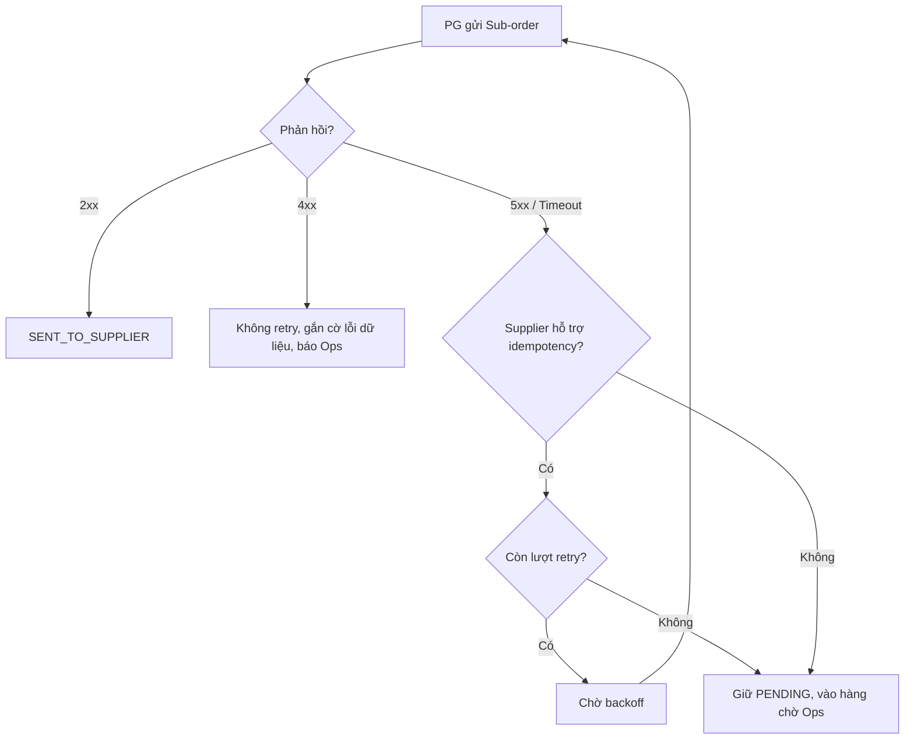
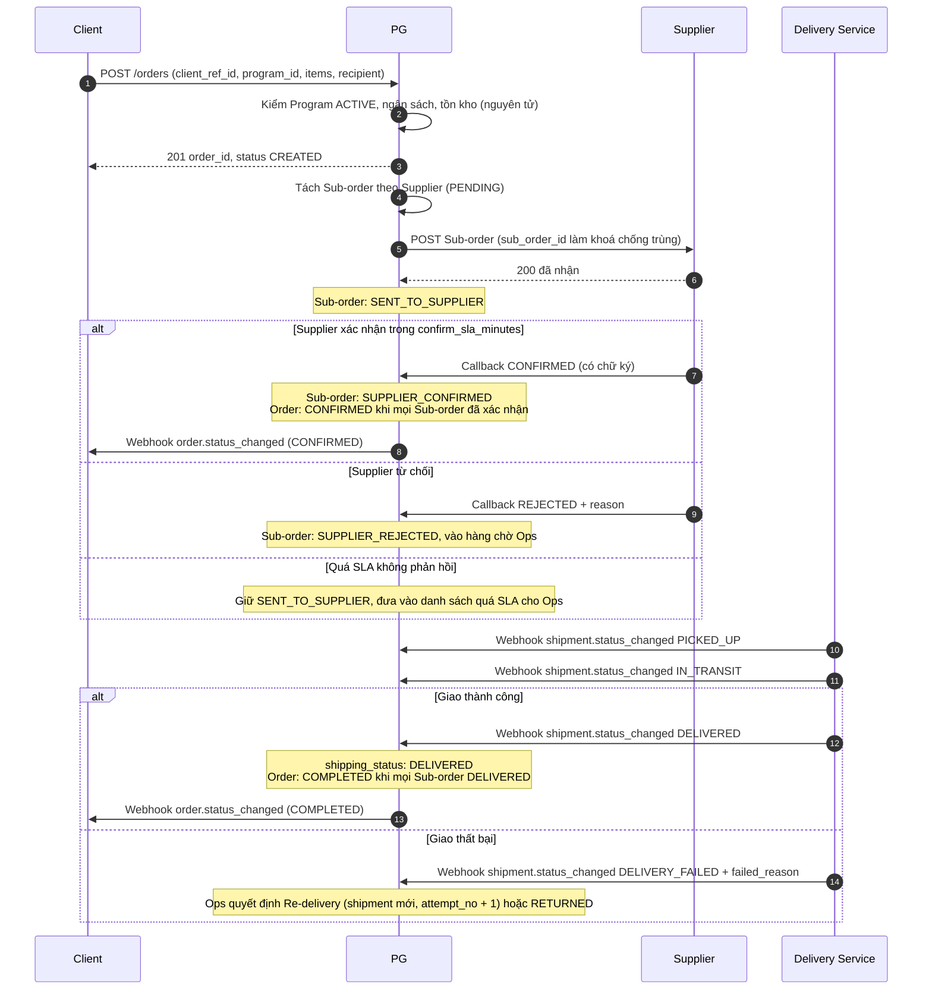
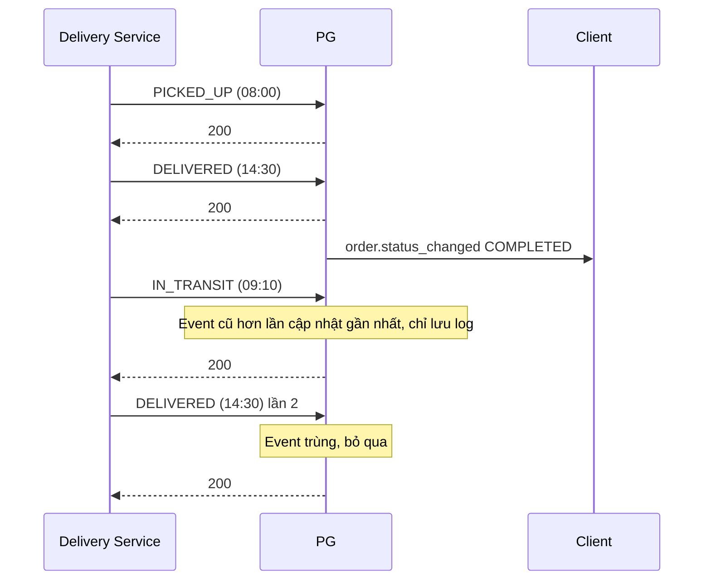
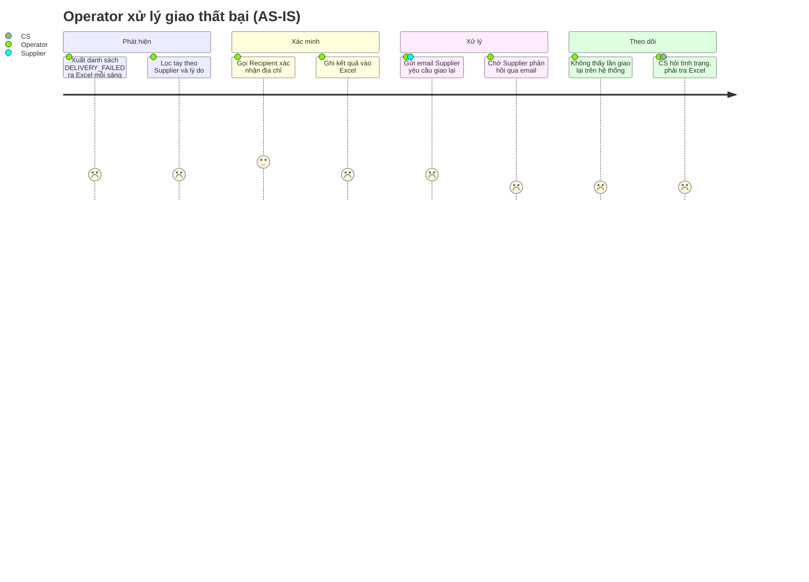
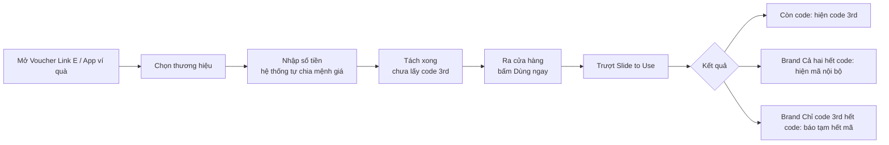

# Tuần 5 — API & Integration cho BA/PO

Tuần 4 bạn đã biết REST API là gì. Tuần này đi vào phần làm hỏng dự án thật: request thiếu field, gọi trùng, timeout, hai thiết bị cùng bấm, webhook đến muộn, lỗi không có mã. Bạn không cần viết code, nhưng phải viết được requirement để Dev không phải đoán và QC có expected result để test. Cuối tuần chuyển sang User Journey và Wireframe, vì mọi API cuối cùng đều hiện ra thành một màn hình hoặc một thông báo cho người dùng.

| Day | Topic | Deliverable |
|---|---|---|
| 29 | Giải phẫu request/response: Header, Body, Query Param, Path Param; Pagination | Bảng mô tả field request/response cho `GET /programs/{id}/products` |
| 30 | Authentication, Authorization, Signature | Ma trận AuthN/AuthZ cho API Client + checklist chữ ký webhook |
| 31 | Idempotency & Duplicate Request | Bộ Business Rule chống trùng cho `POST /orders` + G/W/T |
| 32 | Timeout, Retry, Concurrency | Bảng timeout/retry PG → Supplier + NFR concurrency |
| 33 | Webhook, Event, Callback & Sequence Diagram | Sequence diagram Create Order → Supplier → Delivery |
| 34 | Error Handling, Error Code Matrix & viết API Requirement | API Requirement v1 cho `POST /orders` kèm Error Code Matrix |
| 35 | User Journey & Wireframe cho BA (+ review tuần 5) | User Journey Operator xử lý giao thất bại + low-fi wireframe |

---

## Day 29 - Giải phẫu request/response: Header, Body, Query Param, Path Param; Pagination

> P6 API · Level: Junior → Middle · Thời lượng ~75 phút · Deliverable: Bảng mô tả field request/response cho `GET /programs/{id}/products` (có pagination)

### Mục tiêu

- Đọc một request/response và chỉ ra field nào nằm ở đâu: Header, Path Param, Query Param, Body.
- Biết khi nào một thông tin nên đặt ở vị trí nào, và vì sao vị trí đó ảnh hưởng nghiệp vụ.
- Viết được requirement pagination: kích thước trang, thứ tự sắp xếp, cách lấy trang tiếp, hành vi khi dữ liệu thay đổi giữa hai lần gọi.

### Kiến thức cần học

**1. Bốn chỗ chứa dữ liệu trong một request**

| Vị trí | Dùng cho | Ví dụ trong PG |
|---|---|---|
| Path Param – Tham số đường dẫn | Định danh **tài nguyên cụ thể** | `/programs/{id}/products` — `id` là program_id |
| Query Param – Tham số truy vấn | Lọc, sắp xếp, phân trang (không đổi dữ liệu) | `?category=home&page_size=20` |
| Header – Phần đầu | Thông tin **về request**, không về nghiệp vụ: xác thực, định dạng, mã chống trùng, trace | `Authorization`, `Content-Type`, `X-Request-Id` |
| Body – Thân request | Dữ liệu nghiệp vụ gửi lên (POST/PUT/PATCH) | Thông tin Recipient, danh sách SKU |

Quy tắc nhớ nhanh: **"cái gì"** ở Path, **"lọc thế nào"** ở Query, **"ai gọi, gọi kiểu gì"** ở Header, **"nội dung nghiệp vụ"** ở Body.

**2. Response cũng có cấu trúc**

- Status code (tuần 4): 200, 201, 400, 401, 403, 404, 409, 422, 500…
- Header response: ví dụ `X-Request-Id` trả lại để tra log.
- Body: dữ liệu + metadata (thông tin phân trang, tổng số).

**3. Pagination – Phân trang**

| Kiểu | Cách gọi | Ưu | Nhược nghiệp vụ |
|---|---|---|---|
| Offset/Page | `?page=3&page_size=20` | Dễ hiểu, nhảy trang được | Dữ liệu thêm/xoá giữa hai lần gọi → **trùng hoặc sót** bản ghi |
| Cursor | `?cursor=eyJpZCI6...&limit=20` | Ổn định khi dữ liệu thay đổi | Không nhảy thẳng tới trang 10 |

BA không chọn kỹ thuật thay Dev. BA phải nói rõ **use case**: Client cần đồng bộ toàn bộ danh sách (không được sót) hay chỉ hiển thị trang cho người xem? Câu trả lời quyết định kiểu phân trang.

**4. Ba câu hỏi pagination Junior hay quên**

1. Sắp xếp mặc định theo gì? Không có thứ tự cố định thì phân trang vô nghĩa.
2. `page_size` tối đa bao nhiêu? Client gọi `page_size=100000` thì sao?
3. Có trả `total` không? Đếm tổng trên bảng lớn tốn tài nguyên; Client có thật sự cần không?

### BA/PO sử dụng kiến thức này khi nào?

- Viết API Requirement cho endpoint mới hoặc sửa endpoint cũ.
- Đọc API doc của Supplier/đối tác để làm Gap Analysis: họ gửi gì, mình cần gì.
- Điều tra bug: "Client báo thiếu sản phẩm" — thường do phân trang sót hoặc filter sai.
- Review thiết kế Dev: field nghiệp vụ bị đặt vào Header, hoặc dữ liệu nhạy cảm đặt trên Query (lưu vào log server, lịch sử trình duyệt).

### Quy trình thực hiện

**Step 1 — Xác định use case của endpoint.** Ai gọi, gọi để làm gì, tần suất bao nhiêu. VD: Client gọi `GET /programs/{id}/products` để hiển thị quà cho Recipient chọn.

**Step 2 — Liệt kê dữ liệu vào, gán vị trí.** Định danh → Path. Lọc/sắp xếp/phân trang → Query. Xác thực/trace → Header. Nội dung tạo/sửa → Body.

**Step 3 — Viết bảng field.** Mỗi field có: tên, vị trí, kiểu, bắt buộc, giá trị hợp lệ, mặc định, ý nghĩa nghiệp vụ.

**Step 4 — Viết response.** Field trả về, field nào **không được trả** (dữ liệu nội bộ như `cost_price`), metadata phân trang.

**Step 5 — Viết rule pagination.** Sort mặc định, `page_size` mặc định và tối đa, cách lấy trang tiếp, trang rỗng trả gì.

**Step 6 — Viết edge case.** Program không tồn tại, Program không thuộc Client gọi, Program `ENDED`, SKU `INACTIVE`, trang vượt quá tổng.

### Ví dụ thực tế

**Request**

```http
GET /programs/PRG-1024/products?category=home&sort=price_asc&page_size=20&cursor=eyJza3VfaWQiOiJTS1UtMDA0MCJ9
Authorization: Bearer <access_token>
X-Request-Id: 7f3c1e9a-0b2d-4c55-9a11-2f0c8e4d6b10
Accept: application/json
```

**Response 200**

```json
{
  "data": [
    {
      "sku_id": "SKU-0041",
      "product_name": "Bình giữ nhiệt Lock&Lock",
      "variant": "500ml - Xanh",
      "price_or_point": 350,
      "in_stock": true
    },
    {
      "sku_id": "SKU-0057",
      "product_name": "Bình giữ nhiệt Lock&Lock",
      "variant": "750ml - Đen",
      "price_or_point": 420,
      "in_stock": false
    }
  ],
  "pagination": {
    "page_size": 20,
    "next_cursor": "eyJza3VfaWQiOiJTS1UtMDA1NyJ9",
    "has_more": true
  }
}
```

**Bảng field (trích)** `[Giả định bài tập]` cho giá trị cụ thể:

| Field | Vị trí | Kiểu | Bắt buộc | Rule |
|---|---|---|---|---|
| id | Path | string | Có | program_id thuộc account của Client gọi; khác → 404 (không lộ Program của Client khác) |
| category | Query | string | Không | Một giá trị trong danh mục category; sai → 400 |
| sort | Query | enum | Không | `price_asc`, `price_desc`, `name_asc`. Mặc định `name_asc`, phụ thứ tự theo `sku_id` |
| page_size | Query | int | Không | Mặc định 20, tối đa 100; > 100 → 400 |
| cursor | Query | string | Không | Lấy từ `next_cursor` lần trước; không hợp lệ → 400 |
| price_or_point | Body response | number | — | Lấy từ `program_sku`, **không** phải `list_price` của SKU |
| in_stock | Body response | bool | — | `true` khi tổng `available_qty` (trừ `reserved_qty`) của các Supplier active > 0 |

Điểm nghiệp vụ đáng chú ý:
- Chỉ trả SKU có `program_sku.is_visible = true`, `sku.status = ACTIVE`, `product.status = ACTIVE`. Đây chính là Pain point 1 của case: Client hiển thị Product đã INACTIVE.
- Không trả `cost_price` (giá vốn) — dữ liệu thương mại nội bộ.
- Sort phụ theo `sku_id` để hai SKU cùng giá không "nhảy" giữa các trang.

#### Ví dụ từ dự án thật: Promotion Code

BRD đề xuất `POST /promo/issuances` (giữ chỗ một lượt phát). Phân rã theo vị trí:

| Dữ liệu (theo BRD) | Vị trí hợp lý | Lý do |
|---|---|---|
| ref ID (khách gửi) | Body hoặc Header — **cần chốt** | Là khoá chống trùng; dù đặt đâu cũng phải bắt buộc |
| SKU, campaign | Body | Nội dung nghiệp vụ |
| Mã người dùng đã băm | Body | Không đặt trên Query vì Query hay bị ghi vào log truy cập |
| serial | Path ở các endpoint sau: `/promo/issuances/{serial}/confirm` | Định danh lượt phát |

Response giữ chỗ trả **serial, link, hạn xác nhận** và **không trả mã**. Đây là ví dụ tốt cho Step 4: BA phải ghi rõ field **cấm** xuất hiện trong response, không chỉ field có. Tiêu chí nghiệm thu của BRD cũng ghi: "Phản hồi phát mã không chứa giá trị mã; mã chỉ xuất hiện sau reveal".

`GET /promo/catalog` trả "SKU khách được bán, giá, hạn mức còn lại". Câu hỏi BA cần hỏi `[Giả định bài tập]`: một khách có bao nhiêu SKU? Nếu ít, có cần phân trang không? Đừng thêm pagination chỉ vì "API nào cũng có".

### Junior vs Middle vs Senior

| Tình huống: viết requirement cho `GET /programs/{id}/products` | Junior | Middle | Senior |
|---|---|---|---|
| Nghĩ gì | "Liệt kê field trả về là xong" | "Field nào bắt buộc, filter nào cần, phân trang ra sao" | "Client dùng API này để làm gì, sai thì Recipient gặp gì, ai chịu chi phí" |
| Hỏi gì | "Trả những field nào?" | "Sort mặc định? page_size tối đa? Program ENDED trả gì?" | "Client cache danh sách bao lâu? Hết hàng giữa lúc xem và lúc đặt thì xử lý ở đâu?" |
| Làm gì | Copy cấu trúc bảng DB vào response | Viết bảng field + rule pagination + edge case | Thêm rule không lộ dữ liệu (cost_price, Program của Client khác), nối sang Pain point 1 và Capstone |

### Sai lầm thường gặp

- Đổ nguyên bảng DB ra response, lộ `cost_price`, `priority` của Supplier.
- Không ghi sort mặc định → mỗi lần gọi thứ tự khác nhau, QC báo bug "lúc có lúc không".
- Cho `page_size` không giới hạn.
- Trả 403 khi Program thuộc Client khác → vô tình xác nhận Program đó tồn tại. Nhiều hệ thống chọn 404.
- Đặt dữ liệu cá nhân (SĐT, email) trên Query Param.
- Quên trường hợp trang rỗng: trả `data: []` với 200, không phải 404.

### Góc nhìn Senior BA/PO

Vị trí field không phải chuyện thẩm mỹ kỹ thuật. Nó quyết định **dữ liệu bị log ở đâu, bị cache ở đâu, ai thấy được**. Senior đọc một request và hỏi ngay: "Field này lộ ra thì thiệt hại gì?". Với pagination, Senior không hỏi "offset hay cursor", mà hỏi "Client có được phép sót bản ghi không". Nếu Client dùng để đồng bộ tồn kho hay đối soát, sót một dòng là lệch tiền.

### Bài tập thực hành

**Đầu vào:** Ops cần màn tra cứu Sub-order quá SLA. Dev đề xuất endpoint nội bộ:

```http
GET /sub-orders?supplier_id=SUP-07&status=SENT_TO_SUPPLIER&phone=0901234567&page=1
```

Supplier có `confirm_sla_minutes`. Một ngày có khoảng 3.000 Sub-order `[Giả định bài tập]`. Ops mở màn này liên tục và Sub-order đổi trạng thái liên tục.

**Yêu cầu đầu ra:**
1. Chỉ ra ít nhất 3 vấn đề trong thiết kế request.
2. Viết lại request đúng vị trí field.
3. Viết 5 rule pagination/filter dạng atomic, testable.

### Lời giải tham khảo

**1. Vấn đề**
- `phone` trên Query Param: dữ liệu cá nhân bị ghi vào access log. Nên bỏ, hoặc chuyển sang tìm theo `order_id` / dùng POST search có Body.
- Không có filter "quá SLA". Ops phải tự tính → nên có `overdue=true`, server tính `now - sent_at > confirm_sla_minutes`.
- Không có sort. Ops cần thấy Sub-order **trễ lâu nhất** trước.
- Phân trang page/offset trên danh sách thay đổi liên tục: Sub-order chuyển `SUPPLIER_CONFIRMED` giữa hai lần gọi → bản ghi trang 2 bị đẩy lên trang 1, Ops **sót** việc cần xử lý.

**2. Request viết lại**

```http
GET /sub-orders?supplier_id=SUP-07&status=SENT_TO_SUPPLIER&overdue=true&sort=sent_at_asc&limit=50&cursor=<next_cursor>
Authorization: Bearer <token>
```

**3. Rule**
- R1: Khi `overdue=true`, chỉ trả Sub-order có `status = SENT_TO_SUPPLIER` và `now - sent_at > supplier.confirm_sla_minutes`.
- R2: Sort mặc định `sent_at` tăng dần, phụ theo `sub_order_id`.
- R3: `limit` mặc định 50, tối đa 200; > 200 trả 400.
- R4: Không có kết quả → 200 với `data: []`, `has_more: false`.
- R5: Response không chứa `phone`, `address` của Recipient; chỉ chứa `order_id`, `sub_order_id`, `supplier_id`, `sent_at`, số phút trễ.

**Junior hay bỏ sót:** tính "quá SLA" ở đâu. Nếu để FE tính theo giờ máy người dùng, hai Ops thấy hai danh sách khác nhau. Rule phải nói rõ server tính.

### Checklist hoàn thành

- [ ] Tôi hiểu khái niệm.
- [ ] Tôi tự làm được bài tập.
- [ ] Tôi giải thích được cho Developer/QC.
- [ ] Tôi có thể viết thành Requirement/artifact.
- [ ] Tôi phân biệt được Header / Path / Query / Body và lý do đặt field ở mỗi chỗ.
- [ ] Tôi viết được field **cấm** trả trong response.
- [ ] Tôi chỉ ra được rủi ro sót/trùng khi phân trang dữ liệu đang thay đổi.

---

## Day 30 - Authentication, Authorization, Signature

> P6 API · Level: Middle · Thời lượng ~80 phút · Deliverable: Ma trận AuthN/AuthZ cho API Client + checklist chữ ký webhook

### Mục tiêu

- Phân biệt Authentication, Authorization và Signature bằng ví dụ nghiệp vụ, không bằng định nghĩa.
- Viết được ma trận "ai được gọi endpoint nào, trên dữ liệu nào".
- Biết các câu hỏi BA phải hỏi khi tích hợp với đối tác: cấp key thế nào, xoay key thế nào, xác minh webhook thế nào.

### Kiến thức cần học

| Khái niệm | Câu hỏi nó trả lời | Ví dụ PG | Sai thì sao |
|---|---|---|---|
| Authentication (AuthN) – Xác thực | **Bạn là ai?** | Client gửi API key / access token, PG biết đó là Client A | Kẻ lạ gọi được API, tạo Order giả |
| Authorization (AuthZ) – Phân quyền | **Bạn được làm gì, trên dữ liệu nào?** | Client A chỉ xem Order của Program thuộc account A | Client A đọc được địa chỉ Recipient của Client B |
| Signature – Chữ ký | **Nội dung có đúng do bên đó gửi và không bị sửa không?** | Delivery Service ký webhook; PG kiểm chữ ký trước khi đổi `shipping_status` | Ai đó giả webhook "DELIVERED", Order đóng sai |

**Các cơ chế AuthN hay gặp (BA chỉ cần hiểu hệ quả):**

| Cơ chế | Mô tả ngắn | Câu hỏi BA |
|---|---|---|
| API Key | Một chuỗi bí mật cấp cho mỗi Client (`customer_account.api_key_id`) | Ai cấp? Một Client mấy key? Thu hồi key khi nào? |
| OAuth2 Client Credentials | Client đổi id/secret lấy token có hạn | Token sống bao lâu? Hết hạn giữa chừng thì sao? |
| IP Whitelist | Chỉ nhận request từ IP đăng ký | Client đổi hạ tầng thì quy trình cập nhật ra sao? |

**Signature (HMAC) hoạt động thế nào — đủ để viết requirement:**
1. Hai bên chia sẻ một secret.
2. Bên gửi tính chữ ký từ nội dung + timestamp bằng secret, gửi kèm header.
3. Bên nhận tự tính lại, so sánh. Khớp → tin. Lệch → từ chối.
4. Timestamp quá cũ (VD: > 5 phút) → từ chối, chống **replay** (gửi lại request cũ đã bắt được).

**AuthZ có hai tầng:**
- **Function-level:** được gọi endpoint này không (Client được `POST /orders`, không được gọi API admin).
- **Data-level (object-level):** được thao tác **bản ghi này** không. Đây là chỗ hay thủng nhất: endpoint kiểm token hợp lệ nhưng không kiểm Order có thuộc Client đó không.

### BA/PO sử dụng kiến thức này khi nào?

- Onboard Client mới qua API: quy trình cấp key, môi trường test, giới hạn quyền.
- Nhận webhook từ Delivery Service, Supplier: yêu cầu xác minh nguồn.
- Viết Permission Matrix (Day 25) cho kênh API, không chỉ cho UI admin.
- Review incident: "Client thấy đơn không phải của mình".

### Quy trình thực hiện

**Step 1 — Liệt kê các bên gọi vào hệ thống và hệ thống gọi ra.** Client → PG, Supplier → PG (callback), Delivery Service → PG (webhook), PG → Client (webhook).

**Step 2 — Với mỗi chiều, chốt cơ chế AuthN.** Không cần chọn thuật toán; cần chốt: loại credential, ai cấp, thời hạn, cách thu hồi.

**Step 3 — Viết ma trận AuthZ function-level.** Bên gọi × endpoint.

**Step 4 — Viết rule AuthZ data-level.** "Client chỉ thao tác Order có `account_id` = account của credential".

**Step 5 — Viết rule Signature cho mọi luồng bên ngoài gọi vào để đổi trạng thái.** Webhook, callback.

**Step 6 — Viết hành vi khi thất bại.** 401 vs 403 vs 404, có log không, có cảnh báo không.

### Ví dụ thực tế

**Ma trận AuthZ function-level** `[Giả định bài tập]`:

| Endpoint | Client (API key) | Supplier (API key riêng) | Delivery Service | Admin UI |
|---|---|---|---|---|
| `GET /programs/{id}/products` | Có (Program của mình) | Không | Không | Có |
| `POST /orders` | Có (Program ACTIVE của mình) | Không | Không | Không |
| `GET /orders/{id}` | Có (Order của mình) | Không | Không | Có |
| Callback confirm/reject Sub-order | Không | Có (Sub-order của mình) | Không | Không |
| Webhook `shipment.status_changed` | Không | Không | Có (có chữ ký) | Không |

**Rule (atomic):**
- AUTH-01: Request không có credential hoặc credential sai → 401, không xử lý nghiệp vụ.
- AUTH-02: Credential của account `status` khác ACTIVE → 403.
- AUTH-03: `GET /orders/{id}` với Order có `account_id` khác account của credential → 404, ghi log cảnh báo.
- AUTH-04: Supplier gọi callback cho Sub-order có `supplier_id` khác Supplier của credential → 403, không đổi trạng thái.
- SIG-01: Webhook `shipment.status_changed` thiếu chữ ký hoặc chữ ký sai → 401, không đổi `shipping_status`.
- SIG-02: Webhook có timestamp lệch quá 5 phút so với giờ server → từ chối `[Giả định bài tập]`.

**Payload webhook kèm header chữ ký:**

```http
POST /webhooks/delivery
X-Signature: t=1793232000,v1=5d41402abc4b2a76b9719d911017c592...
Content-Type: application/json

{
  "event": "shipment.status_changed",
  "shipment_id": "SHP-88812",
  "tracking_no": "GHN123456",
  "status": "DELIVERED",
  "occurred_at": "2026-10-28T09:15:00+07:00"
}
```

Nếu không kiểm chữ ký, ai biết URL webhook đều có thể gửi `DELIVERED`, Order thành `COMPLETED`, Ops không re-delivery, Recipient không nhận quà, Finance vẫn trả tiền Supplier.

#### Ví dụ từ dự án thật: Promotion Code

BRD Promotion Code có nhiều điểm thuộc chủ đề hôm nay:

- **Data-level AuthZ cho người dùng cuối:** `reveal` trả mã, PIN, barcode/QR. Đây là endpoint "nhạy nhất". Lượt phát lưu **mã người dùng đã băm** — BA cần hỏi: khi gọi reveal, hệ thống xác định đúng người nhận bằng cách nào? `[Giả định bài tập]`: nếu chỉ cần biết serial là reveal được, ai lấy được link đều mở được mã.
- **Ghi nhận thiết bị:** BRD yêu cầu "mỗi lần reveal ghi thời điểm và thiết bị". Đây là bằng chứng khi tranh chấp.
- **Phân quyền nội bộ (BRD mục 10):** CSKH "tra cứu theo serial hoặc ref ID, không thấy toàn bộ mã"; Sales/AM "chỉ xem hạn mức, lượt phát của khách mình phụ trách" — đây là data-level AuthZ trên giao diện admin.
- **Bảo mật dữ liệu:** mã mã hoá khi lưu, admin luôn thấy mã bị che một phần, không lưu SĐT/CIF gốc, chỉ lưu băm.

Bài học: AuthZ không chỉ cho đối tác gọi API. Nó áp cho **mọi người** chạm vào dữ liệu có giá trị tiền.

### Junior vs Middle vs Senior

| Tình huống: Delivery Service sắp gửi webhook về PG | Junior | Middle | Senior |
|---|---|---|---|
| Nghĩ gì | "Họ gửi, mình nhận và cập nhật" | "Phải xác minh webhook đúng của họ" | "Nếu webhook giả hoặc bị gửi lại, tiền và quà đi đâu sai" |
| Hỏi gì | "Payload có những field gì?" | "Họ ký bằng gì? Secret trao đổi thế nào?" | "Xoay secret không downtime ra sao? Ai giữ secret? Webhook hỏng chữ ký thì ai được báo?" |
| Làm gì | Viết mapping status | Thêm SIG-01, SIG-02 | Thêm quy trình vận hành: rotation, alert, runbook đối chiếu với tra cứu chủ động |

### Sai lầm thường gặp

- Coi "có token là được" — quên kiểm data-level.
- Viết "hệ thống phải bảo mật" — không test được.
- Không định nghĩa thu hồi key khi Client ngừng hợp tác.
- Dùng chung một key cho môi trường test và production.
- Lộ thông tin qua thông báo lỗi: "Order thuộc Client B" thay vì "Không tìm thấy".
- Chỉ kiểm chữ ký, không kiểm timestamp → bị replay webhook cũ.

### Góc nhìn Senior BA/PO

AuthN/AuthZ là requirement **nghiệp vụ**, không phải "phần security lo". Câu hỏi "Sales A có được xem lượt phát của khách do Sales B phụ trách không" là quyết định kinh doanh. Dev không trả lời thay bạn được. Senior luôn viết thêm phần vận hành: cấp key, xoay key, thu hồi key, ai nhận cảnh báo. Thiếu phần này, hệ thống chạy được ngày đầu nhưng chết ở tháng thứ sáu khi một Client đổi đội IT.

### Bài tập thực hành

**Đầu vào:** Supplier SUP-07 dùng `integration_type = API`. Sau khi PG gửi Sub-order, SUP-07 gọi callback:

```http
POST /supplier/callbacks
X-Api-Key: sk_sup07_xxx

{ "sub_order_id": "SO-55021", "result": "REJECTED", "reason": "Hết hàng" }
```

Tháng trước có sự cố `[Giả định bài tập]`: một Sub-order của SUP-03 bị chuyển `SUPPLIER_REJECTED` do một callback mang key SUP-07.

**Yêu cầu đầu ra:**
1. Giải thích lỗ hổng.
2. Viết 4 rule AuthN/AuthZ/Signature cho callback, atomic, testable.
3. Viết 2 kịch bản G/W/T cho QC.

### Lời giải tham khảo

**1. Lỗ hổng:** hệ thống chỉ kiểm key hợp lệ (AuthN), không kiểm `sub_order.supplier_id` có trùng Supplier của key không (AuthZ data-level). Có thể do Supplier gõ nhầm `sub_order_id`, không nhất thiết là tấn công. Hậu quả vẫn là Order bị huỷ sai.

**2. Rule**
- CB-01: Callback không có `X-Api-Key` hợp lệ → 401.
- CB-02: `sub_order.supplier_id` khác Supplier sở hữu key → 403, không đổi trạng thái, ghi `audit_log` với actor = Supplier của key.
- CB-03: Callback phải kèm chữ ký trên body + timestamp; chữ ký sai → 401.
- CB-04: Chỉ chấp nhận callback khi Sub-order đang `SENT_TO_SUPPLIER`; trạng thái khác → 409, không đổi trạng thái.

**3. G/W/T**

```gherkin
Scenario: Supplier gửi callback cho Sub-order không thuộc mình
  Given Sub-order "SO-55021" thuộc Supplier "SUP-03" ở trạng thái SENT_TO_SUPPLIER
  When Supplier "SUP-07" gửi callback REJECTED cho "SO-55021" với key hợp lệ của SUP-07
  Then hệ thống trả 403
  And Sub-order "SO-55021" vẫn ở trạng thái SENT_TO_SUPPLIER
  And audit_log có bản ghi từ chối với actor "SUP-07"

Scenario: Callback đến khi Sub-order đã bị huỷ
  Given Sub-order "SO-55022" ở trạng thái CANCELLED
  When Supplier sở hữu gửi callback CONFIRMED hợp lệ
  Then hệ thống trả 409
  And Sub-order "SO-55022" vẫn ở trạng thái CANCELLED
```

**Junior hay bỏ sót:** CB-04. Đây không phải lỗi bảo mật mà lỗi state, nhưng cùng lỗ hổng: tin vào nội dung bên ngoài gửi mà không đối chiếu dữ liệu của mình.

### Checklist hoàn thành

- [ ] Tôi hiểu khái niệm.
- [ ] Tôi tự làm được bài tập.
- [ ] Tôi giải thích được cho Developer/QC.
- [ ] Tôi có thể viết thành Requirement/artifact.
- [ ] Tôi phân biệt được AuthZ function-level và data-level.
- [ ] Tôi viết được rule xác minh chữ ký + timestamp cho webhook.
- [ ] Tôi liệt kê được phần vận hành: cấp, xoay, thu hồi credential.

---

## Day 31 - Idempotency & Duplicate Request

> P6 API · Level: Middle → Senior · Thời lượng ~85 phút · Deliverable: Bộ Business Rule chống trùng cho `POST /orders` + kịch bản G/W/T

### Mục tiêu

- Hiểu vì sao request trùng là chuyện **bình thường** trong tích hợp, không phải lỗi hiếm.
- Viết được rule Idempotency: khoá chống trùng là gì, phạm vi, thời hạn, gửi lại thì trả gì, gửi lại với nội dung khác thì sao.
- Phân biệt chống trùng ở tầng API (cùng request gửi hai lần) với chống trùng ở tầng nghiệp vụ (hai request khác nhau cùng tranh một tài nguyên).

### Kiến thức cần học

**1. Idempotency – Tính lặp không đổi kết quả**

Một thao tác là idempotent khi gọi một lần hay gọi N lần thì **trạng thái hệ thống như nhau**. `GET` và `PUT` (ghi đè) tự nhiên idempotent. `POST /orders` thì không: mỗi lần gọi tạo một Order mới — trừ khi ta thiết kế cho nó idempotent.

**2. Vì sao request trùng xảy ra**

| Nguyên nhân | Ví dụ PG |
|---|---|
| Timeout phía bên gọi | Client gọi `POST /orders`, PG tạo Order xong nhưng phản hồi về chậm. Client timeout, gọi lại → 2 Order (Pain point 6 của case) |
| Retry tự động | Thư viện HTTP của Client tự retry 3 lần |
| Người dùng bấm lại | Recipient bấm "Xác nhận" 2 lần vì nút không khoá |
| Webhook gửi lại | Delivery Service không nhận được 200 nên gửi lại `shipment.status_changed` |
| Hai thiết bị | Cùng tài khoản thao tác trên điện thoại và máy tính |

**3. Idempotency Key – Khoá chống trùng**

Bên gọi tạo một mã duy nhất cho **mỗi ý định nghiệp vụ** và gửi kèm. Trong PG đó là `client_ref_id`. Server lưu kết quả xử lý theo khoá; gặp lại khoá thì trả kết quả cũ, không xử lý lại.

Năm quyết định BA phải chốt:

| # | Quyết định | Câu hỏi |
|---|---|---|
| 1 | Phạm vi khoá | Duy nhất theo account? theo Program? toàn hệ thống? |
| 2 | Thời hạn | Nhớ khoá bao lâu? Vĩnh viễn hay N ngày? |
| 3 | Gửi lại, cùng nội dung | Trả lại response cũ (cùng status code?) |
| 4 | Gửi lại, **khác nội dung** | Trả lỗi conflict hay trả kết quả cũ? |
| 5 | Request đầu **đang xử lý** | Request thứ hai đến khi request đầu chưa xong thì làm gì? |

**4. Chống trùng ở tầng nghiệp vụ**

Idempotency key chỉ bắt được "cùng một ý định gửi hai lần". Nó không bắt được hai ý định khác nhau tranh **cùng một tài nguyên**: hai Recipient cùng đặt chiếc bình cuối cùng. Cái đó cần **ràng buộc nghiệp vụ** (unique constraint, kiểm-và-trừ nguyên tử) — sẽ học tiếp ở Day 32.

### BA/PO sử dụng kiến thức này khi nào?

- Mọi API tạo giao dịch có tiền, điểm, tồn kho, mã: tạo Order, phát mã, trừ điểm, hoàn tiền.
- Nhận webhook/callback từ bên ngoài.
- Thiết kế nút bấm trên UI có hậu quả tài chính.
- Điều tra sự cố đối soát lệch: hai dòng doanh thu cho một giao dịch.

### Quy trình thực hiện

**Step 1 — Liệt kê các thao tác không được phép xảy ra hai lần.** Tạo Order, trừ tồn kho, tính phí, gửi Sub-order cho Supplier.

**Step 2 — Chọn khoá chống trùng cho từng thao tác.** Khoá do bên gọi tạo (`client_ref_id`) hay khoá tự nhiên (`shipment_id + status + occurred_at`).

**Step 3 — Chốt 5 quyết định ở bảng trên.** Ghi thành rule atomic.

**Step 4 — Viết response cho từng nhánh.** Lần đầu, gửi lại cùng nội dung, gửi lại khác nội dung, đang xử lý.

**Step 5 — Xác định ràng buộc nghiệp vụ còn lại.** Những trùng lặp không bắt được bằng khoá.

**Step 6 — Viết G/W/T và đưa vào tiêu chí nghiệm thu.** Idempotency không test thì coi như không có.

### Ví dụ thực tế

**Request lần 1**

```http
POST /orders
Authorization: Bearer <token>
Content-Type: application/json

{
  "client_ref_id": "ACME-20261028-000123",
  "program_id": "PRG-1024",
  "recipient_name": "Nguyễn Văn A",
  "phone": "0901234567",
  "address": "12 Lê Lợi, Q.1, TP.HCM",
  "items": [ { "sku_id": "SKU-0041", "qty": 1 } ]
}
```

**Response lần 1 — 201**

```json
{
  "order_id": "ORD-778201",
  "client_ref_id": "ACME-20261028-000123",
  "status": "CREATED",
  "created_at": "2026-10-28T10:02:11+07:00"
}
```

**Lần 2, cùng nội dung** (Client timeout và gọi lại) → trả **cùng** `order_id` `ORD-778201`. Status code là 200 hay 201 là quyết định cần chốt với Dev; quan trọng là Client nhận ra đây là Order cũ. `[Giả định bài tập]` chọn 200 + header `Idempotent-Replayed: true`.

**Lần 3, cùng `client_ref_id` nhưng `qty: 2`** → 409:

```json
{
  "error_code": "ORDER_REF_CONFLICT",
  "message": "client_ref_id đã được dùng cho một Order có nội dung khác.",
  "existing_order_id": "ORD-778201"
}
```

**Bộ rule** `[Giả định bài tập]` cho tham số:

- IDEM-01: `client_ref_id` bắt buộc, 1–64 ký tự, thiếu → 400.
- IDEM-02: `client_ref_id` duy nhất trong phạm vi một `account_id`.
- IDEM-03: Gửi lại cùng `client_ref_id` và cùng nội dung → trả Order đã tạo, không tạo Order mới, không giữ thêm tồn kho.
- IDEM-04: Gửi lại cùng `client_ref_id` nhưng khác `program_id`, `items` hoặc thông tin Recipient → 409 `ORDER_REF_CONFLICT`, không tạo Order.
- IDEM-05: Request thứ hai đến khi request đầu đang xử lý → 409 `ORDER_IN_PROGRESS`; Client thử lại sau.
- IDEM-06: Khoá có hiệu lực vĩnh viễn trong account (vì `client_ref_id` lưu trên bảng `order`).
- IDEM-07: Request lần đầu bị từ chối do validation (400) → không giữ khoá; Client sửa và gửi lại cùng `client_ref_id` được.

IDEM-07 là quyết định hay bị bỏ quên: request lỗi validation có "đốt" khoá không? Nếu đốt, Client phải sinh khoá mới cho mỗi lần sửa, dễ sinh trùng ở tầng nghiệp vụ.

**Webhook vào cũng phải chống trùng:** Delivery Service gửi lại `shipment.status_changed` cùng `shipment_id`, `status = DELIVERED`. PG xử lý lần hai không được tạo thêm thông báo `order.status_changed` cho Client.

#### Ví dụ từ dự án thật: Promotion Code

BRD mục 5 có hai rule chống trùng, ở **hai tầng khác nhau**:

| Rule (trích BRD) | Tầng | Bắt được gì |
|---|---|---|
| Cùng ref ID gửi lại → trả đúng lượt phát cũ, không tạo mới, không tính phí lần hai | API (idempotency key) | Ngân hàng timeout và gọi lại |
| Một mã không bao giờ có hai lượt phát còn hiệu lực cùng lúc | Nghiệp vụ (ràng buộc dữ liệu) | Hai lượt phát khác ref ID cùng bị gán một mã do lỗi chọn mã đồng thời |

Thêm một rule cùng họ: **Loyalty Hub trừ điểm và tạo lượt phát trong cùng một giao dịch; một bước lỗi thì cả hai huỷ**. Đây không phải idempotency mà là atomicity, nhưng giải cùng một nỗi sợ: người dùng mất điểm mà không có mã, hoặc có mã mà không mất điểm.

Tiêu chí nghiệm thu BRD viết rất tốt để học: "Gọi phát mã 2 lần cùng ref ID: chỉ 1 lượt phát và 1 lần tính phí". Có số, có kết quả quan sát được.

Câu hỏi mở cho bài tập `[Giả định bài tập]`: BRD không nêu trường hợp cùng ref ID nhưng **khác SKU**. Đây là IDEM-04 của dự án thật — BA cần đưa vào Open Item.

#### Ví dụ từ dự án thật: Slide to Use

NFR-1: "Trượt nhiều lần, hoặc trên hai thiết bị cùng lúc, chỉ ra một kết quả và rút tối đa một code". Idempotency ở đây không nằm ở API đối tác mà ở **hành động UI**. Không có ref ID do Client gửi, nên khoá tự nhiên phải là chính voucher: một voucher ở state 3 kèm bảng tạm chỉ được chuyển sang "đã lấy mã" đúng một lần. Lần trượt thứ hai phải nhận **cùng kết quả** của lần đầu (hiện lại mã đã rút), không rút mã mới. Với nguồn code 3rd cấp theo lượt qua API, mỗi lần rút thừa là Công ty trả tiền cho một mã không ai dùng — chính vấn đề số 1 mà dự án đang giải.

### Junior vs Middle vs Senior

| Tình huống: Client báo "có 2 Order cho cùng một người nhận" | Junior | Middle | Senior |
|---|---|---|---|
| Nghĩ gì | "Client gọi 2 lần, lỗi của Client" | "Thiếu idempotency key, cần `client_ref_id`" | "Có `client_ref_id` rồi mà vẫn trùng → khoá sai phạm vi, hoặc Client sinh khoá mới mỗi lần retry, hoặc đây là trùng nghiệp vụ hợp lệ" |
| Hỏi gì | "Client có gọi 2 lần không?" | "Hai request có cùng `client_ref_id` không?" | "Hai Order cách nhau bao lâu? Cùng nội dung? Rule nghiệp vụ có cho phép một người nhận 2 quà trong cùng Program không?" |
| Làm gì | Đóng ticket, nhắc Client | Thêm rule IDEM-01..04 | Viết rule + SQL kiểm tra trùng hằng ngày + hướng dẫn tích hợp cho Client "giữ nguyên `client_ref_id` khi retry" |

### Sai lầm thường gặp

- Viết "hệ thống không cho tạo trùng" mà không nói **trùng theo field nào**.
- Chỉ xử lý gửi lại cùng nội dung, quên gửi lại khác nội dung.
- Quên request đang xử lý dở (IDEM-05).
- Dùng `recipient_name + phone` làm khoá chống trùng: một người có thể được tặng 2 quà hợp lệ.
- Nghĩ idempotency giải được race condition giữa hai người dùng khác nhau.
- Không đưa idempotency vào tiêu chí nghiệm thu → không ai test.

### Góc nhìn Senior BA/PO

Senior coi request trùng là **mặc định**, không phải ngoại lệ. Câu hỏi không phải "có trùng không" mà "khi trùng thì ai mất tiền". Idempotency cũng là một phần của **hợp đồng tích hợp**: Client phải hiểu và tuân thủ (giữ nguyên khoá khi retry). Vì vậy Senior đưa rule này vào tài liệu tích hợp cho đối tác và vào checklist onboard, không chỉ vào FS nội bộ.

### Bài tập thực hành

**Đầu vào:** PG gửi Sub-order sang Supplier SUP-07 bằng `POST` sang API của họ. Log tuần trước `[Giả định bài tập]`:
- 10:00:00 PG gửi Sub-order SO-60010, SUP-07 không phản hồi sau 30 giây.
- 10:00:30 PG gửi lại SO-60010.
- 10:00:31 SUP-07 trả 200 cho cả hai lần.
- Kết quả: SUP-07 đóng gói 2 kiện, giao 2 lần; cuối tháng SUP-07 đối soát tính 2 Sub-order.

**Yêu cầu đầu ra:**
1. Xác định lỗi nằm ở đâu, của ai.
2. Đề xuất cơ chế chống trùng cho chiều PG → Supplier.
3. Viết 3 rule + 1 kịch bản G/W/T.
4. Nêu tác động lên đối soát (Pain point 5).

### Lời giải tham khảo

**1.** Lỗi ở hợp đồng tích hợp hai bên: PG retry (đúng, vì timeout), nhưng không gửi khoá chống trùng **hoặc** SUP-07 không xử lý idempotent. Cả hai phía đều có phần.

**2.** PG dùng `sub_order_id` làm idempotency key khi gửi sang Supplier. Yêu cầu Supplier: cùng `sub_order_id` → trả kết quả cũ, không tạo đơn mới. Nếu Supplier không hỗ trợ, PG không được tự retry `POST`; phải gọi API tra cứu trước (nếu có) hoặc chuyển sang xử lý thủ công.

**3. Rule**
- SUP-IDEM-01: Mọi request tạo đơn sang Supplier mang `sub_order_id` làm khoá chống trùng.
- SUP-IDEM-02: Supplier có `integration_type = API` chỉ được bật retry tự động khi đã xác nhận hỗ trợ idempotency theo `sub_order_id`.
- SUP-IDEM-03: Với Supplier chưa hỗ trợ, timeout khi gửi → Sub-order giữ `PENDING`, đẩy vào hàng chờ Ops kiểm tra, không gửi lại tự động.

```gherkin
Scenario: PG gửi lại Sub-order sau timeout
  Given Supplier "SUP-07" hỗ trợ idempotency theo sub_order_id
  And PG đã gửi Sub-order "SO-60010" nhưng không nhận phản hồi trong thời gian chờ
  When PG gửi lại "SO-60010" với cùng nội dung
  Then SUP-07 ghi nhận đúng 1 đơn cho "SO-60010"
  And Sub-order "SO-60010" có đúng 1 bản ghi gửi thành công trong audit_log
```

**4. Đối soát:** cần rule đối soát "mỗi `sub_order_id` chỉ được tính một lần trong kỳ", và báo cáo các dòng Supplier gửi lên có `sub_order_id` trùng. Đây là cùng tư duy với "Tranh chấp: trùng — mã đã được thanh toán, không trả lần hai" ở BRD Promotion Code.

**Junior hay bỏ sót:** SUP-IDEM-02 — điều kiện để **được phép** retry. Retry mà không có idempotency ở đầu nhận là tự tạo ra trùng.

### Checklist hoàn thành

- [ ] Tôi hiểu khái niệm.
- [ ] Tôi tự làm được bài tập.
- [ ] Tôi giải thích được cho Developer/QC.
- [ ] Tôi có thể viết thành Requirement/artifact.
- [ ] Tôi chốt được 5 quyết định của idempotency key (phạm vi, thời hạn, cùng nội dung, khác nội dung, đang xử lý).
- [ ] Tôi phân biệt được chống trùng tầng API và ràng buộc tầng nghiệp vụ.
- [ ] Tôi áp được idempotency cho cả chiều gọi ra (PG → Supplier) và webhook vào.

---

## Day 32 - Timeout, Retry, Concurrency

> P6 API · Level: Middle → Senior · Thời lượng ~85 phút · Deliverable: Bảng timeout/retry cho luồng PG → Supplier + NFR concurrency cho giữ tồn kho

### Mục tiêu

- Hiểu ba kết quả của một lần gọi: thành công, thất bại, **không biết** — và vì sao "không biết" là nguy hiểm nhất.
- Viết được chính sách timeout/retry bằng số: thời gian chờ, số lần, khoảng cách, điều kiện dừng, việc làm sau khi dừng.
- Nhận diện race condition trong nghiệp vụ và viết NFR concurrency testable.

### Kiến thức cần học

**1. Timeout – Hết thời gian chờ**

Khi PG gọi Supplier và không nhận phản hồi trong N giây, PG dừng chờ. Nhưng **Supplier có thể đã xử lý xong**. Timeout không có nghĩa là thất bại; nó có nghĩa là **không biết**.

| Kết quả | Ý nghĩa | Hành động hợp lý |
|---|---|---|
| 2xx | Thành công | Cập nhật trạng thái |
| 4xx | Bên gọi sai (dữ liệu, quyền) | Không retry; sửa dữ liệu hoặc báo người |
| 5xx | Bên nhận lỗi | Có thể retry |
| Timeout / mất kết nối | Không biết | Retry **chỉ khi** bên nhận idempotent; nếu không, tra cứu trước |

**2. Retry – Thử lại**

| Tham số | Câu hỏi BA |
|---|---|
| Số lần tối đa | Thử bao nhiêu lần thì dừng? |
| Khoảng cách (backoff) | Cách nhau bao lâu? Tăng dần (VD: 1 phút, 5 phút, 15 phút) để không dồn tải lên bên đang lỗi |
| Lỗi nào được retry | 5xx và timeout; không retry 4xx |
| Sau khi hết lượt | Trạng thái gì? Ai được báo? Ops xử lý thế nào? |
| Tổng thời gian | Có vượt SLA nghiệp vụ không (VD: `confirm_sla_minutes`)? |

**3. Concurrency – Đồng thời và Race Condition**

Race condition – Điều kiện tranh chấp: hai thao tác cùng đọc một giá trị, cùng quyết định dựa trên giá trị đó, rồi cùng ghi → kết quả sai.

```
Tồn kho SKU-0041 tại SUP-07: available_qty = 1
T1 (Recipient A): đọc 1 → đủ → giữ 1
T2 (Recipient B): đọc 1 → đủ → giữ 1   (đọc trước khi T1 ghi)
Kết quả: 2 Order giữ 1 sản phẩm → oversell
```

Cách giải ở mức BA cần biết: **kiểm và trừ trong một thao tác nguyên tử** (Atomic – Nguyên tử: hoặc làm trọn, hoặc không làm gì). BA không chọn lock hay transaction; BA viết rule "Tại mọi thời điểm `reserved_qty` ≤ `available_qty`" và test case cho hai request đồng thời.

**4. TOCTOU – Time of Check to Time of Use**

Kiểm lúc hiển thị, dùng lúc xác nhận — giữa hai thời điểm dữ liệu đã đổi. VD: Recipient thấy "còn hàng" ở màn danh sách, 3 phút sau bấm đặt thì đã hết. Rule đúng: **kiểm lại tại thời điểm ghi**, không tin kết quả kiểm trước đó.

### BA/PO sử dụng kiến thức này khi nào?

- Tích hợp với hệ thống bên ngoài có SLA không đảm bảo (Supplier, đối tác cấp mã, cổng thanh toán).
- Tài nguyên giới hạn có nhiều người tranh: tồn kho, mã, hạn mức, ngân sách Program.
- Viết NFR performance/availability.
- Thiết kế màn hình có nút gây giao dịch tiền.

### Quy trình thực hiện

**Step 1 — Vẽ các lần gọi ra ngoài trong luồng.** Mỗi mũi tên là một điểm có thể timeout.

**Step 2 — Với mỗi lần gọi, hỏi: bên nhận có idempotent không?** Câu trả lời quyết định có được retry tự động.

**Step 3 — Chốt bảng timeout/retry bằng số.** Đối chiếu với SLA nghiệp vụ.

**Step 4 — Định nghĩa trạng thái "không biết".** Không để Sub-order lơ lửng không ai thấy.

**Step 5 — Liệt kê tài nguyên bị tranh chấp.** Viết invariant (bất biến): điều phải luôn đúng.

**Step 6 — Viết NFR concurrency + kịch bản test đồng thời.**

### Ví dụ thực tế

**Bảng timeout/retry PG → Supplier** `[Giả định bài tập]` cho số:

| Lần gọi | Timeout | Retry | Backoff | Hết lượt thì | Ai được báo |
|---|---|---|---|---|---|
| Gửi Sub-order (`POST` sang Supplier) | 30 giây | 3 lần, chỉ với 5xx/timeout và Supplier hỗ trợ idempotency | 1 – 5 – 15 phút | Sub-order giữ `PENDING`, gắn cờ "gửi thất bại" | Ops (hàng chờ ngoại lệ) |
| Chờ callback confirm/reject | `supplier.confirm_sla_minutes` | Không áp dụng (đây là chờ, không gọi) | — | Sub-order vẫn `SENT_TO_SUPPLIER`, vào danh sách quá SLA | Ops + AM của Supplier |
| Gửi webhook `order.status_changed` cho Client | 10 giây | 5 lần | 1 – 5 – 15 – 60 – 180 phút | Lưu trạng thái "gửi thất bại", Client tra cứu bằng `GET /orders/{id}` | Không chặn luồng chính |

Điểm cần thấy: tổng thời gian retry gửi Sub-order (~21 phút) phải nhỏ hơn thời gian nghiệp vụ chấp nhận được trước khi Order bị coi là treo (Pain point 2).

**Invariant và NFR concurrency:**
- INV-01: Với mọi cặp (Supplier, SKU), `reserved_qty` ≤ `available_qty` tại mọi thời điểm.
- NFR-C-01: Khi `available_qty - reserved_qty = 1` và 50 request `POST /orders` cho SKU đó đến đồng thời, đúng 1 Order được tạo, 49 request nhận lỗi hết hàng, `reserved_qty` tăng đúng 1.
- NFR-C-02: Order và việc giữ tồn kho thực hiện trong cùng một thao tác nguyên tử; giữ tồn kho lỗi thì không tạo Order.
- NFR-C-03: Trạng thái `Sub-order.status` chỉ đổi khi trạng thái hiện tại đúng trạng thái nguồn mong đợi (VD: chỉ `SENT_TO_SUPPLIER → SUPPLIER_CONFIRMED`); hai callback đến cùng lúc thì chỉ một được ghi.



#### Ví dụ từ dự án thật: Promotion Code

- **Timeout thiết kế sẵn trong nghiệp vụ:** API 2 bước giữ chỗ → xác nhận. "Không xác nhận sau [15] phút thì mã về kho, không tính phí". Đây là cách xử lý trạng thái "không biết": khách giữ chỗ rồi im lặng (do mất kết nối, do lỗi) thì hệ thống tự giải phóng sau 15 phút, không giữ mã mãi. Tiêu chí nghiệm thu: "Giữ chỗ không xác nhận sau 15 phút: mã về kho, không tính phí".
- **Retry an toàn nhờ ref ID:** khách timeout ở bước giữ chỗ và gọi lại cùng ref ID → nhận lại đúng lượt phát cũ. Không có ref ID, retry sẽ giữ thêm mã.
- **Concurrency:** "Một mã không bao giờ có hai lượt phát còn hiệu lực cùng lúc" là invariant. Khi job thu hồi [00:30] trả mã về kho đúng lúc một yêu cầu giữ chỗ mới chọn mã, rule này phải vẫn đúng.

Câu hỏi BA nên hỏi `[Giả định bài tập]`: khách gọi `confirm` ở phút 14:59 và request đến server ở phút 15:01 thì sao? Mốc 15 phút tính theo giờ nào, và request confirm đến sau mốc nhận lỗi gì? Đây là edge case biên cần ghi thành rule.

#### Ví dụ từ dự án thật: Slide to Use

Hai NFR trong BRD là bài mẫu concurrency:

| NFR | Nội dung (trích BRD) | Race condition đang chặn |
|---|---|---|
| NFR-1 | Trượt nhiều lần, hoặc trên hai thiết bị cùng lúc, chỉ ra một kết quả và rút tối đa một code | Hai lần trượt cùng thấy "chưa lấy mã" → cùng rút code 3rd → tốn 2 code |
| NFR-2 | Kiểm bảng tạm và trừ voucher tại POS là một thao tác nguyên tử | POS kiểm "voucher còn dùng được", cùng lúc người nhận trượt lấy code 3rd → voucher bị dùng ở cả hai nơi |

NFR-2 là ví dụ TOCTOU thật: "kiểm" và "trừ" tách ra là có khe hở. MT-4 ("không voucher nào bị ghi nhận dùng hai lần hoặc có hai dòng doanh thu") là chỉ số đo xem NFR-1, NFR-2 có giữ được ngoài production không.

Thêm một điểm timeout `[Giả định bài tập]`: brand Cả hai, lúc trượt hệ thống gọi đối tác lấy code 3rd và bị timeout. Rule "hết code thì dùng mã nội bộ" có áp cho timeout không? Nếu áp, có thể đối tác **đã cấp** code (Công ty bị tính phí) mà người nhận lại nhận mã nội bộ. BA cần đưa câu này thành Open Item.

### Junior vs Middle vs Senior

| Tình huống: Supplier phản hồi chậm, Order treo | Junior | Middle | Senior |
|---|---|---|---|
| Nghĩ gì | "Supplier chậm, nhắc Supplier" | "Cần timeout + retry" | "Timeout là trạng thái không biết. Retry chỉ an toàn khi đầu nhận idempotent. Hết lượt thì phải có người nhìn thấy" |
| Hỏi gì | "Supplier nào hay chậm?" | "Timeout bao nhiêu giây? Retry mấy lần?" | "Tổng thời gian retry so với SLA? Hết lượt thì ai nhận việc? Có API tra cứu để kiểm trước khi gửi lại không?" |
| Làm gì | Gửi email cho Supplier | Viết bảng timeout/retry | Viết bảng + trạng thái ngoại lệ + hàng chờ Ops + metric số Sub-order hết lượt retry mỗi ngày |

### Sai lầm thường gặp

- Viết "hệ thống tự retry khi lỗi" — không số lần, không khoảng cách, không điều kiện dừng.
- Retry cả lỗi 4xx: dữ liệu sai thì gửi 100 lần vẫn sai.
- Coi timeout = thất bại, rồi huỷ Order trong khi Supplier đã đóng gói.
- Kiểm tồn kho ở màn hình và tin kết quả đó lúc tạo Order.
- Viết "hệ thống chịu được tải cao" thay vì "N request đồng thời cho 1 đơn vị tồn kho → đúng 1 thành công".
- Không có trạng thái cho "hết lượt retry" → Sub-order biến mất khỏi mọi màn hình.

### Góc nhìn Senior BA/PO

Mọi tích hợp đều có một trạng thái thứ ba: **không biết**. Junior viết requirement cho thành công và thất bại; Senior viết cho cả "không biết" và chỉ rõ ai chịu trách nhiệm làm rõ nó. Với concurrency, Senior không cố hiểu cơ chế khoá của DB; Senior viết **invariant** — điều kinh doanh yêu cầu luôn đúng — và đòi một test chứng minh nó đúng dưới tải đồng thời.

### Bài tập thực hành

**Đầu vào:** Program PRG-1024 có `budget` 100.000.000đ. Mỗi Order trừ ngân sách theo `total_amount`. Cuối ngày Program còn 400.000đ. Lúc 20:00:00, 3 Recipient cùng đặt quà giá 350.000đ trong vòng 1 giây. Hệ thống tạo 3 Order, ngân sách thành -650.000đ `[Giả định bài tập]`.

**Yêu cầu đầu ra:**
1. Giải thích vì sao xảy ra.
2. Viết invariant + 2 NFR concurrency testable.
3. Viết response cho request bị từ chối.
4. Nêu câu hỏi cần Business quyết định.

### Lời giải tham khảo

**1.** Ba request cùng đọc "còn 400.000 ≥ 350.000", cùng đi tiếp, cùng trừ. Kiểm và trừ ngân sách không nguyên tử.

**2.**
- INV-B-01: Tổng `total_amount` của Order không ở trạng thái `CANCELLED` thuộc một Program ≤ `program.budget`.
- NFR-B-01: Kiểm ngân sách còn lại và ghi nhận Order thực hiện trong một thao tác nguyên tử.
- NFR-B-02: Ngân sách còn 400.000đ, 3 request 350.000đ đồng thời → đúng 1 Order được tạo, 2 request nhận lỗi `PROGRAM_BUDGET_EXCEEDED`.

**3.**

```json
{
  "error_code": "PROGRAM_BUDGET_EXCEEDED",
  "message": "Ngân sách Program không đủ cho đơn hàng này.",
  "program_id": "PRG-1024"
}
```

Status code 422 (dữ liệu hợp lệ về định dạng nhưng vi phạm rule nghiệp vụ) — cần thống nhất với Error Code Matrix ở Day 34.

**4. Câu hỏi cho Business:** Có cho phép vượt ngân sách trong một biên độ không? Order bị huỷ thì ngân sách hoàn lại ngay hay cuối kỳ? Có cảnh báo AM khi ngân sách còn dưới X% không? Ai được tăng ngân sách và có cần duyệt?

**Junior hay bỏ sót:** Order `CANCELLED` phải được loại khỏi phép tính (INV-B-01). Không loại thì Program "hết tiền" sớm dù chưa tiêu.

### Checklist hoàn thành

- [ ] Tôi hiểu khái niệm.
- [ ] Tôi tự làm được bài tập.
- [ ] Tôi giải thích được cho Developer/QC.
- [ ] Tôi có thể viết thành Requirement/artifact.
- [ ] Tôi viết được bảng timeout/retry có số và điều kiện dừng.
- [ ] Tôi định nghĩa được trạng thái "không biết" và người xử lý nó.
- [ ] Tôi viết được invariant + NFR concurrency có kịch bản đồng thời đo được.

---

## Day 33 - Webhook, Event, Callback & Sequence Diagram

> P6 API · Level: Middle · Thời lượng ~90 phút · Deliverable: Sequence diagram Create Order → Supplier → Delivery (có nhánh lỗi) + bảng event

### Mục tiêu

- Phân biệt Webhook, Event, Callback và Polling; biết khi nào nên dùng cái nào.
- Viết được requirement cho webhook: event nào, payload gì, thứ tự, gửi lại, xác minh, xử lý trùng.
- Vẽ được sequence diagram có nhánh lỗi, đủ để Dev và QC dùng làm căn cứ.

### Kiến thức cần học

**1. Bốn cách hai hệ thống báo cho nhau**

| Cách | Cơ chế | Ví dụ PG | Đánh đổi |
|---|---|---|---|
| Polling – Hỏi định kỳ | Bên A cứ N phút gọi B hỏi "có gì mới không" | Client gọi `GET /orders/{id}` mỗi 10 phút | Đơn giản, tốn tải, chậm |
| Webhook | B chủ động `POST` sang URL của A khi có thay đổi | Delivery Service gửi `shipment.status_changed` | Gần real-time, nhưng có thể mất, trùng, sai thứ tự |
| Callback | Phản hồi bất đồng bộ cho **một yêu cầu cụ thể** đã gửi trước đó | Supplier gọi lại confirm/reject cho Sub-order PG đã gửi | Gắn với một request gốc |
| Event (nội bộ) | Hệ thống phát sự kiện, nhiều thành phần cùng nghe | "Order đã tạo" → module tồn kho, báo cáo, thông báo cùng xử lý | Tách rời thành phần, khó truy vết hơn |

Webhook và callback về kỹ thuật giống nhau (đều là HTTP POST vào), khác ở ý nghĩa: callback trả lời cho câu hỏi mình đã hỏi; webhook báo một việc mới xảy ra phía họ.

**2. Năm sự thật về webhook BA phải viết vào requirement**

1. **Có thể không đến.** Mạng lỗi, server bận → cần retry phía gửi và kênh tra cứu dự phòng.
2. **Có thể đến hai lần.** Bên gửi không nhận được 200 nên gửi lại → bên nhận phải chống trùng (Day 31).
3. **Có thể sai thứ tự.** `DELIVERED` đến trước `IN_TRANSIT` → không được lùi trạng thái.
4. **Có thể giả.** → kiểm chữ ký (Day 30).
5. **Bên nhận phải trả lời nhanh.** Nhận, lưu, trả 200; xử lý nặng làm sau. Nếu xử lý lâu, bên gửi timeout và gửi lại.

**3. Sequence Diagram – Sơ đồ tuần tự**

Mô tả **ai gọi ai, theo thứ tự nào, đồng bộ hay bất đồng bộ**. Thành phần chính:
- Participant – Bên tham gia: Client, PG, Supplier, Delivery Service.
- Mũi tên liền `->>`: gọi; mũi tên đứt `-->>`: phản hồi.
- `alt / else`: nhánh điều kiện. `opt`: nhánh tuỳ chọn. `loop`: lặp. `Note`: ghi chú rule.

Sequence diagram của BA không cần chi tiết bảng DB. Cần đủ: thứ tự, dữ liệu chính trên mỗi mũi tên, nhánh lỗi, điểm đổi trạng thái.

### BA/PO sử dụng kiến thức này khi nào?

- Thiết kế tích hợp với Supplier, Delivery Service, Client.
- Viết FS cho luồng nhiều hệ thống; sequence diagram là thứ Dev đọc đầu tiên.
- Trả lời CS: "vì sao Client chưa nhận được thông báo giao hàng".
- Review impact khi một bên đổi API.

### Quy trình thực hiện

**Step 1 — Liệt kê participant.** Chỉ những bên thật sự trao đổi trong luồng.

**Step 2 — Vẽ happy path.** Mỗi mũi tên ghi: hành động + dữ liệu chính.

**Step 3 — Đánh dấu điểm đổi trạng thái.** Dùng đúng tên trạng thái chuẩn (`SENT_TO_SUPPLIER`, `IN_TRANSIT`…).

**Step 4 — Thêm nhánh lỗi bằng `alt`.** Supplier reject, timeout, giao thất bại.

**Step 5 — Viết bảng event.** Tên event, bên gửi, bên nhận, khi nào phát, payload, trạng thái ảnh hưởng.

**Step 6 — Viết rule xử lý webhook.** Chữ ký, chống trùng, thứ tự, retry, kênh dự phòng.

### Ví dụ thực tế

**Sequence: Create Order → Supplier → Delivery**



Lưu ý: Order có 2 Sub-order, một đã `DELIVERED`, một còn `IN_TRANSIT` → Order là `PARTIALLY_SHIPPED`. Order.status là trạng thái tổng hợp; webhook gửi Client là của **Order**, không phải của từng shipment.

**Bảng event** `[Giả định bài tập]` cho field:

| Event | Gửi → Nhận | Khi nào | Payload chính | Ảnh hưởng |
|---|---|---|---|---|
| Callback confirm/reject | Supplier → PG | Supplier xử lý Sub-order | sub_order_id, result, reason | `sub_order.status` |
| `shipment.status_changed` | Delivery Service → PG | Mỗi lần đổi trạng thái vận chuyển | shipment_id, tracking_no, status, occurred_at, failed_reason | `shipment.status`, `sub_order.shipping_status` |
| `order.status_changed` | PG → Client | `order.status` đổi | order_id, client_ref_id, status, changed_at | Client cập nhật hệ thống của họ |

**Rule xử lý `shipment.status_changed`:**
- WH-01: Kiểm chữ ký trước mọi xử lý; sai → 401.
- WH-02: Lưu event và trả 200 trước khi xử lý nghiệp vụ.
- WH-03: Event trùng (cùng shipment_id, status, occurred_at) → bỏ qua, vẫn trả 200.
- WH-04: Không lùi trạng thái: event có `occurred_at` cũ hơn lần cập nhật gần nhất → lưu log, không đổi `shipping_status`.
- WH-05: Ngoại lệ của WH-04: từ `DELIVERY_FAILED` sang `PICKED_UP` chỉ hợp lệ với shipment Re-delivery mới (`attempt_no` tăng).
- WH-06: Mỗi giờ `[Giả định bài tập]`, PG chủ động tra trạng thái các shipment không có event mới quá 24 giờ (polling dự phòng).

Vì sao trả 200 cho event trùng (WH-03)? Trả lỗi thì Delivery Service tưởng chưa gửi được và gửi lại mãi.

#### Ví dụ từ dự án thật: Promotion Code

**Sequence API 2 bước theo BRD** (thứ tự và endpoint lấy từ BRD; tên participant là cách gọi trong bài):

```mermaid
sequenceDiagram
    autonumber
    participant B as Khách hàng (ngân hàng/bảo hiểm)
    participant G as Công ty Promotion Code
    participant U as Người dùng cuối

    B->>G: POST /promo/issuances (ref ID, SKU, campaign, mã người dùng đã băm)
    G->>G: Kiểm hạn mức, công nợ; chọn mã còn ≥ [14] ngày HSD (FEFO)
    G-->>B: serial, link, hạn xác nhận (KHÔNG có mã)
    alt Xác nhận trong [15] phút
        B->>G: POST /promo/issuances/{serial}/confirm
        Note over G: Từ đây tính phí
    else Không xác nhận sau [15] phút
        Note over G: Mã về kho, không tính phí
    end
    U->>G: POST /promo/issuances/{serial}/reveal
    G-->>U: Mã, PIN, barcode/QR, hạn dùng
    G->>B: Webhook issuance.revealed
    opt Chưa vuốt quá [7] ngày (job [00:30])
        Note over G: Đóng lượt, trả mã về kho, không hoàn phí
        G->>B: Webhook issuance.reclaimed
    end
```

Danh sách webhook trong BRD: `issuance.reminder` (D-3, D-1), `issuance.revealed`, `issuance.reclaimed`, `issuance.used`, `issuance.expired`.

Câu hỏi BA nên đưa vào Open Item `[Giả định bài tập]` — BRD chưa nêu:
- Webhook `issuance.reclaimed` gửi lỗi thì khách tra cứu bằng `GET /promo/issuances/{serial}` — có trả trạng thái "đã thu hồi" không?
- Khách nhận `issuance.reclaimed` sau khi đã hiển thị voucher trong app của họ → app khách phải ẩn voucher. Ai chịu trách nhiệm nếu khách không xử lý event này?
- Webhook có chữ ký không, secret cấp thế nào?

Ghi chú: tiêu chí nghiệm thu BRD có "webhook `issuance.reclaimed` gửi đi, mã được phát lại với serial mới" — một event gắn với một kết quả kiểm chứng được.

### Junior vs Middle vs Senior

| Tình huống: Client phàn nàn "đơn đã giao mà hệ thống tôi vẫn hiện đang giao" | Junior | Middle | Senior |
|---|---|---|---|
| Nghĩ gì | "Lỗi phía Client" | "Webhook `order.status_changed` gửi lỗi hoặc không gửi" | "Mất ở chặng nào: Delivery → PG, PG xử lý, hay PG → Client? Có kênh dự phòng không?" |
| Hỏi gì | "Client có nhận webhook không?" | "Log gửi webhook ghi gì? Retry mấy lần?" | "Order có nhiều Sub-order không (PARTIALLY_SHIPPED)? Event có đến sai thứ tự? Client có đối chiếu bằng `GET /orders/{id}` không?" |
| Làm gì | Bảo Client gọi lại | Kiểm log, gửi lại thủ công | Vẽ sequence chỉ điểm mất, bổ sung rule WH-04/WH-06, thêm màn tra lịch sử webhook cho CS |

### Sai lầm thường gặp

- Sequence diagram chỉ có happy path.
- Coi webhook là đảm bảo đến; không có kênh tra cứu dự phòng.
- Cập nhật trạng thái theo thứ tự đến của event, không theo `occurred_at` → trạng thái lùi.
- Gửi webhook cho Client theo từng shipment thay vì theo Order → Client nhận thông tin rời rạc.
- Xử lý nghiệp vụ nặng trước khi trả 200 → bên gửi timeout và gửi lại.
- Đổi tên event mà không báo đối tác (đổi hợp đồng tích hợp).

### Góc nhìn Senior BA/PO

Webhook là **hợp đồng**, không phải tính năng. Đổi tên một event, thêm một trạng thái, bỏ một field là thay đổi có thể làm hỏng hệ thống đối tác. Senior quản lý danh sách event như quản lý API: có version, có changelog, có thông báo trước. Sequence diagram của Senior luôn trả lời được ba câu: "Nếu bước này không đến thì sao?", "Nếu đến hai lần thì sao?", "Ai phát hiện ra?".

### Bài tập thực hành

**Đầu vào:** Delivery Service gửi các event sau cho shipment SHP-90001 (thứ tự **đến** PG):

| Thứ tự đến | status | occurred_at |
|---|---|---|
| 1 | PICKED_UP | 08:00 |
| 2 | DELIVERED | 14:30 |
| 3 | IN_TRANSIT | 09:10 |
| 4 | DELIVERED | 14:30 |

**Yêu cầu đầu ra:**
1. Với mỗi event, PG làm gì và `shipping_status` cuối cùng là gì?
2. PG gửi bao nhiêu webhook `order.status_changed` cho Client (Order chỉ có 1 Sub-order)?
3. Vẽ sequence diagram có nhánh event trùng và event cũ.

### Lời giải tham khảo

**1.**

| Event | Xử lý | shipping_status sau |
|---|---|---|
| 1 PICKED_UP 08:00 | Cập nhật | PICKED_UP |
| 2 DELIVERED 14:30 | Cập nhật (nhảy cóc vẫn hợp lệ vì tiến về phía trước) | DELIVERED |
| 3 IN_TRANSIT 09:10 | `occurred_at` cũ hơn lần cập nhật gần nhất → lưu log, không đổi (WH-04) | DELIVERED |
| 4 DELIVERED 14:30 | Trùng → bỏ qua, trả 200 (WH-03) | DELIVERED |

**2.** Order: `CONFIRMED` → `COMPLETED`. Gửi đúng **1** webhook `order.status_changed` (COMPLETED) — chỉ khi `order.status` đổi. Event 3 và 4 không sinh webhook. Nếu Order đã ở `PARTIALLY_SHIPPED` thì vẫn chỉ một webhook cho lần đổi sang `COMPLETED`.

**3.**



**Junior hay bỏ sót:** trả 200 cho event 3 và 4. Trả 4xx thì Delivery Service retry vô hạn. Và quên rằng nhảy từ `PICKED_UP` thẳng sang `DELIVERED` là hợp lệ — rule "không lùi" khác với rule "phải đi đủ từng bước".

### Checklist hoàn thành

- [ ] Tôi hiểu khái niệm.
- [ ] Tôi tự làm được bài tập.
- [ ] Tôi giải thích được cho Developer/QC.
- [ ] Tôi có thể viết thành Requirement/artifact.
- [ ] Tôi phân biệt được webhook, callback, event, polling.
- [ ] Tôi vẽ được sequence diagram có `alt` cho nhánh lỗi.
- [ ] Tôi viết được rule xử lý webhook trùng, sai thứ tự, mất.

---

## Day 34 - Error Handling, Error Code Matrix & viết API Requirement

> P6 API · Level: Middle → Senior · Thời lượng ~90 phút · Deliverable: API Requirement v1 cho `POST /orders` kèm Error Code Matrix

### Mục tiêu

- Thiết kế Error Code Matrix: mã lỗi nghiệp vụ, HTTP status, thông điệp, bên gọi nên làm gì, có retry được không.
- Viết một API Requirement hoàn chỉnh theo khung chuẩn, gom kiến thức Day 28–33.
- Phân biệt thông điệp cho máy (error_code), cho Dev đối tác (message) và cho người dùng cuối (câu hiển thị).

### Kiến thức cần học

**1. Vì sao cần error_code riêng, không chỉ HTTP status**

HTTP 422 chỉ nói "vi phạm rule". Client cần biết **rule nào** để xử lý: hết hàng thì gợi ý quà khác, hết ngân sách thì báo AM, Program hết hạn thì ẩn Program. Một error_code ổn định, không đổi theo ngôn ngữ, là thứ Client lập trình theo.

**2. Cấu trúc một dòng Error Code Matrix**

| Cột | Ý nghĩa |
|---|---|
| error_code | Mã máy đọc, ổn định, VD: `SKU_OUT_OF_STOCK` |
| HTTP status | 400 / 401 / 403 / 404 / 409 / 422 / 429 / 500 / 503 |
| Điều kiện | Rule nào bị vi phạm (trỏ về BR) |
| message | Câu cho Dev đối tác, không lộ dữ liệu nội bộ |
| Retry? | Client có nên thử lại không, sau bao lâu |
| Hành động đề xuất | Client/Ops nên làm gì |
| Log/Alert | Có cảnh báo nội bộ không |

**3. Nhóm lỗi**

| Nhóm | Status | Retry | Ví dụ |
|---|---|---|---|
| Định dạng / validation | 400 | Không, sửa dữ liệu | Thiếu `client_ref_id` |
| Xác thực | 401 | Không, kiểm credential | Token hết hạn |
| Phân quyền | 403 / 404 | Không | Program của Client khác |
| Xung đột trạng thái / trùng | 409 | Tuỳ | `ORDER_REF_CONFLICT`, `ORDER_IN_PROGRESS` |
| Vi phạm rule nghiệp vụ | 422 | Không (trừ khi dữ liệu đổi) | Hết hàng, hết ngân sách |
| Quá giới hạn tần suất | 429 | Có, sau thời gian chỉ định | Gọi quá nhiều request |
| Lỗi hệ thống | 500 / 503 | Có, cùng idempotency key | DB lỗi, bảo trì |

**4. Thứ tự kiểm tra** — quyết định lỗi nào trả về khi request sai nhiều chỗ: AuthN → định dạng → AuthZ → idempotency → rule nghiệp vụ. BA cần ghi thứ tự này, nếu không QC và Dev mỗi người hiểu một kiểu.

**5. Khung API Requirement**

1. Mục đích, bên gọi, tần suất
2. Endpoint, method, AuthN/AuthZ
3. Request: Header, Path, Query, Body (bảng field)
4. Business Rule xử lý (trỏ BR ID)
5. Response thành công
6. Error Code Matrix
7. Idempotency
8. Timeout/retry/concurrency (NFR)
9. Event/webhook phát sinh
10. Audit log
11. Open Items

### BA/PO sử dụng kiến thức này khi nào?

- Viết FS cho API mới, sửa API cũ.
- Soạn tài liệu tích hợp cho đối tác.
- Bug triage: lỗi trả sai mã, sai status.
- Thiết kế thông báo lỗi trên UI (Day 37 sẽ dùng lại).

### Quy trình thực hiện

**Step 1 — Từ danh sách BR, liệt kê mọi điều kiện có thể làm request thất bại.** Mỗi BR "không cho phép…" là một dòng lỗi tiềm năng.

**Step 2 — Gom nhóm, gán HTTP status.** Theo bảng nhóm lỗi ở trên.

**Step 3 — Đặt error_code.** Danh từ + tình trạng, chữ hoa, ổn định.

**Step 4 — Viết message và hành động đề xuất.** Kiểm không lộ dữ liệu nội bộ.

**Step 5 — Chốt thứ tự kiểm tra.**

**Step 6 — Điền khung API Requirement 11 mục.** Mỗi mục trỏ về artifact đã có (BR, NFR, sequence).

**Step 7 — Review chéo với QC:** mỗi dòng Error Code Matrix là ít nhất một test case.

### Ví dụ thực tế

**API Requirement v1 — `POST /orders` (trích)** `[Giả định bài tập]` cho tham số cụ thể:

**1. Mục đích:** Client tạo Order quà tặng cho một Recipient trong một Program.

**2. AuthN/AuthZ:** Bearer token của Client. Chỉ tạo Order cho Program có `account_id` = account của token.

**3. Request Body**

| Field | Kiểu | Bắt buộc | Rule |
|---|---|---|---|
| client_ref_id | string(1–64) | Có | Khoá chống trùng, duy nhất trong account |
| program_id | string | Có | Program thuộc account, `status = ACTIVE`, now trong `[start_at, end_at]` |
| recipient_name | string(1–100) | Có | |
| phone | string | Có | Số di động Việt Nam 10 số |
| address | string(10–255) | Có | |
| items[] | array(1–10) | Có | Mỗi phần tử: `sku_id`, `qty` (1–5) |
| items[].sku_id | string | Có | Thuộc `program_sku` của Program, `is_visible = true`, SKU ACTIVE |

**4. Business Rule:** IDEM-01..07 (Day 31), NFR-C-01..02 (Day 32), INV-B-01 (Day 32).

**5. Response 201:** `order_id`, `client_ref_id`, `status = CREATED`, `created_at`.

**6. Error Code Matrix**

| error_code | HTTP | Điều kiện | Retry? | Hành động đề xuất |
|---|---|---|---|---|
| `UNAUTHORIZED` | 401 | Token thiếu/sai/hết hạn | Không | Lấy token mới |
| `VALIDATION_ERROR` | 400 | Thiếu field, sai định dạng; trả danh sách field lỗi | Không | Sửa dữ liệu |
| `PROGRAM_NOT_FOUND` | 404 | Program không tồn tại hoặc không thuộc account | Không | Kiểm program_id |
| `PROGRAM_NOT_ACTIVE` | 422 | Program không ACTIVE hoặc ngoài thời gian | Không | Ẩn Program trên kênh Client |
| `SKU_NOT_IN_PROGRAM` | 422 | SKU không thuộc Program hoặc không hiển thị | Không | Tải lại danh sách quà |
| `SKU_OUT_OF_STOCK` | 422 | Không đủ tồn kho tại thời điểm tạo | Không | Gợi ý Recipient chọn quà khác |
| `PROGRAM_BUDGET_EXCEEDED` | 422 | Ngân sách còn lại < total_amount | Không | Báo AM |
| `ORDER_REF_CONFLICT` | 409 | client_ref_id đã dùng với nội dung khác | Không | Kiểm logic sinh khoá |
| `ORDER_IN_PROGRESS` | 409 | Request cùng client_ref_id đang xử lý | Có, sau 5 giây | Gọi lại cùng client_ref_id |
| `RATE_LIMITED` | 429 | Vượt 20 request/giây/account | Có, theo header `Retry-After` | Giảm tần suất |
| `INTERNAL_ERROR` | 500 | Lỗi hệ thống | Có, cùng client_ref_id | Retry với backoff |

**Response lỗi validation (nhiều field):**

```json
{
  "error_code": "VALIDATION_ERROR",
  "message": "Dữ liệu không hợp lệ.",
  "details": [
    { "field": "phone", "reason": "INVALID_FORMAT" },
    { "field": "items[0].qty", "reason": "OUT_OF_RANGE", "min": 1, "max": 5 }
  ],
  "request_id": "7f3c1e9a-0b2d-4c55-9a11-2f0c8e4d6b10"
}
```

**7. Thứ tự kiểm tra:** AuthN → validation định dạng → AuthZ Program → idempotency → Program ACTIVE → SKU thuộc Program → tồn kho + ngân sách (nguyên tử).

**9. Event:** tạo thành công → tách Sub-order, gửi Supplier (sequence Day 33).

**10. Audit log:** ghi tạo Order với actor = account Client, kèm `client_ref_id`.

**11. Open Items:** Có cho tạo Order khi một trong nhiều SKU hết hàng (tạo phần còn lại) hay từ chối toàn bộ? Rate limit theo account hay theo token?

Điểm quan trọng: `SKU_OUT_OF_STOCK` là lỗi **sau** khi Recipient đã chọn — chính là Pain point 1. Error Code Matrix tốt không xoá được pain point này, nhưng cho Client đủ thông tin để xử lý đẹp. Giải triệt để là đồng bộ tồn kho (Capstone).

#### Ví dụ từ dự án thật: Promotion Code

BRD liệt kê rule, chưa liệt kê error code. Bài tập chuyển rule thật thành Error Code Matrix — **toàn bộ error_code và status dưới đây là `[Giả định bài tập]`**, chỉ cột "Rule nguồn" trích từ BRD:

| Rule nguồn (BRD) | error_code đề xuất | HTTP | Retry? |
|---|---|---|---|
| Không phát khi khách hết hạn mức | `QUOTA_EXCEEDED` | 422 | Không |
| Không phát khi vượt hạn mức công nợ | `CREDIT_LIMIT_EXCEEDED` | 422 | Không |
| Chỉ phát mã còn ≥ [14] ngày HSD gốc — không còn mã thoả | `NO_ELIGIBLE_CODE` | 422 | Có thể, sau khi nhập lô mới |
| Không xác nhận sau [15] phút thì mã về kho | `HOLD_EXPIRED` (khi gọi confirm muộn) | 409 | Không, giữ chỗ mới với ref ID mới |
| Cùng ref ID gửi lại → trả lượt phát cũ | Không phải lỗi: trả kết quả cũ | 200 | — |
| Tặng người khác chỉ trước khi vuốt | `ALREADY_REVEALED` | 409 | Không |

Hai bài học từ bảng này:
- **"Không phải mọi rule là lỗi."** Gửi lại cùng ref ID là hành vi đúng, phải trả thành công.
- **Error code có hệ quả tiền.** `HOLD_EXPIRED` phải nói rõ lượt cũ **không tính phí**, để khách không hiểu nhầm là bị trừ hạn mức.

Từ Slide to Use: BRD ghi "API phát hành, Bulk Order: thay đổi một phần (API vẫn trả code cho client)". Bài học cho Error Handling: khi luồng nội bộ đổi (lấy code 3rd lúc trượt, không lúc tách), hợp đồng API với client **giữ nguyên**. Thay đổi không được rò ra thành lỗi mới phía client. OI-S34 (custom API của một số đối tác và POS khác có đi qua cùng logic kiểm tra không) nhắc rằng Error Handling phải rà **mọi kênh** gọi vào, không chỉ API chính.

### Junior vs Middle vs Senior

| Tình huống: viết phần lỗi cho `POST /orders` | Junior | Middle | Senior |
|---|---|---|---|
| Nghĩ gì | "Lỗi thì trả 400 kèm message" | "Mỗi rule một error_code, có status đúng nhóm" | "Client làm gì với mỗi lỗi? Lỗi nào là tín hiệu vận hành cho mình?" |
| Hỏi gì | "Message ghi gì?" | "Thứ tự kiểm tra? Lỗi nào retry được?" | "Error code có thay đổi được sau khi đối tác đã tích hợp không? Lỗi nào cần alert nội bộ (VD: `INTERNAL_ERROR` tăng đột biến)?" |
| Làm gì | Viết vài message chung chung | Viết Error Code Matrix đầy đủ | Thêm cột hành động đề xuất + alert, đưa vào tài liệu tích hợp, version hoá danh sách mã lỗi |

### Sai lầm thường gặp

- Một mã lỗi chung `ERROR` cho mọi trường hợp.
- Dùng 200 với `success: false` cho lỗi → Client và monitoring không phân biệt được.
- Message lộ thông tin nội bộ: "SUP-07 hết hàng, cost_price 210.000".
- Message tiếng Việt dùng làm khoá xử lý → đổi câu chữ là hỏng tích hợp.
- Validation dừng ở lỗi đầu tiên, Client sửa từng field một.
- Không ghi thứ tự kiểm tra → QC và Dev tranh luận "đáng lẽ phải trả 404 chứ không phải 400".
- API Requirement thiếu Open Items: giả vờ mọi thứ đã chốt.

### Góc nhìn Senior BA/PO

Error Code Matrix là nơi **Business Rule gặp người dùng**. Mỗi BR "không cho phép" sẽ hiện ra thành một lỗi ở đâu đó; nếu BA không thiết kế, Dev sẽ tự đặt và Client sẽ nhận câu "Something went wrong". Senior còn dùng error code làm **metric**: tỷ lệ `SKU_OUT_OF_STOCK` trên tổng request chính là thước đo Pain point 1, là baseline để chứng minh Capstone có hiệu quả.

### Bài tập thực hành

**Đầu vào:** Supplier SUP-07 cung cấp API tạo đơn, tài liệu chỉ ghi: "Lỗi trả HTTP 400 với `{ "msg": "..." }`". Log 1 tuần `[Giả định bài tập]`:
- `400 {"msg":"Out of stock"}` — 42 lần
- `400 {"msg":"Invalid address"}` — 15 lần
- `400 {"msg":"System busy, try later"}` — 9 lần
- Timeout — 6 lần

Hiện PG coi mọi 400 là `SUPPLIER_REJECTED`.

**Yêu cầu đầu ra:**
1. Chỉ ra vấn đề với cách xử lý hiện tại.
2. Viết bảng mapping lỗi Supplier → hành động PG.
3. Viết 3 câu hỏi gửi SUP-07 và 1 rule cho PG khi SUP-07 chưa trả lời.

### Lời giải tham khảo

**1.** "System busy" là lỗi tạm thời, đáng lẽ retry được, nhưng bị coi là reject → 9 Sub-order bị đưa vào nhánh từ chối oan. Mapping theo chuỗi `msg` rất mong manh: SUP-07 đổi câu chữ là hỏng.

**2.**

| Lỗi SUP-07 | Ý nghĩa | Hành động PG |
|---|---|---|
| 400 Out of stock | Từ chối thật | `SUPPLIER_REJECTED`, reason = hết hàng; Ops chuyển Supplier khác (nếu SKU có nhiều Supplier) |
| 400 Invalid address | Dữ liệu PG gửi sai | Không retry; giữ `PENDING`, Ops/CS xác minh địa chỉ với Recipient |
| 400 System busy | Lỗi tạm thời | Xử lý như 5xx: retry theo bảng Day 32 (nếu SUP-07 hỗ trợ idempotency) |
| Timeout | Không biết | Theo bảng Day 32; không tự coi là reject |
| `msg` không nhận diện được | Không biết | Giữ `PENDING`, vào hàng chờ Ops, alert |

**3. Câu hỏi cho SUP-07:** Có danh sách mã lỗi cố định không? "System busy" có nên dùng 503 không? Gửi lại cùng `sub_order_id` có tạo đơn trùng không?

**Rule tạm:** SUP-ERR-01 — Lỗi từ Supplier không nằm trong bảng mapping đã duyệt → Sub-order giữ `PENDING`, không tự chuyển `SUPPLIER_REJECTED`, đưa vào hàng chờ Ops.

**Junior hay bỏ sót:** "Invalid address" là lỗi **của mình**, không phải Supplier từ chối. Nếu tính vào tỷ lệ reject của SUP-07 thì đánh giá Supplier sai.

### Checklist hoàn thành

- [ ] Tôi hiểu khái niệm.
- [ ] Tôi tự làm được bài tập.
- [ ] Tôi giải thích được cho Developer/QC.
- [ ] Tôi có thể viết thành Requirement/artifact.
- [ ] Tôi viết được Error Code Matrix có cột retry và hành động đề xuất.
- [ ] Tôi chốt được thứ tự kiểm tra lỗi.
- [ ] Tôi điền được khung API Requirement 11 mục cho một endpoint.

---

## Day 35 - User Journey & Wireframe cho BA

> P7 UX/UI · Level: Junior → Middle · Thời lượng ~90 phút · Deliverable: User Journey "Operator xử lý giao thất bại" + low-fi wireframe màn Order Detail (+ Review tuần 5)

### Mục tiêu

- Vẽ được User Journey – Hành trình người dùng: mục tiêu, các bước, điểm chạm, cảm xúc/pain point, cơ hội.
- Vẽ được wireframe low-fi đủ để Design và Dev hiểu: thông tin gì, hành động gì, ai được thấy, trạng thái nào.
- Nối được journey và wireframe ngược về API, trạng thái, Business Rule đã viết ở tuần 4–5.

### Kiến thức cần học

**1. User Journey khác Flowchart thế nào**

| | Flowchart / Swimlane (Day 13) | User Journey |
|---|---|---|
| Trả lời | Hệ thống/quy trình chạy thế nào | Người dùng **trải qua** gì |
| Góc nhìn | Bên trong | Bên ngoài, theo một persona |
| Có cảm xúc, pain point | Không | Có |
| Dùng để | Thiết kế logic | Tìm cơ hội cải thiện, ưu tiên |

**2. Cấu trúc một User Journey**

| Thành phần | Câu hỏi |
|---|---|
| Persona + mục tiêu | Ai, muốn đạt gì? |
| Giai đoạn (stage) | Các chặng lớn |
| Bước (step) | Họ làm gì ở mỗi chặng |
| Điểm chạm (touchpoint) | Màn hình, công cụ, kênh nào |
| Cảm xúc / điểm đau | Chỗ nào chậm, mơ hồ, phải làm tay |
| Cơ hội | Thay đổi gì để bớt đau |

**3. Wireframe cho BA**

Wireframe low-fi – Khung giao diện mức thô: hộp, nhãn, nút. Không màu, không font. Mục đích là chốt **thông tin và hành động**, không phải thẩm mỹ. BA vẽ wireframe để:
- Kiểm requirement có đủ dữ liệu hiển thị chưa (thiếu field → thiếu API).
- Gắn từng nút với rule, permission, trạng thái được phép.
- Cho Design một đầu vào rõ thay vì một đoạn mô tả dài.

Mỗi wireframe BA nên có **chú thích đánh số**: (1) field lấy từ đâu, (2) nút hiện khi nào, (3) ai thấy.

**4. Nối UI với API**

Mỗi lỗi trong Error Code Matrix (Day 34) phải có chỗ hiện trên màn. Mỗi trạng thái "không biết" (Day 32) phải có cách người dùng nhìn thấy. Một wireframe không nói gì về lỗi là wireframe chưa xong (Day 37 sẽ đi sâu UI State).

### BA/PO sử dụng kiến thức này khi nào?

- Discovery: hiểu người dùng đang khổ ở đâu trước khi viết requirement.
- Trước khi giao Design: chốt nội dung màn hình.
- Review mockup: đối chiếu mockup với rule, permission, trạng thái.
- Thuyết phục stakeholder ưu tiên: journey cho thấy chi phí của pain point.

### Quy trình thực hiện

**Step 1 — Chọn persona và mục tiêu cụ thể.** Không vẽ journey cho "người dùng" chung chung.

**Step 2 — Quan sát hoặc phỏng vấn để lấy các bước thật** (Day 6). Ghi cả bước làm ngoài hệ thống (Excel, gọi điện).

**Step 3 — Vẽ journey: stage → step → touchpoint → pain point.**

**Step 4 — Đánh dấu cơ hội, chọn 1–2 cơ hội cho phạm vi.**

**Step 5 — Vẽ wireframe cho màn hình phục vụ cơ hội đã chọn.** Đánh số chú thích.

**Step 6 — Bảng chú thích:** field ↔ nguồn dữ liệu/API; nút ↔ điều kiện hiện + permission + BR.

**Step 7 — Review với Ops (người dùng thật) và Dev.**

### Ví dụ thực tế

**Persona:** Operator, xử lý ngoại lệ vận chuyển. **Mục tiêu:** đưa quà đến tay Recipient khi lần giao đầu thất bại. Pain point 3 của case: "Giao thất bại, Ops re-delivery thủ công qua Excel".

**User Journey AS-IS**



**Bảng pain point → cơ hội**

| Stage | Pain point | Cơ hội | Liên quan |
|---|---|---|---|
| Phát hiện | Xuất Excel, lọc tay | Danh sách Sub-order `DELIVERY_FAILED` có filter, sort theo thời gian trễ | Day 29 (filter/pagination) |
| Xác minh | Ghi kết quả ngoài hệ thống | Ghi chú + cập nhật địa chỉ ngay trên Order Detail, có audit | Day 25 (audit log) |
| Xử lý | Email Supplier | Nút "Tạo Re-delivery" sinh shipment mới (`attempt_no` + 1) | Day 33 (sequence) |
| Theo dõi | Không thấy lần giao lại | Timeline shipment trên Order Detail cho Ops và CS | Day 24 (state) |

**Wireframe low-fi — Order Detail (khối Sub-order)**

```text
+--------------------------------------------------------------------+
| Order ORD-778201            [CONFIRMED](1)   Client: ACME (2)      |
| Program: PRG-1024 Quà Tết 2027                                     |
| Recipient: Nguyễn V. A   SĐT: 090****567 (3)   [Sửa địa chỉ](4)    |
+--------------------------------------------------------------------+
| Sub-order SO-55021  · Supplier SUP-07                              |
| Trạng thái: SUPPLIER_CONFIRMED   Vận chuyển: DELIVERY_FAILED (5)   |
|--------------------------------------------------------------------|
| Lịch sử giao hàng (6)                                              |
|  #1  GHN123456  PICKED_UP 08:00 > IN_TRANSIT 09:10                 |
|                 > DELIVERY_FAILED 14:30  Lý do: Không liên lạc được|
|--------------------------------------------------------------------|
| [Tạo Re-delivery](7)   [Đánh dấu RETURNED](8)   [Ghi chú](9)       |
+--------------------------------------------------------------------+
| Nhật ký thao tác (10)                                              |
|  28/10 15:02  ops.a  Ghi chú: Recipient xác nhận địa chỉ cũ đúng   |
+--------------------------------------------------------------------+
```

**Bảng chú thích** `[Giả định bài tập]` cho rule cụ thể:

| # | Thành phần | Nguồn / Rule | Ai thấy / làm |
|---|---|---|---|
| 1 | Trạng thái Order | `order.status`, tổng hợp từ Sub-order | Mọi role xem Order |
| 2 | Client | `customer_account.name` | Ops, CS, AM |
| 3 | SĐT | Che giữa số; xem đủ cần quyền riêng, có log | Ops xem đủ; CS thấy che |
| 4 | Sửa địa chỉ | Chỉ khi chưa có shipment `IN_TRANSIT`; bắt buộc nhập lý do; ghi `audit_log` before/after | Ops |
| 5 | Trạng thái vận chuyển | `sub_order.shipping_status` | Mọi role |
| 6 | Lịch sử giao | Bảng `shipment` theo `attempt_no`, sự kiện theo `occurred_at` | Ops, CS |
| 7 | Tạo Re-delivery | Hiện khi `shipping_status = DELIVERY_FAILED`; tạo shipment mới `attempt_no + 1`; tối đa 2 lần re-delivery | Ops |
| 8 | Đánh dấu RETURNED | Hiện khi `DELIVERY_FAILED`; cần xác nhận 2 bước | Ops |
| 9 | Ghi chú | Lưu kèm actor, thời gian | Ops, CS |
| 10 | Nhật ký | `audit_log` theo order_id | Ops, CS (chỉ xem) |

Nút (7) bấm hai lần thì sao? Áp Day 31: tạo Re-delivery phải idempotent — một `DELIVERY_FAILED` chỉ sinh tối đa một shipment mới.

#### Ví dụ từ dự án thật: Slide to Use

Journey người nhận voucher theo TO-BE trong BRD:



Những gì journey này dạy cho BA:
- **Pain point cũ thành cơ hội:** bảng gợi ý mệnh giá cố định không kiểm tồn kho → "chọn xong mới báo không đủ mã". TO-BE: chỉ nhập số tiền, hệ thống tự chia. Quy tắc chia mệnh giá còn mở (OI-S16): chưa có rule thì wireframe không vẽ được kết quả chia, QC không viết được expected result.
- **Ba kết quả trượt = ba trạng thái màn hình** phải có trong wireframe. Thiếu nhánh "tạm hết mã" là thiếu một màn.
- **Wireframe phải gánh NFR:** NFR-1 (trượt nhiều lần chỉ ra một kết quả) nghĩa là sau khi trượt, thanh trượt phải khoá và màn hiển thị lại đúng kết quả cũ nếu người dùng mở lại.
- **Trợ năng:** OI-S06 hỏi đường thay thế cho thanh trượt (giữ nút 1 giây / nút phụ sau 5 giây). Wireframe nên chừa chỗ cho phương án này.
- **Kênh cũ:** OI-S23 hỏi App bản cũ hiển thị voucher chưa hiện mã thế nào. Journey không chỉ vẽ cho bản mới.

#### Ví dụ từ dự án thật: Promotion Code

Rule "mã chỉ trả về qua endpoint vuốt (reveal), không bao giờ trả lúc phát" biến thành một bước UI riêng trong journey: người dùng nhận voucher (chỉ có serial, link) → mở link → **vuốt mở mã** → thấy mã, PIN, barcode/QR, hạn dùng. Sau vuốt có [7] ngày để dùng, không vượt HSD gốc; tặng người khác chỉ được trước khi vuốt. Wireframe màn trước vuốt và sau vuốt vì vậy khác nhau: trước vuốt có nút tặng, sau vuốt không có. `[Giả định bài tập]`: màn trước vuốt nên hiện hạn phải vuốt (để người dùng biết mã sẽ bị thu hồi), vì webhook `issuance.reminder` D-3, D-1 cho thấy nghiệp vụ cần nhắc người dùng trước hạn.

### Junior vs Middle vs Senior

| Tình huống: vẽ màn Order Detail cho Ops | Junior | Middle | Senior |
|---|---|---|---|
| Nghĩ gì | "Hiện hết thông tin Order" | "Màn phục vụ việc gì của Ops, nút nào cần" | "Pain point nào trong journey màn này giải? Ai khác dùng (CS)? Hành động nào có hậu quả tiền/đối soát?" |
| Hỏi gì | "Hiện những field nào?" | "Nút hiện ở trạng thái nào? Ai được bấm?" | "Re-delivery tính phí ai? Có giới hạn số lần? CS thấy SĐT đủ không? Bấm hai lần thì sao?" |
| Làm gì | Vẽ mọi field của bảng `order` | Vẽ wireframe + bảng chú thích | Wireframe + chú thích + nối về BR, permission, API, audit; đánh dấu Open Item cho Finance |

### Sai lầm thường gặp

- Vẽ journey cho "người dùng" không rõ persona.
- Journey chỉ có các bước trên hệ thống, bỏ Excel, điện thoại, email — nơi pain point thật nằm.
- Wireframe đẹp nhưng không có chú thích → Dev vẫn phải hỏi lại.
- Chỉ vẽ trạng thái thành công; không vẽ lỗi, rỗng, không có quyền.
- Đưa wireframe hi-fi cho stakeholder quá sớm → họ góp ý màu sắc thay vì nội dung.
- Nút hành động không ghi điều kiện hiện và quyền.

### Góc nhìn Senior BA/PO

Journey là công cụ **chọn đúng việc**, wireframe là công cụ **làm rõ việc đã chọn**. Senior không vẽ wireframe trước khi biết pain point nào đang giải. Và Senior đọc wireframe theo chiều ngược: mỗi field có nguồn dữ liệu không, mỗi nút có rule và permission không, mỗi lỗi trong Error Code Matrix hiện ở đâu. Một màn hình là chỗ mọi artifact của bạn — BR, state, API, permission, audit — phải khớp nhau.

### Bài tập thực hành

**Đầu vào:** Pain point 2 của case — Supplier không confirm Sub-order trong SLA → Order treo. Ops hiện mỗi sáng mở từng Order để kiểm. Có `supplier.confirm_sla_minutes`, `sub_order.sent_at`, `confirmed_at`. Endpoint ở bài tập Day 29: `GET /sub-orders?overdue=true&sort=sent_at_asc`.

**Yêu cầu đầu ra:**
1. Vẽ User Journey AS-IS (4 stage) cho Operator, đánh dấu pain point.
2. Vẽ wireframe low-fi màn "Sub-order quá SLA" với ít nhất 6 chú thích.
3. Liệt kê 3 trạng thái màn hình ngoài trạng thái có dữ liệu.

### Lời giải tham khảo

**1. Journey (rút gọn):** Phát hiện (mở từng Order, không biết cái nào trễ — đau) → Liên hệ (gọi/nhắn Supplier, không ghi lại — đau) → Quyết định (chờ tiếp hay huỷ Sub-order, không có tiêu chí — đau) → Báo cáo (AM hỏi Supplier nào hay trễ, không có số — đau).

**2. Wireframe**

```text
+------------------------------------------------------------------+
| Sub-order quá SLA (1)          Supplier: [Tất cả v](2)  [Lọc]    |
+------------------------------------------------------------------+
| Sub-order | Order     | Supplier | Gửi lúc     | Trễ (3) | (4)   |
| SO-55021  | ORD-7782  | SUP-07   | 28/10 08:00 | 185 ph  | [...] |
| SO-55030  | ORD-7790  | SUP-03   | 28/10 09:40 |  85 ph  | [...] |
+------------------------------------------------------------------+
| Hiển thị 50 dòng  [Tải thêm](5)          Cập nhật lúc 10:05 (6)  |
+------------------------------------------------------------------+
(4) Menu: Ghi nhận đã liên hệ · Huỷ Sub-order (7)
```

| # | Chú thích |
|---|---|
| 1 | Chỉ Sub-order `SENT_TO_SUPPLIER` có `now - sent_at > confirm_sla_minutes`, server tính |
| 2 | Filter Supplier; chỉ Supplier active |
| 3 | Số phút trễ = `now - sent_at - confirm_sla_minutes`; sort giảm dần mặc định |
| 4 | Menu hành động theo quyền Ops |
| 5 | Phân trang cursor (danh sách thay đổi liên tục — Day 29) |
| 6 | Thời điểm dữ liệu, có nút làm mới |
| 7 | Huỷ Sub-order: bắt buộc lý do, xác nhận 2 bước, ghi `audit_log`; Sub-order sang `CANCELLED`, Order tính lại trạng thái tổng hợp |

**3. Trạng thái:** Rỗng ("Không có Sub-order quá SLA" — đây là tin tốt, không phải lỗi); Lỗi tải dữ liệu (có nút thử lại); Không có quyền (role không phải Ops).

**Junior hay bỏ sót:** (7) — huỷ Sub-order làm Order đổi trạng thái tổng hợp và ảnh hưởng đối soát cuối tháng (Pain point 5). Một nút trên wireframe kéo theo cả chuỗi state và tiền.

### Checklist hoàn thành

- [ ] Tôi hiểu khái niệm.
- [ ] Tôi tự làm được bài tập.
- [ ] Tôi giải thích được cho Developer/QC.
- [ ] Tôi có thể viết thành Requirement/artifact.
- [ ] Tôi vẽ được journey có persona, pain point và cơ hội.
- [ ] Tôi vẽ được wireframe low-fi có bảng chú thích field ↔ nguồn, nút ↔ điều kiện + quyền.
- [ ] Tôi nối được từng nút trên wireframe về BR, state, API, audit.

### Review tuần 5

**Câu hỏi tự kiểm** (trả lời bằng ví dụ PG, không bằng định nghĩa):

1. Vì sao không nên đặt `phone` của Recipient trên Query Param? Bạn đề xuất thay bằng gì?
2. Client A gọi `GET /orders/ORD-9001` của Client B với token hợp lệ. Hệ thống nên trả gì, và đây là lỗi AuthN hay AuthZ tầng nào?
3. Cùng `client_ref_id`, lần hai khác `qty`. Bạn chọn trả kết quả cũ hay 409? Viết rule.
4. PG gửi Sub-order sang Supplier bị timeout. Ba điều kiện nào cần có để PG được retry tự động?
5. Viết một invariant cho tồn kho và một NFR concurrency có số để QC test.
6. Webhook `DELIVERED` đến hai lần và `IN_TRANSIT` đến sau `DELIVERED`. PG xử lý từng event thế nào, trả status gì?
7. Trong Promotion Code, gửi lại cùng ref ID có phải là lỗi không? Rule nào trong BRD trả lời câu này?
8. NFR-2 của Slide to Use đang chặn race condition giữa hai hành động nào?

**Mini-case tổng hợp tuần 5** `[Giả định bài tập]` cho toàn bộ tình huống:

Client ACME phản hồi: "Sáng nay chúng tôi tạo 200 Order, hệ thống tôi ghi 203 Order thành công nhưng có 5 Recipient báo chưa có quà, và 1 Recipient nhận 2 hộp quà." Log cho thấy: ACME gặp timeout 8 lần và tự retry với `client_ref_id` **mới**; 1 Sub-order của SUP-07 bị gửi hai lần sau timeout; 4 Sub-order nhận lỗi `400 System busy` từ SUP-07 và đang ở `SUPPLIER_REJECTED`; 1 webhook `order.status_changed` gửi ACME thất bại sau 5 lần retry.

Yêu cầu, trong 45 phút:
1. Vẽ sequence diagram cho một Order bị trùng và một Sub-order bị gửi hai lần.
2. Phân loại 4 nhóm sự cố theo chủ đề Day 31–34, nêu bên chịu trách nhiệm.
3. Viết 5 rule/NFR mới (atomic, testable) và 1 câu bổ sung vào tài liệu tích hợp cho Client.
4. Phác wireframe một màn giúp Ops phát hiện các sự cố này trong ngày (tối thiểu 5 chú thích).

Gợi ý kiểm lại: 3 Order thừa đến từ việc ACME đổi `client_ref_id` khi retry (vi phạm hợp đồng idempotency, Day 31); hộp quà thứ hai đến từ PG retry không có khoá chống trùng phía Supplier (Day 31–32); 4 Sub-order "rejected oan" là lỗi mapping lỗi (Day 34); hệ thống ACME lệch trạng thái do không đối chiếu bằng `GET /orders/{id}` khi webhook thất bại (Day 33). Nếu bạn chỉ ra được cả bốn và viết rule cho từng cái, bạn đã xong tuần 5.
