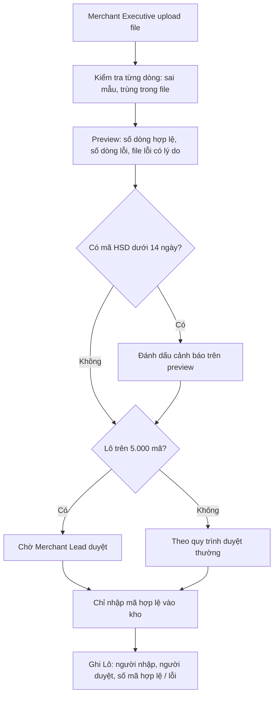
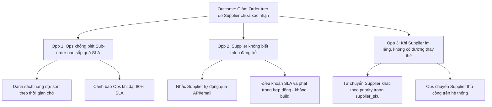
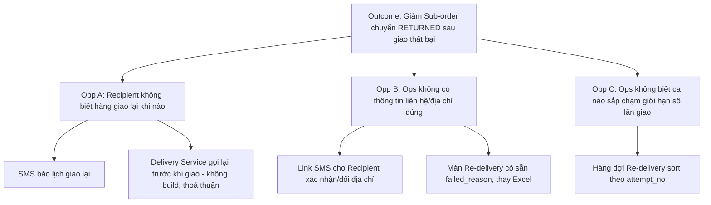
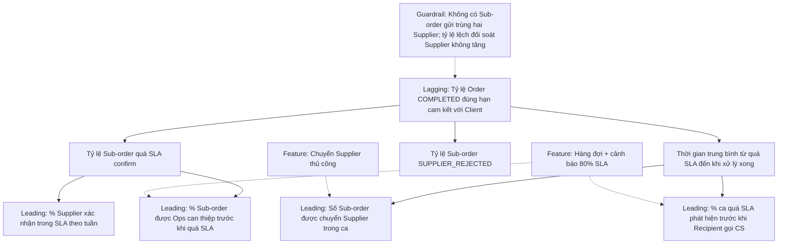
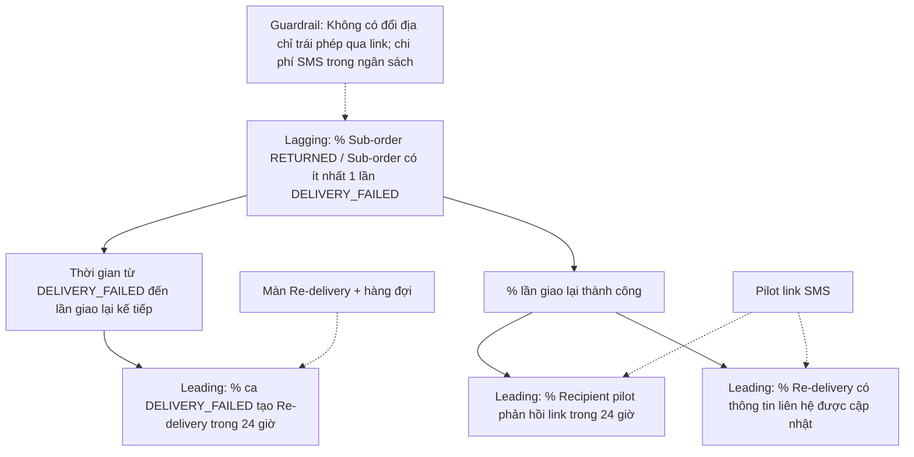

# Tuần 6 — Từ màn hình đến giá trị sản phẩm: Field, UI State, màn danh sách và tư duy PO

Tuần này đi qua hai nửa. Nửa đầu (Day 36–38) đóng nốt phần UX/UI của BA: định nghĩa từng field, mô tả đủ trạng thái màn hình, và đặc tả màn danh sách có search, filter, import, export. Nửa sau (Day 39–42) chuyển sang tư duy Product Owner: vision, problem discovery, MVP, ưu tiên và đo lường. Sợi chỉ nối hai nửa là một câu hỏi: "Màn hình này, field này, feature này tạo ra giá trị gì và đo bằng gì?". Hết tuần, bạn phải tự đi được từ một pain point đến backlog có ưu tiên và một metric tree có baseline.

| Day | Topic | Deliverable |
|---|---|---|
| 36 | Field Definition & Validation | Field Specification Table cho form Re-delivery |
| 37 | UI State: Empty, Loading, Error, Permission, Confirmation | UI State Matrix cho màn Order Detail |
| 38 | Màn danh sách: Search, Filter, Sort, Pagination, Import, Export | List Screen Spec + Import Spec |
| 39 | Product Vision, Product Goal, Problem Discovery, Persona/JTBD | Product Vision Board + 2 Persona/JTBD |
| 40 | Value Proposition, Opportunity, Solution Options, MVP | Solution Options Matrix + MVP Scope |
| 41 | Prioritization (MoSCoW, RICE), Product Backlog, Roadmap | RICE Matrix 8 feature + Outcome Roadmap |
| 42 | KPI & Product Metric (+ review tuần 6) | Metric Tree + Metric Definition Sheet |

---

## Day 36 - Field Definition & Validation

> P7 UX/UI · Level: Junior → Middle · Thời lượng ~75 phút · Deliverable: Field Specification Table cho form "Tạo yêu cầu Re-delivery"

### Mục tiêu

- Viết được Field Specification – Đặc tả trường dữ liệu cho một form, đủ để Dev build và QC viết test mà không phải hỏi lại.
- Phân biệt 4 tầng validation: định dạng, bắt buộc, liên trường, nghiệp vụ.
- Phân biệt lỗi chặn (block) với cảnh báo (warning) và viết error message có hành động.
- Liên kết field trên UI với field trong Data Dictionary (Day 23) và API (Day 29).

### Kiến thức cần học

**1. Field Specification là gì.** Là bảng mô tả từng field trên một màn hình: nó là gì, lấy từ đâu, nhập thế nào, sai thì sao. Data Dictionary (Day 23) mô tả field ở tầng dữ liệu. Field Spec mô tả field ở tầng giao diện. Một field UI có thể không lưu DB (field tính toán), và một cột DB có thể không hiện trên UI.

**2. Các cột bắt buộc của một Field Spec.**

| Cột | Câu hỏi phải trả lời |
|---|---|
| Field / Label | Tên kỹ thuật và nhãn hiển thị là gì? |
| Type / Control | Text, number, dropdown, date picker, radio, file? |
| Required | Bắt buộc luôn, bắt buộc có điều kiện, hay không bắt buộc? |
| Format / Length | Độ dài min–max, ký tự cho phép, số thập phân? |
| Default | Giá trị mặc định khi mở form? |
| Source | Người dùng nhập, hệ thống điền, hay lấy từ entity khác? |
| Editable | Sửa được ở trạng thái nào, bởi ai? |
| Validation | Rule kiểm tra, kiểm ở client hay server? |
| Error message | Câu thông báo chính xác khi sai |
| Mapping | Map vào cột DB hoặc field API nào? |

**3. Bốn tầng validation.**

| Tầng | Ví dụ | Kiểm ở đâu |
|---|---|---|
| Format – Định dạng | SĐT đúng 10 số, bắt đầu bằng 0 | Client + Server |
| Required – Bắt buộc | Địa chỉ không được trống | Client + Server |
| Cross-field – Liên trường | Ngày giao lại phải sau ngày hôm nay | Client + Server |
| Business – Nghiệp vụ | Chỉ tạo Re-delivery khi shipping_status = DELIVERY_FAILED | Server (cần dữ liệu thật) |

Quy tắc vàng: **client-side validation – kiểm tra phía giao diện** chỉ để trải nghiệm tốt. **Server-side validation – kiểm tra phía máy chủ** mới là hàng rào thật. Mọi rule ở client phải lặp lại ở server, vì API có thể được gọi thẳng không qua UI.

**4. Block vs Warning.** Block: không cho lưu. Warning: cho lưu nhưng bắt người dùng xác nhận đã biết rủi ro. Junior hay biến mọi thứ thành block, làm nghiệp vụ tắc. Hỏi: "Có trường hợp hợp lệ nào vi phạm rule này không?" Có → warning. Không → block.

**5. Error message tốt có 3 phần:** cái gì sai, vì sao, làm gì tiếp. "Số điện thoại phải gồm 10 chữ số và bắt đầu bằng 0." tốt hơn "Dữ liệu không hợp lệ."

**6. Thời điểm validate:** khi rời field (on blur), khi bấm lưu (on submit), hay khi gõ (on change). Ghi rõ, vì QC sẽ test đúng thời điểm này.

### BA/PO sử dụng kiến thức này khi nào?

- Viết FS cho màn hình có form: tạo, sửa, import.
- Refinement: Dev hỏi "field này max bao nhiêu ký tự?" mà spec chưa có.
- Viết AC: mỗi rule validation thường thành một AC hoặc một test case negative.
- Bug triage: lỗi "UI cho nhập nhưng API báo lỗi" thường là validation client và server lệch nhau.

### Quy trình thực hiện

**Step 1 — Liệt kê field từ nguồn.** Lấy từ wireframe (Day 35), Data Dictionary (Day 23), request API (Day 29). Đánh dấu field nào người dùng nhập, field nào hệ thống tự điền.

**Step 2 — Điền thuộc tính cơ bản.** Type, required, length, default, source cho từng field.

**Step 3 — Viết validation theo 4 tầng.** Đi lần lượt Format → Required → Cross-field → Business. Mỗi rule một dòng, đánh số (V-01, V-02…).

**Step 4 — Phân loại block/warning.** Với từng rule nghiệp vụ, hỏi "có trường hợp hợp lệ vi phạm không?".

**Step 5 — Viết error message.** Câu chính xác, có hành động. Đưa cho Design/Content duyệt câu chữ nếu có.

**Step 6 — Ghi rule editable theo trạng thái và quyền.** Field nào khoá sau khi Sub-order đã SENT_TO_SUPPLIER?

**Step 7 — Đối chiếu ngược.** Mỗi field có mapping DB/API chưa? Có field DB bắt buộc nào form chưa thu? Có rule nào chỉ có ở client?

### Ví dụ thực tế

**Bối cảnh Physical Gift.** Ops cần tạo yêu cầu giao lại khi Sub-order có shipping_status = `DELIVERY_FAILED` (pain point 3: hiện làm qua Excel). Form "Tạo yêu cầu Re-delivery" `[Giả định bài tập]`.

| # | Field | Label | Type | Req | Format / Length | Default | Source | Editable |
|---|---|---|---|---|---|---|---|---|
| F1 | sub_order_id | Mã Sub-order | Text (read-only) | Y | — | Từ màn trước | Hệ thống | Không |
| F2 | failed_reason | Lý do giao thất bại | Text (read-only) | — | — | shipment gần nhất | Hệ thống | Không |
| F3 | recipient_name | Người nhận | Text | Y | 2–100 ký tự | Từ order | Order, sửa được | Có |
| F4 | phone | Số điện thoại | Text | Y | 10 số, bắt đầu 0 | Từ order | Order, sửa được | Có |
| F5 | address | Địa chỉ giao | Textarea | Y | 10–255 ký tự | Từ order | Order, sửa được | Có |
| F6 | expected_date | Ngày giao lại mong muốn | Date picker | N | dd/mm/yyyy | Trống | Ops nhập | Có |
| F7 | note | Ghi chú cho đơn vị vận chuyển | Textarea | N | 0–500 ký tự | Trống | Ops nhập | Có |
| F8 | reason_code | Lý do tạo Re-delivery | Dropdown | Y | Danh mục cố định | Trống | Ops chọn | Có |

Bảng validation:

| # | Field | Rule | Tầng | Loại | Error message |
|---|---|---|---|---|---|
| V-01 | phone | Đúng 10 chữ số, ký tự đầu là 0 | Format | Block | "Số điện thoại phải gồm 10 chữ số và bắt đầu bằng 0." |
| V-02 | address | Không trống, sau khi bỏ khoảng trắng đầu cuối còn ≥ 10 ký tự | Required | Block | "Vui lòng nhập địa chỉ giao hàng đầy đủ (tối thiểu 10 ký tự)." |
| V-03 | expected_date | Nếu có nhập, phải ≥ ngày hiện tại + 1 | Cross-field | Block | "Ngày giao lại phải từ ngày mai trở đi." |
| V-04 | (form) | Sub-order có shipping_status = DELIVERY_FAILED tại thời điểm lưu | Business | Block | "Sub-order đã đổi trạng thái, không thể tạo giao lại. Tải lại trang để xem trạng thái mới." |
| V-05 | (form) | Số lần giao (attempt_no) của Sub-order < [3] | Business | Block | "Sub-order đã giao [3] lần. Chuyển cho Supervisor xử lý hoàn hàng." |
| V-06 | address | Địa chỉ mới giống hệt địa chỉ đã giao thất bại và reason_code = "Sai địa chỉ" | Business | Warning | "Địa chỉ chưa thay đổi so với lần giao thất bại. Bạn vẫn muốn tạo yêu cầu?" |

Ba điểm cần nhìn:
- V-04 kiểm **tại thời điểm lưu**, không phải lúc mở form. Trong lúc Ops gõ, webhook `shipment.status_changed` có thể đã đổi trạng thái. Đây là race condition (Day 32) hiện ra ở form.
- V-05 có tham số `[3]` — cấu hình được, không hard-code. Ngưỡng này là giả định, phải xác nhận với Ops Lead.
- V-06 là warning, không phải block: có trường hợp hợp lệ (người nhận vắng nhà, địa chỉ đúng) mà Ops vẫn giao lại cùng địa chỉ.

#### Ví dụ từ dự án thật: Promotion Code

BRD Promotion Code có hai rule cho thấy rõ khác biệt block và warning ở tầng nghiệp vụ:

| Rule (trích BRD) | Loại | Vì sao |
|---|---|---|
| Lô trên [5.000] mã cần Merchant Lead duyệt | Không chặn upload, nhưng mã chỉ vào kho **sau khi duyệt** (tiêu chí nghiệm thu: "chỉ nhập mã hợp lệ sau khi duyệt") | Lô lớn hợp lệ, chỉ cần thêm người chịu trách nhiệm |
| Mã dưới [14] ngày HSD lúc nhập: cảnh báo, Lead quyết định | Warning có người quyết | Mã gần hết hạn vẫn có thể đáng nhận, tuỳ thoả thuận với merchant |

Để ý cách BRD viết: tham số trong `[ ]`, có người chịu quyết định (Lead). Đây là mẫu tốt. Junior sẽ viết "Hệ thống không cho nhập mã gần hết hạn" — một rule nghe chắc chắn nhưng chặn nhầm nghiệp vụ.

#### Ví dụ từ dự án thật: Slide to Use

TO-BE ghi: khi tách, người nhận "chỉ nhập số tiền, hệ thống tự chia mệnh giá". Field "Số tiền" trông đơn giản, nhưng quy tắc chia đang là Open Item OI-S16 (ít mã nhất, ưu tiên mệnh giá lớn, hay theo tồn kho?). Ghi chú của chính tài liệu: "Chưa có rule thì QC không viết được expected result". Bài học: một field nhập 1 số có thể phụ thuộc một Business Rule chưa chốt. BA phải ghi field spec kèm "Phụ thuộc OI-S16", không tự chọn rule.

### Junior vs Middle vs Senior

Tình huống: PO nói "Thêm field Số điện thoại vào form Re-delivery".

| | Junior | Middle | Senior |
|---|---|---|---|
| Nghĩ | Thêm một textbox | Field này có format, required, map vào đâu | Field này dùng cho ai, sai thì ai chịu, có dữ liệu nhạy cảm không |
| Hỏi | "Bắt buộc không?" | "Nhận số quốc tế không? Cho sửa sau khi gửi Delivery Service không?" | "Delivery Service có nhận SĐT mới qua API không, hay phải tạo shipment mới? Ai được xem số đầy đủ, có che trên màn danh sách không? Sửa SĐT có ghi audit_log không?" |
| Làm | Ghi "SĐT: bắt buộc" | Viết đủ format, error message, mapping | Viết đủ + rule che số + audit + kiểm tra integration với Delivery Service + ghi Open Item nếu chưa rõ |

### Sai lầm thường gặp

1. **Chỉ viết validation client.** API bị gọi thẳng thì rule mất tác dụng.
2. **Error message chung chung.** "Dữ liệu không hợp lệ" làm CS không trả lời được khách.
3. **Không ghi thời điểm kiểm tra rule nghiệp vụ.** Kiểm lúc mở form thay vì lúc lưu → race condition.
4. **Biến mọi rule thành block.** Nghiệp vụ hợp lệ bị chặn, người dùng tìm đường vòng.
5. **Hard-code ngưỡng.** "Tối đa 3 lần" viết cứng, đổi chính sách phải deploy lại.
6. **Quên field read-only.** Field hệ thống điền vẫn cần spec: lấy từ đâu, khi nguồn trống thì hiện gì.
7. **Không nói rõ khoảng trắng, ký tự đặc biệt.** "Không trống" — chuỗi toàn dấu cách có tính là trống không?

### Góc nhìn Senior BA/PO

Field Spec không phải bảng điền cho đủ cột. Mỗi dòng là một quyết định nghiệp vụ nhỏ. Senior đọc một field theo ba câu: "Nếu field này sai, ai mất tiền hoặc mất thời gian?", "Rule này đúng với mọi kênh không (UI, API, import)?", "Ai sở hữu ngưỡng này?". Rule nào có số thì số đó phải có chủ. Không có chủ thì ghi Open Item, không tự đặt. Và luôn nhớ: validation trùng nhau ở ba nơi (UI, API, import) phải dùng **một** định nghĩa, nếu không sẽ có dữ liệu lọt qua kênh lỏng nhất.

### Bài tập thực hành

**Đầu vào.** Admin cần form "Tạo Program" cho Client. Entity `program` có: program_id, account_id, name, start_at, end_at, budget, status (DRAFT / ACTIVE / PAUSED / ENDED). Thông tin thêm `[Giả định bài tập]`:
- Program mới tạo luôn ở DRAFT.
- Tổng budget các Program ACTIVE của một Client không vượt credit_limit của customer_account.
- Tên Program không trùng trong cùng một Client.
- Program thường kéo dài 1–12 tháng, nhưng Sales nói "đôi khi có Program 18 tháng cho khách lớn".

**Yêu cầu đầu ra.**
1. Field Spec Table cho 5 field: account_id, name, start_at, end_at, budget.
2. Bảng validation có cột Tầng, Loại (block/warning), Error message.
3. Chỉ ra 1 rule nên kiểm lúc **kích hoạt** Program chứ không phải lúc tạo.
4. Liệt kê 2 Open Item.

### Lời giải tham khảo

| # | Field | Rule | Tầng | Loại | Error message |
|---|---|---|---|---|---|
| V-01 | account_id | Chọn từ danh sách Client có status hoạt động | Required + Business | Block | "Vui lòng chọn Client đang hoạt động." |
| V-02 | name | 3–150 ký tự sau khi bỏ khoảng trắng đầu cuối | Format | Block | "Tên Program cần từ 3 đến 150 ký tự." |
| V-03 | name | Không trùng tên Program khác của cùng account_id (không phân biệt hoa thường) | Business | Block | "Client này đã có Program tên '…'. Vui lòng đặt tên khác." |
| V-04 | start_at | ≥ ngày hiện tại | Cross-field | Block | "Ngày bắt đầu không được ở quá khứ." |
| V-05 | end_at | > start_at | Cross-field | Block | "Ngày kết thúc phải sau ngày bắt đầu." |
| V-06 | end_at | Khoảng start–end > [12] tháng | Cross-field | Warning | "Program dài hơn 12 tháng. Xác nhận đây là thoả thuận với Client." |
| V-07 | budget | Số nguyên dương, đơn vị VNĐ | Format | Block | "Ngân sách phải là số dương." |
| V-08 | budget | Tổng budget Program ACTIVE + Program này ≤ credit_limit | Business | Block **lúc kích hoạt** | "Vượt hạn mức tín dụng của Client. Còn trống: X VNĐ." |

**Vì sao.**
- V-06 là warning vì Sales đã nêu trường hợp hợp lệ 18 tháng. Biến thành block là chặn đúng khách lớn nhất.
- V-08 kiểm lúc kích hoạt (DRAFT → ACTIVE) vì rule nói về Program ACTIVE. Lúc tạo DRAFT chưa tiêu hạn mức. Kiểm lúc tạo sẽ chặn Admin chuẩn bị Program trước. Đây là chỗ Junior hay bỏ sót: không nối validation với state transition (Day 24).
- V-03 ghi rõ "không phân biệt hoa thường" — nếu không, "Tet 2027" và "TET 2027" lọt qua.
- Error message V-08 có "Còn trống: X VNĐ" — người dùng biết làm gì tiếp.

**Open Item gợi ý:** (1) Budget tính theo VNĐ hay theo điểm, vì program_sku có price_or_point? (2) Program PAUSED có tính vào hạn mức đã dùng không?

Junior hay bỏ sót: timezone của start_at/end_at (00:00 giờ Việt Nam hay UTC), và sửa end_at khi Program đang ACTIVE có được không.

### Checklist hoàn thành

- [ ] Tôi hiểu khái niệm.
- [ ] Tôi tự làm được bài tập.
- [ ] Tôi giải thích được cho Developer/QC.
- [ ] Tôi có thể viết thành Requirement/artifact.
- [ ] Mỗi rule validation của tôi có tầng, loại block/warning và error message cụ thể.
- [ ] Tôi đã ghi rõ rule nào kiểm ở server và kiểm tại thời điểm nào.
- [ ] Mọi ngưỡng số đều là tham số `[ ]` có người sở hữu hoặc Open Item.

---

## Day 37 - UI State: Empty, Loading, Error, Permission, Confirmation

> P7 UX/UI · Level: Junior → Middle · Thời lượng ~80 phút · Deliverable: UI State Matrix cho màn Order Detail (Ops)

### Mục tiêu

- Liệt kê đủ trạng thái của một màn hình, không chỉ "happy path – luồng chạy đúng".
- Viết UI State Matrix – Ma trận trạng thái giao diện: mỗi state có điều kiện vào, nội dung hiển thị, hành động cho phép.
- Phân biệt các loại Empty, Error để có câu chữ và hành động khác nhau.
- Viết requirement cho Confirmation – Xác nhận thao tác nguy hiểm/không đảo ngược.

### Kiến thức cần học

**1. Mỗi màn hình có nhiều state hơn bạn nghĩ.** Wireframe thường chỉ vẽ một state: có dữ liệu, mọi thứ chạy đúng. Dev sẽ phải tự đoán phần còn lại. Mỗi lần Dev đoán là một lần UI lệch giữa Web, App, và lệch với kỳ vọng của PO.

**2. Năm state cốt lõi.**

| State | Định nghĩa | Câu hỏi BA phải trả lời |
|---|---|---|
| Empty – Rỗng | Không có dữ liệu để hiển thị | Rỗng vì chưa có bao giờ, vì filter, hay vì không có quyền? Hiện gì, gợi ý hành động gì? |
| Loading – Đang tải | Chờ hệ thống trả kết quả | Hiện skeleton hay spinner? Quá bao nhiêu giây thì coi là lỗi? Người dùng bấm lại được không? |
| Error – Lỗi | Không lấy/ghi được dữ liệu | Lỗi do người dùng, do hệ thống, hay do bên thứ ba? Thử lại được không? Dữ liệu đã nhập có giữ lại không? |
| Permission – Quyền | Người dùng không được xem/làm | Ẩn nút, disable nút kèm lý do, hay hiện trang "Không có quyền"? |
| Confirmation – Xác nhận | Hỏi lại trước hành động quan trọng | Hành động có đảo ngược được không? Câu hỏi nêu hậu quả gì? |

Thêm hai state hay bị quên: **Success – Thành công** (sau thao tác thì hiện gì, đi đâu) và **Partial – Một phần** (trang có 3 khối, 1 khối lỗi thì 2 khối còn lại vẫn hiện không?).

**3. Phân loại Empty.**

| Loại | Ví dụ | Hành động gợi ý |
|---|---|---|
| First-use – Chưa từng có | Program mới chưa có SKU | "Thêm SKU vào Program" |
| No-result – Không khớp tìm kiếm | Filter không ra Order nào | "Xoá bộ lọc" |
| Cleared – Đã xử lý hết | Không còn Sub-order quá SLA | Thông báo tích cực, không cần hành động |
| Unavailable – Nguồn cạn | Hết mã ở brand đối tác | Giải thích và hướng đi tiếp |

**4. Phân loại Error.** Lỗi người dùng sửa được (validation, Day 36), lỗi tạm thời thử lại được (timeout, Day 32), lỗi nghiệp vụ không thử lại được (trạng thái đã đổi), lỗi hệ thống (500). Mỗi loại có câu chữ và nút khác nhau. Không bao giờ hiện mã lỗi kỹ thuật thô cho người dùng cuối.

**5. Confirmation tốt** nêu: làm gì, với đối tượng nào, hậu quả gì, có đảo ngược được không. Nút xác nhận ghi đúng động từ ("Huỷ Sub-order"), không ghi "OK". Hành động không đảo ngược thì nút chính không phải nút mặc định khi bấm Enter.

**6. Hidden vs Disabled.** Ẩn khi người dùng không bao giờ được làm (vai trò không có quyền). Disable kèm lý do khi người dùng có quyền nhưng điều kiện chưa thoả ("Chỉ huỷ được khi Sub-order chưa gửi Supplier").

### BA/PO sử dụng kiến thức này khi nào?

- Review mockup với Design: hỏi "còn state nào chưa vẽ?".
- Viết FS màn hình: thêm mục UI State Matrix.
- Viết AC: mỗi state không phải happy path là ít nhất một AC.
- Chuẩn bị cho QC: state matrix chính là danh sách test case UI negative.

### Quy trình thực hiện

**Step 1 — Liệt kê các khối dữ liệu trên màn.** Mỗi khối gọi API riêng thì có state riêng.

**Step 2 — Với mỗi khối, đi qua 7 state:** Empty, Loading, Error, Permission, Confirmation, Success, Partial. State nào không áp dụng thì ghi "N/A" kèm lý do, không bỏ trống.

**Step 3 — Viết điều kiện vào state** bằng dữ liệu cụ thể (trạng thái entity, role, kết quả API), không bằng cảm giác.

**Step 4 — Viết nội dung hiển thị và hành động cho phép.** Câu chữ là bản nháp, ghi "Design duyệt câu chữ".

**Step 5 — Viết AC cho state rủi ro cao** bằng Given/When/Then.

**Step 6 — Ghi Open Item** cho state chưa có quyết định, đặc biệt state liên quan trợ năng (accessibility) và thiết bị cũ.

### Ví dụ thực tế

**Bối cảnh Physical Gift.** Màn "Chọn quà" của Recipient, gọi `GET /programs/{id}/products` `[Giả định bài tập cho câu chữ và ngưỡng thời gian]`.

| State | Điều kiện | Hiển thị | Hành động |
|---|---|---|---|
| Loading | Đang gọi API | Skeleton 6 ô sản phẩm | Không. Quá [10] giây chuyển Error tạm thời |
| Empty (First-use) | Program ACTIVE, không SKU nào is_visible = true | "Chương trình đang cập nhật quà. Vui lòng quay lại sau." | Không có nút chọn |
| Permission | Program ở PAUSED hoặc ENDED | "Chương trình đã tạm dừng / đã kết thúc." | Ẩn toàn bộ danh sách quà |
| Error tạm thời | API timeout hoặc 5xx | "Không tải được danh sách quà." | Nút "Thử lại" |
| Confirmation | Bấm "Đặt quà" | "Xác nhận đặt [Tên SKU] giao đến [địa chỉ]? Sau khi gửi nhà cung cấp, bạn không đổi được quà." | "Đặt quà" / "Quay lại" |
| Error nghiệp vụ | Lúc đặt, SKU vừa hết hàng | "Quà này vừa hết. Vui lòng chọn quà khác." | Quay lại danh sách, SKU đó hiện "Hết hàng" |
| Success | Order CREATED | Màn "Đặt quà thành công" + mã đơn | "Xem đơn" |

Để ý dòng Error nghiệp vụ: đây chính là pain point 1 của case (chọn xong mới báo lỗi). State matrix không giải quyết gốc vấn đề — đó là việc của Capstone — nhưng ít nhất đảm bảo người nhận không bị mắc kẹt ở màn lỗi.

#### Ví dụ từ dự án thật: Slide to Use

Khi người nhận ra cửa hàng, bấm Dùng ngay và trượt thanh Slide to Use, hệ thống mới lấy mã. BRD định nghĩa **ba kết quả** khác nhau tuỳ loại brand và tồn kho:

| Loại brand | Kết quả trượt | Loại state |
|---|---|---|
| Brand Cả hai / Chỉ code 3rd, còn code | Hiện code 3rd | Success |
| Brand Cả hai, hết code | Hiện mã nội bộ thay thế | Success có fallback – phương án dự phòng |
| Brand Chỉ code 3rd, hết code | Báo tạm hết mã | Empty loại Unavailable |

Bài học BA rút ra:

1. **Cùng một hành động, ba kết quả.** Nếu mockup chỉ vẽ "trượt → hiện code", Dev sẽ không biết nhánh hết code. QC sẽ không có expected result. Ba nhánh phải có ba AC riêng.
2. **"Tạm hết mã" là Empty, không phải Error.** Hệ thống chạy đúng, chỉ là nguồn cạn. Câu chữ phải khác lỗi hệ thống, và phải nói người nhận làm gì tiếp. Tình huống hết kho kéo dài đến khi voucher tới hạn vẫn đang là Open Item OI-S15 (gia hạn, hoàn hay để hết hạn) — câu chữ màn hình phụ thuộc quyết định này.
3. **Trượt hai lần là một state cần đặc tả.** NFR-1: trượt nhiều lần hoặc trên hai thiết bị cùng lúc chỉ ra một kết quả và rút tối đa một code. Ở UI: sau lần trượt đầu, thanh trượt vào Loading và khoá; thiết bị thứ hai nhận cùng kết quả đã có.

Hai Open Item thật liên quan trực tiếp đến UI state:

| OI | Nội dung | Vì sao là chuyện UI State |
|---|---|---|
| OI-S06 | Đường thay thế cho thanh trượt (giữ nút 1 giây / nút phụ sau 5 giây)? | Người dùng không thao tác trượt được (trợ năng, thiết bị) cần một con đường khác dẫn tới cùng kết quả. Thiếu nó là một nhóm người dùng bị chặn hoàn toàn |
| OI-S08 | Ẩn ô "Đã sử dụng" khi chưa có mã? | Ô này chỉ có nghĩa khi đã có mã. Hiện ô lúc voucher chưa lấy mã là cho phép một hành động sai thời điểm. Đây là quyết định Hidden vs Disabled |

AC mẫu cho nhánh tạm hết mã `[Giả định bài tập: câu chữ minh hoạ, không phải câu chữ đã duyệt]`:

```gherkin
Scenario: Brand Chỉ code 3rd hết code khi trượt
  Given voucher ở state 3 kèm bảng tạm của brand loại "Chỉ code 3rd"
  And kho code 3rd của brand này bằng 0
  When người nhận trượt hết thanh Slide to Use
  Then hệ thống không cấp mã nội bộ thay thế
  And màn hình hiển thị thông báo tạm hết mã theo câu chữ Design đã duyệt
  And voucher vẫn giữ state 3 kèm bảng tạm
  And không có dòng nào ghi nhận đã lấy code
```

Dòng "voucher vẫn giữ state 3" là chỗ Junior hay bỏ sót: chỉ viết phần hiển thị, quên viết hệ thống **không** đổi gì. QC cần cả hai để test.

### Junior vs Middle vs Senior

Tình huống: Design gửi mockup màn trượt Slide to Use chỉ có một màn kết quả "Hiện code".

| | Junior | Middle | Senior |
|---|---|---|---|
| Nghĩ | Mockup đẹp, đúng flow | Thiếu nhánh hết code | Thiếu nhánh hết code, thiếu đường thay thế, thiếu state khi mạng chập chờn giữa lúc trượt |
| Hỏi | "Màu thanh trượt theo brand không?" | "Hết code ở brand Cả hai và Chỉ code 3rd thì màn hiện gì?" | "Trượt xong mất mạng, mở lại app thì thấy gì? App bản cũ thấy gì (OI-S23)? Người không trượt được thì làm sao (OI-S06)?" |
| Làm | Duyệt mockup | Yêu cầu vẽ thêm 2 màn | Gửi UI State Matrix cho Design làm checklist vẽ, mở Open Item cho state chưa có chủ |

### Sai lầm thường gặp

1. **Chỉ đặc tả happy path.** Dev tự đoán phần còn lại, mỗi kênh đoán một kiểu.
2. **Gộp mọi Empty làm một.** "Không có dữ liệu" cho cả trường hợp chưa từng có và trường hợp filter sai.
3. **Gọi nguồn cạn là lỗi.** Hiện "Đã xảy ra lỗi" khi thật ra hết mã — CS nhận khiếu nại sai bản chất.
4. **Confirmation không nêu hậu quả.** "Bạn có chắc không?" không giúp người dùng quyết định.
5. **Disable nút không có lý do.** Người dùng không biết phải làm gì để nút sáng lên.
6. **Quên state khi thao tác bị lặp.** Bấm hai lần, trượt hai lần, hai thiết bị cùng lúc.
7. **Viết state chỉ bằng UI, quên dữ liệu.** Không ghi state nào thay đổi dữ liệu, state nào không.

### Góc nhìn Senior BA/PO

UI State Matrix là nơi requirement nghiệp vụ gặp hành vi thật của người dùng. Senior đọc mỗi state theo hai trục: **người dùng thấy gì** và **dữ liệu thay đổi gì**. Một state hiển thị đúng nhưng ghi nhầm dữ liệu là bug nặng hơn một state hiển thị xấu. Ở Slide to Use, ba kết quả trượt khác nhau không chỉ ở màn hình mà ở doanh thu, ở kho, ở đối soát. Senior cũng biết state "Empty — Unavailable" thường che một quyết định chính sách chưa chốt (OI-S15). Đừng để Design viết câu chữ cho một chính sách chưa có.

### Bài tập thực hành

**Đầu vào.** Màn "Order Detail" cho Ops. Màn có 3 khối: (A) thông tin Order, (B) danh sách Sub-order kèm status và shipping_status, (C) lịch sử từ audit_log. Ops có nút "Huỷ Sub-order". Quy tắc `[Giả định bài tập]`:
- Chỉ huỷ được Sub-order ở PENDING hoặc SENT_TO_SUPPLIER chưa có phản hồi.
- Huỷ Sub-order ở SENT_TO_SUPPLIER phải gọi API huỷ sang Supplier; Supplier có thể từ chối huỷ.
- Role CS xem được màn này nhưng không được huỷ.
- Khối C gọi một API riêng, thỉnh thoảng chậm.

**Yêu cầu đầu ra.**
1. UI State Matrix cho cả 3 khối và nút Huỷ (tối thiểu 8 dòng).
2. Câu Confirmation cho nút Huỷ.
3. 2 AC G/W/T: một cho Supplier từ chối huỷ, một cho Partial state.

### Lời giải tham khảo

| Khối / thao tác | State | Điều kiện | Hiển thị / hành động |
|---|---|---|---|
| A | Loading | Đang gọi API Order | Skeleton khối A |
| A | Error | Order không tồn tại | Trang "Không tìm thấy Order #…" + nút về danh sách |
| B | Empty | N/A — Order luôn có ≥ 1 Sub-order | Ghi N/A kèm lý do |
| C | Partial | API lịch sử lỗi hoặc quá [5] giây | Khối A, B vẫn hiện; khối C "Chưa tải được lịch sử" + "Thử lại" |
| Nút Huỷ | Permission – ẩn | Role CS | Không hiện nút |
| Nút Huỷ | Permission – disable | Role Ops, Sub-order ngoài PENDING/SENT_TO_SUPPLIER | Disable + tooltip "Chỉ huỷ được khi Sub-order chưa được Supplier xác nhận" |
| Nút Huỷ | Confirmation | Bấm Huỷ | Hộp xác nhận (xem dưới) |
| Nút Huỷ | Loading | Đang chờ Supplier | Nút khoá, chữ "Đang huỷ…", không cho bấm lại |
| Nút Huỷ | Error nghiệp vụ | Supplier từ chối huỷ | "Supplier không chấp nhận huỷ: [lý do]. Sub-order giữ trạng thái hiện tại." |
| Nút Huỷ | Success | Sub-order CANCELLED | Badge CANCELLED, khối C thêm dòng log, Order.status tính lại |

Confirmation: "Huỷ Sub-order #[id] của Supplier [tên]? Sub-order đã gửi Supplier sẽ được yêu cầu huỷ, Supplier có thể từ chối. Thao tác này không hoàn tác được." Nút: "Huỷ Sub-order" / "Giữ lại". Bắt buộc nhập lý do — vì audit_log có cột reason.

```gherkin
Scenario: Supplier từ chối yêu cầu huỷ
  Given Sub-order #S1 ở trạng thái SENT_TO_SUPPLIER
  And Ops đã xác nhận huỷ với lý do "Client yêu cầu"
  When Supplier trả kết quả từ chối huỷ kèm lý do "Đã đóng gói"
  Then Sub-order #S1 giữ trạng thái SENT_TO_SUPPLIER
  And màn hình hiển thị "Supplier không chấp nhận huỷ: Đã đóng gói"
  And audit_log ghi một dòng action "CANCEL_REJECTED" với actor là Ops và reason "Client yêu cầu"

Scenario: Khối lịch sử lỗi không chặn màn hình
  Given API lịch sử của Order #O1 trả lỗi 500
  When Ops mở Order Detail #O1
  Then khối thông tin Order và khối Sub-order hiển thị đầy đủ
  And khối lịch sử hiển thị "Chưa tải được lịch sử" và nút "Thử lại"
```

**Vì sao.** Ẩn nút với CS (không bao giờ được làm), disable với Ops (được làm nhưng chưa đủ điều kiện). Loading của nút Huỷ phải khoá bấm lặp — tránh gửi hai yêu cầu huỷ sang Supplier (Day 31). Junior hay bỏ sót: Success phải nhắc Order.status được **tính lại** từ Sub-order, vì Order.status là trạng thái tổng hợp; và Error nghiệp vụ vẫn phải ghi audit_log.

### Checklist hoàn thành

- [ ] Tôi hiểu khái niệm.
- [ ] Tôi tự làm được bài tập.
- [ ] Tôi giải thích được cho Developer/QC.
- [ ] Tôi có thể viết thành Requirement/artifact.
- [ ] Mỗi khối dữ liệu của tôi đã đi qua đủ 7 state, state không áp dụng có ghi lý do.
- [ ] Tôi phân biệt được Empty "nguồn cạn" với Error, và Hidden với Disabled.
- [ ] AC của tôi ghi cả điều dữ liệu **không** thay đổi.

---

## Day 38 - Màn danh sách: Search, Filter, Sort, Pagination, Import, Export

> P7 UX/UI · Level: Middle · Thời lượng ~90 phút · Deliverable: List Screen Spec cho "Danh sách Sub-order" + Import Spec

### Mục tiêu

- Đặc tả một màn danh sách đủ để Dev build mà không đoán: search khớp kiểu gì, filter kết hợp thế nào, sort mặc định ra sao.
- Viết Import Spec có xử lý lỗi theo dòng, preview, duyệt.
- Viết Export requirement xuất phát từ mục đích dùng file, không từ nút bấm.
- Nhận ra rủi ro dữ liệu nhạy cảm và hiệu năng ở màn danh sách.

### Kiến thức cần học

**1. Màn danh sách là màn được dùng nhiều nhất của Ops.** Ops mở nó hàng chục lần mỗi ngày. Một quyết định nhỏ (sort mặc định, filter mặc định) nhân lên thành hàng giờ làm việc.

**2. Search – Tìm kiếm.** Phải nói rõ:

| Câu hỏi | Ví dụ lựa chọn |
|---|---|
| Tìm theo field nào? | order_id, client_ref_id, phone |
| Khớp kiểu gì? | Exact match – khớp chính xác; prefix – khớp đầu chuỗi; contains – chứa chuỗi |
| Phân biệt hoa thường, dấu? | "Ha Noi" có ra "Hà Nội" không? |
| Độ dài tối thiểu? | Gõ ≥ [3] ký tự mới tìm |
| Search kết hợp filter? | Search trong kết quả đã lọc, hay bỏ filter? |

Quy tắc: mã định danh (order_id, serial) dùng exact. Tên người dùng contains. SĐT thường exact vì là dữ liệu cá nhân — tìm contains trên SĐT cho phép dò số.

**3. Filter – Bộ lọc.** Ghi rõ: các giá trị, chọn một hay nhiều, logic giữa các filter (thường AND giữa các filter khác nhau, OR giữa các giá trị trong cùng filter), filter mặc định, filter có được giữ khi quay lại màn không.

**4. Sort – Sắp xếp.** Sort mặc định là quyết định nghiệp vụ. Danh sách Sub-order cho Ops nên ưu tiên "việc cần làm" (quá SLA lên đầu), không phải "mới nhất lên đầu". Luôn có tiêu chí phụ (tie-breaker) để thứ tự ổn định giữa các trang.

**5. Pagination – Phân trang.** Số dòng mỗi trang, có hiện tổng số không, có chọn số dòng không. Nhắc lại Day 29: offset pagination bị lệch khi dữ liệu mới chen vào; danh sách thay đổi liên tục nên cân nhắc cursor.

**6. Import – Nhập file.** Một Import Spec đủ gồm:

| Phần | Nội dung |
|---|---|
| Template | Cột, thứ tự, định dạng, file mẫu tải về |
| Giới hạn | Dung lượng, số dòng tối đa, định dạng file |
| Validation theo dòng | Áp lại toàn bộ rule Day 36, cộng rule trùng trong file và trùng với dữ liệu sẵn có |
| Kết quả | Preview: số dòng hợp lệ / lỗi; file lỗi tải về có cột lý do |
| Chiến lược | All-or-nothing – lỗi một dòng huỷ cả file, hay partial – nhập phần hợp lệ |
| Duyệt | Ai duyệt, ngưỡng nào cần duyệt |
| Truy vết | Lô nhập ghi người nhập, người duyệt, thời điểm, số dòng |

**7. Export – Xuất file.** Câu hỏi đầu tiên không phải "xuất cột nào" mà "ai dùng file để làm gì". Từ đó suy ra: cột, filter áp dụng, giới hạn dòng, đồng bộ hay bất đồng bộ (async – xử lý nền, gửi file khi xong), quyền, che dữ liệu nhạy cảm, ghi log ai đã xuất.

### BA/PO sử dụng kiến thức này khi nào?

- Đặc tả màn quản trị (admin, back-office) — loại màn chiếm phần lớn khối lượng FS.
- Khi nghiệp vụ đang chạy bằng Excel và cần đưa lên hệ thống (import).
- Khi Kế toán, Sales yêu cầu "cho tôi nút Export".
- Khi review hiệu năng: danh sách 1 triệu dòng không thể "hiện tất cả".

### Quy trình thực hiện

**Step 1 — Xác định người dùng chính và việc họ làm trên màn.** "Ops tìm Sub-order cần xử lý" khác "Kế toán tra cứu để đối soát".

**Step 2 — Chọn cột hiển thị.** Mỗi cột trả lời được "người dùng cần cột này để quyết định gì?". Đánh dấu cột nhạy cảm.

**Step 3 — Đặc tả Search, Filter, Sort, Pagination** theo bảng ở trên. Ghi mặc định của từng cái.

**Step 4 — Đặc tả Empty/Loading/Error** cho danh sách (Day 37): phân biệt "chưa có dữ liệu" và "không khớp filter".

**Step 5 — Đặc tả Import** nếu có: template, validation, preview, chiến lược, duyệt, truy vết.

**Step 6 — Đặc tả Export** từ mục đích dùng file.

**Step 7 — Rà quyền và dữ liệu nhạy cảm** trên cả 3 đường: xem trên màn, search, export.

### Ví dụ thực tế

**Bối cảnh Physical Gift.** Màn "Danh sách Sub-order" cho Ops `[Giả định bài tập cho ngưỡng và mặc định]`.

| Thành phần | Đặc tả |
|---|---|
| Cột | sub_order_id, order_id, Supplier, status, shipping_status, sent_at, thời gian chờ confirm, recipient_name, phone (che: 090****123) |
| Search | order_id, sub_order_id: exact. client_ref_id: exact. phone: exact, nhập đủ 10 số |
| Filter | status (nhiều giá trị), shipping_status (nhiều giá trị), Supplier (nhiều), Program (một), sent_at từ–đến (tối đa [92] ngày) |
| Logic filter | AND giữa các filter, OR trong cùng filter |
| Mặc định | status = SENT_TO_SUPPLIER, sent_at 7 ngày gần nhất |
| Sort mặc định | Thời gian chờ confirm giảm dần (quá SLA lên đầu), phụ: sub_order_id tăng dần |
| Pagination | [50] dòng/trang, hiện tổng số |
| Giữ trạng thái | Quay lại từ Order Detail giữ nguyên search, filter, trang |
| Empty | Không có dữ liệu với filter mặc định: "Không có Sub-order nào chờ Supplier xác nhận." Không khớp filter khác: "Không có kết quả. Xoá bộ lọc?" |

Quyết định đáng chú ý: sort mặc định theo **thời gian chờ** biến màn danh sách thành hàng đợi công việc, trực tiếp giải pain point 2 (Supplier không confirm trong SLA → Order treo). Một quyết định sort là một quyết định sản phẩm.

#### Ví dụ từ dự án thật: Promotion Code — Import lô mã

BRD Promotion Code đưa mã từ file Excel của merchant vào kho. Tiêu chí nghiệm thu MVP ghi: "File 10.000 mã có lẫn trùng và sai mẫu: báo đúng số dòng lỗi, chỉ nhập mã hợp lệ sau khi duyệt." Kết hợp với BR nhập kho: lô trên [5.000] mã cần Merchant Lead duyệt; mã dưới [14] ngày HSD lúc nhập thì cảnh báo, Lead quyết định.

Từ chừng ấy thông tin, BA dựng được luồng import:



Ghi chú: nhánh "H — Theo quy trình duyệt thường" cho lô ≤ 5.000 mã, tài liệu tóm tắt không nói rõ ai duyệt. Đây là chỗ BA phải hỏi, không tự điền. Mã HSD dưới 14 ngày: Lead quyết định nhận hay loại từng mã hay cả nhóm — cũng là câu hỏi mở.

Bảng kết quả theo dòng `[Giả định bài tập: mã lỗi và câu chữ minh hoạ]`:

| Mã kết quả | Điều kiện | Xử lý |
|---|---|---|
| OK | Đúng mẫu, không trùng | Vào danh sách hợp lệ |
| ERR_FORMAT | Sai mẫu mã hoặc thiếu cột bắt buộc | Loại, ghi lý do |
| ERR_DUP_FILE | Trùng mã với dòng khác trong cùng file | Loại tất cả dòng trùng hay giữ dòng đầu — phải chốt |
| ERR_DUP_STOCK | Trùng mã đã có trong kho | Loại — cần xác nhận rule |
| WARN_EXPIRY | HSD gốc < [14] ngày | Giữ, chờ Lead quyết |

Ba điểm Senior nhìn ra:
1. **"Báo đúng số dòng lỗi"** là tiêu chí kiểm được. QC chuẩn bị file 10.000 dòng có số lỗi biết trước và so khớp.
2. **Trùng trong file**: giữ dòng đầu hay loại cả hai? Hai lựa chọn cho ra số dòng lỗi khác nhau → tiêu chí nghiệm thu chỉ test được khi rule này chốt.
3. **Mã được mã hoá khi lưu, admin luôn che một phần mã.** Vậy file lỗi tải về có hiện mã đầy đủ không? Người tải là Merchant Executive — người vừa upload chính file đó. Đây là câu hỏi bảo mật thật, BA phải đưa ra, không mặc định.

#### Ví dụ từ dự án thật: Promotion Code — Export

Phân quyền BRD: Kế toán "chỉ xem; xuất báo cáo nghiệm thu, phải trả merchant, doanh thu". Sales/AM chỉ xem hạn mức, lượt phát của khách mình. CSKH tra cứu theo serial hoặc ref ID, không thấy toàn bộ mã. Đây là đầu vào để đối chiếu với yêu cầu "Export Excel" trong phần Junior/Middle/Senior bên dưới.

### Junior vs Middle vs Senior

Tình huống: trong buổi họp, một người nói "Cho màn Lượt phát một nút Export Excel." `[Giả định bài tập: yêu cầu này không có trong tài liệu dự án]`

| | Junior | Middle | Senior |
|---|---|---|---|
| Nghĩ | Thêm nút, xuất các cột đang hiển thị | Xuất theo filter hiện tại, giới hạn dòng, định dạng ngày/tiền | Ai dùng file để làm gì? Nếu là Kế toán làm nghiệm thu, đó là **báo cáo chuẩn** đã có trong phân quyền, không phải export tuỳ ý |
| Hỏi | "Xuất file .xlsx hay .csv?" | "Tối đa bao nhiêu dòng? Lớn quá thì xử lý nền gửi email được không? Cột serial, ref ID có cần không?" | "File ra khỏi hệ thống thì ai giữ? Có cột mã không — admin luôn che mã, export có được hiện đầy đủ không? Sales xuất thì chỉ ra khách của mình chứ? Có ghi log ai xuất, lúc nào không?" |
| Làm | Ghi "Có nút Export Excel" | Viết export spec: cột, filter, giới hạn, async | Viết export spec theo **từng vai trò**, che mã trong mọi file, ghi log xuất; đề xuất báo cáo cố định cho Kế toán thay vì export thô; mở Open Item cho phần chưa có trong BRD |

Bài học: Export là một kênh rò rỉ dữ liệu. Trên màn hình, dữ liệu đã được che và phân quyền. Trong file Excel, những lớp bảo vệ đó biến mất nếu BA không viết lại cho export.

### Sai lầm thường gặp

1. **Search contains trên mọi field.** Chậm với bảng lớn và cho phép dò dữ liệu cá nhân.
2. **Không ghi logic giữa các filter.** Dev chọn AND, PO nghĩ OR, UAT mới vỡ.
3. **Sort không có tie-breaker.** Phân trang bị lặp hoặc mất dòng.
4. **Export xuất "tất cả" không giới hạn.** Hệ thống treo, hoặc file chứa toàn bộ dữ liệu khách.
5. **Import all-or-nothing cho file lớn.** Một dòng lỗi trong 10.000 dòng bắt người dùng làm lại từ đầu — hoặc ngược lại, partial mà không có duyệt, dữ liệu lỗi lẫn vào.
6. **Không có file lỗi tải về.** Người dùng chỉ biết "có 37 dòng lỗi" mà không biết dòng nào.
7. **Quên quyền trên export.** Màn hình đã lọc theo khách của Sales, export lại xuất toàn bộ.

### Góc nhìn Senior BA/PO

Màn danh sách là nơi dữ liệu đi ra khỏi hệ thống nhiều nhất: qua mắt người, qua search, qua file. Senior luôn rà ba đường đó cùng một bộ quyền. Senior cũng nhìn import như một **API do con người gọi**: cần validation như API, idempotency như API (upload lại cùng file thì sao?), audit như API. Và Senior coi mỗi yêu cầu "Export Excel" là tín hiệu: người dùng đang làm việc gì đó ngoài hệ thống. Hỏi việc đó là gì — đôi khi câu trả lời là một báo cáo chuẩn, đôi khi là một feature mới.

### Bài tập thực hành

**Đầu vào.** Ops hiện tạo Re-delivery bằng Excel (pain point 3). PO muốn cho Ops **import** file Re-delivery hàng loạt. File gồm: sub_order_id, recipient_name, phone, address, reason_code. Rule `[Giả định bài tập]`: dùng lại validation V-01..V-06 của Day 36; mỗi file tối đa [1.000] dòng; một Sub-order chỉ có một yêu cầu Re-delivery đang chờ.

**Yêu cầu đầu ra.**
1. Import Spec: template, giới hạn, validation theo dòng (bao gồm trùng), chiến lược all-or-nothing hay partial (có lý do), preview, truy vết.
2. Bảng mã kết quả theo dòng (tối thiểu 6 mã).
3. Trả lời: Ops upload lại **cùng file** lần hai thì hệ thống làm gì?

### Lời giải tham khảo

**Chiến lược: partial có preview.** Lý do: mỗi dòng là một Sub-order độc lập; một dòng lỗi không làm dòng khác sai. Nhưng không nhập ngay — Ops xem preview và bấm "Tạo [N] yêu cầu hợp lệ".

| Mã | Điều kiện | Xử lý |
|---|---|---|
| OK | Qua mọi rule | Tạo yêu cầu |
| ERR_NOT_FOUND | sub_order_id không tồn tại | Loại |
| ERR_STATUS | shipping_status ≠ DELIVERY_FAILED tại thời điểm xác nhận | Loại |
| ERR_FORMAT | Vi phạm V-01, V-02 | Loại, ghi field lỗi |
| ERR_MAX_ATTEMPT | attempt_no đã đạt [3] | Loại, gợi ý chuyển Supervisor |
| ERR_DUP_FILE | Cùng sub_order_id xuất hiện 2 lần trong file | Loại cả hai dòng, yêu cầu Ops chọn |
| ERR_PENDING | Sub-order đã có yêu cầu Re-delivery đang chờ | Loại |
| WARN_SAME_ADDR | V-06: địa chỉ không đổi, lý do "Sai địa chỉ" | Giữ, đánh dấu, Ops tích xác nhận |

**Upload lại cùng file:** các dòng đã tạo lần một sẽ rơi vào ERR_PENDING → không tạo trùng. Đây là idempotency tự nhiên nhờ rule "một yêu cầu đang chờ". Không có rule này, upload lại sẽ tạo hai lần giao.

**Vì sao ERR_DUP_FILE loại cả hai dòng:** hai dòng cùng Sub-order có thể có hai địa chỉ khác nhau. Hệ thống không biết dòng nào đúng; tự chọn dòng đầu là đoán thay người dùng.

**Vì sao kiểm ERR_STATUS lúc xác nhận chứ không chỉ lúc upload:** giữa upload và xác nhận có thể vài phút, webhook vận chuyển có thể đổi trạng thái.

**Truy vết:** mỗi lần import là một lô: người upload, người xác nhận, thời điểm, số dòng OK/lỗi, file gốc lưu [90] ngày. Junior hay bỏ sót: lưu file gốc và file lỗi để CS tra cứu khi Supplier hỏi "ai đổi địa chỉ này".

### Checklist hoàn thành

- [ ] Tôi hiểu khái niệm.
- [ ] Tôi tự làm được bài tập.
- [ ] Tôi giải thích được cho Developer/QC.
- [ ] Tôi có thể viết thành Requirement/artifact.
- [ ] Search của tôi ghi rõ kiểu khớp từng field; filter ghi rõ logic AND/OR và mặc định.
- [ ] Import Spec của tôi có preview, file lỗi, chiến lược có lý do và truy vết lô.
- [ ] Mọi yêu cầu Export của tôi bắt đầu bằng "ai dùng file để làm gì" và áp cùng quyền/che dữ liệu như màn hình.

---

## Day 39 - Product Vision, Product Goal, Problem Discovery, Persona/JTBD

> P8 PO · Level: Middle → Senior · Thời lượng ~80 phút · Deliverable: Product Vision Board cho mảng Fulfillment của Physical Gift + 2 Persona/JTBD

### Mục tiêu

- Phân biệt Product Vision – Tầm nhìn sản phẩm, Product Goal – Mục tiêu sản phẩm, và Sprint Goal.
- Làm Problem Discovery – Khám phá vấn đề có bằng chứng, không nhảy sang giải pháp.
- Viết Persona – Chân dung người dùng dựa trên hành vi, và JTBD – Jobs To Be Done (việc người dùng cần hoàn thành).
- Dùng các artifact này để nói "không" với feature lạc hướng.

### Kiến thức cần học

**1. Ba tầng mục tiêu.**

| Tầng | Thời gian | Ví dụ Physical Gift `[Giả định bài tập]` | Ai sở hữu |
|---|---|---|---|
| Product Vision | 2–3 năm | "Mọi món quà doanh nghiệp gửi đi đều đến đúng người, đúng hạn, và Client biết điều đó mà không cần hỏi." | PO + Management |
| Product Goal | 1 quý – 1 năm | "Giảm Order treo do Supplier chưa xác nhận" (đo bằng metric ở Day 42) | PO |
| Sprint Goal | 1–2 tuần | "Ops nhìn thấy Sub-order quá SLA trên một danh sách" | Scrum Team |

Vision không đo trực tiếp, nhưng phải đủ cụ thể để loại được feature. Một vision "trở thành nền tảng quà tặng hàng đầu" không loại được gì.

**2. Product Vision Board** (theo cách trình bày phổ biến của Roman Pichler) gồm: Vision, Target Group – Nhóm người dùng, Needs – Nhu cầu, Product – Sản phẩm là gì, Business Goals – Mục tiêu kinh doanh.

**3. Problem Discovery.** Mục tiêu là trả lời: vấn đề có thật không, lớn cỡ nào, xảy ra với ai, vì sao. Nguồn bằng chứng:

| Nguồn | Ví dụ |
|---|---|
| Dữ liệu hệ thống | Số Sub-order quá SLA confirm / tháng (SQL Day 26) |
| Ticket CS | Số khiếu nại "chưa nhận quà" |
| Quan sát | Ngồi cạnh Ops một buổi xử lý Order treo |
| Phỏng vấn | Ops, Supplier, Client HR |
| Tài liệu | Hợp đồng SLA với Supplier |

Problem Discovery khác Elicitation (Day 6) ở chỗ: Elicitation thu requirement cho một giải pháp đã có hướng. Discovery còn đang hỏi "có nên làm gì không".

**4. Persona.** Một nhân vật đại diện, dựng từ dữ liệu thật: mục tiêu, việc hằng ngày, công cụ đang dùng, nỗi đau, bối cảnh. Persona tốt mô tả **hành vi**, không mô tả tuổi, sở thích nếu không ảnh hưởng quyết định sản phẩm.

**5. JTBD.** Cấu trúc Job Story:

```
Khi [tình huống],
tôi muốn [động cơ],
để [kết quả mong đợi].
```

Khác User Story (Day 19) ở chỗ: Job Story bắt đầu từ **tình huống**, không từ vai trò. Hai người khác vai trò có thể chung một job; cùng một người có job khác nhau theo tình huống.

**6. Ba loại job:** functional (việc phải làm), emotional (cảm giác muốn có), social (hình ảnh trước người khác). Client HR gửi quà Tết: functional là "quà đến đủ nhân viên", social là "không bị nhân viên phàn nàn với sếp".

### BA/PO sử dụng kiến thức này khi nào?

- Đầu quý, khi chọn Product Goal và tạo roadmap (Day 41).
- Khi có request lớn từ Sales/Management: kiểm request có phục vụ goal không.
- Khi định nghĩa MVP (Day 40): MVP phục vụ job nào của persona nào.
- Khi tranh luận ưu tiên: quay về "vấn đề này có bằng chứng không".

### Quy trình thực hiện

**Step 1 — Thu bằng chứng vấn đề.** Ít nhất hai nguồn khác loại (một định lượng, một định tính).

**Step 2 — Viết Problem Statement** theo mẫu Day 5: ai bị ảnh hưởng, vấn đề gì, tác động đo được, bằng chứng.

**Step 3 — Dựng Persona** cho người chịu vấn đề và người ra quyết định. Mỗi persona 5 mục: vai trò, mục tiêu, việc hằng ngày, nỗi đau, công cụ.

**Step 4 — Viết Job Story** cho mỗi persona, 2–3 job, ưu tiên job có tình huống cụ thể.

**Step 5 — Viết Vision Board.** Vision một câu. Business Goals phải đo được.

**Step 6 — Chọn Product Goal** cho 1 quý. Một goal, không phải năm goal.

**Step 7 — Kiểm tra lọc.** Lấy 3 request đang có, hỏi: phục vụ goal nào, job nào? Không phục vụ → để Later hoặc từ chối.

### Ví dụ thực tế

**Bối cảnh Physical Gift.** Pain point 2: Supplier không confirm Sub-order trong SLA → Order treo.

Problem Statement `[Giả định bài tập: số liệu minh hoạ]`:
> Ops không phát hiện kịp Sub-order mà Supplier chưa xác nhận quá confirm_sla_minutes. Trung bình mỗi tháng có khoảng 400 Sub-order quá SLA, trong đó khoảng 25% chỉ được phát hiện khi Recipient gọi CS. Hậu quả: Order treo ở CONFIRMED, Client HR bị nhân viên hỏi, CS mất thời gian tra cứu thủ công.

Persona:

| | Persona A — Ops điều phối | Persona B — Client HR |
|---|---|---|
| Mục tiêu | Mọi Sub-order có Supplier xác nhận trong ca | Quà đến đủ nhân viên trước ngày sự kiện |
| Việc hằng ngày | Lọc Sub-order, gọi Supplier, ghi Excel | Tạo Program, theo dõi tiến độ, trả lời nhân viên |
| Nỗi đau | Không biết Sub-order nào sắp quá SLA, phải tự đếm giờ | Không biết quà của ai đang kẹt, phải hỏi AM |
| Công cụ | Màn danh sách, điện thoại, Excel | Email, báo cáo Client, webhook `order.status_changed` (nếu tích hợp) |

Job Story:

| Persona | Job Story |
|---|---|
| Ops | Khi đầu ca có hàng trăm Sub-order đang chờ, tôi muốn thấy ngay những cái sắp quá SLA, để gọi đúng Supplier trước khi Recipient phải hỏi. |
| Ops | Khi Supplier không trả lời sau khi đã nhắc, tôi muốn chuyển Sub-order sang Supplier khác có cùng SKU, để Order không treo thêm. |
| Client HR | Khi nhân viên hỏi "quà tôi đâu", tôi muốn tự tra được trạng thái theo tên người nhận, để không phải đợi AM trả lời. |

Product Vision Board:

| Mục | Nội dung |
|---|---|
| Vision | Mọi món quà doanh nghiệp gửi đi đều đến đúng người, đúng hạn, và Client biết điều đó mà không cần hỏi |
| Target Group | Client HR, Ops, Recipient |
| Needs | Biết trạng thái thật của từng quà; xử lý ngoại lệ trước khi người nhận phát hiện |
| Product | Nền tảng Physical Gift: Program, Order, Sub-order, theo dõi vận chuyển |
| Business Goals | Giảm khiếu nại "chưa nhận quà"; giữ Client gia hạn Program năm sau |

Kiểm tra lọc: Sales đề xuất "cho Recipient chọn màu giấy gói quà". Phục vụ job nào trong danh sách? Không. Đưa vào Later, không đưa vào quý này. Đó là cách Vision Board dùng để nói "không" có lý do.

#### Ví dụ từ dự án thật: Slide to Use

BRD Slide to Use là một ví dụ tốt về Problem Discovery có bằng chứng cơ chế. Vấn đề 1 được viết:

> Mã đối tác được cấp trước khi người nhận cần. Hệ thống lấy code 3rd ngay khi tách, kể cả khi người nhận chưa định ra cửa hàng. Người nhận không dùng thì mã không thu hồi được. Kho cạn nhanh hơn nhu cầu thật; với nguồn cấp theo lượt, Công ty trả tiền cho mã không tạo giao dịch.

Phân tích cấu trúc:

| Thành phần | Trong câu trên |
|---|---|
| Hành vi hệ thống gây ra vấn đề | Lấy code 3rd ngay khi tách |
| Điều kiện | Người nhận chưa định ra cửa hàng |
| Tác động vận hành | Kho cạn nhanh hơn nhu cầu thật |
| Tác động tiền | Công ty trả tiền cho mã không tạo giao dịch (nguồn cấp theo lượt) |

Từ đây có thể diễn giải thành Job Story của người nhận `[Giả định bài tập: diễn giải học tập, không phải câu trong BRD]`:
> Khi tôi đứng ở quầy và sẵn sàng thanh toán, tôi muốn lấy mã ngay lúc đó, để mã chắc chắn còn hiệu lực và dùng được ở cửa hàng này.

Job Story này giải thích **vì sao** giải pháp là "tách việc giữ quyền khỏi việc lấy mã": thời điểm lấy mã nên trùng với thời điểm job xảy ra. Vấn đề 2 (người nhận phải tự chia mệnh giá, chọn xong mới báo không đủ mã) là một job khác: "Khi tôi biết mình cần mua bao nhiêu tiền, tôi muốn chỉ nhập số tiền đó".

#### Ví dụ từ dự án thật: Promotion Code

Mục tiêu Phase 1 trong BRD có ba dòng. Đọc theo ba tầng mục tiêu:

| Mục tiêu BRD | Loại |
|---|---|
| Đưa mã từ file Excel của merchant vào kho, phát qua API và Loyalty Hub, đối soát được cuối tháng | Năng lực sản phẩm (output) |
| Chứng minh mô hình phát lại mã chưa vuốt hoạt động an toàn trong pilot | Product Goal dạng học — kiểm chứng giả định rủi ro nhất |
| Không ảnh hưởng luồng e-voucher đang chạy | Ràng buộc (guardrail) |

Dòng thứ hai là dòng đáng học nhất: Product Goal của một MVP không phải "làm xong tính năng" mà "chứng minh điều chưa chắc". Day 40 sẽ quay lại điểm này.

### Junior vs Middle vs Senior

Tình huống: Management yêu cầu "Làm tính năng tự chuyển Supplier khi Supplier không xác nhận".

| | Junior | Middle | Senior |
|---|---|---|---|
| Nghĩ | Viết story ngay | Vấn đề gốc là Order treo; chuyển Supplier là một giải pháp | Có bằng chứng cỡ vấn đề chưa? Bao nhiêu SKU có ≥ 2 Supplier active trong supplier_sku? Nếu ít, giải pháp này không giúp được phần lớn ca |
| Hỏi | "Chuyển sang Supplier nào?" | "Mỗi tháng bao nhiêu Sub-order quá SLA? Ops đang xử lý thế nào?" | "Order treo ảnh hưởng ai nhiều nhất? Persona nào chịu? Có job nào mà giải pháp đơn giản hơn (cảnh báo sớm) đã đủ không?" |
| Làm | Viết 3 story | Viết Problem Statement có số liệu | Problem Statement + 2 persona + kiểm độ phủ của giải pháp bằng SQL trên supplier_sku trước khi cam kết |

### Sai lầm thường gặp

1. **Vision là khẩu hiệu.** Không loại được feature nào.
2. **Persona dựng từ tưởng tượng.** Không có dữ liệu, không có quan sát.
3. **Persona mô tả nhân khẩu học, bỏ qua hành vi.** "Nữ, 30 tuổi, thích du lịch" không giúp quyết định gì.
4. **Job Story chứa giải pháp.** "Khi…, tôi muốn có nút chuyển Supplier" — đó là feature, không phải job.
5. **Nhiều Product Goal cùng lúc.** Năm goal = không goal nào được ưu tiên.
6. **Discovery chỉ hỏi người yêu cầu.** Bỏ qua người chịu vấn đề thật (Recipient, Ops).
7. **Không định lượng vấn đề.** Không biết vấn đề lớn cỡ nào thì không ưu tiên được (Day 41).

### Góc nhìn Senior BA/PO

PO giỏi không phải người có nhiều ý tưởng, mà người nói "không" có lý do. Vision, Goal, Persona, JTBD là bộ lọc. Senior luôn hỏi: "Vấn đề này của ai, có bằng chứng gì, lớn cỡ nào?" trước khi hỏi "làm gì". Và Senior nhận ra mẫu chung trong các BRD tốt: vấn đề được mô tả bằng **cơ chế** (hệ thống làm gì sai, lúc nào) chứ không chỉ bằng **triệu chứng** (khách phàn nàn). Cơ chế đúng dẫn thẳng tới giải pháp đúng — như Slide to Use: sai ở thời điểm lấy mã, nên giải pháp là dời thời điểm lấy mã.

### Bài tập thực hành

**Đầu vào.** Pain point 3: giao thất bại, Ops re-delivery thủ công qua Excel. Dữ liệu `[Giả định bài tập]`:
- Mỗi tháng ~600 shipment có status DELIVERY_FAILED.
- Ops mất trung bình 12 phút cho mỗi lần giao thất bại để gom, liên hệ Recipient, nhập lại địa chỉ.
- 18% Sub-order giao thất bại lần 2 chuyển sang RETURNED.
- CS ghi nhận Recipient phàn nàn "không ai gọi lại cho tôi".
- Client HR hỏi AM "bao nhiêu quà bị trả về" vào cuối Program.

**Yêu cầu đầu ra.**
1. Problem Statement có số liệu và cơ chế.
2. 2 Persona (Ops, Recipient), mỗi persona 2 Job Story không chứa giải pháp.
3. Một Product Goal quý, viết theo outcome.
4. Đánh giá 2 request: (a) "Cho Recipient tự đổi địa chỉ qua link SMS", (b) "Thêm biểu đồ trang chủ Admin" — phục vụ goal không?

### Lời giải tham khảo

**Problem Statement.** "Khi giao thất bại, hệ thống không chủ động thu thông tin mới từ Recipient; Ops gom thủ công qua Excel và gọi lại. Mỗi tháng ~600 lần giao thất bại, mỗi lần Ops mất ~12 phút (~120 giờ công/tháng); 18% Sub-order giao thất bại lần 2 bị trả về. Recipient không biết quà đang ở đâu sau lần thất bại đầu."

Để ý cơ chế: "hệ thống không chủ động thu thông tin mới". Đây là chỗ mấu chốt. Junior hay viết "Ops làm Excel mất thời gian" — chỉ là triệu chứng, dẫn tới giải pháp "thay Excel bằng màn hình" mà vẫn không chạm tới Recipient.

**Job Story.**
- Ops: "Khi một shipment báo thất bại, tôi muốn có ngay thông tin liên hệ còn đúng của Recipient, để sắp lịch giao lại trong ngày."
- Ops: "Khi cuối ca vẫn còn lần giao thất bại chưa xử lý, tôi muốn biết Sub-order nào sắp chạm giới hạn số lần giao, để ưu tiên trước khi hàng bị trả về."
- Recipient: "Khi tôi lỡ cuộc giao hàng, tôi muốn biết bao giờ hàng giao lại, để sắp xếp có người nhận."
- Recipient: "Khi địa chỉ cũ không còn đúng, tôi muốn báo địa chỉ mới, để không mất quà."

**Product Goal.** "Trong quý, giảm tỷ lệ Sub-order chuyển RETURNED sau giao thất bại" — chưa đặt số đích vì chưa có baseline chính thức (Day 42).

**Lọc request.** (a) phục vụ trực tiếp job thứ hai của Recipient và job thứ nhất của Ops → ứng viên mạnh. (b) không phục vụ job nào đã liệt kê → Later. Junior hay bỏ sót: (a) kéo theo câu hỏi bảo mật (link SMS lộ cho người khác thì sao) và chi phí SMS — phục vụ goal không có nghĩa là làm ngay.

### Checklist hoàn thành

- [ ] Tôi hiểu khái niệm.
- [ ] Tôi tự làm được bài tập.
- [ ] Tôi giải thích được cho Developer/QC.
- [ ] Tôi có thể viết thành Requirement/artifact.
- [ ] Problem Statement của tôi có cơ chế và số liệu, không chỉ triệu chứng.
- [ ] Job Story của tôi bắt đầu bằng tình huống và không chứa giải pháp.
- [ ] Tôi đã dùng Vision/Goal để loại ít nhất một request có lý do.

---

## Day 40 - Value Proposition, Opportunity, Solution Options, MVP

> P8 PO · Level: Middle → Senior · Thời lượng ~85 phút · Deliverable: Solution Options Matrix + MVP Scope cho pain point "Order treo do Supplier chưa xác nhận"

### Mục tiêu

- Viết Value Proposition – Tuyên bố giá trị gắn với job và nỗi đau cụ thể.
- Dựng Opportunity Solution Tree – Cây cơ hội–giải pháp, đi từ outcome xuống giải pháp.
- So sánh ít nhất 3 Solution Options – Phương án giải pháp theo tiêu chí rõ ràng.
- Định nghĩa MVP – Minimum Viable Product theo **giả định cần kiểm chứng**, không theo "bản ít tính năng".

### Kiến thức cần học

**1. Value Proposition.** Một câu nói rõ: cho ai, giải nỗi đau gì, tạo lợi ích gì, khác cách hiện tại ở đâu. Mẫu:

```
Cho [persona] đang [job / tình huống],
[sản phẩm/feature] giúp [lợi ích đo được]
bằng cách [cơ chế],
khác với [cách hiện tại] ở chỗ [điểm khác biệt].
```

**2. Opportunity – Cơ hội.** Một nhu cầu, nỗi đau, hoặc mong muốn chưa được đáp ứng, diễn đạt từ phía người dùng. "Ops không biết Sub-order nào sắp quá SLA" là opportunity. "Dashboard SLA" là solution. Trộn hai thứ này là lỗi phổ biến nhất của PO mới.

**3. Opportunity Solution Tree** (cách tiếp cận của Teresa Torres): Outcome ở gốc → các Opportunity → các Solution cho mỗi opportunity → các Experiment/Assumption test cho mỗi solution. Cây giúp nhìn thấy: một outcome có nhiều đường, và mình đang chọn đường nào.

**4. Solution Options.** Luôn đưa ra ít nhất 3 phương án, gồm cả phương án "không build" (đổi quy trình, đổi hợp đồng). So sánh theo: giá trị cho outcome, chi phí, rủi ro, thời gian, phụ thuộc, khả năng đảo ngược.

**5. MVP không phải bản ít tính năng.** MVP là phiên bản nhỏ nhất **kiểm chứng được giả định rủi ro nhất** với người dùng thật, an toàn. Ba câu để định nghĩa MVP:

| Câu hỏi | Ý nghĩa |
|---|---|
| Giả định rủi ro nhất là gì? | Nếu sai thì cả hướng giải pháp sai |
| Cần tối thiểu gì để kiểm chứng nó với người dùng thật? | Phạm vi MVP |
| Cái gì phải đúng ngay từ đầu dù là MVP? | Guardrail: tiền, dữ liệu, bảo mật, không phá hệ thống đang chạy |

MVP thiếu tính năng thì được. MVP sai tiền, lộ dữ liệu thì không được.

**6. Các loại giả định** cần kiểm: Value (người dùng có cần không), Usability (dùng được không), Feasibility (làm được không), Viability (kinh doanh có lời, hợp lệ không).

### BA/PO sử dụng kiến thức này khi nào?

- Sau Problem Discovery (Day 39), trước khi viết story.
- Khi stakeholder mang tới một giải pháp đã định sẵn — dùng cây để đặt nó cạnh các lựa chọn khác.
- Khi cắt phạm vi Phase 1 và Phase 2.
- Khi phải giải thích với Management vì sao "chưa làm hết".

### Quy trình thực hiện

**Step 1 — Viết outcome** từ Product Goal (Day 39).

**Step 2 — Liệt kê opportunity** từ bằng chứng Discovery, mỗi cái diễn đạt từ phía người dùng.

**Step 3 — Với mỗi opportunity chính, sinh ≥ 3 solution**, gồm một phương án không build.

**Step 4 — Chấm Solution Options Matrix.**

**Step 5 — Chọn hướng, viết giả định rủi ro nhất** theo 4 loại Value/Usability/Feasibility/Viability.

**Step 6 — Định nghĩa MVP:** in-scope, out-scope (Phase sau), guardrail, tiêu chí thành công, cách đo.

**Step 7 — Viết Value Proposition** cho hướng đã chọn để truyền thông với stakeholder.

### Ví dụ thực tế

**Bối cảnh Physical Gift.** Outcome: giảm Order treo do Supplier chưa xác nhận.



Solution Options Matrix `[Giả định bài tập: điểm chấm minh hoạ, thang 1–5, Chi phí và Rủi ro: 5 = thấp]`:

| Phương án | Giá trị cho outcome | Chi phí | Rủi ro | Đảo ngược được | Phụ thuộc | Nhận xét |
|---|---|---|---|---|---|---|
| S1 Hàng đợi sort theo thời gian chờ | 3 | 5 | 5 | Có | Không | Rẻ, nhanh, nền cho mọi phương án khác |
| S2 Cảnh báo 80% SLA | 4 | 4 | 5 | Có | Kênh thông báo nội bộ | Chủ động hơn S1 |
| S3 Nhắc Supplier tự động | 4 | 3 | 4 | Có | Supplier MANUAL không có API | Phủ được Supplier API, Supplier MANUAL cần email |
| S4 Điều khoản hợp đồng | 3 | 5 | 3 | Khó | Sales, Legal | Không build nhưng tác động dài hạn |
| S5 Tự chuyển Supplier | 5 | 1 | 2 | Khó | supplier_sku, tồn kho, giá vốn, đối soát | Đổi giá vốn, có thể gửi trùng hai Supplier |
| S6 Chuyển thủ công | 4 | 3 | 3 | Có | supplier_sku | Ops quyết, hệ thống thực thi |

Giả định rủi ro nhất của S5: "Phần lớn SKU bị treo có Supplier thứ hai active và còn tồn kho." Nếu sai, S5 tốn nhiều công mà giúp ít. Kiểm bằng SQL trên `supplier_sku` và `inventory` **trước** khi build — đây là experiment rẻ nhất có thể.

**MVP được chọn:** S1 + S2 + S6.

| Mục | Nội dung |
|---|---|
| Giả định kiểm chứng | Ops biết sớm thì xử lý kịp; chuyển Supplier có kiểm soát giảm được Order treo |
| In-scope | Hàng đợi sort, cảnh báo 80% SLA, nút chuyển Supplier thủ công kèm lý do |
| Out-scope (Phase sau) | Tự chuyển Supplier, nhắc Supplier tự động |
| Guardrail | Sub-order cũ phải được huỷ thành công ở Supplier cũ trước khi tạo Sub-order mới; ghi audit_log; đối soát tháng tách được hai Sub-order |
| Thành công | Tỷ lệ Sub-order quá SLA được xử lý trước khi Recipient gọi CS tăng so với baseline (Day 42) |

Value Proposition: "Cho Ops điều phối đầu ca, hàng đợi SLA giúp phát hiện mọi Sub-order sắp quá hạn xác nhận trước khi Recipient phải hỏi, bằng cách xếp và cảnh báo theo thời gian chờ, khác với Excel hiện tại ở chỗ không cần tự đếm giờ."

#### Ví dụ từ dự án thật: Promotion Code — Phase 1 là MVP thật

Đọc BRD Promotion Code bằng ba câu hỏi MVP:

| Câu hỏi MVP | BRD trả lời |
|---|---|
| Giả định rủi ro nhất | "Chứng minh mô hình phát lại mã chưa vuốt hoạt động an toàn trong pilot." Rủi ro nằm ở chỗ một mã được phát và tính phí nhiều lần |
| Tối thiểu cần gì | Đưa mã từ Excel vào kho, phát qua API và Loyalty Hub, đối soát cuối tháng |
| Guardrail | "Không ảnh hưởng luồng e-voucher đang chạy"; một mã không bao giờ có hai lượt phát còn hiệu lực; cùng ref ID không tính phí lần hai; mã chỉ trả qua reveal |

Dấu hiệu MVP được cắt có chủ đích:
- **"Đã vuốt mà hết hạn dùng → Chờ merchant xác nhận. Phase 1 không tự phát lại."** Nhánh khó nhất (mã đã lộ cho người dùng nhưng chưa chắc đã dùng) không được tự động hoá. Phase 1 chỉ tự phát lại mã **chưa vuốt** — trường hợp an toàn vì mã chưa từng lộ.
- **Mỗi mã phát tối đa [3] lần.** Giới hạn rủi ro trong pilot bằng tham số.
- **Kho của khách chỉ là hạn mức**, không giữ mã vật lý — giảm số thứ phải đồng bộ.

Điều MVP này **không** cắt: an toàn tiền (2 bước giữ chỗ/xác nhận, idempotency theo ref ID), bảo mật mã (mã hoá, che, chỉ trả qua reveal), đối soát. Đúng nguyên tắc: thiếu tính năng thì được, sai tiền thì không.

Phase 2 cụ thể gồm những gì không có trong tài liệu tóm tắt của khoá học. Điều có thể nói chắc: những nhánh BRD ghi "Phase 1 không…" là ứng viên tự nhiên cho phase sau, và quyết định đưa vào hay không phải dựa trên kết quả pilot.

Bài học thật từ vòng rà soát cũng chạm tới MVP: rule hiện hành "số lượng phân bổ không được lớn hơn Khả dụng" chặn over-issue, và việc nới rule này **chưa có trong estimate**. MVP nhỏ trên giấy có thể không chạy được nếu bỏ qua thay đổi bắt buộc ở hệ thống cũ.

#### Ví dụ từ dự án thật: Slide to Use — phương án đã bị loại

Mục ngoài phạm vi của BRD Slide to Use ghi: "tự chuyển nguồn code theo ngưỡng tồn kho (đã bỏ)". Đây là một solution option từng được cân nhắc rồi loại. Ghi lại phương án đã loại kèm chữ "đã bỏ" giúp người đọc sau không đề xuất lại mà không biết lịch sử. Một Solution Options Matrix tốt giữ cả các dòng bị loại, kèm lý do.

### Junior vs Middle vs Senior

Tình huống: Management nói "MVP thì làm nhanh, bỏ phần đối soát đi, làm sau".

| | Junior | Middle | Senior |
|---|---|---|---|
| Nghĩ | Đồng ý, MVP là làm ít | Đối soát quan trọng nhưng có thể làm tay | Đối soát là guardrail tiền. Câu hỏi là: làm tay có đối soát đúng được không, với khối lượng pilot? |
| Hỏi | "Bỏ cả báo cáo luôn ạ?" | "Pilot bao nhiêu giao dịch? Kế toán đối soát tay được không?" | "Nếu không có dữ liệu đối soát, ta chứng minh giả định MVP (phát lại an toàn) bằng gì? Kế toán có ký nhận cách làm tay không?" |
| Làm | Gạch phần đối soát | Đề xuất đối soát bằng export | Giữ dữ liệu cần cho đối soát (bắt buộc), cho phép báo cáo làm tay trong pilot, ghi Decision Log có chữ ký Kế toán |

### Sai lầm thường gặp

1. **MVP = cắt bớt tính năng theo cảm tính.** Không nói được MVP kiểm chứng điều gì.
2. **Chỉ có một phương án.** Stakeholder mang giải pháp tới, BA viết requirement cho nó luôn.
3. **Quên phương án không build.** Đổi quy trình, hợp đồng đôi khi rẻ và hiệu quả hơn.
4. **Opportunity viết như solution.** "Cần dashboard" không phải opportunity.
5. **Cắt guardrail để kịp hạn.** Tiền, bảo mật, hệ thống đang chạy không phải chỗ để cắt.
6. **Không ghi phương án đã loại.** Ba tháng sau có người đề xuất lại.
7. **Không có tiêu chí thành công cho MVP.** Hết pilot không biết nên làm tiếp hay dừng.

### Góc nhìn Senior BA/PO

MVP là một thí nghiệm có người dùng thật, không phải bản nháp của sản phẩm cuối. Senior viết MVP bằng ngôn ngữ giả định: "Chúng tôi tin rằng…, sẽ biết đúng khi…". Senior cũng phân biệt hai loại cắt: cắt **độ rộng** (ít kênh, ít khách, ít tính năng — được) và cắt **độ đúng** (sai tiền, sai dữ liệu — không được). Promotion Code Phase 1 là mẫu: hẹp về tự động hoá, chặt về tiền và bảo mật.

### Bài tập thực hành

**Đầu vào.** Dùng Problem Statement và Product Goal re-delivery của bạn từ Day 39. Thêm `[Giả định bài tập]`:
- 60% ca giao thất bại có lý do "không liên lạc được", 30% "sai địa chỉ", 10% khác.
- Delivery Service đã gửi webhook `shipment.status_changed` có `failed_reason`.
- Gửi SMS tốn phí trên mỗi tin; ngân sách quý giới hạn.
- Supplier là bên đóng gói; giao lại cần Delivery Service lấy hàng lần nữa.

**Yêu cầu đầu ra.**
1. Opportunity Solution Tree (mermaid) với ≥ 2 opportunity, ≥ 5 solution, có 1 phương án không build.
2. Solution Options Matrix.
3. MVP Scope: giả định rủi ro nhất, in/out, guardrail, tiêu chí thành công.
4. Value Proposition một câu.

### Lời giải tham khảo



**Giả định rủi ro nhất:** "Recipient sẽ phản hồi link SMS trong thời gian đủ để giao lại." (Value + Usability). Nếu Recipient không bấm link, B1 vô dụng, và 60% ca "không liên lạc được" có thể chính là người không đọc SMS.

**MVP:** B2 + C1 cho toàn bộ ca, B1 chỉ pilot cho nhóm "sai địa chỉ" của [1–2] Program.

| Mục | Nội dung |
|---|---|
| In | Màn Re-delivery thay Excel (B2), hàng đợi theo attempt_no (C1), pilot link SMS cho nhóm sai địa chỉ |
| Out | SMS cho mọi ca, đổi lịch giao tự chọn |
| Guardrail | Link SMS có hạn dùng và chỉ đổi được địa chỉ của đúng Sub-order; mọi thay đổi ghi audit_log; không tạo shipment mới khi Sub-order đã RETURNED |
| Thành công | Tỷ lệ Recipient pilot phản hồi link trong [24] giờ; tỷ lệ RETURNED của nhóm pilot so với nhóm không pilot |

**Vì sao pilot hẹp:** chi phí SMS và rủi ro bảo mật link là thật; giả định "Recipient phản hồi" chưa được chứng minh. B2 và C1 rẻ, không rủi ro, giúp Ops ngay — làm cho tất cả. Junior hay bỏ sót: guardrail cho link SMS (ai cầm link cũng đổi được địa chỉ?) và nhóm đối chứng để đo.

**Value Proposition:** "Cho Ops xử lý giao thất bại, màn Re-delivery giúp sắp lịch giao lại trong ngày với thông tin liên hệ đúng, bằng cách gom sẵn lý do thất bại và thứ tự ưu tiên, khác Excel hiện tại ở chỗ không phải nhập lại và không sót ca sắp bị trả về."

### Checklist hoàn thành

- [ ] Tôi hiểu khái niệm.
- [ ] Tôi tự làm được bài tập.
- [ ] Tôi giải thích được cho Developer/QC.
- [ ] Tôi có thể viết thành Requirement/artifact.
- [ ] Tôi tách được opportunity (phía người dùng) và solution (phía sản phẩm).
- [ ] Tôi luôn có ≥ 3 phương án, gồm một phương án không build, và giữ lại phương án bị loại kèm lý do.
- [ ] MVP của tôi nêu được giả định cần kiểm chứng, guardrail và tiêu chí thành công.

---

## Day 41 - Prioritization (MoSCoW, RICE), Product Backlog, Roadmap

> P8 PO · Level: Middle → Senior · Thời lượng ~90 phút · Deliverable: RICE Matrix cho 8 feature Physical Gift + Outcome Roadmap 3 tháng

### Mục tiêu

- Dùng MoSCoW và RICE đúng chỗ, biết giới hạn của từng cách.
- Sắp xếp Product Backlog – Danh sách việc sản phẩm theo giá trị, rủi ro và phụ thuộc, không chỉ theo điểm.
- Dựng Outcome Roadmap – Lộ trình theo kết quả, tránh cam kết ngày giả.
- Giải thích được quyết định ưu tiên cho stakeholder bị xếp sau.

### Kiến thức cần học

**1. MoSCoW.** Phân loại trong **một phạm vi cụ thể** (một release, một phase):

| Loại | Ý nghĩa | Phép thử |
|---|---|---|
| Must have | Thiếu thì release không có ý nghĩa, hoặc sai pháp lý/tiền | "Thiếu cái này, ta có hoãn release không?" Có → Must |
| Should have | Quan trọng, có cách tạm thay thế | Có workaround chấp nhận được |
| Could have | Có thì tốt | Bỏ không ai phàn nàn chính thức |
| Won't have (this time) | Thống nhất **không** làm trong phạm vi này | Ghi ra để chặn kỳ vọng |

Chữ "this time" quan trọng: Won't không phải "không bao giờ". Lỗi phổ biến: 80% backlog là Must. Quy ước thường dùng: Must không quá ~60% effort của release.

**2. RICE.** Chấm điểm định lượng để so sánh nhiều feature:

```
RICE = (Reach × Impact × Confidence) / Effort
```

| Thành phần | Định nghĩa | Thang thường dùng |
|---|---|---|
| Reach – Độ phủ | Số người/đơn vị bị ảnh hưởng trong một khoảng thời gian | Số thật, **cùng đơn vị cho mọi feature** |
| Impact – Tác động | Mức tác động lên mỗi đơn vị | 3 rất lớn, 2 lớn, 1 vừa, 0.5 thấp, 0.25 rất thấp |
| Confidence – Độ tin cậy | Mức tin vào các ước lượng trên | 100% / 80% / 50% |
| Effort – Công sức | Công sức toàn team | Person-month (người-tháng) |

RICE là **đầu vào** cho quyết định, không phải quyết định. Nó không thấy: ràng buộc pháp lý/tiền, phụ thuộc kỹ thuật, cam kết hợp đồng, rủi ro.

**3. Product Backlog.** Danh sách có thứ tự của mọi việc cần làm cho sản phẩm. Thứ tự phản ánh: giá trị, rủi ro (làm việc rủi ro sớm để học sớm), phụ thuộc, và cơ hội. Phần trên cùng chi tiết (sẵn sàng theo DoR Day 21), phần dưới thô (Epic). Backlog gồm cả việc không phải feature: nợ kỹ thuật, thay đổi bắt buộc ở hệ thống cũ, chuẩn bị dữ liệu.

**4. Roadmap.** Ba kiểu:

| Kiểu | Đặc điểm | Rủi ro |
|---|---|---|
| Feature/Date roadmap | Feature X ngày Y | Cam kết giả khi chưa estimate xong |
| Now / Next / Later | Theo độ chắc chắn | Stakeholder muốn có ngày |
| Outcome roadmap | Theo outcome/theme, mỗi theme có metric | Cần metric rõ (Day 42) |

PO nên dùng Now/Next/Later kết hợp outcome. "Now" có thể có ngày vì đã estimate. "Later" chỉ có hướng.

### BA/PO sử dụng kiến thức này khi nào?

- Đầu quý: chọn việc cho Product Goal.
- Khi có nhiều stakeholder cùng đòi ưu tiên.
- Khi cắt phạm vi release (MoSCoW).
- Khi Management hỏi "khi nào xong" (roadmap).

### Quy trình thực hiện

**Step 1 — Gom ứng viên.** Từ Opportunity Solution Tree (Day 40), request stakeholder, nợ kỹ thuật, thay đổi bắt buộc.

**Step 2 — Chuẩn hoá đơn vị Reach.** Chọn một đơn vị (Order/quý, Recipient/quý) và đổi mọi feature về đơn vị đó.

**Step 3 — Chấm RICE**, ghi nguồn cho từng số. Số giả định thì Confidence thấp.

**Step 4 — Lọc ràng buộc cứng.** Feature pháp lý/tiền/bảo mật lên đầu bất kể điểm. Feature có phụ thuộc xếp sau thứ nó phụ thuộc.

**Step 5 — MoSCoW cho release gần nhất.**

**Step 6 — Sắp backlog**, chia Now/Next/Later, gắn mỗi nhóm với outcome.

**Step 7 — Viết lý do** cho 3 feature bị xếp thấp mà có stakeholder mạnh đứng sau.

### Ví dụ thực tế

**Bối cảnh Physical Gift.** Release 1 cho outcome "Giảm Order treo do Supplier chưa xác nhận" (MVP Day 40). MoSCoW `[Giả định bài tập]`:

| Item | MoSCoW | Lý do |
|---|---|---|
| Hàng đợi Sub-order sort theo thời gian chờ | Must | Nền của mọi phương án, thiếu thì release không giải được gì |
| Chuyển Supplier thủ công có huỷ Sub-order cũ trước | Must | Cốt lõi của MVP; huỷ trước là guardrail chống gửi trùng |
| Ghi audit_log cho chuyển Supplier | Must | Đối soát và tranh chấp với Supplier |
| Cảnh báo 80% SLA | Should | Workaround: Ops tự xem hàng đợi đầu mỗi giờ |
| Export hàng đợi | Could | Ops đã xem trên màn |
| Tự chuyển Supplier | Won't (this time) | Chờ kết quả kiểm độ phủ supplier_sku và kết quả MVP |

Roadmap Now/Next/Later:

| | Now (tháng 1) | Next (tháng 2–3) | Later |
|---|---|---|---|
| Outcome | Giảm Order treo do Supplier | Giảm Sub-order RETURNED sau giao thất bại | Client tự theo dõi trạng thái |
| Việc | Hàng đợi SLA, chuyển Supplier thủ công | Màn Re-delivery, pilot link SMS | Cổng tra cứu cho Client HR |
| Metric | Xem Day 42 | Tỷ lệ RETURNED | Số câu hỏi Client gửi AM |
| Độ chắc | Đã estimate | Đã có hướng | Chỉ là hướng |

#### Ví dụ từ dự án thật: Promotion Code

Hai bài học ưu tiên từ dự án thật:

1. **Guardrail luôn là Must, bất kể điểm.** "Không ảnh hưởng luồng e-voucher đang chạy" kèm tiêu chí nghiệm thu "chạy lại regression". Việc chạy regression không có Reach, không tạo tính năng mới, RICE sẽ chấm thấp. Nhưng nó là Must vì rủi ro phá luồng đang có doanh thu.
2. **Backlog phải có việc "ẩn" ở hệ thống cũ.** Vòng rà soát phát hiện rule "số lượng phân bổ không được lớn hơn Khả dụng" chặn over-issue, và việc nới rule **chưa có trong estimate**. Đây là một backlog item thiếu. Nếu không thêm, roadmap sai từ gốc: đợt sau không chạy được. Bài học ưu tiên: trước khi sắp backlog, hỏi "hệ thống hiện tại phải đổi gì để feature mới chạy được?".

#### Ví dụ từ dự án thật: Slide to Use

Bảng scope theo kênh của Slide to Use là một bản MoSCoW thực tế, dù không dùng chữ MoSCoW:

| Nhóm trong BRD | Tương ứng |
|---|---|
| "Thay đổi" (Link E, App, Link V mono chưa auto convert, Link V multi, POS, Đối soát, Report…) | Must của phase này |
| "Giữ nguyên" (Link V mono auto convert, Nhắn tin đổi code) | Không làm, nhưng phải regression (NFR-4) |
| "Chờ team liên quan đánh giá" (kênh Gift, Loyalty/Loyalty Hub) | Dependency — chưa xếp được vào roadmap đến khi team kia trả lời |
| Ngoài phạm vi (tự chuyển nguồn theo ngưỡng tồn kho — đã bỏ; mini app Zalo…) | Won't this time |

Điểm đáng học: nhóm "Chờ team liên quan đánh giá" là cách trung thực để ghi việc chưa ưu tiên được vì phụ thuộc. Roadmap không nên vẽ chúng vào một tháng cụ thể.

### Junior vs Middle vs Senior

Tình huống: Sales yêu cầu "Đổi giao diện trang chọn quà theo theme của Client" cho một Client lớn, muốn làm ngay tháng này.

| | Junior | Middle | Senior |
|---|---|---|---|
| Nghĩ | Client lớn, phải làm | Chấm RICE, thấy thấp | RICE thấp, nhưng có cam kết hợp đồng không? Có rủi ro mất Client không? |
| Hỏi | "Theme gồm những gì?" | "Bao nhiêu Recipient? Tác động lên việc chọn quà thế nào?" | "Hợp đồng có điều khoản này không? Nếu tháng sau mới làm thì mất gì cụ thể? Có cách cấu hình nhẹ (logo, màu) thay vì đổi giao diện?" |
| Làm | Đẩy lên đầu backlog | Xếp theo điểm, báo Sales chờ | Trình trade-off cho PO/Management: làm ngay đẩy lùi cái gì; đề xuất phiên bản nhẹ; ghi Decision Log |

### Sai lầm thường gặp

1. **Reach khác đơn vị giữa các feature.** So Order với Client là so táo với cam.
2. **Confidence 100% cho mọi thứ.** Số giả định mà tin tuyệt đối.
3. **Dùng RICE như phán quyết.** Bỏ qua pháp lý, tiền, phụ thuộc.
4. **Mọi thứ là Must.** MoSCoW mất tác dụng.
5. **Backlog chỉ có feature.** Thiếu nợ kỹ thuật, regression, thay đổi ở hệ thống cũ.
6. **Roadmap có ngày cho mọi thứ.** Cam kết giả cho "Later".
7. **Không giải thích cho người bị xếp sau.** Stakeholder đi đường vòng lên Management.

### Góc nhìn Senior BA/PO

Ưu tiên là quyết định nói "chưa" với ai đó. Công cụ giúp quyết định có lý do, minh bạch, và có thể xem lại khi dữ liệu đổi. Senior dùng RICE để mở cuộc trò chuyện ("vì sao Confidence của bạn là 80%?"), không để đóng nó. Senior luôn quét backlog tìm ba loại việc RICE không thấy: guardrail (tiền, bảo mật, regression), phụ thuộc (team khác, hệ thống cũ), và việc học (experiment rẻ giảm rủi ro cho feature đắt).

### Bài tập thực hành

**Đầu vào.** 8 feature của Physical Gift. **Mọi số liệu là `[Giả định bài tập]`**, không phải số thật. Reach tính theo **số Order bị ảnh hưởng mỗi quý**. Effort tính theo person-month.

| # | Feature | Reach | Impact | Confidence | Effort |
|---|---|---|---|---|---|
| F1 | Cảnh báo Sub-order quá SLA confirm | 1.500 | 2 | 80% | 1 |
| F2 | Tự chuyển Supplier khi reject/quá SLA | 1.500 | 3 | 50% | 4 |
| F3 | Re-delivery trên hệ thống (thay Excel) | 900 | 2 | 80% | 3 |
| F4 | Admin sửa địa chỉ Order trước khi gửi Supplier | 600 | 1 | 80% | 2 |
| F5 | Chống trùng Order bằng client_ref_id | 300 | 3 | 100% | 1 |
| F6 | Ẩn SKU hết hàng/INACTIVE trên trang chọn quà | 4.000 | 2 | 50% | 5 |
| F7 | Đối soát Supplier tự xử lý Sub-order huỷ muộn | 800 | 1 | 80% | 3 |
| F8 | Theme trang chọn quà theo Client | 4.000 | 0.5 | 50% | 3 |

Thông tin thêm: F2 cần F1 làm trước. F5 liên quan pain point 6 (Client gọi API hai lần khi timeout → hai Order, mất tiền). F7: Kế toán báo cuối tháng lệch số với Supplier.

**Yêu cầu đầu ra.**
1. Tính RICE, xếp hạng.
2. Điều chỉnh thứ tự cuối cùng có lý do (ràng buộc, phụ thuộc).
3. Chọn 3 feature cho quý, MoSCoW cho phần còn lại.
4. Viết 2–3 câu giải thích cho Sales vì sao F8 không vào quý này.

### Lời giải tham khảo

| # | Tính | RICE | Hạng theo điểm |
|---|---|---|---|
| F1 | 1.500 × 2 × 0.8 / 1 | 2.400 | 1 |
| F5 | 300 × 3 × 1.0 / 1 | 900 | 2 |
| F6 | 4.000 × 2 × 0.5 / 5 | 800 | 3 |
| F2 | 1.500 × 3 × 0.5 / 4 | 562,5 | 4 |
| F3 | 900 × 2 × 0.8 / 3 | 480 | 5 |
| F8 | 4.000 × 0.5 × 0.5 / 3 | 333,3 | 6 |
| F4 | 600 × 1 × 0.8 / 2 | 240 | 7 |
| F7 | 800 × 1 × 0.8 / 3 | 213,3 | 8 |

**Thứ tự cuối cùng và lý do:**

| Thứ tự | Feature | Lý do điều chỉnh |
|---|---|---|
| 1 | F5 | Rủi ro tiền: Order trùng là tiền và hàng thật đi sai. Effort 1, Confidence 100%. Must bất kể điểm |
| 2 | F1 | Điểm cao nhất, nền cho F2 |
| 3 | F3 | Outcome quý sau (Day 39–40), Confidence 80% |
| 4 | F7 | RICE thấp nhất nhưng là lệch tiền với Supplier mỗi tháng. Cần hỏi Kế toán quy mô lệch (VNĐ) trước khi xếp lại — có thể lên Must |
| 5 | F6 | Reach lớn nhưng Confidence 50%, Effort 5; đây là đề bài Capstone, cần Discovery thêm |
| 6 | F2 | Phụ thuộc F1 và kết quả kiểm độ phủ supplier_sku; Confidence 50% |
| 7 | F4 | Thấp |
| 8 | F8 | Impact thấp, không phục vụ outcome nào trong quý |

**Quý này:** F5, F1, F3 (Must). F7 Should (chờ số từ Kế toán). F6, F2 Could/Next. F4, F8 Won't this time.

**Vì sao F6 không lên dù đứng hạng 3:** Confidence 50% nghĩa là ta chưa chắc Reach 4.000 và Impact 2 — cần Discovery (đo số Order lỗi do SKU INACTIVE). Effort 5 chiếm gần hết quý. Làm experiment đo trước rẻ hơn.

**Giải thích cho Sales về F8:** "Quý này team tập trung giảm Order trùng và Order treo, hai việc ảnh hưởng tiền và trải nghiệm của mọi Client, kể cả Client của anh/chị. Theme theo Client có tác động thấp lên việc Recipient nhận quà nên xếp sau. Nếu hợp đồng của Client có cam kết về giao diện, gửi em điều khoản để đưa lên PO xem lại."

Junior hay bỏ sót: (1) chấm xong là xong, không điều chỉnh theo ràng buộc; (2) không thấy F7 tuy điểm thấp nhưng là chuyện tiền; (3) không ghi "số liệu giả định" nên người đọc tưởng là số thật.

### Checklist hoàn thành

- [ ] Tôi hiểu khái niệm.
- [ ] Tôi tự làm được bài tập.
- [ ] Tôi giải thích được cho Developer/QC.
- [ ] Tôi có thể viết thành Requirement/artifact.
- [ ] Reach của tôi dùng cùng một đơn vị, mỗi số có nguồn hoặc ghi là giả định.
- [ ] Thứ tự cuối cùng của tôi có lý do cho mọi điều chỉnh so với điểm RICE.
- [ ] Roadmap của tôi gắn mỗi nhóm việc với một outcome và không gắn ngày cho "Later".

---

## Day 42 - KPI & Product Metric (metric tree, baseline, leading/lagging)

> P8 PO · Level: Senior · Thời lượng ~90 phút · Deliverable: Metric Tree + Metric Definition Sheet cho outcome "Giảm Order treo do Supplier chưa xác nhận"

### Mục tiêu

- Phân biệt output metric và outcome metric; leading và lagging indicator.
- Dựng Metric Tree – Cây chỉ số nối outcome với hành vi đo được.
- Viết Metric Definition đủ để một người khác tính ra cùng một con số.
- Hiểu vì sao không có baseline thì không chứng minh được cải thiện, và vì sao phải hỏi "dữ liệu ở đâu ra?" trước khi chốt KPI.

### Kiến thức cần học

**1. Output vs Outcome.**

| Loại | Đo gì | Ví dụ |
|---|---|---|
| Output – Đầu ra | Team đã làm gì | "Đã release hàng đợi SLA", "20 story done" |
| Outcome – Kết quả | Hành vi/kết quả của người dùng, doanh nghiệp thay đổi thế nào | "Tỷ lệ Sub-order quá SLA giảm" |

Release xong là output. PO chịu trách nhiệm outcome.

**2. Leading vs Lagging.**

| | Lagging – Chỉ số trễ | Leading – Chỉ số dẫn |
|---|---|---|
| Đặc điểm | Phản ánh kết quả cuối, biết muộn | Thay đổi sớm, dự báo kết quả cuối |
| Ví dụ | Tỷ lệ Client gia hạn Program năm sau | Tỷ lệ Sub-order được xác nhận trong SLA mỗi tuần |
| Dùng để | Đánh giá | Điều chỉnh sớm |

**3. Guardrail metric – Chỉ số bảo vệ.** Chỉ số không được xấu đi khi tối ưu chỉ số chính. Tối ưu "Sub-order được xác nhận nhanh" mà tỷ lệ Supplier reject tăng là thắng giả.

**4. Metric Tree.** Gốc là outcome (thường lagging). Nhánh là các driver (thường leading). Lá là hành vi/chỉ số team tác động trực tiếp được. Cây trả lời: "Feature này kéo chỉ số lá nào, và chỉ số đó nối lên gốc thế nào?".

**5. Metric Definition.** Mỗi chỉ số cần:

| Mục | Ví dụ |
|---|---|
| Tên | Tỷ lệ Sub-order quá SLA confirm |
| Công thức | Số Sub-order có confirmed_at − sent_at > confirm_sla_minutes, hoặc chưa confirm khi đã quá SLA / Tổng Sub-order có sent_at trong kỳ |
| Tử số / Mẫu số | Ghi rõ loại trừ gì (Sub-order CANCELLED trước SLA?) |
| Nguồn dữ liệu | Bảng sub_order, supplier |
| Tần suất | Tuần |
| Owner | PO Fulfillment |
| Baseline | Giá trị trước thay đổi, kỳ đo, cách đo |
| Target | Giá trị đích, thời hạn |
| Loại | Leading / Lagging / Guardrail |

**6. Baseline – Số liệu nền.** Giá trị đo **trước** thay đổi, cùng công thức, cùng nguồn. Không có baseline, mọi con số sau release chỉ là một con số, không phải bằng chứng cải thiện. Baseline phải đo **trước** release — sau release thì không đo lại được trạng thái cũ.

**7. Câu hỏi bắt buộc: "Dữ liệu ở đâu ra?"** Một KPI đẹp mà hệ thống không ghi được dữ liệu là KPI không tồn tại. Nếu cần ghi thêm dữ liệu, đó là requirement — phải vào backlog cùng feature.

### BA/PO sử dụng kiến thức này khi nào?

- Khi viết BRD: mục Mục tiêu và Chỉ số.
- Khi định nghĩa tiêu chí thành công của MVP (Day 40) và outcome roadmap (Day 41).
- Trước release: chốt baseline và yêu cầu ghi dữ liệu (event, log).
- Post-release review (Day 47): so với baseline.

### Quy trình thực hiện

**Step 1 — Viết outcome ở gốc.**

**Step 2 — Phân rã thành driver** bằng câu hỏi "outcome này tăng/giảm khi nào?".

**Step 3 — Xuống lá:** chỉ số team tác động được trong 1–2 sprint.

**Step 4 — Gắn feature vào lá.** Feature không gắn được vào lá nào → xem lại ưu tiên.

**Step 5 — Thêm guardrail** cho mỗi chỉ số chính.

**Step 6 — Viết Metric Definition** cho mỗi chỉ số, trả lời "dữ liệu ở đâu ra" bằng bảng/field cụ thể.

**Step 7 — Đo baseline hoặc mở Open Item baseline** trước khi release. Thiếu dữ liệu → thêm requirement ghi dữ liệu.

### Ví dụ thực tế

**Bối cảnh Physical Gift.** Outcome: Giảm Order treo do Supplier chưa xác nhận.



Metric Definition (trích) `[Giả định bài tập]`:

| Mục | L4: % ca quá SLA phát hiện trước khi Recipient gọi CS |
|---|---|
| Công thức | Số Sub-order quá SLA có thao tác Ops đầu tiên (audit_log) trước ticket CS đầu tiên của Order / Tổng Sub-order quá SLA trong kỳ |
| Nguồn | sub_order, audit_log, hệ thống ticket CS (liên kết theo order_id) |
| Rủi ro dữ liệu | Ticket CS có ghi order_id không? Nếu CS ghi tự do, không nối được → cần requirement CS bắt buộc nhập order_id |
| Baseline | Đo 8 tuần trước release |
| Target | Chưa đặt — đặt sau khi có baseline |
| Loại | Leading |

Dòng "Rủi ro dữ liệu" là trọng tâm: chỉ số tốt nhất có thể không đo được vì dữ liệu nằm ở hệ thống khác, ghi tự do.

#### Ví dụ từ dự án thật: Slide to Use

BRD Slide to Use có bảng mục tiêu và chỉ số rất đáng học. Phân loại lại theo kiến thức hôm nay:

| # | Mục tiêu | Chỉ số trong BRD | Phân loại |
|---|---|---|---|
| MT-1 | Chỉ lấy mã đối tác khi người nhận thật sự dùng | Tỷ lệ voucher đã tách nhưng chưa lấy mã sau 30/60/90 ngày; số mã không phải xuất kho | Outcome, lagging (cần 30–90 ngày mới thấy). Gắn thẳng với vấn đề tiền: mã không tạo giao dịch |
| MT-2 | Đơn giản hoá thao tác tách | Tỷ lệ lượt tách hoàn tất / lượt mở màn tách, **so với trước phát hành** | Outcome dạng funnel – phễu chuyển đổi, leading. Có ghi rõ phải so với trước → cần baseline |
| MT-3 | Người nhận luôn có mã ở brand Cả hai | Tỷ lệ chuyển sang mã nội bộ; không phát sinh khiếu nại "không lấy được mã" | Vế đầu: chỉ số theo dõi. Vế sau: guardrail |
| MT-4 | Mỗi voucher chỉ dùng một lần | Không voucher nào bị ghi nhận dùng hai lần hoặc có hai dòng doanh thu | Guardrail tuyệt đối (mục tiêu = 0), nối với NFR-1, NFR-2 |

Bốn điểm đáng học:

1. **Mỗi mục tiêu nối với một vấn đề trong Problem Statement.** MT-1 ↔ vấn đề 1 (mã cấp trước khi cần). MT-2 ↔ vấn đề 2 (tự chia mệnh giá). Không có chỉ số "trang trí".
2. **Có guardrail.** MT-3, MT-4 không đo "tốt hơn" mà đo "không được tệ đi". Feature đổi thời điểm lấy mã và cách ghi doanh thu thì guardrail về dùng hai lần và doanh thu trùng là bắt buộc.
3. **MT-1 có ba mốc 30/60/90 ngày.** Đây là lagging rõ ràng: release xong một tuần chưa nói được gì. PO phải báo trước với stakeholder thời điểm có kết quả.
4. **Baseline được mở thành Open Item riêng (OI-BRD-01)** cho MT-1, MT-2. BRD ghi rõ: không có baseline thì không chứng minh được cải thiện. Cách làm đúng: không giả vờ có số, mà đưa việc lấy baseline thành một hạng mục có chủ, có hạn — trước ngày phát hành.

Câu hỏi Senior đặt thêm cho MT-2 `[Giả định bài tập]`: "lượt mở màn tách" trước phát hành có được ghi lại không? Nếu luồng cũ không ghi event mở màn, baseline MT-2 phải lấy từ nguồn khác hoặc phải ghi event trên luồng cũ một thời gian trước khi bật luồng mới. Đây đúng là loại câu hỏi OI-BRD-01 phải trả lời.

#### Ví dụ từ dự án thật: Promotion Code — KPI không đo được bằng hệ thống hiện tại

Vòng rà soát 18/09/2026 phát hiện: KPI là **tỷ lệ redeem thật tại merchant**, nhưng với mã merchant cấp, Công ty **chỉ biết mã đã rời kho**. Việc dùng mã xảy ra tại hệ thống của merchant.

Bài học: chọn KPI phải hỏi "dữ liệu ở đâu ra?". Trong chính BRD Phase 1 có các nguồn dữ liệu có thể dùng để thu hẹp khoảng trống. Bảng dưới là **gợi ý học tập** `[Giả định bài tập]`, không phải quyết định của dự án:

| Nguồn trong BRD | Công ty biết được gì | Dùng làm |
|---|---|---|
| Lượt phát (giữ chỗ, xác nhận) | Mã đã được phát, đã tính phí | Output |
| Endpoint reveal (vuốt), ghi thời điểm và thiết bị | Người dùng đã mở mã | Leading, đo được ngay |
| Endpoint mark-used (người dùng bấm đã dùng) | Người dùng tự báo đã dùng | Leading, phụ thuộc người dùng có bấm hay không |
| Dòng redeem từ file merchant (đối soát) | Merchant xác nhận đã dùng | Gần nhất với KPI thật, nhưng lagging (theo kỳ đối soát) |

Cách nghĩ Senior: một KPI không đo được thì có ba đường — (1) đổi KPI sang chỉ số đo được và nói rõ giới hạn; (2) dùng proxy – chỉ số thay thế có quan hệ chặt; (3) thêm requirement để có dữ liệu (ví dụ thoả thuận merchant gửi file redeem định kỳ). Đường nào cũng phải được chốt **trước** khi build, vì đường (3) là thêm việc.

### Junior vs Middle vs Senior

Tình huống: Management nói "KPI của feature hàng đợi SLA là giảm 50% Order treo".

| | Junior | Middle | Senior |
|---|---|---|---|
| Nghĩ | Ghi KPI vào BRD | "Order treo" định nghĩa thế nào? | Con số 50% dựa trên baseline nào? Feature tác động trực tiếp lên chỉ số lá nào? |
| Hỏi | "Đo hàng tháng hả anh?" | "Treo là quá SLA bao lâu? Tính Order hay Sub-order?" | "Hiện tại là bao nhiêu? Dữ liệu ở bảng nào? Có guardrail nào không được xấu đi? Khi nào đo được kết quả?" |
| Làm | Chép KPI | Viết Metric Definition | Viết Metric Definition + mở OI baseline + đề xuất target sau khi có baseline + thêm guardrail + đề xuất leading metric để theo dõi tuần |

### Sai lầm thường gặp

1. **Chỉ có output metric.** "Release đúng hạn" không phải KPI sản phẩm.
2. **Đặt target trước khi có baseline.** "Giảm 50%" từ con số chưa ai đo.
3. **Không có guardrail.** Tối ưu một số, làm hỏng số khác.
4. **Định nghĩa mơ hồ.** Hai người tính ra hai số khác nhau.
5. **KPI không có nguồn dữ liệu.** Phát hiện sau release là quá muộn.
6. **Đo baseline sau release.** Trạng thái cũ không còn để đo.
7. **Chỉ có lagging.** Ba tháng sau mới biết sai hướng.

### Góc nhìn Senior BA/PO

Metric là hợp đồng giữa PO và tổ chức: "đây là cách ta biết mình đúng hay sai". Senior viết metric cùng lúc với Problem Statement, không phải sau khi build. Senior luôn kiểm ba thứ: có baseline chưa, dữ liệu ở đâu ra, guardrail nào. Hai case thật tuần này cho thấy hai mặt của cùng một kỷ luật: Slide to Use thừa nhận thiếu baseline và mở OI-BRD-01 thay vì bịa số; Promotion Code phát hiện KPI không đo được bằng hệ thống hiện tại. Cả hai đều là dấu hiệu tốt — vì được phát hiện **trước** khi go-live.

### Bài tập thực hành

**Đầu vào.** Outcome quý sau (Day 39–41): "Giảm Sub-order chuyển RETURNED sau giao thất bại". Feature: màn Re-delivery (F3), hàng đợi theo attempt_no, pilot link SMS cho nhóm "sai địa chỉ". Dữ liệu có sẵn: `shipment` (attempt_no, status, failed_reason), `sub_order` (shipping_status), `audit_log`. Chưa có: dữ liệu Recipient bấm link SMS `[Giả định bài tập]`.

**Yêu cầu đầu ra.**
1. Metric Tree (mermaid) có gốc lagging, ≥ 3 leading, ≥ 1 guardrail, nối feature vào lá.
2. Metric Definition cho 1 lagging và 1 leading (đủ các mục).
3. Liệt kê dữ liệu còn thiếu và requirement cần thêm.
4. Kế hoạch baseline.

### Lời giải tham khảo



| Mục | Lagging: % RETURNED sau giao thất bại | Leading: % tạo Re-delivery trong 24 giờ |
|---|---|---|
| Công thức | Sub-order có shipping_status = RETURNED / Sub-order có ≥ 1 shipment DELIVERY_FAILED, theo tháng phát sinh lần thất bại đầu | Ca DELIVERY_FAILED có yêu cầu Re-delivery tạo trong 24 giờ / Tổng ca DELIVERY_FAILED trong tuần |
| Loại trừ | Sub-order CANCELLED do Client | Ca Sub-order đã chạm giới hạn attempt_no |
| Nguồn | shipment, sub_order | shipment, bảng yêu cầu Re-delivery (mới), audit_log |
| Tần suất | Tháng | Tuần |
| Baseline | Đo 3 tháng gần nhất từ dữ liệu sẵn có | Không đo được từ hệ thống (Excel) → lấy mẫu từ file Excel của Ops 4 tuần |
| Target | Đặt sau baseline | Đặt sau baseline |

**Dữ liệu thiếu → requirement:** (1) ghi event gửi SMS, mở link, gửi thông tin mới, kèm sub_order_id; (2) bảng yêu cầu Re-delivery có created_at và người tạo; (3) gắn cờ Sub-order thuộc nhóm pilot để so với nhóm đối chứng.

**Vì sao.** Lagging tính theo tháng phát sinh thất bại đầu, không theo tháng RETURNED — tránh một Sub-order thất bại cuối tháng bị tính lệch kỳ (cùng kiểu câu hỏi OI-S42 của Slide to Use: thời điểm ghi nhận ảnh hưởng kỳ báo cáo). Baseline cho leading không có trong hệ thống vì việc đang làm bằng Excel — Junior hay bỏ sót điều này và hứa "so sánh trước/sau" mà không có "trước". Guardrail về link SMS nối thẳng với rủi ro bảo mật đã nêu ở Day 40.

### Checklist hoàn thành

- [ ] Tôi hiểu khái niệm.
- [ ] Tôi tự làm được bài tập.
- [ ] Tôi giải thích được cho Developer/QC.
- [ ] Tôi có thể viết thành Requirement/artifact.
- [ ] Metric Tree của tôi có gốc lagging, lá leading, guardrail và feature gắn vào lá.
- [ ] Mỗi chỉ số của tôi trả lời được "dữ liệu ở đâu ra" bằng bảng/field cụ thể.
- [ ] Tôi có kế hoạch baseline trước release, hoặc Open Item baseline có chủ.

### Review tuần 6

**Câu hỏi tự kiểm**

1. Một rule validation khi nào nên là warning thay vì block? Cho một ví dụ từ Promotion Code.
2. Vì sao rule "Sub-order phải ở DELIVERY_FAILED" phải kiểm lúc lưu chứ không chỉ lúc mở form?
3. Ba kết quả trượt Slide to Use khác nhau ở màn hình và ở dữ liệu thế nào? Vì sao "tạm hết mã" không phải Error?
4. Khi nào ẩn nút, khi nào disable nút? OI-S08 thuộc loại quyết định nào?
5. Câu hỏi đầu tiên khi nhận yêu cầu "Export Excel" là gì, và vì sao export là kênh rò rỉ dữ liệu?
6. MVP của Promotion Code Phase 1 kiểm chứng giả định gì, cắt gì, và **không** cắt gì?
7. Vì sao RICE không đủ để xếp hạng F5 (chống trùng Order) và F7 (đối soát)?
8. OI-BRD-01 và bài học KPI của Promotion Code dạy cùng một kỷ luật gì?

**Mini-case tổng hợp** `[Giả định bài tập]`

Pain point 5: cuối tháng đối soát Supplier lệch số do Sub-order huỷ muộn. Kế toán đề xuất: "Cho Ops import file huỷ Sub-order hàng loạt, và cho Kế toán export danh sách Sub-order huỷ theo Supplier."

Trong 60 phút, tạo một one-pager gồm:
1. Problem Statement có cơ chế (huỷ muộn là huỷ sau thời điểm nào? lệch số vì đâu?).
2. Persona Kế toán + 1 Job Story không chứa giải pháp.
3. 3 Solution Options, gồm 1 phương án không build; chọn MVP và nêu guardrail.
4. Import Spec rút gọn: 5 mã kết quả theo dòng, chiến lược partial hay all-or-nothing (có lý do), xử lý upload lặp.
5. Export spec bắt đầu từ "ai dùng file để làm gì", kèm quyền và cột.
6. UI State cho nút "Xác nhận huỷ hàng loạt": Loading, Partial (một số Supplier từ chối), Confirmation.
7. MoSCoW cho 5 item của bạn.
8. Metric tree mini: 1 lagging (lệch đối soát), 2 leading, 1 guardrail, kế hoạch baseline.

Tự chấm: mỗi mục có trả lời được "nguồn ở đâu?" không. Mục nào dựa trên giả định thì đã ghi `[Giả định bài tập]` chưa. Nếu bạn làm được mục 3 và mục 8 mà không cần mở lại bài, bạn đã chuyển từ tư duy "viết requirement cho feature" sang tư duy "chọn feature theo outcome".
