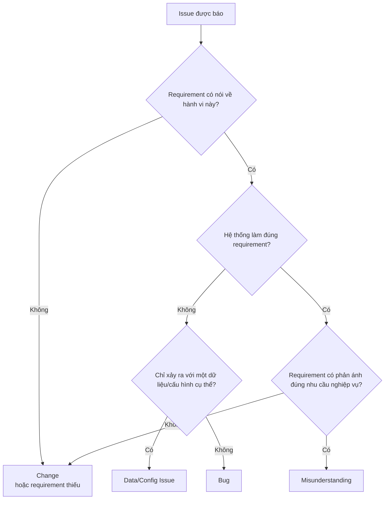
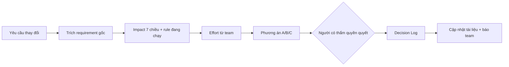

# Tuần 7 — Delivery & Senior: từ Refinement đến Go-live và ra quyết định

Sáu tuần đầu bạn học cách tìm đúng vấn đề và viết requirement đúng. Tuần 7 trả lời câu hỏi khó hơn: requirement đã viết xong thì làm sao để nó **đi tới production an toàn**, và khi mọi thứ thay đổi giữa chừng thì ai quyết, quyết dựa vào đâu. Năm ngày đầu là Delivery (Refinement, hỗ trợ Dev/QC, Change Request, UAT, Release). Hai ngày cuối là kỹ năng Senior: xử lý xung đột, ra quyết định, quản lý rủi ro và nói chuyện với BOD. Bạn là QC Manager, nên nhiều thứ trong tuần này bạn đã từng thấy từ phía QC — tuần này bạn nhìn lại chúng từ ghế của người chịu trách nhiệm về requirement và về giá trị.

| Day | Topic | Deliverable |
|---|---|---|
| 43 | Backlog Refinement, Sprint Planning, Estimation | Refinement Pack cho 3 story + câu hỏi mở |
| 44 | Development Support, QC Support, Bug Triage | Triage Log 12 issue có phân loại và hành động |
| 45 | Requirement Change, Change Request, Impact Analysis | Impact Analysis + Decision Log cho 1 Change Request |
| 46 | UAT: kế hoạch, UAT Scenario, quản lý UAT, sign-off | UAT Plan + 8 UAT Scenario + biên bản sign-off |
| 47 | Release Checklist, Go-live, Rollback, Monitoring, Post-release Review | Release Checklist + Rollback Plan + Monitoring Plan |
| 48 | Stakeholder/Requirement Conflict, Scope Creep, Trade-off, Decision Making | Decision Record cho 1 xung đột thật |
| 49 | Risk & Dependency, Facilitation, Negotiation, Presentation, Executive Communication (+ review tuần 7) | Risk & Dependency Register + Executive Summary 1 trang |

---

## Day 43 - Backlog Refinement, Sprint Planning, Estimation

> P9 Delivery · Middle · Thời lượng ~60–90 phút · Deliverable: Refinement Pack cho 3 story (story đã chuẩn hoá, câu hỏi mở, dependency, đề xuất tách/không tách)

### Mục tiêu

- Chuẩn bị một buổi Backlog Refinement – Làm mịn backlog sao cho team hiểu cùng một nghĩa và ước lượng được.
- Phân biệt việc của BA/PO và việc của team Dev/QC trong Estimation – Ước lượng.
- Biết khi nào một story chưa đủ "Ready" để đưa vào Sprint Planning – Lập kế hoạch sprint.
- Phát hiện các phần việc ẩn làm vỡ estimate: rule đang chạy, regression, dữ liệu cũ, dependency.

### Kiến thức cần học

**Backlog Refinement** là hoạt động liên tục, không phải một cuộc họp. Mục tiêu: mỗi item ở đầu backlog đạt Definition of Ready (DoR – Điều kiện sẵn sàng, đã học Day 21). Cuộc họp refinement chỉ là nơi chốt lại những gì BA/PO đã chuẩn bị trước.

Một buổi refinement tốt đi qua 5 câu hỏi theo thứ tự:

| # | Câu hỏi | Ai trả lời chính |
|---|---|---|
| 1 | Why — vấn đề gì, đo bằng gì? | PO |
| 2 | Flow — người dùng/hệ thống đi qua những bước nào? | BA |
| 3 | Rule — Business Rule – Quy tắc nghiệp vụ nào áp dụng, tham số bao nhiêu? | BA |
| 4 | AC — Acceptance Criteria – Tiêu chí chấp nhận nào để biết xong? | BA + QC |
| 5 | Dependency & Impact — đụng tới hệ thống, team, dữ liệu nào? | Dev/Tech Lead + BA |

**Sprint Planning** trả lời hai câu: sprint này làm gì (Sprint Goal – Mục tiêu sprint) và làm thế nào. PO mang vào danh sách ưu tiên. Team quyết định nhận bao nhiêu. PO không ép số lượng.

**Estimation** có ba kiểu phổ biến:

| Kiểu | Đơn vị | Dùng khi |
|---|---|---|
| Story Point | Điểm tương đối (1, 2, 3, 5, 8, 13) | Team Scrum ổn định, có lịch sử velocity |
| T-shirt size | S / M / L / XL | Ước lượng sớm ở mức epic, roadmap |
| Giờ/ngày công | Giờ | Task kỹ thuật, team cần commit theo thời gian |

Story Point đo **độ phức tạp + khối lượng + độ không chắc chắn**, không đo giờ. Một story 13 điểm thường là tín hiệu "chưa hiểu đủ" hơn là "rất nhiều việc".

**Spike** – Nhiệm vụ khảo sát: một task có giới hạn thời gian để giảm không chắc chắn (VD: "đọc API Supplier X trong 1 ngày để biết có hỗ trợ callback không"). Spike ra kết luận, không ra tính năng.

**Vai trò BA/PO trong estimation:** BA/PO **không** đưa ra con số. BA/PO làm cho con số đáng tin bằng cách loại bớt không chắc chắn: rule rõ, edge case đã liệt kê, dependency đã gọi tên.

### BA/PO sử dụng kiến thức này khi nào?

- 2–3 ngày trước refinement: rà story ở đầu backlog theo DoR, gửi trước cho Dev/QC đọc.
- Trong refinement: điều phối 5 câu hỏi, ghi câu hỏi mở, tách story khi team nói "to quá".
- Trong Sprint Planning: PO trình bày Sprint Goal và thứ tự ưu tiên; BA trả lời câu hỏi chi tiết.
- Khi estimate chênh lệch lớn giữa các thành viên (một người 3 điểm, một người 13 điểm): đó là tín hiệu có hiểu lầm requirement, BA phải làm rõ ngay.

### Quy trình thực hiện

**Step 1 — Chọn story đầu backlog.** Lấy 3–5 story PO xếp ưu tiên cao nhất cho 1–2 sprint tới.

**Step 2 — Tự chấm DoR.** Mỗi story: có Why, có flow, có rule kèm tham số, có AC dạng Given/When/Then, có data/API/UI impact, có dependency. Thiếu mục nào ghi "Câu hỏi mở".

**Step 3 — Rà phần việc ẩn.** Bốn nguồn hay bị bỏ sót:
1. Rule **đang chạy** có thể chặn rule mới.
2. Regression – Kiểm thử hồi quy ở các kênh/luồng không đổi.
3. Dữ liệu cũ đang tồn tại (record tạo trước khi tính năng bật).
4. Team khác phải làm phần của họ.

**Step 4 — Gửi pre-read.** Gửi Refinement Pack trước 24h. Ghi rõ "câu hỏi cần team trả lời".

**Step 5 — Điều phối buổi refinement.** Đi theo 5 câu hỏi. Mỗi story tối đa 15 phút. Quá giờ thì đưa vào Spike hoặc họp riêng.

**Step 6 — Tách story nếu cần.** Dùng kỹ thuật đã học Day 19: theo luồng, theo rule, theo kênh, theo happy/exception.

**Step 7 — Ghi kết quả.** Story nào Ready, story nào chưa và vì sao, ai trả lời câu hỏi mở, hạn khi nào.

### Ví dụ thực tế

Pain point số 2 của Physical Gift: Supplier không confirm Sub-order trong SLA → Order treo. PO đưa epic: "Tự động xử lý Sub-order quá SLA".

Bản nháp ban đầu chỉ có 1 story: "Là Ops, tôi muốn hệ thống tự xử lý Sub-order quá SLA để Order không bị treo." Team estimate: một người 5, một người 13. Chênh lệch này cho thấy mỗi người hiểu "tự xử lý" khác nhau.

BA chuẩn bị lại Refinement Pack:

| Story | Nội dung | Rule | Câu hỏi mở | Dependency |
|---|---|---|---|---|
| S1 | Hệ thống phát hiện Sub-order ở `SENT_TO_SUPPLIER` quá `confirm_sla_minutes` và cảnh báo Ops | BR: Quá `confirm_sla_minutes` tính từ `sent_at` mà chưa có `confirmed_at` → tạo cảnh báo | Job quét mỗi bao nhiêu phút? [Giả định bài tập: 5 phút] | Không |
| S2 | Ops chuyển Sub-order quá SLA sang Supplier khác có cùng SKU | Chỉ chọn Supplier trong `supplier_sku` có `is_active` = true và `inventory.available_qty` ≥ qty | Supplier cũ confirm muộn sau khi đã chuyển thì sao? | Đối soát Supplier (pain point 5) |
| S3 | Sub-order quá SLA và không có Supplier thay thế → Ops huỷ, Order tính lại trạng thái tổng hợp | Order.status là trạng thái tổng hợp từ các Sub-order | Client có nhận webhook `order.status_changed` khi một Sub-order bị huỷ không? | Client webhook |

Câu hỏi "Supplier cũ confirm muộn" là phần việc ẩn lớn nhất. Nếu không hỏi, Dev estimate S2 là 3 điểm, sau đó phát hiện cần xử lý callback trễ, huỷ Sub-order cũ với Supplier, và đối soát hai Supplier — thành 8 điểm giữa sprint.

AC mẫu cho S1:

```gherkin
Given Sub-order SO-1 có status = SENT_TO_SUPPLIER
  And supplier.confirm_sla_minutes = 60
  And sent_at = 09:00, confirmed_at rỗng
When job quét chạy lúc 10:01
Then hệ thống tạo 1 cảnh báo cho Ops với sub_order_id = SO-1
  And Sub-order SO-1 giữ nguyên status = SENT_TO_SUPPLIER
  And audit_log ghi action = "SLA_BREACH_ALERT", actor = "system"
```

Dòng "giữ nguyên status" rất quan trọng. Junior thường để trống, Dev tự hiểu là chuyển sang trạng thái mới, trong khi danh sách trạng thái chuẩn không có trạng thái "quá SLA".

#### Ví dụ từ dự án thật: Slide to Use

Scope của Slide to Use được viết **theo từng kênh**: Voucher Link E và App ví quà thay đổi; Link V mono chưa auto convert thay đổi; Link V mono auto convert giữ nguyên; Link V multi thay đổi; API kiểm tra trạng thái, POS, Đối soát, Report thay đổi; Nhắn tin đổi code giữ nguyên.

Cách viết này giúp refinement theo hai hướng:
- **Tách story theo kênh** là tự nhiên: mỗi kênh "thay đổi" có thể là một story hoặc một nhóm story.
- **Kênh "giữ nguyên" vẫn tốn effort.** NFR-4 yêu cầu các kênh giữ nguyên không đổi hành vi và QC chạy regression từng kênh. Nếu refinement chỉ estimate kênh thay đổi, phần regression bị bỏ khỏi estimate.

[Giả định bài tập] Trong refinement, bạn nên tạo task riêng "Regression Link V mono auto convert" và "Regression Nhắn tin đổi code" để effort này hiện ra trên board.

#### Ví dụ từ dự án thật: Promotion Code

Vòng rà soát 18/09/2026 phát hiện User Guide ghi "số lượng phân bổ không được lớn hơn Khả dụng", trong khi over-issue cần phát nhiều lượt hơn số mã. Việc nới rule cũ **chưa có trong estimate**. Đây là đúng loại "phần việc ẩn số 1" ở Step 3: rule đang chạy chặn rule mới. Day 45 sẽ phân tích kỹ hơn.

### Junior vs Middle vs Senior

Tình huống: team estimate story S2 (chuyển Supplier) chênh nhau 3 điểm và 13 điểm.

| Junior | Middle | Senior |
|---|---|---|
| Lấy trung bình, ghi 8 điểm cho xong | Hỏi người cho 13 điểm lý do, phát hiện ca Supplier cũ confirm muộn, ghi câu hỏi mở | Hỏi lý do, rồi đề xuất tách: S2a chuyển Supplier (happy path), S2b xử lý callback trễ từ Supplier cũ; đưa S2b vào Spike nếu chưa biết API Supplier có hỗ trợ huỷ |
| Nghĩ estimate là việc của Dev | Biết BA làm rõ để estimate chính xác | Biết estimate chênh là dữ liệu: nó chỉ ra phần requirement mơ hồ |
| Đưa story vào sprint dù còn câu hỏi mở | Không đưa story chưa Ready | Đưa phần đã Ready vào sprint, phần chưa Ready có owner và hạn trả lời trước sprint sau |

### Sai lầm thường gặp

1. **Refinement không có pre-read.** Team nghe story lần đầu trong phòng họp, nên chỉ hỏi câu bề mặt.
2. **BA trả lời "để em hỏi lại" cho mọi câu.** Một hai câu là bình thường. Mười câu nghĩa là BA chưa chuẩn bị.
3. **Ép team giảm estimate.** PO nói "cái này đơn giản mà, 3 điểm thôi". Estimate thấp giả tạo sẽ trả giá bằng sprint thất bại.
4. **Bỏ regression và dữ liệu cũ khỏi estimate.**
5. **Story có chữ "tự xử lý", "hợp lý", "kịp thời"** mà không có rule, tham số, trạng thái đích.
6. **Sprint Goal là danh sách ticket.** Sprint Goal phải là một kết quả: "Ops được cảnh báo khi Sub-order quá SLA", không phải "làm S1, S2, S3".

### Góc nhìn Senior BA/PO

Senior không đo chất lượng refinement bằng số story được estimate. Senior đo bằng **số câu hỏi phát sinh giữa sprint**. Mỗi câu hỏi giữa sprint là một câu lẽ ra phải hỏi trong refinement.

Senior cũng dùng refinement để bảo vệ team. Khi PO hoặc stakeholder muốn nhét thêm việc, Senior đặt câu hỏi: "Sprint Goal hiện tại là X. Việc mới này phục vụ X hay một mục tiêu khác? Nếu khác, ta bỏ gì ra?".

Với QC Manager chuyển sang BA/PO: bạn có lợi thế lớn. Bạn biết QC cần gì để viết expected result. Hãy dùng chính câu hỏi đó làm bộ lọc DoR: "QC đọc story này có viết được expected result không?". Ví dụ thật: OI-S16 của Slide to Use (quy tắc tự chia mệnh giá chưa chốt) được ghi rõ "chưa có rule thì QC không viết được expected result" — story phụ thuộc OI-S16 chưa Ready.

### Bài tập thực hành

**Đầu vào:** Pain point 3 của Physical Gift — giao thất bại, Ops re-delivery thủ công qua Excel. PO đưa 1 story nháp:

> "Là Ops, tôi muốn re-delivery trên hệ thống thay vì Excel để tiết kiệm thời gian."

Thông tin thêm [Giả định bài tập]:
- Delivery Service gửi webhook `shipment.status_changed` với status `DELIVERY_FAILED` và `failed_reason`.
- Ops muốn giới hạn tối đa 3 lần giao.
- Client muốn biết khi Re-delivery xảy ra.
- Sprint còn 20 điểm capacity.

**Yêu cầu đầu ra:**
1. Tách thành 3–4 story, mỗi story có 1 AC dạng Given/When/Then.
2. Liệt kê ít nhất 4 câu hỏi mở, mỗi câu ghi owner.
3. Liệt kê phần việc ẩn (rule đang chạy, regression, dữ liệu cũ, dependency).
4. Đề xuất Sprint Goal một câu.

### Lời giải tham khảo

**Tách story:**

| Story | Nội dung | AC chính |
|---|---|---|
| R1 | Hiển thị danh sách Shipment `DELIVERY_FAILED` cho Ops, có `failed_reason`, `attempt_no` | Given shipment có status = DELIVERY_FAILED, When Ops mở màn Re-delivery, Then thấy shipment đó với attempt_no và failed_reason |
| R2 | Ops tạo Re-delivery → tạo shipment mới với `attempt_no` + 1 | Given shipment attempt_no = 1 status DELIVERY_FAILED, When Ops bấm Re-delivery, Then tạo shipment attempt_no = 2 và ghi audit_log |
| R3 | Chặn Re-delivery khi đã đủ số lần tối đa | Given attempt_no = 3 và status DELIVERY_FAILED, When Ops bấm Re-delivery, Then hệ thống từ chối với thông báo "Đã đạt tối đa 3 lần giao" và gợi ý chuyển RETURNED |
| R4 | Gửi webhook cho Client khi tạo Re-delivery | Given Client có cấu hình webhook, When R2 thành công, Then gửi `order.status_changed` [câu hỏi mở: có cần event riêng không] |

**Tại sao tách như vậy:** R1 và R2 tạo giá trị ngay (bỏ Excel). R3 là rule riêng, test riêng. R4 dính dependency với Client nên tách để không chặn R1–R3.

**Câu hỏi mở:**
1. Số lần giao tối đa 3 là tính cả lần đầu hay chỉ Re-delivery? — Owner: Ops Lead.
2. Re-delivery có phát sinh phí vận chuyển cần đối soát không? — Owner: Kế toán.
3. Đổi địa chỉ khi Re-delivery có được không? Nếu có, đụng pain point 4 (sửa Order). — Owner: PO.
4. Client cần event riêng hay dùng `order.status_changed`? — Owner: Sales/AM hỏi Client.

**Phần việc ẩn Junior hay bỏ sót:**
- Shipment đang `DELIVERY_FAILED` nằm sẵn trong hệ thống trước khi tính năng bật, đang được theo dõi trong Excel. Cần quyết định: nhập lại hay chỉ áp cho shipment mới.
- Báo cáo đối soát Supplier/Client hiện tính theo shipment nào? Thêm shipment mới có làm lệch không.
- Regression luồng webhook từ Delivery Service.

**Sprint Goal:** "Ops xử lý Re-delivery trên hệ thống, không còn dùng Excel, với giới hạn số lần giao được kiểm soát." R1–R3 vào sprint; R4 chờ trả lời câu hỏi 4.

### Checklist hoàn thành

- [ ] Tôi hiểu khái niệm.
- [ ] Tôi tự làm được bài tập.
- [ ] Tôi giải thích được cho Developer/QC.
- [ ] Tôi có thể viết thành Requirement/artifact.
- [ ] Tôi phân biệt được việc của BA/PO và việc của team trong Estimation.
- [ ] Tôi liệt kê được 4 nguồn phần việc ẩn và kiểm từng nguồn trước refinement.
- [ ] Tôi viết được Sprint Goal là một kết quả, không phải danh sách ticket.

---

## Day 44 - Development Support, QC Support, Bug Triage

> P9 Delivery · Middle · Thời lượng ~60–90 phút · Deliverable: Triage Log 12 issue (phân loại, mức độ, owner, hành động, cập nhật requirement nếu cần)

### Mục tiêu

- Biết BA/PO hỗ trợ Dev trong sprint thế nào mà không thành "người thiết kế kỹ thuật".
- Phân biệt rõ **BA hỗ trợ QC** với **QC tự làm** — điểm dễ lẫn nhất với người đi lên từ QC.
- Chủ trì Bug Triage – Phân loại lỗi: tách issue thành Bug / Change / Misunderstanding / Data-Config Issue.
- Biết khi nào kết quả triage phải dẫn tới việc sửa requirement.

### Kiến thức cần học

**Development Support** — trong sprint, Dev sẽ hỏi. Câu hỏi thuộc 3 loại:

| Loại câu hỏi | Ví dụ | BA/PO làm gì |
|---|---|---|
| Làm rõ requirement | "Quá SLA tính từ `sent_at` hay `created_at`?" | Trả lời có căn cứ, **cập nhật lại tài liệu**, không chỉ trả lời trên chat |
| Requirement thiếu | "Supplier confirm muộn sau khi đã chuyển thì sao?" | Ghi câu hỏi mở, hỏi người có thẩm quyền, đánh giá có phải Change không |
| Câu hỏi kỹ thuật | "Dùng queue hay cron cho job quét?" | Không quyết. Nêu ràng buộc nghiệp vụ (VD: cảnh báo trễ tối đa bao nhiêu phút), để Tech Lead chọn |

Nguyên tắc: **câu trả lời nằm trên chat là câu trả lời sẽ mất.** Mọi làm rõ phải quay về tài liệu requirement hoặc ticket.

**QC Support — BA hỗ trợ QC khác QC tự làm thế nào:**

| Việc | QC tự làm | BA/PO hỗ trợ |
|---|---|---|
| Viết test case | QC thiết kế TC, kỹ thuật test (boundary, equivalence, pairwise) | BA đảm bảo mỗi rule có tham số, mỗi AC có expected result để QC trace được |
| Expected result | QC viết theo spec | BA là nguồn sự thật khi spec không nói rõ; BA trả lời "đúng nghiệp vụ là gì" |
| Test data | QC chuẩn bị data | BA chỉ ra **data thật có hình dạng gì** (VD: Supplier MANUAL, Program PAUSED, dữ liệu tạo trước khi bật tính năng) |
| Regression scope | QC quyết định bộ regression | BA liệt kê **luồng/kênh nào bị đụng và luồng nào cam kết giữ nguyên** |
| Kết luận lỗi | QC báo "kết quả khác expected" | BA/PO quyết "khác expected là lỗi code, lỗi spec, hay spec chưa nói" |

Bạn từng là QC Manager. Cạm bẫy lớn nhất: bạn sẽ muốn tự viết TC, tự chạy test. Đừng. Việc của bạn bây giờ là làm cho **nguồn sự thật** rõ đến mức QC không cần đoán.

**Bug Triage** — mỗi issue QC/UAT/Ops báo lên phải được phân loại trước khi giao cho Dev:

| Loại | Định nghĩa | Dấu hiệu | Ai xử lý |
|---|---|---|---|
| Bug | Hệ thống làm khác requirement đã chốt | Có rule/AC rõ, hệ thống vi phạm | Dev sửa, QC retest |
| Change | Hệ thống làm đúng requirement, nhưng người báo muốn khác | "Như này cũng được nhưng nên…", hoặc ca chưa có trong spec | BA/PO đánh giá → Change Request (Day 45) hoặc backlog |
| Misunderstanding | Người báo hiểu sai requirement hoặc hành vi đúng | Requirement rõ, hệ thống đúng, người báo kỳ vọng khác | BA giải thích, đóng issue; nếu nhiều người cùng hiểu sai → cải thiện UI/tài liệu |
| Data/Config Issue | Code đúng, dữ liệu hoặc cấu hình sai | Chỉ xảy ra với một Program/Supplier/môi trường | Ops/Admin sửa config, có thể cần script dữ liệu |

Thêm 2 nhãn phụ: **Duplicate** (trùng issue khác) và **Cannot Reproduce** (không tái hiện được — cần thêm thông tin).

**Severity – Mức độ nghiêm trọng** (tác động hệ thống) khác **Priority – Độ ưu tiên** (thứ tự sửa). Lỗi lệch 1 pixel ở trang chủ: Severity thấp, Priority có thể cao. Lỗi sai số tiền đối soát cuối tháng: Severity cao, Priority cao trước kỳ đối soát.

### BA/PO sử dụng kiến thức này khi nào?

- Hằng ngày trong sprint: trả lời câu hỏi Dev/QC trong vòng [Giả định bài tập: 4 giờ làm việc].
- Buổi triage định kỳ (hằng ngày trong giai đoạn test, 15–30 phút) với QC Lead + Tech Lead.
- Khi UAT và sau go-live: issue từ business/Ops/CS cũng đi qua cùng một cửa triage.

### Quy trình thực hiện

**Step 1 — Gom issue vào một nơi.** Không triage trên chat. Mỗi issue có: bước tái hiện, expected, actual, môi trường, dữ liệu.

**Step 2 — Tìm nguồn sự thật.** Với mỗi issue, mở requirement: rule nào, AC nào nói về hành vi này?

**Step 3 — Phân loại theo cây quyết định:**



Nhánh cuối là chỗ Senior khác Junior: hệ thống đúng spec nhưng spec sai nhu cầu thì **không phải Misunderstanding** của người báo — đó là lỗi requirement, xử lý như Change.

**Step 4 — Gán Severity, Priority, owner, hành động.**

**Step 5 — Cập nhật requirement nếu cần.** Mọi Change và mọi Bug do spec mơ hồ đều phải sửa tài liệu, ghi version.

**Step 6 — Theo dõi xu hướng.** Nhiều Misunderstanding cùng một chỗ = UI hoặc tài liệu có vấn đề. Nhiều Data/Config Issue = thiếu validation khi cấu hình.

### Ví dụ thực tế

Physical Gift, giai đoạn test tính năng cảnh báo Sub-order quá SLA (Day 43). QC báo 5 issue:

| # | Issue | Phân loại | Lý do | Hành động |
|---|---|---|---|---|
| 1 | Sub-order quá SLA 61 phút, `confirm_sla_minutes` = 60, không có cảnh báo | Bug | AC S1 nói rõ phải cảnh báo | Dev sửa, Severity cao |
| 2 | Supplier "ABC" không bao giờ có cảnh báo dù quá SLA | Data/Config Issue | Supplier ABC có `integration_type` = MANUAL, `confirm_sla_minutes` để trống | Admin bổ sung config; BA thêm rule: Supplier ACTIVE bắt buộc có `confirm_sla_minutes` |
| 3 | Sub-order `SUPPLIER_REJECTED` vẫn hiện trong danh sách quá SLA | Bug | Rule chỉ áp cho `SENT_TO_SUPPLIER` | Dev sửa |
| 4 | Ops muốn cảnh báo qua email, hiện chỉ có trên màn hình | Change | Requirement chỉ nói "tạo cảnh báo cho Ops" | PO đánh giá, đưa vào backlog |
| 5 | QC kỳ vọng Sub-order chuyển trạng thái khi quá SLA | Misunderstanding | AC ghi rõ "giữ nguyên status = SENT_TO_SUPPLIER" | BA giải thích, đóng |

Issue 2 thú vị nhất. Code đúng. Nhưng nếu dừng ở "Admin sửa config" thì tháng sau Supplier mới lại lỗi tương tự. BA thêm rule validation để chặn từ gốc — đây là biến một Data/Config Issue thành cải tiến requirement.

Issue 4 cũng phải ghi rõ: "requirement chỉ nói tạo cảnh báo" là **mơ hồ về kênh**. Junior đóng là Change rồi thôi. Middle ghi thêm vào lesson learned: lần sau, requirement cảnh báo phải nêu kênh (màn hình / email / chat), người nhận, độ trễ tối đa.

#### Ví dụ từ dự án thật: Slide to Use

Slide to Use có hai NFR là đầu vào trực tiếp cho QC Support và triage:

- **NFR-4:** các kênh giữ nguyên không đổi hành vi, QC chạy regression từng kênh. BA hỗ trợ QC bằng **danh sách kênh giữ nguyên rõ ràng**: Link V mono auto convert, Nhắn tin đổi code. Danh sách này đến từ bảng scope theo kênh. QC tự quyết bộ test regression trong mỗi kênh.
- **NFR-1:** trượt nhiều lần hoặc trên hai thiết bị cùng lúc chỉ ra một kết quả và rút tối đa một code. Đây là NFR cụ thể đến mức QC có expected result rõ.

[Giả định bài tập] Giả sử QC báo: "Trượt đồng thời trên 2 điện thoại, cả hai màn hình đều hiện cùng một code 3rd." Phân loại thế nào? Đối chiếu NFR-1: "chỉ ra một kết quả và rút tối đa một code". Cả hai thiết bị hiện **cùng một** code → chỉ rút một code → **không vi phạm NFR-1**. Nếu hai màn hình hiện **hai code khác nhau** → rút hai code → Bug, Severity cao vì Công ty trả tiền cho code không dùng (với nguồn cấp theo lượt). Câu hỏi còn lại "hiện cùng code trên hai thiết bị có chấp nhận được không" là câu hỏi nghiệp vụ, đưa PO quyết — nếu không chấp nhận thì là Change, không phải Bug.

Một ví dụ khác: [Giả định bài tập] UAT báo "Brand Chỉ code 3rd, trượt khi hết code, App báo tạm hết mã nhưng voucher đã bị tính redeem". Theo TO-BE, đây là **hành vi đúng thiết kế** (ghi redeem lúc tách). Nhưng OI-S15 (hết kho kéo dài, voucher tới hạn: gia hạn, hoàn hay để hết hạn?) đang mở. Phân loại: không phải Bug; là câu hỏi requirement chưa đóng → gắn vào OI-S15, không giao Dev.

### Junior vs Middle vs Senior

Tình huống: QC báo "Supplier ABC không có cảnh báo quá SLA" (issue 2).

| Junior | Middle | Senior |
|---|---|---|
| Chuyển cho Dev vì "tính năng không chạy" | Kiểm dữ liệu, thấy `confirm_sla_minutes` trống, phân loại Data/Config, nhờ Admin sửa | Phân loại Data/Config, nhờ Admin sửa, **đồng thời** thêm validation vào requirement, kiểm còn bao nhiêu Supplier ACTIVE khác đang trống field này (SQL Day 26) |
| Trả lời QC trên chat | Ghi kết luận vào ticket | Ghi kết luận vào ticket và cập nhật Data Dictionary: field bắt buộc khi nào |
| Không nghĩ tới production | Nghĩ tới môi trường test | Hỏi: trên production có Supplier nào như vậy không — nếu có, go-live ngày đầu sẽ có Sub-order không bao giờ được cảnh báo |

### Sai lầm thường gặp

1. **BA tự viết test case thay QC** vì "mình làm nhanh hơn". Kết quả: BA và QC cùng dựa trên cách hiểu của BA, mất lớp kiểm tra độc lập.
2. **Gán mọi issue là Bug.** Dev sửa cả Change mà không qua đánh giá → scope phình không ai kiểm soát.
3. **Đóng Misunderstanding mà không hỏi "vì sao người báo hiểu sai".** Nếu 3 người cùng hiểu sai, lỗi ở tài liệu hoặc UI.
4. **Trả lời câu hỏi Dev trên chat, không cập nhật spec.** Hai tuần sau QC test theo spec cũ.
5. **Nhầm Severity với Priority.**
6. **Triage một mình.** Triage cần ít nhất QC (biết hiện tượng) + Dev/Tech Lead (biết nguyên nhân) + BA/PO (biết requirement).

### Góc nhìn Senior BA/PO

Senior coi Triage Log là **dữ liệu chất lượng requirement**. Cuối sprint, Senior đếm: bao nhiêu issue là "Change do requirement thiếu", bao nhiêu là "Bug do spec mơ hồ". Nếu con số này cao, vấn đề nằm ở refinement, không phải ở Dev hay QC.

Với người đi lên từ QC: bạn quen hỏi "hệ thống có đúng spec không". Câu hỏi mới của bạn là "**spec có đúng nhu cầu không**". Nhánh cuối của cây quyết định là chỗ bạn tạo giá trị khác với QC.

Senior cũng giữ ranh giới với Dev: không chỉ định giải pháp kỹ thuật. Thay vì "dùng lock trong DB", Senior viết ràng buộc kiểm thử được: "hai yêu cầu đồng thời trên cùng voucher chỉ rút tối đa một code" — đúng như cách NFR-1 của Slide to Use được viết.

### Bài tập thực hành

**Đầu vào:** Tính năng Re-delivery (Day 43) đang ở giai đoạn test. Requirement đã chốt: R1–R3, tối đa 3 lần giao (tính cả lần đầu), mỗi lần Re-delivery tạo shipment mới `attempt_no` + 1, ghi `audit_log`. Có 12 issue [Giả định bài tập]:

1. Bấm Re-delivery 2 lần liên tiếp tạo 2 shipment mới.
2. Shipment `attempt_no` = 3, `DELIVERY_FAILED`, vẫn bấm được Re-delivery.
3. Ops muốn sửa địa chỉ khi Re-delivery.
4. Danh sách Re-delivery không có shipment của Program "Tết 2026".
5. Ops nói "Re-delivery xong phải tự gửi lại cho Supplier" — hệ thống không gửi.
6. `audit_log` không ghi `actor`.
7. Màn hình hiển thị `failed_reason` dạng mã "ADDR_NF", Ops không hiểu.
8. Shipment `RETURNED` vẫn hiện trong danh sách Re-delivery.
9. QC kỳ vọng Order chuyển về `CONFIRMED` khi Re-delivery.
10. Môi trường UAT không nhận webhook từ Delivery Service.
11. CS muốn xem lịch sử Re-delivery.
12. Issue 1 được báo lại bởi một QC khác.

Ghi chú: Program "Tết 2026" có `status` = ENDED. Requirement R1 không nói gì về Program ENDED. Requirement không nói Re-delivery có gửi lại cho Supplier.

**Yêu cầu đầu ra:** Triage Log gồm: #, Phân loại, Severity (Cao/Trung bình/Thấp), Owner, Hành động, Có cần sửa requirement không.

### Lời giải tham khảo

| # | Phân loại | Severity | Owner | Hành động | Sửa requirement? |
|---|---|---|---|---|---|
| 1 | Bug | Cao | Dev | Chặn tạo trùng (double-click, idempotency – Day 31) | Có: thêm NFR "một thao tác Re-delivery chỉ tạo một shipment" |
| 2 | Bug | Cao | Dev | Vi phạm R3 | Không |
| 3 | Change | Trung bình | PO | Đánh giá; đụng pain point 4 | Có thể (backlog) |
| 4 | Change (requirement thiếu) | Trung bình | PO + Ops | Quyết: Program ENDED có Re-delivery không | Có |
| 5 | Change (requirement thiếu) | Cao | PO + Tech Lead | Hỏi quy trình thật: ai bàn giao lại hàng cho Delivery Service | Có |
| 6 | Bug | Trung bình | Dev | `actor` là field bắt buộc của `audit_log` | Không |
| 7 | Change | Thấp | BA + Design | Map mã → mô tả tiếng Việt | Có: thêm bảng mapping `failed_reason` |
| 8 | Bug | Cao | Dev | `RETURNED` là trạng thái kết thúc, không Re-delivery | Có thể: ghi rõ điều kiện lọc |
| 9 | Misunderstanding | Thấp | BA | Order.status là tổng hợp từ Sub-order; Re-delivery thuộc shipment | Không, nhưng bổ sung ghi chú vào spec |
| 10 | Data/Config Issue | Cao (chặn test) | DevOps | Cấu hình webhook UAT | Không |
| 11 | Change | Thấp | PO | Backlog | Có thể |
| 12 | Duplicate | — | QC | Link về #1, đóng | Không |

**Tại sao:**
- **#4 không phải Bug.** Hệ thống không hiện shipment của Program ENDED — có thể do Dev tự lọc. Requirement không nói, nên không ai sai theo spec. Nhưng nghiệp vụ thật: quà đã đặt trong lúc Program ACTIVE vẫn phải giao. Đây là requirement thiếu.
- **#5 là issue nguy hiểm nhất.** Nếu Re-delivery chỉ tạo bản ghi mà không ai thật sự giao lại hàng, hệ thống báo "đã xử lý" trong khi Recipient không nhận quà. Junior xếp Thấp vì "chỉ là thêm tính năng".
- **#8 Junior hay xếp Misunderstanding.** Requirement R1 lọc `DELIVERY_FAILED`; shipment `RETURNED` xuất hiện nghĩa là bộ lọc sai → Bug.
- **#9** là ví dụ đúng Misunderstanding: requirement rõ, hệ thống đúng. Vẫn nên thêm một câu vào spec vì QC đã hiểu sai một lần.

Junior hay bỏ sót: cột "Có cần sửa requirement không". 6/12 issue dẫn tới sửa tài liệu — đó là phần việc của BA sau triage.

### Checklist hoàn thành

- [ ] Tôi hiểu khái niệm.
- [ ] Tôi tự làm được bài tập.
- [ ] Tôi giải thích được cho Developer/QC.
- [ ] Tôi có thể viết thành Requirement/artifact.
- [ ] Tôi phân biệt được việc BA hỗ trợ QC và việc QC tự làm.
- [ ] Tôi phân loại được Bug / Change / Misunderstanding / Data-Config Issue bằng cây quyết định.
- [ ] Tôi biết nhánh "đúng spec nhưng spec sai nhu cầu" phải xử lý như Change.

---

## Day 45 - Requirement Change, Change Request, Impact Analysis

> P9 Delivery · Middle → Senior · Thời lượng ~60–90 phút · Deliverable: Impact Analysis (UI/API/DB/Report/Process/Test/Doc) + Decision Log cho 1 Change Request

### Mục tiêu

- Phân biệt Requirement Change – Thay đổi yêu cầu được kiểm soát với thay đổi tự phát.
- Viết Change Request (CR – Yêu cầu thay đổi) đủ để người có thẩm quyền quyết.
- Làm Impact Analysis – Phân tích tác động trên 7 chiều, **gồm cả rule đang chạy**.
- Ghi Decision Log – Nhật ký quyết định để không ai phải hỏi lại "sao lại thế này?".

### Kiến thức cần học

**Thay đổi là bình thường.** Vấn đề không phải thay đổi, mà là thay đổi không ai biết tác động. Agile chấp nhận thay đổi, nhưng không chấp nhận thay đổi không có chi phí được nói ra.

**Khi nào cần CR chính thức:**

| Tình huống | Cần CR? |
|---|---|
| Làm rõ câu chữ, không đổi hành vi | Không, cập nhật tài liệu + version |
| Đổi hành vi của story chưa vào sprint | Không cần CR nặng, PO cập nhật backlog, ghi Decision Log |
| Đổi hành vi của story đang làm hoặc đã xong | Có |
| Đổi scope đã cam kết với stakeholder (kênh, phase, ngày) | Có |
| Đổi rule ảnh hưởng tiền, doanh thu, đối soát | Có, kể cả khi story chưa làm |

**Cấu trúc một CR:**

| Mục | Nội dung |
|---|---|
| Người đề xuất, ngày | |
| Mô tả thay đổi | AS-IS requirement → TO-BE requirement (trích rule/AC cụ thể) |
| Lý do | Vấn đề gì mới được phát hiện |
| Impact Analysis | 7 chiều bên dưới |
| Phương án | Ít nhất 2: làm ngay / làm phase sau / không làm |
| Effort & lịch | Do team ước lượng |
| Người quyết | Một người, có thẩm quyền |
| Kết luận | Ngày, quyết định, rule liên quan |

**Impact Analysis — 7 chiều:**

| Chiều | Câu hỏi |
|---|---|
| UI | Màn hình, câu chữ, trạng thái hiển thị nào đổi? Mockup nào phải làm lại? |
| API | Request/response, error code, webhook nào đổi? Client bên ngoài có phải sửa không? |
| DB / Data | Field, trạng thái, bảng mới? **Dữ liệu đang có xử lý thế nào?** |
| Report / Đối soát | Số liệu báo cáo, doanh thu, đối soát có lệch không? |
| Process | Quy trình Ops/CS/Kế toán có đổi không? Ai cần đào tạo? |
| Test | TC nào phải sửa, regression nào phải chạy thêm? |
| Doc | BRD, FS, ADR, Open Items, User Guide nào phải cập nhật? |

Chiều thứ tám ẩn: **rule đang chạy**. Một rule mới có thể bị chặn bởi một rule cũ trong hệ thống hiện tại mà không ai liệt kê.

**Decision Log** — mỗi dòng: ngày, quyết định, lý do, phương án bị loại, người quyết, rule/tài liệu bị ảnh hưởng, quyết định này thay thế quyết định nào.

### BA/PO sử dụng kiến thức này khi nào?

- Khi stakeholder nói "à, thêm cái này nữa nhé" sau khi requirement đã chốt.
- Khi triage (Day 44) ra loại Change.
- Khi Tech Lead/ADR đổi giải pháp làm đổi hành vi nghiệp vụ.
- Khi cùng một chủ đề bị quyết đi quyết lại trong thời gian ngắn — Decision Log là cách duy nhất giữ team đồng bộ.

### Quy trình thực hiện

**Step 1 — Ghi nhận và đặt tên thay đổi.** Một câu: "Đổi X thành Y vì Z".

**Step 2 — Xác định requirement gốc.** Trích rule, AC, story bị đụng. Không có requirement gốc thì đây là requirement mới, không phải change.

**Step 3 — Quét 7 chiều + rule đang chạy.** Đọc cả User Guide, cấu hình hiện hành, không chỉ BRD mới.

**Step 4 — Hỏi team ước lượng effort.** Gồm cả việc làm lại (rework) phần đã xong.

**Step 5 — Đưa phương án.** Mỗi phương án: lợi, hại, effort, rủi ro.

**Step 6 — Người có thẩm quyền quyết.** Ghi Decision Log.

**Step 7 — Lan truyền.** Cập nhật mọi tài liệu ở chiều Doc, báo Dev/QC/stakeholder, ghi version.



### Ví dụ thực tế

#### Ví dụ từ dự án thật: Slide to Use — chuỗi đổi quyết định

Đây là chuỗi thay đổi có trong tài liệu dự án:

| Ngày | Quyết định | Thay thế |
|---|---|---|
| 14/10/2026 | Chốt theo ADR: tách tại brand Cả hai thì voucher giữ "Còn dùng được", tạo bản ghi lấy mã với nhiều trạng thái | — |
| 15/10/2026 (lần 1) | Áp cho brand Chỉ code 3rd + Cả hai, dùng state 3 + bảng tạm; Link V ngoài phạm vi | 14/10 |
| 15/10/2026 (lần 2) | Brand Cả hai hết code → xoá bảng tạm **và huỷ dòng doanh thu lúc tách**; doanh thu ghi khi khách dùng mã nội bộ | Bổ sung lần 1 |
| 20/10/2026 | Họp review mockup mở rộng phạm vi sang Link V (mono chưa auto convert, multi), API trạng thái, Report | Đảo phần "Link V ngoài phạm vi" của 15/10 lần 1 |

Ba lần đổi trong hai ngày, rồi mở rộng scope sau một tuần. Tài liệu ghi mỗi lần đổi kéo theo: cập nhật ADR, 4–5 FS, mockup, open items, và một câu hỏi mới cho Kế toán (OI-S43).

Thử chạy Impact Analysis cho **thay đổi 15/10 lần 2** theo 7 chiều. Các ô có [Giả định bài tập] là suy luận học tập, không phải nội dung tài liệu:

| Chiều | Tác động |
|---|---|
| UI | [Giả định bài tập] Thông báo khi brand Cả hai hết code và chuyển sang mã nội bộ có thể cần câu chữ mới |
| API | [Giả định bài tập] API kiểm tra trạng thái phải phản ánh voucher không còn bảng tạm |
| DB / Data | Xoá bảng tạm; huỷ dòng doanh thu lúc tách (theo tài liệu). [Giả định bài tập] Cần định nghĩa "huỷ" ở mức dữ liệu |
| Report / Đối soát | Dòng doanh thu bị huỷ và ghi lại khi khách dùng mã nội bộ → báo cáo doanh thu đổi. Liên quan OI-S42 (ngày redeem cho đối soát client là ngày tách hay ngày lấy mã) |
| Process | Kế toán phải chấp nhận cách huỷ → **OI-S43: huỷ bằng đánh dấu hay bút toán đảo** |
| Test | [Giả định bài tập] TC brand Cả hai nhánh hết code phải viết lại; thêm kiểm MT-4 (không có hai dòng doanh thu) |
| Doc | ADR, 4–5 FS, mockup, open items (theo tài liệu) |

Điểm học quan trọng nhất: một thay đổi nghe như "kỹ thuật" (xoá bảng tạm) lại **chặn một nhánh chức năng** vì phụ thuộc vào quyết định của Kế toán. Impact Analysis tốt phải làm lộ ra câu hỏi đó ngay lúc đổi, không đợi đến UAT.

**Decision Log mẫu** — học theo cách bảng Open Items của dự án ghi câu đã đóng: "Đã đóng 22/10/2026: được, voucher chưa gắn brand (BR-V16)" — có ngày đóng, kết luận, rule liên quan.

| # | Ngày | Quyết định | Lý do | Phương án bị loại | Người quyết | Thay thế | Ảnh hưởng |
|---|---|---|---|---|---|---|---|
| D-03 | 15/10/2026 | Brand Cả hai hết code: xoá bảng tạm, huỷ dòng doanh thu lúc tách, ghi doanh thu khi dùng mã nội bộ | [Giả định bài tập] Tránh hai dòng doanh thu cho một voucher (MT-4) | [Giả định bài tập] Giữ dòng doanh thu lúc tách | PO Voucher [Giả định bài tập] | D-02 (15/10 lần 1) | ADR, FS, OI-S43, OI-S42 |

Cột "Thay thế" là cột Junior hay bỏ. Không có nó, ba tuần sau ai đó đọc ADR 14/10 và làm theo quyết định đã chết.

#### Ví dụ từ dự án thật: Promotion Code — rule hiện hành chặn over-issue

Vòng rà soát 18/09/2026: User Guide ghi "số lượng phân bổ không được lớn hơn Khả dụng". Promotion Code cần over-issue — phát nhiều lượt hơn số mã, vì một mã chưa vuốt quay về kho và được phát lại (tối đa [3] lần). Không nới rule cũ thì đợt sau không chạy được. Việc này chưa có trong estimate.

Bài học: Impact Analysis không chỉ hỏi "tính năng mới cần gì", mà hỏi "**hệ thống hiện tại đang cấm điều gì mà tính năng mới cần làm**". Nguồn để tìm: User Guide, cấu hình, validation đang chạy — không phải BRD mới. Đi kèm rủi ro ngược: nới rule cũ có thể ảnh hưởng luồng e-voucher đang chạy, mà mục tiêu Phase 1 ghi rõ "không ảnh hưởng luồng e-voucher đang chạy". [Giả định bài tập] Vì vậy CR nới rule phải giới hạn phạm vi áp dụng chỉ cho Promotion Code, và kèm regression e-voucher.

#### Ví dụ Physical Gift

Sales/AM gửi yêu cầu: "Client muốn thêm field `delivery_note` (ghi chú giao hàng) khi tạo Order qua API". Nghe như "thêm 1 field". Impact Analysis [Giả định bài tập]:

| Chiều | Tác động |
|---|---|
| UI | Màn chi tiết Order cho Ops hiển thị ghi chú |
| API | `POST /orders` thêm field optional; độ dài tối đa? ký tự cho phép? Webhook `order.status_changed` có trả lại không? |
| DB | Thêm cột vào `order` — hay vào `sub_order` vì mỗi Supplier giao riêng? |
| Integration Supplier | API gửi Sub-order sang Supplier có field tương ứng không? Supplier MANUAL nhận thế nào? |
| Report | Không đổi |
| Process | Ops/CS cần biết ghi chú có giá trị ràng buộc không ("giao sau 18h") |
| Test | TC API validation, TC hiển thị, regression `POST /orders` |
| Doc | API doc cho Client, Data Dictionary |

Từ "thêm 1 field" ra ít nhất 3 câu hỏi mở và một dependency với Supplier.

### Junior vs Middle vs Senior

Tình huống: stakeholder đổi quyết định lần thứ ba trong hai ngày.

| Junior | Middle | Senior |
|---|---|---|
| Sửa tài liệu theo lần mới nhất, không ghi lịch sử | Ghi Decision Log, cập nhật các tài liệu liên quan | Ghi Decision Log có cột "Thay thế", liệt kê tài liệu phải đổi, **chỉ ra câu hỏi mới phát sinh** (VD: OI-S43) và ai phải trả lời |
| Hỏi "sao lại đổi?" với giọng khó chịu | Hỏi lý do để ghi log | Hỏi lý do, và hỏi "điều gì khiến ta đổi lần nữa?" để tìm giả định chưa chốt |
| Không báo QC | Báo QC sau khi sửa xong | Báo QC ngay khi đổi, kèm danh sách TC bị ảnh hưởng |
| Coi mở rộng scope là thêm việc | Đánh giá effort | Đánh giá effort, đề xuất cái gì phải ra khỏi scope hoặc lùi ngày để bù |

### Sai lầm thường gặp

1. **Chỉ phân tích tác động lên code.** Bỏ Report, Process, Doc — ba chiều hay gây sự cố sau go-live.
2. **Không đọc rule đang chạy.** Như bài học Promotion Code.
3. **Ghi đè tài liệu, không version.** Mất dấu vì sao requirement thành như hiện tại.
4. **Không có người quyết.** CR được "cả team đồng ý" trên chat — đến khi có hậu quả thì không ai chịu trách nhiệm.
5. **Quên dữ liệu đang có.** Thêm trạng thái mới mà không nói record cũ ở trạng thái nào.
6. **Chỉ có một phương án.** CR chỉ có "làm" thì người quyết không có lựa chọn thật.

### Góc nhìn Senior BA/PO

Thay đổi liên tục là **triệu chứng**. Senior nhìn chuỗi 14/10 → 15/10 → 15/10 → 20/10 và hỏi: giả định nào chưa chốt khiến ta đổi? Trong chuỗi Slide to Use, các lần đổi xoay quanh hai trục: phạm vi brand/kênh và cách ghi doanh thu. Cả hai đều cần người có thẩm quyền ngoài team kỹ thuật (PO cho phạm vi, Kế toán cho doanh thu). Bài học Senior: khi một quyết định kỹ thuật chạm tới tiền, đưa Kế toán vào **trước** khi chốt ADR, không phải sau.

Senior cũng đo chi phí thay đổi bằng con số mà stakeholder hiểu: "Lần đổi này làm lại 4–5 FS, mockup, và mở 1 câu hỏi chặn nhánh chức năng". Nói vậy, stakeholder tự cân nhắc trước lần đổi sau.

### Bài tập thực hành

**Đầu vào:** Promotion Code Phase 1. [Giả định bài tập] Sau khi BRD 16/10/2026 chốt, Sales đề xuất CR: "Đổi thời gian thu hồi lượt chưa vuốt từ [7] ngày xuống 3 ngày để mã quay vòng nhanh hơn."

Rule liên quan (có trong BRD): sau vuốt có [7] ngày để dùng; job hằng ngày [00:30] thu hồi lượt chưa vuốt quá hạn, gửi webhook, không hoàn phí; webhook `issuance.reminder` gửi D-3, D-1; tiêu chí nghiệm thu "lượt chưa vuốt sau 7 ngày: mã về kho, webhook `issuance.reclaimed` gửi đi".

**Yêu cầu đầu ra:**
1. Impact Analysis 7 chiều + rule đang chạy.
2. Ít nhất 2 phương án.
3. Một dòng Decision Log (để trống cột kết luận nếu chưa quyết).
4. Ít nhất 3 câu hỏi cho stakeholder.

### Lời giải tham khảo

**Impact Analysis:**

| Chiều | Tác động |
|---|---|
| UI | Loyalty Hub: nhắc hạn vuốt phải đổi số ngày |
| API | Webhook `issuance.reminder` D-3 **trùng ngày phát** nếu hạn là 3 ngày → lịch nhắc phải định nghĩa lại |
| DB | Nếu [7] là tham số cấu hình thì không đổi schema. Lượt đã phát trước ngày đổi áp hạn cũ hay mới? |
| Report | Số lượt thu hồi tăng; KPI và báo cáo phí thay đổi |
| Process | Khách API (ngân hàng, bảo hiểm) phải thông báo lại người dùng cuối |
| Test | Sửa tiêu chí nghiệm thu "sau 7 ngày"; TC reminder; boundary ngày thứ 3 |
| Doc | BRD mục 5, tiêu chí nghiệm thu mục 12, API doc webhook |
| Rule đang chạy | Hợp đồng/thoả thuận với khách về thời hạn — cần kiểm |

**Phương án:** (A) Đổi tham số toàn cục; (B) Cho cấu hình theo SKU/campaign, mặc định giữ [7]; (C) Giữ [7] cho Phase 1, đo dữ liệu pilot rồi quyết.

**Tại sao C đáng cân nhắc:** mục tiêu Phase 1 là "chứng minh mô hình phát lại mã chưa vuốt hoạt động an toàn trong pilot". Đổi tham số trước khi có dữ liệu pilot là quyết định không có bằng chứng.

**Câu hỏi:** (1) Lý do muốn 3 ngày: tồn kho thiếu hay khách yêu cầu? Có số liệu không? (2) Lượt đã phát trước ngày đổi áp hạn nào? (3) Hợp đồng với khách API có cam kết thời hạn không?

**Junior hay bỏ sót:** reminder D-3 xung đột với hạn 3 ngày; lượt đã phát trước ngày đổi; và việc khách API phải đổi thông báo cho người dùng cuối của họ — tác động nằm **ngoài** hệ thống Công ty.

### Checklist hoàn thành

- [ ] Tôi hiểu khái niệm.
- [ ] Tôi tự làm được bài tập.
- [ ] Tôi giải thích được cho Developer/QC.
- [ ] Tôi có thể viết thành Requirement/artifact.
- [ ] Impact Analysis của tôi có đủ 7 chiều và có dòng "rule đang chạy".
- [ ] Decision Log của tôi có cột "Thay thế quyết định nào".
- [ ] Tôi luôn đưa ít nhất 2 phương án cho người quyết.

---

## Day 46 - UAT: kế hoạch, UAT Scenario, quản lý UAT, sign-off

> P9 Delivery · Middle · Thời lượng ~60–90 phút · Deliverable: UAT Plan 1 trang + 8 UAT Scenario + mẫu biên bản sign-off

### Mục tiêu

- Phân biệt UAT – User Acceptance Testing – Kiểm thử chấp nhận người dùng với QC testing/SIT.
- Lập UAT Plan: phạm vi, người tham gia, dữ liệu, entry/exit criteria, lịch.
- Viết UAT Scenario theo ngôn ngữ nghiệp vụ, trace về tiêu chí nghiệm thu.
- Quản lý UAT và lấy sign-off có điều kiện rõ ràng.

### Kiến thức cần học

**UAT khác QC testing thế nào:**

| | QC testing / SIT | UAT |
|---|---|---|
| Câu hỏi | Hệ thống có đúng requirement không? | Hệ thống có giải quyết đúng nhu cầu nghiệp vụ không? |
| Người làm | QC | Người dùng nghiệp vụ (Ops, Kế toán, CS, Merchant team) |
| Độ phủ | Rộng: boundary, negative, concurrency | Hẹp, sâu: luồng nghiệp vụ thật end-to-end |
| Dữ liệu | Dữ liệu test thiết kế | Dữ liệu giống thật nhất có thể |
| Kết quả | Bug list | Quyết định chấp nhận / không chấp nhận |

Bạn là QC Manager nên cần nhớ: **UAT không phải vòng QC thứ hai**. Nếu UAT tìm ra nhiều lỗi kỹ thuật (validation, crash), nghĩa là QC testing chưa xong — entry criteria đã bị bỏ qua.

**Vai trò trong UAT:**

| Vai trò | Việc |
|---|---|
| PO | Chủ UAT, quyết định sign-off |
| BA | Lập plan, viết scenario, chuẩn bị dữ liệu cùng QC, điều phối, triage issue UAT |
| QC | Hỗ trợ môi trường, dữ liệu, tái hiện lỗi; xác nhận entry criteria |
| Business user | Chạy scenario, đánh giá đạt/không đạt theo góc nhìn công việc thật |

**Entry criteria – Điều kiện bắt đầu UAT** (ví dụ): QC testing hoàn tất; không còn Bug Severity cao đang mở; môi trường UAT có cấu hình giống production; dữ liệu UAT đã chuẩn bị; người tham gia đã được hướng dẫn.

**Exit criteria – Điều kiện kết thúc UAT** (ví dụ): 100% scenario mức "Bắt buộc" đã chạy; không còn issue chặn; issue còn lại có kế hoạch xử lý được PO chấp nhận.

**Sign-off** có 3 dạng: Chấp nhận; Chấp nhận có điều kiện (kèm danh sách điều kiện, owner, hạn); Không chấp nhận (kèm lý do, việc phải làm trước vòng UAT sau).

### BA/PO sử dụng kiến thức này khi nào?

- Ngay khi chốt tiêu chí nghiệm thu: mỗi tiêu chí là một hạt giống UAT Scenario.
- 1–2 sprint trước UAT: chốt người tham gia, xin lịch, chuẩn bị dữ liệu.
- Trong UAT: điều phối hằng ngày, triage issue (dùng lại Day 44).
- Cuối UAT: tổng hợp, đề xuất quyết định, lấy sign-off.

### Quy trình thực hiện

**Step 1 — Xác định phạm vi UAT.** Lấy tiêu chí nghiệm thu, luồng nghiệp vụ chính, các kênh/luồng cam kết giữ nguyên.

**Step 2 — Chọn người tham gia.** Mỗi nhóm vai trò dùng hệ thống thật cần một người. Thiếu vai trò nào thì luồng của vai trò đó không được nghiệm thu.

**Step 3 — Viết UAT Scenario.** Ngôn ngữ nghiệp vụ, mỗi scenario: mã, tiêu chí trace, vai trò, tiền điều kiện, các bước, kết quả mong đợi, mức (Bắt buộc/Nên có).

**Step 4 — Chuẩn bị dữ liệu và môi trường.** Dữ liệu phải có hình dạng thật: lô có lỗi, khách gần hết hạn mức, mã sắp hết hạn.

**Step 5 — Kick-off.** 30 phút: mục tiêu, cách ghi kết quả, cách báo issue, lịch.

**Step 6 — Chạy và theo dõi.** Bảng tiến độ hằng ngày: số scenario chạy / đạt / không đạt / bị chặn.

**Step 7 — Triage issue UAT.** Bug / Change / Misunderstanding / Data-Config.

**Step 8 — Sign-off.** Đề xuất quyết định kèm bằng chứng.

### Ví dụ thực tế

#### Ví dụ từ dự án thật: Promotion Code

BRD mục 12 có 7 tiêu chí nghiệm thu MVP. Chuyển thành UAT Scenario. Vai trò lấy từ bảng phân quyền BRD mục 10; dữ liệu và bước chi tiết là [Giả định bài tập].

| Mã | Tiêu chí (BRD mục 12) | Vai trò chạy | Kết quả mong đợi | Mức |
|---|---|---|---|---|
| UAT-01 | File 10.000 mã có lẫn trùng và sai mẫu | Merchant Executive nhập, Merchant Lead duyệt | Báo đúng số dòng lỗi; chỉ nhập mã hợp lệ sau khi duyệt | Bắt buộc |
| UAT-02 | Gọi phát mã 2 lần cùng ref ID | Đại diện khách API [Giả định bài tập] | Chỉ 1 lượt phát và 1 lần tính phí | Bắt buộc |
| UAT-03 | Giữ chỗ không xác nhận sau 15 phút | Đại diện khách API + Kế toán kiểm phí | Mã về kho, không tính phí | Bắt buộc |
| UAT-04 | Phản hồi phát mã không chứa giá trị mã | Đại diện khách API | Mã chỉ xuất hiện sau reveal | Bắt buộc |
| UAT-05 | Lượt chưa vuốt sau 7 ngày | Merchant Executive xem kho, khách API nhận webhook | Mã về kho, webhook `issuance.reclaimed` gửi đi, mã được phát lại với serial mới | Bắt buộc |
| UAT-06 | Loyalty Hub đổi điểm lỗi giữa chừng | Người dùng Loyalty Hub thử nghiệm | Không trừ điểm và không tạo lượt phát | Bắt buộc |
| UAT-07 | Luồng e-voucher hiện tại không bị ảnh hưởng | Người vận hành e-voucher [Giả định bài tập] | Regression đạt | Bắt buộc |
| UAT-08 | [Giả định bài tập] CSKH tra cứu theo serial, không thấy toàn bộ mã | CSKH | Mã bị che một phần | Nên có |

Ba điểm học từ bảng này:

1. **UAT-05 không chạy được nếu chờ 7 ngày thật.** Tham số [7] cấu hình được — đây là lý do BRD để tham số trong ngoặc vuông. [Giả định bài tập] Trên môi trường UAT, đặt tham số ngắn hơn và ghi rõ trong UAT Plan; sau UAT, kiểm lại tham số trước go-live (Day 47).
2. **UAT-03 cần Kế toán.** "Không tính phí" là kết quả ở góc nhìn tiền. Chỉ QC xác nhận "mã về kho" là chưa đủ.
3. **UAT-07 là regression**, chạy bởi người đang vận hành e-voucher. Mục tiêu Phase 1 ghi "không ảnh hưởng luồng e-voucher đang chạy" — đây là điều kiện cứng cho sign-off.

UAT Scenario mẫu viết đầy đủ:

```gherkin
Scenario: UAT-02 Gọi phát mã hai lần cùng ref ID
  Given khách API "Ngân hàng A" [Giả định bài tập] còn hạn mức cho SKU "SKU-01"
  When khách gọi POST /promo/issuances với ref ID "REF-1001"
   And khách gọi lại POST /promo/issuances với cùng ref ID "REF-1001"
  Then cả hai phản hồi trả về cùng một serial
   And chỉ có 1 lượt phát trong hệ thống cho ref ID "REF-1001"
   And Kế toán xuất báo cáo phí thấy đúng 1 dòng phí cho ref ID "REF-1001"
```

Dòng cuối là chỗ UAT khác QC: người nghiệm thu nhìn **báo cáo phí**, đúng công cụ họ dùng hằng ngày.

#### Ví dụ Physical Gift

UAT tính năng Re-delivery (Day 43–44). Người tham gia: Ops (chạy luồng chính), CS (tra cứu khi Recipient hỏi), Kế toán (kiểm đối soát nếu Re-delivery có phí — câu hỏi mở Day 43). Entry criteria thêm một dòng riêng: issue #5 ở Day 44 (ai bàn giao lại hàng cho Delivery Service) phải đã có quyết định. Nếu chưa, UAT chỉ nghiệm thu được thao tác trên màn hình, không nghiệm thu được nghiệp vụ "Recipient nhận được quà".

### Junior vs Middle vs Senior

Tình huống: còn 2 ngày tới hạn sign-off, UAT-05 chưa chạy được vì môi trường chưa cấu hình tham số thu hồi.

| Junior | Middle | Senior |
|---|---|---|
| Đánh dấu "Đạt" vì QC đã test rồi | Báo PO, đề xuất lùi sign-off | Báo PO kèm 2 phương án: lùi 1–2 ngày để chạy; hoặc Chấp nhận có điều kiện — UAT-05 chạy trên production pilot với số lượng nhỏ, có owner, hạn và tiêu chí dừng |
| Không phân biệt scenario Bắt buộc/Nên có | Phân biệt, chỉ chặn vì Bắt buộc | Đánh giá rủi ro: thu hồi sai thì khách bị mất lượt hoặc mã bị phát cho hai người → không thể bỏ qua |
| Coi sign-off là chữ ký | Coi sign-off là kết quả | Coi sign-off là **quyết định chấp nhận rủi ro** có tên người chịu trách nhiệm |

### Sai lầm thường gặp

1. **UAT bằng chính QC.** Không có người dùng nghiệp vụ thì đó là vòng QC thứ hai.
2. **Scenario viết như test case kỹ thuật**: "nhập field X = 256 ký tự". Business user không biết vì sao phải làm.
3. **Dữ liệu UAT quá sạch.** Không có lô lỗi, không có khách sát hạn mức → không lộ ra vấn đề thật.
4. **Thiếu vai trò.** Không mời Kế toán vào UAT tính năng có phí.
5. **Sign-off miệng.** Không có biên bản, không có danh sách điều kiện.
6. **Tham số rút gọn cho UAT rồi quên trả lại** trước go-live.

### Góc nhìn Senior BA/PO

UAT là lần đầu người dùng thật chạm vào giải pháp. Nhiều issue UAT không phải Bug mà là "**đúng spec nhưng không dùng được trong công việc thật**". Senior chuẩn bị tâm lý cho PO: UAT sẽ sinh Change; quyết định là Change nào chặn go-live, Change nào vào backlog.

Senior viết UAT Scenario **từ tiêu chí nghiệm thu đã chốt từ đầu dự án** — như BRD Promotion Code có mục 12. Nếu tiêu chí nghiệm thu chỉ được viết lúc UAT, nghĩa là cả dự án đã chạy mà không biết thế nào là xong.

### Bài tập thực hành

**Đầu vào:** Slide to Use. Từ case: TO-BE 3 loại brand (thường, Cả hai, Chỉ code 3rd), mục tiêu MT-1..MT-4, NFR-1..NFR-4, scope theo kênh, stakeholder (PO Voucher, Tech Lead, App ví quà, Kế toán, Design, MC/CS, BA/QC). Open Items OI-S15, OI-S16, OI-S42, OI-S43 đang mở [Giả định bài tập: tại thời điểm UAT].

**Yêu cầu đầu ra:**
1. UAT Plan 1 trang: phạm vi, người tham gia, entry/exit criteria.
2. 8 UAT Scenario, mỗi scenario ghi vai trò chạy và trace về TO-BE/MT/NFR.
3. Chỉ ra scenario nào bị chặn bởi Open Item nào.

### Lời giải tham khảo

**Người tham gia:** PO Voucher (quyết sign-off); Kế toán (doanh thu, OI-S43, OI-S42); MC/CS (hướng dẫn khách, merchant); App ví quà (bản App); BA/QC điều phối. Thiếu Kế toán thì toàn bộ nhánh doanh thu không được nghiệm thu.

**Entry criteria bổ sung:** OI-S43 đã đóng. Nếu chưa, scenario brand Cả hai hết code chỉ chạy được phần hiển thị, không nghiệm thu được phần doanh thu.

**Scenario:**

| Mã | Scenario | Vai trò | Trace | Bị chặn bởi |
|---|---|---|---|---|
| U1 | Brand thường: tách, trượt, hiện mã nội bộ | MC/CS | TO-BE | — |
| U2 | Brand Cả hai còn code: tách không lấy code; trượt ra code 3rd | MC/CS + Kế toán | TO-BE, MT-1 | — |
| U3 | Brand Cả hai hết code: trượt ra mã nội bộ; doanh thu chỉ một dòng | Kế toán | TO-BE, MT-3, MT-4 | OI-S43 |
| U4 | Brand Chỉ code 3rd hết code: báo tạm hết mã | MC/CS | TO-BE | OI-S15 (xử lý sau đó) |
| U5 | Trượt trên 2 thiết bị cùng lúc: một kết quả, tối đa một code | QC hỗ trợ, PO xác nhận | NFR-1 | — |
| U6 | Tách tháng này, trượt tháng sau: kỳ đối soát client | Kế toán | OI-S42 | OI-S42 |
| U7 | Link V mono auto convert, Nhắn tin đổi code: hành vi không đổi | MC/CS | NFR-4 | — |
| U8 | Nhập số tiền, hệ thống tự chia mệnh giá | MC/CS | MT-2 | OI-S16 (quy tắc chia chưa chốt thì không có expected result) |

**Tại sao:** U3, U6, U8 cho thấy UAT không thể sign-off "Chấp nhận" đầy đủ khi Open Item còn mở — chỉ có thể "Chấp nhận có điều kiện" hoặc lùi. Junior hay bỏ U6 vì nó không thấy trên màn hình; nó chỉ lộ ra trong báo cáo đối soát cuối kỳ.

### Checklist hoàn thành

- [ ] Tôi hiểu khái niệm.
- [ ] Tôi tự làm được bài tập.
- [ ] Tôi giải thích được cho Developer/QC.
- [ ] Tôi có thể viết thành Requirement/artifact.
- [ ] Tôi phân biệt được UAT với QC testing và không biến UAT thành vòng QC thứ hai.
- [ ] Mỗi UAT Scenario của tôi trace về một tiêu chí nghiệm thu và có vai trò nghiệp vụ chạy.
- [ ] Tôi biết lấy sign-off "có điều kiện" với owner và hạn.

---

## Day 47 - Release Checklist, Go-live, Rollback, Monitoring, Post-release Review

> P9 Delivery · Middle → Senior · Thời lượng ~60–90 phút · Deliverable: Release Checklist + Rollback Plan + Monitoring Plan + khung Post-release Review

### Mục tiêu

- Lập Release Checklist – Danh sách kiểm tra phát hành phần nghiệp vụ mà BA/PO chịu trách nhiệm.
- Xử lý dữ liệu chuyển tiếp: Migration – Chuyển đổi dữ liệu, Backward Compatibility – Tương thích ngược.
- Viết Rollback Plan – Kế hoạch quay lui có tiêu chí kích hoạt rõ, và biết khi nào rollback **không** khả thi.
- Định nghĩa Monitoring – Giám sát sau go-live và viết Post-release Review (PIR) đo outcome.

### Kiến thức cần học

**Release không chỉ là deploy code.** BA/PO chịu trách nhiệm phần nghiệp vụ của release:

| Nhóm | BA/PO kiểm |
|---|---|
| Cấu hình | Tham số nghiệp vụ đúng giá trị production (không còn giá trị rút gọn của UAT) |
| Dữ liệu | Record tạo trước ngày bật tính năng xử lý theo luồng nào |
| Tương thích | Client/App bản cũ còn đang dùng có hoạt động không |
| Truyền thông | Ops, CS, Kế toán, khách hàng biết gì, khi nào |
| Kiểm soát | Bật tắt thế nào, quay lui thế nào, ai quyết |
| Đo lường | Metric nào theo dõi ngày đầu, tuần đầu, tháng đầu |

**Feature Flag – Cờ bật/tắt tính năng:** tính năng được deploy nhưng chỉ bật khi cờ bật. Cho phép bật theo kênh, theo nhóm, theo tỷ lệ, và tắt mà không deploy lại.

**Migration:** khi tính năng đổi cách lưu hoặc đổi luồng, phải quyết cho dữ liệu cũ — áp luồng mới, giữ luồng cũ, hay chuyển đổi.

**Backward Compatibility:** client cũ (App bản cũ, tích hợp API của khách) vẫn phải chạy, hoặc phải có kế hoạch buộc cập nhật.

**Rollback** có 3 dạng:

| Dạng | Khi nào dùng | Giới hạn |
|---|---|---|
| Tắt cờ | Tính năng có feature flag | Dữ liệu đã tạo theo luồng mới vẫn còn |
| Quay lui code | Lỗi nặng, chưa có dữ liệu mới | Không dùng được khi đã có dữ liệu chỉ luồng mới hiểu |
| Roll-forward – Sửa tiến | Đã có dữ liệu luồng mới | Cần hotfix nhanh, chấp nhận chạy lỗi một thời gian |

Câu hỏi Senior: **"Sau khi tính năng chạy 1 giờ, nếu tắt nó đi, dữ liệu đã tạo ra sẽ ở trạng thái nào?"**

**Monitoring** cho BA/PO gồm 2 lớp: chỉ số sức khoẻ (lỗi, số giao dịch bất thường) và chỉ số nghiệp vụ (KPI đã học Day 42).

**Post-release Review (PIR)**: so outcome với mục tiêu, liệt kê sự cố, bài học, việc tiếp theo. Không đổ lỗi.

### BA/PO sử dụng kiến thức này khi nào?

- Từ lúc viết requirement: hỏi ngay "dữ liệu cũ thế nào", "client cũ thế nào".
- 1 sprint trước release: chốt checklist, kế hoạch truyền thông, tiêu chí rollback.
- Ngày go-live: có mặt trong war room – nhóm trực phát hành, theo dõi metric nghiệp vụ.
- 2–4 tuần sau: PIR.

### Quy trình thực hiện

**Step 1 — Liệt kê thay đổi nghiệp vụ** của release (từ scope, Decision Log).

**Step 2 — Rà dữ liệu chuyển tiếp.** Mọi entity có record tạo trước ngày bật: áp luồng nào?

**Step 3 — Rà client cũ.** App bản cũ, tích hợp API khách, kênh "giữ nguyên".

**Step 4 — Chọn chiến lược bật.** Bật toàn bộ, bật theo kênh, hay pilot.

**Step 5 — Viết tiêu chí rollback.** Số cụ thể, người quyết, thời gian quyết.

**Step 6 — Viết Monitoring Plan.** Metric, ngưỡng, người theo dõi, kênh báo động.

**Step 7 — Kế hoạch truyền thông.** Ai cần biết, nội dung, thời điểm.

**Step 8 — Go-live, theo dõi, PIR.**

### Ví dụ thực tế

#### Ví dụ từ dự án thật: Slide to Use

Hai Open Items của dự án là ví dụ chuẩn cho bài này:

- **OI-S10 / S54:** Voucher phát hành trước ngày bật tính năng áp luồng mới hay cũ? — rủi ro dữ liệu chuyển tiếp (migration).
- **OI-S23:** App bản cũ hiển thị voucher chưa hiện mã thế nào, có bắt buộc cập nhật App? — backward compatibility.

Phân tích (các phương án là [Giả định bài tập], tài liệu chỉ ghi câu hỏi):

**OI-S10/S54 — dữ liệu chuyển tiếp.** Có ít nhất 3 nhóm voucher vào ngày bật:

| Nhóm | Mô tả | Câu hỏi |
|---|---|---|
| A | Phát hành trước, chưa tách | Lần tách đầu tiên sau ngày bật: luồng mới (chưa lấy code) hay cũ (lấy code ngay)? |
| B | Phát hành trước, đã tách theo luồng cũ, đã có code 3rd | Giữ nguyên, không có bảng tạm. Màn hình mới phải hiển thị đúng voucher đã có code |
| C | Phát hành sau ngày bật | Luồng mới |

Nhóm B là chỗ dễ lỗi: màn hình mới được thiết kế cho voucher state 3 + bảng tạm, nhưng nhóm B không có bảng tạm. QC phải có dữ liệu nhóm B trong UAT.

**OI-S23 — App bản cũ.** Luồng mới cần thanh Slide to Use trên App. [Giả định bài tập] App bản cũ không có thanh trượt. Nếu người nhận dùng App cũ mở voucher đang giữ state 3 + bảng tạm (chưa có code), họ thấy gì? Ba phương án: buộc cập nhật App; App cũ tiếp tục luồng cũ (cần server biết phiên bản App); hiển thị thông báo yêu cầu cập nhật khi gặp voucher chưa có mã. Stakeholder quyết: App ví quà (thời điểm phát hành) và PO.

**Rollback.** [Giả định bài tập] Giả sử tính năng bật bằng feature flag theo kênh. Sau 1 giờ chạy, đã có voucher tách theo luồng mới: ghi redeem, giữ state 3 + bảng tạm, chưa có code. Nếu tắt cờ:
- Voucher này không thể quay về "chưa tách" — redeem và doanh thu đã ghi.
- Luồng cũ không biết đọc bảng tạm → người nhận có thể không lấy được mã.

Kết luận: với tính năng này, "tắt cờ" **không phải** rollback sạch. Rollback Plan phải ghi: khi tắt cờ, voucher đang ở state 3 + bảng tạm được xử lý thế nào (vẫn cho trượt lấy mã theo logic mới, hoặc chạy script chuyển đổi). Đây là quyết định phải chốt **trước** go-live.

**Monitoring.** Dùng mục tiêu MT-1..MT-4 của dự án:

| Metric | Nguồn | Ngưỡng báo động [Giả định bài tập] | Theo dõi |
|---|---|---|---|
| MT-4: voucher bị ghi nhận dùng hai lần hoặc có hai dòng doanh thu | Dữ liệu doanh thu | > 0 → báo động ngay | Hằng ngày tuần đầu |
| NFR-1: một voucher rút hơn một code | Log lấy code | > 0 → báo động ngay | Theo thời gian thực |
| MT-3: khiếu nại "không lấy được mã" ở brand Cả hai | CS | > 0 → điều tra | Hằng ngày |
| MT-2: lượt tách hoàn tất / lượt mở màn tách | Analytics | So baseline (OI-BRD-01) | Hằng tuần |
| MT-1: voucher đã tách nhưng chưa lấy mã sau 30/60/90 ngày | Dữ liệu voucher | Không có ngưỡng, là chỉ số outcome | Ngày 30/60/90 |

Lưu ý: MT-1 và MT-2 cần baseline. Tài liệu mở thành OI-BRD-01. Nếu đến ngày go-live OI-BRD-01 chưa đóng, PIR sẽ không chứng minh được cải thiện — đây là việc phải làm trước go-live, không phải sau.

#### Ví dụ từ dự án thật: Promotion Code

Hai điểm release đáng học từ BRD:
- **Tham số cấu hình** ([7] ngày, [15] phút, [3] lần, [14] ngày HSD, [5.000] mã, [00:30]): checklist phải có dòng "kiểm giá trị production của từng tham số", đặc biệt nếu UAT đã rút gọn (Day 46).
- **Không ảnh hưởng e-voucher**: Monitoring ngày đầu phải có chỉ số sức khoẻ của luồng e-voucher hiện có, không chỉ của Promotion Code.

#### Release Checklist mẫu (phần nghiệp vụ)

| # | Hạng mục | Owner | Trạng thái |
|---|---|---|---|
| 1 | Tham số nghiệp vụ = giá trị production, đã đối chiếu BRD | BA | |
| 2 | Quyết định dữ liệu chuyển tiếp đã chốt và có trong Decision Log | PO | |
| 3 | Client/App bản cũ: phương án đã chốt | PO + App team | |
| 4 | Tiêu chí rollback có số, người quyết, khung thời gian | PO + Tech Lead | |
| 5 | Monitoring: metric, ngưỡng, người theo dõi | BA + Tech Lead | |
| 6 | Ops/CS đã có hướng dẫn, kịch bản trả lời khách | BA + CS | |
| 7 | Kế toán biết ngày bật và cách ghi doanh thu mới | PO | |
| 8 | Regression các kênh giữ nguyên đã đạt | QC | |
| 9 | Sign-off UAT; điều kiện còn mở có owner | PO | |
| 10 | Baseline cho KPI đã chụp | BA | |

### Junior vs Middle vs Senior

Tình huống: Tech Lead nói "có feature flag rồi, lỗi thì tắt, yên tâm".

| Junior | Middle | Senior |
|---|---|---|
| Yên tâm, ghi "Rollback: tắt cờ" | Hỏi tắt cờ mất bao lâu, ai có quyền | Hỏi: sau khi tắt cờ, dữ liệu đã tạo theo luồng mới ở trạng thái nào, người dùng của nó thấy gì; yêu cầu ghi phương án cho dữ liệu đó vào Rollback Plan |
| Không nghĩ tới App cũ | Liệt kê App cũ là rủi ro | Đưa OI-S23 thành điều kiện go-live, có người quyết và hạn |
| Theo dõi lỗi kỹ thuật | Theo dõi thêm KPI | Đặt ngưỡng báo động cho metric tiền (MT-4) ở mức 0, vì một trường hợp cũng là sai doanh thu |

### Sai lầm thường gặp

1. **Coi feature flag là rollback miễn phí.** Dữ liệu đã tạo không biến mất khi tắt cờ.
2. **Quên dữ liệu tạo trước ngày bật.**
3. **Quên tham số UAT** trong cấu hình production.
4. **Tiêu chí rollback chung chung**: "khi có lỗi nghiêm trọng". Phải có số và người quyết.
5. **Không có baseline** → PIR chỉ có cảm nhận.
6. **PIR thành buổi tìm người có lỗi.** Mọi người giấu thông tin ở lần sau.

### Góc nhìn Senior BA/PO

Senior thiết kế release **từ lúc viết requirement**. Câu "voucher phát hành trước ngày bật tính năng thì sao?" được Slide to Use mở thành OI-S10/S54 từ giai đoạn BRD — đúng cách. Nếu câu này xuất hiện lần đầu ở buổi release checklist thì đã quá muộn để chọn phương án tốt.

PIR của Senior trả lời 4 câu: Mục tiêu là gì và đạt bao nhiêu? Điều gì xảy ra khác dự kiến? Vì sao? Lần sau làm gì khác? Câu cuối phải thành hành động có owner, không phải "rút kinh nghiệm".

### Bài tập thực hành

**Đầu vào:** Physical Gift, tính năng Re-delivery (Day 43–46) chuẩn bị go-live. Thông tin [Giả định bài tập]:
- Đang có 150 shipment `DELIVERY_FAILED` được Ops theo dõi trong Excel, một số đã Re-delivery thủ công 1–2 lần.
- Tính năng có feature flag.
- Re-delivery tạo shipment mới; Delivery Service gửi webhook `shipment.status_changed` cho shipment mới.
- Client nhận webhook `order.status_changed`.
- Mục tiêu: bỏ Excel; giảm thời gian từ `DELIVERY_FAILED` đến lần giao lại.

**Yêu cầu đầu ra:**
1. Phương án migration cho 150 shipment trong Excel.
2. Rollback Plan: tiêu chí kích hoạt, cách xử lý shipment đã tạo theo luồng mới.
3. Monitoring Plan 4–5 metric.
4. Khung PIR 4 câu hỏi kèm metric cụ thể.

### Lời giải tham khảo

**Migration:** Ba phương án — (A) không nhập, Ops xử lý 150 shipment cũ bằng Excel đến khi hết; (B) nhập lại `attempt_no` thật từ Excel; (C) nhập nhưng đặt `attempt_no` = 1. Khuyến nghị B nếu Excel đủ tin cậy, vì rule tối đa 3 lần giao phụ thuộc `attempt_no`. C nhìn đơn giản nhưng **phá rule R3**: shipment đã giao thất bại 3 lần ngoài đời sẽ được giao thêm 2 lần nữa. Junior hay chọn C.

**Rollback Plan:**
- Kích hoạt khi: một thao tác Re-delivery tạo hơn một shipment (lỗi #1 Day 44) > 0 trường hợp; hoặc webhook `shipment.status_changed` cho shipment mới không được ghi nhận trong [Giả định bài tập: 30 phút].
- Người quyết: PO, tham vấn Tech Lead; quyết trong 1 giờ.
- Tắt cờ thì: shipment mới đã tạo vẫn tồn tại → Ops tiếp tục theo dõi chúng trên màn hình Re-delivery (chỉ xem), không tạo mới; danh sách xuất ra để Ops quay lại Excel tạm thời.

**Monitoring:** số shipment trùng `attempt_no` cho cùng Sub-order (ngưỡng 0); thời gian từ `DELIVERY_FAILED` đến shipment mới (so baseline Excel); số shipment `attempt_no` = 3 chuyển `RETURNED`; webhook lỗi; số shipment vẫn được Ops ghi vào Excel (mục tiêu 0 sau 2 tuần).

**PIR:** Mục tiêu bỏ Excel — sau 4 tuần còn bao nhiêu shipment xử lý ngoài hệ thống? Thời gian trung bình đến lần giao lại so với baseline? Sự cố nào xảy ra, phát hiện bằng metric nào hay do khách báo? Hành động tiếp theo, owner, hạn.

**Junior hay bỏ sót:** baseline thời gian xử lý thủ công phải được đo **trước** go-live, từ Excel. Sau go-live, Excel bị bỏ, không còn đo lại được.

### Checklist hoàn thành

- [ ] Tôi hiểu khái niệm.
- [ ] Tôi tự làm được bài tập.
- [ ] Tôi giải thích được cho Developer/QC.
- [ ] Tôi có thể viết thành Requirement/artifact.
- [ ] Tôi xử lý được dữ liệu chuyển tiếp và client bản cũ trong release.
- [ ] Rollback Plan của tôi trả lời "dữ liệu đã tạo theo luồng mới sẽ thế nào".
- [ ] Monitoring Plan có metric nghiệp vụ và ngưỡng có số.

---

## Day 48 - Stakeholder Conflict, Requirement Conflict, Scope Creep, Trade-off, Decision Making

> P10 Senior · Senior · Thời lượng ~60–90 phút · Deliverable: Decision Record cho 1 xung đột (bối cảnh, phương án, tiêu chí, khuyến nghị, người quyết)

### Mục tiêu

- Phân biệt Stakeholder Conflict – Xung đột giữa các bên liên quan với Requirement Conflict – Mâu thuẫn yêu cầu.
- Nhận diện Scope Creep – Phình phạm vi không kiểm soát và phân biệt với thay đổi có kiểm soát.
- Trình bày Trade-off – Đánh đổi bằng tiêu chí, không bằng cảm tính.
- Dẫn dắt Decision Making – Ra quyết định: ai quyết, dựa vào nguồn nào, ghi lại thế nào.

### Kiến thức cần học

**Hai loại xung đột:**

| Loại | Bản chất | Ví dụ |
|---|---|---|
| Requirement Conflict | Hai requirement không thể cùng đúng | Tài liệu A nói tính phí theo mã được dùng, tài liệu B nói theo mã phát ra |
| Stakeholder Conflict | Hai bên có mục tiêu khác nhau | Sales muốn mã quay vòng nhanh; Merchant muốn hạn dùng dài cho người dùng |

Requirement Conflict thường **là triệu chứng** của Stakeholder Conflict chưa được nói ra. Sửa câu chữ trong tài liệu mà không giải quyết mục tiêu khác nhau thì mâu thuẫn sẽ quay lại.

**Nguồn có thẩm quyền – Source of Authority:** khi hai tài liệu mâu thuẫn, câu hỏi đầu tiên không phải "cái nào đúng" mà là "**ai có quyền quyết điều này**". Doanh thu → Kế toán/Finance + BOD. Phạm vi sản phẩm → PO. Giải pháp kỹ thuật → Tech Lead. Hợp đồng → người ký hợp đồng.

**Scope Creep** khác thay đổi có kiểm soát:

| Thay đổi có kiểm soát | Scope Creep |
|---|---|
| Có CR, Impact Analysis, người quyết | Thêm qua chat, qua họp, "tiện thì làm luôn" |
| Đánh đổi rõ: thêm X thì lùi Y hoặc bỏ Z | Không ai nói cái gì bị đánh đổi |
| Có trong Decision Log | Không ai nhớ ai yêu cầu |

**Trade-off** — trình bày theo bảng: phương án × tiêu chí. Tiêu chí thường dùng: giá trị nghiệp vụ, rủi ro tiền/dữ liệu, effort, thời gian, khả năng đảo ngược.

**Khả năng đảo ngược** là tiêu chí Senior hay dùng: quyết định đảo ngược được (cấu hình tham số) có thể quyết nhanh; quyết định khó đảo ngược (cách ghi doanh thu, cấu trúc dữ liệu) phải quyết chậm và đúng người.

**Mô hình ra quyết định** — DACI:

| Vai trò | Ý nghĩa |
|---|---|
| Driver | Người dẫn dắt, chuẩn bị phương án (thường là BA/PO) |
| Approver | **Một** người quyết |
| Contributor | Người đóng góp ý kiến chuyên môn |
| Informed | Người được báo kết quả |

### BA/PO sử dụng kiến thức này khi nào?

- Khi Document Analysis phát hiện hai nguồn nói khác nhau.
- Khi hai stakeholder cùng gửi yêu cầu trái nhau.
- Khi nghe "thêm cái này nhé, nhỏ thôi" ở giữa dự án.
- Khi một quyết định kỹ thuật chạm tới tiền, hợp đồng, hoặc trải nghiệm khách.

### Quy trình thực hiện

**Step 1 — Gọi tên xung đột.** Viết hai vế bằng câu atomic. "A: phí tính theo lượt phát được xác nhận. B: phí tính theo mã được redeem tại merchant."

**Step 2 — Tìm nguồn của từng vế.** Tài liệu nào, ngày nào, ai viết, phục vụ mục tiêu gì.

**Step 3 — Xác định người có thẩm quyền.** Theo loại quyết định.

**Step 4 — Phân tích tác động mỗi vế.** Dùng Impact Analysis Day 45, nhấn vào tiền, dữ liệu, khả năng đảo ngược.

**Step 5 — Lập bảng trade-off.** Ít nhất 2 phương án, tiêu chí có trọng số nếu cần.

**Step 6 — Khuyến nghị.** BA/PO được khuyến nghị, nhưng tách rõ "phân tích" và "ý kiến của tôi".

**Step 7 — Người có thẩm quyền quyết → Decision Log → lan truyền.**

### Ví dụ thực tế

#### Ví dụ từ dự án thật: Promotion Code — hai mâu thuẫn

Vòng rà soát 18/09/2026 phát hiện:

1. **Hai nguồn tài liệu mâu thuẫn về mô hình doanh thu**: theo mã được dùng vs theo mã phát ra.
2. **FIFO vs FEFO** chưa chốt giữa brief BOD và tài liệu kho.

Phân tích mâu thuẫn 1 như một Requirement Conflict:

| | Vế "theo mã phát ra" | Vế "theo mã được dùng" |
|---|---|---|
| Dữ liệu cần | Công ty biết chắc: lượt phát được xác nhận | Cần biết redeem thật tại merchant |
| Công ty có dữ liệu không? | Có | Chỉ qua file redeem merchant gửi, đối soát cuối tháng. Vòng rà soát cũng ghi: với mã merchant cấp, Công ty chỉ biết mã đã rời kho |
| Rủi ro | [Giả định bài tập] Khách trả phí cho mã người dùng không dùng | [Giả định bài tập] Doanh thu phụ thuộc dữ liệu đối tác, ghi nhận trễ |

BRD 16/10/2026 sau đó có các rule cho thấy phí gắn với **lượt phát**: "API 2 bước: giữ chỗ → xác nhận… không xác nhận sau [15] phút thì mã về kho, không tính phí"; endpoint confirm ghi "xác nhận, từ đây tính phí"; thu hồi lượt chưa vuốt "không hoàn phí". BA khi gặp mâu thuẫn kiểu này không tự chọn vế thuận tiện cho hệ thống, mà phải xác nhận vế đó với người có thẩm quyền về doanh thu và ghi vào Decision Log kèm nguồn.

Mâu thuẫn 2 — **FIFO vs FEFO**: FIFO (First In First Out – nhập trước phát trước) vs FEFO (First Expired First Out – hết hạn trước phát trước). BRD 16/10 ghi "Ưu tiên mã gần hết hạn (FEFO)" kèm rule "chỉ phát mã còn ≥ [14] ngày HSD gốc". Bài học Decision Log: khi chốt FEFO, log phải ghi rõ đã loại FIFO, vì sao, và **brief BOD** — nguồn còn lại — đã được cập nhật hoặc thông báo chưa. Nếu không, lần sau ai đó đọc brief BOD và mở lại tranh luận.

[Giả định bài tập] Trade-off FIFO vs FEFO:

| Tiêu chí | FIFO | FEFO |
|---|---|---|
| Giảm mã hết hạn trong kho | Thấp | Cao |
| Trải nghiệm người nhận | Có thể nhận mã còn hạn dài | Nhận mã gần hết hạn hơn — được giới hạn bởi rule ≥ [14] ngày |
| Độ phức tạp | Đơn giản | Cần sắp xếp theo HSD |
| Đảo ngược | Dễ (thay đổi thứ tự lấy mã) | Dễ |

Vì cả hai đều dễ đảo ngược, đây là quyết định có thể chốt nhanh. Rule ≥ [14] ngày là cách giảm nhược điểm của FEFO — một ví dụ trade-off được "vá" bằng rule bổ sung.

#### Ví dụ từ dự án thật: Slide to Use — OI-S43 và scope mở rộng

**OI-S43:** Kế toán có chấp nhận huỷ dòng doanh thu lúc tách và ghi lại khi khách dùng mã nội bộ? Huỷ bằng đánh dấu hay bút toán đảo? Tài liệu ghi: câu này **chặn một nhánh chức năng**.

Đây là xung đột giữa giải pháp kỹ thuật (15/10 lần 2: xoá bảng tạm, huỷ dòng doanh thu) và nguyên tắc nghiệp vụ của Kế toán. Theo DACI:
- Driver: BA/PO.
- Approver cho cách ghi nhận doanh thu: Kế toán [Giả định bài tập: trong dự án thật, tài liệu ghi Kế toán là stakeholder "ghi và huỷ doanh thu"].
- Contributor: Tech Lead (khả năng hệ thống làm từng cách).
- Informed: QC, Report, Đối soát.

Sai lầm cần tránh: Tech Lead và PO chốt "đánh dấu huỷ" vì dễ làm, rồi gửi Kế toán "để biết". Kế toán là Approver, không phải Informed.

[Giả định bài tập] Trade-off:

| Tiêu chí | Đánh dấu huỷ | Bút toán đảo |
|---|---|---|
| Dấu vết kiểm toán | Dòng gốc bị đổi trạng thái | Dòng gốc giữ nguyên, có dòng đảo |
| Báo cáo theo kỳ | Kỳ đã khoá có thể bị đổi số | Kỳ cũ giữ nguyên, điều chỉnh ở kỳ mới |
| Effort | Thấp hơn | Cao hơn |
| Liên quan OI-S42 | Phải trả lời: kỳ nào? | Phải trả lời: kỳ nào? |

**Scope mở rộng 20/10:** họp review mockup mở rộng phạm vi sang Link V (mono chưa auto convert, multi), API trạng thái, Report — trong khi 15/10 lần 1 ghi Link V ngoài phạm vi. Có phải Scope Creep không? Tiêu chí ở bảng trên: nếu việc mở rộng có Impact Analysis, có người quyết, được ghi lại và đánh đổi rõ (lịch, effort) thì là thay đổi có kiểm soát. Nếu chỉ "chốt trong buổi review mockup" mà không ai nói cái gì bị lùi, thì có dấu hiệu Scope Creep. Tài liệu ghi lại quyết định 20/10 — đó là điểm tốt; câu hỏi Senior còn lại là: **effort và ngày phát hành có được tính lại sau 20/10 không?**

### Junior vs Middle vs Senior

Tình huống: phát hiện brief BOD nói FIFO, tài liệu kho nói FEFO.

| Junior | Middle | Senior |
|---|---|---|
| Chọn cái mới nhất hoặc cái Dev dễ làm | Ghi Open Item, hỏi PO | Ghi Open Item, xác định người có thẩm quyền, chuẩn bị bảng trade-off, đề xuất phương án có rule bổ sung (≥ [14] ngày), sau khi chốt thì cập nhật cả nguồn bị loại |
| Không thấy mâu thuẫn vì chỉ đọc một tài liệu | Thấy mâu thuẫn khi đọc cả hai | Chủ động đọc chéo các nguồn (brief BOD, tài liệu kho, User Guide) như một bước bắt buộc |
| Tranh luận "cái nào đúng" | Tìm ai quyết | Tìm ai quyết và hỏi vì sao hai nguồn khác nhau — mục tiêu nào đứng sau mỗi vế |

### Sai lầm thường gặp

1. **BA tự quyết mâu thuẫn thuộc thẩm quyền người khác**, nhất là doanh thu và hợp đồng.
2. **Nhiều Approver.** "Cả nhóm đồng ý" = không ai chịu trách nhiệm.
3. **Đưa phương án không có tiêu chí**: "Em thấy phương án A hay hơn".
4. **Trộn phân tích và ý kiến cá nhân.**
5. **Không cập nhật nguồn bị loại.** Mâu thuẫn quay lại ở dự án sau.
6. **Gọi mọi thay đổi là Scope Creep** để từ chối. Senior chấp nhận thay đổi có giá trị, miễn là đánh đổi được nói ra.

### Góc nhìn Senior BA/PO

Senior không cố tránh xung đột. Xung đột phát hiện sớm là tài sản: hai mâu thuẫn của Promotion Code được phát hiện ở vòng rà soát 18/09, trước BRD 16/10 — rẻ hơn rất nhiều so với phát hiện ở UAT hay kỳ đối soát đầu tiên.

Senior cũng biết khi nào **không** cần đồng thuận. Đồng thuận phù hợp với quyết định dễ đảo ngược. Quyết định khó đảo ngược (cách ghi doanh thu) cần đúng người có thẩm quyền, không cần mọi người đồng ý.

Câu Senior hay dùng: "Tôi không cần anh chị đồng ý với phương án. Tôi cần anh chị đồng ý rằng bảng này đã liệt kê đúng các lựa chọn và hậu quả."

### Bài tập thực hành

**Đầu vào:** Physical Gift [Giả định bài tập].
- Ops yêu cầu: Sub-order quá SLA → tự động chuyển Supplier khác ngay, không cần Ops duyệt (giảm Order treo).
- Finance yêu cầu: mọi lần chuyển Supplier phải được Ops duyệt, vì giá vốn (`cost_price` trong `supplier_sku`) của Supplier thay thế có thể cao hơn và làm lệch đối soát (pain point 5).
- Sales/AM: Client lớn phàn nàn Order treo 2 ngày.
- Management muốn quyết trong tuần.

**Yêu cầu đầu ra:** Decision Record gồm:
1. Gọi tên xung đột (Requirement hay Stakeholder Conflict, hai vế).
2. DACI.
3. Ít nhất 3 phương án, bảng trade-off ≥ 4 tiêu chí.
4. Khuyến nghị, tách khỏi phân tích.
5. Rule atomic cho phương án khuyến nghị.

### Lời giải tham khảo

**Xung đột:** Stakeholder Conflict (Ops tối ưu tốc độ, Finance tối ưu chi phí và đối soát), thể hiện thành Requirement Conflict: "tự động chuyển" vs "phải duyệt".

**DACI:** Driver BA/PO; Approver Management (vì đánh đổi giữa chi phí và trải nghiệm Client); Contributor Ops, Finance, Sales/AM, Tech Lead; Informed CS, Supplier team.

**Phương án và trade-off:**

| Tiêu chí | A. Tự động hoàn toàn | B. Luôn cần Ops duyệt | C. Tự động nếu chênh giá vốn ≤ ngưỡng, còn lại Ops duyệt |
|---|---|---|---|
| Giảm Order treo | Cao | Thấp | Cao với phần lớn ca [cần dữ liệu] |
| Kiểm soát chi phí | Thấp | Cao | Trung bình, có trần |
| Rủi ro đối soát | Cao | Thấp | Trung bình, có log |
| Effort | Trung bình | Thấp | Cao hơn |
| Đảo ngược | Dễ (tắt) | Dễ | Dễ (chỉnh ngưỡng) |

**Khuyến nghị (ý kiến BA):** C, với ngưỡng là tham số do Finance đặt. Lý do: giải quyết phần lớn Order treo mà vẫn để Finance kiểm soát ca đắt.

**Rule:** "Khi Sub-order ở `SENT_TO_SUPPLIER` quá `confirm_sla_minutes`, nếu tồn tại Supplier thay thế có `is_active` = true, `available_qty` ≥ qty và `cost_price` chênh so với Supplier hiện tại ≤ [X]%, hệ thống tự chuyển và ghi `audit_log` với `reason` = 'SLA_AUTO_SWITCH'. Nếu chênh > [X]%, tạo yêu cầu duyệt cho Ops."

**Junior hay bỏ sót:** (1) Phương án C cần dữ liệu: bao nhiêu ca quá SLA có Supplier thay thế rẻ hơn ngưỡng? Không có số thì "Cao với phần lớn ca" là giả định. (2) Câu hỏi Day 43 vẫn mở: Supplier cũ confirm muộn sau khi đã tự chuyển thì sao — phương án A và C làm câu hỏi này xảy ra thường xuyên hơn.

### Checklist hoàn thành

- [ ] Tôi hiểu khái niệm.
- [ ] Tôi tự làm được bài tập.
- [ ] Tôi giải thích được cho Developer/QC.
- [ ] Tôi có thể viết thành Requirement/artifact.
- [ ] Gặp mâu thuẫn, câu hỏi đầu tiên của tôi là "ai có thẩm quyền quyết".
- [ ] Bảng trade-off của tôi có tiêu chí "khả năng đảo ngược".
- [ ] Tôi tách được phân tích và khuyến nghị cá nhân.

---

## Day 49 - Risk & Dependency Management, Facilitation, Negotiation, Presentation, Executive Communication

> P10 Senior · Senior · Thời lượng ~60–90 phút · Deliverable: Risk & Dependency Register (≥ 6 dòng) + Executive Summary 1 trang cho BOD

### Mục tiêu

- Lập và duy trì Risk Register – Sổ rủi ro và Dependency Register – Sổ phụ thuộc.
- Điều phối (Facilitation) một cuộc họp ra quyết định với nhiều team.
- Đàm phán (Negotiation) với team khác khi họ không có cùng ưu tiên.
- Viết Executive Summary – Tóm tắt cho lãnh đạo 1 trang: kết luận trước, chi tiết sau.

### Kiến thức cần học

**Risk vs Issue vs Dependency:**

| Khái niệm | Định nghĩa | Ví dụ |
|---|---|---|
| Risk | Điều **có thể** xảy ra, gây hại | Một kênh redeem không đi qua logic mới |
| Issue | Điều **đã** xảy ra | UAT phát hiện kênh POS không kiểm bảng tạm |
| Dependency | Việc của mình cần việc/quyết định của người khác | Cần team khác đánh giá kênh của họ |

**Risk Register** — mỗi dòng: mô tả theo dạng "Nếu… thì…", xác suất (Cao/Trung bình/Thấp), tác động, mức (xác suất × tác động), phản ứng, owner, tín hiệu sớm (trigger), trạng thái.

Bốn kiểu phản ứng: **Avoid** – Tránh (đổi kế hoạch để rủi ro không xảy ra), **Mitigate** – Giảm, **Transfer** – Chuyển (cho bên khác chịu), **Accept** – Chấp nhận (có ý thức, có người ký).

**Dependency Register** — mỗi dòng: mình cần gì, từ ai, hạn, nếu trễ thì ảnh hưởng gì, trạng thái, người liên lạc. Dependency không có hạn = dependency sẽ trễ.

**Facilitation** — người điều phối không phải người nói nhiều nhất. Cấu trúc họp ra quyết định:
1. Mục tiêu họp: một câu "cuối buổi này ta quyết X".
2. Pre-read gửi trước.
3. Trình bày phương án (Day 48), không trình bày lại toàn bộ dự án.
4. Thảo luận theo tiêu chí.
5. Approver quyết, hoặc chốt "chưa quyết được vì thiếu Y, owner Z, hạn".
6. Đọc lại kết luận trước khi kết thúc.

**Negotiation** — đàm phán dựa trên lợi ích, không dựa trên lập trường. Team khác nói "không có thời gian đánh giá" là lập trường. Lợi ích của họ có thể là: không muốn nhận rủi ro trong kênh của mình, sprint đã kín. Tìm phương án giải quyết lợi ích đó: BA chuẩn bị sẵn checklist đánh giá để họ chỉ mất 1 giờ; hoặc đưa vấn đề lên cấp ưu tiên chung.

**Executive Communication** — lãnh đạo đọc 30 giây đầu để quyết có đọc tiếp không. Nguyên tắc BLUF (Bottom Line Up Front – Kết luận lên đầu):

| Phần | Nội dung |
|---|---|
| Kết luận / Đề nghị | Cần BOD quyết gì, hoặc trạng thái một câu |
| Vì sao quan trọng | Vấn đề kinh doanh, tiền, khách |
| Trạng thái | Đúng/chậm kế hoạch, lý do |
| Rủi ro chính | Tối đa 3, mỗi cái có phương án |
| Cần hỗ trợ | Quyết định hoặc nguồn lực cụ thể, có hạn |

Không đưa chi tiết kỹ thuật (bảng tạm, state 3) nếu BOD không cần để quyết.

### BA/PO sử dụng kiến thức này khi nào?

- Risk/Dependency Register: từ lúc có scope, cập nhật hằng tuần.
- Facilitation: mọi cuộc họp có từ 2 team trở lên.
- Negotiation: khi cần team khác làm việc không nằm trong ưu tiên của họ.
- Executive Summary: báo cáo định kỳ, xin quyết định, báo rủi ro cần leo thang.

### Quy trình thực hiện

**Step 1 — Quét rủi ro theo nguồn:** Open Items chưa đóng, kênh/tích hợp chưa đánh giá, dữ liệu chuyển tiếp, quyết định đổi nhiều lần, dependency team khác.

**Step 2 — Viết rủi ro dạng "Nếu… thì…".** Có nguyên nhân và hậu quả.

**Step 3 — Chấm mức và chọn phản ứng.** Rủi ro chạm tiền/dữ liệu ưu tiên Avoid hoặc Mitigate.

**Step 4 — Lập Dependency Register**, mỗi dòng có hạn và hậu quả nếu trễ.

**Step 5 — Leo thang đúng lúc.** Dependency quá hạn, hoặc rủi ro mức cao không có owner → đưa lên cấp có quyền phân bổ ưu tiên.

**Step 6 — Viết Executive Summary**, đọc lại với câu hỏi: "Nếu BOD chỉ đọc 3 dòng đầu, họ có biết phải làm gì không?".

### Ví dụ thực tế

#### Ví dụ từ dự án thật: Slide to Use

**Risk OI-S34:** "Custom API của một số đối tác và POS khác có đi qua cùng logic kiểm tra không?" — tài liệu ghi: sót kênh = rủi ro redeem voucher đã tính redeem.

Viết lại thành dòng Risk Register:

| Trường | Nội dung |
|---|---|
| Mô tả | Nếu custom API của một số đối tác hoặc POS khác không đi qua logic kiểm bảng tạm, thì voucher đã ghi redeem lúc tách có thể bị redeem thêm ở kênh đó |
| Liên quan | OI-S34, NFR-2 (kiểm bảng tạm và trừ voucher tại POS là một thao tác nguyên tử), MT-4 (mỗi voucher chỉ dùng một lần) |
| Xác suất | [Giả định bài tập] Trung bình — chưa biết số kênh |
| Tác động | Cao — mất tiền, sai doanh thu |
| Phản ứng | Mitigate: [Giả định bài tập] kiểm kê toàn bộ kênh redeem trước go-live, mỗi kênh có kết luận "đi qua logic chung / không"; kênh "không" thì xử lý trước go-live hoặc loại khỏi phạm vi bật |
| Tín hiệu sớm | MT-4 > 0 sau go-live |
| Owner | Tech Lead [Giả định bài tập] |

Điểm học: OI-S34 là câu hỏi về **phạm vi chưa biết**. Bảng scope theo kênh liệt kê các kênh đã biết; OI-S34 hỏi về những kênh có thể nằm ngoài bảng. Senior luôn có một dòng rủi ro "kênh chưa được liệt kê".

**Dependency:** bảng scope ghi "kênh Gift, Loyalty/Loyalty Hub: Chờ team liên quan đánh giá"; stakeholder ghi "các team Team kênh A và Team kênh B (đánh giá kênh của họ)".

| Cần gì | Từ ai | Hạn | Nếu trễ |
|---|---|---|---|
| Kết luận đánh giá kênh kênh Gift, Loyalty/Loyalty Hub | Team liên quan — Team kênh A / Team kênh B (theo tài liệu, các team này đánh giá kênh của họ) | [Giả định bài tập: trước khoá scope phát hành] | Không biết các kênh này có bị ảnh hưởng → hoặc lùi phát hành, hoặc phát hành kèm rủi ro chưa đo |
| Thời điểm phát hành App | App ví quà | [Giả định bài tập] | OI-S23 (App bản cũ) không chốt được |
| Kết luận OI-S43 | Kế toán | [Giả định bài tập] | Nhánh brand Cả hai hết code bị chặn |

**Đàm phán với team khác** [Giả định bài tập]: team phụ trách kênh Loyalty/Loyalty Hub nói "sprint này kín, quý sau mới đánh giá". Lập trường: không có thời gian. Lợi ích: không muốn bị kéo vào việc không có trong kế hoạch, không muốn nhận rủi ro kênh mình. Đề xuất của BA: (1) BA chuẩn bị sẵn tài liệu 1 trang "thay đổi nào có thể chạm kênh của anh chị" + checklist 5 câu hỏi có/không; (2) team chỉ cần 1 giờ của Tech Lead để trả lời; (3) nếu không kịp, thống nhất ghi "kênh Loyalty/Loyalty Hub chưa đánh giá — rủi ro được chấp nhận bởi [người có thẩm quyền]" để quyết định không bị treo. Phương án 3 không phải nhượng bộ; nó biến dependency treo thành một quyết định chấp nhận rủi ro có người ký.

#### Executive Summary 1 trang mẫu cho BOD [Giả định bài tập — khung và trạng thái minh hoạ; số liệu chưa có trong tài liệu được để trống]

```text
SLIDE TO USE + FLOW REDEEM CODE 3RD — BÁO CÁO TÌNH TRẠNG

ĐỀ NGHỊ BOD
1. Chỉ định người chốt cách huỷ/ghi lại doanh thu (OI-S43) trước [ngày].
2. Ưu tiên cho team liên quan đánh giá kênh kênh Gift, Loyalty/Loyalty Hub
   trước [ngày], hoặc đồng ý loại hai kênh này khỏi đợt phát hành đầu.

VÌ SAO QUAN TRỌNG
- Hiện code đối tác được lấy ngay khi người nhận tách voucher, kể cả khi họ
  chưa ra cửa hàng. Mã không dùng không thu hồi được; với nguồn cấp theo lượt,
  Công ty trả tiền cho mã không tạo giao dịch.
- Giải pháp: chỉ lấy mã khi người nhận trượt "Slide to Use" tại cửa hàng.

TRẠNG THÁI
- Phạm vi đã mở rộng ngày 20/10 sang Link V, API trạng thái, Report.
- Đã có BRD bản 21/10, bảng Open Items.
- Lịch phát hành: [cần tính lại sau mở rộng phạm vi 20/10].

3 RỦI RO CHÍNH
1. Sót kênh redeem (OI-S34): voucher có thể bị redeem thêm ở kênh chưa
   đi qua logic mới → kiểm kê toàn bộ kênh trước go-live.
2. Doanh thu (OI-S43, OI-S42): chưa chốt cách huỷ và kỳ ghi nhận
   → cần quyết định của Kế toán.
3. Dữ liệu chuyển tiếp và App bản cũ (OI-S10/S54, OI-S23)
   → phương án phải chốt trước ngày bật.

ĐO THÀNH CÔNG
MT-1 tỷ lệ voucher đã tách chưa lấy mã sau 30/60/90 ngày; MT-4 không voucher
nào dùng hai lần. Baseline (OI-BRD-01): [chưa có — cần trước go-live].
```

Đọc lại theo 3 dòng đầu: BOD biết ngay hai việc phải làm. Không có chữ "state 3", "bảng tạm". Số liệu chưa có thì để trống và nói rõ — không điền ước đoán.

### Junior vs Middle vs Senior

Tình huống: team khác chưa đánh giá kênh của họ, còn 2 tuần tới ngày khoá phạm vi.

| Junior | Middle | Senior |
|---|---|---|
| Chờ, nhắc trên chat | Ghi vào Dependency Register, nhắc có hạn | Ghi register, chuẩn bị tài liệu giúp team kia trả lời nhanh, đặt mốc leo thang; nếu quá hạn thì đưa ra lựa chọn "loại kênh khỏi đợt đầu" hoặc "chấp nhận rủi ro có người ký" |
| Báo BOD toàn bộ chi tiết | Báo BOD trạng thái | Báo BOD điều cần họ quyết, kèm phương án |
| Rủi ro viết "có thể chậm" | Rủi ro viết "Nếu… thì…" | Rủi ro có tín hiệu sớm và owner, gắn với metric theo dõi sau go-live |

### Sai lầm thường gặp

1. **Risk Register lập một lần rồi bỏ.**
2. **Rủi ro không có owner** hoặc owner là "team".
3. **Dependency không có hạn.**
4. **Leo thang quá muộn**, khi không còn phương án.
5. **Executive Summary viết theo trình tự thời gian** ("tuần 1 làm…, tuần 2 làm…") thay vì kết luận trước.
6. **Điền số ước đoán cho đẹp báo cáo.** Một con số sai trước BOD làm mất uy tín toàn bộ báo cáo.

### Góc nhìn Senior BA/PO

Senior quản lý rủi ro bằng **tín hiệu sớm**, không bằng danh sách. Mỗi rủi ro quan trọng phải có một chỉ số cho biết nó đang xảy ra — như MT-4 cho OI-S34.

Senior hiểu BOD không cần biết mọi thứ; BOD cần biết **điều gì chỉ họ mới quyết được**. Executive Summary tốt làm cho quyết định dễ ra, không làm cho người viết trông bận rộn.

Với người đi lên từ QC: báo cáo QC quen trình bày "đã test bao nhiêu, pass bao nhiêu". Báo cáo cho BOD đảo ngược: bắt đầu bằng quyết định và rủi ro kinh doanh, số liệu test chỉ là bằng chứng phụ.

### Bài tập thực hành

**Đầu vào:** Promotion Code Phase 1. Từ case: mục tiêu Phase 1 (đưa mã vào kho, phát qua API và Loyalty Hub, đối soát cuối tháng; chứng minh mô hình phát lại an toàn trong pilot; không ảnh hưởng e-voucher); 6 bài học rà soát 18/09; tiêu chí nghiệm thu mục 12.

**Yêu cầu đầu ra:**
1. Risk Register ≥ 5 rủi ro, dạng "Nếu… thì…", có phản ứng và tín hiệu sớm.
2. Dependency Register ≥ 2 dòng.
3. Executive Summary ≤ 1 trang cho BOD, mở đầu bằng điều cần BOD quyết.

### Lời giải tham khảo

**Risk Register (rút gọn):**

| # | Rủi ro | Nguồn | Phản ứng | Tín hiệu sớm |
|---|---|---|---|---|
| R1 | Nếu không nới rule "phân bổ ≤ Khả dụng" thì đợt phát sau không chạy được | Rà soát 18/09 #1 | Mitigate: CR nới rule, giới hạn cho Promotion Code, kèm regression e-voucher | Estimate chưa có hạng mục này |
| R2 | Nếu KPI là tỷ lệ redeem thật thì không đo được vì Công ty chỉ biết mã rời kho | #2 | Avoid: chọn KPI đo được hoặc dựa vào file redeem merchant | Không có nguồn dữ liệu cho KPI |
| R3 | Nếu mô hình doanh thu chưa xác nhận với người có thẩm quyền thì báo cáo phí/doanh thu sai | #3 | Mitigate: Decision Log có Approver | Hai nguồn tài liệu còn nói khác nhau |
| R4 | Nếu giả định "một chương trình một nguồn mã" được dùng để thiết kế thì brand nhiều nguồn mã + fallback bị lỗi | #6 | Avoid: thiết kế theo dữ liệu sản xuất thật | Có brand nhiều nguồn trong production |
| R5 | Nếu luồng e-voucher bị ảnh hưởng thì vi phạm mục tiêu Phase 1 | Mục tiêu + tiêu chí nghiệm thu | Mitigate: regression, monitoring e-voucher ngày đầu | Lỗi e-voucher tăng sau release |
| R6 | Nếu build trần phát hành mới thì trùng chức năng đã có dưới tên khác | #5 | Avoid: dùng lại/mở rộng cái đã có | — |

**Dependency [Giả định bài tập]:** Loyalty Hub (trừ điểm + tạo lượt phát cùng giao dịch); Kế toán (xác nhận mô hình doanh thu, báo cáo phải trả merchant).

**Executive Summary — dòng đầu:** "Đề nghị BOD xác nhận mô hình doanh thu (theo lượt phát hay theo mã được dùng) trước [ngày]; hai tài liệu hiện mâu thuẫn và ảnh hưởng trực tiếp báo cáo phí."

**Tại sao:** trong 6 bài học, chỉ R3 cần cấp BOD. R1, R4, R6 là việc của team. Junior thường đưa cả 6 lên BOD, khiến điều quan trọng nhất bị chìm.

**Junior hay bỏ sót:** R2 không phải rủi ro kỹ thuật, nhưng nếu không xử lý thì Phase 1 không chứng minh được mục tiêu — thành công không đo được cũng là thất bại về mặt báo cáo.

### Checklist hoàn thành

- [ ] Tôi hiểu khái niệm.
- [ ] Tôi tự làm được bài tập.
- [ ] Tôi giải thích được cho Developer/QC.
- [ ] Tôi có thể viết thành Requirement/artifact.
- [ ] Mỗi rủi ro của tôi có dạng "Nếu… thì…", owner, tín hiệu sớm.
- [ ] Mỗi dependency có hạn và hậu quả nếu trễ.
- [ ] Executive Summary của tôi mở đầu bằng điều cần lãnh đạo quyết, không có số ước đoán.

### Review tuần 7

**Câu tự kiểm:**

1. Hai thành viên estimate cùng một story 3 điểm và 13 điểm. Bạn làm gì trong 5 phút tiếp theo?
2. Kể 4 nguồn phần việc ẩn hay làm vỡ estimate. Nguồn nào đã xảy ra thật trong Promotion Code?
3. Hệ thống làm đúng spec nhưng business nói "không dùng được". Phân loại issue này thế nào và vì sao không phải Misunderstanding?
4. Impact Analysis của bạn gồm những chiều nào? Chiều nào hay bị bỏ nhất?
5. Trong chuỗi đổi quyết định 14/10 → 20/10 của Slide to Use, quyết định nào làm phát sinh câu hỏi cho Kế toán, và vì sao câu hỏi đó chặn một nhánh chức năng?
6. Vì sao "tắt feature flag" không phải là rollback sạch với Slide to Use?
7. Hai tài liệu mâu thuẫn. Câu hỏi đầu tiên bạn đặt ra là gì?
8. Executive Summary của bạn: 3 dòng đầu chứa gì?

**Mini-case tổng hợp:**

Physical Gift, tính năng "tự chuyển Supplier khi quá SLA" (Day 48, phương án C) đang UAT. [Giả định bài tập] Trong UAT:
- Finance báo: báo cáo đối soát Supplier cuối tháng có Sub-order xuất hiện ở cả Supplier cũ và Supplier mới.
- Ops đề nghị thêm: tự chuyển cả khi Supplier `SUPPLIER_REJECTED`.
- Có 40 Sub-order đang quá SLA trên production từ trước ngày bật.
- Ngày go-live đã thông báo cho Client lớn.

Làm trong 45 phút: (1) triage 2 issue UAT; (2) Impact Analysis cho đề nghị của Ops; (3) quyết định cho 40 Sub-order cũ; (4) tiêu chí rollback; (5) 3 dòng đầu Executive Summary gửi Management.

Gợi ý: báo cáo của Finance là Bug nếu requirement đối soát đã nói rõ Sub-order thuộc Supplier nào sau khi chuyển; nếu chưa nói, đó là requirement thiếu — và vẫn chặn go-live vì chạm tiền. Đề nghị của Ops là Change: `SUPPLIER_REJECTED` là trạng thái khác `SENT_TO_SUPPLIER` quá SLA, cần rule riêng. 40 Sub-order cũ: tự động chuyển ngay khi bật cờ sẽ tạo 40 lần chuyển cùng lúc — cần quyết có áp hay không, áp theo đợt hay để Ops xử lý. Dòng đầu Executive Summary nói về quyết định go-live, không về số TC đã pass.

**Rubric tự chấm tuần 7 (0–4):**

Cách chấm: 0 = chưa làm được; 1 = làm được khi có template/hướng dẫn; 2 = tự làm được với case quen thuộc; 3 = tự làm được với case mới và giải thích được trade-off; 4 = review/coaching người khác và cải tiến cách làm của team.

| Năng lực | Junior | Middle | Senior target | Bằng chứng trong tuần 7 | Điểm (0–4) |
|---|---|---|---|---|---|
| Problem Analysis | Ghi lại request | Tìm problem và impact | Dùng evidence, root cause, metric và trade-off | Phân tích vì sao Slide to Use đổi quyết định nhiều lần (Day 45); trade-off Day 48 | |
| Requirement | Viết mô tả chức năng | Có flow/rule/AC | Atomic, testable, traceable, đủ exception/NFR | Story + AC Day 43; cập nhật requirement sau triage Day 44; UAT trace tiêu chí Day 46 | |
| Stakeholder | Trao đổi theo yêu cầu | Chủ động workshop và follow-up | Facilitate conflict, decision và expectation | DACI và Decision Record Day 48; đàm phán dependency Day 49 | |
| System Analysis | Hiểu UI/field | Hiểu API/data/flow | Phân tích integration, race, retry, idempotency, audit | NFR-1 trong triage; dữ liệu chuyển tiếp, App cũ, rollback Day 47 | |
| Product Thinking | Nhận feature | Biết priority/MVP | Quyết định dựa trên value, data, risk, opportunity cost | Sprint Goal Day 43; phương án C Day 45; KPI và baseline trong PIR Day 47 | |
| Delivery | Hỗ trợ clarification | Theo refinement/UAT | Quản lý change, release, monitoring, post-release outcome | Refinement Pack, Triage Log, Impact Analysis, UAT Plan, Release Checklist, Risk Register | |

Sau khi chấm: chọn **một** năng lực điểm thấp nhất, viết một hành động cụ thể cho tuần Capstone (Day 50–56). Ví dụ: "Delivery = 2 → trong Capstone tôi sẽ viết Rollback Plan có mục 'dữ liệu đã tạo theo luồng mới sẽ thế nào' trước khi viết story."
